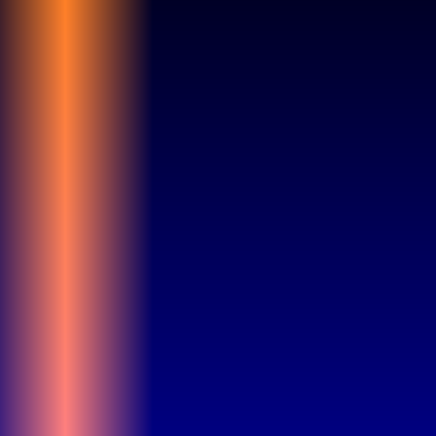
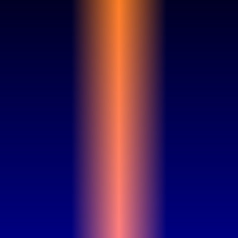
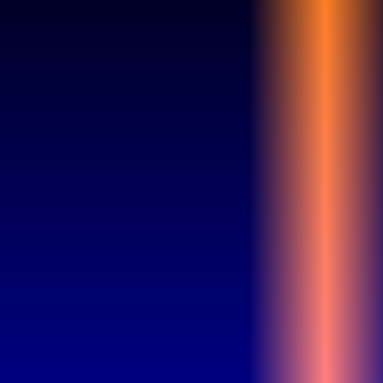

In the [Get Started](../get-started/index.md) you made your shaders in a library that knows nothing about KNI. They compiled, and you saw the result as text in the console. Here you take the step that was missing: seeing them in a KNI window.


That is what will show up in your window in a few minutes, and the `Gradient` you wrote yourself is what will draw it.

> [!IMPORTANT]
> This guide continues right where the Get Started ends. It assumes you have the `Tutorial` folder, with `MyShaders` inside, and that you already know how to run `add`. If you have not done that yet, start with [Set up your project](../get-started/setup.md).

## What you are going to do

You are going to add one more project to your folder: the game.

```text
Tutorial/
├── MyShaders/        your shaders (nothing changes)
├── TryIt/            the console program from the tutorial
└── MyGame/           new: a KNI window that uses your shaders
```

`MyShaders` is not touched. It is the same library, with the same files. The only thing that has to do with KNI lives in `MyGame`.

## 1. Create the game

From the `Tutorial` folder:

```bash
dotnet new console -n MyGame -f net8.0
```

Add KNI to it:

```bash
dotnet add MyGame package nkast.Xna.Framework.Game
```

```bash
dotnet add MyGame package nkast.Kni.Platform.SDL2.GL
```

And tell it that it is going to use your shaders:

```bash
dotnet add MyGame reference MyShaders/MyShaders.csproj
```

The first one is KNI. The second one is the part that opens the window on Windows, macOS and Linux.

> [!TIP]
> If you already have a KNI game, do not create a new one: just add the reference to `MyShaders` and continue from step 2. And notice something: you are not going to touch the Content Pipeline. The shader does not go through there.

## 2. The rectangle that covers the screen

In the tutorial you saw that a shader does not draw "the screen": it draws a shape, and to paint the whole screen we use a rectangle that covers all of it. That rectangle has four corners, and each corner carries the two pieces of data you declared in `Corner`:

```csharp
public struct Corner
{
    [location(0)] public vec2 Position;
    [location(1)] public vec2 Uv;
}
```

Now it is the game's turn to send those corners. For that, KNI asks you for a `struct` that says how each one is made. Create `MyGame/ScreenCorner.cs`:

```csharp title="MyGame/ScreenCorner.cs"
using Microsoft.Xna.Framework;
using Microsoft.Xna.Framework.Graphics;

public readonly struct ScreenCorner(Vector2 position, Vector2 uv) : IVertexType
{
    private static readonly VertexDeclaration Declaration = new(
        new VertexElement(0, VertexElementFormat.Vector2, VertexElementUsage.TextureCoordinate, 0),
        new VertexElement(8, VertexElementFormat.Vector2, VertexElementUsage.TextureCoordinate, 1));

    public readonly Vector2 Position = position;
    public readonly Vector2 Uv = uv;

    VertexDeclaration IVertexType.VertexDeclaration => Declaration;
}
```

The two fields are the same ones from `Corner`: the position and the `Uv`. What is new is the `VertexDeclaration`, which is KNI's way of explaining to the GPU what is in each corner. Each line describes one field:

```csharp
new VertexElement(0, VertexElementFormat.Vector2, VertexElementUsage.TextureCoordinate, 0),
```

- The first `0` is the byte where the field starts. `Position` comes first, so it starts at 0.
- `Vector2` is its type: two `float`.
- `TextureCoordinate` and the last `0` are the slot. **This is the important part.**

And the second line, the one for `Uv`, starts at byte `8` because the two `float` of `Position` come before it, and they take 4 bytes each.

### From `[location]` to `TextureCoordinate`

In your shader the slots have just a number: `[location(0)]`, `[location(1)]`. In KNI they have a name and a number. Yotsuba Shader translates them like this:

| In your shader | In KNI |
| --- | --- |
| `[location(0)]` | `TextureCoordinate`, number `0` |
| `[location(1)]` | `TextureCoordinate`, number `1` |
| `[location(2)]` | `TextureCoordinate`, number `2` |

That is: the name is always `TextureCoordinate`, and the number is the one from your `location`.

> [!WARNING]
> The natural thing would be to put `VertexElementUsage.Position` on the position field. Do not do it. The shader expects that data in `TextureCoordinate 0`, because that is how you declared it with `[location(0)]`. If you put `Position`, the program starts without any error, but the shader receives the data crossed and the rectangle comes out deformed or does not come out at all.

## 3. The game

Delete what `MyGame/Program.cs` comes with and leave only this, which creates the game and starts it:

```csharp title="MyGame/Program.cs"
using var game = new MyGame();
game.Run();
```

Now create `MyGame/MyGame.cs`:

```csharp title="MyGame/MyGame.cs"
using Microsoft.Xna.Framework;
using Microsoft.Xna.Framework.Graphics;
using MyShaders;
using YotsubaShader;

public class MyGame : Game
{
    private readonly GraphicsDeviceManager _graphics;
    private Effect _shader = null!;

    private readonly ScreenCorner[] _screen =
    [
        new(new Vector2(-1f,  1f), new Vector2(0f, 0f)),
        new(new Vector2( 1f,  1f), new Vector2(1f, 0f)),
        new(new Vector2(-1f, -1f), new Vector2(0f, 1f)),
        new(new Vector2( 1f, -1f), new Vector2(1f, 1f)),
    ];

    public MyGame()
    {
        _graphics = new GraphicsDeviceManager(this)
        {
            PreferredBackBufferWidth = 800,
            PreferredBackBufferHeight = 800,
        };
    }

    protected override void LoadContent()
    {
        byte[] compiled = new Gradient().ToKNIWebGL_FX();
        _shader = new Effect(GraphicsDevice, compiled);
    }

    protected override void Draw(GameTime gameTime)
    {
        GraphicsDevice.RasterizerState = RasterizerState.CullNone;

        _shader.CurrentTechnique.Passes[0].Apply();
        GraphicsDevice.DrawUserPrimitives(PrimitiveType.TriangleStrip, _screen, 0, 2);

        base.Draw(gameTime);
    }
}
```

There are three parts. Let's go one by one.

### The four corners

`_screen` is the rectangle. Each line is a corner, with its position and its `Uv`:

```csharp
new(new Vector2(-1f,  1f), new Vector2(0f, 0f)),   // top left
new(new Vector2( 1f,  1f), new Vector2(1f, 0f)),   // top right
new(new Vector2(-1f, -1f), new Vector2(0f, 1f)),   // bottom left
new(new Vector2( 1f, -1f), new Vector2(1f, 1f)),   // bottom right
```

For the GPU the screen goes from `-1` to `1`, with `(0, 0)` in the center and the `1` of Y at the top. That is why the positions are `-1` and `1`: they are the edges of the screen. The `Uv` values are the ones you saw in the tutorial: `(0, 0)` at the top left and `(1, 1)` at the bottom right.

### Loading the shader

This is the part that joins the two worlds:

```csharp
byte[] compiled = new Gradient().ToKNIWebGL_FX();
_shader = new Effect(GraphicsDevice, compiled);
```

`new Gradient()` is your shader, the class you wrote. `ToKNIWebGL_FX` is the method that `add` gave your class for KNI. It returns the compiled shader, in the format that `Effect` knows how to read.

Do not let the "WebGL" in the name confuse you. That format is the one KNI uses in the browser, and desktop KNI with OpenGL (the `SDL2.GL` package you installed) reads exactly the same one.

There is no `.fx` file, no `Content` folder, and no separate step to compile. The shader already comes inside your library.

### Drawing

```csharp
GraphicsDevice.RasterizerState = RasterizerState.CullNone;

_shader.CurrentTechnique.Passes[0].Apply();
GraphicsDevice.DrawUserPrimitives(PrimitiveType.TriangleStrip, _screen, 0, 2);
```

- `Apply()` tells the GPU: "from now on, draw with this shader".
- `DrawUserPrimitives` sends the four corners. The GPU does not know how to draw rectangles, only triangles, so the rectangle goes as two triangles stuck together. That is `TriangleStrip`, and the `2` at the end is how many triangles there are.
- `CullNone` asks the GPU not to discard any triangle. Normally it discards the ones that "face backwards", which in a 3D game are the faces you cannot see. Here there is nothing to hide.

## 4. Run it

```bash
dotnet run --project MyGame
```

A window opens with the sunset. That color was calculated by your `Fragment` method, pixel by pixel, on the GPU.

> [!WARNING]
> If `dotnet` complains that `ToMGFX`, `ToKNIWebGL_FX` or `ToFNA_FX` does not exist, you still need to run `add` on `MyShaders`. And if `add` fails, check whether you have shaders 3, 4 and 5 from the tutorial in the project (`Neon.cs`, `Plasma.cs`, `Underwater.cs`): they cannot be compiled for the GPU yet and they make `add` fail. Take them out of the `MyShaders` folder for now.

## 5. Change the shader

Changing the shader is changing one word. In `LoadContent`, where it says `Gradient`, put `Mandelbrot`:

```csharp
byte[] compiled = new Mandelbrot().ToKNIWebGL_FX();
```

Run it again:

```bash
dotnet run --project MyGame
```


The same rectangle, the same four corners, and a completely different drawing. Everything that changed is inside the shader.

## 6. A shader that moves

So far the window shows a still image. For something to move, the game has to send the shader a piece of data that changes: the time. You saw it in the tutorial in [Shader 4](../get-started/plasma.md): that piece of data is called a **uniform**.

You are going to make a stripe of light that crosses the screen from left to right:

| Second 0.3 | Second 1 | Second 1.7 |
| --- | --- | --- |
|  |  |  |

### The shader

Create `MyShaders/Sweep.cs`:

```csharp title="MyShaders/Sweep.cs"
using YotsubaShader.GlslSyntax;
using YotsubaShader.GlslSyntax.Resources;
using YotsubaShader.GlslSyntax.Types;
using YotsubaShader.Language;

namespace MyShaders;

public struct Stopwatch
{
    public float Seconds;
}

public class Sweep
{
    [uniform, layout(0, 0)]
    public Stopwatch Time;

    [ShaderStage(Stage.Vertex)]
    public Pixel Vertex(Corner corner)
    {
        Pixel pixel;
        pixel.Position = Make.Vec4(corner.Position.X, corner.Position.Y, 0f, 1f);
        pixel.Uv = corner.Uv;
        return pixel;
    }

    [ShaderStage(Stage.Fragment)]
    [return: location(0)]
    public vec4 Fragment(Pixel pixel)
    {
        float center = Time.Seconds * 0.5f;

        float distance = pixel.Uv.X - center;
        if (distance < 0f)
        {
            distance = -distance;
        }

        float brightness = 1f - distance * 5f;
        if (brightness < 0f)
        {
            brightness = 0f;
        }

        return Make.Vec4(brightness, brightness * 0.5f, 0.15f + 0.35f * pixel.Uv.Y, 1f);
    }
}
```

The `Vertex` method is the usual one. What is new:

- `Stopwatch` is a normal `struct` with the data the game is going to send.
- `[uniform, layout(0, 0)] public Stopwatch Time;` declares that data inside the shader.
- In `Fragment`, `center` is where the stripe is right now, from `0` (left edge) to `1` (right edge). `distance` is how far this pixel is from the stripe, and the `if` removes the sign. The farther away, the less `brightness`.

Compile it with `add`, just like in the tutorial:

```bash
dotnet yotsuba add MyShaders/MyShaders.csproj --target spirv
```

If you made `add` [run by itself](../get-started/cli.md), you do not need to: it runs when the game is built.

### The game sends it the time

In `MyGame/MyGame.cs` two things change: which shader is loaded, and two new lines in `Draw`. The complete file looks like this:

```csharp title="MyGame/MyGame.cs"
using Microsoft.Xna.Framework;
using Microsoft.Xna.Framework.Graphics;
using MyShaders;
using YotsubaShader;

public class MyGame : Game
{
    private readonly GraphicsDeviceManager _graphics;
    private Effect _shader = null!;

    private readonly ScreenCorner[] _screen =
    [
        new(new Vector2(-1f,  1f), new Vector2(0f, 0f)),
        new(new Vector2( 1f,  1f), new Vector2(1f, 0f)),
        new(new Vector2(-1f, -1f), new Vector2(0f, 1f)),
        new(new Vector2( 1f, -1f), new Vector2(1f, 1f)),
    ];

    public MyGame()
    {
        _graphics = new GraphicsDeviceManager(this)
        {
            PreferredBackBufferWidth = 800,
            PreferredBackBufferHeight = 800,
        };
    }

    protected override void LoadContent()
    {
        byte[] compiled = new Sweep().ToKNIWebGL_FX();
        _shader = new Effect(GraphicsDevice, compiled);
    }

    protected override void Draw(GameTime gameTime)
    {
        GraphicsDevice.RasterizerState = RasterizerState.CullNone;

        float seconds = (float)(gameTime.TotalGameTime.TotalSeconds % 2.0);
        _shader.Parameters["Time_Seconds"].SetValue(seconds);

        _shader.CurrentTechnique.Passes[0].Apply();
        GraphicsDevice.DrawUserPrimitives(PrimitiveType.TriangleStrip, _screen, 0, 2);

        base.Draw(gameTime);
    }
}
```

The two new lines:

```csharp
float seconds = (float)(gameTime.TotalGameTime.TotalSeconds % 2.0);
_shader.Parameters["Time_Seconds"].SetValue(seconds);
```

The first one gets how many seconds the game has been open. The `% 2.0` makes it go back to `0` every two seconds, so the stripe starts again from the left.

The second one hands that number to the shader. The name `"Time_Seconds"` is not made up, it comes from your code: it is the name of the field, an underscore, and the name of the data.

| In your shader | In KNI |
| --- | --- |
| `public Stopwatch Time;` with a `Seconds` value | `Parameters["Time_Seconds"]` |

You have to do it **before** `Apply()`, because `Apply()` is the moment the data travels to the GPU.

Run it:

```bash
dotnet run --project MyGame
```

The stripe crosses the screen over and over.

> [!NOTE]
> The plasma from [Shader 4](../get-started/plasma.md) is fed exactly the same way, with `Parameters["Time_Seconds"]`, because its field is also called `Time` and its value `Seconds`. You cannot see it today because it uses the `sin` function, which `add` does not translate yet.

## KNI in the browser

KNI is used a lot to make games that run in a web page. That is what `ToKNIWebGL_FX` is meant for, and the line that loads the shader is the same one from this guide:

```csharp
byte[] compiled = new Gradient().ToKNIWebGL_FX();
```

What changes is the game project, which is a KNI web project instead of a console program.

> [!NOTE]
> This guide is tested from start to finish with desktop KNI 4.3 (`nkast.Kni.Platform.SDL2.GL`). The web project uses the same compiled shader, but we did not run it here.

## What is not possible yet

> [!PLANNED]
> Reading an image from the shader (textures, as in [Shader 5](../get-started/underwater.md)) does not work in the compiler yet, so this guide does not cover it. When it works, how to pass a KNI `Texture2D` to the shader will be added here.

## Summary

Of everything you did, the only thing specific to KNI is this:

| | |
| --- | --- |
| The packages | `nkast.Xna.Framework.Game` and `nkast.Kni.Platform.SDL2.GL` |
| The method | `ToKNIWebGL_FX()` |

The rest is the same in MonoGame, KNI and FNA, because the three share the same way of programming:

- The corners are declared with `TextureCoordinate` and the number from your `[location]`.
- The shader is loaded with `new Effect(GraphicsDevice, bytes)`.
- The data of a uniform is sent with `Parameters["Field_Value"].SetValue(...)`, before `Apply()`.

And your `MyShaders` library did not change at all to work here.
