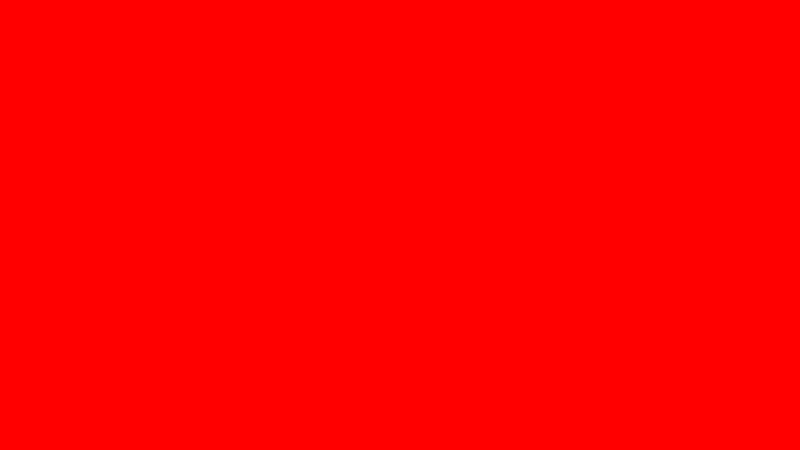
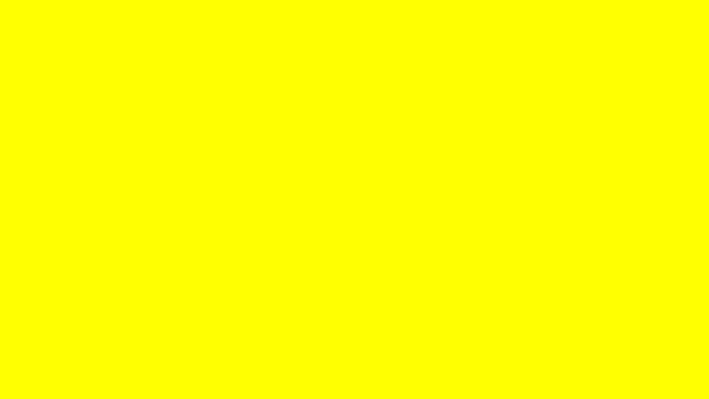

Everything a pixel shader does ends in a single thing: **returning a color**. A shadow, a fire, water, a fractal. In the end, the shader says "this pixel goes this color", and the GPU paints it.

That is why we start here. If you understand well what a color is for the GPU, the rest of the tutorial becomes much easier.

## Step 1: your first color shader

Create this chapter's shader from the template:

1. Copy `MyShaders/Template.cs` and call the copy `Colors.cs`.
2. Inside, change `public class Template` to `public class Colors`.

And run the work cycle (the same one from the previous chapter, with the new name at the end):

{{register Colors}}

The window comes out black. That is what the only line of `Fragment` says:

```csharp
return Make.Vec4(0f, 0f, 0f, 1f);
```

Those four numbers are the color. Each one has a job:

| Position | Name | What it controls |
|---|---|---|
| 1st | Red | How much red light there is |
| 2nd | Green | How much green light there is |
| 3rd | Blue | How much blue light there is |
| 4th | Alpha | How opaque the color is |

The first three are called **RGB** (*red, green, blue*), and each one is called a **channel**. Your screen is made of tiny pixels, and each one has three lights: a red one, a green one and a blue one. The shader decides how brightly each one shines.

## Step 2: turn on a light

Change the color to this:

```csharp
return Make.Vec4(1f, 0f, 0f, 1f);
```

Run the work cycle.



Red at the maximum (`1`), green and blue off (`0`). It is pure red.

Now do it yourself: try `(0f, 1f, 0f, 1f)` and then `(0f, 0f, 1f, 1f)`. Every time you change the line, run the work cycle again. You should see pure green and pure blue.

> [!NOTE]
> You may wonder why `vec4` has fields called `X`, `Y`, `Z` and `W` instead of `R`, `G`, `B` and `A`. It is because a `vec4` is just "four numbers together": sometimes they are a position, sometimes a color. You decide what they mean. For a color, the order is always the same: `X` is red, `Y` is green, `Z` is blue and `W` is alpha.

## Step 3: mix lights

Now turn on two lights at once:

```csharp
return Make.Vec4(1f, 1f, 0f, 1f);
```



Red plus green gives **yellow**. If you ever mixed paints, this surprises you: red and green paint make brown. But here you are not mixing paint, you are mixing **light**, and light adds up. That is why with all three on you get white, and with all three off, black.

Try these recipes, one by one:

| Color | Write it like this |
|---|---|
| Black | `Make.Vec4(0f, 0f, 0f, 1f)` |
| White | `Make.Vec4(1f, 1f, 1f, 1f)` |
| Yellow | `Make.Vec4(1f, 1f, 0f, 1f)` |
| Cyan | `Make.Vec4(0f, 1f, 1f, 1f)` |
| Magenta | `Make.Vec4(1f, 0f, 1f, 1f)` |
| Orange | `Make.Vec4(1f, 0.5f, 0f, 1f)` |

There is a trick with grays. When the three lights have the same value, the color leans toward neither red, green nor blue: you get gray. The higher the number, the lighter it is. Try it:

```csharp
return Make.Vec4(0.5f, 0.5f, 0.5f, 1f);
```


That is a medium gray. With `0.2f` in all three you get almost black, and with `0.9f`, almost white.

## Why from 0 to 1 and not from 0 to 255?

If you have used colors in other programs, you may have expected numbers from `0` to `255`, or a code like `#FF8000`. In a shader the numbers go from `0` to `1`.

The conversion is simple: divide by 255. If you want the orange `#FF8000`, which in decimal is `255, 128, 0`:

```csharp
float red = 255f / 255f;  // 1
float green = 128f / 255f; // 0.5 (roughly)
float blue = 0f / 255f;    // 0
```

And that is why the orange in the table is `(1, 0.5, 0)`: `128` is almost half of `255`.

And why from `0` to `1`? Because that way the math works out by itself. Multiplying a color by `0.5` leaves it at half brightness; multiplying it by `0` turns it off; multiplying it by `1` does not change it.

## Step 4: what happens if I go over?

Now that you know the limit is `1`, let us do something forbidden. Write an impossible color:

```csharp
return Make.Vec4(2f, 0.5f, -3f, 1f);
```

Red at `2` (double the maximum) and blue at `-3` (less than nothing). Run the work cycle.


You get the same orange as before, `(1, 0.5, 0)`. There is no error or anything strange: the GPU **clips** the values. What goes above `1` stays at `1`, and what goes below `0` stays at `0`.

This matters for two reasons:

- You can do math that goes a little over without anything breaking.
- But it can also hide mistakes: if something comes out completely white or completely black, maybe your math went out of range and the GPU clipped it. We will remember this in the chapter on [when something goes wrong](debugging.md).

## The fourth number: alpha

One number is left to explain. Alpha says **how opaque** the color is: `1` is completely opaque and `0` is completely transparent. It is used for things like glass, smoke or a sprite with soft edges.

But for alpha to have any effect, the program that draws has to be prepared to blend that color with what was behind it. The shader does not decide that. For now, always leave it at `1f`, which is the safe value.

## A challenge

Before moving on, do it yourself without looking at the table. Change the color until you get:

1. A **dark green** (like a forest).
2. A **pink** (hint: it is a strong red with some green and some blue).
3. Your favorite color.

There is no right answer. What matters is that you see how changing a number shows up instantly.

## What you learned

- A color is a `vec4`: red, green, blue and alpha, in that order.
- The numbers go from `0` to `1`. To convert from `0`-`255`, divide by `255`.
- Lights **add**: red + green = yellow, and all three together give white.
- If you go over `1` or below `0`, the GPU clips to the limit.
- So far every pixel has the same color. The exciting thing is for each pixel to have a different one, and for that you need to know **where** each pixel is.

Next: [The coordinates](coordinates.md).
