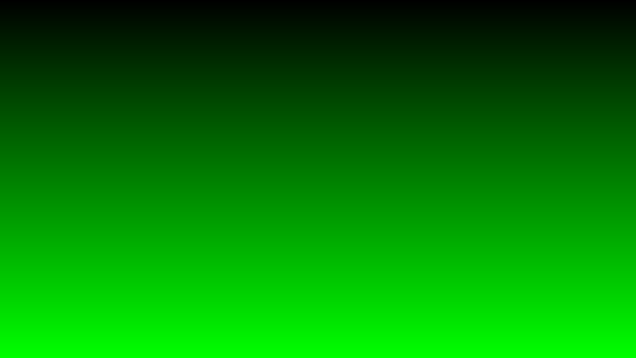
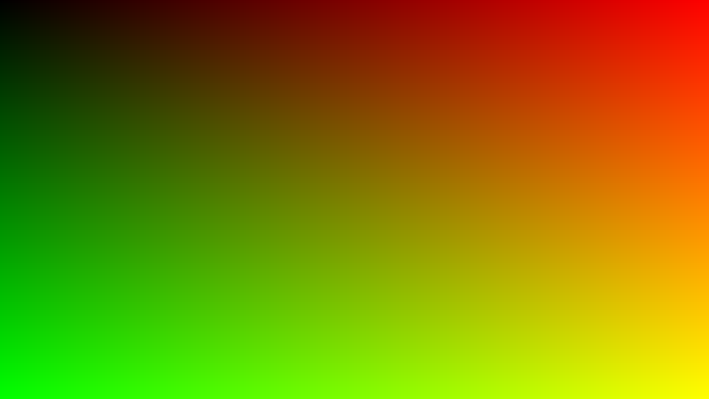
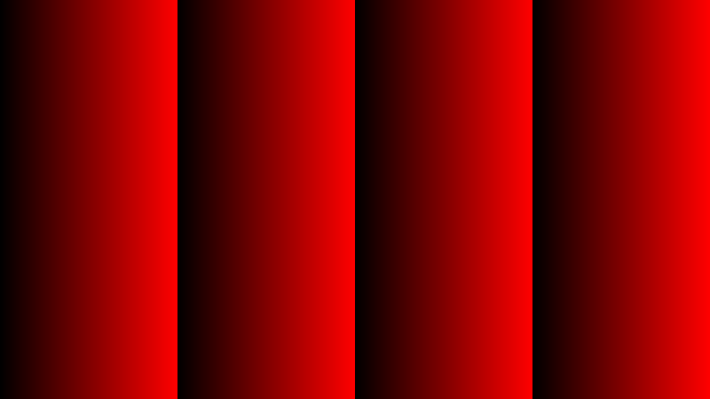
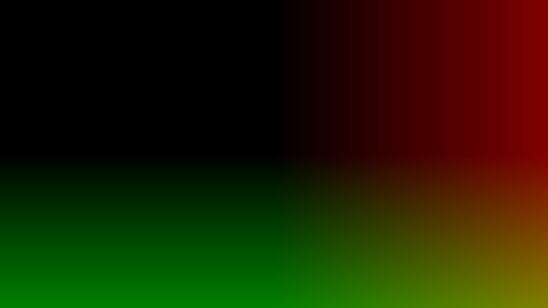
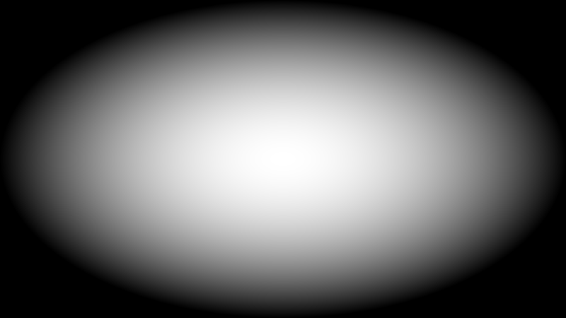
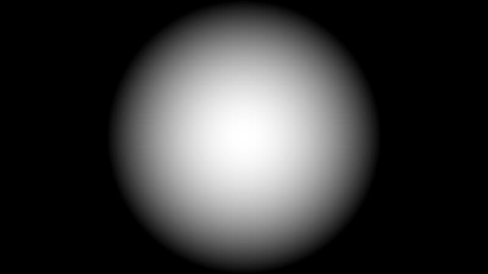

In the previous chapter every pixel had the same color. Now you are going to achieve something much more interesting: each pixel getting its own.

For that, the shader needs an answer to one question: **where is this pixel?** That answer is the `Uv`, and you have been seeing it since the first shader without us stopping to look at it closely. Today we do.

## Step 1: the Uv turned into color

Copy `Template.cs` as `Coordinates.cs` and change the class name to `Coordinates`. Then replace the line in `Fragment` with this one:

```csharp
return Make.Vec4(pixel.Uv.X, 0f, 0f, 1f);
```

Here we are using the pixel's position as if it were the amount of red. Run the work cycle:

{{register Coordinates}}


Black on the left and red on the right. What you are seeing is the value of `Uv.X` drawn as brightness: at the left edge it is `0` (no red) and at the right edge it is `1` (full red).

This is the best tool for understanding a shader: **turning a number into color so you can see it**. You will use it many times.

## Step 2: the other coordinate

Now change the line to show `Uv.Y` in the green channel:

```csharp
return Make.Vec4(0f, pixel.Uv.Y, 0f, 1f);
```



Look closely: green grows **downward**. At the top `Uv.Y` is `0` and at the bottom it is `1`.

This surprises almost everyone, because in math and in function plots the Y axis grows upward. But screens are numbered from the top-left corner, the way text is read: left to right and top to bottom. That is how we defined it in the viewer's rectangle, and in many engines it is the same.

> [!TIP]
> If some day you see a drawing **upside down** (the sky at the bottom, for example), the first thing to check is whether your Y grows upward or downward.

Now put both coordinates together, one in each channel:

```csharp
return Make.Vec4(pixel.Uv.X, pixel.Uv.Y, 0f, 1f);
```



This image is a coordinate map. Each corner tells you its position:

| Corner | `Uv` | Color you get |
|---|---|---|
| Top left | `(0, 0)` | Black |
| Top right | `(1, 0)` | Red |
| Bottom left | `(0, 1)` | Green |
| Bottom right | `(1, 1)` | Yellow |

If you ever doubt what is happening with the positions in a shader, paint `Uv.X` and `Uv.Y` as colors and you will know at once.

## Step 3: repeating the pattern

So far `Uv.X` goes from `0` to `1` only once. What if we want the gradient to repeat several times? Multiply first:

```csharp
float x = (pixel.Uv.X * 4f) % 1f;
return Make.Vec4(x, 0f, 0f, 1f);
```

There are two new things in that line:

- `pixel.Uv.X * 4f` makes the number go from `0` to `4` instead of `0` to `1`.
- `% 1f` is the **remainder of the division** by 1. That is, it keeps only the decimal part: `0.3` gives `0.3`, but `1.3` gives `0.3` and `3.7` gives `0.7`.

Together, they make the number rise from `0` to `1`, go back to `0`, rise again, and so on four times.



Change the `4f` to `10f` and you will see ten stripes. Change the `1f` of the remainder to `0.5f` and see how the stripes change. Playing with these numbers is the best way to make them stick.

## Step 4: putting the origin in the center

The `Uv` starts at the top-left corner. But to draw a circle in the middle, or anything centered, we need the point `(0, 0)` to be **at the center** of the screen. For that we subtract `0.5`:

```csharp
float dx = pixel.Uv.X - 0.5f;
float dy = pixel.Uv.Y - 0.5f;
return Make.Vec4(dx, dy, 0f, 1f);
```

`dx` and `dy` are "how far I am from the center" in each direction. They no longer go from `0` to `1`, but from `-0.5` to `0.5`.



Look at the result carefully. The left half has no red and the top half has no green. Why? Because there `dx` and `dy` are **less than zero**, and as you saw in the colors chapter, the GPU clips negatives to `0`. In other words: what you see is the color half-cut at the center. The center itself, where `dx` and `dy` are `0`, is the darkest point.

## Step 5: the distance to the center

With `dx` and `dy` we can tell how far each pixel is from the center. The calculation is `dx * dx + dy * dy`: each number multiplied by itself, and the two results added. At the center it gives `0`, and the further away you go, the bigger it gets.

Careful: that result is not the exact distance. It is the distance multiplied by itself (in math it is called "the squared distance"). To tell who is further away it works just as well, and it saves us a harder calculation. Let us use it to paint a spot of light:

```csharp
float dx = pixel.Uv.X - 0.5f;
float dy = pixel.Uv.Y - 0.5f;
float light = 1f - (dx * dx + dy * dy) * 4f;
return Make.Vec4(light, light, light, 1f);
```

Let us read the third line from the inside out:

1. `dx * dx + dy * dy` is the number from before: `0` at the center and bigger and bigger toward the outside.
2. `* 4f` makes it grow faster, so the effect reaches the edges.
3. `1f - ...` flips it: now it is `1` at the center (white) and falls toward the edges (black).



It works, but something is wrong. We asked for a **round** spot, and an **oval** came out. What happened?

## The oval problem

The `Uv` always goes from `0` to `1`, both horizontally and vertically, no matter the shape of the window. Our window is 800 by 450 pixels: it is wider than tall. So `0.1` of width is 80 pixels, but `0.1` of height is only 45. The distances we compute **are not equal in both directions**, and the circle stretches.

This is one of the problems beginners ask about most: *"why is my circle oval?"* The solution is to correct that difference. If the window is 1.78 times wider than tall, we have to multiply `dx` by 1.78 so that it "measures the same" as `dy`.

But for that the shader has to **know the width and height of the window**, and it cannot guess that from inside. The program that draws it knows, and it has to pass it along.

## Step 6: data handed over by the program

A piece of data that the program passes to the shader is called a **uniform**. It is called that because it is *uniform*: it has the same value for all the pixels of the image. The width of the window is a good example, because it does not change from one pixel to another.

Declaring one takes three steps. Do them in order.

**First**, create a file `MyShaders/Context.cs` that describes the data package:

```csharp title="MyShaders/Context.cs"
namespace MyShaders;

public struct Context
{
    public float Width;
    public float Height;
}
```

It is a `struct` with two numbers. Later we will add a third.

**Second**, in `Coordinates.cs`, add this line at the very top with the other `using` lines:

```csharp style=glsl
using YotsubaShader.GlslSyntax.Resources;
```

```csharp style=hlsl
using YotsubaShader.HlslSyntax.Resources;
```

```csharp style=msl
using YotsubaShader.MslSyntax.Resources;
```

```csharp style=wgsl
using YotsubaShader.WgslSyntax.Resources;
```

```csharp style=spirv
using YotsubaShader.SpirvSyntax.Resources;
```

**Third**, inside the `Coordinates` class, right before `Vertex`, declare the data:

```csharp style=glsl
    [uniform, layout(0, 0)]
    public Context Data;
```

```csharp style=hlsl
    [cbuffer, register("b0")]
    public Context Data;
```

```csharp style=msl
    [constant, buffer(0)]
    public Context Data;
```

```csharp style=wgsl
    [uniform, @group(0), @binding(0)]
    public Context Data;
```

```csharp style=spirv
    [Uniform, DescriptorSet(0), Binding(0)]
    public Context Data;
```

This line has three parts:

- `[uniform]` tells the compiler: "this is not an ordinary variable, it is data that reaches me from outside".
- `[layout(0, 0)]` is its **address** inside the GPU. For now write it exactly like this; when you have more than one piece of data, each one will get a different address.
- `public Context Data;` is the data itself. It is called `Data` and its type is the struct we just created.

And now, inside `Fragment`, you can use it like any other value: `Data.Width` and `Data.Height`.

> [!NOTE]
> How does the window find out that it has to deliver `Width` and `Height`? It is the viewer that does it, by name: it looks for a piece of data called `Data_Width` (the uniform's name, an underscore and the field's name). If your shader uses other names, the viewer does not know them. That is why, in this tutorial, keep the names `Data`, `Width`, `Height` and `Seconds`.

## Step 7: fixing the circle

Now use the width and height to correct `dx`. Replace the contents of `Fragment` with this:

```csharp
float aspect = Data.Width / Data.Height;
float dx = (pixel.Uv.X - 0.5f) * aspect;
float dy = pixel.Uv.Y - 0.5f;
float light = 1f - (dx * dx + dy * dy) * 4f;
return Make.Vec4(light, light, light, 1f);
```

The new line is the first one: `aspect` is the width divided by the height, that is, how many times wider than tall the window is. With 800 and 450 it is 1.78. In the second line we apply it to `dx`.

Run the work cycle.



Now it is a circle. Try one more thing: stretch the window with the mouse (or change the `800` and the `450` in `Viewer/Program.cs`). The circle stays round, because the shader recomputes the aspect with every new size.

> [!NOTE]
> There is another way to solve this, which is to divide by the height instead of the width, and leave the X axis without a fixed limit. The one we use here is the easiest to explain. In other shaders you will see both.

## All together

This is the complete file, in case you want to compare it with yours:

```csharp style=glsl title="MyShaders/Coordinates.cs"
using YotsubaShader.GlslSyntax;
using YotsubaShader.GlslSyntax.Resources;
using YotsubaShader.GlslSyntax.Types;
using YotsubaShader.Language;

namespace MyShaders;

public class Coordinates
{
    [uniform, layout(0, 0)]
    public Context Data;

    [ShaderStage(Stage.Vertex)]
    public Pixel Vertex({{vertexType}} corner)
    {
        Pixel pixel;
        pixel.Position = Make.Vec4(corner.{{pos}}.X, corner.{{pos}}.Y, 0f, 1f);
        pixel.Uv = corner.{{uv}};
        return pixel;
    }

    [ShaderStage(Stage.Fragment)]
    [return: location(0)]
    public vec4 Fragment(PixelIn pixel)
    {
        float aspect = Data.Width / Data.Height;
        float dx = (pixel.Uv.X - 0.5f) * aspect;
        float dy = pixel.Uv.Y - 0.5f;
        float light = 1f - (dx * dx + dy * dy) * 4f;
        return Make.Vec4(light, light, light, 1f);
    }
}
```

```csharp style=hlsl title="MyShaders/Coordinates.cs"
using YotsubaShader.HlslSyntax;
using YotsubaShader.HlslSyntax.Resources;
using YotsubaShader.GlslSyntax.Types;
using YotsubaShader.Language;

namespace MyShaders;

public class Coordinates
{
    [cbuffer, register("b0")]
    public Context Data;

    [ShaderStage(Stage.Vertex)]
    public Pixel Vertex({{vertexType}} corner)
    {
        Pixel pixel;
        pixel.Position = Make.Vec4(corner.{{pos}}.X, corner.{{pos}}.Y, 0f, 1f);
        pixel.Uv = corner.{{uv}};
        return pixel;
    }

    [ShaderStage(Stage.Fragment)]
    [return: SV_Target]
    public vec4 Fragment(PixelIn pixel)
    {
        float aspect = Data.Width / Data.Height;
        float dx = (pixel.Uv.X - 0.5f) * aspect;
        float dy = pixel.Uv.Y - 0.5f;
        float light = 1f - (dx * dx + dy * dy) * 4f;
        return Make.Vec4(light, light, light, 1f);
    }
}
```

```csharp style=msl title="MyShaders/Coordinates.cs"
using YotsubaShader.MslSyntax;
using YotsubaShader.MslSyntax.Resources;
using YotsubaShader.GlslSyntax.Types;
using YotsubaShader.Language;

namespace MyShaders;

public class Coordinates
{
    [constant, buffer(0)]
    public Context Data;

    [ShaderStage(Stage.Vertex)]
    public Pixel Vertex({{vertexType}} corner)
    {
        Pixel pixel;
        pixel.Position = Make.Vec4(corner.{{pos}}.X, corner.{{pos}}.Y, 0f, 1f);
        pixel.Uv = corner.{{uv}};
        return pixel;
    }

    [ShaderStage(Stage.Fragment)]
    [return: color(0)]
    public vec4 Fragment(PixelIn pixel)
    {
        float aspect = Data.Width / Data.Height;
        float dx = (pixel.Uv.X - 0.5f) * aspect;
        float dy = pixel.Uv.Y - 0.5f;
        float light = 1f - (dx * dx + dy * dy) * 4f;
        return Make.Vec4(light, light, light, 1f);
    }
}
```

```csharp style=wgsl title="MyShaders/Coordinates.cs"
using YotsubaShader.WgslSyntax;
using YotsubaShader.WgslSyntax.Resources;
using YotsubaShader.GlslSyntax.Types;
using YotsubaShader.Language;

namespace MyShaders;

public class Coordinates
{
    [uniform, @group(0), @binding(0)]
    public Context Data;

    [ShaderStage(Stage.Vertex)]
    public Pixel Vertex({{vertexType}} corner)
    {
        Pixel pixel;
        pixel.Position = Make.Vec4(corner.{{pos}}.X, corner.{{pos}}.Y, 0f, 1f);
        pixel.Uv = corner.{{uv}};
        return pixel;
    }

    [ShaderStage(Stage.Fragment)]
    [return: location(0)]
    public vec4 Fragment(PixelIn pixel)
    {
        float aspect = Data.Width / Data.Height;
        float dx = (pixel.Uv.X - 0.5f) * aspect;
        float dy = pixel.Uv.Y - 0.5f;
        float light = 1f - (dx * dx + dy * dy) * 4f;
        return Make.Vec4(light, light, light, 1f);
    }
}
```

```csharp style=spirv title="MyShaders/Coordinates.cs"
using YotsubaShader.SpirvSyntax;
using YotsubaShader.SpirvSyntax.Resources;
using YotsubaShader.GlslSyntax.Types;
using YotsubaShader.Language;

namespace MyShaders;

public class Coordinates
{
    [Uniform, DescriptorSet(0), Binding(0)]
    public Context Data;

    [ShaderStage(Stage.Vertex)]
    public Pixel Vertex({{vertexType}} corner)
    {
        Pixel pixel;
        pixel.Position = Make.Vec4(corner.{{pos}}.X, corner.{{pos}}.Y, 0f, 1f);
        pixel.Uv = corner.{{uv}};
        return pixel;
    }

    [ShaderStage(Stage.Fragment)]
    [return: Location(0)]
    public vec4 Fragment(PixelIn pixel)
    {
        float aspect = Data.Width / Data.Height;
        float dx = (pixel.Uv.X - 0.5f) * aspect;
        float dy = pixel.Uv.Y - 0.5f;
        float light = 1f - (dx * dx + dy * dy) * 4f;
        return Make.Vec4(light, light, light, 1f);
    }
}
```

## What you learned

- `pixel.Uv` is the pixel's position: `X` from `0` to `1` to the right, `Y` from `0` to `1` **downward**.
- To see a number, paint it as a color. It is the fastest way to understand what a shader does.
- `%` repeats a pattern. Subtracting `0.5` moves the origin to the center.
- To tell how far a pixel is from the center, use `dx * dx + dy * dy`.
- An oval circle is fixed by taking into account that the window is wider than tall, and for that the shader needs a **uniform**: a piece of data handed over by the program.

Next: [Deciding with if](decisions.md).
