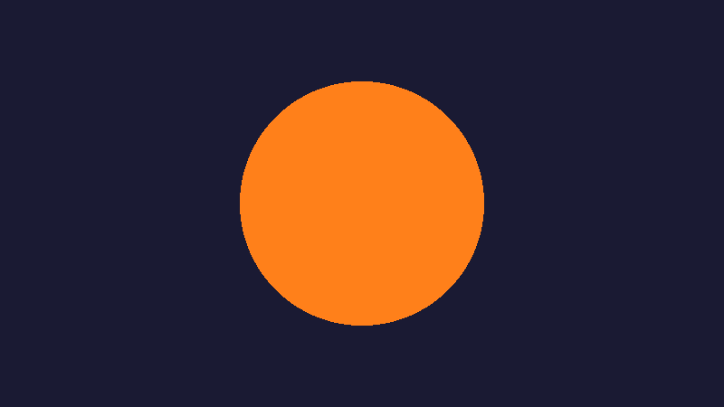
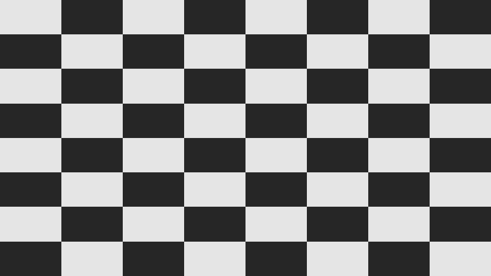

Until now the shader computed a color with a calculation. But sometimes you do not want a calculation: you want to **choose**. "If the pixel is on the left, paint it orange; if not, blue". That is done with `if`.

With `if` you will be able to draw shapes: rectangles, circles, boards. Everything that has a hard edge.

## An idea worth having clear

Before writing code, one thing about how the GPU works, because it will save you confusion: **each pixel runs your `Fragment` on its own**. It is as if you had 360,000 people with the same sheet of instructions, each one painting their little square, without talking to each other.

That means that inside the `if`, "I" is always a single pixel. The pixel on the left can decide "orange" and the one on the right "blue", and neither knows what the other decided. You cannot ask "what color is your neighbor?". You have to decide only with what you know about yourself: your position, the time, the data you were given.

## Step 1: splitting the screen in two

Copy `Template.cs` as `Decisions.cs`, change the class name to `Decisions` and replace the line in `Fragment` with this:

```csharp
if (pixel.Uv.X < 0.5f)
{
    return Make.Vec4(1f, 0.4f, 0.1f, 1f);
}
return Make.Vec4(0.1f, 0.2f, 0.5f, 1f);
```

Run the work cycle:

But first, tell the viewer about the new shader. In `Viewer/Program.cs`, add this line to the `switch`, above the `_ =>` line:

```csharp
            "Decisions" => new Decisions().ToMGFX(gl),
```

Now run it:

```bash
dotnet yotsuba add MyShaders/MyShaders.csproj --target spirv && dotnet run --project Viewer -- Decisions
```


Read it like a sentence: *"if the X position is less than 0.5, return orange. If not, return blue"*.

- Between parentheses goes the **condition**, something that can be true or false. Here, `pixel.Uv.X < 0.5f` is true for the pixels in the left half.
- Between braces goes what is done **if it is true**. Since there is a `return`, the shader ends there for that pixel.
- If the condition is false, the shader skips the braces and continues with what comes next: the second `return`.

Move the `0.5f` to `0.2f` and run again. The line that divides the two colors moves to the left.

## Step 2: more than two options with else if

What if we want three stripes? Replace the contents of `Fragment` with this:

```csharp
float x = pixel.Uv.X;
if (x < 0.333f)
{
    return Make.Vec4(0.1f, 0.3f, 0.8f, 1f);
}
else if (x < 0.666f)
{
    return Make.Vec4(1f, 1f, 1f, 1f);
}
else
{
    return Make.Vec4(0.9f, 0.2f, 0.2f, 1f);
}
```


We have added two things:

- `else if (...)` means "if the previous one was not met, try this other condition".
- `else` without a condition means "if none of the previous ones was met, do this".

Order matters. C# tests the conditions **from top to bottom and keeps the first one that is true**. A pixel with `x = 0.2` meets the first one and does not even look at the others. One with `x = 0.5` does not meet the first, but does meet the second. And one with `x = 0.9` meets none, so it falls into the `else`.

Notice also that there is now a `float x` at the start. Saving `pixel.Uv.X` in a variable with a short name makes the conditions easier to read.

## The comparison operators

These are the ones you can use inside the condition:

| Operator | Means | Example |
|---|---|---|
| `<` | less than | `x < 0.5f` |
| `>` | greater than | `x > 0.5f` |
| `<=` | less than or equal to | `x <= 0.5f` |
| `>=` | greater than or equal to | `x >= 0.5f` |
| `==` | equal to | `counter == 3` |
| `!=` | different from | `counter != 3` |

> [!WARNING]
> A single `=` **assigns** (`x = 5f` stores a 5 in `x`). To **compare** you have to write two: `x == 5f`. It is a very common mistake when starting. Luckily, C# warns you with an error if you get it wrong inside an `if`.
>
> And one more warning: with `float` numbers, almost never use `==`. A `float` that "should" be `0.5` can be `0.5000001` after several calculations, and the comparison fails. With whole numbers (`int`) there is no problem.

## Step 3: combining conditions

To draw a rectangle, a pixel has to meet four things at once: be to the right of the left edge, to the left of the right one, below the top one and above the bottom one. They are combined with `&&`, which means **"and"**:

```csharp
float x = pixel.Uv.X;
float y = pixel.Uv.Y;
if (x > 0.25f && x < 0.75f && y > 0.25f && y < 0.75f)
{
    return Make.Vec4(1f, 0.5f, 0.1f, 1f);
}
return Make.Vec4(0.1f, 0.1f, 0.2f, 1f);
```


There are three ways of combining conditions:

| Operator | Read as | It is true when |
|---|---|---|
| `&&` | and | both conditions are true |
| `\|\|` | or | at least one is true |
| `!` | not | the condition is false |

For example, `x < 0.1f || x > 0.9f` is true at the left and right edges, and false in the middle.

Try this: change the four numbers so the rectangle is taller than wide, and then one that touches the edge of the window.

## Step 4: a circle

A pixel is inside a circle if it is **closer to the center than the edge is**. That is, if its distance to the center is less than the radius. You already know how to write that: the calculation `dx * dx + dy * dy` from the previous chapter tells you how far away you are. And since that calculation gives the distance multiplied by itself, you have to compare it with the radius multiplied by itself.

Since the circle needs the window's aspect, you have to declare the uniform again, just like before. Add at the top the `using`:

```csharp style=glsl
using YotsubaShader.GlslSyntax.Resources;
```

```csharp style=hlsl
using YotsubaShader.HlslSyntax.Resources;
```

```csharp style=msl
using YotsubaShader.MslSyntax.Resources;
```

```csharp style=wgsl
using YotsubaShader.WgslSyntax.Resources;
```

```csharp style=spirv
using YotsubaShader.SpirvSyntax.Resources;
```

And inside the class, before `Vertex`:

```csharp style=glsl
    [uniform, layout(0, 0)]
    public Context Data;
```

```csharp style=hlsl
    [cbuffer, register("b0")]
    public Context Data;
```

```csharp style=msl
    [constant, buffer(0)]
    public Context Data;
```

```csharp style=wgsl
    [uniform, @group(0), @binding(0)]
    public Context Data;
```

```csharp style=spirv
    [Uniform, DescriptorSet(0), Binding(0)]
    public Context Data;
```

Now replace `Fragment` with this:

```csharp
float aspect = Data.Width / Data.Height;
float dx = (pixel.Uv.X - 0.5f) * aspect;
float dy = pixel.Uv.Y - 0.5f;
if (dx * dx + dy * dy < 0.3f * 0.3f)
{
    return Make.Vec4(1f, 0.5f, 0.1f, 1f);
}
return Make.Vec4(0.1f, 0.1f, 0.2f, 1f);
```



The condition `dx * dx + dy * dy < 0.3f * 0.3f` says: "I am closer to the center than the edge is". `0.3f * 0.3f` is the radius `0.3` multiplied by itself; we leave it written like that so you can see where it comes from.

Change the `0.3f` (in both factors) to `0.1f` and the circle gets small. Change the `0.5f` in `dx` to `0.3f` and the circle moves to the left.

## Step 5: a chessboard

A very common trick to decide "this square is light, this one is dark" is to count which square you are in and check whether that number is even or odd. Replace `Fragment` with this:

```csharp
int column = (int)(pixel.Uv.X * 8f);
int row = (int)(pixel.Uv.Y * 8f);
if ((column + row) % 2 == 0)
{
    return Make.Vec4(0.9f, 0.9f, 0.9f, 1f);
}
return Make.Vec4(0.15f, 0.15f, 0.15f, 1f);
```



Let us go part by part:

1. `pixel.Uv.X * 8f` goes from `0` to `8`, and `(int)(...)` **cuts off the decimals**: `3.7` becomes `3`. So `column` is `0, 1, 2, ..., 7`: the number of the column where the pixel is. The same with `row`.
2. `(column + row) % 2` is the remainder of dividing by 2: it gives `0` if the sum is even and `1` if it is odd.
3. If you move to the square next door, the sum changes by `1`: if it was even, now it is odd. That is why the squares alternate.

Change both `8f` to `4f` and to `20f`. With different numbers in each, you will get rectangular squares.

## A shortcut: the ? operator

When you only want to choose **one value** between two, there is a shorter way than `if`:

```csharp
float brightness = pixel.Uv.X < 0.5f ? 1f : 0f;
```

It reads: *"if the condition is true, it is the first one; if not, the second"*. It is the same as:

```csharp
float brightness;
if (pixel.Uv.X < 0.5f)
{
    brightness = 1f;
}
else
{
    brightness = 0f;
}
```

Use `?` when the decision is short, and `if` when there are several lines inside.

## The flaw of shapes made with if

Look closely at the edge of the circle or the rectangle. It is a clean cut: a pixel is inside or outside, with nothing in between. On screen that looks like a slightly jagged edge.

With `if` there is no other way, because an `if` is all or nothing. To get soft edges you need different tools, which you will build two chapters later.

## All together

This is the complete circle file, in case you want to compare it with yours:

```csharp style=glsl title="MyShaders/Decisions.cs"
using YotsubaShader.GlslSyntax;
using YotsubaShader.GlslSyntax.Resources;
using YotsubaShader.GlslSyntax.Types;
using YotsubaShader.Language;

namespace MyShaders;

public class Decisions
{
    [uniform, layout(0, 0)]
    public Context Data;

    [ShaderStage(Stage.Vertex)]
    public Pixel Vertex(Corner corner)
    {
        Pixel pixel;
        pixel.Position = Make.Vec4(corner.Position.X, corner.Position.Y, 0f, 1f);
        pixel.Uv = corner.Uv;
        return pixel;
    }

    [ShaderStage(Stage.Fragment)]
    [return: location(0)]
    public vec4 Fragment(PixelIn pixel)
    {
        float aspect = Data.Width / Data.Height;
        float dx = (pixel.Uv.X - 0.5f) * aspect;
        float dy = pixel.Uv.Y - 0.5f;
        if (dx * dx + dy * dy < 0.3f * 0.3f)
        {
            return Make.Vec4(1f, 0.5f, 0.1f, 1f);
        }
        return Make.Vec4(0.1f, 0.1f, 0.2f, 1f);
    }
}
```

```csharp style=hlsl title="MyShaders/Decisions.cs"
using YotsubaShader.HlslSyntax;
using YotsubaShader.HlslSyntax.Resources;
using YotsubaShader.GlslSyntax.Types;
using YotsubaShader.Language;

namespace MyShaders;

public class Decisions
{
    [cbuffer, register("b0")]
    public Context Data;

    [ShaderStage(Stage.Vertex)]
    public Pixel Vertex(Corner corner)
    {
        Pixel pixel;
        pixel.Position = Make.Vec4(corner.Position.X, corner.Position.Y, 0f, 1f);
        pixel.Uv = corner.Uv;
        return pixel;
    }

    [ShaderStage(Stage.Fragment)]
    [return: SV_Target]
    public vec4 Fragment(PixelIn pixel)
    {
        float aspect = Data.Width / Data.Height;
        float dx = (pixel.Uv.X - 0.5f) * aspect;
        float dy = pixel.Uv.Y - 0.5f;
        if (dx * dx + dy * dy < 0.3f * 0.3f)
        {
            return Make.Vec4(1f, 0.5f, 0.1f, 1f);
        }
        return Make.Vec4(0.1f, 0.1f, 0.2f, 1f);
    }
}
```

```csharp style=msl title="MyShaders/Decisions.cs"
using YotsubaShader.MslSyntax;
using YotsubaShader.MslSyntax.Resources;
using YotsubaShader.GlslSyntax.Types;
using YotsubaShader.Language;

namespace MyShaders;

public class Decisions
{
    [constant, buffer(0)]
    public Context Data;

    [ShaderStage(Stage.Vertex)]
    public Pixel Vertex(Corner corner)
    {
        Pixel pixel;
        pixel.Position = Make.Vec4(corner.Position.X, corner.Position.Y, 0f, 1f);
        pixel.Uv = corner.Uv;
        return pixel;
    }

    [ShaderStage(Stage.Fragment)]
    [return: color(0)]
    public vec4 Fragment(PixelIn pixel)
    {
        float aspect = Data.Width / Data.Height;
        float dx = (pixel.Uv.X - 0.5f) * aspect;
        float dy = pixel.Uv.Y - 0.5f;
        if (dx * dx + dy * dy < 0.3f * 0.3f)
        {
            return Make.Vec4(1f, 0.5f, 0.1f, 1f);
        }
        return Make.Vec4(0.1f, 0.1f, 0.2f, 1f);
    }
}
```

```csharp style=wgsl title="MyShaders/Decisions.cs"
using YotsubaShader.WgslSyntax;
using YotsubaShader.WgslSyntax.Resources;
using YotsubaShader.GlslSyntax.Types;
using YotsubaShader.Language;

namespace MyShaders;

public class Decisions
{
    [uniform, @group(0), @binding(0)]
    public Context Data;

    [ShaderStage(Stage.Vertex)]
    public Pixel Vertex(Corner corner)
    {
        Pixel pixel;
        pixel.Position = Make.Vec4(corner.Position.X, corner.Position.Y, 0f, 1f);
        pixel.Uv = corner.Uv;
        return pixel;
    }

    [ShaderStage(Stage.Fragment)]
    [return: location(0)]
    public vec4 Fragment(PixelIn pixel)
    {
        float aspect = Data.Width / Data.Height;
        float dx = (pixel.Uv.X - 0.5f) * aspect;
        float dy = pixel.Uv.Y - 0.5f;
        if (dx * dx + dy * dy < 0.3f * 0.3f)
        {
            return Make.Vec4(1f, 0.5f, 0.1f, 1f);
        }
        return Make.Vec4(0.1f, 0.1f, 0.2f, 1f);
    }
}
```

```csharp style=spirv title="MyShaders/Decisions.cs"
using YotsubaShader.SpirvSyntax;
using YotsubaShader.SpirvSyntax.Resources;
using YotsubaShader.GlslSyntax.Types;
using YotsubaShader.Language;

namespace MyShaders;

public class Decisions
{
    [Uniform, DescriptorSet(0), Binding(0)]
    public Context Data;

    [ShaderStage(Stage.Vertex)]
    public Pixel Vertex(Corner corner)
    {
        Pixel pixel;
        pixel.Position = Make.Vec4(corner.Position.X, corner.Position.Y, 0f, 1f);
        pixel.Uv = corner.Uv;
        return pixel;
    }

    [ShaderStage(Stage.Fragment)]
    [return: Location(0)]
    public vec4 Fragment(PixelIn pixel)
    {
        float aspect = Data.Width / Data.Height;
        float dx = (pixel.Uv.X - 0.5f) * aspect;
        float dy = pixel.Uv.Y - 0.5f;
        if (dx * dx + dy * dy < 0.3f * 0.3f)
        {
            return Make.Vec4(1f, 0.5f, 0.1f, 1f);
        }
        return Make.Vec4(0.1f, 0.1f, 0.2f, 1f);
    }
}
```

## What you learned

- Each pixel runs the shader **separately** and decides only with what it knows about itself.
- `if`, `else if` and `else` choose which color to return. C# uses the first true condition.
- `&&` is "and", `||` is "or", `!` is "not". With them you build shapes: rectangles and circles.
- `(int)` cuts off the decimals and `%` gives the remainder. Together they are used to count squares.
- Shapes made with `if` have a hard edge. Soft edges come later.

Next: [Functions and structs](functions.md).
