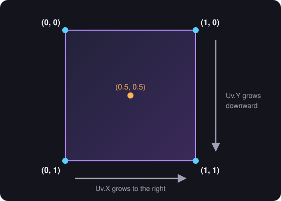
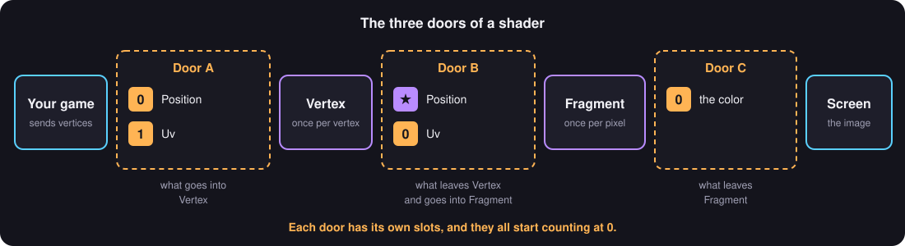
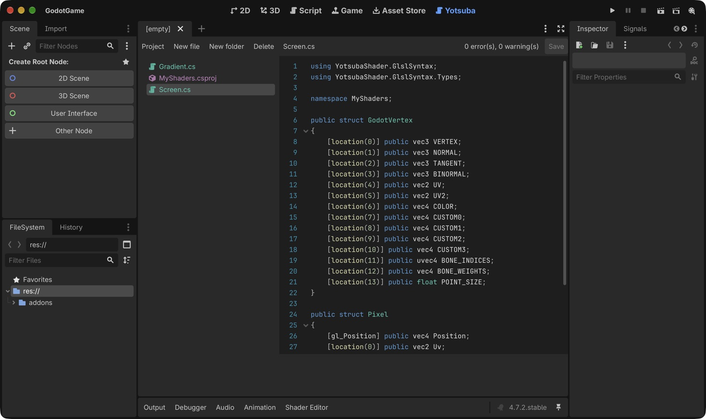
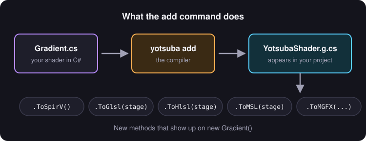

> [!SCENE] goal

This is the shader you will make in this chapter. It paints the whole screen with a gradient, from pink at the top to yellow at the bottom:


It is simple on purpose. What matters here is not the drawing, but that you write in C#, one by one, the five things you saw in [How a shader is built](how-a-shader-is-built.md). The four shaders that come next use exactly these same parts.

> [!SCENE] plan

## The plan

[How a shader is built](how-a-shader-is-built.md) ended with a list of five decisions. This is how each one is written in C#:

| | What you decide | How it is written in C# |
| --- | --- | --- |
| 1 | What data each vertex carries (door A) | A `struct`, with `[location]` on each field. |
| 2 | What Vertex lets through to Fragment (door B) | Another `struct`. |
| 3 | What the Vertex function does | A method marked with `[ShaderStage(Stage.Vertex)]`. |
| 4 | What the Fragment function does | A method marked with `[ShaderStage(Stage.Fragment)]`. |
| 5 | Where the color goes (door C) | `[return: location(0)]` above the Fragment method. |

> [!SAY] Let's read this table from left to right. The first column has each of the five decisions you already know, and the second shows how it is written in C#. The data each vertex carries, door A, is written as a struct, with a location on every field. What Vertex lets through to Fragment, door B, is another struct. The two functions, Vertex and Fragment, are just two methods, each one marked with its ShaderStage. And where the color goes, door C, is written as return location zero right above the Fragment method. Notice there is nothing else: five decisions, and five pieces of ordinary C#.

There is nothing else. A shader in C# is a few `struct`s and a class with two methods.

> [!SCENE] rect

## The shape: a rectangle that covers the whole screen

There we followed a triangle. Now we want to paint the entire screen, so the shape is going to be a rectangle that covers it from edge to edge: two triangles, four vertices.

What data does each vertex carry? Two things:

- **The position**, as always. The four corners of the screen: `(-1, 1)`, `(1, 1)`, `(-1, -1)` and `(1, -1)`.
- **A piece of data usually called `Uv`**, which is new.

> [!SCENE] uv

### What is `Uv` and what do I want it for?

To make a gradient, each pixel needs to know whether it is at the top or at the bottom. But you already saw that a pixel knows nothing by itself: it only knows what reaches it through the spreading.

So we are going to send it exactly that. We give each vertex a pair of numbers that says which corner of the rectangle it is:



> [!SAY] In this image we can see the concept visually. There is a square with four corners. The top left one is zero, zero. The top right one is one, zero. The bottom left is zero, one, and the bottom right is one, one. In the center there is an orange dot that is zero point five, zero point five: exactly halfway in both directions. Look at the arrows too: X grows to the right, as you would expect, but Y grows downward, the opposite of the math you saw in school.

And the spreading does the rest. A pixel halfway between corner `(0, 0)` and corner `(1, 0)` receives `(0.5, 0)`. One right in the center receives `(0.5, 0.5)`. Each pixel ends up knowing where it is inside the rectangle, with two numbers from `0` to `1`.

The name `Uv` is a custom: in graphics the letters "U" and "V" are used so they are not confused with the X and Y of the position. It means nothing more.

> [!NOTE]
> "And why do I not use the position directly, if it already says where everything is?" For two reasons. The GPU keeps the final position: it is the special data, the one with the star. And besides, it goes from `-1` to `1` with Y pointing up, while for doing math something that goes from `0` to `1` starting at the top left is much more comfortable.

> [!SCENE] doors

With that, the three doors of this shader look like this:



It is the same drawing of the three doors you already know, changing "color" for `Uv`. Keep it at hand, because each slot in that drawing is going to be a line of C#.

> [!SCENE] vectors

## Vectors: numbers that go together

Before writing the doors you are missing one tool. A position is two numbers. A color is four. In a shader you almost never work with a single number, and that is why there are three types that group `float` numbers:

| Type | How many `float` it has | Its fields | What it is almost always used for |
| --- | --- | --- | --- |
| `vec2` | 2 | `X`, `Y` | A position in 2D, or a `Uv`. |
| `vec3` | 3 | `X`, `Y`, `Z` | A position in 3D, or a color without opacity. |
| `vec4` | 4 | `X`, `Y`, `Z`, `W` | A color with opacity, or the final position. |

These types are called vectors. You do not need to know math to use them: think of them as a `struct` with two, three or four `float`.

When a `vec4` holds a color, its fields are still called `X`, `Y`, `Z` and `W`, so you have to remember the order:

| Field | In a color it is |
| --- | --- |
| `X` | the red |
| `Y` | the green |
| `Z` | the blue |
| `W` | the opacity |

> [!SCENE] make

## Creating a vector

A vector is created like any other C# type: with `new` and its constructor. You write the values in the order of the fields, `X`, `Y`, `Z` and `W`:

```csharp
using YotsubaShader.GlslSyntax.Types;

vec2 uv = new vec2(0.5f, 0.25f);
vec3 orange = new vec3(1f, 0.5f, 0.1f);
vec4 red = new vec4(1f, 0f, 0f, 1f);
```

> [!SAY] A vector is created like any other type in C sharp: with new and its constructor. You write the values in the order of the fields. A vec2 takes two numbers, a vec3 takes three, and a vec4 takes four. To have the color red, with full opacity, it is enough to write new vec4 of one, zero, zero, one. At the top, the using for GlslSyntax dot Types is where the types vec2, vec3 and vec4 come from.

- `using YotsubaShader.GlslSyntax.Types;` is where `vec2`, `vec3` and `vec4` come from.
- The `f` in `1f` says the number is a `float`. Get used to always writing it: with a number that has decimals, like `0.5`, it is mandatory, because without it C# takes it as a `double` and it does not compile.

The constructor has a few more forms, all of them handy:

```csharp
vec4 gray = new vec4(0.5f);            // the same number in the four fields
vec4 solid = new vec4(orange, 1f);     // a vec3 plus the fourth value
vec2 corner = new vec2(uv.X, uv.Y);    // fields of other vectors
```

> [!NOTE]
> You can also declare a vector empty, `vec4 v;`, and fill its fields one by one with `v.X = 1f;`. It is normal C#: C# only asks that you fill **all** of them before you use it, or it fails with `CS0165: Use of unassigned local variable 'v'`. The constructor does it in a single line, so it is what we will use in the whole tutorial.

Nothing else is needed: the compiler knows what the constructor of a vector means and writes it in the language of each graphics API, for example `vec4(1.0, 0.0, 0.0, 1.0)` in GLSL and `float4(1.0f, 0.0f, 0.0f, 1.0f)` in HLSL.

> [!SCENE] doorA

## First file: doors A and B

Now for the doors. Both go in a file called `Screen.cs`. You are going to write it in two parts.

### Door A: what each vertex carries

Create `Screen.cs` with this:

:::godot
In Godot: open the **Yotsuba** tab, select `MyShaders` in the **Project** panel, press **New file** and type `Screen.cs`. Paste the code into the empty editor and save it with `Cmd/Ctrl+S`.
:::

```csharp style=glsl title="MyShaders/Screen.cs"
using YotsubaShader.GlslSyntax;
using YotsubaShader.GlslSyntax.Types;

namespace MyShaders;

public struct {{vertexType}}
{
    {{vertexFields glsl}}
}
```

```csharp style=hlsl title="MyShaders/Screen.cs"
using YotsubaShader.HlslSyntax;
using YotsubaShader.GlslSyntax.Types;

namespace MyShaders;

public struct {{vertexType}}
{
    {{vertexFields hlsl}}
}
```

```csharp style=msl title="MyShaders/Screen.cs"
using YotsubaShader.MslSyntax;
using YotsubaShader.GlslSyntax.Types;

namespace MyShaders;

public struct {{vertexType}}
{
    {{vertexFields msl}}
}
```

```csharp style=wgsl title="MyShaders/Screen.cs"
using YotsubaShader.WgslSyntax;
using YotsubaShader.GlslSyntax.Types;

namespace MyShaders;

public struct {{vertexType}}
{
    {{vertexFields glsl}}
}
```

```csharp style=spirv title="MyShaders/Screen.cs"
using YotsubaShader.SpirvSyntax;
using YotsubaShader.GlslSyntax.Types;

namespace MyShaders;

public struct {{vertexType}}
{
    {{vertexFields spirv}}
}
```

:::xna
This is door A, written in C#. Line by line:

- **`public struct Corner`**: a vertex is a packet of data, and in C# a packet of data is a `struct`. I chose the name `Corner`, because each vertex of our rectangle is one of its corners. You can call it whatever you want.
- **`[location(0)] public vec2 Position;`**: "in slot 0 of this door two `float` travel, and I am going to call them `Position`".
- **`[location(1)] public vec2 Uv;`**: "in slot 1 another two `float` travel, and I am going to call them `Uv`".

`[location]` comes from `using YotsubaShader.GlslSyntax;`, that is why that `using` is at the top.

Compare it with the drawing of the doors: at door A there is a slot 0 with `Position` and a slot 1 with `Uv`. It is exactly what you just wrote.

Three questions it is normal to ask here:

**Who fills those slots?** Your game. When you get to your game engine you are going to write the four corners with their position and their `Uv`, and you are going to tell it that the position goes in slot 0 and the `Uv` in slot 1. Here, in the shader, you only declare what you expect to receive.

**Do the names `Position` and `Uv` matter?** Not to the GPU. It only sees the slot number and the type. The names are for you, so the code can be read.

**What happens if I get the number wrong?** The shader reads the wrong data. If you put `Uv` in slot 0 here, you would receive the position believing it is the `Uv`. No error comes up: the drawing simply comes out wrong. That is why it is worth being clear about what goes in each slot.
:::

:::raylib silknet
This is door A, written in C#. Line by line:

- **`public struct Corner`**: a vertex is a packet of data, and in C# a packet of data is a `struct`. I chose the name `Corner`, because each vertex of our rectangle is one of its corners. You can call it whatever you want.
- **`[location(0)] public vec2 Position;`**: "in slot 0 of this door two `float` travel, and I am going to call them `Position`".
- **`[location(1)] public vec2 Uv;`**: "in slot 1 another two `float` travel, and I am going to call them `Uv`".

`[location]` comes from `using YotsubaShader.GlslSyntax;`, that is why that `using` is at the top.

Compare it with the drawing of the doors: at door A there is a slot 0 with `Position` and a slot 1 with `Uv`. It is exactly what you just wrote.

Three questions it is normal to ask here:

**Who fills those slots?** Your game. When you get to your game engine you are going to write the four corners with their position and their `Uv`, and you are going to tell it that the position goes in slot 0 and the `Uv` in slot 1. Here, in the shader, you only declare what you expect to receive.

**Do the names `Position` and `Uv` matter?** Not to the GPU. It only sees the slot number and the type. The names are for you, so the code can be read.

**What happens if I get the number wrong?** The shader reads the wrong data. If you put `Uv` in slot 0 here, you would receive the position believing it is the `Uv`. No error comes up: the drawing simply comes out wrong. That is why it is worth being clear about what goes in each slot.
:::

:::godot
This is door A, written in C#. It is the vertex data of Godot, all of it. Line by line:

- **`public struct {{vertexType}}`**: a vertex is a packet of data, and in C# a packet of data is a `struct`. This one is called `{{vertexType}}` and **it is the same for the whole tutorial**: you write it once and you never touch it again.
- **`public vec3 VERTEX;`**: the position of the vertex. Godot calls it `VERTEX`, so your field is called `VERTEX`. Same with `NORMAL`, `TANGENT`, `BINORMAL`, `UV`, `UV2`, `COLOR`, `CUSTOM0` to `CUSTOM3`, `BONE_INDICES`, `BONE_WEIGHTS` and `POINT_SIZE`: Godot's names, with Godot's capital letters.
- **`[location(0)]`, `[location(1)]`...**: the syntax asks for a number in each field, so the number is there. But in door A the plugin does not use it: it reads the **name**.

This is the file in the Yotsuba tab of Godot:



You are going to use only `VERTEX` (the position) and `UV` in the shaders of the tutorial. The other twelve are there so you never have to change the struct: a shader that does not read them leaves them alone, and Godot fills them with default values. They are listed one by one in [the Godot reference](../engines/godot-reference.md).

`[location]` comes from `using YotsubaShader.GlslSyntax;`, that is why that `using` is at the top.

Three questions it is normal to ask here:

**Who fills those fields?** Godot. Every mesh carries its vertex data, and the engine hands each vertex to your shader with those names. The only thing to keep in mind is that the mesh must carry what you ask for: the viewer of the next chapter gives the rectangle normals and tangents because your struct asks for them.

**Do the names matter?** Here, yes, a lot. They are how Godot and your shader understand each other. If you write `Position` instead of `VERTEX`, the compiler does not know which data you want and tells you.

**Do I have to declare all 14?** No, but the tutorial does, so the struct is always the same and nobody gets lost.
:::

> [!SCENE] doorB

### Door B: what Vertex lets through to Fragment

Add the second `struct` below the first one. The complete file looks like this:

```csharp style=glsl title="MyShaders/Screen.cs"
using YotsubaShader.GlslSyntax;
using YotsubaShader.GlslSyntax.Types;

namespace MyShaders;

public struct {{vertexType}}
{
    {{vertexFields glsl}}
}

public struct Pixel
{
    [gl_Position] public vec4 Position;
    [location(0)] public vec2 Uv;
}

public struct PixelIn
{
    [location(0)] public vec2 Uv;
}
```

```csharp style=hlsl title="MyShaders/Screen.cs"
using YotsubaShader.HlslSyntax;
using YotsubaShader.GlslSyntax.Types;

namespace MyShaders;

public struct {{vertexType}}
{
    {{vertexFields hlsl}}
}

public struct Pixel
{
    [SV_Position] public vec4 Position;
    [TEXCOORD(0)] public vec2 Uv;
}

public struct PixelIn
{
    [TEXCOORD(0)] public vec2 Uv;
}
```

```csharp style=msl title="MyShaders/Screen.cs"
using YotsubaShader.MslSyntax;
using YotsubaShader.GlslSyntax.Types;

namespace MyShaders;

public struct {{vertexType}}
{
    {{vertexFields msl}}
}

public struct Pixel
{
    [position] public vec4 Position;
    [attribute(0)] public vec2 Uv;
}

public struct PixelIn
{
    [attribute(0)] public vec2 Uv;
}
```

```csharp style=wgsl title="MyShaders/Screen.cs"
using YotsubaShader.WgslSyntax;
using YotsubaShader.GlslSyntax.Types;

namespace MyShaders;

public struct {{vertexType}}
{
    {{vertexFields glsl}}
}

public struct Pixel
{
    [builtin_position] public vec4 Position;
    [location(0)] public vec2 Uv;
}

public struct PixelIn
{
    [location(0)] public vec2 Uv;
}
```

```csharp style=spirv title="MyShaders/Screen.cs"
using YotsubaShader.SpirvSyntax;
using YotsubaShader.GlslSyntax.Types;

namespace MyShaders;

public struct {{vertexType}}
{
    {{vertexFields spirv}}
}

public struct Pixel
{
    [BuiltIn_Position] public vec4 Position;
    [Location(0)] public vec2 Uv;
}

public struct PixelIn
{
    [Location(0)] public vec2 Uv;
}
```

`Pixel` is door B as Vertex sees it. It has the two kinds of data that leave Vertex, the special one and yours:

- **`[gl_Position] public vec4 Position;`** is the special data, the one with the star. `[gl_Position]` tells the GPU: "this is the final position of the vertex, keep it". That is why it has no number. And it is a `vec4` because the final position has four numbers.
- **`[location(0)] public vec2 Uv;`** is data of yours: "in slot 0 of this door the `Uv` travels".

> [!NOTE]
> The name `gl_Position` may look odd. It comes from GLSL, the shader language of OpenGL, where that special data is called exactly that. Since in this tutorial we use the GLSL style, the names are the same.

> [!SCENE] zero

### "Wait a moment: `location(0)` again?"

Yes. And this is the moment to look at it carefully, because it is exactly the confusion I warned you about.

:::xna
In `{{vertexType}}`, slot 0 is the position. In `Pixel`, slot 0 is the `Uv`. They do not clash, because they are two different doors, and each door counts from 0 on its own:

| | Slot 0 | Slot 1 |
| --- | --- | --- |
| `{{vertexType}}` (door A) | `{{pos}}` | `{{uv}}` |
| `Pixel` (door B) | `Uv` | none |

The `Uv` came in through slot 1 of door A and leaves through slot 0 of door B. Nothing wrong with that: the number is only valid inside its own door.
:::

:::raylib silknet
In `{{vertexType}}`, slot 0 is the position. In `Pixel`, slot 0 is the `Uv`. They do not clash, because they are two different doors, and each door counts from 0 on its own:

| | Slot 0 | Slot 1 |
| --- | --- | --- |
| `{{vertexType}}` (door A) | `{{pos}}` | `{{uv}}` |
| `Pixel` (door B) | `Uv` | none |

The `Uv` came in through slot 1 of door A and leaves through slot 0 of door B. Nothing wrong with that: the number is only valid inside its own door.
:::

:::godot
In the Godot route door A is not numbered by you: its fields are found by **name** (`VERTEX`, `UV`...), as you just saw. Door B (`Pixel`) is the one that does use slot numbers: its `Uv` travels in slot 0, and that is the number `PixelIn` has to repeat.
:::

And why is the `Uv` in `Pixel` not slot 1, so it looks the same? You could put it in 1 and it would work. But at door B the position does not take a slot, so the first free one is 0. The normal thing is to number from 0 without leaving gaps.

> [!SCENE] pixel

### Why is it called `Pixel`?

Because it is what reaches each pixel. The Vertex function fills it once per vertex, the GPU spreads it, and the Fragment function receives it once per pixel, already blended.

Fragment does not receive the whole `Pixel`. The final position is for the GPU to place the triangle, and a Fragment function has no use for it (in GLSL, `gl_Position` does not even exist in that stage, and the compiler warns you if you try). That is why the file has a second `struct`, `PixelIn`, with only the data of yours: what Fragment receives.

The two sides of door B have to agree: the same `location` number and the same type. Here `Uv` is `location(0)` and `vec2` in both. If one side said `vec3`, or slot 1, the shader would not compile.

> [!SCENE] vertexfn

## Second file: the two functions

Decisions 3, 4 and 5 are left: the two functions and door C. They go together in a class. First I show them to you separately, and then the complete file for you to copy.

### The Vertex function

```csharp
[ShaderStage(Stage.Vertex)]
public Pixel Vertex({{vertexType}} corner)
{
    Pixel pixel;
    pixel.Position = new vec4(corner.{{pos}}.X, corner.{{pos}}.Y, 0f, 1f);
    pixel.Uv = corner.{{uv}};
    return pixel;
}
```

Start with the first line and the signature, which already say almost everything:

- **`[ShaderStage(Stage.Vertex)]`** is what turns this method into the Vertex stage. Without that attribute it would be just any method and the GPU would never call it.
- **`({{vertexType}} corner)`**: what it receives. It is door A: one vertex, with its `{{pos}}` and its `{{uv}}`. Remember it is **a single one**. The GPU calls the method four times, once per corner.
- **`public Pixel`**: what it returns. It is door B.
- **The name `Vertex`** is free. It could be called `PlaceCorner`. What counts is the attribute.

And the body does the two jobs of the Vertex stage:

**Job 1, say where the vertex goes:**

```csharp
pixel.Position = new vec4(corner.{{pos}}.X, corner.{{pos}}.Y, 0f, 1f);
```

Here we do not want to move anything, so the final position is the same one that arrived. The only thing that changes is that it arrived with two numbers and has to be handed over with four. That is why we take the `X` and the `Y` that arrived and fill in `0f` and `1f`, which are the depth and the perspective we talked about.

**Job 2, let through what Fragment is going to need:**

```csharp
pixel.Uv = corner.{{uv}};
```

We copy the `Uv` as is. If you did not, nothing would reach the Fragment function to tell where each pixel is.

`Pixel pixel;` at the start and `return pixel;` at the end work like the empty `vec4 v;` of the note about vectors: you declare the empty `struct`, fill its two fields and return it. This time you do need it, because there is no constructor to build a `struct` of yours.

> [!SCENE] fragfn

### The Fragment function and door C

```csharp
[ShaderStage(Stage.Fragment)]
[return: location(0)]
public vec4 Fragment(PixelIn pixel)
{
    return new vec4(1f, 0f, 0f, 1f);
}
```

- **`[ShaderStage(Stage.Fragment)]`** turns this method into the Fragment stage.
- **`(PixelIn pixel)`**: what it receives. It is the other side of door B: only your data, without the position. But mind what you learned about the spreading: this `pixel` is none of the four that `Vertex` returned. It is a mix of them, different for each pixel.
- **`public vec4`**: what it returns. A color, that is, four numbers.
- **`[return: location(0)]`** is door C: "the color I return goes to slot 0". And slot 0 of door C is the screen.

If you had never seen `[return: ...]`, it is normal C#. Attributes go above what they describe: above a field, a method, a class. But what a method returns has no place of its own to put anything above, so C# lets you write `return:` in front to say "this attribute is not for the method, it is for what it returns".

For now the body does the simplest thing possible. It always returns `new vec4(1f, 0f, 0f, 1f)`, which is red: all the red, no green, no blue, and full opacity. It does not even use the `pixel` it receives. So the whole screen is going to be red.

> [!SCENE] zeros

### The three zeros

You have now written the three doors, and all three have a `location(0)`. Now you can read them without getting confused:

| Where you wrote it | Which door it is | What travels in its slot 0 |
| --- | --- | --- |
| `[location(0)]` in `{{vertexType}}` | A: from the game to Vertex | The position of the vertex. |
| `[location(0)]` in `Pixel` and in `PixelIn` | B: from Vertex to Fragment | The `Uv`. |
| `[return: location(0)]` on `Fragment` | C: from Fragment to the screen | The color of the pixel. |

Three zeros, three doors, three different things.

> [!SCENE] file

### The complete file

Create `Gradient.cs` with the two functions inside a class:

:::godot
In the Yotsuba tab again: **New file**, `Gradient.cs`, paste and save. If you wrote something wrong, the error shows underlined and in the list under the editor.
:::

```csharp style=glsl title="MyShaders/Gradient.cs"
using YotsubaShader.GlslSyntax;
using YotsubaShader.GlslSyntax.Types;
using YotsubaShader.Language;

namespace MyShaders;

public class Gradient
{
    [ShaderStage(Stage.Vertex)]
    public Pixel Vertex({{vertexType}} corner)
    {
        Pixel pixel;
        pixel.Position = new vec4(corner.{{pos}}.X, corner.{{pos}}.Y, 0f, 1f);
        pixel.Uv = corner.{{uv}};
        return pixel;
    }

    [ShaderStage(Stage.Fragment)]
    [return: location(0)]
    public vec4 Fragment(PixelIn pixel)
    {
        return new vec4(1f, 0f, 0f, 1f);
    }
}
```

```csharp style=hlsl title="MyShaders/Gradient.cs"
using YotsubaShader.HlslSyntax;
using YotsubaShader.GlslSyntax.Types;
using YotsubaShader.Language;

namespace MyShaders;

public class Gradient
{
    [ShaderStage(Stage.Vertex)]
    public Pixel Vertex({{vertexType}} corner)
    {
        Pixel pixel;
        pixel.Position = new vec4(corner.{{pos}}.X, corner.{{pos}}.Y, 0f, 1f);
        pixel.Uv = corner.{{uv}};
        return pixel;
    }

    [ShaderStage(Stage.Fragment)]
    [return: SV_Target]
    public vec4 Fragment(PixelIn pixel)
    {
        return new vec4(1f, 0f, 0f, 1f);
    }
}
```

```csharp style=msl title="MyShaders/Gradient.cs"
using YotsubaShader.MslSyntax;
using YotsubaShader.GlslSyntax.Types;
using YotsubaShader.Language;

namespace MyShaders;

public class Gradient
{
    [ShaderStage(Stage.Vertex)]
    public Pixel Vertex({{vertexType}} corner)
    {
        Pixel pixel;
        pixel.Position = new vec4(corner.{{pos}}.X, corner.{{pos}}.Y, 0f, 1f);
        pixel.Uv = corner.{{uv}};
        return pixel;
    }

    [ShaderStage(Stage.Fragment)]
    [return: color(0)]
    public vec4 Fragment(PixelIn pixel)
    {
        return new vec4(1f, 0f, 0f, 1f);
    }
}
```

```csharp style=wgsl title="MyShaders/Gradient.cs"
using YotsubaShader.WgslSyntax;
using YotsubaShader.GlslSyntax.Types;
using YotsubaShader.Language;

namespace MyShaders;

public class Gradient
{
    [ShaderStage(Stage.Vertex)]
    public Pixel Vertex({{vertexType}} corner)
    {
        Pixel pixel;
        pixel.Position = new vec4(corner.{{pos}}.X, corner.{{pos}}.Y, 0f, 1f);
        pixel.Uv = corner.{{uv}};
        return pixel;
    }

    [ShaderStage(Stage.Fragment)]
    [return: location(0)]
    public vec4 Fragment(PixelIn pixel)
    {
        return new vec4(1f, 0f, 0f, 1f);
    }
}
```

```csharp style=spirv title="MyShaders/Gradient.cs"
using YotsubaShader.SpirvSyntax;
using YotsubaShader.GlslSyntax.Types;
using YotsubaShader.Language;

namespace MyShaders;

public class Gradient
{
    [ShaderStage(Stage.Vertex)]
    public Pixel Vertex({{vertexType}} corner)
    {
        Pixel pixel;
        pixel.Position = new vec4(corner.{{pos}}.X, corner.{{pos}}.Y, 0f, 1f);
        pixel.Uv = corner.{{uv}};
        return pixel;
    }

    [ShaderStage(Stage.Fragment)]
    [return: Location(0)]
    public vec4 Fragment(PixelIn pixel)
    {
        return new vec4(1f, 0f, 0f, 1f);
    }
}
```

A shader is a normal class, with one method per stage. The class is called `Gradient` because that is the name of the shader: that is how you are going to ask for it later, with `new Gradient()`.

There is a new `using`, `YotsubaShader.Language`. That is where `[ShaderStage]` and `Stage` come from.

> [!SCENE] add

## Compile it with `add`

You now have a shader written. Next it has to be turned into something the GPU understands. From the `Tutorial` folder, run the command you saw in the previous chapter:

```bash
yotsuba add MyShaders/MyShaders.csproj --target spirv
```

The first time it takes a while, because the compiler itself is also built. When it finishes you will see something like this (the CLI prints its messages in Spanish; this one means "File generated"):

```text
Archivo generado: /path/to/Tutorial/MyShaders/YotsubaShader.g.cs
```

Open the `MyShaders` folder. There is a new file you did not write: `YotsubaShader.g.cs`.



That is what `add` does: it compiles every shader in your project and **adds** to your project a C# file with the result. That file gives your `Gradient` class new methods:

| Method | What it returns |
| --- | --- |
| `ToGlsl(stage)` | The shader translated to GLSL (OpenGL), as text. |
| `ToGlslEs(stage)` | The same, in the GLSL variant for mobile and web. |
| `ToHlsl(stage)` | The shader translated to HLSL (DirectX), as text. |
| `ToMSL(stage)` | The shader translated to Metal (Apple), as text. |
| `ToSpirV()` | The shader in SPIR-V, Vulkan's binary format, as `byte[]`. |
| `ToMGFX(platform)`, `ToKNIWebGL_FX()`, `ToFNA_FX()` | The shader ready to load in MonoGame, KNI or FNA, as `byte[]`. These three appear only if you ask for the engine's plugin with `--target {{plugin}}`, `--target kni` or `--target fna`. You will do it in [Your window to see shaders](visor.md). |

That is, you do not have to load files or remember paths. Your shader is a class, and you ask that same class for the compiled result.

> [!NOTE]
> `YotsubaShader.g.cs` is a generated file. Do not edit it by hand: every time you run `add` it is written again from scratch.
>
> If you later delete or rename a shader class and `add` fails with a `CS0234` error, the old file still names the class that no longer exists. Delete `YotsubaShader.g.cs` and run `add` again.

> [!SCENE] use

## Use the result

Let's ask `Gradient` for its GLSL version and show it in the console. Open `TryIt/Program.cs`, delete whatever is there and write this:

```csharp title="TryIt/Program.cs"
using MyShaders;
using YotsubaShader;
using YotsubaShader.Language;

var shader = new Gradient();

Console.WriteLine(shader.ToGlsl(Stage.Fragment));
```

And run it:

```bash
dotnet run --project TryIt
```

This is what comes out:

```glsl
#version 450

struct Pixel
{
    vec4 Position;
    vec2 Uv;
};

layout(location = 0) in vec2 pixel_Uv;
layout(location = 0) out vec4 _return;

void main()
{
    _return = vec4(1.0, 0.0, 0.0, 1.0);
}
```

Look at it calmly, because everything you wrote is there, translated to another language:

- Your `struct Pixel` is there.
- Your `new vec4(...)` is there too, written as `vec4(...)`, the constructor of GLSL. You did not have to write a helper for it: the compiler translates the constructor of the vector.
- Your `Fragment` method is the `main()` at the end.

And your doors are there too. Look at these two lines:

```glsl
layout(location = 0) in vec2 pixel_Uv;
layout(location = 0) out vec4 _return;
```

The first one says `in`: it is the `Uv` that arrives through slot 0 of door B. The second one says `out`: it is the color that leaves through slot 0 of door C. Two zeros, one coming in and one going out, and GLSL tells them apart the same way you do: by the door.

That text is a real GLSL shader. If you give it to OpenGL, it paints the screen red.

### Look at the Vertex stage too

Change `Stage.Fragment` to `Stage.Vertex` in `TryIt/Program.cs` and run it again. Now your `Vertex` method comes out:

```glsl
#version 450

struct Pixel
{
    vec4 Position;
    vec2 Uv;
};

layout(location = 0) in vec2 corner_Position;
layout(location = 1) in vec2 corner_Uv;
layout(location = 0) out vec2 _return_Uv;

void main()
{
    Pixel pixel;
    pixel.Position = vec4(corner_Position.x, corner_Position.y, 0.0, 1.0);
    pixel.Uv = corner_Uv;
    gl_Position = pixel.Position;
    _return_Uv = pixel.Uv;
}
```

Here you can see doors A and B in full:

- The two lines with `in` are door A: the position in slot 0 and the `Uv` in slot 1.
- The line with `out` is door B: the `Uv` leaving through slot 0.
- And the final position has no `layout` and no number. It shows up at the end as `gl_Position = pixel.Position;`. It is the special data, the one the GPU keeps.

Put `Stage.Fragment` back before you continue.

> [!SCENE] gradient

## Now for real, the gradient

A red screen is not very exciting. To make a gradient, the color has to be different at each pixel. And what is different about one pixel compared to another? Its `Uv`.

Remember that the `Uv` only exists at the four corners, but the Fragment function runs for every pixel, including the ones in the middle. It is the spreading again: the GPU gives each pixel the mix that corresponds to it.

So inside `Fragment`, `pixel.Uv.Y` is `0` at the top pixels, `1` at the bottom ones, and rises little by little in between. That is exactly what a gradient needs.

Replace the `Fragment` method with this one. The complete file looks like this:

```csharp style=glsl title="MyShaders/Gradient.cs"
using YotsubaShader.GlslSyntax;
using YotsubaShader.GlslSyntax.Types;
using YotsubaShader.Language;

namespace MyShaders;

public class Gradient
{
    [ShaderStage(Stage.Vertex)]
    public Pixel Vertex({{vertexType}} corner)
    {
        Pixel pixel;
        pixel.Position = new vec4(corner.{{pos}}.X, corner.{{pos}}.Y, 0f, 1f);
        pixel.Uv = corner.{{uv}};
        return pixel;
    }

    [ShaderStage(Stage.Fragment)]
    [return: location(0)]
    public vec4 Fragment(PixelIn pixel)
    {
        float red = 1f;
        float green = 0.25f + 0.6f * pixel.Uv.Y;
        float blue = 0.45f - 0.35f * pixel.Uv.Y;
        return new vec4(red, green, blue, 1f);
    }
}
```

```csharp style=hlsl title="MyShaders/Gradient.cs"
using YotsubaShader.HlslSyntax;
using YotsubaShader.GlslSyntax.Types;
using YotsubaShader.Language;

namespace MyShaders;

public class Gradient
{
    [ShaderStage(Stage.Vertex)]
    public Pixel Vertex({{vertexType}} corner)
    {
        Pixel pixel;
        pixel.Position = new vec4(corner.{{pos}}.X, corner.{{pos}}.Y, 0f, 1f);
        pixel.Uv = corner.{{uv}};
        return pixel;
    }

    [ShaderStage(Stage.Fragment)]
    [return: SV_Target]
    public vec4 Fragment(PixelIn pixel)
    {
        float red = 1f;
        float green = 0.25f + 0.6f * pixel.Uv.Y;
        float blue = 0.45f - 0.35f * pixel.Uv.Y;
        return new vec4(red, green, blue, 1f);
    }
}
```

```csharp style=msl title="MyShaders/Gradient.cs"
using YotsubaShader.MslSyntax;
using YotsubaShader.GlslSyntax.Types;
using YotsubaShader.Language;

namespace MyShaders;

public class Gradient
{
    [ShaderStage(Stage.Vertex)]
    public Pixel Vertex({{vertexType}} corner)
    {
        Pixel pixel;
        pixel.Position = new vec4(corner.{{pos}}.X, corner.{{pos}}.Y, 0f, 1f);
        pixel.Uv = corner.{{uv}};
        return pixel;
    }

    [ShaderStage(Stage.Fragment)]
    [return: color(0)]
    public vec4 Fragment(PixelIn pixel)
    {
        float red = 1f;
        float green = 0.25f + 0.6f * pixel.Uv.Y;
        float blue = 0.45f - 0.35f * pixel.Uv.Y;
        return new vec4(red, green, blue, 1f);
    }
}
```

```csharp style=wgsl title="MyShaders/Gradient.cs"
using YotsubaShader.WgslSyntax;
using YotsubaShader.GlslSyntax.Types;
using YotsubaShader.Language;

namespace MyShaders;

public class Gradient
{
    [ShaderStage(Stage.Vertex)]
    public Pixel Vertex({{vertexType}} corner)
    {
        Pixel pixel;
        pixel.Position = new vec4(corner.{{pos}}.X, corner.{{pos}}.Y, 0f, 1f);
        pixel.Uv = corner.{{uv}};
        return pixel;
    }

    [ShaderStage(Stage.Fragment)]
    [return: location(0)]
    public vec4 Fragment(PixelIn pixel)
    {
        float red = 1f;
        float green = 0.25f + 0.6f * pixel.Uv.Y;
        float blue = 0.45f - 0.35f * pixel.Uv.Y;
        return new vec4(red, green, blue, 1f);
    }
}
```

```csharp style=spirv title="MyShaders/Gradient.cs"
using YotsubaShader.SpirvSyntax;
using YotsubaShader.GlslSyntax.Types;
using YotsubaShader.Language;

namespace MyShaders;

public class Gradient
{
    [ShaderStage(Stage.Vertex)]
    public Pixel Vertex({{vertexType}} corner)
    {
        Pixel pixel;
        pixel.Position = new vec4(corner.{{pos}}.X, corner.{{pos}}.Y, 0f, 1f);
        pixel.Uv = corner.{{uv}};
        return pixel;
    }

    [ShaderStage(Stage.Fragment)]
    [return: Location(0)]
    public vec4 Fragment(PixelIn pixel)
    {
        float red = 1f;
        float green = 0.25f + 0.6f * pixel.Uv.Y;
        float blue = 0.45f - 0.35f * pixel.Uv.Y;
        return new vec4(red, green, blue, 1f);
    }
}
```

Do the math for two pixels and you will see it clearly:

| Pixel | `Uv.Y` | Red | Green | Blue | Color |
| --- | --- | --- | --- | --- | --- |
| One at the top | `0` | `1` | `0.25` | `0.45` | Pink |
| One at the bottom | `1` | `1` | `0.85` | `0.10` | Orange-yellow |

The pixels in the middle land between one color and the other. You did not write any loop: the GPU runs those four lines for each pixel, and each one arrives with its own `Uv`.

Compile and run again:

```bash
yotsuba add MyShaders/MyShaders.csproj --target spirv
```

```bash
dotnet run --project TryIt
```

Now the `main()` in the output is this:

```glsl
void main()
{
    float red = 1.0;
    float green = 0.25 + (0.60000002384185791015625 * pixel_Uv.y);
    float blue = 0.449999988079071044921875 - (0.3499999940395355224609375 * pixel_Uv.y);
    _return = vec4(red, green, blue, 1.0);
}
```

They are your same lines. The long numbers are your `0.6f`, `0.45f` and `0.35f`, written with all the decimals a `float` keeps inside.

> [!IMPORTANT]
> Every time you change a shader you have to run `add` again, and then build your program. If you skip `add`, your program keeps using the previous version. In the [CLI chapter](cli.md) you will see how to make this happen on its own.

> [!SCENE] apis

## The same shader, for other graphics APIs

So far you asked for GLSL. But the file `add` generated carries every format. Change `TryIt/Program.cs` to this:

```csharp title="TryIt/Program.cs"
using MyShaders;
using YotsubaShader;
using YotsubaShader.Language;

var shader = new Gradient();

Console.WriteLine("--- GLSL ---");
Console.WriteLine(shader.ToGlsl(Stage.Fragment));

Console.WriteLine("--- HLSL ---");
Console.WriteLine(shader.ToHlsl(Stage.Fragment));

Console.WriteLine("--- Metal ---");
Console.WriteLine(shader.ToMSL(Stage.Fragment));

byte[] spirv = shader.ToSpirV();
File.WriteAllBytes("Gradient.spv", spirv);
Console.WriteLine($"Gradient.spv: {spirv.Length} bytes");
```

This time you do not need to run `add`, because the shader did not change. Just run `dotnet run --project TryIt`.

You will see your shader three times, in three different languages, and a new `Gradient.spv` file in the folder you ran it from. For example, this is how your method looks in HLSL:

```hlsl
void Fragment_inner()
{
    float red = 1.0f;
    float green = 0.25f + (0.60000002384185791015625f * pixel_Uv.y);
    float blue = 0.449999988079071044921875f - (0.3499999940395355224609375f * pixel_Uv.y);
    _return = float4(red, green, blue, 1.0f);
}
```

You wrote the shader only once, in C#, and you have it for OpenGL, DirectX, Metal and Vulkan.

> [!TIP]
> To see the Vertex stage instead of the Fragment one, change `Stage.Fragment` to `Stage.Vertex`. `ToSpirV()` does not ask for a stage because the SPIR-V file carries both inside.

> [!SCENE] screen

## And how do I see it on screen?

So far you have only seen the gradient as an image in the tutorial and as text in the console. To see it really drawn you need a window and something that sends the rectangle to the GPU. A game engine or a graphics API does that, and each one does it its own way.

That is why the next chapter has you make a small window, a **viewer**, that draws the shader you tell it. It is a work tool: your shaders stay the same. With it, every chapter from now on will ask you to write, run and **see** what you do. When you finish, in [What now?](next-steps.md), you pick your engine and see how to load there what `add` gives you.

> [!SCENE] learned

## What you learned

- A shader in C# is a few `struct`s and a class with two methods.
- Door A is a `struct` with `[location(n)]` on each field: what your game sends for each vertex.
- Door B is another `struct`: the final position marked with `[gl_Position]`, and your data with `[location(n)]`.
- Door C is `[return: location(0)]` above the Fragment method.
- Each door counts its slots from 0. That is why there are three `location(0)` and they do not clash.
- Each stage is a method marked with `[ShaderStage]`. Vertex returns the position and lets data through; Fragment returns the color, a `vec4` with values from `0` to `1`.
- What Vertex returns reaches Fragment spread across the pixels. That is why `Uv` is different at each one.
- The `add` command compiles your shaders and adds `YotsubaShader.g.cs` to your project. From there, `new Gradient().ToGlsl(...)` and its siblings give you the compiled shader.

Next: [Your window for seeing shaders](visor.md).
