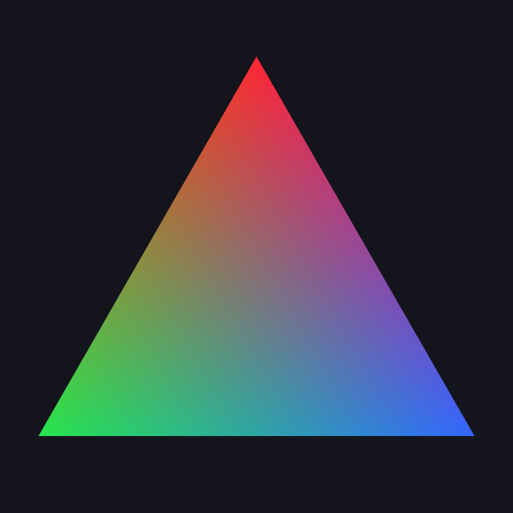
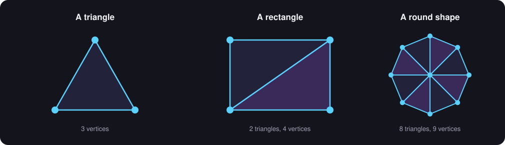
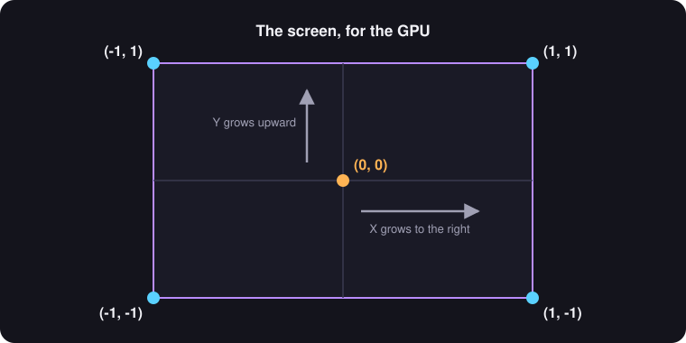
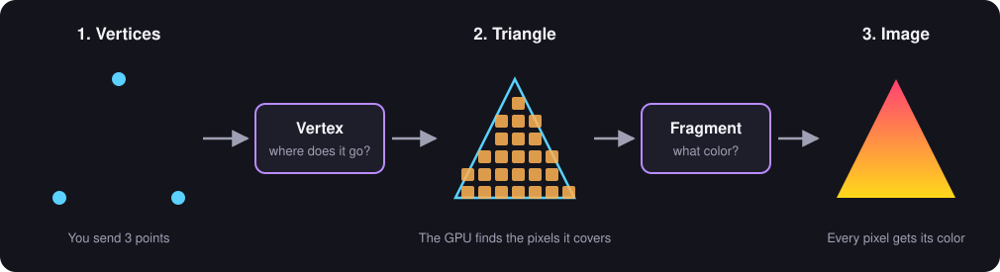
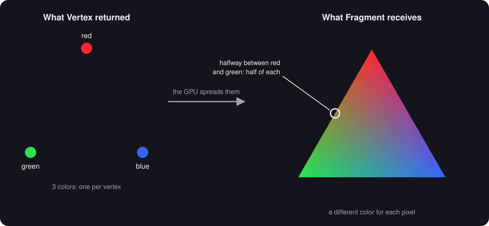
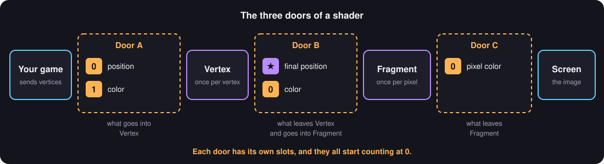

> [!SCENE] intro

You already know what a shader is: a function the GPU runs a huge number of times at once. But knowing what it is does not tell you how to make one. What does that function receive? What does it have to return? Who calls it, and with what data?

> [!SCENE] journey

In this chapter you will not write code or install anything. You will follow the complete journey of a drawing, from your game to the screen, one step after another. Take your time with it, because everything you write later in C# is one of these steps. If you understand the journey, the code explains itself.

> [!SCENE] triangle

The drawing we are going to follow is this triangle:



> [!SAY] In this image there is a triangle. One corner is red, another is green and another is blue, and inside the colors blend little by little, with no hard edges between them.

It has a red corner, a green one and a blue one, and inside the colors blend into each other. It does not look like much, but drawing it takes every piece a shader has. Not one less.

## 1. Everything is drawn with triangles

> [!SCENE] shapes

The GPU knows how to draw very few shapes, and the one used for almost everything is the triangle. Everything else is built by putting triangles together:



> [!SAY] In this image we see three shapes. On the left, a triangle with its three corners marked. In the middle, a rectangle, split by a diagonal into two triangles. On the right, a round shape made of eight small triangles around a center. Every shape is built from triangles.

A rectangle is two triangles. Something round is many small triangles. A character in a 3D game is thousands.

Each corner of a triangle is called a **vertex**. It is a word you will read all the time, and it means nothing more than that: a point, a corner.

Look at the rectangle: it has 4 vertices and not 6, because the two triangles share two corners.

> [!NOTE]
> Why triangles and not squares or circles? Because it is the simplest shape that has a filling: with three points you get a flat shape, with no folds. That is why the GPU can fill it fast, and with many triangles you can build any other shape.

## 2. Your game sends a list of vertices

> [!SCENE] list

To draw the triangle, your game sends the GPU a list with its three vertices. And for each vertex it sends the data you decide. In our case there are two: where it is and what color it is.

| Vertex | Position | Color |
| --- | --- | --- |
| The top one | `(0, 0.8)` | red |
| The bottom left one | `(-0.8, -0.7)` | green |
| The bottom right one | `(0.8, -0.7)` | blue |

> [!SAY] This table is the list our game sends. Three rows, one per vertex. The top one is at zero, zero point eight, and it is red. The bottom left one is at minus zero point eight, minus zero point seven, and it is green. The bottom right one is at zero point eight, minus zero point seven, and it is blue.

There are two things here worth having clear from the start:

- **You decide what data each vertex carries.** The GPU does not force you to send a color. You could send only the position, or the position and five more things. You send what your shader is going to need.
- **For the GPU they are just numbers.** It does not know that this is "a color". It sees three or four numbers together and nothing else. You give them their meaning inside the shader.

### What can a vertex carry?

> [!SCENE] carry

Position and color are what this triangle needs, but a vertex can carry any data you want. These are the usual ones:

| Data | Type in C# | What it is for |
| --- | --- | --- |
| Position | `vec2`, `vec3` or `vec4` | where the vertex is |
| Color | `vec3` or `vec4` | the color of the vertex; `vec4` adds opacity |
| UV | `vec2` | which point of a texture belongs to this vertex |
| Normal | `vec3` | where the surface points, used for lighting |
| Tangent | `vec4` | direction along the surface, used for relief effects |
| Bone indices and weights | `vec4` or `uint` | animate a character |
| Your own data | `float`, `int`, `uint` or a vector | a temperature, an age, a flag |

> [!SAY] Here is a table with the kinds of data a vertex can carry. Position, as a vec2, vec3 or vec4. Color, as a vec3 or vec4. UV coordinates, which say what point of a texture belongs to the vertex. Normal and tangent, used for lighting and relief. Bone indices and weights, to animate a character. And finally your own data: a temperature, an age, a flag.

Each piece of data is a `float`, an `int` or a `uint`, alone or in groups of two, three or four (`vec2`, `vec3`, `vec4` and their `int` and `uint` versions). A matrix is bigger than four numbers, so it takes several slots.

The GPU does not know what any of this means. A `vec4` is four numbers, whether you put a color in it or a position. The meaning only exists in how you use it inside the shader.

### What do the position numbers mean?

> [!SCENE] coords

Your screen may be 1920 pixels wide, or 800, or 4000. So that the same drawing works on all of them, the GPU does not measure the screen in pixels. It uses the same ruler, whatever the screen:



> [!SAY] In this image we see the screen as the GPU sees it, as a rectangle. The center is the point zero, zero. The top left corner is minus one, one, and the bottom right corner is one, minus one. X grows to the right, Y grows upward.

- The center of the screen is `(0, 0)`.
- The left edge is `-1` and the right edge is `1`.
- The bottom edge is `-1` and the top edge is `1`.

So the vertex `(0, 0.8)` is centered horizontally and almost at the very top. And `(-0.8, -0.7)` is to the left and at the bottom.

> [!WARNING]
> If you have already programmed something in 2D, you are used to Y growing downward. Here it is the other way around: Y grows **upward**.

## 3. The Vertex stage: once for each vertex

> [!SCENE] vertex

This is where the first function you write comes in.

The GPU takes the list and calls your Vertex function once for each vertex. Three vertices, three calls. In each call it hands over the data of **a single** vertex: it does not see the other two.

That function has two jobs:

1. **Say where that vertex ends up on the screen.** This is mandatory. Without a position, the GPU has nothing to draw.
2. **Let through the data the next stage is going to need.** This is optional, and you decide which. In our case, the color.

In the triangle it looks like this:

| | What it receives | What it returns |
| --- | --- | --- |
| Vertex function | the position and the color of one vertex | the final position and the color |

> [!SAY] This small table puts the Vertex function in one line. It receives the position and the color of one vertex, and it returns the final position and the color.

### "If my game already sent the position, why do I return it again?"

> [!SCENE] why

It is the logical question, because in our triangle the Vertex function does not change anything: it receives a position and returns that same one.

But in a real game the vertices are almost never sent already in place. The shape of a character is sent only once, and it is the Vertex stage that moves it around the map, rotates it, or makes it small when it is far from the camera. That is what it exists for: it is the place where it is decided where each point lands.

That in our example the answer is "where it already was" does not mean nobody has to give it.

### The final position has four numbers, not two

> [!SCENE] four

Your game sent the position with two numbers, X and Y. But the GPU asks for the final position with four:

| Number | What it is | What we put in 2D |
| --- | --- | --- |
| 1st | X: left or right | yours |
| 2nd | Y: down or up | yours |
| 3rd | Z: the depth, that is, how far away it is | `0` |
| 4th | W: it is used for perspective in 3D | `1` |

> [!SAY] The final position has four numbers. The first is X, left or right, and it is yours. The second is Y, down or up, and it is also yours. The third is Z, the depth, and in 2D we put zero. And the fourth is W, used for perspective in 3D, and we put one.

The last two only matter in 3D. As long as you draw in 2D, keep this: the first two are your X and your Y, and the other two are `0` and `1`.

## 4. The GPU assembles the triangle

> [!SCENE] raster

You do not write this step. The GPU does it by itself.

With the three final positions it now knows where the triangle is on the screen. Then it works out which pixels fall inside:



> [!SAY] In this image the three points go through Vertex and form a triangle. Then the GPU marks, on a grid, the pixels that the triangle covers, and finally Fragment gives each of those pixels its color.

The bigger the shape, the more pixels it covers. A small triangle may cover a few hundred. A rectangle that covers a whole Full HD screen covers the two million.

## 5. The spreading: from three values to thousands

> [!SCENE] spread

Something happens here that is almost never explained, and it is the key to understanding everything else.

The Vertex function returned three colors, one per vertex. But the triangle has thousands of pixels. Which color reaches each one?

The GPU **spreads** them. It gives each pixel a mix of the three values, depending on how close it is to each vertex:



> [!SAY] In this image, on the left, there are three colored dots: that is what Vertex returned. On the right, the whole triangle is filled with blended colors: that is what Fragment receives, a different color for every pixel.

- A pixel right next to the red vertex receives almost all red.
- A pixel halfway between the red and the green receives half of each.
- A pixel right in the center receives a third of each.

> [!SCENE] heat

This is not something special about colors. The GPU does not know they are colors, remember? For it they are numbers, and it spreads **any** number the Vertex function lets through. If you let a temperature through, each pixel receives its own blended temperature.

> [!SCENE] important

From here comes an idea you have to take away from this chapter:

> [!IMPORTANT]
> What the Vertex function returns **is not** what the Fragment function receives. Vertex returns three exact values, one per vertex. Fragment receives thousands, one per pixel, and each one is a different mix. The data has the same name on both sides, but on the way the GPU spread it.

The technical name for this spreading is *interpolation*. You will read it elsewhere. Here we keep calling it spreading.

## 6. The Fragment stage: once for each pixel

> [!SCENE] fragment

This is the second function you write.

The GPU calls it once for each pixel that fell inside the triangle, and in each call it hands over the data already spread for **that** pixel.

It has a single job: **return the color of that pixel**.

A color is four numbers, and each one goes from `0` (nothing) to `1` (everything). Not from 0 to 255:

| Color | Red | Green | Blue | Opacity |
| --- | --- | --- | --- | --- |
| Red | `1` | `0` | `0` | `1` |
| White | `1` | `1` | `1` | `1` |
| Black | `0` | `0` | `0` | `1` |
| Gray | `0.5` | `0.5` | `0.5` | `1` |
| Yellow | `1` | `1` | `0` | `1` |

> [!SAY] This table shows how a color is written with four numbers: red, green, blue and opacity. Red is one, zero, zero, one. White is one, one, one, one. Black is zero, zero, zero, one. Gray is zero point five in the three channels. And yellow is one, one, zero, one.

The fourth number is the opacity: `1` is a solid color and `0` is fully transparent.

> [!SCENE] freedom

In our triangle, the Fragment function does the simplest thing there is: it receives the already blended color and returns it as is. The whole gradient was made by the spreading.

But it could do whatever it wanted with it: darken it, ignore it and return red, or calculate another color with a formula. That is what writing shaders consists of, and it is what you will do in the five that come next.

### What a Fragment function cannot do

> [!SCENE] isolated

Since the GPU runs the function for thousands of pixels at the same time, each call lives isolated from the others:

- **It knows nothing about the other pixels.** It cannot ask what color the one next to it ended up.
- **It remembers nothing.** A variable you create inside the function disappears when it ends. It is of no use for the next pixel or for the next frame.
- **There is no loop going through the pixels.** The loop is the GPU. You write what happens with one.

The only thing a pixel knows is what reaches it through the spreading. If it needs something else, like the time that has passed or a photo, your game has to send it. You will see that in shaders 4 and 5.

## 7. The slots: how each stage knows which data is which

> [!SCENE] slots

So far we talked about "the position" and "the color", by name. But the GPU does not understand names. For it the data travels in **numbered slots**.

Your game says: "I put the position in slot 0 and the color in slot 1". And the Vertex function says: "I read the position from slot 0 and the color from slot 1". They understand each other by the number.

That number is called a *location*.

Which number goes with which data is up to you. Slot 0 is not the position by rule: you could put the color in slot 0 and the position in slot 1, as long as your game does the same. The GPU only sees the number and the type: slot 0, two floats; slot 1, four floats. Each slot holds up to four numbers, and every GPU offers at least 16 of them for the vertex data. If you get a number wrong no error appears: the shader reads the wrong data and the drawing comes out wrong.

In HLSL the slot is written as a semantic, `TEXCOORD0` and `TEXCOORD1` in our triangle. It is the same idea with another name.

> [!SCENE] doors

Up to there it is easy. What confuses almost everyone is this: **there is not a single row of slots. There are three.**

On the triangle's journey the data crosses three doors, and each door has its own row:



> [!SAY] In this image we follow the whole path from left to right. Your game sends data through door A to Vertex. Vertex passes data through door B to Fragment. Fragment sends the color through door C to the screen. Each door has its slots numbered from zero.

| Door | What crosses it | Slot 0 | Slot 1 |
| --- | --- | --- | --- |
| **A** | What your game sends to Vertex | the position | the color |
| **B** | What Vertex lets through to Fragment | the color | nothing |
| **C** | What Fragment returns | the pixel color | nothing |

> [!SAY] This table lists the three doors. Door A is what your game sends to Vertex: the position in slot zero and the color in slot one. Door B is what Vertex lets through to Fragment: the color in slot zero, and nothing in slot one. And door C is what Fragment returns: the pixel color in slot zero, and nothing in slot one.

Each door starts counting from 0 on its own. That is why "slot 0" appears three times, and all three times it carries a different thing: at door A it is the position, at B it is the color, and at C it is the final color of the pixel.

Think of three buildings on the same street. All three have an apartment number 1, and none has anything to do with the other two. To find someone you need the building **and** the number.

> [!IMPORTANT]
> This is the point where almost everyone gets lost the first time. You are going to see a `0` next to the position in the Vertex stage, and another `0` next to the color in the Fragment stage, and you are going to think there is a mistake or that both mean the same thing. Neither: they are slots of different doors.

> [!SCENE] rules

There are three rules:

1. **Within the same door a number is not repeated.** There cannot be two pieces of data in slot 0 of door A.
2. **Both sides of a door have to agree.** If Vertex leaves the color in slot 0 of door B, Fragment has to read the color from slot 0 of door B. The number and the type of data have to match. The name does not matter.
3. **Between different doors, the numbers have no relation at all.**

### And the final position? Why does it not have a number?

> [!SCENE] special

Look at door B in the drawing. Besides the color there is something else, marked with a star instead of a number: the final position.

It has no slot because it is not data for your Fragment function. It is data for **the GPU itself**, which needs it in step 4 to assemble the triangle. Since it is always needed and always for the same thing, it does not get a number: it is marked with a special name that the GPU recognizes.

So there are two kinds of data leaving Vertex:

- **The special one**, the final position. The GPU keeps it.
- **Yours**, the ones with a slot number. Those are the ones that are spread and reach Fragment.

### Why does door C have a number, if only one color comes out?

Because a shader can paint on several images at once, and the number says which one. It is something advanced that you will not need in this tutorial. Almost always you paint on a single one, and that is number `0`.

### Five styles: you choose

> [!SCENE] styles

The number between brackets, `location`, is how GLSL names a slot. GLSL is the language of OpenGL and Vulkan. HLSL, the language of DirectX, names the same thing with a word and an index, such as `TEXCOORD0`. Metal, WebGPU and SPIR-V have their own words too. So which one do you write? **The one you already know.** Yotsuba Shader has five styles: **GLSL, HLSL, MSL (Metal), WGSL (WebGPU) and SPIR-V**. Only the words of the interface change; the math and the C# stay exactly the same. Use the **Style** dropdown at the top right of this page to see every example in the style you prefer.

:::godot
> [!IMPORTANT]
> **In the Godot route, door A works by name, not by number.** Godot hands every vertex its data with fixed names: `VERTEX` (the position), `NORMAL`, `UV`, `COLOR`... The plugin reads the **name of your field** to know which one you ask for. So in this route `{{vertexType}}` always has **all 14** attributes of Godot, written exactly as Godot writes them (capital letters included), and you will use that same struct from the first shader to the last one. The number between brackets is still written because the syntax asks for it, but for door A Godot ignores it. Doors B and C keep working with numbers, as explained here.
>
> You do not need to use the 14. A shader that only reads `VERTEX` and `UV` leaves the rest alone, and Godot fills them with default values.
:::

Our `Corner` in the five styles:

```csharp style=glsl
public struct {{vertexType}}
{
    {{vertexFieldsColor glsl}}
}
```

```csharp style=hlsl
public struct {{vertexType}}
{
    {{vertexFieldsColor hlsl}}
}
```

```csharp style=msl
public struct {{vertexType}}
{
    {{vertexFieldsColor msl}}
}
```

```csharp style=wgsl
public struct {{vertexType}}
{
    {{vertexFieldsColor glsl}}
}
```

```csharp style=spirv
public struct {{vertexType}}
{
    {{vertexFieldsColor spirv}}
}
```

> [!SAY] This is our Corner, the data of one vertex, written in five ways. At the top right of the documentation you will find a dropdown that says Style. Choosing GLSL, HLSL, MSL for Metal, WGSL or SPIR-V changes every example on the page. In this video we always show GLSL and HLSL side by side, and the written tutorial has the step by step for each style. Choosing one style or another changes only the words of the interface, like location or TEXCOORD, and the compiler gives you the same result.

> [!SCENE] dict

They look different, but each language has its own words for the same concepts, and the compiler knows the concept behind each word. Here are the ones you have met so far:

| Concept | GLSL | HLSL | MSL | WGSL | SPIR-V |
| --- | --- | --- | --- | --- | --- |
| A channel of vertex data | `[location(0)]` | `[TEXCOORD(0)]` | `[attribute(0)]` | `[location(0)]` | `[Location(0)]` |
| The final position | `[gl_Position]` | `[SV_Position]` | `[position]` | `[builtin_position]` | `[BuiltIn_Position]` |
| Where the color goes (door C) | `[return: location(0)]` | `[return: SV_Target]` | `[return: color(0)]` | `[return: location(0)]` | `[return: Location(0)]` |

> [!SAY] This table works like a small dictionary between the five styles. Each row is one idea, and each column is how one style says it. A channel of vertex data is location in GLSL and WGSL, TEXCOORD in HLSL, attribute in Metal, and Location with a capital L in SPIR-V. The final position is gl_Position in GLSL, SV_Position in HLSL, position in Metal, and so on. And where the color goes is location zero in most of them, and SV_Target in HLSL. The words are different, but for the compiler they are the same idea.

There is one difference worth knowing. With a number such as `location(0)` **you choose the number**. With a semantic such as `TEXCOORD`, **the compiler can choose the number** for you, and it connects the two stages by the name: the `TEXCOORD(0)` that leaves Vertex is the one Fragment receives. The final result is the same kind of slot.

The rest of this chapter writes the number in the neutral way: "slot 0". Whatever your style is, that is the slot you write with its own words.

## 8. The complete blueprint

> [!SCENE] blueprint

You have made the whole journey. To build **any** shader, not just this triangle, you have to decide five things:

| | What you decide | In the triangle |
| --- | --- | --- |
| 1 | What data each vertex carries (door A) | The position in slot 0 and the color in slot 1. |
| 2 | What Vertex lets through to Fragment (door B) | The final position, which is the special one, and the color in slot 0. |
| 3 | What the Vertex function does | It copies the position and the color. |
| 4 | What the Fragment function does | It returns the color it receives. |
| 5 | Where the color goes (door C) | To slot 0. |

> [!SAY] This table sums up the whole journey, one row per decision. In the first row, each vertex carries its position in slot zero and its color in slot one. In the second, what Vertex hands to Fragment is the final position, which is the special one, and the color in slot zero. The third says the Vertex function only copies the position and the color. The fourth, that Fragment returns the color it receives. And the fifth, that this color leaves through slot zero.

> [!SCENE] who

And this is how the work is split among the three that take part:

| Who | What it does |
| --- | --- |
| Your game | Sends the list of vertices with their data. |
| You, in the shader | You write the Vertex function and the Fragment function, and declare the three doors. |
| The GPU | Calls your functions, assembles the triangles, finds the pixels and spreads the data. |

> [!SAY] And this other table splits the work among the three that take part. Your game sends the list of vertices with their data. You, in the shader, write the two functions and declare the three doors. And the GPU does everything else: it calls your functions, assembles the triangles, finds the pixels and spreads the data.

Notice what you do **not** have to write: not the loop over the vertices, not the loop over the pixels, not the spreading. The GPU already does all of that.

## 9. The whole shader, and what the compiler generates

> [!SCENE] whole

This is the complete triangle shader, written in the five styles. Pick yours in the **Style** dropdown. (`Make.Vec4` is the small helper from the first-shader chapter.)

```csharp style=glsl
using YotsubaShader.GlslSyntax;
using YotsubaShader.GlslSyntax.Types;
using YotsubaShader.Language;

namespace MyShaders;

public class Triangle
{
    public struct {{vertexType}}
    {
        {{vertexFieldsColor glsl}}
    }

    public struct Pixel
    {
        [gl_Position] public vec4 Position;
        [location(0)] public vec4 Color;
    }

    public struct PixelIn
    {
        [location(0)] public vec4 Color;
    }

    [ShaderStage(Stage.Vertex)]
    public Pixel Vertex({{vertexType}} corner)
    {
        Pixel pixel;
        pixel.Position = Make.Vec4(corner.{{pos}}.X, corner.{{pos}}.Y, 0f, 1f);
        pixel.Color = corner.{{color}};
        return pixel;
    }

    [ShaderStage(Stage.Fragment)]
    [return: location(0)]
    public vec4 Fragment(PixelIn pixel)
    {
        return pixel.Color;
    }
}
```

```csharp style=hlsl
using YotsubaShader.HlslSyntax;
using YotsubaShader.GlslSyntax.Types;
using YotsubaShader.Language;

namespace MyShaders;

public class Triangle
{
    public struct {{vertexType}}
    {
        {{vertexFieldsColor hlsl}}
    }

    public struct Pixel
    {
        [SV_Position] public vec4 Position;
        [TEXCOORD(0)] public vec4 Color;
    }

    public struct PixelIn
    {
        [TEXCOORD(0)] public vec4 Color;
    }

    [ShaderStage(Stage.Vertex)]
    public Pixel Vertex({{vertexType}} corner)
    {
        Pixel pixel;
        pixel.Position = Make.Vec4(corner.{{pos}}.X, corner.{{pos}}.Y, 0f, 1f);
        pixel.Color = corner.{{color}};
        return pixel;
    }

    [ShaderStage(Stage.Fragment)]
    [return: SV_Target]
    public vec4 Fragment(PixelIn pixel)
    {
        return pixel.Color;
    }
}
```

```csharp style=msl
using YotsubaShader.MslSyntax;
using YotsubaShader.GlslSyntax.Types;
using YotsubaShader.Language;

namespace MyShaders;

public class Triangle
{
    public struct {{vertexType}}
    {
        {{vertexFieldsColor msl}}
    }

    public struct Pixel
    {
        [position] public vec4 Position;
        [attribute(0)] public vec4 Color;
    }

    public struct PixelIn
    {
        [attribute(0)] public vec4 Color;
    }

    [ShaderStage(Stage.Vertex)]
    public Pixel Vertex({{vertexType}} corner)
    {
        Pixel pixel;
        pixel.Position = Make.Vec4(corner.{{pos}}.X, corner.{{pos}}.Y, 0f, 1f);
        pixel.Color = corner.{{color}};
        return pixel;
    }

    [ShaderStage(Stage.Fragment)]
    [return: color(0)]
    public vec4 Fragment(PixelIn pixel)
    {
        return pixel.Color;
    }
}
```

```csharp style=wgsl
using YotsubaShader.WgslSyntax;
using YotsubaShader.GlslSyntax.Types;
using YotsubaShader.Language;

namespace MyShaders;

public class Triangle
{
    public struct {{vertexType}}
    {
        {{vertexFieldsColor glsl}}
    }

    public struct Pixel
    {
        [builtin_position] public vec4 Position;
        [location(0)] public vec4 Color;
    }

    public struct PixelIn
    {
        [location(0)] public vec4 Color;
    }

    [ShaderStage(Stage.Vertex)]
    public Pixel Vertex({{vertexType}} corner)
    {
        Pixel pixel;
        pixel.Position = Make.Vec4(corner.{{pos}}.X, corner.{{pos}}.Y, 0f, 1f);
        pixel.Color = corner.{{color}};
        return pixel;
    }

    [ShaderStage(Stage.Fragment)]
    [return: location(0)]
    public vec4 Fragment(PixelIn pixel)
    {
        return pixel.Color;
    }
}
```

```csharp style=spirv
using YotsubaShader.SpirvSyntax;
using YotsubaShader.GlslSyntax.Types;
using YotsubaShader.Language;

namespace MyShaders;

public class Triangle
{
    public struct {{vertexType}}
    {
        {{vertexFieldsColor spirv}}
    }

    public struct Pixel
    {
        [BuiltIn_Position] public vec4 Position;
        [Location(0)] public vec4 Color;
    }

    public struct PixelIn
    {
        [Location(0)] public vec4 Color;
    }

    [ShaderStage(Stage.Vertex)]
    public Pixel Vertex({{vertexType}} corner)
    {
        Pixel pixel;
        pixel.Position = Make.Vec4(corner.{{pos}}.X, corner.{{pos}}.Y, 0f, 1f);
        pixel.Color = corner.{{color}};
        return pixel;
    }

    [ShaderStage(Stage.Fragment)]
    [return: Location(0)]
    public vec4 Fragment(PixelIn pixel)
    {
        return pixel.Color;
    }
}
```

> [!SAY] This is the complete triangle shader. First the structs: Corner is the data of each vertex, with its position and color, and Pixel is what Vertex passes on, with the final position and the color. Then the Vertex function, which copies the position and the color into the Pixel. And last the Fragment function, which simply returns the color it receives.

Whichever style you choose, Yotsuba Shader generates the same outputs from it: GLSL and GLSL ES, HLSL, Metal, SPIR-V and C++. We compiled the shader with the compiler of this project. These are the Vertex stage results; the Fragment stage works the same way.

```csharp tab="C# · any style"
using YotsubaShader.GlslSyntax;
using YotsubaShader.GlslSyntax.Types;
using YotsubaShader.Language;

namespace MyShaders;

public class Triangle
{
    public struct {{vertexType}}
    {
        {{vertexFieldsColor glsl}}
    }

    public struct Pixel
    {
        [gl_Position] public vec4 Position;
        [location(0)] public vec4 Color;
    }

    public struct PixelIn
    {
        [location(0)] public vec4 Color;
    }

    [ShaderStage(Stage.Vertex)]
    public Pixel Vertex({{vertexType}} corner)
    {
        Pixel pixel;
        pixel.Position = Make.Vec4(corner.{{pos}}.X, corner.{{pos}}.Y, 0f, 1f);
        pixel.Color = corner.{{color}};
        return pixel;
    }

    [ShaderStage(Stage.Fragment)]
    [return: location(0)]
    public vec4 Fragment(PixelIn pixel)
    {
        return pixel.Color;
    }
}
```

```glsl tab="GLSL / GLSL ES"
#version 450

struct Pixel
{
    vec4 Position;
    vec4 Color;
};

layout(location = 0) in vec2 corner_Position;
layout(location = 1) in vec4 corner_Color;
layout(location = 0) out vec4 _return_Color;

vec4 Vec4(float x, float y, float z, float w)
{
    vec4 v;
    v.x = x;
    v.y = y;
    v.z = z;
    v.w = w;
    return v;
}

void main()
{
    Pixel pixel;
    pixel.Position = Vec4(corner_Position.x, corner_Position.y, 0.0, 1.0);
    pixel.Color = corner_Color;
    gl_Position = pixel.Position;
    _return_Color = pixel.Color;
}
```

```hlsl tab="HLSL"
struct Pixel
{
    float4 Position;
    float4 Color;
};

static float4 gl_Position;
static float2 corner_Position;
static float4 corner_Color;
static float4 _return_Color;

struct SPIRV_Cross_Input
{
    float2 corner_Position : TEXCOORD0;
    float4 corner_Color : TEXCOORD1;
};

struct SPIRV_Cross_Output
{
    float4 _return_Color : TEXCOORD0;
    float4 gl_Position : SV_Position;
};

float4 Vec4(float x, float y, float z, float w)
{
    float4 v;
    v.x = x;
    v.y = y;
    v.z = z;
    v.w = w;
    return v;
}

void Vertex_inner()
{
    Pixel pixel;
    pixel.Position = Vec4(corner_Position.x, corner_Position.y, 0.0f, 1.0f);
    pixel.Color = corner_Color;
    gl_Position = pixel.Position;
    _return_Color = pixel.Color;
}

SPIRV_Cross_Output Vertex(SPIRV_Cross_Input stage_input)
{
    corner_Position = stage_input.corner_Position;
    corner_Color = stage_input.corner_Color;
    Vertex_inner();
    SPIRV_Cross_Output stage_output;
    stage_output.gl_Position = gl_Position;
    stage_output._return_Color = _return_Color;
    return stage_output;
}
```

```cpp tab="Metal (MSL)"
#pragma clang diagnostic ignored "-Wmissing-prototypes"

#include <metal_stdlib>
#include <simd/simd.h>

using namespace metal;

struct Pixel
{
    float4 Position;
    float4 Color;
};

struct Vertex_out
{
    float4 _return_Color [[user(locn0)]];
    float4 gl_Position [[position]];
};

struct Vertex_in
{
    float2 corner_Position [[attribute(0)]];
    float4 corner_Color [[attribute(1)]];
};

static inline __attribute__((always_inline))
float4 Vec4(float x, float y, float z, float w)
{
    float4 v;
    v.x = x;
    v.y = y;
    v.z = z;
    v.w = w;
    return v;
}

vertex Vertex_out Vertex(Vertex_in in [[stage_in]])
{
    Vertex_out out = {};
    Pixel pixel;
    pixel.Position = Vec4(in.corner_Position.x, in.corner_Position.y, 0.0, 1.0);
    pixel.Color = in.corner_Color;
    out.gl_Position = pixel.Position;
    out._return_Color = pixel.Color;
    return out;
}
```

```text tab="SPIR-V"
; SPIR-V
; Version: 1.6
; Generator: Khronos; 0
; Bound: 57
; Schema: 0
               OpCapability Shader
               OpExtension "SPV_GOOGLE_decorate_string"
               OpExtension "SPV_GOOGLE_hlsl_functionality1"
               OpMemoryModel Logical GLSL450
               OpEntryPoint Vertex %Vertex "Vertex" %corner_Position %corner_Color %__return_Position %__return_Color
               OpEntryPoint Fragment %Fragment "Fragment" %pixel_Position %pixel_Color %__return
               OpExecutionMode %Fragment OriginUpperLeft
               OpName %Vertex "Vertex"
               OpName %corner_Position "corner_Position"
               OpName %corner_Color "corner_Color"
               OpName %__return_Position "__return_Position"
               OpName %__return_Color "__return_Color"
               OpName %Fragment "Fragment"
               OpName %pixel_Position "pixel_Position"
               OpName %pixel_Color "pixel_Color"
               OpName %__return "__return"
               OpName %Vec4 "Vec4"
               OpName %Pixel "Pixel"
               OpMemberName %Pixel 0 "Position"
               OpMemberName %Pixel 1 "Color"
               OpName %pixel "pixel"
               OpName %x "x"
               OpName %y "y"
               OpName %z "z"
               OpName %w "w"
               OpName %v "v"
               OpDecorate %corner_Position Location 0
               OpDecorate %corner_Color Location 1
               OpDecorate %__return_Position BuiltIn Position
               OpDecorate %__return_Color Location 0
               OpDecorate %pixel_Position BuiltIn FragCoord
               OpDecorate %pixel_Color Location 0
               OpDecorate %__return Location 0
       %void = OpTypeVoid
      %float = OpTypeFloat 32
    %v2float = OpTypeVector %float 2
%_ptr_Input_v2float = OpTypePointer Input %v2float
    %v4float = OpTypeVector %float 4
%_ptr_Input_v4float = OpTypePointer Input %v4float
%_ptr_Output_v4float = OpTypePointer Output %v4float
    %float_0 = OpConstant %float 0
    %float_1 = OpConstant %float 1
         %27 = OpTypeFunction %void
      %Pixel = OpTypeStruct %v4float %v4float
%_ptr_Function_Pixel = OpTypePointer Function %Pixel
%_ptr_Function_v4float = OpTypePointer Function %v4float
       %uint = OpTypeInt 32 0
     %uint_0 = OpConstant %uint 0
     %uint_1 = OpConstant %uint 1
         %33 = OpTypeFunction %v4float %float %float %float %float
%_ptr_Function_float = OpTypePointer Function %float
     %uint_2 = OpConstant %uint 2
     %uint_3 = OpConstant %uint 3
%corner_Position = OpVariable %_ptr_Input_v2float Input
%corner_Color = OpVariable %_ptr_Input_v4float Input
%__return_Position = OpVariable %_ptr_Output_v4float Output
%__return_Color = OpVariable %_ptr_Output_v4float Output
%pixel_Position = OpVariable %_ptr_Input_v4float Input
%pixel_Color = OpVariable %_ptr_Input_v4float Input
   %__return = OpVariable %_ptr_Output_v4float Output
     %Vertex = OpFunction %void None %27
         %37 = OpLabel
      %pixel = OpVariable %_ptr_Function_Pixel Function
         %38 = OpAccessChain %_ptr_Function_v4float %pixel %uint_0
         %39 = OpLoad %v2float %corner_Position
         %40 = OpCompositeExtract %float %39 0
         %41 = OpLoad %v2float %corner_Position
         %42 = OpCompositeExtract %float %41 1
         %43 = OpFunctionCall %v4float %Vec4 %40 %42 %float_0 %float_1
               OpStore %38 %43
         %44 = OpAccessChain %_ptr_Function_v4float %pixel %uint_1
         %45 = OpLoad %v4float %corner_Color
               OpStore %44 %45
         %46 = OpLoad %Pixel %pixel
         %47 = OpCompositeExtract %v4float %46 0
               OpStore %__return_Position %47
         %48 = OpCompositeExtract %v4float %46 1
               OpStore %__return_Color %48
               OpReturn
               OpFunctionEnd
   %Fragment = OpFunction %void None %27
         %49 = OpLabel
         %50 = OpLoad %v4float %pixel_Color
               OpStore %__return %50
               OpReturn
               OpFunctionEnd
       %Vec4 = OpFunction %v4float None %33
          %x = OpFunctionParameter %float
          %y = OpFunctionParameter %float
          %z = OpFunctionParameter %float
          %w = OpFunctionParameter %float
         %51 = OpLabel
          %v = OpVariable %_ptr_Function_v4float Function
         %52 = OpAccessChain %_ptr_Function_float %v %uint_0
               OpStore %52 %x
         %53 = OpAccessChain %_ptr_Function_float %v %uint_1
               OpStore %53 %y
         %54 = OpAccessChain %_ptr_Function_float %v %uint_2
               OpStore %54 %z
         %55 = OpAccessChain %_ptr_Function_float %v %uint_3
               OpStore %55 %w
         %56 = OpLoad %v4float %v
               OpReturnValue %56
               OpFunctionEnd
```

```cpp tab="C++"
// This C++ shader is autogenerated by spirv-cross.
#include "spirv_cross/internal_interface.hpp"
#include "spirv_cross/external_interface.h"
#include <array>
#include <stdint.h>

using namespace spirv_cross;
using namespace glm;

namespace Impl
{
    struct Shader
    {
        struct Pixel
        {
            vec4 Position;
            vec4 Color;
        };
        
        struct Resources : VertexResources
        {
            internal::StageInput<vec2> corner_Position__;
#define corner_Position __res->corner_Position__.get()
            
            internal::StageInput<vec4> corner_Color__;
#define corner_Color __res->corner_Color__.get()
            
            internal::StageOutput<vec4> _return_Color__;
#define _return_Color __res->_return_Color__.get()
            
            inline void init(spirv_cross_shader& s)
            {
                VertexResources::init(s);
                s.register_stage_input(corner_Position__, 0);
                s.register_stage_input(corner_Color__, 1);
                s.register_stage_output(_return_Color__, 0);
            }
        };
        
        Resources* __res;
        
        inline vec4 Vec4(const float &x, const float &y, const float &z, const float &w)
        {
            vec4 v;
            v.x = x;
            v.y = y;
            v.z = z;
            v.w = w;
            return v;
        }
        
        inline void main()
        {
            struct Pixel pixel;
            pixel.Position = Vec4(corner_Position.x, corner_Position.y, 0.0f, 1.0f);
            pixel.Color = corner_Color;
            gl_Position = pixel.Position;
            _return_Color = pixel.Color;
        }
        
    };
}

spirv_cross_shader_t *spirv_cross_construct(void)
{
    return new VertexShader<Impl::Shader, Impl::Shader::Resources>();
}

void spirv_cross_destruct(spirv_cross_shader_t *shader)
{
    delete static_cast<VertexShader<Impl::Shader, Impl::Shader::Resources>*>(shader);
}

void spirv_cross_invoke(spirv_cross_shader_t *shader)
{
    static_cast<VertexShader<Impl::Shader, Impl::Shader::Resources>*>(shader)->invoke();
}

static const struct spirv_cross_interface vtable =
{
    spirv_cross_construct,
    spirv_cross_destruct,
    spirv_cross_invoke,
};

const struct spirv_cross_interface *spirv_cross_get_interface(void)
{
    return &vtable;
}
```

> [!SAY] We compiled this shader and each output has its own tab: the original C# and the five results, which are GLSL, HLSL, Metal, SPIR-V and C++. You can switch tabs to check with your own eyes what the compiler generated from the same C#.

We also compiled the same shader written in each of the five styles: the GLSL, GLSL ES, Metal and C++ files come out identical, character by character. HLSL and SPIR-V keep the names you wrote, so in those two the only differences are the names you chose, for example the `"TEXCOORD0"` that SPIR-V remembers in a `UserSemantic` line when you write in the HLSL style.

> [!NOTE]
> The compiler turns your C# into SPIR-V first, and from there it generates the other languages. That is why a name like `TEXCOORD` and a number like `location(0)` can mean the same thing for it: both end up as the same slot in SPIR-V.

> [!SCENE] learned

## What you learned

- Everything is drawn with triangles, and each corner is a vertex.
- Your game sends the vertices, each with the data you decide.
- For the GPU the screen goes from `-1` to `1`, with `(0, 0)` in the center and Y pointing up.
- The Vertex function runs once per vertex. It returns the final position and lets data through.
- The GPU spreads that data among the pixels. That is why each pixel receives a different value.
- The Fragment function runs once per pixel and returns its color: four numbers from `0` to `1`.
- The data travels in numbered slots, and each of the three doors has its own, starting at 0.

In the next chapter you get the project ready, and in the one after that you write these five things in C#. You will see that each one is very few lines.

Next: [Set up your project](setup.md).
