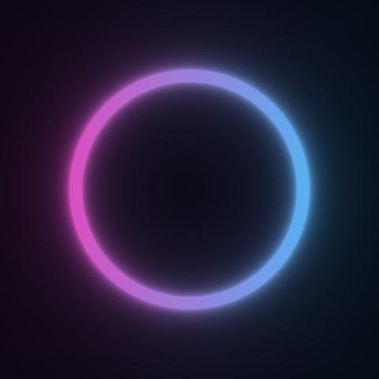
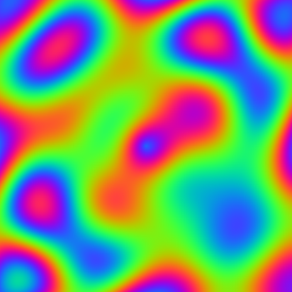

> [!SCENE] welcome

Welcome to Yotsuba Shader. An SDK for writing shaders in C# for multiple graphics APIs and game engines.

> [!SCENE] learn

## What you will learn

In this tutorial you will learn how to write shaders in C# with Yotsuba Shader, and how to compile them so you can hand them to the GPU, whether from an existing game engine, from your own engine, or straight from a graphics API.

> [!SCENE] basics

You will go from the basics of a shader to using the compiler.
You do not need to know what a shader is or how it works. We teach you here. All you need is to know how to program in C#.

> [!SCENE] steps

## How this tutorial is built

You are not going to read a list of attributes and functions. You are going to **write code and see it work**, step by step. In every chapter there is something to type, a command to run and an image that you should see appear in your window. If something does not look the same, the chapter tells you what to check.

> [!SCENE] path

The path has three stretches:

### 1. The fundamentals

Nothing is taken for granted here. It is designed for someone who has never seen a shader.

| Chapter | What you learn |
| --- | --- |
| [What is a shader?](what-is-a-shader.md) | What it is for, and why it runs on the GPU. |
| [How a shader is built](how-a-shader-is-built.md) | Vertices, pixels and the three doors the data travels through. |
| [Set up your project](setup.md) | You get everything installed, in a C# library for your shaders. |
| [Shader 1: a sunset](first-shader.md) | Your first complete shader, and how to compile it with the `add` command. |

### 2. The workshop

One chapter per tool, each with short exercises. Here you build the base that every shader uses.

| Chapter | What you learn |
| --- | --- |
| [Your window for seeing shaders](visor.md) | A viewer to see each change instantly. |
| [The colors](colors.md) | What a color means to the GPU, and what happens when you go over. |
| [The coordinates](coordinates.md) | How a pixel knows where it is, and how to stop your circles coming out oval. |
| [Deciding with if](decisions.md) | Rectangles, circles and boards. |
| [Functions and structs](functions.md) | How to keep order in a growing shader. |
| [Mixing and smoothing](mixing.md) | `mix`, `clamp` and `smoothstep`, written by you. |
| [Repeating with loops](loops.md) | `for`, `break`, `continue` and arrays. |
| [Time](time.md) | How something moves when it has no memory. |

### 3. The shaders

Now that you have the tools, you use them to make four more ambitious shaders.

| | Shader | The new thing you learn |
| --- | --- | --- |
|  | [2. A fractal](mandelbrot.md) | Putting `if`, loops and functions together into something complex. |
|  | [3. A neon ring](neon.md) | The math functions the GPU already has. |
|  | [4. A moving plasma](plasma.md) | How to send data to the shader from your program, such as the time. |
|  | [5. A photo underwater](underwater.md) | How to read an image from the shader and change it. |

When something does not work out, you have [When something goes wrong](debugging.md): a method for finding errors and the questions almost everyone asks.

> [!SCENE] finale

This tutorial uses {{engine}}. When you finish, in [What now?](next-steps.md), you see how the shaders you made are used in {{engine}}.

> [!TIP]
> Press **⌘K** (or **Ctrl K**) at any moment to search the whole site.

Start with [What is a shader?](what-is-a-shader.md).
