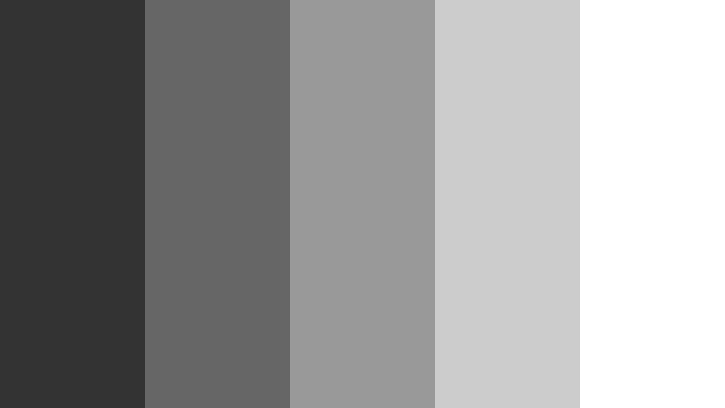
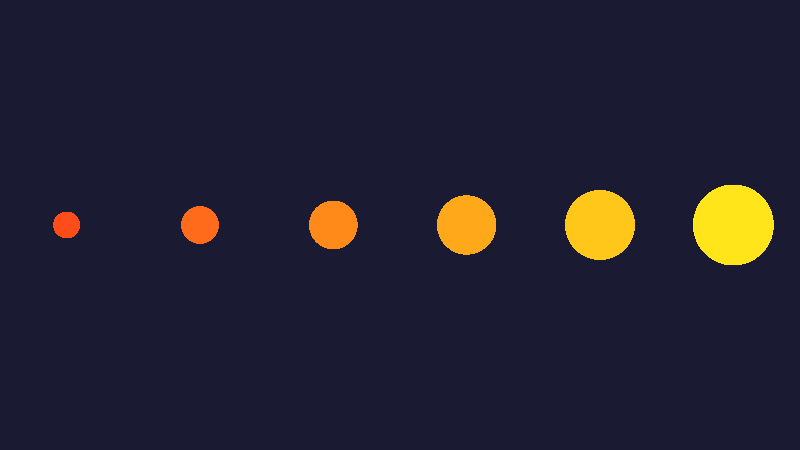
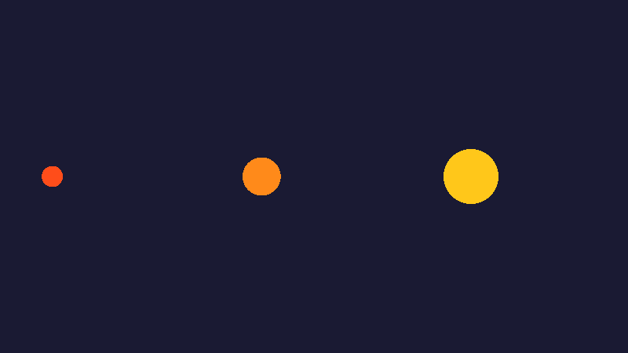
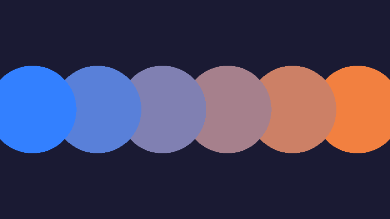
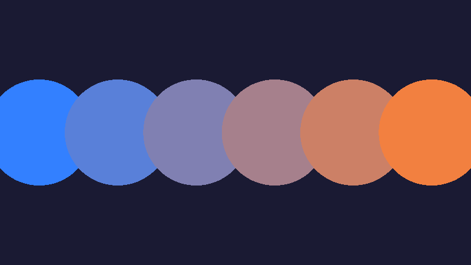
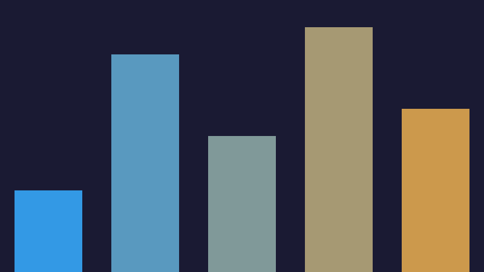
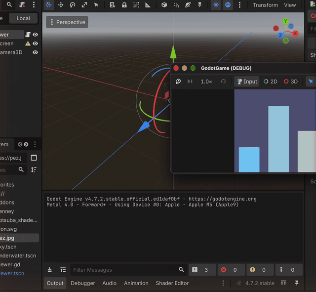

> [!SCENE] intro

You already know how to draw a circle. And six circles? And fifty? You are not going to copy and paste the same block fifty times. That is what **loops** are for: you tell the shader "repeat this so many times", and it does.

With loops, a shader does big things with little code. The Mandelbrot fractal, which you will make later, is nothing more than a loop that goes around a hundred times for each pixel.

> [!SCENE] for

## Step 1: counting with a for

Copy `Template.cs` as `Loops.cs` and change the class name to `Loops`. Replace the line in `Fragment` with this:

```csharp
int steps = 0;
for (int i = 0; i < 5; i++)
{
    if (pixel.Uv.X > i * 0.2f)
    {
        steps++;
    }
}
float v = steps / 5f;
return new vec4(v, v, v, 1f);
```

Run the work cycle:

{{register Loops}}



Five stripes of gray, each one lighter. Let us see how it was done, starting with the `for` line:

```csharp
for (int i = 0; i < 5; i++)
```

It has three parts separated by `;`:

| Part | What it does |
|---|---|
| `int i = 0` | **Before starting**, it creates a counter `i` worth `0`. |
| `i < 5` | **Before each lap**, it checks whether to continue. If false, the loop ends. |
| `i++` | **At the end of each lap**, it adds `1` to `i`. |

So `i` is `0, 1, 2, 3, 4` on each lap, and when it reaches `5` the loop stops: **five laps**.

Inside the loop, `pixel.Uv.X > i * 0.2f` asks "am I further to the right than the position `i * 0.2`?". Those positions are `0, 0.2, 0.4, 0.6, 0.8`. A pixel with `Uv.X = 0.5` exceeds three of them (`0`, `0.2` and `0.4`), so `steps` ends up being `3`. Divided by `5`, it gives `0.6`: a medium gray.

And remember what you learned in the decisions chapter: **each pixel does its own count**. The pixel on the left counts `0` or `1`; the one on the right counts `5`.

Change the `5` in the loop's condition and also the `5f`. If you use `10` in both, you get ten stripes.

> [!NOTE]
> This is the first time we use `steps++`. It is the same as `steps = steps + 1`, but shorter. It reads "add one".

> [!SCENE] circles

## Step 2: six circles with a single block

Now we are going to draw several circles, but writing the code **only once**. Declare the uniform, as you already know. At the top:

```csharp style=glsl
using YotsubaShader.GlslSyntax.Resources;
```

```csharp style=hlsl
using YotsubaShader.HlslSyntax.Resources;
```

```csharp style=msl
using YotsubaShader.MslSyntax.Resources;
```

```csharp style=wgsl
using YotsubaShader.WgslSyntax.Resources;
```

```csharp style=spirv
using YotsubaShader.SpirvSyntax.Resources;
```

And inside the class, before `Vertex`:

```csharp style=glsl
    [uniform, layout(0, 0)]
    public Context Data;
```

```csharp style=hlsl
    [cbuffer, register("b0")]
    public Context Data;
```

```csharp style=msl
    [constant, buffer(0)]
    public Context Data;
```

```csharp style=wgsl
    [uniform, @group(0), @binding(0)]
    public Context Data;
```

```csharp style=spirv
    [Uniform, DescriptorSet(0), Binding(0)]
    public Context Data;
```

Replace `Fragment` with this:

```csharp
float aspect = Data.Width / Data.Height;
float x = pixel.Uv.X * aspect;
float y = pixel.Uv.Y;

vec4 color = new vec4(0.1f, 0.1f, 0.2f, 1f);
for (int i = 0; i < 6; i++)
{
    float centerX = (i + 0.5f) * aspect / 6f;
    float radius = 0.03f + 0.012f * i;
    float dx = x - centerX;
    float dy = y - 0.5f;
    if (dx * dx + dy * dy < radius * radius)
    {
        color = new vec4(1f, 0.3f + 0.12f * i, 0.1f, 1f);
    }
}
return color;
```



Here the counter `i` does not just count: **it is used in the calculations**. On each lap, `i` is something different, and that is why each circle comes out different:

| Lap (`i`) | Position `centerX` | Radius |
|---|---|---|
| 0 | `0.5 * aspect / 6` | 0.030 |
| 1 | `1.5 * aspect / 6` | 0.042 |
| 2 | `2.5 * aspect / 6` | 0.054 |
| ... | ... | ... |
| 5 | `5.5 * aspect / 6` | 0.090 |

The position spreads the six circles across the width: we cut the width into six equal pieces and put each circle in the **middle** of its piece (that is why the `+ 0.5f`). The radius grows by `0.012` with each lap, and so does the green of the color.

For seven circles, change the two `6`s to `7`. To make them bigger, change the `0.03f`.

> [!WARNING]
> A classic trap: **integer division**. If you write `i / 6`, and `i` is an `int`, C# divides integers and **throws away the decimals**: `1 / 6` gives `0`, not `0.1666`. That is why we write `(i + 0.5f) * aspect / 6f`: as soon as a `float` appears, everything is computed with decimals. If some day a value always comes out `0` or always `1` for no reason, check whether you are dividing two integers.

> [!SCENE] continue

## Step 3: skipping laps with continue

Sometimes you want nothing to happen on some laps. `continue` means *"end this lap here and go to the next one"*. Add this **at the beginning of the loop body**, right below the opening brace:

```csharp
    if (i % 2 == 1)
    {
        continue;
    }
```

`i % 2 == 1` is true when `i` is odd. On those laps, `continue` skips the rest of the block. Run the work cycle.



Only the circles from laps `0`, `2` and `4` are drawn. The others were skipped.

> [!SCENE] break

## Step 4: stopping early with break

`break` is the other tool: *"leave the loop right now"*. To see it, remove the `continue` you just added and make the circles **overlap** (big fixed radius). Replace the whole loop with this one:

```csharp
for (int i = 0; i < 6; i++)
{
    float centerX = (i + 0.5f) * aspect / 6f;
    float dx = x - centerX;
    float dy = y - 0.5f;
    if (dx * dx + dy * dy < 0.2f * 0.2f)
    {
        color = new vec4(0.2f + 0.15f * i, 0.5f, 1f - 0.15f * i, 1f);
        break;
    }
}
```

Compare this result with the same code **without** the `break` line (try it yourself: delete it and run again).





Without `break`, each lap paints over the previous one, so **the last circle wins** (the one on the right). With `break`, as soon as a circle hits, the loop stops, and **the first one wins** (the one on the left). It is the same idea as the face: the order decides who ends up on top.

> [!SCENE] array

## Step 5: a list of data, the array

Until now, what changed on each lap came from a **formula** with `i`. But sometimes the data does not follow any formula: it is simply a list. For example, the heights of the bars in a chart.

That is what the **array** is for: a row of numbered values. It is created like this:

```csharp
float[] heights = new float[5];
heights[0] = 0.3f;
heights[1] = 0.8f;
heights[2] = 0.5f;
heights[3] = 0.9f;
heights[4] = 0.6f;
```

- `new float[5]` creates a list with **five** slots.
- `heights[2]` is slot number `2`. Counting starts at `0`: the slots are `0, 1, 2, 3, 4`.

Now, a bar chart. Replace the entire `Fragment` with this:

```csharp
float[] heights = new float[5];
heights[0] = 0.3f;
heights[1] = 0.8f;
heights[2] = 0.5f;
heights[3] = 0.9f;
heights[4] = 0.6f;

vec4 color = new vec4(0.1f, 0.1f, 0.2f, 1f);
for (int i = 0; i < 5; i++)
{
    float left = i * 0.2f + 0.03f;
    float right = left + 0.14f;
    if (pixel.Uv.X > left && pixel.Uv.X < right && pixel.Uv.Y > 1f - heights[i])
    {
        color = new vec4(0.2f + 0.15f * i, 0.6f, 0.9f - 0.15f * i, 1f);
    }
}
return color;
```

Run the work cycle.



:::godot

:::

Each lap draws one bar: its left and right edges come from `i`, and its height comes from the list `heights[i]`. Notice the height condition: `Uv.Y > 1f - heights[i]`. Remember that `Y` grows downward, so "being below the line" means having a **greater** `Y`.

Change the numbers in the list and you will see the bars go up and down. That is the power of combining a loop with an array: adding one more bar is adding a slot and changing the `5` to a `6`.

> [!NOTE]
> A shader's arrays have a fixed size, which you must write when creating them: `new float[5]`. You cannot ask for a size that depends on a variable, because the GPU needs to know how much memory to reserve before starting.

> [!SCENE] while

## Another loop: while

There is another way to repeat, the `while`, which continues as long as a condition is true:

```csharp
int pasos = 0;
while (pasos < 100)
{
    pasos++;
}
```

It does the same as a `for`, with the difference that you take care of the counter. You will use it when you do not know before starting how many laps to take, though always with a limit. The Mandelbrot, later on, is an example.

> [!SCENE] cost

## Careful: loops cost

There is a calculation worth doing. If your window has 360,000 pixels and your loop goes around 100 times, the GPU does 36 million laps per image. It is a lot for a person, but a GPU handles it well. What it cannot handle is a loop **without an end**.

> [!WARNING]
> If you write a loop with a condition that never becomes false, the shader does not finish, and your screen may freeze or the program close. Always give it a clear limit: `i < 100`, or a `break` that is sure to be reached. In a shader there is no such thing as "it will end eventually".

A practical rule: start with few laps, check that it works, and raise the number only if needed.

## All together

This is the complete bar chart file:

```csharp style=glsl title="MyShaders/Loops.cs"
using YotsubaShader.GlslSyntax;
using YotsubaShader.GlslSyntax.Types;
using YotsubaShader.Language;

namespace MyShaders;

public class Loops
{
    [ShaderStage(Stage.Vertex)]
    public Pixel Vertex({{vertexType}} corner)
    {
        Pixel pixel;
        pixel.Position = new vec4(corner.{{pos}}.X, corner.{{pos}}.Y, 0f, 1f);
        pixel.Uv = corner.{{uv}};
        return pixel;
    }

    [ShaderStage(Stage.Fragment)]
    [return: location(0)]
    public vec4 Fragment(PixelIn pixel)
    {
        float[] heights = new float[5];
        heights[0] = 0.3f;
        heights[1] = 0.8f;
        heights[2] = 0.5f;
        heights[3] = 0.9f;
        heights[4] = 0.6f;

        vec4 color = new vec4(0.1f, 0.1f, 0.2f, 1f);
        for (int i = 0; i < 5; i++)
        {
            float left = i * 0.2f + 0.03f;
            float right = left + 0.14f;
            if (pixel.Uv.X > left && pixel.Uv.X < right && pixel.Uv.Y > 1f - heights[i])
            {
                color = new vec4(0.2f + 0.15f * i, 0.6f, 0.9f - 0.15f * i, 1f);
            }
        }
        return color;
    }
}
```

```csharp style=hlsl title="MyShaders/Loops.cs"
using YotsubaShader.HlslSyntax;
using YotsubaShader.GlslSyntax.Types;
using YotsubaShader.Language;

namespace MyShaders;

public class Loops
{
    [ShaderStage(Stage.Vertex)]
    public Pixel Vertex({{vertexType}} corner)
    {
        Pixel pixel;
        pixel.Position = new vec4(corner.{{pos}}.X, corner.{{pos}}.Y, 0f, 1f);
        pixel.Uv = corner.{{uv}};
        return pixel;
    }

    [ShaderStage(Stage.Fragment)]
    [return: SV_Target]
    public vec4 Fragment(PixelIn pixel)
    {
        float[] heights = new float[5];
        heights[0] = 0.3f;
        heights[1] = 0.8f;
        heights[2] = 0.5f;
        heights[3] = 0.9f;
        heights[4] = 0.6f;

        vec4 color = new vec4(0.1f, 0.1f, 0.2f, 1f);
        for (int i = 0; i < 5; i++)
        {
            float left = i * 0.2f + 0.03f;
            float right = left + 0.14f;
            if (pixel.Uv.X > left && pixel.Uv.X < right && pixel.Uv.Y > 1f - heights[i])
            {
                color = new vec4(0.2f + 0.15f * i, 0.6f, 0.9f - 0.15f * i, 1f);
            }
        }
        return color;
    }
}
```

```csharp style=msl title="MyShaders/Loops.cs"
using YotsubaShader.MslSyntax;
using YotsubaShader.GlslSyntax.Types;
using YotsubaShader.Language;

namespace MyShaders;

public class Loops
{
    [ShaderStage(Stage.Vertex)]
    public Pixel Vertex({{vertexType}} corner)
    {
        Pixel pixel;
        pixel.Position = new vec4(corner.{{pos}}.X, corner.{{pos}}.Y, 0f, 1f);
        pixel.Uv = corner.{{uv}};
        return pixel;
    }

    [ShaderStage(Stage.Fragment)]
    [return: color(0)]
    public vec4 Fragment(PixelIn pixel)
    {
        float[] heights = new float[5];
        heights[0] = 0.3f;
        heights[1] = 0.8f;
        heights[2] = 0.5f;
        heights[3] = 0.9f;
        heights[4] = 0.6f;

        vec4 color = new vec4(0.1f, 0.1f, 0.2f, 1f);
        for (int i = 0; i < 5; i++)
        {
            float left = i * 0.2f + 0.03f;
            float right = left + 0.14f;
            if (pixel.Uv.X > left && pixel.Uv.X < right && pixel.Uv.Y > 1f - heights[i])
            {
                color = new vec4(0.2f + 0.15f * i, 0.6f, 0.9f - 0.15f * i, 1f);
            }
        }
        return color;
    }
}
```

```csharp style=wgsl title="MyShaders/Loops.cs"
using YotsubaShader.WgslSyntax;
using YotsubaShader.GlslSyntax.Types;
using YotsubaShader.Language;

namespace MyShaders;

public class Loops
{
    [ShaderStage(Stage.Vertex)]
    public Pixel Vertex({{vertexType}} corner)
    {
        Pixel pixel;
        pixel.Position = new vec4(corner.{{pos}}.X, corner.{{pos}}.Y, 0f, 1f);
        pixel.Uv = corner.{{uv}};
        return pixel;
    }

    [ShaderStage(Stage.Fragment)]
    [return: location(0)]
    public vec4 Fragment(PixelIn pixel)
    {
        float[] heights = new float[5];
        heights[0] = 0.3f;
        heights[1] = 0.8f;
        heights[2] = 0.5f;
        heights[3] = 0.9f;
        heights[4] = 0.6f;

        vec4 color = new vec4(0.1f, 0.1f, 0.2f, 1f);
        for (int i = 0; i < 5; i++)
        {
            float left = i * 0.2f + 0.03f;
            float right = left + 0.14f;
            if (pixel.Uv.X > left && pixel.Uv.X < right && pixel.Uv.Y > 1f - heights[i])
            {
                color = new vec4(0.2f + 0.15f * i, 0.6f, 0.9f - 0.15f * i, 1f);
            }
        }
        return color;
    }
}
```

```csharp style=spirv title="MyShaders/Loops.cs"
using YotsubaShader.SpirvSyntax;
using YotsubaShader.GlslSyntax.Types;
using YotsubaShader.Language;

namespace MyShaders;

public class Loops
{
    [ShaderStage(Stage.Vertex)]
    public Pixel Vertex({{vertexType}} corner)
    {
        Pixel pixel;
        pixel.Position = new vec4(corner.{{pos}}.X, corner.{{pos}}.Y, 0f, 1f);
        pixel.Uv = corner.{{uv}};
        return pixel;
    }

    [ShaderStage(Stage.Fragment)]
    [return: Location(0)]
    public vec4 Fragment(PixelIn pixel)
    {
        float[] heights = new float[5];
        heights[0] = 0.3f;
        heights[1] = 0.8f;
        heights[2] = 0.5f;
        heights[3] = 0.9f;
        heights[4] = 0.6f;

        vec4 color = new vec4(0.1f, 0.1f, 0.2f, 1f);
        for (int i = 0; i < 5; i++)
        {
            float left = i * 0.2f + 0.03f;
            float right = left + 0.14f;
            if (pixel.Uv.X > left && pixel.Uv.X < right && pixel.Uv.Y > 1f - heights[i])
            {
                color = new vec4(0.2f + 0.15f * i, 0.6f, 0.9f - 0.15f * i, 1f);
            }
        }
        return color;
    }
}
```

> [!SCENE] learned

## What you learned

- `for (int i = 0; i < n; i++)` repeats a block `n` times, with `i` being `0, 1, ..., n - 1`.
- The counter `i` can be used in the calculations, and that makes each lap draw something different.
- `continue` jumps to the next lap. `break` leaves the loop.
- An array is a fixed-size list of data, numbered from `0`.
- Dividing two integers discards the decimals. If you need decimals, add an `f`.
- A loop must always have a limit. Each pixel runs it in full.

Next: [Time](time.md).
