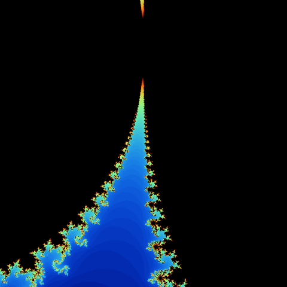
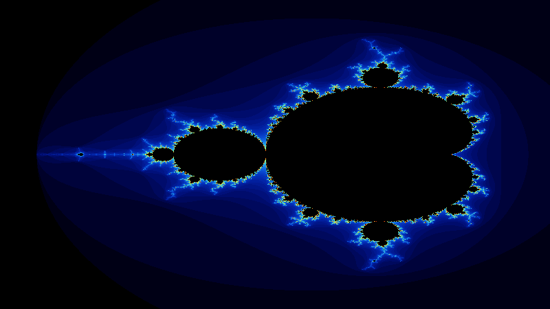
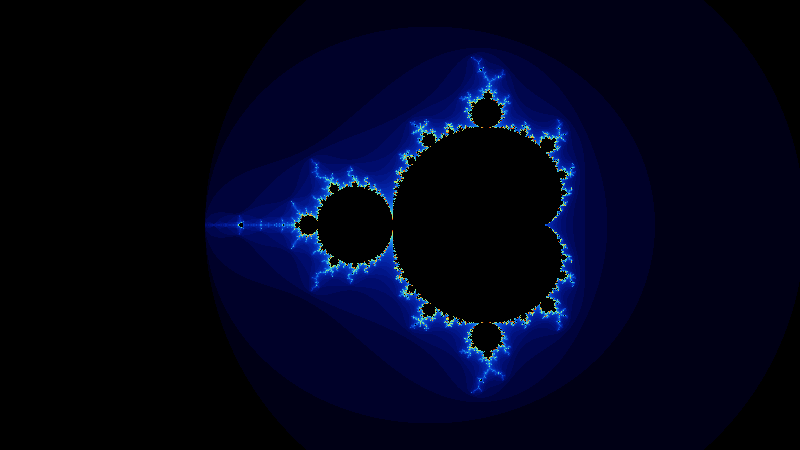
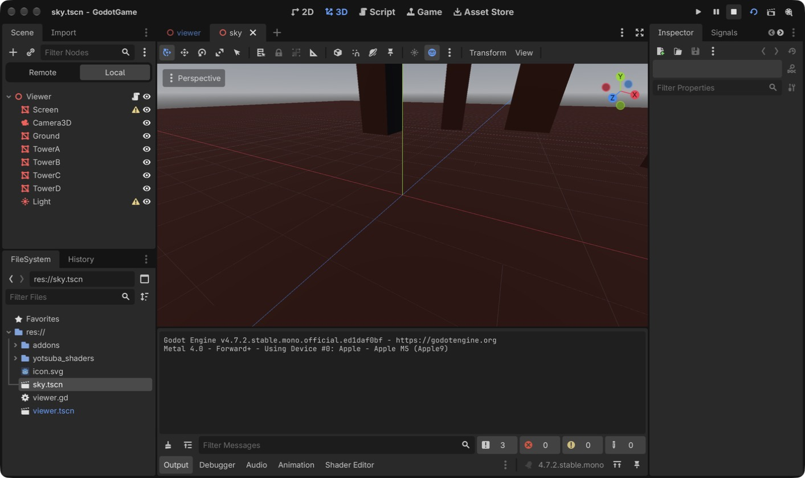
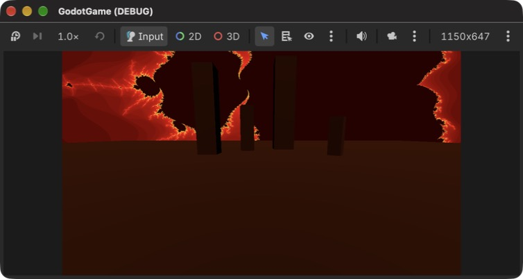

You already know how to decide with `if`, repeat with loops, write your own functions and move things with time. Now you are going to put it all together in a more ambitious shader: each pixel will run a loop of up to 100 turns, and with that you will draw this:


It is called the Mandelbrot fractal. The curious thing is that there is no image stored anywhere: that whole drawing comes from a two-line formula, repeated many times.

There is no new C# in this chapter. It is proof that what you learned in the previous ones is enough to draw something as complex as this.

## The idea, without the math

For each pixel we do the following:

1. We take two numbers that depend on where the pixel is. We will call them `cx` and `cy`.
2. We start with two other numbers, `x` and `y`, at zero.
3. We apply a formula that changes `x` and `y`, using `cx` and `cy`. And we apply it again. And again.
4. With some pixels, `x` and `y` always stay small, no matter how many turns we take. With others, they grow without stopping and "escape".
5. We count how many turns each pixel lasted before escaping. That number decides its color.

The pixels that never escape are the black shape. The ones that escape quickly are the dark background. And the ones that take a while to escape form the bright edges.

That is all. You do not need to understand why the formula produces that drawing. What we care about is how it is written.

## Step 1: counting the turns

This is the function that does the turns. It is normal C#:

```csharp
public static int CountSteps(float cx, float cy)
{
    float x = 0f;
    float y = 0f;
    int steps = 0;

    while (steps < 100)
    {
        float newX = x * x - y * y + cx;
        float newY = 2f * x * y + cy;
        x = newX;
        y = newY;

        if (x * x + y * y > 4f)
        {
            break;
        }

        steps++;
    }

    return steps;
}
```

Read it from top to bottom:

- The `while` takes at most 100 turns.
- The first two lines inside the loop are the formula. They calculate the new `x` and `y` from the previous ones.
- The `if` checks whether the point has already escaped. If so, `break` cuts the loop.
- If not, we add one turn and carry on.

The function returns how many turns it took. If it returns 100, the point never escaped.

Look at what is here: a `while`, an `if`, a `break`, an `int` and a `++`. All of that works inside the GPU.

> [!WARNING]
> A loop in a shader must always have a sure end. Here it is `steps < 100`. A loop that never ends does not give an error: it freezes the GPU, and the whole screen with it.

## Step 2: from the pixel to `cx` and `cy`

`CountSteps` needs two numbers for each pixel. We get them from `Uv`, which you already know: it goes from `0` to `1`.

The drawing of the fractal lives between `-2.2` and `0.8` from left to right, and between `-1.5` and `1.5` from top to bottom. So a number that goes from `0` to `1` has to be turned into one that goes, for example, from `-2.2` to `0.8`:

```csharp
float cx = pixel.Uv.X * 3f - 2.2f;
float cy = pixel.Uv.Y * 3f - 1.5f;
```

Check it with the extremes: when `Uv.X` is `0`, `cx` is `-2.2`. When it is `1`, it is `3 - 2.2 = 0.8`. This "multiply to stretch, subtract to move" calculation is one you will use in every shader.

## Step 3: from the number of turns to a color

If the point took all 100 turns, we paint it black. If not, we turn its turns into a color:

```csharp
int steps = CountSteps(cx, cy);

if (steps == 100)
{
    return Make.Vec4(0f, 0f, 0f, 1f);
}

float t = steps / 100f;
return Palette(t);
```

`t` is the number of turns brought to a value between `0` and `1`. Notice that we divide by `100f`, with the `f`: that way the division is between `float`s. If you wrote `steps / 100`, C# would do an integer division and the result would always be `0`.

And this is the function that turns `t` into a color:

```csharp
public static vec4 Palette(float t)
{
    float rest = 1f - t;
    float red = 9f * rest * t * t * t;
    float green = 15f * rest * rest * t * t;
    float blue = 8.5f * rest * rest * rest * t;
    return Make.Vec4(red, green, blue, 1f);
}
```

You do not have to memorize those numbers. What they do is make blue show up with small values of `t`, green with middle values and red with high values. So the points that escape quickly come out dark blue, and the ones that take longer go through light blue up to yellow.

## The complete shader

Create `MyShaders/Mandelbrot.cs`:

```csharp style=glsl title="MyShaders/Mandelbrot.cs"
using YotsubaShader.GlslSyntax;
using YotsubaShader.GlslSyntax.Types;
using YotsubaShader.Language;

namespace MyShaders;

public class Mandelbrot
{
    [ShaderStage(Stage.Vertex)]
    public Pixel Vertex({{vertexType}} corner)
    {
        Pixel pixel;
        pixel.Position = Make.Vec4(corner.{{pos}}.X, corner.{{pos}}.Y, 0f, 1f);
        pixel.Uv = corner.{{uv}};
        return pixel;
    }

    [ShaderStage(Stage.Fragment)]
    [return: location(0)]
    public vec4 Fragment(PixelIn pixel)
    {
        float cx = pixel.Uv.X * 3f - 2.2f;
        float cy = pixel.Uv.Y * 3f - 1.5f;

        int steps = CountSteps(cx, cy);

        if (steps == 100)
        {
            return Make.Vec4(0f, 0f, 0f, 1f);
        }

        float t = steps / 100f;
        return Palette(t);
    }

    public static int CountSteps(float cx, float cy)
    {
        float x = 0f;
        float y = 0f;
        int steps = 0;

        while (steps < 100)
        {
            float newX = x * x - y * y + cx;
            float newY = 2f * x * y + cy;
            x = newX;
            y = newY;

            if (x * x + y * y > 4f)
            {
                break;
            }

            steps++;
        }

        return steps;
    }

    public static vec4 Palette(float t)
    {
        float rest = 1f - t;
        float red = 9f * rest * t * t * t;
        float green = 15f * rest * rest * t * t;
        float blue = 8.5f * rest * rest * rest * t;
        return Make.Vec4(red, green, blue, 1f);
    }
}
```

```csharp style=hlsl title="MyShaders/Mandelbrot.cs"
using YotsubaShader.HlslSyntax;
using YotsubaShader.GlslSyntax.Types;
using YotsubaShader.Language;

namespace MyShaders;

public class Mandelbrot
{
    [ShaderStage(Stage.Vertex)]
    public Pixel Vertex({{vertexType}} corner)
    {
        Pixel pixel;
        pixel.Position = Make.Vec4(corner.{{pos}}.X, corner.{{pos}}.Y, 0f, 1f);
        pixel.Uv = corner.{{uv}};
        return pixel;
    }

    [ShaderStage(Stage.Fragment)]
    [return: SV_Target]
    public vec4 Fragment(PixelIn pixel)
    {
        float cx = pixel.Uv.X * 3f - 2.2f;
        float cy = pixel.Uv.Y * 3f - 1.5f;

        int steps = CountSteps(cx, cy);

        if (steps == 100)
        {
            return Make.Vec4(0f, 0f, 0f, 1f);
        }

        float t = steps / 100f;
        return Palette(t);
    }

    public static int CountSteps(float cx, float cy)
    {
        float x = 0f;
        float y = 0f;
        int steps = 0;

        while (steps < 100)
        {
            float newX = x * x - y * y + cx;
            float newY = 2f * x * y + cy;
            x = newX;
            y = newY;

            if (x * x + y * y > 4f)
            {
                break;
            }

            steps++;
        }

        return steps;
    }

    public static vec4 Palette(float t)
    {
        float rest = 1f - t;
        float red = 9f * rest * t * t * t;
        float green = 15f * rest * rest * t * t;
        float blue = 8.5f * rest * rest * rest * t;
        return Make.Vec4(red, green, blue, 1f);
    }
}
```

```csharp style=msl title="MyShaders/Mandelbrot.cs"
using YotsubaShader.MslSyntax;
using YotsubaShader.GlslSyntax.Types;
using YotsubaShader.Language;

namespace MyShaders;

public class Mandelbrot
{
    [ShaderStage(Stage.Vertex)]
    public Pixel Vertex({{vertexType}} corner)
    {
        Pixel pixel;
        pixel.Position = Make.Vec4(corner.{{pos}}.X, corner.{{pos}}.Y, 0f, 1f);
        pixel.Uv = corner.{{uv}};
        return pixel;
    }

    [ShaderStage(Stage.Fragment)]
    [return: color(0)]
    public vec4 Fragment(PixelIn pixel)
    {
        float cx = pixel.Uv.X * 3f - 2.2f;
        float cy = pixel.Uv.Y * 3f - 1.5f;

        int steps = CountSteps(cx, cy);

        if (steps == 100)
        {
            return Make.Vec4(0f, 0f, 0f, 1f);
        }

        float t = steps / 100f;
        return Palette(t);
    }

    public static int CountSteps(float cx, float cy)
    {
        float x = 0f;
        float y = 0f;
        int steps = 0;

        while (steps < 100)
        {
            float newX = x * x - y * y + cx;
            float newY = 2f * x * y + cy;
            x = newX;
            y = newY;

            if (x * x + y * y > 4f)
            {
                break;
            }

            steps++;
        }

        return steps;
    }

    public static vec4 Palette(float t)
    {
        float rest = 1f - t;
        float red = 9f * rest * t * t * t;
        float green = 15f * rest * rest * t * t;
        float blue = 8.5f * rest * rest * rest * t;
        return Make.Vec4(red, green, blue, 1f);
    }
}
```

```csharp style=wgsl title="MyShaders/Mandelbrot.cs"
using YotsubaShader.WgslSyntax;
using YotsubaShader.GlslSyntax.Types;
using YotsubaShader.Language;

namespace MyShaders;

public class Mandelbrot
{
    [ShaderStage(Stage.Vertex)]
    public Pixel Vertex({{vertexType}} corner)
    {
        Pixel pixel;
        pixel.Position = Make.Vec4(corner.{{pos}}.X, corner.{{pos}}.Y, 0f, 1f);
        pixel.Uv = corner.{{uv}};
        return pixel;
    }

    [ShaderStage(Stage.Fragment)]
    [return: location(0)]
    public vec4 Fragment(PixelIn pixel)
    {
        float cx = pixel.Uv.X * 3f - 2.2f;
        float cy = pixel.Uv.Y * 3f - 1.5f;

        int steps = CountSteps(cx, cy);

        if (steps == 100)
        {
            return Make.Vec4(0f, 0f, 0f, 1f);
        }

        float t = steps / 100f;
        return Palette(t);
    }

    public static int CountSteps(float cx, float cy)
    {
        float x = 0f;
        float y = 0f;
        int steps = 0;

        while (steps < 100)
        {
            float newX = x * x - y * y + cx;
            float newY = 2f * x * y + cy;
            x = newX;
            y = newY;

            if (x * x + y * y > 4f)
            {
                break;
            }

            steps++;
        }

        return steps;
    }

    public static vec4 Palette(float t)
    {
        float rest = 1f - t;
        float red = 9f * rest * t * t * t;
        float green = 15f * rest * rest * t * t;
        float blue = 8.5f * rest * rest * rest * t;
        return Make.Vec4(red, green, blue, 1f);
    }
}
```

```csharp style=spirv title="MyShaders/Mandelbrot.cs"
using YotsubaShader.SpirvSyntax;
using YotsubaShader.GlslSyntax.Types;
using YotsubaShader.Language;

namespace MyShaders;

public class Mandelbrot
{
    [ShaderStage(Stage.Vertex)]
    public Pixel Vertex({{vertexType}} corner)
    {
        Pixel pixel;
        pixel.Position = Make.Vec4(corner.{{pos}}.X, corner.{{pos}}.Y, 0f, 1f);
        pixel.Uv = corner.{{uv}};
        return pixel;
    }

    [ShaderStage(Stage.Fragment)]
    [return: Location(0)]
    public vec4 Fragment(PixelIn pixel)
    {
        float cx = pixel.Uv.X * 3f - 2.2f;
        float cy = pixel.Uv.Y * 3f - 1.5f;

        int steps = CountSteps(cx, cy);

        if (steps == 100)
        {
            return Make.Vec4(0f, 0f, 0f, 1f);
        }

        float t = steps / 100f;
        return Palette(t);
    }

    public static int CountSteps(float cx, float cy)
    {
        float x = 0f;
        float y = 0f;
        int steps = 0;

        while (steps < 100)
        {
            float newX = x * x - y * y + cx;
            float newY = 2f * x * y + cy;
            x = newX;
            y = newY;

            if (x * x + y * y > 4f)
            {
                break;
            }

            steps++;
        }

        return steps;
    }

    public static vec4 Palette(float t)
    {
        float rest = 1f - t;
        float red = 9f * rest * t * t * t;
        float green = 15f * rest * rest * t * t;
        float blue = 8.5f * rest * rest * rest * t;
        return Make.Vec4(red, green, blue, 1f);
    }
}
```

Three things worth noticing:

- **The `Vertex` method is the same as in the previous shader.** When what you draw is a rectangle that covers the screen, the Vertex stage does not change. The interesting part happens in `Fragment`.
- **You did not write `Corner`, `Pixel` and `PixelIn` again.** They are in `Screen.cs` and all your shaders share them, like any `struct` in your project.
- **The `CountSteps` and `Palette` functions do not have `[ShaderStage]`.** Only stages have it. The rest are helper functions, and the compiler finds them on its own because `Fragment` calls them.

## Compile and look at the result

The same command as always. Since `add` compiles every shader in the project, it now processes both:

{{register Mandelbrot}}

The viewer opens with your fractal. You will probably see it **stretched sideways**. It is not a fault of the shader: it is the same problem as the oval in the [coordinates](coordinates.md) chapter. This shader converts the `Uv` into numbers without taking into account that the window is wider than tall. To see it properly, make it square: in `Viewer/Program.cs`, change `800` and `450` to `600` and `600`. At the end of the chapter there is a challenge to fix it in the shader itself.

If you also want to see the compiled version, in `TryIt/Program.cs` change `new Gradient()` to `new Mandelbrot()`:

```csharp title="TryIt/Program.cs"
using MyShaders;
using YotsubaShader;
using YotsubaShader.Language;

var shader = new Mandelbrot();

Console.WriteLine(shader.ToGlsl(Stage.Fragment));
```

```bash
dotnet run --project TryIt
```

In the output, look for your `CountSteps` function. It is there, with its loop:

```glsl
int CountSteps(float cx, float cy)
{
    float x = 0.0;
    float y = 0.0;
    int steps = 0;
    while (steps < 100)
    {
        float newX = ((x * x) - (y * y)) + cx;
        float newY = ((2.0 * x) * y) + cy;
        x = newX;
        y = newY;
        if (((x * x) + (y * y)) > 4.0)
        {
            break;
        }
        steps++;
    }
    return steps;
}
```

Think for a moment about what the GPU does with this. If you draw in a 600 by 600 window, that is 360,000 pixels. Each one takes up to 100 turns. That is up to 36 million turns per image, and the GPU does it dozens of times per second without effort, because all the pixels work at once. This is reason 1 from the chapter [What is a shader?](what-is-a-shader.md), now with a real example.

## Play with it

The best thing about a fractal is that you can get as close as you want and there is always more detail. To zoom in you only have to change the two lines that calculate `cx` and `cy`: a smaller number in the multiplication is more zoom, and the number you subtract moves the view.

Try these:

```csharp
float cx = pixel.Uv.X * 0.3f - 0.9f;
float cy = pixel.Uv.Y * 0.3f - 0.05f;
```



Other things you can try (remember to run `add` after each change):

- Change both `100`s to `20`. The edge loses detail, because the points have fewer turns to show whether they escape.
- In `Palette`, swap `red` and `blue` in the last line. The fractal goes from blue to orange.

### Challenge: stop it stretching

In a wide window the fractal comes out stretched:



You already know how to fix it: you did it with the circle. Try it yourself before looking at the solution. You need three things: declare the `Data` uniform (with its `using`), compute the `aspect`, and use it in `cx`. And so the fractal stays centered, it helps to measure from the center of the window (`Uv.X - 0.5f`), as in the coordinates chapter.

One possible solution: declare the uniform in the `Mandelbrot` class, as always,

```csharp style=glsl
    [uniform, layout(0, 0)]
    public Context Data;
```

```csharp style=hlsl
    [cbuffer, register("b0")]
    public Context Data;
```

```csharp style=msl
    [constant, buffer(0)]
    public Context Data;
```

```csharp style=wgsl
    [uniform, @group(0), @binding(0)]
    public Context Data;
```

```csharp style=spirv
    [Uniform, DescriptorSet(0), Binding(0)]
    public Context Data;
```

and replace the two lines of `cx` and `cy` with these three:

```csharp
float aspect = Data.Width / Data.Height;
float cx = (pixel.Uv.X - 0.5f) * 3f * aspect - 0.7f;
float cy = (pixel.Uv.Y - 0.5f) * 3f;
```



The numbers `3f` and `-0.7f` are the ones that used to come from the `3f` and the `-2.2f`: the `3` is how much of the plane is seen in height, and the `-0.7` is the center of the view horizontally.

:::godot
## A bonus for Godot: an apocalyptic sky

In Godot the fractal does not have to stay inside a rectangle. You are going to use it as the **sky of a 3D scene**, with a ripple that makes it look like the air is burning.

> [!NOTE]
> This is a **temporary** shader, only to show off. You will not need it later: when you finish, you go back to `Mandelbrot` and the rest of the tutorial goes on exactly as in every other route.

Create `MyShaders/MandelbrotSky.cs`:

```csharp style=glsl title="MyShaders/MandelbrotSky.cs"
using YotsubaShader.GlslSyntax;
using YotsubaShader.GlslSyntax.Resources;
using YotsubaShader.GlslSyntax.Types;
using YotsubaShader.Language;
using static YotsubaShader.GlslSyntax.Methods.Math;

namespace MyShaders;

public struct SkyClock
{
    public float Seconds;
}

public class MandelbrotSky
{
    [uniform, layout(0, 0)]
    public SkyClock Sky;

    [ShaderStage(Stage.Vertex)]
    public Pixel Vertex(GodotVertex corner)
    {
        Pixel pixel;
        // z almost 0: the rectangle sits at the very back, behind every object of the scene.
        pixel.Position = Make.Vec4(corner.VERTEX.X, corner.VERTEX.Y, 0.00001f, 1f);
        pixel.Uv = corner.UV;
        return pixel;
    }

    [ShaderStage(Stage.Fragment)]
    [return: location(0)]
    public vec4 Fragment(PixelIn pixel)
    {
        float t = Sky.Seconds;

        // The ripple: every row of the sky is pushed sideways by a wave that travels upwards.
        float u = pixel.Uv.X + 0.012f * sin(pixel.Uv.Y * 38f - t * 2.5f);
        float v = pixel.Uv.Y + 0.008f * sin(pixel.Uv.X * 29f + t * 1.7f);

        // A slow breathing zoom over the upper edge of the fractal.
        float zoom = 1.1f + 0.2f * sin(t * 0.15f);
        float cx = -0.65f + (u - 0.5f) * 3f / zoom;
        float cy = 0.45f + (v - 0.5f) * 1.7f / zoom;

        int steps = CountSteps(cx, cy);
        float k = steps / 100f;
        float red = clamp(k * 4f, 0f, 1f);
        float green = clamp(k * 4f - 1.2f, 0f, 1f) * 0.55f;
        float blue = clamp(k * 4f - 3f, 0f, 1f) * 0.25f;

        // The inside of the set (all 100 steps) is the dark core of the sky.
        float inside = step(100f, steps);
        red = mix(red, 0.02f, inside);
        green = mix(green, 0f, inside);
        blue = mix(blue, 0f, inside);
        return Make.Vec4(red, green, blue, 1f);
    }

    public static int CountSteps(float cx, float cy)
    {
        float x = 0f;
        float y = 0f;
        int steps = 0;

        while (steps < 100)
        {
            float newX = x * x - y * y + cx;
            float newY = 2f * x * y + cy;
            x = newX;
            y = newY;

            if (x * x + y * y > 4f)
            {
                break;
            }

            steps++;
        }

        return steps;
    }
}
```

Three ideas are new here:

- **`0.00001f` in the position.** Until now the third number of `Position` was `0f`. In Godot, that number is the depth: how far from the camera the point is. With almost zero, the rectangle goes to the very back, behind everything else. Objects in front of it hide it, exactly like a real sky.
- **The ripple.** Before turning the pixel into `cx` and `cy`, you push `Uv.X` a little with a `sin` of the height, and `Uv.Y` with a `sin` of the width. Both include the time, so the waves travel. Change `0.012f` to `0.05f` and the sky will melt.
- **`step` and `mix` instead of an `if`.** The inside of the set is painted with these two, which choose a color without branching. `step(100f, steps)` is `1` when the pixel never escaped and `0` otherwise; `mix` uses that number to pick between the fire color and the dark core.

Now the scene. Open `viewer.tscn` and save it with another name (**Scene → Save Scene As…**): `sky.tscn`. Then add, as children of `Viewer`:

- **`Ground`**: a `MeshInstance3D`. In the Inspector, **Mesh → New PlaneMesh** and make its **Size** `80 × 80`.
- **`TowerA`, `TowerB`, `TowerC`**: more `MeshInstance3D`, with **Mesh → New BoxMesh**, tall and thin (for example `1.6 × 7 × 1.6`). Place them behind the camera's view, between `-4` and `-11` in Z, at different heights.
- **`Light`**: a `DirectionalLight3D` with an orange color.

Select the `Camera3D` and move it up and back (`Position` Y `1.6`, Z `8`). Select the root and write `MandelbrotSky` in **Shader Name**.



Press **Play Scene** (`Cmd/Ctrl+R`):



The fractal is your own code, running as the background of a 3D scene. To go back, open `viewer.tscn`: it still says `Mandelbrot`.
:::

## What you can use inside a shader and what you cannot

You have seen that a lot of C# works. This is the summary:

| You can | You cannot |
| --- | --- |
| `float`, `int`, `uint`, `bool` | `string`, `double`, `object` |
| `vec2`, `vec3`, `vec4` and your own `struct`s | Classes, lists, dictionaries |
| `if`, `else`, `for`, `while`, `break`, `continue` | `try`, `catch`, `foreach` over lists |
| Calling your own `static` functions | A function calling itself (recursion) |
| `+`, `-`, `*`, `/`, `%`, comparisons, `&&`, `||` | `new` on objects, `async`, lambdas |

The general rule is the one from the first chapter: the GPU only knows how to do calculations. If something needs memory that grows, text or the operating system, it does not exist there.

## What you learned

- Inside a shader you can use `if`, `while`, `for` and `break`.
- You can split your shader into `static` functions. They take no attribute.
- Each pixel runs its own loop, all of them at once.
- To go from `Uv` to another range: multiply to stretch and add or subtract to move.
- Be careful when dividing integers: use `100f`, not `100`.

Next: [Shader 3: a neon ring](neon.md).
