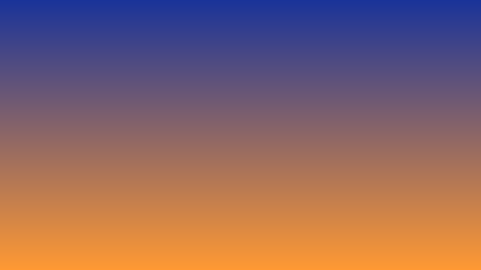
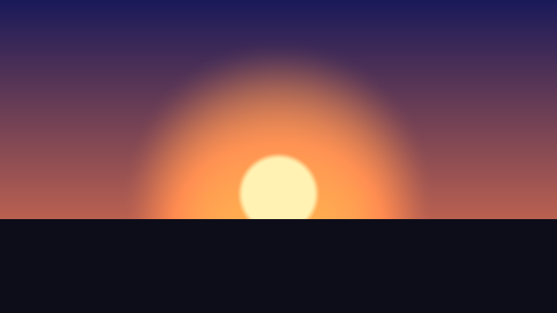

> [!SCENE] intro

If you ask someone who makes shaders which function they use the most, they will probably tell you **`mix`**. It is used to go from one value to another little by little. With it you make gradients, changes from one color to another, soft edges, lights that fade out.

The GPU already comes with that function made, just like two sibling functions: `clamp` and `smoothstep`. But in Yotsuba Shader they cannot be called from C# yet (you will see it flagged in the neon ring chapter). And for learning, that is a stroke of luck: **you are going to write them yourself**. Once you have made them with your own hands, there will be no mystery left in them.

> [!SCENE] mix

## Step 1: mixing two numbers

Copy `Template.cs` as `Mixing.cs` and change the class name to `Mixing`.

The idea of mixing is this: you have a starting value `a`, an end value `b`, and a number `t` between `0` and `1` that says **how much of the way** you have gone.

- With `t = 0`, you are at `a`.
- With `t = 1`, you are at `b`.
- With `t = 0.5`, you are exactly in the middle.

The formula is `a + (b - a) * t`. Try it with paper: if `a = 10`, `b = 20` and `t = 0.3`, then `b - a` is `10`, times `0.3` gives `3`, plus `10` gives `13`. 30% of the way between 10 and 20.

Write the function inside the `Mixing` class, after `Fragment`:

```csharp
    public static float Mix(float a, float b, float t)
    {
        return a + (b - a) * t;
    }
```

And use it in `Fragment` to make a sky gradient. Replace the `return` line with this:

```csharp
float t = pixel.Uv.Y;
float r = Mix(0.1f, 1f, t);
float g = Mix(0.2f, 0.6f, t);
float b = Mix(0.6f, 0.2f, t);
return Make.Vec4(r, g, b, 1f);
```

Here `t` is the pixel's height: `0` at the top and `1` at the bottom. Each color channel is mixed separately, from its top value to its bottom value. Notice the blue: it goes down from `0.6` to `0.2`, while red goes up from `0.1` to `1`.

Run the work cycle:

{{register Mixing}}



A sunset sky with a single function. Change the numbers to your liking, and you will see how each channel moves on its own.

> [!SCENE] clamp

## Step 2: what if t goes outside 0 to 1?

`Mix` works perfectly as long as `t` is between `0` and `1`. But if `t` is `2`, the formula does not stop at `b`: it goes past it. With `a = 10` and `b = 20`, `t = 2` gives `30`.

Sometimes that is what you want. But many times you will want the result to **stay put** at `a` or at `b` when you go over. That tool is called `clamp` (*limit*), and it is very short. Add it below `Mix`:

```csharp
    public static float Clamp(float value, float min, float max)
    {
        if (value < min)
        {
            return min;
        }
        if (value > max)
        {
            return max;
        }
        return value;
    }
```

If the value is less than the minimum, it returns the minimum. If it is greater than the maximum, it returns the maximum. If not, it leaves it as it is. `Clamp(5f, 0f, 1f)` gives `1`; `Clamp(-3f, 0f, 1f)` gives `0`; and `Clamp(0.4f, 0f, 1f)` gives `0.4`.

We are not going to use it yet, but the next function will need it.

> [!SCENE] smooth

## Step 3: soft edges

In the decisions chapter you saw that an `if` makes hard edges. For a soft edge we need something that is **not all or nothing**: a number that goes from `0` to `1` little by little.

That is the job of `smoothstep`. You give it three things: where the change starts (`start`), where it ends (`end`) and the value you are looking at. It returns:

- `0` if the value is before the start.
- `1` if the value is after the end.
- A number between `0` and `1` if it is in the middle, rising smoothly.

Add it below `Clamp`:

```csharp
    public static float Smooth(float start, float end, float value)
    {
        float t = Clamp((value - start) / (end - start), 0f, 1f);
        return t * t * (3f - 2f * t);
    }
```

It has two lines, and each one does something different:

1. `(value - start) / (end - start)` turns the value into a `t`: `0` when value is `start`, `1` when value is `end`. And `Clamp` cuts it so it never leaves `0` to `1`. Up to here it is a straight ramp.
2. `t * t * (3f - 2f * t)` smooths the ramp. At the beginning it rises slowly, in the middle faster, and at the end it slows down again, like an S-shaped letter.

See how the path changes:

| `t` (straight ramp) | Smoothed result |
|---|---|
| 0 | 0 |
| 0.25 | 0.156 |
| 0.5 | 0.5 |
| 0.75 | 0.844 |
| 1 | 1 |

With the straight ramp, at a quarter of the way you are at a quarter of the height. With the smoothed one, at a quarter of the way you are barely at 16%. That slow start and slow end are what makes it look "smooth".

> [!SCENE] circle

## Step 4: a circle with a soft edge

Let us apply it. Declare the uniform, as in the previous chapters. At the top:

```csharp style=glsl
using YotsubaShader.GlslSyntax.Resources;
```

```csharp style=hlsl
using YotsubaShader.HlslSyntax.Resources;
```

```csharp style=msl
using YotsubaShader.MslSyntax.Resources;
```

```csharp style=wgsl
using YotsubaShader.WgslSyntax.Resources;
```

```csharp style=spirv
using YotsubaShader.SpirvSyntax.Resources;
```

And inside the class, before `Vertex`:

```csharp style=glsl
    [uniform, layout(0, 0)]
    public Context Data;
```

```csharp style=hlsl
    [cbuffer, register("b0")]
    public Context Data;
```

```csharp style=msl
    [constant, buffer(0)]
    public Context Data;
```

```csharp style=wgsl
    [uniform, @group(0), @binding(0)]
    public Context Data;
```

```csharp style=spirv
    [Uniform, DescriptorSet(0), Binding(0)]
    public Context Data;
```

Now replace the entire contents of `Fragment` with this:

```csharp
float aspect = Data.Width / Data.Height;
float dx = (pixel.Uv.X - 0.5f) * aspect;
float dy = pixel.Uv.Y - 0.5f;
float d2 = dx * dx + dy * dy;

float brightness = 1f - Smooth(0.04f, 0.09f, d2);
return Make.Vec4(brightness, brightness * 0.6f, brightness * 0.1f, 1f);
```

The important part is in the two middle lines. `d2` is the usual calculation for how far the pixel is from the center. Then:

- `Smooth(0.04f, 0.09f, d2)` is `0` when `d2` is less than `0.04` (near the center), `1` when it is greater than `0.09` (far away), and rises smoothly in between.
- `1f - ...` flips it: now it is `1` at the center and `0` outside. That is the brightness.

The three numbers in the last line (`brightness`, `brightness * 0.6f`, `brightness * 0.1f`) tint the light orange: more red, some green, almost no blue.


Compare it with the circle from the previous chapter. There is no sharp edge anymore: the light fades out. Change the `0.04f` to `0.085f` and the edge becomes almost sharp. Change the `0.09f` to `0.2f` and the light blurs much more. **The closer `start` and `end` are, the harder the edge.**

> [!SCENE] sunset

## Step 5: a complete sunset

Let us put it all together in a scene. We will do it little by little, so you can see how each layer adds up. Replace the contents of `Fragment` with this first version, which is the sky:

```csharp
float aspect = Data.Width / Data.Height;
float dx = (pixel.Uv.X - 0.5f) * aspect;
float dy = pixel.Uv.Y - 0.62f;
float d2 = dx * dx + dy * dy;

// sky: from dark blue at the top to orange at the horizon
float t = pixel.Uv.Y;
float r = Mix(0.1f, 1f, t);
float g = Mix(0.1f, 0.5f, t);
float b = Mix(0.35f, 0.3f, t);

return Make.Vec4(r, g, b, 1f);
```

Nothing new except that `dy` is now measured from `0.62` (the sun's height, a bit below the center). Run the work cycle to see the sky.

**Layer 1: the halo.** Add this **before** the `return`:

```csharp
// sun halo
float halo = 1f - Smooth(0.0f, 0.25f, d2);
r = r + halo * 0.5f;
g = g + halo * 0.3f;
```

A halo is a very big and very soft circle: it goes from `0` to `0.25`. And instead of **replacing** the sky color, it **adds** to it: the sky is still there, but with more light near the sun. Run the work cycle.

**Layer 2: the disc.** Add this after the halo:

```csharp
// sun disc
float disc = 1f - Smooth(0.012f, 0.018f, d2);
r = Mix(r, 1f, disc);
g = Mix(g, 0.95f, disc);
b = Mix(b, 0.7f, disc);
```

The disc is a small circle with an almost hard edge (`0.012` to `0.018`, very close together). Here we use `Mix` in a different way: `disc` is `1` inside the sun and `0` outside, so `Mix(r, 1f, disc)` leaves the sky where `disc` is `0` and puts the sun's color where it is `1`. On the pixels at the edge, it mixes both. **Mixing with a `t` that is 0 or 1 is an `if` with soft edges.** Run the work cycle.

**Layer 3: the ground.** And to finish, a dark strip at the bottom. Add this, and **replace the `return`** with the new version:

```csharp
// ground
if (pixel.Uv.Y > 0.7f)
{
    r = 0.05f;
    g = 0.05f;
    b = 0.1f;
}
return Make.Vec4(Clamp(r, 0f, 1f), Clamp(g, 0f, 1f), Clamp(b, 0f, 1f), 1f);
```

Here we see `Clamp` again: when adding the halo, red or green can go over `1`. The GPU would clip them on its own, but writing it by hand makes clear what is going on.

Run the work cycle.



Three functions written by you, and you have a sunset. Play with it: raise the sun by changing the `0.62`, enlarge the halo by changing the `0.25`, or change the sky colors.

## All together

This is the complete file:

```csharp style=glsl title="MyShaders/Mixing.cs"
using YotsubaShader.GlslSyntax;
using YotsubaShader.GlslSyntax.Resources;
using YotsubaShader.GlslSyntax.Types;
using YotsubaShader.Language;

namespace MyShaders;

public class Mixing
{
    [uniform, layout(0, 0)]
    public Context Data;

    [ShaderStage(Stage.Vertex)]
    public Pixel Vertex({{vertexType}} corner)
    {
        Pixel pixel;
        pixel.Position = Make.Vec4(corner.{{pos}}.X, corner.{{pos}}.Y, 0f, 1f);
        pixel.Uv = corner.{{uv}};
        return pixel;
    }

    [ShaderStage(Stage.Fragment)]
    [return: location(0)]
    public vec4 Fragment(PixelIn pixel)
    {
        float aspect = Data.Width / Data.Height;
        float dx = (pixel.Uv.X - 0.5f) * aspect;
        float dy = pixel.Uv.Y - 0.62f;
        float d2 = dx * dx + dy * dy;

        // sky: from dark blue at the top to orange at the horizon
        float t = pixel.Uv.Y;
        float r = Mix(0.1f, 1f, t);
        float g = Mix(0.1f, 0.5f, t);
        float b = Mix(0.35f, 0.3f, t);

        // sun halo and sun disc
        float halo = 1f - Smooth(0.0f, 0.25f, d2);
        float disc = 1f - Smooth(0.012f, 0.018f, d2);
        r = r + halo * 0.5f;
        g = g + halo * 0.3f;
        r = Mix(r, 1f, disc);
        g = Mix(g, 0.95f, disc);
        b = Mix(b, 0.7f, disc);

        // ground
        if (pixel.Uv.Y > 0.7f)
        {
            r = 0.05f;
            g = 0.05f;
            b = 0.1f;
        }
        return Make.Vec4(Clamp(r, 0f, 1f), Clamp(g, 0f, 1f), Clamp(b, 0f, 1f), 1f);
    }

    public static float Clamp(float value, float min, float max)
    {
        if (value < min)
        {
            return min;
        }
        if (value > max)
        {
            return max;
        }
        return value;
    }

    public static float Mix(float a, float b, float t)
    {
        return a + (b - a) * t;
    }

    public static float Smooth(float start, float end, float value)
    {
        float t = Clamp((value - start) / (end - start), 0f, 1f);
        return t * t * (3f - 2f * t);
    }
}
```

```csharp style=hlsl title="MyShaders/Mixing.cs"
using YotsubaShader.HlslSyntax;
using YotsubaShader.HlslSyntax.Resources;
using YotsubaShader.GlslSyntax.Types;
using YotsubaShader.Language;

namespace MyShaders;

public class Mixing
{
    [cbuffer, register("b0")]
    public Context Data;

    [ShaderStage(Stage.Vertex)]
    public Pixel Vertex({{vertexType}} corner)
    {
        Pixel pixel;
        pixel.Position = Make.Vec4(corner.{{pos}}.X, corner.{{pos}}.Y, 0f, 1f);
        pixel.Uv = corner.{{uv}};
        return pixel;
    }

    [ShaderStage(Stage.Fragment)]
    [return: SV_Target]
    public vec4 Fragment(PixelIn pixel)
    {
        float aspect = Data.Width / Data.Height;
        float dx = (pixel.Uv.X - 0.5f) * aspect;
        float dy = pixel.Uv.Y - 0.62f;
        float d2 = dx * dx + dy * dy;

        // sky: from dark blue at the top to orange at the horizon
        float t = pixel.Uv.Y;
        float r = Mix(0.1f, 1f, t);
        float g = Mix(0.1f, 0.5f, t);
        float b = Mix(0.35f, 0.3f, t);

        // sun halo and sun disc
        float halo = 1f - Smooth(0.0f, 0.25f, d2);
        float disc = 1f - Smooth(0.012f, 0.018f, d2);
        r = r + halo * 0.5f;
        g = g + halo * 0.3f;
        r = Mix(r, 1f, disc);
        g = Mix(g, 0.95f, disc);
        b = Mix(b, 0.7f, disc);

        // ground
        if (pixel.Uv.Y > 0.7f)
        {
            r = 0.05f;
            g = 0.05f;
            b = 0.1f;
        }
        return Make.Vec4(Clamp(r, 0f, 1f), Clamp(g, 0f, 1f), Clamp(b, 0f, 1f), 1f);
    }

    public static float Clamp(float value, float min, float max)
    {
        if (value < min)
        {
            return min;
        }
        if (value > max)
        {
            return max;
        }
        return value;
    }

    public static float Mix(float a, float b, float t)
    {
        return a + (b - a) * t;
    }

    public static float Smooth(float start, float end, float value)
    {
        float t = Clamp((value - start) / (end - start), 0f, 1f);
        return t * t * (3f - 2f * t);
    }
}
```

```csharp style=msl title="MyShaders/Mixing.cs"
using YotsubaShader.MslSyntax;
using YotsubaShader.MslSyntax.Resources;
using YotsubaShader.GlslSyntax.Types;
using YotsubaShader.Language;

namespace MyShaders;

public class Mixing
{
    [constant, buffer(0)]
    public Context Data;

    [ShaderStage(Stage.Vertex)]
    public Pixel Vertex({{vertexType}} corner)
    {
        Pixel pixel;
        pixel.Position = Make.Vec4(corner.{{pos}}.X, corner.{{pos}}.Y, 0f, 1f);
        pixel.Uv = corner.{{uv}};
        return pixel;
    }

    [ShaderStage(Stage.Fragment)]
    [return: color(0)]
    public vec4 Fragment(PixelIn pixel)
    {
        float aspect = Data.Width / Data.Height;
        float dx = (pixel.Uv.X - 0.5f) * aspect;
        float dy = pixel.Uv.Y - 0.62f;
        float d2 = dx * dx + dy * dy;

        // sky: from dark blue at the top to orange at the horizon
        float t = pixel.Uv.Y;
        float r = Mix(0.1f, 1f, t);
        float g = Mix(0.1f, 0.5f, t);
        float b = Mix(0.35f, 0.3f, t);

        // sun halo and sun disc
        float halo = 1f - Smooth(0.0f, 0.25f, d2);
        float disc = 1f - Smooth(0.012f, 0.018f, d2);
        r = r + halo * 0.5f;
        g = g + halo * 0.3f;
        r = Mix(r, 1f, disc);
        g = Mix(g, 0.95f, disc);
        b = Mix(b, 0.7f, disc);

        // ground
        if (pixel.Uv.Y > 0.7f)
        {
            r = 0.05f;
            g = 0.05f;
            b = 0.1f;
        }
        return Make.Vec4(Clamp(r, 0f, 1f), Clamp(g, 0f, 1f), Clamp(b, 0f, 1f), 1f);
    }

    public static float Clamp(float value, float min, float max)
    {
        if (value < min)
        {
            return min;
        }
        if (value > max)
        {
            return max;
        }
        return value;
    }

    public static float Mix(float a, float b, float t)
    {
        return a + (b - a) * t;
    }

    public static float Smooth(float start, float end, float value)
    {
        float t = Clamp((value - start) / (end - start), 0f, 1f);
        return t * t * (3f - 2f * t);
    }
}
```

```csharp style=wgsl title="MyShaders/Mixing.cs"
using YotsubaShader.WgslSyntax;
using YotsubaShader.WgslSyntax.Resources;
using YotsubaShader.GlslSyntax.Types;
using YotsubaShader.Language;

namespace MyShaders;

public class Mixing
{
    [uniform, @group(0), @binding(0)]
    public Context Data;

    [ShaderStage(Stage.Vertex)]
    public Pixel Vertex({{vertexType}} corner)
    {
        Pixel pixel;
        pixel.Position = Make.Vec4(corner.{{pos}}.X, corner.{{pos}}.Y, 0f, 1f);
        pixel.Uv = corner.{{uv}};
        return pixel;
    }

    [ShaderStage(Stage.Fragment)]
    [return: location(0)]
    public vec4 Fragment(PixelIn pixel)
    {
        float aspect = Data.Width / Data.Height;
        float dx = (pixel.Uv.X - 0.5f) * aspect;
        float dy = pixel.Uv.Y - 0.62f;
        float d2 = dx * dx + dy * dy;

        // sky: from dark blue at the top to orange at the horizon
        float t = pixel.Uv.Y;
        float r = Mix(0.1f, 1f, t);
        float g = Mix(0.1f, 0.5f, t);
        float b = Mix(0.35f, 0.3f, t);

        // sun halo and sun disc
        float halo = 1f - Smooth(0.0f, 0.25f, d2);
        float disc = 1f - Smooth(0.012f, 0.018f, d2);
        r = r + halo * 0.5f;
        g = g + halo * 0.3f;
        r = Mix(r, 1f, disc);
        g = Mix(g, 0.95f, disc);
        b = Mix(b, 0.7f, disc);

        // ground
        if (pixel.Uv.Y > 0.7f)
        {
            r = 0.05f;
            g = 0.05f;
            b = 0.1f;
        }
        return Make.Vec4(Clamp(r, 0f, 1f), Clamp(g, 0f, 1f), Clamp(b, 0f, 1f), 1f);
    }

    public static float Clamp(float value, float min, float max)
    {
        if (value < min)
        {
            return min;
        }
        if (value > max)
        {
            return max;
        }
        return value;
    }

    public static float Mix(float a, float b, float t)
    {
        return a + (b - a) * t;
    }

    public static float Smooth(float start, float end, float value)
    {
        float t = Clamp((value - start) / (end - start), 0f, 1f);
        return t * t * (3f - 2f * t);
    }
}
```

```csharp style=spirv title="MyShaders/Mixing.cs"
using YotsubaShader.SpirvSyntax;
using YotsubaShader.SpirvSyntax.Resources;
using YotsubaShader.GlslSyntax.Types;
using YotsubaShader.Language;

namespace MyShaders;

public class Mixing
{
    [Uniform, DescriptorSet(0), Binding(0)]
    public Context Data;

    [ShaderStage(Stage.Vertex)]
    public Pixel Vertex({{vertexType}} corner)
    {
        Pixel pixel;
        pixel.Position = Make.Vec4(corner.{{pos}}.X, corner.{{pos}}.Y, 0f, 1f);
        pixel.Uv = corner.{{uv}};
        return pixel;
    }

    [ShaderStage(Stage.Fragment)]
    [return: Location(0)]
    public vec4 Fragment(PixelIn pixel)
    {
        float aspect = Data.Width / Data.Height;
        float dx = (pixel.Uv.X - 0.5f) * aspect;
        float dy = pixel.Uv.Y - 0.62f;
        float d2 = dx * dx + dy * dy;

        // sky: from dark blue at the top to orange at the horizon
        float t = pixel.Uv.Y;
        float r = Mix(0.1f, 1f, t);
        float g = Mix(0.1f, 0.5f, t);
        float b = Mix(0.35f, 0.3f, t);

        // sun halo and sun disc
        float halo = 1f - Smooth(0.0f, 0.25f, d2);
        float disc = 1f - Smooth(0.012f, 0.018f, d2);
        r = r + halo * 0.5f;
        g = g + halo * 0.3f;
        r = Mix(r, 1f, disc);
        g = Mix(g, 0.95f, disc);
        b = Mix(b, 0.7f, disc);

        // ground
        if (pixel.Uv.Y > 0.7f)
        {
            r = 0.05f;
            g = 0.05f;
            b = 0.1f;
        }
        return Make.Vec4(Clamp(r, 0f, 1f), Clamp(g, 0f, 1f), Clamp(b, 0f, 1f), 1f);
    }

    public static float Clamp(float value, float min, float max)
    {
        if (value < min)
        {
            return min;
        }
        if (value > max)
        {
            return max;
        }
        return value;
    }

    public static float Mix(float a, float b, float t)
    {
        return a + (b - a) * t;
    }

    public static float Smooth(float start, float end, float value)
    {
        float t = Clamp((value - start) / (end - start), 0f, 1f);
        return t * t * (3f - 2f * t);
    }
}
```

> [!SCENE] learned

## What you learned

- `Mix(a, b, t)` goes from `a` to `b` according to `t`. With `t` between `0` and `1`, the result always stays between `a` and `b`.
- `Clamp` cuts a value between a minimum and a maximum.
- `Smooth` goes from `0` to `1` slowly at the start and slowly at the end. The closer `start` and `end` are, the harder the edge.
- Mixing with a `t` of `0` or `1` is an `if` with soft edges.
- A scene is built in **layers**: each layer mixes or adds something over what was there.
- In GLSL these three functions are called `mix`, `clamp` and `smoothstep`. When you see them in other tutorials, you know what they do inside.

Next: [Repeating with loops](loops.md).
