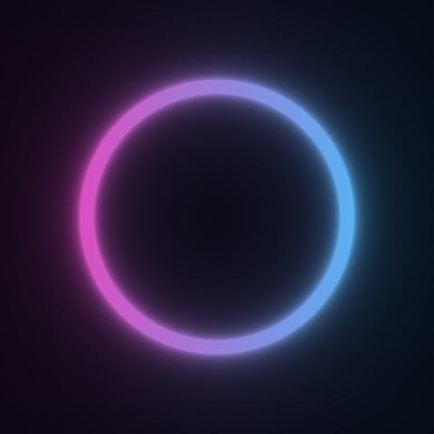
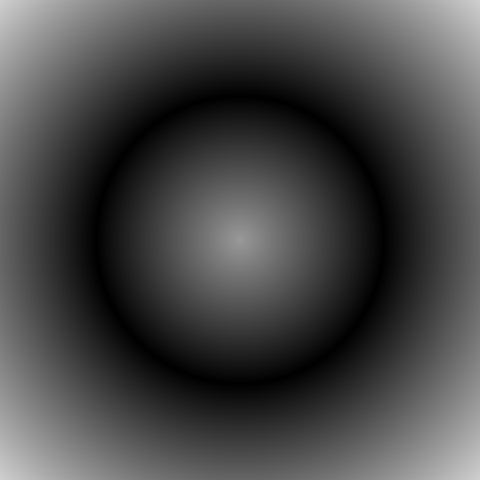
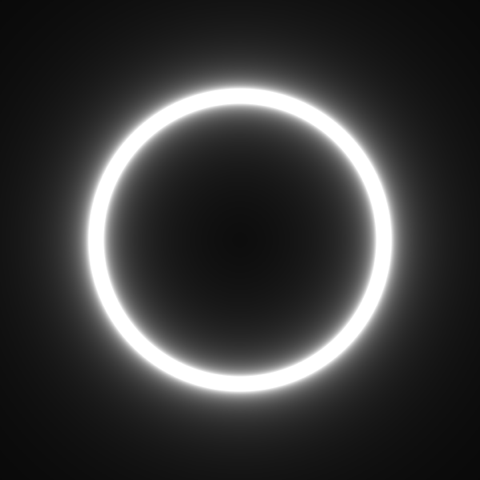

> [!SCENE] intro

So far you did every calculation with additions, subtractions and multiplications. But the GPU already comes with many math functions built in: square root, sine, absolute value, mixing two colors... In this chapter you will use them to draw a neon tube:



> [!SCENE] use

## How the GPU's functions are used

They are all in a class called `Math`, inside `YotsubaShader.GlslSyntax.Methods`. Since you will use them all the time, the comfortable thing is to put this line at the top of the file:

```csharp
using static YotsubaShader.GlslSyntax.Methods.Math;
```

A `using static` lets you call the methods of a class without writing its name in front. So instead of `Math.sqrt(x)` you just write `sqrt(x)`.

> [!NOTE]
> The names are lowercase (`sqrt`, `abs`, `mix`) because that is what they are called in GLSL, and this style keeps those names. They are not the ones from C#'s `System.Math`: those do not work in a shader, because there is no way to take them to the GPU.

These are the four you will use in this shader:

| Function | What it does | Example |
| --- | --- | --- |
| `sqrt(x)` | The square root. | `sqrt(9f)` gives `3` |
| `abs(x)` | Removes the sign from a number. | `abs(-0.2f)` gives `0.2` |
| `clamp(x, minimum, maximum)` | If `x` goes past the limits, it leaves it at the limit. | `clamp(7f, 0f, 1f)` gives `1` |
| `mix(a, b, t)` | Mixes `a` and `b`. With `t` at `0` it gives `a`, with `1` it gives `b`, with `0.5` half of each. | `mix(0f, 10f, 0.5f)` gives `5` |

> [!SCENE] dist

## Step 1: how far each pixel is from the center

A ring is a circle, and to draw a circle you need to know how far from the center each pixel is.

First we move the center. With `Uv`, the point `(0, 0)` is the top left corner. It suits us better for `(0, 0)` to be the center of the screen. It is the stretch-and-move calculation you already know:

```csharp
float x = pixel.Uv.X * 2f - 1f;
float y = pixel.Uv.Y * 2f - 1f;
```

Now `x` and `y` go from `-1` to `1`, and the center of the screen is `(0, 0)`.

The distance from a point to the center is calculated with the Pythagorean theorem, the one about the triangle from school: the square root of `x` times `x` plus `y` times `y`.

```csharp
float distanceToCenter = sqrt(x * x + y * y);
```

If you painted each pixel with that number as its color (farther away, whiter), you would see this:


Black in the center, because the distance is `0`. Lighter and lighter as you move away.

> [!SCENE] ring

## Step 2: how far each pixel is from the ring

We want a ring of radius `0.6`. The pixels that form the ring are the ones at a distance of `0.6` from the center. So we subtract:

```csharp
float distanceToRing = abs(distanceToCenter - 0.6f);
```

If a pixel is at `0.6` from the center, the result is `0`: it is right on the ring. If it is at `0.8`, it gives `0.2`. And if it is at `0.4`, the subtraction gives `-0.2`, but `abs` removes the sign and it becomes `0.2`. That is, we do not care whether the pixel is inside or outside the ring: we only care how far it is from reaching it.



You can already see the ring: it is the black line, where the distance is `0`.

> [!SCENE] glow

## Step 3: turning the distance into glow

We want the opposite of the previous image: lots of light on the ring and little far from it. There is a widely used trick for that, which is to divide a small number by the distance:

```csharp
float glow = clamp(0.03f / distanceToRing, 0f, 1f);
```

Think about what happens with the division:

| Distance to the ring | `0.03 / distance` | Glow after `clamp` |
| --- | --- | --- |
| `0.01` (almost on it) | `3` | `1` |
| `0.03` | `1` | `1` |
| `0.1` | `0.3` | `0.3` |
| `0.5` (far) | `0.06` | `0.06` |

Near the ring the result is huge, and `clamp` leaves it at `1`, which is the maximum. As you move away it drops fast, but never quite reaches zero. That light fading out little by little is what makes it look like neon and not a plain line.



> [!TIP]
> The `0.03` is the thickness of the glow. With `0.01` you get a thin thread. With `0.1`, a huge halo.

> [!SCENE] color

## Step 4: giving it color

We have a glow from `0` to `1`. What is left is deciding what color the light is and what color the background is. This is where `mix` comes in, which also works with colors:

```csharp
vec3 pink = new vec3(1f, 0.2f, 0.7f);
vec3 cyan = new vec3(0.2f, 0.8f, 1f);
vec3 tube = mix(pink, cyan, pixel.Uv.X);
```

`mix(pink, cyan, pixel.Uv.X)` gives pink on the left of the screen (where `Uv.X` is `0`), cyan on the right (where it is `1`) and a blend in the middle. It is the gradient from the first shader, done with a single function.

And now we mix again, between the background and the tube, using the glow:

```csharp
vec3 background = new vec3(0.02f, 0.02f, 0.06f);
vec3 color = mix(background, tube, glow);
```

Where the glow is `0`, the background comes out. Where it is `1`, the color of the tube comes out. In the halo, a blend.

We use `vec3` because a color, while you are calculating it, does not need opacity. We add it at the end, when returning it.

## The complete shader

```csharp style=glsl title="MyShaders/Neon.cs"
using YotsubaShader.GlslSyntax;
using YotsubaShader.GlslSyntax.Types;
using YotsubaShader.Language;
using static YotsubaShader.GlslSyntax.Methods.Math;

namespace MyShaders;

public class Neon
{
    [ShaderStage(Stage.Vertex)]
    public Pixel Vertex({{vertexType}} corner)
    {
        Pixel pixel;
        pixel.Position = new vec4(corner.{{pos}}.X, corner.{{pos}}.Y, 0f, 1f);
        pixel.Uv = corner.{{uv}};
        return pixel;
    }

    [ShaderStage(Stage.Fragment)]
    [return: location(0)]
    public vec4 Fragment(PixelIn pixel)
    {
        float x = pixel.Uv.X * 2f - 1f;
        float y = pixel.Uv.Y * 2f - 1f;

        float distanceToCenter = sqrt(x * x + y * y);
        float distanceToRing = abs(distanceToCenter - 0.6f);

        float glow = clamp(0.03f / distanceToRing, 0f, 1f);

        vec3 pink = new vec3(1f, 0.2f, 0.7f);
        vec3 cyan = new vec3(0.2f, 0.8f, 1f);
        vec3 tube = mix(pink, cyan, pixel.Uv.X);

        vec3 background = new vec3(0.02f, 0.02f, 0.06f);
        vec3 color = mix(background, tube, glow);

        return new vec4(color.X, color.Y, color.Z, 1f);
    }
}
```

```csharp style=hlsl title="MyShaders/Neon.cs"
using YotsubaShader.HlslSyntax;
using YotsubaShader.GlslSyntax.Types;
using YotsubaShader.Language;
using static YotsubaShader.GlslSyntax.Methods.Math;

namespace MyShaders;

public class Neon
{
    [ShaderStage(Stage.Vertex)]
    public Pixel Vertex({{vertexType}} corner)
    {
        Pixel pixel;
        pixel.Position = new vec4(corner.{{pos}}.X, corner.{{pos}}.Y, 0f, 1f);
        pixel.Uv = corner.{{uv}};
        return pixel;
    }

    [ShaderStage(Stage.Fragment)]
    [return: SV_Target]
    public vec4 Fragment(PixelIn pixel)
    {
        float x = pixel.Uv.X * 2f - 1f;
        float y = pixel.Uv.Y * 2f - 1f;

        float distanceToCenter = sqrt(x * x + y * y);
        float distanceToRing = abs(distanceToCenter - 0.6f);

        float glow = clamp(0.03f / distanceToRing, 0f, 1f);

        vec3 pink = new vec3(1f, 0.2f, 0.7f);
        vec3 cyan = new vec3(0.2f, 0.8f, 1f);
        vec3 tube = mix(pink, cyan, pixel.Uv.X);

        vec3 background = new vec3(0.02f, 0.02f, 0.06f);
        vec3 color = mix(background, tube, glow);

        return new vec4(color.X, color.Y, color.Z, 1f);
    }
}
```

```csharp style=msl title="MyShaders/Neon.cs"
using YotsubaShader.MslSyntax;
using YotsubaShader.GlslSyntax.Types;
using YotsubaShader.Language;
using static YotsubaShader.GlslSyntax.Methods.Math;

namespace MyShaders;

public class Neon
{
    [ShaderStage(Stage.Vertex)]
    public Pixel Vertex({{vertexType}} corner)
    {
        Pixel pixel;
        pixel.Position = new vec4(corner.{{pos}}.X, corner.{{pos}}.Y, 0f, 1f);
        pixel.Uv = corner.{{uv}};
        return pixel;
    }

    [ShaderStage(Stage.Fragment)]
    [return: color(0)]
    public vec4 Fragment(PixelIn pixel)
    {
        float x = pixel.Uv.X * 2f - 1f;
        float y = pixel.Uv.Y * 2f - 1f;

        float distanceToCenter = sqrt(x * x + y * y);
        float distanceToRing = abs(distanceToCenter - 0.6f);

        float glow = clamp(0.03f / distanceToRing, 0f, 1f);

        vec3 pink = new vec3(1f, 0.2f, 0.7f);
        vec3 cyan = new vec3(0.2f, 0.8f, 1f);
        vec3 tube = mix(pink, cyan, pixel.Uv.X);

        vec3 background = new vec3(0.02f, 0.02f, 0.06f);
        vec3 color = mix(background, tube, glow);

        return new vec4(color.X, color.Y, color.Z, 1f);
    }
}
```

```csharp style=wgsl title="MyShaders/Neon.cs"
using YotsubaShader.WgslSyntax;
using YotsubaShader.GlslSyntax.Types;
using YotsubaShader.Language;
using static YotsubaShader.GlslSyntax.Methods.Math;

namespace MyShaders;

public class Neon
{
    [ShaderStage(Stage.Vertex)]
    public Pixel Vertex({{vertexType}} corner)
    {
        Pixel pixel;
        pixel.Position = new vec4(corner.{{pos}}.X, corner.{{pos}}.Y, 0f, 1f);
        pixel.Uv = corner.{{uv}};
        return pixel;
    }

    [ShaderStage(Stage.Fragment)]
    [return: location(0)]
    public vec4 Fragment(PixelIn pixel)
    {
        float x = pixel.Uv.X * 2f - 1f;
        float y = pixel.Uv.Y * 2f - 1f;

        float distanceToCenter = sqrt(x * x + y * y);
        float distanceToRing = abs(distanceToCenter - 0.6f);

        float glow = clamp(0.03f / distanceToRing, 0f, 1f);

        vec3 pink = new vec3(1f, 0.2f, 0.7f);
        vec3 cyan = new vec3(0.2f, 0.8f, 1f);
        vec3 tube = mix(pink, cyan, pixel.Uv.X);

        vec3 background = new vec3(0.02f, 0.02f, 0.06f);
        vec3 color = mix(background, tube, glow);

        return new vec4(color.X, color.Y, color.Z, 1f);
    }
}
```

```csharp style=spirv title="MyShaders/Neon.cs"
using YotsubaShader.SpirvSyntax;
using YotsubaShader.GlslSyntax.Types;
using YotsubaShader.Language;
using static YotsubaShader.GlslSyntax.Methods.Math;

namespace MyShaders;

public class Neon
{
    [ShaderStage(Stage.Vertex)]
    public Pixel Vertex({{vertexType}} corner)
    {
        Pixel pixel;
        pixel.Position = new vec4(corner.{{pos}}.X, corner.{{pos}}.Y, 0f, 1f);
        pixel.Uv = corner.{{uv}};
        return pixel;
    }

    [ShaderStage(Stage.Fragment)]
    [return: Location(0)]
    public vec4 Fragment(PixelIn pixel)
    {
        float x = pixel.Uv.X * 2f - 1f;
        float y = pixel.Uv.Y * 2f - 1f;

        float distanceToCenter = sqrt(x * x + y * y);
        float distanceToRing = abs(distanceToCenter - 0.6f);

        float glow = clamp(0.03f / distanceToRing, 0f, 1f);

        vec3 pink = new vec3(1f, 0.2f, 0.7f);
        vec3 cyan = new vec3(0.2f, 0.8f, 1f);
        vec3 tube = mix(pink, cyan, pixel.Uv.X);

        vec3 background = new vec3(0.02f, 0.02f, 0.06f);
        vec3 color = mix(background, tube, glow);

        return new vec4(color.X, color.Y, color.Z, 1f);
    }
}
```

> [!SCENE] check

To check that it is written correctly, build the C# project:

```bash
dotnet build MyShaders
```

If you get `Build succeeded`, the shader is valid C#. Once `add` supports these functions, it is compiled and used just like the previous two: `new Neon().ToGlsl(Stage.Fragment)`.

> [!SCENE] play

## Play with it

- Change `0.6f` to `0.3f` for a smaller ring.
- Change `pixel.Uv.X` to `pixel.Uv.Y` in the first `mix`. The color change now goes from top to bottom.
- Draw two rings: calculate a second glow with another radius and add them before mixing.

```csharp
float bigGlow = clamp(0.03f / abs(distanceToCenter - 0.6f), 0f, 1f);
float smallGlow = clamp(0.03f / abs(distanceToCenter - 0.3f), 0f, 1f);
float glow = clamp(bigGlow + smallGlow, 0f, 1f);
```

> [!SCENE] learned

## What you learned

- The GPU comes with math functions ready made. They are in `YotsubaShader.GlslSyntax.Methods.Math` and are used with `using static`.
- Almost any shape comes from a distance: you calculate how far each pixel is from the shape and turn that into color.
- `mix` blends two numbers or two colors. `clamp` keeps a value between two limits.
- Dividing a small number by a distance gives the effect of light fading out.

Next: [Shader 4: a moving plasma](plasma.md).
