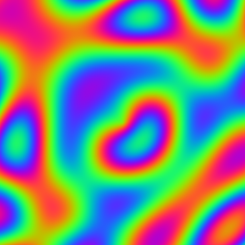
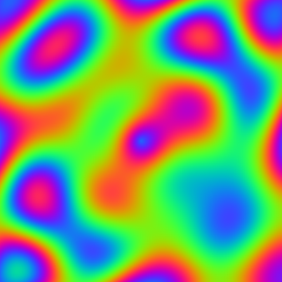
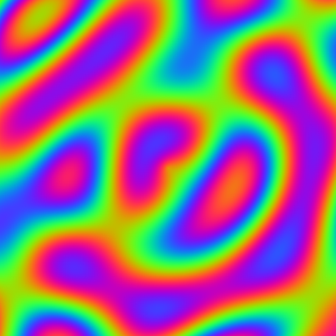
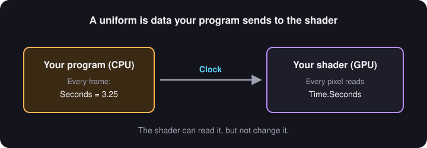
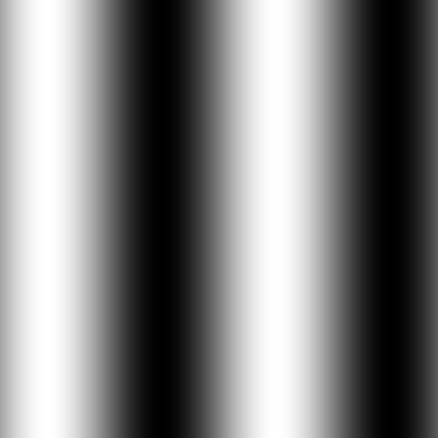

> [!SCENE] intro

The three previous shaders have something in common: they always draw the same image. That makes sense. The only thing each pixel knows is its `Uv`, and that never changes.

For something to move, the shader needs a piece of data that changes over time. And the GPU does not have that data: your program does. In this chapter you learn to send it, and with that you make this effect, which is a classic from the 90s:

| Second 0 | Second 1.5 | Second 3 |
| --- | --- | --- |
|  |  |  |

They are three moments of the same shader. In motion, the blobs deform and melt into each other without stopping.

> [!SCENE] uniform

## Data that comes from outside: the uniform

A piece of data your program sends to the shader is called a **uniform**. The name comes from it being "uniform": it has the same value for every pixel. At any one instant, every pixel reads the same time.



It is declared in two steps.

**First, a `struct` with the data.** A normal one, with no attributes:

```csharp
public struct Clock
{
    public float Seconds;
}
```

**Then, a field in the shader's class**, marked with two attributes:

```csharp style=glsl
[uniform, layout(0, 0)]
public Clock Time;
```

```csharp style=hlsl
[cbuffer, register("b0")]
public Clock Time;
```

```csharp style=msl
[constant, buffer(0)]
public Clock Time;
```

```csharp style=wgsl
[uniform, @group(0), @binding(0)]
public Clock Time;
```

```csharp style=spirv
[Uniform, DescriptorSet(0), Binding(0)]
public Clock Time;
```

- `uniform` says that field is data that comes from your program.
- `layout(0, 0)` is its address. It is the same idea as the slots of `[location]`, but for this kind of data the address has two numbers: the group and the slot inside the group. Here it is group 0, slot 0. Your program will have to leave the clock at exactly that address.

These two attributes are in `YotsubaShader.GlslSyntax.Resources`, so you have to add that `using`.

And to read it inside the shader, you use it like any field:

```csharp
float t = Time.Seconds;
```

One thing to keep in mind: the shader can **read** a uniform, but not change it. Data travels in one direction only, from your program to the GPU.

> [!SCENE] sin

## A wave: the `sin` function

`sin` is the sine. You do not need to remember trigonometry. For what we care about, `sin` is a function that, whatever number you give it, returns something between `-1` and `1`, going up and down without stopping, like a wave.

Look at what happens if we paint each pixel according to `sin(x * 6f)`, with black for `-1` and white for `1`:



Stripes come out, because as you move right `x` grows and the sine goes up and down. The `6` says how many stripes fit: with `12` there would be twice as many.

Now comes the important part. If you add the time to it:

```csharp
sin(x * 6f + t)
```

as `t` grows, all the stripes slide to one side. With that addition you already have movement.

> [!SCENE] four

## Four waves together

Stripes that slide are boring. The plasma comes from adding several waves, each one in a different direction and at a different speed:

```csharp
float waves = sin(x * 6f + t)
           + sin(y * 6f + t * 1.3f)
           + sin((x + y) * 6f + t * 0.7f)
           + sin(sqrt(x * x + y * y) * 9f - t * 2f);
```

One by one:

| Line | What shape it has | Where it moves |
| --- | --- | --- |
| `sin(x * 6f + t)` | Vertical stripes. | Sideways. |
| `sin(y * 6f + t * 1.3f)` | Horizontal stripes. | Up and down, a bit faster. |
| `sin((x + y) * 6f + t * 0.7f)` | Diagonal stripes. | Diagonally, slower. |
| `sin(sqrt(x * x + y * y) * 9f - t * 2f)` | Circles, like the ripples from a stone in water. You will recognize the distance to the center from the previous chapter. | Outward. |

When you add them, where several crests meet the value is high, and where several troughs meet it is low. Since each one goes at its own pace, the drawing never repeats exactly:


> [!SCENE] rainbow

## From a number to a rainbow

`waves` is a single number. To turn it into color we use the same `sin`, three times, once for each component of the color:

```csharp
public static vec4 Rainbow(float value)
{
    float red = 0.5f + 0.5f * sin(value * 1.5f);
    float green = 0.5f + 0.5f * sin(value * 1.5f + 2.1f);
    float blue = 0.5f + 0.5f * sin(value * 1.5f + 4.2f);
    return Make.Vec4(red, green, blue, 1f);
}
```

Two details:

- `0.5f + 0.5f * sin(...)` turns the result of the sine, which goes from `-1` to `1`, into something that goes from `0` to `1`, which is what a color needs.
- The `+ 2.1f` and `+ 4.2f` make green and blue run out of step with red. When red is at the top, the other two are at a different point of their wave. That is why all the colors of the rainbow come out instead of grays.

## The complete shader

```csharp style=glsl title="MyShaders/Plasma.cs"
using YotsubaShader.GlslSyntax;
using YotsubaShader.GlslSyntax.Resources;
using YotsubaShader.GlslSyntax.Types;
using YotsubaShader.Language;
using static YotsubaShader.GlslSyntax.Methods.Math;

namespace MyShaders;

public struct Clock
{
    public float Seconds;
}

public class Plasma
{
    [uniform, layout(0, 0)]
    public Clock Time;

    [ShaderStage(Stage.Vertex)]
    public Pixel Vertex({{vertexType}} corner)
    {
        Pixel pixel;
        pixel.Position = Make.Vec4(corner.{{pos}}.X, corner.{{pos}}.Y, 0f, 1f);
        pixel.Uv = corner.{{uv}};
        return pixel;
    }

    [ShaderStage(Stage.Fragment)]
    [return: location(0)]
    public vec4 Fragment(PixelIn pixel)
    {
        float x = pixel.Uv.X * 2f - 1f;
        float y = pixel.Uv.Y * 2f - 1f;
        float t = Time.Seconds;

        float waves = sin(x * 6f + t)
                   + sin(y * 6f + t * 1.3f)
                   + sin((x + y) * 6f + t * 0.7f)
                   + sin(sqrt(x * x + y * y) * 9f - t * 2f);

        return Rainbow(waves);
    }

    public static vec4 Rainbow(float value)
    {
        float red = 0.5f + 0.5f * sin(value * 1.5f);
        float green = 0.5f + 0.5f * sin(value * 1.5f + 2.1f);
        float blue = 0.5f + 0.5f * sin(value * 1.5f + 4.2f);
        return Make.Vec4(red, green, blue, 1f);
    }
}
```

```csharp style=hlsl title="MyShaders/Plasma.cs"
using YotsubaShader.HlslSyntax;
using YotsubaShader.HlslSyntax.Resources;
using YotsubaShader.GlslSyntax.Types;
using YotsubaShader.Language;
using static YotsubaShader.GlslSyntax.Methods.Math;

namespace MyShaders;

public struct Clock
{
    public float Seconds;
}

public class Plasma
{
    [cbuffer, register("b0")]
    public Clock Time;

    [ShaderStage(Stage.Vertex)]
    public Pixel Vertex({{vertexType}} corner)
    {
        Pixel pixel;
        pixel.Position = Make.Vec4(corner.{{pos}}.X, corner.{{pos}}.Y, 0f, 1f);
        pixel.Uv = corner.{{uv}};
        return pixel;
    }

    [ShaderStage(Stage.Fragment)]
    [return: SV_Target]
    public vec4 Fragment(PixelIn pixel)
    {
        float x = pixel.Uv.X * 2f - 1f;
        float y = pixel.Uv.Y * 2f - 1f;
        float t = Time.Seconds;

        float waves = sin(x * 6f + t)
                   + sin(y * 6f + t * 1.3f)
                   + sin((x + y) * 6f + t * 0.7f)
                   + sin(sqrt(x * x + y * y) * 9f - t * 2f);

        return Rainbow(waves);
    }

    public static vec4 Rainbow(float value)
    {
        float red = 0.5f + 0.5f * sin(value * 1.5f);
        float green = 0.5f + 0.5f * sin(value * 1.5f + 2.1f);
        float blue = 0.5f + 0.5f * sin(value * 1.5f + 4.2f);
        return Make.Vec4(red, green, blue, 1f);
    }
}
```

```csharp style=msl title="MyShaders/Plasma.cs"
using YotsubaShader.MslSyntax;
using YotsubaShader.MslSyntax.Resources;
using YotsubaShader.GlslSyntax.Types;
using YotsubaShader.Language;
using static YotsubaShader.GlslSyntax.Methods.Math;

namespace MyShaders;

public struct Clock
{
    public float Seconds;
}

public class Plasma
{
    [constant, buffer(0)]
    public Clock Time;

    [ShaderStage(Stage.Vertex)]
    public Pixel Vertex({{vertexType}} corner)
    {
        Pixel pixel;
        pixel.Position = Make.Vec4(corner.{{pos}}.X, corner.{{pos}}.Y, 0f, 1f);
        pixel.Uv = corner.{{uv}};
        return pixel;
    }

    [ShaderStage(Stage.Fragment)]
    [return: color(0)]
    public vec4 Fragment(PixelIn pixel)
    {
        float x = pixel.Uv.X * 2f - 1f;
        float y = pixel.Uv.Y * 2f - 1f;
        float t = Time.Seconds;

        float waves = sin(x * 6f + t)
                   + sin(y * 6f + t * 1.3f)
                   + sin((x + y) * 6f + t * 0.7f)
                   + sin(sqrt(x * x + y * y) * 9f - t * 2f);

        return Rainbow(waves);
    }

    public static vec4 Rainbow(float value)
    {
        float red = 0.5f + 0.5f * sin(value * 1.5f);
        float green = 0.5f + 0.5f * sin(value * 1.5f + 2.1f);
        float blue = 0.5f + 0.5f * sin(value * 1.5f + 4.2f);
        return Make.Vec4(red, green, blue, 1f);
    }
}
```

```csharp style=wgsl title="MyShaders/Plasma.cs"
using YotsubaShader.WgslSyntax;
using YotsubaShader.WgslSyntax.Resources;
using YotsubaShader.GlslSyntax.Types;
using YotsubaShader.Language;
using static YotsubaShader.GlslSyntax.Methods.Math;

namespace MyShaders;

public struct Clock
{
    public float Seconds;
}

public class Plasma
{
    [uniform, @group(0), @binding(0)]
    public Clock Time;

    [ShaderStage(Stage.Vertex)]
    public Pixel Vertex({{vertexType}} corner)
    {
        Pixel pixel;
        pixel.Position = Make.Vec4(corner.{{pos}}.X, corner.{{pos}}.Y, 0f, 1f);
        pixel.Uv = corner.{{uv}};
        return pixel;
    }

    [ShaderStage(Stage.Fragment)]
    [return: location(0)]
    public vec4 Fragment(PixelIn pixel)
    {
        float x = pixel.Uv.X * 2f - 1f;
        float y = pixel.Uv.Y * 2f - 1f;
        float t = Time.Seconds;

        float waves = sin(x * 6f + t)
                   + sin(y * 6f + t * 1.3f)
                   + sin((x + y) * 6f + t * 0.7f)
                   + sin(sqrt(x * x + y * y) * 9f - t * 2f);

        return Rainbow(waves);
    }

    public static vec4 Rainbow(float value)
    {
        float red = 0.5f + 0.5f * sin(value * 1.5f);
        float green = 0.5f + 0.5f * sin(value * 1.5f + 2.1f);
        float blue = 0.5f + 0.5f * sin(value * 1.5f + 4.2f);
        return Make.Vec4(red, green, blue, 1f);
    }
}
```

```csharp style=spirv title="MyShaders/Plasma.cs"
using YotsubaShader.SpirvSyntax;
using YotsubaShader.SpirvSyntax.Resources;
using YotsubaShader.GlslSyntax.Types;
using YotsubaShader.Language;
using static YotsubaShader.GlslSyntax.Methods.Math;

namespace MyShaders;

public struct Clock
{
    public float Seconds;
}

public class Plasma
{
    [Uniform, DescriptorSet(0), Binding(0)]
    public Clock Time;

    [ShaderStage(Stage.Vertex)]
    public Pixel Vertex({{vertexType}} corner)
    {
        Pixel pixel;
        pixel.Position = Make.Vec4(corner.{{pos}}.X, corner.{{pos}}.Y, 0f, 1f);
        pixel.Uv = corner.{{uv}};
        return pixel;
    }

    [ShaderStage(Stage.Fragment)]
    [return: Location(0)]
    public vec4 Fragment(PixelIn pixel)
    {
        float x = pixel.Uv.X * 2f - 1f;
        float y = pixel.Uv.Y * 2f - 1f;
        float t = Time.Seconds;

        float waves = sin(x * 6f + t)
                   + sin(y * 6f + t * 1.3f)
                   + sin((x + y) * 6f + t * 0.7f)
                   + sin(sqrt(x * x + y * y) * 9f - t * 2f);

        return Rainbow(waves);
    }

    public static vec4 Rainbow(float value)
    {
        float red = 0.5f + 0.5f * sin(value * 1.5f);
        float green = 0.5f + 0.5f * sin(value * 1.5f + 2.1f);
        float blue = 0.5f + 0.5f * sin(value * 1.5f + 4.2f);
        return Make.Vec4(red, green, blue, 1f);
    }
}
```

> [!SCENE] compile

## What happens to the uniform when compiling

When `add` processes a shader with a uniform, your `struct` and its address show up in the output. In GLSL they look like this:

```glsl
layout(binding = 0, std140) uniform Clock
{
    float Seconds;
} Time;
```

There are your `Clock`, your `Seconds`, your `Time` field and the slot from `layout(0, 0)`: `binding = 0` is the slot. The other number, the group, is not in the GLSL: this GLSL is for OpenGL, which has no groups. The group travels in the SPIR-V, the format for Vulkan.

> [!SCENE] program

## How your program sends it the time

This part happens outside the shader, in your program, and it is what makes the image move. On every frame you draw:

1. You check how many seconds have passed since the program started.
2. You store that number in a `Clock`.
3. You hand that `Clock` to the GPU, at group 0, slot 0.
4. You draw.

Step 3 is different in each engine and each graphics API. But steps 1 and 2 are normal C#, and they have an advantage you only get from writing the shader in C#: **the `struct Clock` the shader uses is the same one your program uses.** There are not two definitions to keep in sync by hand.

You can try it right now in `TryIt`. This program creates a `Clock` and turns it into the bytes that have to be handed to the GPU:

```csharp title="TryIt/Program.cs"
using System.Runtime.InteropServices;
using MyShaders;

var clock = new Clock { Seconds = 3.25f };

byte[] bytes = MemoryMarshal.AsBytes(MemoryMarshal.CreateReadOnlySpan(ref clock, 1)).ToArray();

Console.WriteLine($"The uniform takes {bytes.Length} bytes.");
```

The output is `The uniform takes 4 bytes.`, which is what a `float` takes.

> [!NOTE]
> In a uniform you can put `float`, `int`, `uint`, vectors and other `struct`s. Do not put `bool`: use an `int` with `0` and `1`.

:::godot
## In Godot, the clock is already connected

The generated Godot shader declares your uniform as a plain value named after the field and the member:

```glsl
uniform float Time_Seconds;
```

The viewer script from the [viewer chapter](visor.md) already handles it: every frame it looks for uniforms that end in `_Seconds` and writes the seconds since the game started. That is why `Plasma` moves just by typing `Plasma` in **Shader Name** and pressing **Play**; you do not write any extra code.

If you rename the field to something else (`Clock.Seconds` in a field called `Wall`, for example), the uniform becomes `Wall_Seconds` and the viewer still finds it, because it only looks at the ending.
:::

> [!SCENE] play

## Play with it

- Change the `1.5f` in `Rainbow` to `0.5f`. The colors change more slowly from one blob to the next, and you get bigger blobs of a single color.
- Multiply the time: `float t = Time.Seconds * 3f;`. Everything goes three times faster.
- Add a second piece of data to the `Clock`, for example `public float Speed;`, and use it in that multiplication. Now your program controls the speed without touching the shader.

> [!SCENE] learned

## What you learned

- A uniform is data your program sends to the shader. It has the same value for every pixel.
- It is declared with a `struct` and a field marked with `[uniform, layout(group, slot)]`.
- The shader reads it, but cannot change it.
- The same `struct` works in the shader and in your program.
- `sin` makes waves. If you add the time to it, the waves move.

Next: [Shader 5: a photo underwater](underwater.md).
