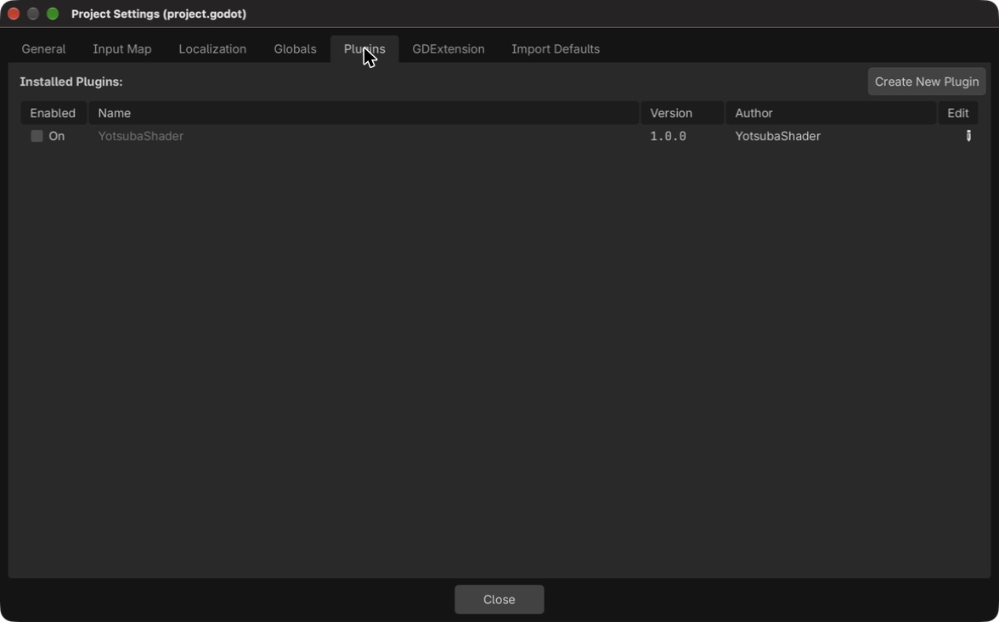
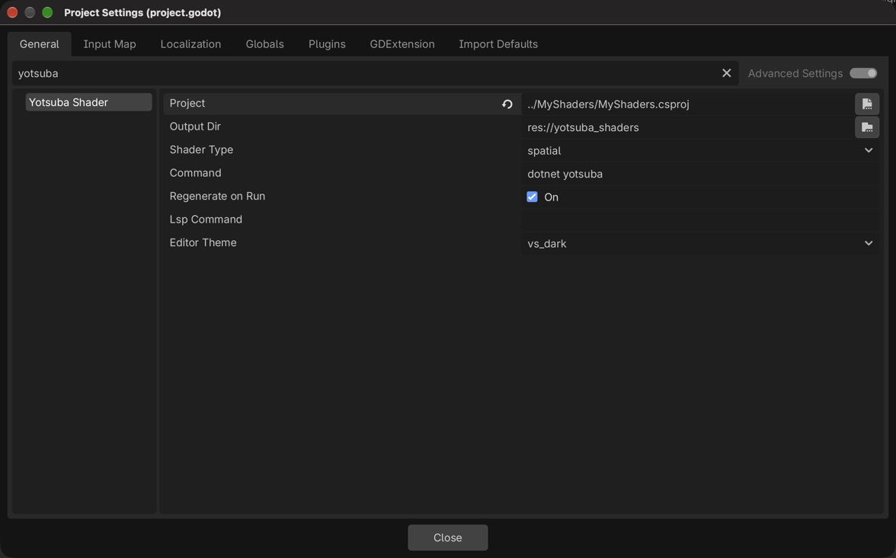
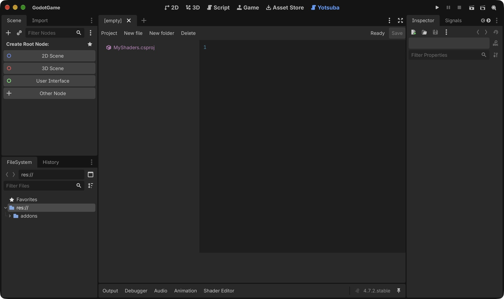
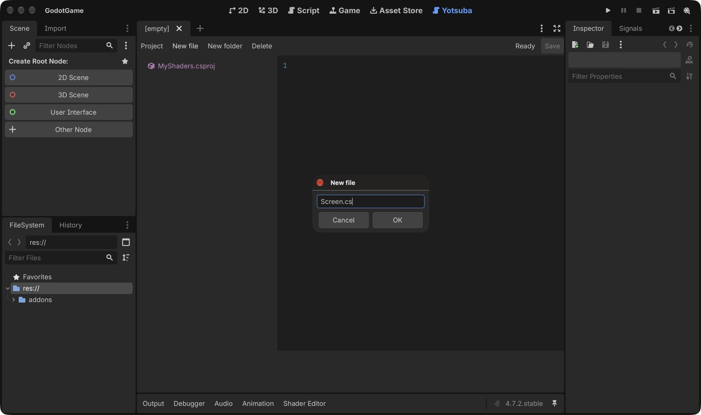
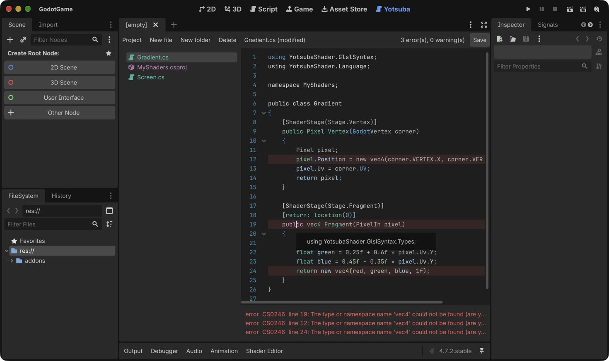

> [!SCENE] intro

In this chapter you will not write any shader yet. You will get the working folder ready, so that in the next chapters you only have to worry about the code.

You will write all the shaders of the tutorial in a C# library. You will see them run with {{engine}}.

When you finish the tutorial, you will use that same library in your {{engine}} game. The last chapter, [What now?](next-steps.md), has the steps to connect it.

> [!SCENE] need

## What you need

- **The .NET 10 SDK or newer.** To see which one you have, open a terminal and type `dotnet --version`. If you get a number lower than 10, download the new one from [dotnet.microsoft.com](https://dotnet.microsoft.com/download).

  One detail: the SDK is the program that compiles, and it does not have to be the same version as your project. That is why further down we create the projects with `-f net8.0`: SDK 10 knows how to build them just the same. If your game uses another version, that is fine.
- **A C# editor.** The one you already use: Rider, Visual Studio or Visual Studio Code. (In the Godot route you can use Godot itself, see step 7.)
:::godot
- **Godot 4.4 or newer.** Download it from [godotengine.org](https://godotengine.org/download). Both versions work: the standard one (GDScript) and the **.NET** one (C#). You will use it from step 5 of this chapter, and it is also where you will write your shaders: the Yotsuba Shader addon adds a C# editor to it.
:::

> [!SCENE] tree

## What the folder will look like

By the end of this chapter you will have this:

```text
Tutorial/
├── MyShaders/        a normal C# library: this is where you write the shaders
└── TryIt/            a console program to use the compiled shaders
```

Notice that `MyShaders` is a C# library like any other. That is the nice thing about writing shaders in C#: a shader project is simply a .NET project. This is the library you will later take to your game engine.

`TryIt` only exists so you can see the result while you learn. When you use the shaders in your game, your game's project takes its place.

> [!SCENE] install

## 1. Create the folder and install the compiler

```bash
mkdir Tutorial
```

```bash
cd Tutorial
```

```bash
dotnet tool install --global YotsubaShader.Compiler.CLI
```

The command downloads the Yotsuba Shader compiler from NuGet and installs it as a tool for your whole computer, not only for this folder. From now on, from any folder, the compiler is called with `yotsuba`.

> [!NOTE]
> If the terminal says it cannot find `yotsuba` right after installing, close it and open a new one. The terminal reads the list of tools when it starts.

> [!SCENE] project

## 2. Create the shader project

From the `Tutorial` folder:

```bash
dotnet new classlib -n MyShaders -f net8.0
```

The template creates a `Class1.cs` file that you will not use. Delete it.

Now tell the project that it is going to use Yotsuba Shader. It is a single reference:

```bash
dotnet add MyShaders package YotsubaShader.GlslSyntax
```

That one line brings you two things:

| Package | What it gives you |
| --- | --- |
| `YotsubaShader.GlslSyntax` | The names you are going to write with: `vec4`, `[location]`, `sin`, `texture`... |
| `YotsubaShader.Language` | The basics: `[ShaderStage]`, which you use to mark which method is a shader. |

You do not add `YotsubaShader.Language` yourself. `GlslSyntax` already uses it inside, and when a package uses another, NuGet brings you both.

> [!SCENE] styles

> [!NOTE]
> `GlslSyntax` is one of the five "styles" that come with Yotsuba Shader. It uses the same names as GLSL, the shader language you will find most often in tutorials on the internet. If you come from HLSL, Metal, Vulkan or WGSL, there is a style for each, and the result is the same. You will see it in [Other writing styles](how-it-works.md). In this tutorial we use GLSL from start to finish.

> [!SCENE] tryit

## 3. Create the program to try things out

```bash
dotnet new console -n TryIt -f net8.0
```

```bash
dotnet add TryIt reference MyShaders/MyShaders.csproj
```

`TryIt` is an ordinary console program. It plays the role of "your game" or "your application": the program that will ask for the compiled shaders. We will use it to see with our own eyes what the compiler produces.

> [!SCENE] build

## 4. Check that everything builds

```bash
dotnet build TryIt
```

If you see `Build succeeded` at the end, everything is ready. There is no shader yet, but the references are in place.

:::godot
> [!SCENE] g_project

## 5. Create the Godot project

Create an empty folder called `GodotGame` **inside** your `Tutorial` folder. Open Godot, press **Create** and fill in the window like this:


- **Project Name:** `GodotGame`.
- **Project Path:** the full path to that empty folder. Godot confirms it with "The project folder exists and is empty". Keep **Create Folder** off, because the folder already exists.
- **Renderer:** Forward+ is fine.

Press **Create**. The editor opens with an empty project:


```text
Tutorial/
├── MyShaders/        your shaders
├── TryIt/            the console you created in step 3
└── GodotGame/        new: the Godot project
```

It goes **inside** `Tutorial` on purpose, so everything stays together and the relative paths you will use later (`../GodotGame/...`) work.

> [!NOTE]
> Both versions of Godot work: the standard one (GDScript) and the **.NET** one (C#). Every script in this route is shown in both languages, in tabs. The C# you write in `MyShaders` is only the shader, and Godot never runs it.

> [!SCENE] g_addon

## 6. Install the addon

Yotsuba Shader has an addon for the Godot editor. Every time you press **Play**, it asks `yotsuba` to translate your shaders into Godot files, so you never have to run the command by hand. The addon comes inside the NuGet package of the Godot plugin. From the `Tutorial` folder:

```bash tab="macOS / Linux"
curl -L -o godot-addon.zip https://www.nuget.org/api/v2/package/YotsubaShader.Extensions.Godot/0.9.5
unzip -q godot-addon.zip "content/addon/addons/*" -d godot-addon
cp -R godot-addon/content/addon/addons GodotGame/
```

```powershell tab="Windows (PowerShell)"
curl.exe -L -o godot-addon.zip https://www.nuget.org/api/v2/package/YotsubaShader.Extensions.Godot/0.9.5
Expand-Archive godot-addon.zip -DestinationPath godot-addon -Force
Copy-Item -Recurse -Force godot-addon/content/addon/addons GodotGame/
```

`0.9.5` is the version this tutorial was written with; install the same one as your `yotsuba` tool (`dotnet tool list --global` shows it). The Yotsuba tab, which you will use in a moment, comes in the addon from version 0.9.1 on. In PowerShell you have to write `curl.exe`, because `curl` alone is another command there.

Godot only looks at its files when it starts, so reload the project (**Project → Reload Current Project**). The new `addons` folder appears in the FileSystem panel.

Now turn the addon on. Open **Project → Project Settings → Plugins**. **YotsubaShader** is in the list, switched off:



Tick the **Enabled** box:


Then open the **General** tab, turn on **Advanced Settings** (top right), type `yotsuba` in the filter and choose the **Yotsuba Shader** section. The **Project** field is empty:


Fill in `project` with:

```text
../MyShaders/MyShaders.csproj
```



The path is counted from the Godot project. Leave the rest as it is: `Lsp Command` and `Editor Theme` are for the Yotsuba tab you will see next, `Output Dir` is where the translated shaders go, `Shader Type` is `spatial` (for 3D objects), `Command` is the tool and `Regenerate on Run` makes the addon translate every time you press Play. If Godot says it cannot find `dotnet` (on macOS, when you open it from the Dock), write the full path of the tool in `Command`.

## 7. Write your shaders in the Yotsuba tab

With the addon on, Godot has one more tab next to **2D**, **3D** and **Script**: **Yotsuba**. It is an editor for the C# of `MyShaders`, inside Godot itself, so you do not need another program to write shaders.


Open it. At the top are the buttons **Project**, **New file**, **New folder** and **Delete**, the name of the open file and the **Save** button. Below them, on the left, the files of `MyShaders` (the project you wrote in `project`); on the right, the editor with its line numbers, and under it the list of problems. It starts empty:



To create a file, press **New file**. The tab asks for a name and puts the file in the project folder.



In the next chapter you will create `Screen.cs` and `Gradient.cs` like this.

Three things worth knowing:

- **Save** (the button, or `Cmd/Ctrl+S`) writes the file to disk. Until you save, the change only exists in the tab.
- **Errors show as you type.** The line with the problem is marked in red, and each error appears in the list below with its code: `CS...` if it is C# and `YS...` if it is a rule of Yotsuba Shader. The counter next to **Save** adds them up.
- **Completion and quick fixes.** After a dot, the tab suggests what you can write. If a type is missing its `using`, put the cursor on it and press `Alt+Enter`; the tab offers the `using` to add.



> [!NOTE]
> The Yotsuba tab needs Godot 4.4 or newer and a `yotsuba` tool that has the `lsp` command (the one you installed in step 1 has it). If the status says it could not start the language server, write the full path of `yotsuba` in **Lsp Command**, in the same section of the Project Settings. It is a young editor: if you prefer, any other C# editor (Rider, Visual Studio, VS Code) can open `MyShaders/MyShaders.csproj` and everything else in the tutorial works the same.
:::

> [!SCENE] cli

## A shortcut for calling the compiler

The Yotsuba Shader compiler is a terminal program (a CLI). You will run it like this, from the `Tutorial` folder:

```bash
yotsuba add MyShaders/MyShaders.csproj --target spirv
```

Do not run it yet. Just look at its parts:

| Part | What it means |
| --- | --- |
| `yotsuba` | "Run the compiler". It is the name of the tool you just installed. Everything after it is the orders for it. |
| `add` | The command. `add` means: "compile my shaders and **add** the result to my project". |
| `MyShaders/MyShaders.csproj` | The project where the shaders are. |
| `--target spirv` | An output format. The CLI asks for at least one. `spirv` is built into the CLI; the engines (MonoGame, KNI, FNA, Godot) are plugins that you add later as one more `--target`. |

:::raylib silknet
In this route you will not add a plugin: raylib-cs and Silk.NET read files, and the formats you ask for with `--target` (`glsl:330`, `gles:300`, `spirv` and `wgsl`) are built into the CLI. The next chapters show the command for each one.
:::

In the next chapter you will use it for real.

Next: [Shader 1: a sunset](first-shader.md).
