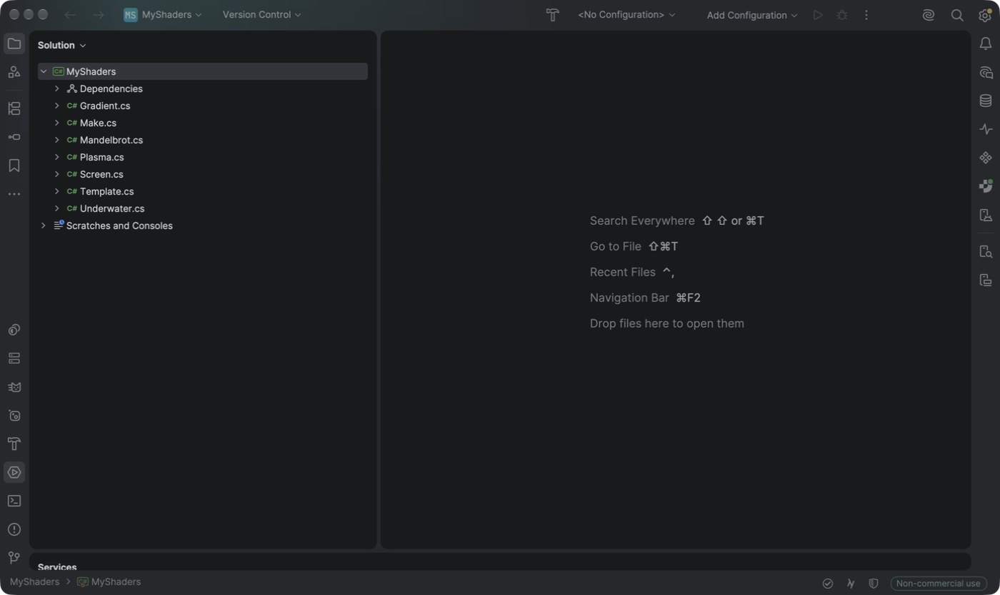

> [!SCENE] intro

In this chapter you will not write any shader yet. You will get the working folder ready, so that in the next chapters you only have to worry about the code.

You will write all the shaders of the tutorial in a C# library. You will see them run with {{engine}}.

When you finish the tutorial, you will use that same library in your {{engine}} game. The last chapter, [What now?](next-steps.md), has the steps to connect it.

> [!SCENE] need

## What you need

- **The .NET 10 SDK or newer.** To see which one you have, open a terminal and type `dotnet --version`. If you get a number lower than 10, download the new one from [dotnet.microsoft.com](https://dotnet.microsoft.com/download).

  One detail: the SDK is the program that compiles, and it does not have to be the same version as your project. That is why further down we create the projects with `-f net8.0`: SDK 10 knows how to build them just the same. If your game uses another version, that is fine.
- **A C# editor.** The one you already use: Rider, Visual Studio or Visual Studio Code.
:::godot
- **Godot 4.** Download it from [godotengine.org](https://godotengine.org/download). Both versions work: the standard one (GDScript) and the **.NET** one (C#). You will install it in the chapter about the viewer; for now it is enough to have it downloaded.
:::

> [!SCENE] tree

## What the folder will look like

By the end of this chapter you will have this:

```text
Tutorial/
├── MyShaders/        a normal C# library: this is where you write the shaders
└── TryIt/            a console program to use the compiled shaders
```

Notice that `MyShaders` is a C# library like any other. That is the nice thing about writing shaders in C#: a shader project is simply a .NET project. This is the library you will later take to your game engine.

`TryIt` only exists so you can see the result while you learn. When you use the shaders in your game, your game's project takes its place.

> [!SCENE] install

## 1. Create the folder and install the compiler

```bash
mkdir Tutorial
```

```bash
cd Tutorial
```

```bash
dotnet tool install --global YotsubaShader.Compiler.CLI
```

The command downloads the Yotsuba Shader compiler from NuGet and installs it as a tool for your whole computer, not only for this folder. From now on, from any folder, the compiler is called with `yotsuba`.

> [!NOTE]
> If the terminal says it cannot find `yotsuba` right after installing, close it and open a new one. The terminal reads the list of tools when it starts.

> [!SCENE] project

## 2. Create the shader project

From the `Tutorial` folder:

```bash
dotnet new classlib -n MyShaders -f net8.0
```

The template creates a `Class1.cs` file that you will not use. Delete it.

Now tell the project that it is going to use Yotsuba Shader. It is a single reference:

```bash
dotnet add MyShaders package YotsubaShader.GlslSyntax
```

That one line brings you two things:

| Package | What it gives you |
| --- | --- |
| `YotsubaShader.GlslSyntax` | The names you are going to write with: `vec4`, `[location]`, `sin`, `texture`... |
| `YotsubaShader.Language` | The basics: `[ShaderStage]`, which you use to mark which method is a shader. |

You do not add `YotsubaShader.Language` yourself. `GlslSyntax` already uses it inside, and when a package uses another, NuGet brings you both.

> [!SCENE] styles

> [!NOTE]
> `GlslSyntax` is one of the five "styles" that come with Yotsuba Shader. It uses the same names as GLSL, the shader language you will find most often in tutorials on the internet. If you come from HLSL, Metal, Vulkan or WGSL, there is a style for each, and the result is the same. You will see it in [Other writing styles](how-it-works.md). In this tutorial we use GLSL from start to finish.

> [!SCENE] tryit

## 3. Create the program to try things out

```bash
dotnet new console -n TryIt -f net8.0
```

```bash
dotnet add TryIt reference MyShaders/MyShaders.csproj
```

`TryIt` is an ordinary console program. It plays the role of "your game" or "your application": the program that will ask for the compiled shaders. We will use it to see with our own eyes what the compiler produces.

> [!SCENE] build

## 4. Check that everything builds

```bash
dotnet build TryIt
```

If you see `Build succeeded` at the end, everything is ready. There is no shader yet, but the references are in place.

:::godot
## Open it in your editor

Open `MyShaders/MyShaders.csproj` with the editor you like (Rider, Visual Studio, VS Code). This is how it looks in Rider:



Godot and your editor are two separate programs: the editor is for the C# of `MyShaders`, and Godot is only for looking at the result.

You can also do the same from the terminal: `dotnet build MyShaders` from the `Tutorial` folder.
:::

> [!SCENE] cli

## A shortcut for calling the compiler

The Yotsuba Shader compiler is a terminal program (a CLI). You will run it like this, from the `Tutorial` folder:

```bash
yotsuba add MyShaders/MyShaders.csproj --target spirv
```

Do not run it yet. Just look at its parts:

| Part | What it means |
| --- | --- |
| `yotsuba` | "Run the compiler". It is the name of the tool you just installed. Everything after it is the orders for it. |
| `add` | The command. `add` means: "compile my shaders and **add** the result to my project". |
| `MyShaders/MyShaders.csproj` | The project where the shaders are. |
| `--target spirv` | An output format. The CLI asks for at least one. `spirv` is built into the CLI; the engines (MonoGame, KNI, FNA, Godot) are plugins that you add later as one more `--target`. |

In the next chapter you will use it for real.

Next: [Shader 1: a sunset](first-shader.md).
