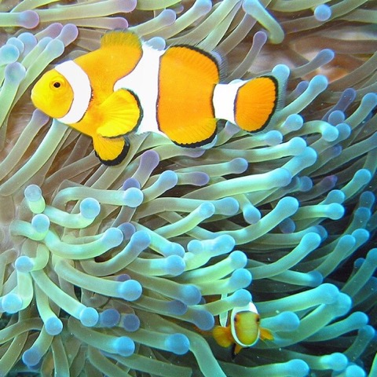
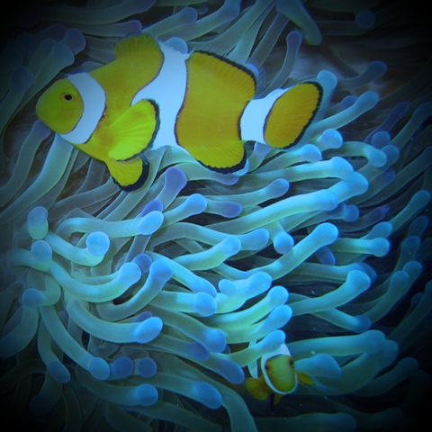
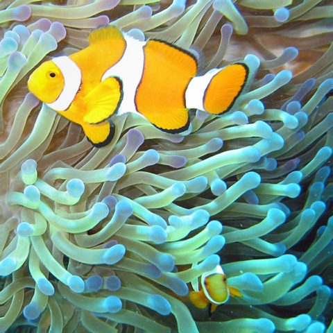
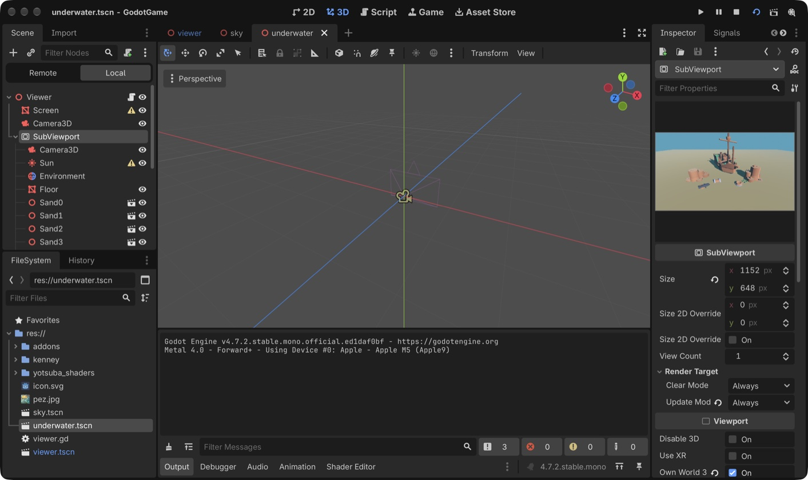
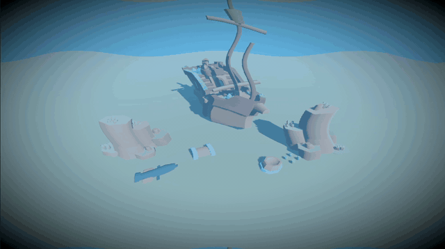

> [!SCENE] intro

The four previous shaders made up the color of each pixel with calculations. In this last one, the color comes from an image: a photo. And since the color goes through your function before it reaches the screen, you can do whatever you want to it.

You will take this photo:



and make it look like this, rippling as if you were looking at it through water:



Everything you already know comes together in this shader: `Uv`, your own functions, `sin`, `mix` and the time uniform. The only new thing is reading the image.

> [!SCENE] texture

## An image inside a shader: the texture

An image used by a shader is called a **texture**. It is declared just like the uniform from the previous chapter, as a field of the class with its address:

```csharp
[layout(0, 1)]
public sampler2D Photo;
```

- `sampler2D` is the type. It means "a 2D image I can read". It is in `YotsubaShader.GlslSyntax.Resources.Types`.
- `layout(0, 1)` is its address: group 0, slot 1. Slot 0 is already taken by the clock, and two things cannot be at the same address.

Your program is the one that loads the photo and leaves it at that address, just as it did with the clock.

> [!SCENE] read

## Reading a color from the photo

To read the texture you use the `texture` function. You give it the texture and a point, and it returns the color at that point:

```csharp
vec4 photo = texture(Photo, Make.Vec2(u, v));
```

The point is given with two numbers from `0` to `1`. `(0, 0)` is the top left corner of the photo and `(1, 1)` the bottom right. Sound familiar? It is exactly the same as `Uv`.

That is why, if you give each pixel the color of the photo at its own `Uv`, the photo shows up on screen as is, unchanged:

```csharp
vec4 photo = texture(Photo, Make.Vec2(pixel.Uv.X, pixel.Uv.Y));
```

`texture` is not in the `Math` class, but in another one called `Intrinsic`, where the functions that talk to the hardware live. It is used with another `using static`:

```csharp
using static YotsubaShader.GlslSyntax.Methods.Intrinsic;
```

> [!SCENE] trick

## The trick: reading from a slightly different place

Here is the idea behind the whole effect. Nobody forces you to read the photo exactly at the pixel's `Uv`. You can read it **a little to the side**.

If every pixel read a little to the right, the whole photo would look shifted. But if each pixel drifts by a different amount, the photo deforms. And if that amount follows a wave, the photo ripples:

```csharp
float u = pixel.Uv.X + sin(pixel.Uv.Y * 25f + t * 2f) * 0.012f;
float v = pixel.Uv.Y + sin(pixel.Uv.X * 20f + t * 1.5f) * 0.012f;

vec4 photo = texture(Photo, Make.Vec2(u, v));
```

Look at the first line piece by piece:

- `pixel.Uv.X` is the point where the pixel would normally read.
- `sin(pixel.Uv.Y * 25f + t * 2f)` is a wave that depends on the height of the pixel. Each row of pixels gets a different value, between `-1` and `1`.
- `* 0.012f` makes the wave very small. The largest drift is 1.2% of the width of the photo. With more, the image breaks apart; with less, you cannot notice it.
- `+ t * 2f` is the trick from the previous chapter: adding the time makes the wave travel.

The second line does the same for the height, with other numbers so the two waves do not move in step.



The photo did not move. What changed is which point each pixel reads from.

> [!SCENE] tint

## Tinting it blue

Under water everything looks bluish, because water dims the red. We will do the same: lower the red a lot, the green a little, and leave the blue.

```csharp
vec3 original = Make.Vec3(photo.X, photo.Y, photo.Z);
vec3 seaBlue = Make.Vec3(photo.X * 0.2f, photo.Y * 0.7f, photo.Z * 1f + 0.1f);
vec3 color = mix(original, seaBlue, 0.6f);
```

`photo.X`, `photo.Y` and `photo.Z` are the red, green and blue of the color you read. `seaBlue` is that same color with red at 20% and green at 70%.

The final `mix` keeps 60% of the blue version and 40% of the original. That way the fish is still orange, but muted. If you want deeper water, raise the `0.6f`.

> [!SCENE] vignette

## Darkening the edges

The last touch is to darken the corners, like in an old photo. That is called a vignette, and it is once again the distance to the center:

```csharp
public static float Vignette(float u, float v)
{
    float x = u * 2f - 1f;
    float y = v * 2f - 1f;
    float distance = sqrt(x * x + y * y);
    return 1f - smoothstep(0.5f, 1.4f, distance);
}
```

A new function shows up here, `smoothstep(start, end, value)`. It returns `0` if the value is below `start`, `1` if it is above `end`, and in between it rises from `0` to `1` smoothly. It is used to make transitions with no hard cuts.

In this case: up to a distance of `0.5` from the center it returns `0`, and from there to `1.4` it rises. Since we want the opposite (light in the center, shade at the edges), we flip it with `1f - ...`.


That image is the vignette on its own: white is `1` and black is `0`. When you multiply the color of the photo by that number, the center stays the same and the edges get darker:

```csharp
float shade = Vignette(pixel.Uv.X, pixel.Uv.Y);

return Make.Vec4(color.X * shade, color.Y * shade, color.Z * shade, 1f);
```

Multiplying a color by a number between `0` and `1` is how you darken it.

## The complete shader

```csharp title="MyShaders/Underwater.cs"
using YotsubaShader.GlslSyntax;
using YotsubaShader.GlslSyntax.Resources;
using YotsubaShader.GlslSyntax.Resources.Types;
using YotsubaShader.GlslSyntax.Types;
using YotsubaShader.Language;
using static YotsubaShader.GlslSyntax.Methods.Intrinsic;
using static YotsubaShader.GlslSyntax.Methods.Math;

namespace MyShaders;

public class Underwater
{
    [uniform, layout(0, 0)]
    public Clock Time;

    [layout(0, 1)]
    public sampler2D Photo;

    [ShaderStage(Stage.Vertex)]
    public Pixel Vertex({{vertexType}} corner)
    {
        Pixel pixel;
        pixel.Position = Make.Vec4(corner.{{pos}}.X, corner.{{pos}}.Y, 0f, 1f);
        pixel.Uv = corner.{{uv}};
        return pixel;
    }

    [ShaderStage(Stage.Fragment)]
    [return: location(0)]
    public vec4 Fragment(PixelIn pixel)
    {
        float t = Time.Seconds;

        float u = pixel.Uv.X + sin(pixel.Uv.Y * 25f + t * 2f) * 0.012f;
        float v = pixel.Uv.Y + sin(pixel.Uv.X * 20f + t * 1.5f) * 0.012f;

        vec4 photo = texture(Photo, Make.Vec2(u, v));

        vec3 original = Make.Vec3(photo.X, photo.Y, photo.Z);
        vec3 seaBlue = Make.Vec3(photo.X * 0.2f, photo.Y * 0.7f, photo.Z * 1f + 0.1f);
        vec3 color = mix(original, seaBlue, 0.6f);

        float shade = Vignette(pixel.Uv.X, pixel.Uv.Y);

        return Make.Vec4(color.X * shade, color.Y * shade, color.Z * shade, 1f);
    }

    public static float Vignette(float u, float v)
    {
        float x = u * 2f - 1f;
        float y = v * 2f - 1f;
        float distance = sqrt(x * x + y * y);
        return 1f - smoothstep(0.5f, 1.4f, distance);
    }
}
```

> [!SCENE] shared

The `struct Clock` is not declared again: it is the one from `Plasma.cs`. Two shaders can share the same data `struct`, and your program can send the same clock to both.

:::godot
## Giving the photo to Godot

A shader cannot open files by itself: your scene gives it the image. The viewer script already has a slot for that, the `photo` property (in C#, `Photo`). It sends the image to the shader's `Photo` texture right after loading it.

1. Copy `pez.jpg` into `GodotGame/` and let Godot import it.
2. Open `viewer.tscn`, select the root `Viewer` and write `Underwater` in **Shader Name**.
3. Drag `pez.jpg` from the FileSystem dock to the **Photo** property of the Inspector.

Press **Play Scene** (`Cmd/Ctrl+R`): the clownfish appears rippling, tinted blue and with dark edges, exactly as in the other routes.

## A bonus for Godot: the whole 3D scene underwater

The shader does not care where the image comes from. In Godot an image can also be **what a camera sees**. You are going to render a seabed in 3D and use that render as the `Photo`, so the water effect covers a full scene.

> [!NOTE]
> This is a **temporary** scene, only to show off. When you finish you give `Underwater` the clownfish again and the tutorial goes on as in every other route.

The models are from the [Pirate Kit by Kenney](https://kenney.nl/assets/pirate-kit), license CC0 (public domain). Download it and copy these files from `Models/GLB format/` into `GodotGame/kenney/`: `ship-wreck.glb`, `patch-sand.glb`, `rocks-sand-a.glb`, `rocks-sand-b.glb`, `chest.glb`, `barrel.glb`, `crate-bottles.glb`, `cannon.glb`. Copy the `Textures/colormap.png` file too, next to them, because the models use it for their colors. Then use **Project → Reload Current Project** so Godot imports them.

Open `viewer.tscn`, save it as `underwater.tscn` (**Scene → Save Scene As…**) and add these nodes as children of `Viewer`:

- **`SubViewport`**: a small invisible screen where the 3D scene is drawn. In the Inspector set **Size** to `1152 × 648`, **Render Target → Update Mode** to `Always` and turn **Own World 3D** on. That last one is important: it gives the SubViewport its own world, so the camera of `Viewer` does not see its objects.

Everything below goes inside `SubViewport`:

| Node | Type | What you set |
| --- | --- | --- |
| `Camera3D` | `Camera3D` | Position `(0, 7.5, 15)`, Rotation X `-25°`, **FOV** `65` |
| `Sun` | `DirectionalLight3D` | Rotation X `-60°`, **Energy** `0.7`, Shadow **Enabled** |
| `Environment` | `WorldEnvironment` | New Environment: sky in dark teal, **Fog** enabled with a teal color and **Density** `0.006` |
| `Floor` | `MeshInstance3D` | **Mesh → New PlaneMesh**, size `120 × 120`, Position Y `0.85`, sand-colored material |
| `Sand0` … `Sand8` | `patch-sand.glb` | Drag the file from the FileSystem into the scene. Nine copies in a grid: X `-8, 0, 8` and Z `-4, 2, 8`, Y `-0.1` |
| `Wreck` | `ship-wreck.glb` | Position `(0.5, 0.3, -1)`, Rotation Y `25°` |
| `RocksA`, `RocksB` | `rocks-sand-a.glb`, `rocks-sand-b.glb` | Positions `(-5.5, 0, 3.5)` and `(6, 0, 4)` |
| `Chest`, `Barrel`, `Crate`, `Cannon` | `chest.glb`, `barrel.glb`, `crate-bottles.glb`, `cannon.glb` | Spread them in front of the wreck, around Z `5` to `6.5` |



Now connect the two. Select the root `Viewer` and, in **Photo**, choose **New ViewportTexture**. Godot asks which viewport: pick `SubViewport`. The root keeps `Underwater` in **Shader Name**.

Press **Play Scene**:



The wreck, the rocks and the sand are plain Godot models. Everything you see tinted, rippling and darkened at the edges is your `Underwater` shader, which received the camera image as if it were a photo.

To go back to the standard chapter, open `viewer.tscn`: it still has `Underwater` and the clownfish in **Photo**.
:::

> [!SCENE] far

## Look how far you have come

Read the `Fragment` method again. It does ten lines of calculations, and each one is something you learned in a chapter:

| Line | Where it comes from |
| --- | --- |
| `pixel.Uv.X`, `Make.Vec4(...)` | Shader 1 |
| The `Vignette` function | Shader 2 |
| `sqrt`, `mix` | Shader 3 |
| `Time.Seconds`, `sin(... + t)` | Shader 4 |
| `texture(Photo, ...)` | This chapter |

Almost every effect you see in a game is made with these same pieces: reading an image, shifting a little where it is read from, mixing colors and using distances.

> [!SCENE] play

## Play with it

- Change `0.012f` to `0.05f` in both lines. The photo deforms much more.
- Remove the blue tint by returning `original` instead of `color`. You are left with just the ripples.
- Turn the photo black and white: calculate `float gray = (photo.X + photo.Y + photo.Z) / 3f;` and return `Make.Vec4(gray, gray, gray, 1f)`.

> [!SCENE] learned

## What you learned

- A texture is an image the shader can read. It is declared as a `sampler2D` field with its `[layout(group, slot)]`.
- `texture(image, point)` returns the color of the image at that point. The point goes from `0` to `1`, just like `Uv`.
- Reading the image at a different point from the one that corresponds is the basis of almost every distortion effect.
- Multiplying a color by a number darkens it. `smoothstep` makes the change from one value to another smooth.

You have finished all five shaders. Before closing, the chapter [When something goes wrong](debugging.md) gathers the method for finding errors and the questions almost everyone asks.

---

Clownfish photo: Janderk, [Wikimedia Commons](https://commons.wikimedia.org/wiki/File:Common_clownfish.jpg), public domain.
