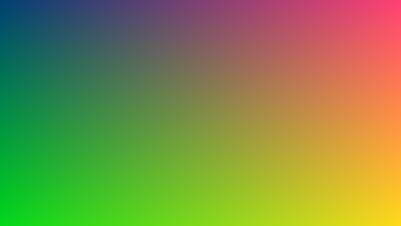
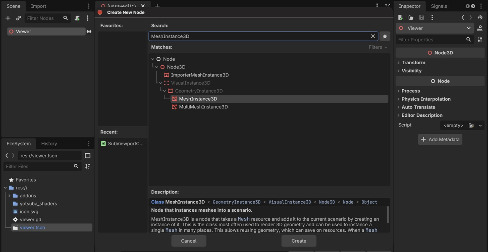
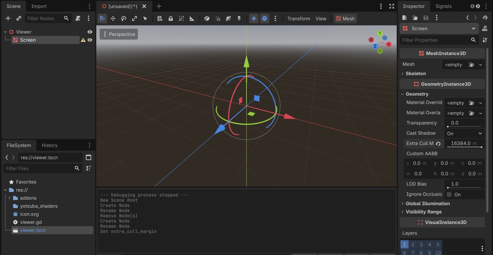
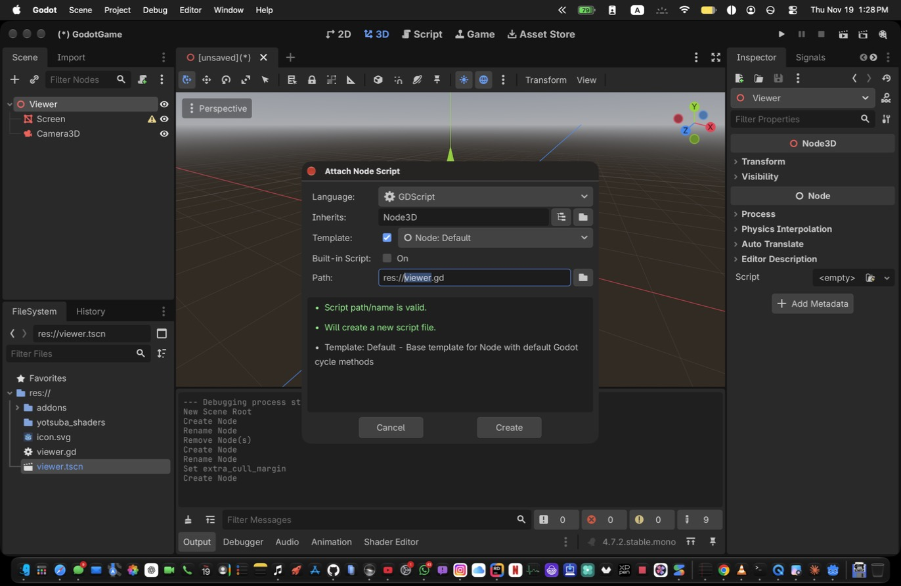
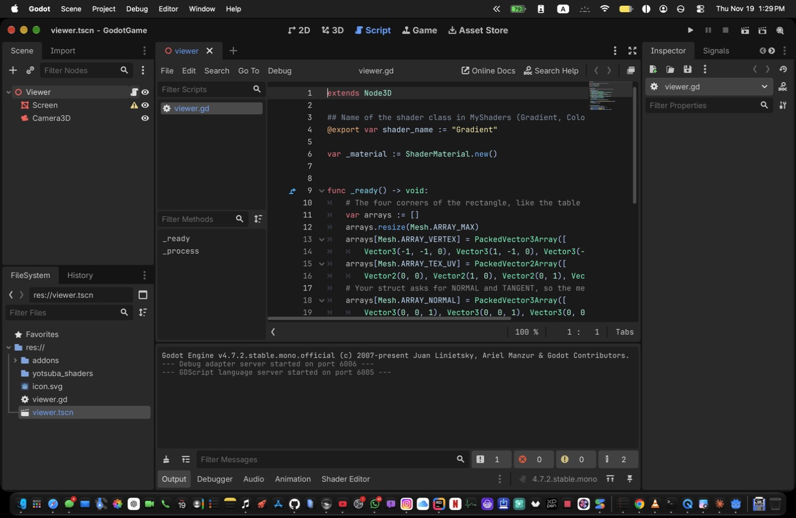
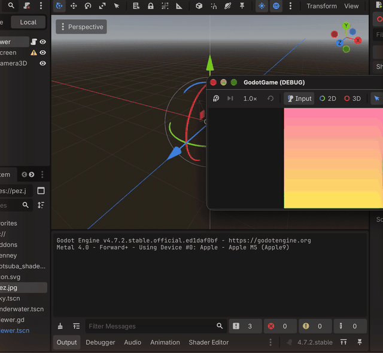
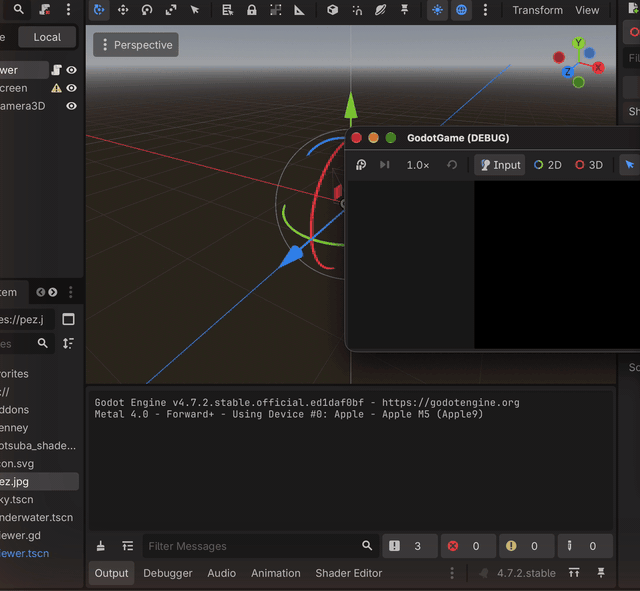

> [!SCENE] intro

So far you have compiled a shader and read its code in the console. But a shader is made to be **seen**. A shader whose result you never see is like a recipe you never cook: you learn nothing from it.

That is why, from this chapter on, the way of working changes. Everything that follows works like this:

1. You write a little code.
2. You compile it.
3. You look at it in a window.
4. You change one number and look again.

For step 3 you need that window. You are going to build it now, just once.

:::xna
> [!SCENE] x_viewer

## What the viewer is

The viewer is a program of about 70 lines that does three things:

- It opens a window.
- It draws a rectangle that covers the whole window (the same rectangle from [Shader 1](first-shader.md)).
- It puts on it the shader you name.

Notice one thing: the viewer is **not part of your shader**. Your shaders stay in `MyShaders`, knowing nothing about windows. The viewer is just a work tool, like a bench for testing parts. We use {{engine}} to open the window because it is short and works the same on Windows, Mac and Linux. When you want to take your shaders to your game, you will use the same library with the engine you prefer.

> [!NOTE]
> You do not need to understand every line of the viewer to keep going. If you are curious, the [{{engine}}](../engines/{{plugin}}-reference.md) guide explains one by one the parts that we only mention here.

> [!SCENE] x_project

## Step 1: create the project

From the `Tutorial` folder:

```bash
dotnet new console -n Viewer -f net8.0
dotnet add Viewer package {{enginePackage}}
dotnet add Viewer reference MyShaders/MyShaders.csproj
```

- The first line creates an empty console program called `Viewer`.
- The second adds {{engine}} to it, which is what opens the window.
- The third tells it that it can use your shaders. This way, every change you make in `MyShaders` will be seen by the viewer without copying anything.

Your folder looks like this:

```text
Tutorial/
├── MyShaders/        your shaders
├── TryIt/            the console from the previous chapter
└── Viewer/           new: the window
```

> [!SCENE] x_vertex

## Step 2: describe the vertex, on the window's side

In [How a shader is built](how-a-shader-is-built.md) you saw that the game hands the shader a list of vertices, and that each one carries a position and a `Uv`. In the shader you already wrote what a vertex looks like (the `Corner` struct). Now you have to write **the same thing on the plain C# side**, so that window and shader understand each other.

Create `Viewer/ScreenCorner.cs`:

```csharp title="Viewer/ScreenCorner.cs"
using Microsoft.Xna.Framework;
using Microsoft.Xna.Framework.Graphics;

public readonly struct ScreenCorner(Vector2 posicion, Vector2 uv) : IVertexType
{
    private static readonly VertexDeclaration Declaracion = new(
        new VertexElement(0, VertexElementFormat.Vector2, VertexElementUsage.TextureCoordinate, 0),
        new VertexElement(8, VertexElementFormat.Vector2, VertexElementUsage.TextureCoordinate, 1));

    public readonly Vector2 Position = posicion;
    public readonly Vector2 Uv = uv;

    VertexDeclaration IVertexType.VertexDeclaration => Declaracion;
}
```

The only important thing here is that it matches your `Corner`: first two numbers for the position (slot 0), then two for the `Uv` (slot 1). If you ever change `Corner`, you will have to change `ScreenCorner` the same way.

> [!SCENE] x_window

## Step 3: an empty window

Replace the entire contents of `Viewer/Program.cs` with this:

```csharp title="Viewer/Program.cs"
using Microsoft.Xna.Framework;
using Microsoft.Xna.Framework.Graphics;
using Microsoft.Xna.Framework.Input;

string name = args.Length > 0 ? args[0] : "Gradient";

using var viewer = new Viewer(name);
viewer.Run();

public class Viewer : Game
{
    private readonly string _name;

    public Viewer(string name)
    {
        _name = name;
        var graphics = new GraphicsDeviceManager(this)
        {
            PreferredBackBufferWidth = 800,
            PreferredBackBufferHeight = 450,
        };
        Window.AllowUserResizing = true;
        Window.Title = name;
    }

    protected override void Update(GameTime gameTime)
    {
        if (Keyboard.GetState().IsKeyDown(Keys.Escape))
        {
            Exit();
        }
        base.Update(gameTime);
    }

    protected override void Draw(GameTime gameTime)
    {
        GraphicsDevice.Clear(Color.CornflowerBlue);
        base.Draw(gameTime);
    }
}
```

Look at the three parts:

- The first line takes the name of the shader you type when you run it. If you type none, it uses `Gradient`.
- The `Viewer(...)` constructor asks for a window of 800 by 450 pixels. It is wide on purpose: later it will help you discover a typical shader problem. You can also stretch it with the mouse.
- `Update` closes the window when you press **Esc**. `Draw` paints it blue, for now.

Run it:

```bash
dotnet run --project Viewer
```

A blue window should appear. Close it with **Esc**. If you see it, {{engine}} works on your computer and nothing is missing.

> [!SCENE] x_shader

## Step 4: add the shader

Now we are going to make the window draw a shader instead of painting itself blue. These are four changes in the same file. Make them one by one.

**Change 1.** Add these lines at the very top, next to the other `using` lines:

```csharp
using MyShaders;
using YotsubaShader;
```

**Change 2.** Inside the `Viewer` class, below `private readonly string _name;`, add the shader and the rectangle:

```csharp
    private Effect _shader = null!;

    private readonly ScreenCorner[] _screen =
    [
        new(new Vector2(-1f,  1f), new Vector2(0f, 0f)),
        new(new Vector2( 1f,  1f), new Vector2(1f, 0f)),
        new(new Vector2(-1f, -1f), new Vector2(0f, 1f)),
        new(new Vector2( 1f, -1f), new Vector2(1f, 1f)),
    ];
```

These are the four corners of the rectangle. Each one says where it is on the screen (from `-1` to `1`) and what its `Uv` is (from `0` to `1`). It is the same table you saw in the chapter about how a shader is built.

**Change 3.** Between the constructor and `Update`, add a new method that loads your shader:

```csharp
    protected override void LoadContent()
    {
{{loadPrefix}}
        // One line per shader of the tutorial: the name you type after `--`, and its class.
        byte[] compiled = _name switch
        {
            "Gradient" => {{toFx Gradient}},
            _ => throw new Exception($"The viewer does not know a shader called \"{_name}\". Add it to the switch."),
        };

        _shader = new Effect(GraphicsDevice, compiled);
    }
```

`{{toMethod}}` is the method Yotsuba Shader creates for each of your shader classes: it returns the shader compiled for {{engine}}. The `switch` chooses which class to use from the name you type after `--` in the terminal. For now it only knows `Gradient`. **Every time you create a new shader you will add one line here**, and the chapter will remind you. The last line, `_ =>`, means "any other name" and gives you a clear error if you misspell it.

**Change 4.** Replace the whole `Draw` method with this one:

```csharp
    protected override void Draw(GameTime gameTime)
    {
        GraphicsDevice.Clear(Color.Black);
        GraphicsDevice.RasterizerState = RasterizerState.CullNone;

        // If your shader declares this data, the viewer hands it over.
        _shader.Parameters["Data_Width"]?.SetValue((float)GraphicsDevice.Viewport.Width);
        _shader.Parameters["Data_Height"]?.SetValue((float)GraphicsDevice.Viewport.Height);
        _shader.Parameters["Data_Seconds"]?.SetValue((float)gameTime.TotalGameTime.TotalSeconds);

        _shader.CurrentTechnique.Passes[0].Apply();
        GraphicsDevice.DrawUserPrimitives(PrimitiveType.TriangleStrip, _screen, 0, 2);

        base.Draw(gameTime);
    }
```

The three lines that start with `_shader.Parameters` are a preview: if your shader asks for the window size or the time, the viewer gives them to it. We do not use them yet; in a few chapters you will know what they are for. If your shader does not ask for them, those lines do nothing.

In case something does not add up, this is the complete file:

```csharp title="Viewer/Program.cs"
using Microsoft.Xna.Framework;
using Microsoft.Xna.Framework.Graphics;
using Microsoft.Xna.Framework.Input;
using MyShaders;
using YotsubaShader;

string name = args.Length > 0 ? args[0] : "Gradient";

using var viewer = new Viewer(name);
viewer.Run();

public class Viewer : Game
{
    private readonly string _name;
    private Effect _shader = null!;

    private readonly ScreenCorner[] _screen =
    [
        new(new Vector2(-1f,  1f), new Vector2(0f, 0f)),
        new(new Vector2( 1f,  1f), new Vector2(1f, 0f)),
        new(new Vector2(-1f, -1f), new Vector2(0f, 1f)),
        new(new Vector2( 1f, -1f), new Vector2(1f, 1f)),
    ];

    public Viewer(string name)
    {
        _name = name;
        var graphics = new GraphicsDeviceManager(this)
        {
            PreferredBackBufferWidth = 800,
            PreferredBackBufferHeight = 450,
        };
        Window.AllowUserResizing = true;
        Window.Title = name;
    }

    protected override void LoadContent()
    {
{{loadPrefix}}
        // One line per shader of the tutorial: the name you type after `--`, and its class.
        byte[] compiled = _name switch
        {
            "Gradient" => {{toFx Gradient}},
            _ => throw new Exception($"The viewer does not know a shader called \"{_name}\". Add it to the switch."),
        };

        _shader = new Effect(GraphicsDevice, compiled);
    }

    protected override void Update(GameTime gameTime)
    {
        if (Keyboard.GetState().IsKeyDown(Keys.Escape))
        {
            Exit();
        }
        base.Update(gameTime);
    }

    protected override void Draw(GameTime gameTime)
    {
        GraphicsDevice.Clear(Color.Black);
        GraphicsDevice.RasterizerState = RasterizerState.CullNone;

        // If your shader declares this data, the viewer hands it over.
        _shader.Parameters["Data_Width"]?.SetValue((float)GraphicsDevice.Viewport.Width);
        _shader.Parameters["Data_Height"]?.SetValue((float)GraphicsDevice.Viewport.Height);
        _shader.Parameters["Data_Seconds"]?.SetValue((float)gameTime.TotalGameTime.TotalSeconds);

        _shader.CurrentTechnique.Passes[0].Apply();
        GraphicsDevice.DrawUserPrimitives(PrimitiveType.TriangleStrip, _screen, 0, 2);

        base.Draw(gameTime);
    }
}
```

> [!SCENE] x_see

## Step 5: see your first shader

Now for real. Your `Gradient` from the previous chapter is already compiled, so it is enough to run the viewer:

```bash
dotnet run --project Viewer -- Gradient
```

What comes after `--` is the name of the shader you pass to the viewer.


That is your shader, drawn by your computer's GPU. Close it with **Esc**.

> [!SCENE] x_cycle

## The work cycle

Now you are going to learn the cycle you will use for the rest of the tutorial. It is always the same:

1. You **edit** a file in `MyShaders`.
2. You **compile** with `add`, so your changes become a shader.
3. You **look** with the viewer.

The last two steps fit on one line, joined by `&&` (which means "and if that went well, continue with this"):

```bash
yotsuba add MyShaders/MyShaders.csproj --target spirv --target {{plugin}} && dotnet run --project Viewer -- Gradient
```

There is one new thing in the command: `--target {{plugin}}`. The viewer loads your shader with `{{toMethod}}`, and that method is not generated by the CLI alone: it comes from the **{{engine}} plugin**. With that `--target` you ask for it. The first time the CLI downloads the plugin (it needs internet only that time), and from then on it uses the copy it saved. The [{{engine}} guide](../engines/{{plugin}}-reference.md) explains what the plugin is and what it produces.

Try it now with your first experiment. Open `MyShaders/Gradient.cs` and find this line in `Fragment`:

```csharp
float red = 1f;
```

Change it to this:

```csharp
float red = pixel.Uv.X;
```

Save and run the command above:



Red no longer has the same value across the whole screen: now it grows from left to right, because `pixel.Uv.X` goes from `0` at the left edge to `1` at the right. At the left edge there is no red at all and only green and blue remain (dark blue at the top, green at the bottom). On the right, the sunset from before comes back.

You have just done what you will do hundreds of times: change a number and see what happens. Before moving on, put the line back to `float red = 1f;`.

> [!NOTE]
> The cycle has one extra step the first time you use a shader: its line in the viewer's `switch`. You do it once per shader, never again.

> [!TIP]
> Save the cycle command in a text file or in your terminal history. You are going to run it many times, and the only thing that changes is the name at the end.

:::

:::godot
> [!SCENE] g_viewer

## What the viewer is

The viewer is a small **Godot scene** that does three things:

- It draws a rectangle that covers the whole window (the same rectangle from [Shader 1](first-shader.md)).
- It puts on it the shader you name.
- It hands it the window size and the time, in case the shader asks for them.

Notice one thing: the viewer is **not part of your shader**. Your shaders stay in `MyShaders`, knowing nothing about Godot. The viewer is just a work tool, like a bench for testing parts. When you want to take your shaders to your game, you will use the same library in your own scenes.

> [!NOTE]
> You do not need to understand every line of the viewer to keep going. It is about 30 lines of Godot.

> [!NOTE]
> This route needs the Godot project and the addon from [Set up your project](setup.md): the `GodotGame` folder inside `Tutorial`, with `addons/yotsubashader` enabled and `project` pointing at `MyShaders`. If you skipped that, do it now.

> [!SCENE] g_scene

## Step 1: the rectangle and the window

Here is the key idea of this route: Godot does not draw a bare rectangle. It draws **meshes**, inside **scenes**. So the viewer is a scene with three nodes:

- `Viewer`: the root. It carries the script.
- `Screen`: a `MeshInstance3D`, the object that will show your shader.
- `Camera3D`: without it Godot has nothing to look through.

Build it step by step.

**The root.** In the **Scene** panel, press **3D Scene**. Godot creates a `Node3D`. Double-click its name and call it `Viewer`.

**The `Screen` node.** Right-click `Viewer` and choose **Add Child Node…** (or select it and press `Cmd/Ctrl+A`). Type `MeshInstance3D`, select it and press **Create**:



Double-click the new node and rename it to `Screen`.

**The camera.** Select `Viewer` again, add another child node, this time a `Camera3D`. Leave it as it is.

**The margin.** Select `Screen`. In the Inspector open **Geometry** and set **Extra Cull Margin** to `16384`:



Why: before drawing an object, Godot checks, using its position **in the 3D world**, if it is inside what the camera sees. Your shader moves the vertices somewhere else, but that happens later. The big margin tells Godot: "do not throw this object away".

**The script.** Right-click `Viewer` and choose **Attach Script…**. Leave the language on GDScript (or choose C# if you use .NET), leave the path as `res://viewer.gd` and press **Create**:



The script editor opens with a template. Replace **all** its content with this:

```gdscript tab="GDScript" title="GodotGame/viewer.gd"
extends Node3D

## Name of the shader class in MyShaders (Gradient, Colors, Plasma...).
@export var shader_name := "Gradient"

## The image for shaders that declare a `Photo` texture. Drag one here in the Inspector.
@export var photo: Texture2D

var _material := ShaderMaterial.new()


func _ready() -> void:
	# The four corners of the rectangle, like the table from the chapter: position and Uv.
	var arrays := []
	arrays.resize(Mesh.ARRAY_MAX)
	arrays[Mesh.ARRAY_VERTEX] = PackedVector3Array([
		Vector3(-1, -1, 0), Vector3(1, -1, 0), Vector3(-1, 1, 0), Vector3(1, 1, 0)])
	arrays[Mesh.ARRAY_TEX_UV] = PackedVector2Array([
		Vector2(0, 0), Vector2(1, 0), Vector2(0, 1), Vector2(1, 1)])
	# Your struct asks for NORMAL and TANGENT, so the mesh has to carry them too.
	arrays[Mesh.ARRAY_NORMAL] = PackedVector3Array([
		Vector3(0, 0, 1), Vector3(0, 0, 1), Vector3(0, 0, 1), Vector3(0, 0, 1)])
	arrays[Mesh.ARRAY_TANGENT] = PackedFloat32Array([
		1, 0, 0, 1, 1, 0, 0, 1, 1, 0, 0, 1, 1, 0, 0, 1])
	var mesh := ArrayMesh.new()
	mesh.add_surface_from_arrays(Mesh.PRIMITIVE_TRIANGLE_STRIP, arrays)

	_material.shader = load("res://yotsuba_shaders/MyShaders/%s.spatial.gdshader" % shader_name)
	if photo:
		_material.set_shader_parameter("Photo", photo)
	$Screen.mesh = mesh
	$Screen.material_override = _material


func _process(_delta: float) -> void:
	var size := get_viewport().get_visible_rect().size
	var seconds := Time.get_ticks_msec() / 1000.0
	# Any uniform called <Field>_Width, <Field>_Height or <Field>_Seconds receives its value.
	for uniform in _material.shader.get_shader_uniform_list():
		var uniform_name: String = uniform.name
		if uniform_name.ends_with("_Width"):
			_material.set_shader_parameter(uniform_name, size.x)
		elif uniform_name.ends_with("_Height"):
			_material.set_shader_parameter(uniform_name, size.y)
		elif uniform_name.ends_with("_Seconds"):
			_material.set_shader_parameter(uniform_name, seconds)
```
```csharp tab="C#" title="GodotGame/Viewer.cs"
using Godot;

public partial class Viewer : Node3D
{
    // Name of the shader class in MyShaders (Gradient, Colors, Plasma...).
    [Export] public string ShaderName { get; set; } = "Gradient";

    // The image for shaders that declare a `Photo` texture. Drag one here in the Inspector.
    [Export] public Texture2D Photo { get; set; }

    private readonly ShaderMaterial _material = new();

    public override void _Ready()
    {
        // The four corners of the rectangle, like the table from the chapter: position and Uv.
        var arrays = new Godot.Collections.Array();
        arrays.Resize((int)Mesh.ArrayType.Max);
        arrays[(int)Mesh.ArrayType.Vertex] = new[]
        {
            new Vector3(-1, -1, 0), new Vector3(1, -1, 0), new Vector3(-1, 1, 0), new Vector3(1, 1, 0),
        };
        arrays[(int)Mesh.ArrayType.TexUV] = new[]
        {
            new Vector2(0, 0), new Vector2(1, 0), new Vector2(0, 1), new Vector2(1, 1),
        };
        // Your struct asks for NORMAL and TANGENT, so the mesh has to carry them too.
        arrays[(int)Mesh.ArrayType.Normal] = new[]
        {
            new Vector3(0, 0, 1), new Vector3(0, 0, 1), new Vector3(0, 0, 1), new Vector3(0, 0, 1),
        };
        arrays[(int)Mesh.ArrayType.Tangent] = new float[] { 1, 0, 0, 1, 1, 0, 0, 1, 1, 0, 0, 1, 1, 0, 0, 1 };
        var mesh = new ArrayMesh();
        mesh.AddSurfaceFromArrays(Mesh.PrimitiveType.TriangleStrip, arrays);

        _material.Shader = GD.Load<Shader>($"res://yotsuba_shaders/MyShaders/{ShaderName}.spatial.gdshader");
        if (Photo != null) _material.SetShaderParameter("Photo", Photo);
        var screen = GetNode<MeshInstance3D>("Screen");
        screen.Mesh = mesh;
        screen.MaterialOverride = _material;
    }

    public override void _Process(double delta)
    {
        Vector2 size = GetViewport().GetVisibleRect().Size;
        double seconds = Time.GetTicksMsec() / 1000.0;
        // Any uniform called <Field>_Width, <Field>_Height or <Field>_Seconds receives its value.
        foreach (var uniform in _material.Shader.GetShaderUniformList())
        {
            string name = uniform["name"].AsString();
            if (name.EndsWith("_Width")) _material.SetShaderParameter(name, size.X);
            else if (name.EndsWith("_Height")) _material.SetShaderParameter(name, size.Y);
            else if (name.EndsWith("_Seconds")) _material.SetShaderParameter(name, seconds);
        }
    }
}
```

The corners are the same table of the previous chapters: each one says where it is and what its `Uv` is. One thing changes in Godot: the vertical axis of the screen goes the other way (`Y = -1` is the **top**), so the corner that has `Uv = (0, 0)` is written with `Y = -1`. This way the `Uv` still starts at the top left, and the shaders look the same as in every other route.

Other lines worth reading:

- `ShaderMaterial` is a material whose painting is done by a shader you provide. `material_override` makes `Screen` use it.
- `_ready()` runs once, when the scene starts. `_process()` runs every frame.
- The loop in `_process` looks at the `uniform` of your shader and sends a value to the ones whose name ends in `_Width`, `_Height` or `_Seconds` (for example `Data_Seconds` or `Time_Seconds`). If your shader declares none of them, nothing happens. You will learn what they are for in a few chapters.
- `@export` (or `[Export]` in C#) puts `shader_name` in the **Inspector**, so you choose the shader without touching the code.

This is how the editor looks with your script:



If you use C#, the script file must be called exactly like the class, `Viewer.cs`, and Godot needs a `.csproj` for the Godot project (the editor makes it with **Project → Tools → C# → Create C# solution**). That `.csproj` is **not** `MyShaders`: it is the one of the game.

> [!SCENE] g_see

## Step 2: see your first shader

Save the scene (`Cmd/Ctrl+S`) with the name `viewer.tscn`. Select the `Viewer` node: in the Inspector, **Shader Name** says `Gradient`.


Press **Play** (the triangle at the top right). The first time, Godot asks for a main scene: choose **Select Current**. Before the game starts, the addon translates `MyShaders`, and then the window opens.



That is your shader, drawn by the GPU. Close the window to go back to the editor.

> [!NOTE]
> If you prefer the terminal, the addon does this for you: `yotsuba compile MyShaders/MyShaders.csproj --target godot --output ../GodotGame/yotsuba_shaders`.

> [!SCENE] g_cycle

## The work cycle

For the rest of the tutorial you will use this cycle:

1. You **edit** a file in `MyShaders`.
2. You press **Play** in Godot. The addon **compiles** for you.
3. You **look** at the window.

Try it with your first experiment. Open `MyShaders/Gradient.cs` and find this line in `Fragment`:

```csharp
float red = 1f;
```

Change it to this:

```csharp
float red = pixel.Uv.X;
```

Save and press **Play**:


Red no longer has the same value across the whole screen: now it grows from left to right, because `pixel.Uv.X` goes from `0` at the left edge to `1` at the right.

You have just done what you will do hundreds of times: change a number and see what happens. Before moving on, put the line back to `float red = 1f;`.

> [!NOTE]
> For every new shader you will only type its name in the **Shader Name** field. You do it once per shader.
:::

:::raylib
## What the viewer is

The viewer is a program of about 50 lines that does three things:

- It opens a window.
- It draws a rectangle that covers the whole window (the same rectangle from [Shader 1](first-shader.md)).
- It puts on it the shader you name.

Notice one thing: the viewer is **not part of your shader**. Your shaders stay in `MyShaders`, knowing nothing about windows. The viewer is just a work tool, like a bench for testing parts. We use {{engine}} to open the window because it is short and works the same on Windows, Mac and Linux. When you want to take your shaders to your game, you will use the same library with the engine you prefer.

> [!NOTE]
> You do not need to understand every line of the viewer to keep going. If you are curious, the [{{engine}}](../engines/raylib-reference.md) guide explains one by one the parts that we only mention here.

## Step 1: compile the shaders to files

In the previous chapters you used `add`, which writes C# methods inside your project. raylib does not need them: it takes the shader as **text**. So in this route you use the other command, `compile`, which writes each shader to a file. From the `Tutorial` folder:

```bash
yotsuba compile MyShaders/MyShaders.csproj --target glsl:330 --output out
```

- `--target glsl:330` asks for GLSL, version 3.30: the language of the OpenGL 3.3 that raylib uses.
- `--output out` is the folder where the files go.

For every shader class there are now two files, one per stage:

```text
MyShaders/out/MyShaders/
├── Gradient.Vertex.glsl
└── Gradient.Fragment.glsl
```

## Step 2: create the project

From the `Tutorial` folder:

```bash
dotnet new console -n Viewer -f net8.0
dotnet add Viewer package Raylib-cs --version 8.1.0
```

- The first line creates an empty console program called `Viewer`.
- The second adds raylib-cs to it, which is what opens the window.

The viewer does **not** reference `MyShaders`: it only reads the files from step 1. The one thing left is to allow `unsafe` code, because the next file calls functions through pointers. Open `Viewer/Viewer.csproj` and add this line inside `<PropertyGroup>`:

```xml
<AllowUnsafeBlocks>true</AllowUnsafeBlocks>
```

Your folder looks like this:

```text
Tutorial/
├── MyShaders/        your shaders (with the out folder)
├── TryIt/            the console from the previous chapter
└── Viewer/           new: the window
```

## Step 3: an empty window

Replace the entire contents of `Viewer/Program.cs` with this:

```csharp title="Viewer/Program.cs"
using Raylib_cs;

string name = args.Length > 0 ? args[0] : "Gradient";

Raylib.SetConfigFlags(ConfigFlags.ResizableWindow);
Raylib.InitWindow(800, 450, name);

while (!Raylib.WindowShouldClose())
{
    Raylib.BeginDrawing();
    Raylib.ClearBackground(Color.SkyBlue);
    Raylib.EndDrawing();
}

Raylib.CloseWindow();
```

Look at the three parts:

- The first line takes the name of the shader you type when you run it. If you type none, it uses `Gradient`.
- `InitWindow` asks for a window of 800 by 450 pixels. It is wide on purpose: later it will help you discover a typical shader problem. `ResizableWindow` lets you stretch it with the mouse, too.
- The loop repeats on every frame until you close the window (or press **Esc**), and for now all it does is paint the window sky blue.

Run it:

```bash
dotnet run --project Viewer
```

A blue window should appear. Close it with **Esc**. If you see it, raylib works on your computer and nothing is missing.

## Step 4: the OpenGL functions raylib does not wrap

raylib draws with OpenGL and wraps almost everything it needs, but not **uniform blocks**: the way your shader receives the window size and the time. raylib has already created the OpenGL context, so all that is left is to ask it where those functions live, with `Rlgl.GetProcAddress`. Create `Viewer/Gl.cs`:

```csharp title="Viewer/Gl.cs"
using System.Runtime.InteropServices;
using Raylib_cs;

// The few OpenGL functions that raylib does not wrap. raylib already created the context;
// we only ask it where those functions live.
public static unsafe class Gl
{
    public const uint UniformBuffer = 0x8A11;
    public const uint DynamicDraw = 0x88E8;
    public const uint ActiveUniformBlocks = 0x8A36;

    private delegate void GenBuffersFn(int n, out uint buffers);
    private delegate void BindBufferFn(uint target, uint buffer);
    private delegate void BufferDataFn(uint target, nint size, float[] data, uint usage);
    private delegate void BindBufferBaseFn(uint target, uint index, uint buffer);
    private delegate void GetProgramFn(uint program, uint name, out int value);
    private delegate void UniformBlockBindingFn(uint program, uint blockIndex, uint binding);

    private static T Load<T>(string name) where T : Delegate
    {
        nint text = Marshal.StringToHGlobalAnsi(name);
        void* address = Rlgl.GetProcAddress((sbyte*)text);
        Marshal.FreeHGlobal(text);
        return Marshal.GetDelegateForFunctionPointer<T>((nint)address);
    }

    private static readonly GenBuffersFn GenBuffersFunction = Load<GenBuffersFn>("glGenBuffers");
    private static readonly BindBufferFn BindBufferFunction = Load<BindBufferFn>("glBindBuffer");
    private static readonly BufferDataFn BufferDataFunction = Load<BufferDataFn>("glBufferData");
    private static readonly BindBufferBaseFn BindBufferBaseFunction = Load<BindBufferBaseFn>("glBindBufferBase");
    private static readonly GetProgramFn GetProgramFunction = Load<GetProgramFn>("glGetProgramiv");
    private static readonly UniformBlockBindingFn UniformBlockBindingFunction = Load<UniformBlockBindingFn>("glUniformBlockBinding");

    public static uint GenBuffer() { GenBuffersFunction(1, out uint id); return id; }
    public static void BindBuffer(uint target, uint buffer) => BindBufferFunction(target, buffer);
    public static void BufferData(uint target, float[] data, uint usage) => BufferDataFunction(target, data.Length * sizeof(float), data, usage);
    public static void BindBufferBase(uint target, uint index, uint buffer) => BindBufferBaseFunction(target, index, buffer);
    public static int GetProgram(uint program, uint name) { GetProgramFunction(program, name, out int value); return value; }
    public static void UniformBlockBinding(uint program, uint block, uint binding) => UniformBlockBindingFunction(program, block, binding);
}
```

`Load<T>` asks raylib for a function by name and turns it into a C# delegate. The six methods at the bottom are named after the OpenGL functions they wrap (`glGenBuffers`, `glBindBufferBase`...), so if you ever look up what they do, the OpenGL documentation works as it is.

## Step 5: add the shader

Now we are going to make the window draw a shader instead of painting itself blue. Replace the whole of `Viewer/Program.cs` with this file:

```csharp title="Viewer/Program.cs"
using Raylib_cs;

string name = args.Length > 0 ? args[0] : "Gradient";
// Shaders that declare only the clock (a Clock with Seconds) read the seconds first; the others read width, height and seconds.
bool clockOnly = name is "Plasma" or "Underwater";

Raylib.SetConfigFlags(ConfigFlags.ResizableWindow);
Raylib.InitWindow(800, 450, name);

// The two stages of the shader, as the compiler wrote them.
string folder = "MyShaders/out/MyShaders";
Shader shader = Raylib.LoadShaderFromMemory(
    File.ReadAllText($"{folder}/{name}.Vertex.glsl"),
    File.ReadAllText($"{folder}/{name}.Fragment.glsl"));

// The uniform block (width, height, seconds) goes at address 0.
uint data = Gl.GenBuffer();
int blocks = Gl.GetProgram(shader.Id, Gl.ActiveUniformBlocks);
for (uint block = 0; block < blocks; block++)
{
    Gl.UniformBlockBinding(shader.Id, block, 0);
}
Gl.BindBufferBase(Gl.UniformBuffer, 0, data);

// The photo for shaders that declare a texture. If the file does not exist, the texture is white.
Texture2D photo = File.Exists("pez.png") ? Raylib.LoadTexture("pez.png") : default;

while (!Raylib.WindowShouldClose())
{
    // If your shader declares this data, the viewer hands it over.
    float seconds = (float)Raylib.GetTime();
    float[] values = clockOnly ? [seconds, 0f, 0f, 0f] : [Raylib.GetScreenWidth(), Raylib.GetScreenHeight(), seconds, 0f];
    Gl.BindBuffer(Gl.UniformBuffer, data);
    Gl.BufferData(Gl.UniformBuffer, values, Gl.DynamicDraw);

    Raylib.BeginDrawing();
    Raylib.ClearBackground(Color.Black);
    Raylib.BeginShaderMode(shader);

    // The rectangle: four corners with their Uv. Positions go from -1 to 1.
    Rlgl.SetTexture(photo.Id);
    Rlgl.Begin(DrawMode.Quads);
    Rlgl.TexCoord2f(0f, 0f); Rlgl.Vertex2f(-1f, 1f);
    Rlgl.TexCoord2f(0f, 1f); Rlgl.Vertex2f(-1f, -1f);
    Rlgl.TexCoord2f(1f, 1f); Rlgl.Vertex2f(1f, -1f);
    Rlgl.TexCoord2f(1f, 0f); Rlgl.Vertex2f(1f, 1f);
    Rlgl.End();
    Rlgl.SetTexture(0);

    Raylib.EndShaderMode();
    Raylib.EndDrawing();
}

Raylib.UnloadShader(shader);
Raylib.CloseWindow();
```

It has four parts:

- **Loading.** `LoadShaderFromMemory` takes the text of both stages, as the compiler wrote them. raylib compiles and links them. Since the name comes from the command line, the viewer does not need to know in advance which shaders exist: **you do not register every new shader**, you just compile it.
- **The address of the data.** Your shader declares its data as a *uniform block* (`[uniform, layout(0, 0)]`), and every block needs an address. GLSL 3.30 cannot write it in the text, so the viewer gives address `0` to every block of the program with `UniformBlockBinding`, and leaves the `data` buffer there with `BindBufferBase`.
- **The rectangle.** Between `Rlgl.Begin` and `Rlgl.End` go the four corners, each with its `Uv`. The positions go from `-1` to `1`. raylib delivers the position in slot 0 and the `Uv` in slot 1, exactly the order of your `Corner` struct.
- **The data of each frame.** If your shader declares the window size or the time, the viewer hands them over: width, height and seconds. Shaders that declare only the clock (`Plasma` and `Underwater`) get the seconds first. We do not use that data yet; in a few chapters you will know what it is for. The photo lines are not used yet either: they are for the last shader, and if the file does not exist they are skipped.

## Step 6: see your first shader

Now for real. Your `Gradient` is already compiled from step 1, so it is enough to run the viewer:

```bash
dotnet run --project Viewer -- Gradient
```

What comes after `--` is the name of the shader you pass to the viewer.


That is your shader, drawn by your computer's GPU. Close it with **Esc**.

## The work cycle

Now you are going to learn the cycle you will use for the rest of the tutorial. It is always the same:

1. You **edit** a file in `MyShaders`.
2. You **compile** with `compile`, so your changes become files.
3. You **look** with the viewer.

The last two steps fit on one line, joined by `&&` (which means "and if that went well, continue with this"):

```bash
yotsuba compile MyShaders/MyShaders.csproj --target glsl:330 --output out && dotnet run --project Viewer -- Gradient
```

Try it now with your first experiment. Open `MyShaders/Gradient.cs` and find this line in `Fragment`:

```csharp
float red = 1f;
```

Change it to this:

```csharp
float red = pixel.Uv.X;
```

Save and run the command above:


Red no longer has the same value across the whole screen: now it grows from left to right, because `pixel.Uv.X` goes from `0` at the left edge to `1` at the right. At the left edge there is no red at all and only green and blue remain (dark blue at the top, green at the bottom). On the right, the sunset from before comes back.

You have just done what you will do hundreds of times: change a number and see what happens. Before moving on, put the line back to `float red = 1f;`.

> [!TIP]
> Save the cycle command in a text file or in your terminal history. You are going to run it many times, and the only thing that changes is the name at the end.
:::

:::silknet
## What the viewer is

The viewer is a program that does three things:

- It opens a window.
- It draws a rectangle that covers the whole window (the same rectangle from [Shader 1](first-shader.md)).
- It puts on it the shader you name.

Notice one thing: the viewer is **not part of your shader**. Your shaders stay in `MyShaders`, knowing nothing about windows. The viewer is just a work tool, like a bench for testing parts. We use {{engine}} to open the window, and unlike the other routes here **you choose the graphics API**: OpenGL, OpenGL ES, Vulkan or WebGPU. Every tab in this chapter is a complete viewer for one of them, and the shaders you write afterwards are the same for all four.

> [!NOTE]
> Choose one API and **keep the same tab in every step of the chapter**. The following chapters also have their commands in tabs: always use yours. If you are curious about the others, the [{{engine}}](../engines/silknet-reference.md) guide explains one by one the parts that we only mention here.

## Step 1: compile the shaders to files

In the previous chapters you used `add`, which writes C# methods inside your project. Here the viewer receives each shader as a **file**, so you use the other command, `compile`. Every API asks for a different format with `--target`. From the `Tutorial` folder:

```bash tab="OpenGL"
yotsuba compile MyShaders/MyShaders.csproj --target glsl:330 --output out
```
```bash tab="OpenGL ES"
yotsuba compile MyShaders/MyShaders.csproj --target gles:300 --output out
```
```bash tab="Vulkan"
yotsuba compile MyShaders/MyShaders.csproj --target spirv --output out
```
```bash tab="WebGPU"
yotsuba compile MyShaders/MyShaders.csproj --target wgsl --output out
```

- `--target` chooses the format: GLSL 3.30 for OpenGL, GLSL ES 3.00 for OpenGL ES, SPIR-V for Vulkan and WGSL for WebGPU.
- `--output out` is the folder where the files go.

This is what comes out for every shader class:

```text tab="OpenGL"
MyShaders/out/MyShaders/
├── Gradient.Vertex.glsl
└── Gradient.Fragment.glsl
```
```text tab="OpenGL ES"
MyShaders/out/MyShaders/
├── Gradient.Vertex.gles
└── Gradient.Fragment.gles
```
```text tab="Vulkan"
MyShaders/out/MyShaders/
└── Gradient.spv
```
```text tab="WebGPU"
MyShaders/out/MyShaders/
└── Gradient.wgsl
```

OpenGL and OpenGL ES get one file per stage. SPIR-V and WGSL keep both stages in a single file.

## Step 2: create the project

From the `Tutorial` folder, create the project and add the packages of your API:

```bash
dotnet new console -n Viewer -f net8.0
```

```bash tab="OpenGL"
dotnet add Viewer package Silk.NET.OpenGL --version 2.23.0
dotnet add Viewer package Silk.NET.Windowing --version 2.23.0
dotnet add Viewer package Silk.NET.Input --version 2.23.0
dotnet add Viewer package StbImageSharp --version 2.23.0
```
```bash tab="OpenGL ES"
dotnet add Viewer package Silk.NET.OpenGLES --version 2.23.0
dotnet add Viewer package Silk.NET.Windowing --version 2.23.0
dotnet add Viewer package Silk.NET.Input --version 2.23.0
dotnet add Viewer package StbImageSharp --version 2.23.0
```
```bash tab="Vulkan"
dotnet add Viewer package Silk.NET.Vulkan --version 2.23.0
dotnet add Viewer package Silk.NET.Vulkan.Extensions.KHR --version 2.23.0
dotnet add Viewer package Silk.NET.Windowing --version 2.23.0
dotnet add Viewer package Silk.NET.Windowing.Sdl --version 2.23.0
dotnet add Viewer package Silk.NET.Input --version 2.23.0
dotnet add Viewer package Silk.NET.Input.Sdl --version 2.23.0
dotnet add Viewer package StbImageSharp --version 2.23.0
```
```bash tab="WebGPU"
dotnet add Viewer package Silk.NET.WebGPU --version 2.23.0
dotnet add Viewer package Silk.NET.WebGPU.Native.WGPU --version 2.23.0
dotnet add Viewer package Silk.NET.Windowing --version 2.23.0
dotnet add Viewer package Silk.NET.Input --version 2.23.0
dotnet add Viewer package StbImageSharp --version 2.23.0
```

The viewer does **not** reference `MyShaders`: it only reads the files from step 1. The one thing left is to allow `unsafe` code, because the graphics APIs are called through pointers. Open `Viewer/Viewer.csproj` and add this line inside `<PropertyGroup>`:

```xml
<AllowUnsafeBlocks>true</AllowUnsafeBlocks>
```

Besides the packages, every API needs something on your computer:

- **OpenGL.** Nothing else: the viewer asks for a 4.1 core context, the most macOS offers.
- **OpenGL ES.** A driver with OpenGL ES 3.0. On Linux and on most Windows drivers it is already there; where there is none (macOS, for example), put ANGLE's `libEGL` and `libGLESv2` next to the program.
- **Vulkan.** The Vulkan loader and a driver. On Windows and Linux your graphics card driver brings them; on macOS install the [Vulkan SDK](https://vulkan.lunarg.com/sdk/home), which includes MoltenVK.
- **WebGPU.** Nothing else: `Silk.NET.WebGPU.Native.WGPU` brings wgpu-native, which uses Direct3D 12, Metal or Vulkan depending on your system.

Your folder looks like this:

```text
Tutorial/
├── MyShaders/        your shaders (with the out folder)
├── TryIt/            the console from the previous chapter
└── Viewer/           new: the window
```

## Step 3: an empty window

Replace the entire contents of `Viewer/Program.cs` with the one for your API:

```csharp tab="OpenGL" title="Viewer/Program.cs"
using Silk.NET.Input;
using Silk.NET.Maths;
using Silk.NET.OpenGL;
using Silk.NET.Windowing;

string name = args.Length > 0 ? args[0] : "Gradient";

var options = WindowOptions.Default with
{
    Size = new Vector2D<int>(800, 450),
    Title = name,
    API = new GraphicsAPI(ContextAPI.OpenGL, ContextProfile.Core, ContextFlags.ForwardCompatible, new APIVersion(4, 1)),
};

using IWindow window = Window.Create(options);
GL gl = null!;

window.Load += () =>
{
    gl = window.CreateOpenGL();
    gl.ClearColor(0.39f, 0.58f, 0.93f, 1f);

    // Esc closes the window.
    IInputContext input = window.CreateInput();
    foreach (IKeyboard keyboard in input.Keyboards)
    {
        keyboard.KeyDown += (_, key, _) =>
        {
            if (key == Key.Escape) window.Close();
        };
    }
};

window.Resize += size => gl.Viewport(size);
window.Render += _ => gl.Clear(ClearBufferMask.ColorBufferBit);

window.Run();
```
```csharp tab="OpenGL ES" title="Viewer/Program.cs"
using Silk.NET.Input;
using Silk.NET.Maths;
using Silk.NET.OpenGLES;
using Silk.NET.Windowing;

string name = args.Length > 0 ? args[0] : "Gradient";

var options = WindowOptions.Default with
{
    Size = new Vector2D<int>(800, 450),
    Title = name,
    API = new GraphicsAPI(ContextAPI.OpenGLES, new APIVersion(3, 0)),
};

using IWindow window = Window.Create(options);
GL gl = null!;

window.Load += () =>
{
    gl = window.CreateOpenGLES();
    gl.ClearColor(0.39f, 0.58f, 0.93f, 1f);

    // Esc closes the window.
    IInputContext input = window.CreateInput();
    foreach (IKeyboard keyboard in input.Keyboards)
    {
        keyboard.KeyDown += (_, key, _) =>
        {
            if (key == Key.Escape) window.Close();
        };
    }
};

window.Resize += size => gl.Viewport(size);
window.Render += _ => gl.Clear(ClearBufferMask.ColorBufferBit);

window.Run();
```
```csharp tab="Vulkan" title="Viewer/Program.cs"
using Silk.NET.Input;
using Silk.NET.Maths;
using Silk.NET.Windowing;

string name = args.Length > 0 ? args[0] : "Gradient";

var options = WindowOptions.DefaultVulkan with
{
    Size = new Vector2D<int>(800, 450),
    Title = name,
};

// SDL opens Vulkan windows on every system.
Window.PrioritizeSdl();
using IWindow window = Window.Create(options);

window.Load += () =>
{
    // Esc closes the window.
    IInputContext input = window.CreateInput();
    foreach (IKeyboard keyboard in input.Keyboards)
    {
        keyboard.KeyDown += (_, key, _) =>
        {
            if (key == Key.Escape) window.Close();
        };
    }
};

window.Run();
```
```csharp tab="WebGPU" title="Viewer/Program.cs"
using Silk.NET.Input;
using Silk.NET.Maths;
using Silk.NET.Windowing;

string name = args.Length > 0 ? args[0] : "Gradient";

var options = WindowOptions.Default with
{
    Size = new Vector2D<int>(800, 450),
    Title = name,
    API = GraphicsAPI.None,
};

using IWindow window = Window.Create(options);

window.Load += () =>
{
    // Esc closes the window.
    IInputContext input = window.CreateInput();
    foreach (IKeyboard keyboard in input.Keyboards)
    {
        keyboard.KeyDown += (_, key, _) =>
        {
            if (key == Key.Escape) window.Close();
        };
    }
};

window.Run();
```

Look at the parts that repeat in all four:

- The first line takes the name of the shader you type when you run it. If you type none, it uses `Gradient`.
- `Size` asks for a window of 800 by 450 pixels. It is wide on purpose: later it will help you discover a typical shader problem.
- What changes is the API option (`API =` or `DefaultVulkan`): it tells Silk.NET which kind of window to create.
- `Escape` closes the window.

Run it:

```bash
dotnet run --project Viewer
```

An empty window should appear. Close it with **Esc**. If you see it, Silk.NET works on your computer.

## Step 4: add the shader

Now we are going to make the window draw a shader. Replace the whole of `Viewer/Program.cs` with the file for your API:

```csharp tab="OpenGL" title="Viewer/Program.cs"
using Silk.NET.Input;
using Silk.NET.Maths;
using Silk.NET.OpenGL;
using Silk.NET.Windowing;
using StbImageSharp;

string name = args.Length > 0 ? args[0] : "Gradient";
// Shaders that declare only the clock (a Clock with Seconds) read the seconds first; the others read width, height and seconds.
bool clockOnly = name is "Plasma" or "Underwater";

var options = WindowOptions.Default with
{
    Size = new Vector2D<int>(800, 450),
    Title = name,
    API = new GraphicsAPI(ContextAPI.OpenGL, ContextProfile.Core, ContextFlags.ForwardCompatible, new APIVersion(4, 1)),
};

using IWindow window = Window.Create(options);
GL gl = null!;
uint program = 0, vao = 0, data = 0, photo = 0;

window.Load += () =>
{
    gl = window.CreateOpenGL();

    IInputContext input = window.CreateInput();
    foreach (IKeyboard keyboard in input.Keyboards)
    {
        keyboard.KeyDown += (_, key, _) =>
        {
            if (key == Key.Escape) window.Close();
        };
    }

    // The two stages of the shader, as the compiler wrote them.
    string folder = "MyShaders/out/MyShaders";
    uint vertex = Compile(gl, ShaderType.VertexShader, File.ReadAllText($"{folder}/{name}.Vertex.glsl"));
    uint fragment = Compile(gl, ShaderType.FragmentShader, File.ReadAllText($"{folder}/{name}.Fragment.glsl"));
    program = gl.CreateProgram();
    gl.AttachShader(program, vertex);
    gl.AttachShader(program, fragment);
    gl.LinkProgram(program);
    gl.GetProgram(program, ProgramPropertyARB.LinkStatus, out int linked);
    if (linked == 0) throw new Exception(gl.GetProgramInfoLog(program));
    gl.DeleteShader(vertex);
    gl.DeleteShader(fragment);

    // The rectangle: four corners, each with its position (slot 0) and its Uv (slot 1).
    float[] screen =
    {
        -1f,  1f, 0f, 0f,
         1f,  1f, 1f, 0f,
        -1f, -1f, 0f, 1f,
         1f, -1f, 1f, 1f,
    };
    vao = gl.GenVertexArray();
    gl.BindVertexArray(vao);
    uint vbo = gl.GenBuffer();
    gl.BindBuffer(BufferTargetARB.ArrayBuffer, vbo);
    gl.BufferData<float>(BufferTargetARB.ArrayBuffer, screen, BufferUsageARB.StaticDraw);
    unsafe
    {
        gl.EnableVertexAttribArray(0);
        gl.VertexAttribPointer(0, 2, VertexAttribPointerType.Float, false, 16, (void*)0);
        gl.EnableVertexAttribArray(1);
        gl.VertexAttribPointer(1, 2, VertexAttribPointerType.Float, false, 16, (void*)8);
    }

    // The uniform block (width, height, seconds) goes at address 0.
    data = gl.GenBuffer();
    gl.BindBuffer(BufferTargetARB.UniformBuffer, data);
    unsafe { gl.BufferData(BufferTargetARB.UniformBuffer, 16, null, BufferUsageARB.DynamicDraw); }
    gl.BindBufferBase(BufferTargetARB.UniformBuffer, 0, data);
    gl.GetProgram(program, ProgramPropertyARB.ActiveUniformBlocks, out int blocks);
    for (uint block = 0; block < blocks; block++)
    {
        gl.UniformBlockBinding(program, block, 0);
    }

    // The photo for shaders that declare a texture.
    if (File.Exists("pez.jpg"))
    {
        ImageResult image = ImageResult.FromStream(File.OpenRead("pez.jpg"), ColorComponents.RedGreenBlueAlpha);
        photo = gl.GenTexture();
        gl.BindTexture(TextureTarget.Texture2D, photo);
        gl.TexImage2D<byte>(TextureTarget.Texture2D, 0, InternalFormat.Rgba8, (uint)image.Width, (uint)image.Height, 0, PixelFormat.Rgba, PixelType.UnsignedByte, image.Data);
        gl.TexParameter(TextureTarget.Texture2D, TextureParameterName.TextureMinFilter, (int)GLEnum.Linear);
        gl.TexParameter(TextureTarget.Texture2D, TextureParameterName.TextureMagFilter, (int)GLEnum.Linear);
        gl.TexParameter(TextureTarget.Texture2D, TextureParameterName.TextureWrapS, (int)GLEnum.ClampToEdge);
        gl.TexParameter(TextureTarget.Texture2D, TextureParameterName.TextureWrapT, (int)GLEnum.ClampToEdge);
    }
};

window.Resize += size => gl.Viewport(size);

window.Render += _ =>
{
    gl.Clear(ClearBufferMask.ColorBufferBit);
    gl.UseProgram(program);

    // If your shader declares this data, the viewer hands it over.
    float seconds = (float)window.Time;
    float[] values = clockOnly ? [seconds, 0f, 0f, 0f] : [window.FramebufferSize.X, window.FramebufferSize.Y, seconds, 0f];
    gl.BindBuffer(BufferTargetARB.UniformBuffer, data);
    gl.BufferSubData<float>(BufferTargetARB.UniformBuffer, 0, values);

    if (photo != 0)
    {
        gl.ActiveTexture(TextureUnit.Texture0);
        gl.BindTexture(TextureTarget.Texture2D, photo);
    }

    gl.BindVertexArray(vao);
    gl.DrawArrays(PrimitiveType.TriangleStrip, 0, 4);
};

window.Run();

static uint Compile(GL gl, ShaderType type, string source)
{
    uint shader = gl.CreateShader(type);
    gl.ShaderSource(shader, source);
    gl.CompileShader(shader);
    gl.GetShader(shader, ShaderParameterName.CompileStatus, out int ok);
    if (ok == 0) throw new Exception(gl.GetShaderInfoLog(shader));
    return shader;
}
```
```csharp tab="OpenGL ES" title="Viewer/Program.cs"
using Silk.NET.Input;
using Silk.NET.Maths;
using Silk.NET.OpenGLES;
using Silk.NET.Windowing;
using StbImageSharp;

string name = args.Length > 0 ? args[0] : "Gradient";
// Shaders that declare only the clock (a Clock with Seconds) read the seconds first; the others read width, height and seconds.
bool clockOnly = name is "Plasma" or "Underwater";

var options = WindowOptions.Default with
{
    Size = new Vector2D<int>(800, 450),
    Title = name,
    API = new GraphicsAPI(ContextAPI.OpenGLES, new APIVersion(3, 0)),
};

using IWindow window = Window.Create(options);
GL gl = null!;
uint program = 0, vao = 0, data = 0, photo = 0;

window.Load += () =>
{
    gl = window.CreateOpenGLES();

    IInputContext input = window.CreateInput();
    foreach (IKeyboard keyboard in input.Keyboards)
    {
        keyboard.KeyDown += (_, key, _) =>
        {
            if (key == Key.Escape) window.Close();
        };
    }

    // The two stages of the shader, as the compiler wrote them.
    string folder = "MyShaders/out/MyShaders";
    uint vertex = Compile(gl, ShaderType.VertexShader, File.ReadAllText($"{folder}/{name}.Vertex.gles"));
    uint fragment = Compile(gl, ShaderType.FragmentShader, File.ReadAllText($"{folder}/{name}.Fragment.gles"));
    program = gl.CreateProgram();
    gl.AttachShader(program, vertex);
    gl.AttachShader(program, fragment);
    gl.LinkProgram(program);
    gl.GetProgram(program, ProgramPropertyARB.LinkStatus, out int linked);
    if (linked == 0) throw new Exception(gl.GetProgramInfoLog(program));
    gl.DeleteShader(vertex);
    gl.DeleteShader(fragment);

    // The rectangle: four corners, each with its position (slot 0) and its Uv (slot 1).
    float[] screen =
    {
        -1f,  1f, 0f, 0f,
         1f,  1f, 1f, 0f,
        -1f, -1f, 0f, 1f,
         1f, -1f, 1f, 1f,
    };
    vao = gl.GenVertexArray();
    gl.BindVertexArray(vao);
    uint vbo = gl.GenBuffer();
    gl.BindBuffer(BufferTargetARB.ArrayBuffer, vbo);
    gl.BufferData<float>(BufferTargetARB.ArrayBuffer, screen, BufferUsageARB.StaticDraw);
    unsafe
    {
        gl.EnableVertexAttribArray(0);
        gl.VertexAttribPointer(0, 2, VertexAttribPointerType.Float, false, 16, (void*)0);
        gl.EnableVertexAttribArray(1);
        gl.VertexAttribPointer(1, 2, VertexAttribPointerType.Float, false, 16, (void*)8);
    }

    // The uniform block (width, height, seconds) goes at address 0.
    data = gl.GenBuffer();
    gl.BindBuffer(BufferTargetARB.UniformBuffer, data);
    unsafe { gl.BufferData(BufferTargetARB.UniformBuffer, 16, null, BufferUsageARB.DynamicDraw); }
    gl.BindBufferBase(BufferTargetARB.UniformBuffer, 0, data);
    gl.GetProgram(program, ProgramPropertyARB.ActiveUniformBlocks, out int blocks);
    for (uint block = 0; block < blocks; block++)
    {
        gl.UniformBlockBinding(program, block, 0);
    }

    // The photo for shaders that declare a texture.
    if (File.Exists("pez.jpg"))
    {
        ImageResult image = ImageResult.FromStream(File.OpenRead("pez.jpg"), ColorComponents.RedGreenBlueAlpha);
        photo = gl.GenTexture();
        gl.BindTexture(TextureTarget.Texture2D, photo);
        gl.TexImage2D<byte>(TextureTarget.Texture2D, 0, InternalFormat.Rgba8, (uint)image.Width, (uint)image.Height, 0, PixelFormat.Rgba, PixelType.UnsignedByte, image.Data);
        gl.TexParameter(TextureTarget.Texture2D, TextureParameterName.TextureMinFilter, (int)GLEnum.Linear);
        gl.TexParameter(TextureTarget.Texture2D, TextureParameterName.TextureMagFilter, (int)GLEnum.Linear);
        gl.TexParameter(TextureTarget.Texture2D, TextureParameterName.TextureWrapS, (int)GLEnum.ClampToEdge);
        gl.TexParameter(TextureTarget.Texture2D, TextureParameterName.TextureWrapT, (int)GLEnum.ClampToEdge);
    }
};

window.Resize += size => gl.Viewport(size);

window.Render += _ =>
{
    gl.Clear(ClearBufferMask.ColorBufferBit);
    gl.UseProgram(program);

    // If your shader declares this data, the viewer hands it over.
    float seconds = (float)window.Time;
    float[] values = clockOnly ? [seconds, 0f, 0f, 0f] : [window.FramebufferSize.X, window.FramebufferSize.Y, seconds, 0f];
    gl.BindBuffer(BufferTargetARB.UniformBuffer, data);
    gl.BufferSubData<float>(BufferTargetARB.UniformBuffer, 0, values);

    if (photo != 0)
    {
        gl.ActiveTexture(TextureUnit.Texture0);
        gl.BindTexture(TextureTarget.Texture2D, photo);
    }

    gl.BindVertexArray(vao);
    gl.DrawArrays(PrimitiveType.TriangleStrip, 0, 4);
};

window.Run();

static uint Compile(GL gl, ShaderType type, string source)
{
    uint shader = gl.CreateShader(type);
    gl.ShaderSource(shader, source);
    gl.CompileShader(shader);
    gl.GetShader(shader, ShaderParameterName.CompileStatus, out int ok);
    if (ok == 0) throw new Exception(gl.GetShaderInfoLog(shader));
    return shader;
}
```
```csharp tab="Vulkan" title="Viewer/Program.cs"
using Silk.NET.Input;
using Silk.NET.Maths;
using Silk.NET.Windowing;

string name = args.Length > 0 ? args[0] : "Gradient";

var options = WindowOptions.DefaultVulkan with
{
    Size = new Vector2D<int>(800, 450),
    Title = name,
};

// SDL opens Vulkan windows on every system.
Window.PrioritizeSdl();
using IWindow window = Window.Create(options);
Renderer? renderer = null;

window.Load += () =>
{
    IInputContext input = window.CreateInput();
    foreach (IKeyboard keyboard in input.Keyboards)
    {
        keyboard.KeyDown += (_, key, _) =>
        {
            if (key == Key.Escape) window.Close();
        };
    }

    renderer = new Renderer(window, name);
};

window.FramebufferResize += _ =>
{
    if (renderer != null) renderer.Resized = true;
};
window.Render += _ => renderer!.Draw();
window.Closing += () => renderer?.Dispose();

window.Run();
```
```csharp tab="WebGPU" title="Viewer/Program.cs"
using Silk.NET.Core.Native;
using Silk.NET.Input;
using Silk.NET.Maths;
using Silk.NET.WebGPU;
using Silk.NET.Windowing;
using StbImageSharp;
using Buffer = Silk.NET.WebGPU.Buffer;

string name = args.Length > 0 ? args[0] : "Gradient";
// Shaders that declare only the clock (a Clock with Seconds) read the seconds first; the others read width, height and seconds.
bool clockOnly = name is "Plasma" or "Underwater";

var options = WindowOptions.Default with
{
    Size = new Vector2D<int>(800, 450),
    Title = name,
    API = GraphicsAPI.None,
};

using IWindow window = Window.Create(options);
unsafe
{
    WebGPU wgpu = WebGPU.GetApi();
    Instance* instance = null;
    Surface* surface = null;
    Adapter* adapter = null;
    Device* device = null;
    Queue* queue = null;
    RenderPipeline* pipeline = null;
    BindGroup* bindGroup = null;
    Buffer* vertexBuffer = null;
    Buffer* dataBuffer = null;
    TextureFormat format = TextureFormat.Bgra8Unorm;

    window.Load += () =>
    {
        IInputContext input = window.CreateInput();
        foreach (IKeyboard keyboard in input.Keyboards)
        {
            keyboard.KeyDown += (_, key, _) =>
            {
                if (key == Key.Escape) window.Close();
            };
        }

        // Instance, surface, adapter (the graphics card) and device (your connection to it).
        var instanceDescriptor = new InstanceDescriptor();
        instance = wgpu.CreateInstance(in instanceDescriptor);
        surface = WindowSurface.Create(wgpu, instance, window);

        var adapterOptions = new RequestAdapterOptions { CompatibleSurface = surface };
        wgpu.InstanceRequestAdapter(instance, in adapterOptions, new PfnRequestAdapterCallback((status, result, message, _) =>
        {
            if (status != RequestAdapterStatus.Success) throw new Exception($"No adapter: {SilkMarshal.PtrToString((nint)message)}");
            adapter = result;
        }), null);

        var deviceDescriptor = new DeviceDescriptor();
        wgpu.AdapterRequestDevice(adapter, in deviceDescriptor, new PfnRequestDeviceCallback((status, result, message, _) =>
        {
            if (status != RequestDeviceStatus.Success) throw new Exception($"No device: {SilkMarshal.PtrToString((nint)message)}");
            device = result;
        }), null);
        queue = wgpu.DeviceGetQueue(device);

        Configure();

        // The shader: one WGSL file with both stages.
        // wgpu's Metal backend already uses the name VertexOutput, so the output struct gets another one.
        string wgsl = File.ReadAllText($"MyShaders/out/MyShaders/{name}.wgsl")
            .Replace("VertexOutput", "VertexOut");
        var wgslDescriptor = new ShaderModuleWGSLDescriptor
        {
            Chain = new ChainedStruct { SType = SType.ShaderModuleWgsldescriptor },
            Code = (byte*)SilkMarshal.StringToPtr(wgsl),
        };
        var moduleDescriptor = new ShaderModuleDescriptor { NextInChain = (ChainedStruct*)&wgslDescriptor };
        ShaderModule* module = wgpu.DeviceCreateShaderModule(device, in moduleDescriptor);

        // The rectangle: four corners, each with its position (slot 0) and its Uv (slot 1).
        // The Y of the positions is flipped because the compiled WGSL keeps Vulkan's convention.
        float[] screen =
        [
            -1f, -1f, 0f, 0f,
             1f, -1f, 1f, 0f,
            -1f,  1f, 0f, 1f,
             1f,  1f, 1f, 1f,
        ];
        vertexBuffer = CreateBuffer(BufferUsage.Vertex | BufferUsage.CopyDst, (ulong)(screen.Length * sizeof(float)));
        fixed (float* p = screen) wgpu.QueueWriteBuffer(queue, vertexBuffer, 0, p, (nuint)(screen.Length * sizeof(float)));

        // The uniform block (width, height, seconds): 16 bytes, written every frame.
        dataBuffer = CreateBuffer(BufferUsage.Uniform | BufferUsage.CopyDst, 16);

        // The photo: WebGPU keeps the texture and its sampler apart.
        Texture* photo = CreatePhoto();
        var viewDescriptor = new TextureViewDescriptor
        {
            Format = TextureFormat.Rgba8Unorm,
            Dimension = TextureViewDimension.Dimension2D,
            MipLevelCount = 1,
            ArrayLayerCount = 1,
            Aspect = TextureAspect.All,
        };
        TextureView* photoView = wgpu.TextureCreateView(photo, in viewDescriptor);
        var samplerDescriptor = new SamplerDescriptor
        {
            MagFilter = FilterMode.Linear,
            MinFilter = FilterMode.Linear,
            AddressModeU = AddressMode.ClampToEdge,
            AddressModeV = AddressMode.ClampToEdge,
            AddressModeW = AddressMode.ClampToEdge,
            MaxAnisotropy = 1,
            LodMaxClamp = 32,
        };
        Sampler* sampler = wgpu.DeviceCreateSampler(device, in samplerDescriptor);

        // Group 0: binding 0 is the uniform block, 1 the texture and 2 the sampler.
        var layoutEntries = stackalloc BindGroupLayoutEntry[3];
        layoutEntries[0] = new BindGroupLayoutEntry { Binding = 0, Visibility = ShaderStage.Vertex | ShaderStage.Fragment, Buffer = new BufferBindingLayout { Type = BufferBindingType.Uniform } };
        layoutEntries[1] = new BindGroupLayoutEntry { Binding = 1, Visibility = ShaderStage.Fragment, Texture = new TextureBindingLayout { SampleType = TextureSampleType.Float, ViewDimension = TextureViewDimension.Dimension2D } };
        layoutEntries[2] = new BindGroupLayoutEntry { Binding = 2, Visibility = ShaderStage.Fragment, Sampler = new SamplerBindingLayout { Type = SamplerBindingType.Filtering } };
        var layoutDescriptor = new BindGroupLayoutDescriptor { EntryCount = 3, Entries = layoutEntries };
        BindGroupLayout* bindLayout = wgpu.DeviceCreateBindGroupLayout(device, in layoutDescriptor);

        var entries = stackalloc BindGroupEntry[3];
        entries[0] = new BindGroupEntry { Binding = 0, Buffer = dataBuffer, Offset = 0, Size = 16 };
        entries[1] = new BindGroupEntry { Binding = 1, TextureView = photoView };
        entries[2] = new BindGroupEntry { Binding = 2, Sampler = sampler };
        var groupDescriptor = new BindGroupDescriptor { Layout = bindLayout, EntryCount = 3, Entries = entries };
        bindGroup = wgpu.DeviceCreateBindGroup(device, in groupDescriptor);

        var pipelineLayoutDescriptor = new PipelineLayoutDescriptor { BindGroupLayoutCount = 1, BindGroupLayouts = &bindLayout };
        PipelineLayout* pipelineLayout = wgpu.DeviceCreatePipelineLayout(device, in pipelineLayoutDescriptor);

        // The vertex attributes repeat the location numbers of the C# struct.
        var attributes = stackalloc VertexAttribute[2];
        attributes[0] = new VertexAttribute { Format = VertexFormat.Float32x2, Offset = 0, ShaderLocation = 0 };
        attributes[1] = new VertexAttribute { Format = VertexFormat.Float32x2, Offset = 8, ShaderLocation = 1 };
        var vertexLayout = new VertexBufferLayout { ArrayStride = 16, StepMode = VertexStepMode.Vertex, AttributeCount = 2, Attributes = attributes };

        var blend = new BlendState
        {
            Color = new BlendComponent { Operation = BlendOperation.Add, SrcFactor = BlendFactor.One, DstFactor = BlendFactor.Zero },
            Alpha = new BlendComponent { Operation = BlendOperation.Add, SrcFactor = BlendFactor.One, DstFactor = BlendFactor.Zero },
        };
        var target = new ColorTargetState { Format = format, Blend = &blend, WriteMask = ColorWriteMask.All };
        var fragment = new FragmentState { Module = module, EntryPoint = (byte*)SilkMarshal.StringToPtr("Fragment"), TargetCount = 1, Targets = &target };

        var pipelineDescriptor = new RenderPipelineDescriptor
        {
            Layout = pipelineLayout,
            Vertex = new VertexState { Module = module, EntryPoint = (byte*)SilkMarshal.StringToPtr("Vertex"), BufferCount = 1, Buffers = &vertexLayout },
            Primitive = new PrimitiveState { Topology = PrimitiveTopology.TriangleStrip, FrontFace = FrontFace.Ccw, CullMode = CullMode.None },
            Multisample = new MultisampleState { Count = 1, Mask = ~0u },
            Fragment = &fragment,
        };
        pipeline = wgpu.DeviceCreateRenderPipeline(device, in pipelineDescriptor);
    };

    window.FramebufferResize += _ =>
    {
        if (device != null) Configure();
    };

    window.Render += _ =>
    {
        // If your shader declares this data, the viewer hands it over.
        float seconds = (float)window.Time;
    float[] values = clockOnly ? [seconds, 0f, 0f, 0f] : [window.FramebufferSize.X, window.FramebufferSize.Y, seconds, 0f];
        fixed (float* p = values) wgpu.QueueWriteBuffer(queue, dataBuffer, 0, p, 16);

        SurfaceTexture current;
        wgpu.SurfaceGetCurrentTexture(surface, &current);
        TextureView* view = wgpu.TextureCreateView(current.Texture, null);
        CommandEncoder* encoder = wgpu.DeviceCreateCommandEncoder(device, null);

        var color = new RenderPassColorAttachment
        {
            View = view,
            LoadOp = LoadOp.Clear,
            StoreOp = StoreOp.Store,
            ClearValue = new Color(0, 0, 0, 1),
        };
        var passDescriptor = new RenderPassDescriptor { ColorAttachmentCount = 1, ColorAttachments = &color };
        RenderPassEncoder* pass = wgpu.CommandEncoderBeginRenderPass(encoder, in passDescriptor);
        wgpu.RenderPassEncoderSetPipeline(pass, pipeline);
        wgpu.RenderPassEncoderSetBindGroup(pass, 0, bindGroup, 0, null);
        wgpu.RenderPassEncoderSetVertexBuffer(pass, 0, vertexBuffer, 0, 64);
        wgpu.RenderPassEncoderDraw(pass, 4, 1, 0, 0);
        wgpu.RenderPassEncoderEnd(pass);

        CommandBuffer* commands = wgpu.CommandEncoderFinish(encoder, null);
        wgpu.QueueSubmit(queue, 1, &commands);
        wgpu.SurfacePresent(surface);

        wgpu.CommandBufferRelease(commands);
        wgpu.RenderPassEncoderRelease(pass);
        wgpu.CommandEncoderRelease(encoder);
        wgpu.TextureViewRelease(view);
        wgpu.TextureRelease(current.Texture);
    };

    window.Run();

    void Configure()
    {
        var configuration = new SurfaceConfiguration
        {
            Device = device,
            Format = format,
            Usage = TextureUsage.RenderAttachment,
            Width = (uint)window.FramebufferSize.X,
            Height = (uint)window.FramebufferSize.Y,
            PresentMode = PresentMode.Fifo,
            AlphaMode = CompositeAlphaMode.Auto,
        };
        wgpu.SurfaceConfigure(surface, in configuration);
    }

    Buffer* CreateBuffer(BufferUsage usage, ulong size)
    {
        var descriptor = new BufferDescriptor { Usage = usage, Size = size };
        return wgpu.DeviceCreateBuffer(device, in descriptor);
    }

    Texture* CreatePhoto()
    {
        // If the photo does not exist, the texture is a single white pixel.
        byte[] pixels = [255, 255, 255, 255];
        int width = 1, height = 1;
        if (File.Exists("pez.jpg"))
        {
            ImageResult image = ImageResult.FromStream(File.OpenRead("pez.jpg"), ColorComponents.RedGreenBlueAlpha);
            pixels = image.Data;
            width = image.Width;
            height = image.Height;
        }

        var descriptor = new TextureDescriptor
        {
            Usage = TextureUsage.TextureBinding | TextureUsage.CopyDst,
            Dimension = TextureDimension.Dimension2D,
            Size = new Extent3D((uint)width, (uint)height, 1),
            Format = TextureFormat.Rgba8Unorm,
            MipLevelCount = 1,
            SampleCount = 1,
        };
        Texture* texture = wgpu.DeviceCreateTexture(device, in descriptor);
        var destination = new ImageCopyTexture { Texture = texture, MipLevel = 0, Aspect = TextureAspect.All };
        var layout = new TextureDataLayout { Offset = 0, BytesPerRow = (uint)(width * 4), RowsPerImage = (uint)height };
        var size = new Extent3D((uint)width, (uint)height, 1);
        fixed (byte* p = pixels) wgpu.QueueWriteTexture(queue, in destination, p, (nuint)pixels.Length, in layout, in size);
        return texture;
    }
}
```

The four versions do the same, in the words of each API:

- **Loading.** It reads the shader file that step 1 compiled. Since the name comes from the command line, **you do not register every new shader**: you just compile it.
- **The rectangle.** Four corners, each with its position (slot 0) and its `Uv` (slot 1), exactly the order of your `Corner` struct. The positions go from `-1` to `1`.
- **The data.** The shader declares its data as a uniform block at `layout(0, 0)`: the viewer creates a 16-byte buffer and writes it again on every frame with the width, the height and the seconds. Shaders that declare only the clock (`Plasma` and `Underwater`) get the seconds first. We do not use that data yet; in a few chapters you will know what it is for.
- **The photo.** If `pez.jpg` exists, it is uploaded as a texture at address 1. It is for the last shader; if the file does not exist, a white texture is used.

**Vulkan and WebGPU need support files.** In Vulkan, `Program.cs` only creates the window and calls `Renderer`: the renderer is seven `Renderer*.cs` files (instance, device, swapchain, resources, pipeline, synchronization and drawing). WebGPU needs `WindowSurface.cs`, which creates the surface of the window on each system. They are complete, with their explanation, in the [{{engine}} guide](../engines/silknet-reference.md): copy them into `Viewer/`, next to `Program.cs`.

## Step 5: see your first shader

Now for real. Compile your `Gradient` and run the viewer:

```bash tab="OpenGL"
yotsuba compile MyShaders/MyShaders.csproj --target glsl:330 --output out && dotnet run --project Viewer -- Gradient
```
```bash tab="OpenGL ES"
yotsuba compile MyShaders/MyShaders.csproj --target gles:300 --output out && dotnet run --project Viewer -- Gradient
```
```bash tab="Vulkan"
yotsuba compile MyShaders/MyShaders.csproj --target spirv --output out && dotnet run --project Viewer -- Gradient
```
```bash tab="WebGPU"
yotsuba compile MyShaders/MyShaders.csproj --target wgsl --output out && dotnet run --project Viewer -- Gradient
```

What comes after `--` is the name of the shader you pass to the viewer.


That is your shader, drawn by your computer's GPU with the API you chose. Close it with **Esc**.

## The work cycle

Now you are going to learn the cycle you will use for the rest of the tutorial. It is always the same:

1. You **edit** a file in `MyShaders`.
2. You **compile** with `compile`, so your changes become files.
3. You **look** with the viewer.

The last two steps are the command you just ran: they are joined by `&&` (which means "and if that went well, continue with this"). Try it with your first experiment. Open `MyShaders/Gradient.cs` and find this line in `Fragment`:

```csharp
float red = 1f;
```

Change it to this:

```csharp
float red = pixel.Uv.X;
```

Save and run the command of your tab:


Red no longer has the same value across the whole screen: now it grows from left to right, because `pixel.Uv.X` goes from `0` at the left edge to `1` at the right. At the left edge there is no red at all and only green and blue remain (dark blue at the top, green at the bottom). On the right, the sunset from before comes back.

You have just done what you will do hundreds of times: change a number and see what happens. Before moving on, put the line back to `float red = 1f;`.

> [!TIP]
> Save the cycle command in a text file or in your terminal history. You are going to run it many times, and the only thing that changes is the name at the end.
:::

> [!SCENE] template

## A starting file

For each of the following chapters you will create a new shader. They all start the same way, with the same `Vertex` as always, so it is handy to have it as a mold. Create `MyShaders/Template.cs`:

```csharp style=glsl title="MyShaders/Template.cs"
using YotsubaShader.GlslSyntax;
using YotsubaShader.GlslSyntax.Types;
using YotsubaShader.Language;

namespace MyShaders;

public class Template
{
    [ShaderStage(Stage.Vertex)]
    public Pixel Vertex({{vertexType}} corner)
    {
        Pixel pixel;
        pixel.Position = new vec4(corner.{{pos}}.X, corner.{{pos}}.Y, 0f, 1f);
        pixel.Uv = corner.{{uv}};
        return pixel;
    }

    [ShaderStage(Stage.Fragment)]
    [return: location(0)]
    public vec4 Fragment(PixelIn pixel)
    {
        return new vec4(0f, 0f, 0f, 1f);
    }
}
```

```csharp style=hlsl title="MyShaders/Template.cs"
using YotsubaShader.HlslSyntax;
using YotsubaShader.GlslSyntax.Types;
using YotsubaShader.Language;

namespace MyShaders;

public class Template
{
    [ShaderStage(Stage.Vertex)]
    public Pixel Vertex({{vertexType}} corner)
    {
        Pixel pixel;
        pixel.Position = new vec4(corner.{{pos}}.X, corner.{{pos}}.Y, 0f, 1f);
        pixel.Uv = corner.{{uv}};
        return pixel;
    }

    [ShaderStage(Stage.Fragment)]
    [return: SV_Target]
    public vec4 Fragment(PixelIn pixel)
    {
        return new vec4(0f, 0f, 0f, 1f);
    }
}
```

```csharp style=msl title="MyShaders/Template.cs"
using YotsubaShader.MslSyntax;
using YotsubaShader.GlslSyntax.Types;
using YotsubaShader.Language;

namespace MyShaders;

public class Template
{
    [ShaderStage(Stage.Vertex)]
    public Pixel Vertex({{vertexType}} corner)
    {
        Pixel pixel;
        pixel.Position = new vec4(corner.{{pos}}.X, corner.{{pos}}.Y, 0f, 1f);
        pixel.Uv = corner.{{uv}};
        return pixel;
    }

    [ShaderStage(Stage.Fragment)]
    [return: color(0)]
    public vec4 Fragment(PixelIn pixel)
    {
        return new vec4(0f, 0f, 0f, 1f);
    }
}
```

```csharp style=wgsl title="MyShaders/Template.cs"
using YotsubaShader.WgslSyntax;
using YotsubaShader.GlslSyntax.Types;
using YotsubaShader.Language;

namespace MyShaders;

public class Template
{
    [ShaderStage(Stage.Vertex)]
    public Pixel Vertex({{vertexType}} corner)
    {
        Pixel pixel;
        pixel.Position = new vec4(corner.{{pos}}.X, corner.{{pos}}.Y, 0f, 1f);
        pixel.Uv = corner.{{uv}};
        return pixel;
    }

    [ShaderStage(Stage.Fragment)]
    [return: location(0)]
    public vec4 Fragment(PixelIn pixel)
    {
        return new vec4(0f, 0f, 0f, 1f);
    }
}
```

```csharp style=spirv title="MyShaders/Template.cs"
using YotsubaShader.SpirvSyntax;
using YotsubaShader.GlslSyntax.Types;
using YotsubaShader.Language;

namespace MyShaders;

public class Template
{
    [ShaderStage(Stage.Vertex)]
    public Pixel Vertex({{vertexType}} corner)
    {
        Pixel pixel;
        pixel.Position = new vec4(corner.{{pos}}.X, corner.{{pos}}.Y, 0f, 1f);
        pixel.Uv = corner.{{uv}};
        return pixel;
    }

    [ShaderStage(Stage.Fragment)]
    [return: Location(0)]
    public vec4 Fragment(PixelIn pixel)
    {
        return new vec4(0f, 0f, 0f, 1f);
    }
}
```

The `Fragment` of this template returns black (`0, 0, 0`). It is a shader that does nothing yet, ready for you to fill in.

When a chapter tells you "copy `Template.cs` as `Colors.cs`", do this:

1. Copy the file and call it `Colors.cs`.
2. Inside, change `public class Template` to `public class Colors`.

The class name has to match what you type after `--` in the viewer.

:::xna
Check that everything works by running the template. First add its line to the `switch` in `Viewer/Program.cs`, above the `_ =>` line:

```csharp
            "Template" => {{toFx Template}},
```

Then run:

```bash
yotsuba add MyShaders/MyShaders.csproj --target spirv --target {{plugin}} && dotnet run --project Viewer -- Template
```

A completely black window should open. If you see it, you are ready.

## If something fails

| What you see | What it means | What to do |
|---|---|---|
| `The viewer does not know a shader called "Colors"` | The name has no line in the viewer's `switch`, or you misspelled it. | Add `"Colors" => {{toFx Colors}},` to the `switch` and check the capital letters. |
| The window shows the old shader | You changed the file but did not run `add`. | Use the cycle command, which does both things. |
| `error CS0234` when running `add` | You deleted or renamed a class and `YotsubaShader.g.cs` still names it. | Delete `MyShaders/YotsubaShader.g.cs` and run again. |
| A `CS` error with a number and a line | It is an ordinary C# error in your code. | Read it, go to that line and fix it. `add` does not continue until it compiles. |
| The window does not open and there is no error | Sometimes it ends up behind other windows. | Look for it in the taskbar or the Dock. |

:::

:::godot
Check that everything works by running the template. Select the `Viewer` node, write `Template` in **Shader Name** and press **Play**. A completely black window should open. If you see it, you are ready.



## If something fails

| What you see | What it means | What to do |
|---|---|---|
| `Cannot open file 'res://yotsuba_shaders/MyShaders/Colors.spatial.gdshader'` | The name in **Shader Name** is misspelled, or the addon did not run. | Check the capital letters, and that the **YotsubaShader** plugin is on. |
| The window shows the old shader | The addon is off or `regenerate_on_run` is off. | Turn it on in the Project Settings, or use **Project → Tools → Regenerate YotsubaShader shaders**. |
| The Output panel says `dotnet` was not found | Godot, opened from the Dock or Finder, does not see the same `PATH` as your terminal. | Put the full path of `dotnet` in the `command` setting of the addon. |
| The addon cannot find `yotsuba` | Godot was opened from the Dock or Finder and does not see the folder where .NET installs tools, or the tool is not installed. | Run `dotnet tool install --global YotsubaShader.Compiler.CLI`, or write the full path to the `yotsuba` executable in the `Command` field. |
| A `CS` error with a number and a line | It is an ordinary C# error in your shader. | Read it, go to that line and fix it. |
| The window is black or empty | Godot threw the rectangle away or the shader failed. | Check `extra_cull_margin` of `Screen` and the Output panel. |
:::

:::raylib silknet
Check that everything works by running the template. Compile it and open it:

{{register Template}}

A completely black window should open. If you see it, you are ready.

## If something fails

| What you see | What it means | What to do |
|---|---|---|
| `Could not find file '.../Colors.Fragment.glsl'` (or `.spv`, `.wgsl`) | The shader was not compiled, the name is misspelled or you ran the viewer from another folder. | Use the cycle command, which compiles and opens, from the `Tutorial` folder, and check the capital letters. |
| The window shows the old shader | You changed the file but did not run `compile`. | Use the cycle command, which does both things. |
| A `CS` error with a number and a line | It is an ordinary C# error in your code. | Read it, go to that line and fix it. `compile` does not continue until it compiles. |
| The console shows a shader compilation error | The driver rejected the generated shader. | Read the line the error points to: it is almost always a GLSL version different from the one you asked for with `--target`. |
| The window does not open and there is no error | Sometimes it ends up behind other windows. | Look for it in the taskbar or the Dock. |
| The window is black with a shader that uses a photo | The viewer did not find the image. | Put the photo inside the `Tutorial` folder, as the last shader's chapter explains. |
:::

> [!SCENE] learned

## What you learned

- To see a shader you need a window. The viewer is that window, and it is a separate tool: your shaders do not depend on it.
- The work cycle is: edit, compile with `add`, and look with the viewer.
- `Template.cs` is the mold for all the shaders to come: a `Vertex` already written and a `Fragment` that returns black.

Next: [The colors](colors.md).
