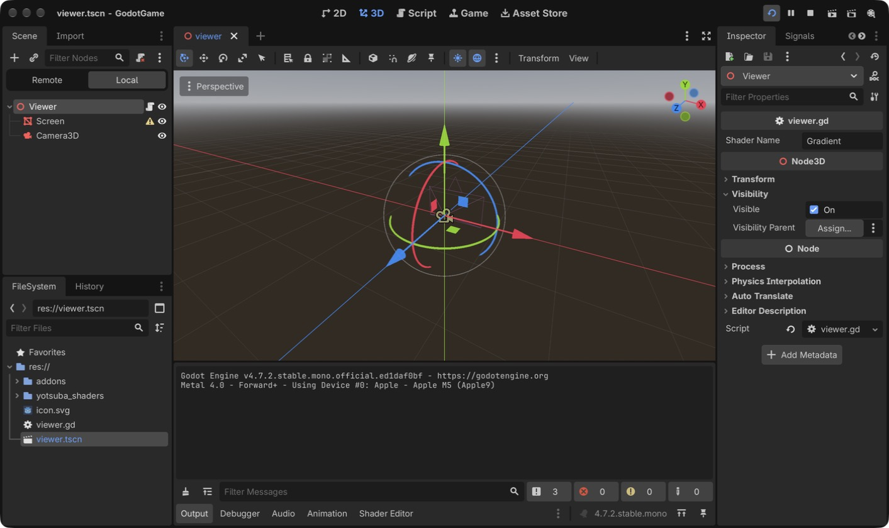

So far you have compiled a shader and read its code in the console. But a shader is made to be **seen**. A shader whose result you never see is like a recipe you never cook: you learn nothing from it.

That is why, from this chapter on, the way of working changes. Everything that follows works like this:

1. You write a little code.
2. You compile it.
3. You look at it in a window.
4. You change one number and look again.

For step 3 you need that window. You are going to build it now, just once.

:::xna
## What the viewer is

The viewer is a program of about 70 lines that does three things:

- It opens a window.
- It draws a rectangle that covers the whole window (the same rectangle from [Shader 1](first-shader.md)).
- It puts on it the shader you name.

Notice one thing: the viewer is **not part of your shader**. Your shaders stay in `MyShaders`, knowing nothing about windows. The viewer is just a work tool, like a bench for testing parts. We use {{engine}} to open the window because it is short and works the same on Windows, Mac and Linux. When you want to take your shaders to your game, you will use the same library with the engine you prefer.

> [!NOTE]
> You do not need to understand every line of the viewer to keep going. If you are curious, the [{{engine}}](../engines/{{plugin}}-reference.md) guide explains one by one the parts that we only mention here.

## Step 1: create the project

From the `Tutorial` folder:

```bash
dotnet new console -n Viewer -f net8.0
dotnet add Viewer package {{enginePackage}}
dotnet add Viewer reference MyShaders/MyShaders.csproj
```

- The first line creates an empty console program called `Viewer`.
- The second adds {{engine}} to it, which is what opens the window.
- The third tells it that it can use your shaders. This way, every change you make in `MyShaders` will be seen by the viewer without copying anything.

Your folder looks like this:

```text
Tutorial/
├── MyShaders/        your shaders
├── TryIt/            the console from the previous chapter
└── Viewer/           new: the window
```

## Step 2: describe the vertex, on the window's side

In [How a shader is built](how-a-shader-is-built.md) you saw that the game hands the shader a list of vertices, and that each one carries a position and a `Uv`. In the shader you already wrote what a vertex looks like (the `Corner` struct). Now you have to write **the same thing on the plain C# side**, so that window and shader understand each other.

Create `Viewer/ScreenCorner.cs`:

```csharp title="Viewer/ScreenCorner.cs"
using Microsoft.Xna.Framework;
using Microsoft.Xna.Framework.Graphics;

public readonly struct ScreenCorner(Vector2 posicion, Vector2 uv) : IVertexType
{
    private static readonly VertexDeclaration Declaracion = new(
        new VertexElement(0, VertexElementFormat.Vector2, VertexElementUsage.TextureCoordinate, 0),
        new VertexElement(8, VertexElementFormat.Vector2, VertexElementUsage.TextureCoordinate, 1));

    public readonly Vector2 Position = posicion;
    public readonly Vector2 Uv = uv;

    VertexDeclaration IVertexType.VertexDeclaration => Declaracion;
}
```

The only important thing here is that it matches your `Corner`: first two numbers for the position (slot 0), then two for the `Uv` (slot 1). If you ever change `Corner`, you will have to change `ScreenCorner` the same way.

## Step 3: an empty window

Replace the entire contents of `Viewer/Program.cs` with this:

```csharp title="Viewer/Program.cs"
using Microsoft.Xna.Framework;
using Microsoft.Xna.Framework.Graphics;
using Microsoft.Xna.Framework.Input;

string name = args.Length > 0 ? args[0] : "Gradient";

using var viewer = new Viewer(name);
viewer.Run();

public class Viewer : Game
{
    private readonly string _name;

    public Viewer(string name)
    {
        _name = name;
        var graphics = new GraphicsDeviceManager(this)
        {
            PreferredBackBufferWidth = 800,
            PreferredBackBufferHeight = 450,
        };
        Window.AllowUserResizing = true;
        Window.Title = name;
    }

    protected override void Update(GameTime gameTime)
    {
        if (Keyboard.GetState().IsKeyDown(Keys.Escape))
        {
            Exit();
        }
        base.Update(gameTime);
    }

    protected override void Draw(GameTime gameTime)
    {
        GraphicsDevice.Clear(Color.CornflowerBlue);
        base.Draw(gameTime);
    }
}
```

Look at the three parts:

- The first line takes the name of the shader you type when you run it. If you type none, it uses `Gradient`.
- The `Viewer(...)` constructor asks for a window of 800 by 450 pixels. It is wide on purpose: later it will help you discover a typical shader problem. You can also stretch it with the mouse.
- `Update` closes the window when you press **Esc**. `Draw` paints it blue, for now.

Run it:

```bash
dotnet run --project Viewer
```

A blue window should appear. Close it with **Esc**. If you see it, {{engine}} works on your computer and nothing is missing.

## Step 4: add the shader

Now we are going to make the window draw a shader instead of painting itself blue. These are four changes in the same file. Make them one by one.

**Change 1.** Add these lines at the very top, next to the other `using` lines:

```csharp
using MyShaders;
using YotsubaShader;
```

**Change 2.** Inside the `Viewer` class, below `private readonly string _name;`, add the shader and the rectangle:

```csharp
    private Effect _shader = null!;

    private readonly ScreenCorner[] _screen =
    [
        new(new Vector2(-1f,  1f), new Vector2(0f, 0f)),
        new(new Vector2( 1f,  1f), new Vector2(1f, 0f)),
        new(new Vector2(-1f, -1f), new Vector2(0f, 1f)),
        new(new Vector2( 1f, -1f), new Vector2(1f, 1f)),
    ];
```

These are the four corners of the rectangle. Each one says where it is on the screen (from `-1` to `1`) and what its `Uv` is (from `0` to `1`). It is the same table you saw in the chapter about how a shader is built.

**Change 3.** Between the constructor and `Update`, add a new method that loads your shader:

```csharp
    protected override void LoadContent()
    {
{{loadPrefix}}
        // One line per shader of the tutorial: the name you type after `--`, and its class.
        byte[] compiled = _name switch
        {
            "Gradient" => {{toFx Gradient}},
            _ => throw new Exception($"The viewer does not know a shader called \"{_name}\". Add it to the switch."),
        };

        _shader = new Effect(GraphicsDevice, compiled);
    }
```

`{{toMethod}}` is the method Yotsuba Shader creates for each of your shader classes: it returns the shader compiled for {{engine}}. The `switch` chooses which class to use from the name you type after `--` in the terminal. For now it only knows `Gradient`. **Every time you create a new shader you will add one line here**, and the chapter will remind you. The last line, `_ =>`, means "any other name" and gives you a clear error if you misspell it.

**Change 4.** Replace the whole `Draw` method with this one:

```csharp
    protected override void Draw(GameTime gameTime)
    {
        GraphicsDevice.Clear(Color.Black);
        GraphicsDevice.RasterizerState = RasterizerState.CullNone;

        // If your shader declares this data, the viewer hands it over.
        _shader.Parameters["Data_Width"]?.SetValue((float)GraphicsDevice.Viewport.Width);
        _shader.Parameters["Data_Height"]?.SetValue((float)GraphicsDevice.Viewport.Height);
        _shader.Parameters["Data_Seconds"]?.SetValue((float)gameTime.TotalGameTime.TotalSeconds);

        _shader.CurrentTechnique.Passes[0].Apply();
        GraphicsDevice.DrawUserPrimitives(PrimitiveType.TriangleStrip, _screen, 0, 2);

        base.Draw(gameTime);
    }
```

The three lines that start with `_shader.Parameters` are a preview: if your shader asks for the window size or the time, the viewer gives them to it. We do not use them yet; in a few chapters you will know what they are for. If your shader does not ask for them, those lines do nothing.

In case something does not add up, this is the complete file:

```csharp title="Viewer/Program.cs"
using Microsoft.Xna.Framework;
using Microsoft.Xna.Framework.Graphics;
using Microsoft.Xna.Framework.Input;
using MyShaders;
using YotsubaShader;

string name = args.Length > 0 ? args[0] : "Gradient";

using var viewer = new Viewer(name);
viewer.Run();

public class Viewer : Game
{
    private readonly string _name;
    private Effect _shader = null!;

    private readonly ScreenCorner[] _screen =
    [
        new(new Vector2(-1f,  1f), new Vector2(0f, 0f)),
        new(new Vector2( 1f,  1f), new Vector2(1f, 0f)),
        new(new Vector2(-1f, -1f), new Vector2(0f, 1f)),
        new(new Vector2( 1f, -1f), new Vector2(1f, 1f)),
    ];

    public Viewer(string name)
    {
        _name = name;
        var graphics = new GraphicsDeviceManager(this)
        {
            PreferredBackBufferWidth = 800,
            PreferredBackBufferHeight = 450,
        };
        Window.AllowUserResizing = true;
        Window.Title = name;
    }

    protected override void LoadContent()
    {
{{loadPrefix}}
        // One line per shader of the tutorial: the name you type after `--`, and its class.
        byte[] compiled = _name switch
        {
            "Gradient" => {{toFx Gradient}},
            _ => throw new Exception($"The viewer does not know a shader called \"{_name}\". Add it to the switch."),
        };

        _shader = new Effect(GraphicsDevice, compiled);
    }

    protected override void Update(GameTime gameTime)
    {
        if (Keyboard.GetState().IsKeyDown(Keys.Escape))
        {
            Exit();
        }
        base.Update(gameTime);
    }

    protected override void Draw(GameTime gameTime)
    {
        GraphicsDevice.Clear(Color.Black);
        GraphicsDevice.RasterizerState = RasterizerState.CullNone;

        // If your shader declares this data, the viewer hands it over.
        _shader.Parameters["Data_Width"]?.SetValue((float)GraphicsDevice.Viewport.Width);
        _shader.Parameters["Data_Height"]?.SetValue((float)GraphicsDevice.Viewport.Height);
        _shader.Parameters["Data_Seconds"]?.SetValue((float)gameTime.TotalGameTime.TotalSeconds);

        _shader.CurrentTechnique.Passes[0].Apply();
        GraphicsDevice.DrawUserPrimitives(PrimitiveType.TriangleStrip, _screen, 0, 2);

        base.Draw(gameTime);
    }
}
```

## Step 5: see your first shader

Now for real. Your `Gradient` from the previous chapter is already compiled, so it is enough to run the viewer:

```bash
dotnet run --project Viewer -- Gradient
```

What comes after `--` is the name of the shader you pass to the viewer.


That is your shader, drawn by your computer's GPU. Close it with **Esc**.

## The work cycle

Now you are going to learn the cycle you will use for the rest of the tutorial. It is always the same:

1. You **edit** a file in `MyShaders`.
2. You **compile** with `add`, so your changes become a shader.
3. You **look** with the viewer.

The last two steps fit on one line, joined by `&&` (which means "and if that went well, continue with this"):

```bash
dotnet yotsuba add MyShaders/MyShaders.csproj --target spirv --target {{plugin}} && dotnet run --project Viewer -- Gradient
```

There is one new thing in the command: `--target {{plugin}}`. The viewer loads your shader with `{{toMethod}}`, and that method is not generated by the CLI alone: it comes from the **{{engine}} plugin**. With that `--target` you ask for it. The first time the CLI downloads the plugin (it needs internet only that time), and from then on it uses the copy it saved. The [{{engine}} guide](../engines/{{plugin}}-reference.md) explains what the plugin is and what it produces.

Try it now with your first experiment. Open `MyShaders/Gradient.cs` and find this line in `Fragment`:

```csharp
float red = 1f;
```

Change it to this:

```csharp
float red = pixel.Uv.X;
```

Save and run the command above:


Red no longer has the same value across the whole screen: now it grows from left to right, because `pixel.Uv.X` goes from `0` at the left edge to `1` at the right. At the left edge there is no red at all and only green and blue remain (dark blue at the top, green at the bottom). On the right, the sunset from before comes back.

You have just done what you will do hundreds of times: change a number and see what happens. Before moving on, put the line back to `float red = 1f;`.

> [!NOTE]
> The cycle has one extra step the first time you use a shader: its line in the viewer's `switch`. You do it once per shader, never again.

> [!TIP]
> Save the cycle command in a text file or in your terminal history. You are going to run it many times, and the only thing that changes is the name at the end.

:::

:::godot
## What the viewer is

The viewer is a small **Godot scene** that does three things:

- It draws a rectangle that covers the whole window (the same rectangle from [Shader 1](first-shader.md)).
- It puts on it the shader you name.
- It hands it the window size and the time, in case the shader asks for them.

Notice one thing: the viewer is **not part of your shader**. Your shaders stay in `MyShaders`, knowing nothing about Godot. The viewer is just a work tool, like a bench for testing parts. When you want to take your shaders to your game, you will use the same library in your own scenes.

> [!NOTE]
> You do not need to understand every line of the viewer to keep going. It is about 30 lines of Godot.

## Step 1: create the Godot project

Create an empty folder called `GodotGame` **inside** your `Tutorial` folder. Open Godot, press **Create** and fill in the window like this:


- **Project Name:** `GodotGame`.
- **Project Path:** the full path to that empty folder. Godot confirms it with "The project folder exists and is empty". Keep **Create Folder** off, because the folder already exists.
- **Renderer:** Forward+ is fine.

Press **Create**. The editor opens with an empty project:


```text
Tutorial/
├── MyShaders/        your shaders
├── TryIt/            the console from the previous chapter
└── GodotGame/        new: the Godot project
```

It goes **inside** `Tutorial` on purpose. The `yotsuba` tool was installed with a manifest (`.config/dotnet-tools.json`), and .NET looks for that manifest in the current folder and in the ones above. If the Godot project is inside `Tutorial`, `dotnet yotsuba` works from there too.

> [!NOTE]
> Both versions of Godot work: the standard one (GDScript) and the **.NET** one (C#). Every script in this route is shown in both languages, in tabs. The C# you write in `MyShaders` is only the shader, and Godot never runs it.

## Step 2: install the addon

Yotsuba Shader has an addon for the Godot editor. Every time you press **Play**, it asks `yotsuba` to translate your shaders into Godot files, so you never have to run the command by hand. The addon comes inside the NuGet package of the Godot plugin. From the `Tutorial` folder:

```bash
curl -L -o godot-addon.zip https://www.nuget.org/api/v2/package/YotsubaShader.Extensions.Godot/0.9.0
unzip -q godot-addon.zip "content/addon/addons/*" -d godot-addon
cp -R godot-addon/content/addon/addons GodotGame/
```

A `.nupkg` is a zip file, so on Windows you can also rename it to `.zip` and copy the `addons/yotsubashader` folder by hand.

Godot only looks at its files when it starts, so reload the project (**Project → Reload Current Project**). The new `addons` folder appears in the FileSystem panel.

Now turn the addon on. Open **Project → Project Settings → Plugins**. **YotsubaShader** is in the list, switched off:


Tick the **Enabled** box. Then open the **General** tab, turn on **Advanced Settings** (top right), type `yotsuba` in the filter and choose the **Yotsuba Shader** section. The **Project** field is empty:


Fill in `project` with:

```text
../MyShaders/MyShaders.csproj
```


The path is counted from the Godot project. Leave the rest as it is: `Output Dir` is where the translated shaders go, `Shader Type` is `spatial` (for 3D objects), `Command` is the tool and `Regenerate on Run` makes the addon translate every time you press Play.

## Step 3: the rectangle and the window

Here is the key idea of this route: Godot does not draw a bare rectangle. It draws **meshes**, inside **scenes**. So the viewer is a scene with three nodes:

- `Viewer`: the root. It carries the script.
- `Screen`: a `MeshInstance3D`, the object that will show your shader.
- `Camera3D`: without it Godot has nothing to look through.

Build it step by step.

**The root.** In the **Scene** panel, press **3D Scene**. Godot creates a `Node3D`. Double-click its name and call it `Viewer`.

**The `Screen` node.** Right-click `Viewer` and choose **Add Child Node…** (or select it and press `Cmd/Ctrl+A`). Type `MeshInstance3D`, select it and press **Create**:


Double-click the new node and rename it to `Screen`.

**The camera.** Select `Viewer` again, add another child node, this time a `Camera3D`. Leave it as it is.

**The margin.** Select `Screen`. In the Inspector open **Geometry** and set **Extra Cull Margin** to `16384`:


Why: before drawing an object, Godot checks, using its position **in the 3D world**, if it is inside what the camera sees. Your shader moves the vertices somewhere else, but that happens later. The big margin tells Godot: "do not throw this object away".

**The script.** Right-click `Viewer` and choose **Attach Script…**. Leave the language on GDScript (or choose C# if you use .NET), leave the path as `res://viewer.gd` and press **Create**:


The script editor opens with a template. Replace **all** its content with this:

```gdscript tab="GDScript" title="GodotGame/viewer.gd"
extends Node3D

## Name of the shader class in MyShaders (Gradient, Colors, Plasma...).
@export var shader_name := "Gradient"

## The image for shaders that declare a `Photo` texture. Drag one here in the Inspector.
@export var photo: Texture2D

var _material := ShaderMaterial.new()


func _ready() -> void:
	# The four corners of the rectangle, like the table from the chapter: position and Uv.
	var arrays := []
	arrays.resize(Mesh.ARRAY_MAX)
	arrays[Mesh.ARRAY_VERTEX] = PackedVector3Array([
		Vector3(-1, -1, 0), Vector3(1, -1, 0), Vector3(-1, 1, 0), Vector3(1, 1, 0)])
	arrays[Mesh.ARRAY_TEX_UV] = PackedVector2Array([
		Vector2(0, 0), Vector2(1, 0), Vector2(0, 1), Vector2(1, 1)])
	# Your struct asks for NORMAL and TANGENT, so the mesh has to carry them too.
	arrays[Mesh.ARRAY_NORMAL] = PackedVector3Array([
		Vector3(0, 0, 1), Vector3(0, 0, 1), Vector3(0, 0, 1), Vector3(0, 0, 1)])
	arrays[Mesh.ARRAY_TANGENT] = PackedFloat32Array([
		1, 0, 0, 1, 1, 0, 0, 1, 1, 0, 0, 1, 1, 0, 0, 1])
	var mesh := ArrayMesh.new()
	mesh.add_surface_from_arrays(Mesh.PRIMITIVE_TRIANGLE_STRIP, arrays)

	_material.shader = load("res://yotsuba_shaders/MyShaders/%s.spatial.gdshader" % shader_name)
	if photo:
		_material.set_shader_parameter("Photo", photo)
	$Screen.mesh = mesh
	$Screen.material_override = _material


func _process(_delta: float) -> void:
	var size := get_viewport().get_visible_rect().size
	var seconds := Time.get_ticks_msec() / 1000.0
	# Any uniform called <Field>_Width, <Field>_Height or <Field>_Seconds receives its value.
	for uniform in _material.shader.get_shader_uniform_list():
		var uniform_name: String = uniform.name
		if uniform_name.ends_with("_Width"):
			_material.set_shader_parameter(uniform_name, size.x)
		elif uniform_name.ends_with("_Height"):
			_material.set_shader_parameter(uniform_name, size.y)
		elif uniform_name.ends_with("_Seconds"):
			_material.set_shader_parameter(uniform_name, seconds)
```
```csharp tab="C#" title="GodotGame/Viewer.cs"
using Godot;

public partial class Viewer : Node3D
{
    // Name of the shader class in MyShaders (Gradient, Colors, Plasma...).
    [Export] public string ShaderName { get; set; } = "Gradient";

    // The image for shaders that declare a `Photo` texture. Drag one here in the Inspector.
    [Export] public Texture2D Photo { get; set; }

    private readonly ShaderMaterial _material = new();

    public override void _Ready()
    {
        // The four corners of the rectangle, like the table from the chapter: position and Uv.
        var arrays = new Godot.Collections.Array();
        arrays.Resize((int)Mesh.ArrayType.Max);
        arrays[(int)Mesh.ArrayType.Vertex] = new[]
        {
            new Vector3(-1, -1, 0), new Vector3(1, -1, 0), new Vector3(-1, 1, 0), new Vector3(1, 1, 0),
        };
        arrays[(int)Mesh.ArrayType.TexUV] = new[]
        {
            new Vector2(0, 0), new Vector2(1, 0), new Vector2(0, 1), new Vector2(1, 1),
        };
        // Your struct asks for NORMAL and TANGENT, so the mesh has to carry them too.
        arrays[(int)Mesh.ArrayType.Normal] = new[]
        {
            new Vector3(0, 0, 1), new Vector3(0, 0, 1), new Vector3(0, 0, 1), new Vector3(0, 0, 1),
        };
        arrays[(int)Mesh.ArrayType.Tangent] = new float[] { 1, 0, 0, 1, 1, 0, 0, 1, 1, 0, 0, 1, 1, 0, 0, 1 };
        var mesh = new ArrayMesh();
        mesh.AddSurfaceFromArrays(Mesh.PrimitiveType.TriangleStrip, arrays);

        _material.Shader = GD.Load<Shader>($"res://yotsuba_shaders/MyShaders/{ShaderName}.spatial.gdshader");
        if (Photo != null) _material.SetShaderParameter("Photo", Photo);
        var screen = GetNode<MeshInstance3D>("Screen");
        screen.Mesh = mesh;
        screen.MaterialOverride = _material;
    }

    public override void _Process(double delta)
    {
        Vector2 size = GetViewport().GetVisibleRect().Size;
        double seconds = Time.GetTicksMsec() / 1000.0;
        // Any uniform called <Field>_Width, <Field>_Height or <Field>_Seconds receives its value.
        foreach (var uniform in _material.Shader.GetShaderUniformList())
        {
            string name = uniform["name"].AsString();
            if (name.EndsWith("_Width")) _material.SetShaderParameter(name, size.X);
            else if (name.EndsWith("_Height")) _material.SetShaderParameter(name, size.Y);
            else if (name.EndsWith("_Seconds")) _material.SetShaderParameter(name, seconds);
        }
    }
}
```

The corners are the same table of the previous chapters: each one says where it is and what its `Uv` is. One thing changes in Godot: the vertical axis of the screen goes the other way (`Y = -1` is the **top**), so the corner that has `Uv = (0, 0)` is written with `Y = -1`. This way the `Uv` still starts at the top left, and the shaders look the same as in every other route.

Other lines worth reading:

- `ShaderMaterial` is a material whose painting is done by a shader you provide. `material_override` makes `Screen` use it.
- `_ready()` runs once, when the scene starts. `_process()` runs every frame.
- The loop in `_process` looks at the `uniform` of your shader and sends a value to the ones whose name ends in `_Width`, `_Height` or `_Seconds` (for example `Data_Seconds` or `Time_Seconds`). If your shader declares none of them, nothing happens. You will learn what they are for in a few chapters.
- `@export` (or `[Export]` in C#) puts `shader_name` in the **Inspector**, so you choose the shader without touching the code.

This is how the editor looks with your script:


If you use C#, the script file must be called exactly like the class, `Viewer.cs`, and Godot needs a `.csproj` for the Godot project (the editor makes it with **Project → Tools → C# → Create C# solution**). That `.csproj` is **not** `MyShaders`: it is the one of the game.

## Step 4: see your first shader

Save the scene (`Cmd/Ctrl+S`) with the name `viewer.tscn`. Select the `Viewer` node: in the Inspector, **Shader Name** says `Gradient`.



Press **Play** (the triangle at the top right). The first time, Godot asks for a main scene: choose **Select Current**. Before the game starts, the addon translates `MyShaders`, and then the window opens.


That is your shader, drawn by the GPU. Close the window to go back to the editor.

> [!NOTE]
> If you prefer the terminal, the addon does this for you: `dotnet yotsuba compile MyShaders/MyShaders.csproj --target godot --output ../GodotGame/yotsuba_shaders`.

## The work cycle

For the rest of the tutorial you will use this cycle:

1. You **edit** a file in `MyShaders`.
2. You press **Play** in Godot. The addon **compiles** for you.
3. You **look** at the window.

Try it with your first experiment. Open `MyShaders/Gradient.cs` and find this line in `Fragment`:

```csharp
float red = 1f;
```

Change it to this:

```csharp
float red = pixel.Uv.X;
```

Save and press **Play**:


Red no longer has the same value across the whole screen: now it grows from left to right, because `pixel.Uv.X` goes from `0` at the left edge to `1` at the right.

You have just done what you will do hundreds of times: change a number and see what happens. Before moving on, put the line back to `float red = 1f;`.

> [!NOTE]
> For every new shader you will only type its name in the **Shader Name** field. You do it once per shader.
:::

## A starting file

For each of the following chapters you will create a new shader. They all start the same way, with the same `Vertex` as always, so it is handy to have it as a mold. Create `MyShaders/Template.cs`:

```csharp style=glsl title="MyShaders/Template.cs"
using YotsubaShader.GlslSyntax;
using YotsubaShader.GlslSyntax.Types;
using YotsubaShader.Language;

namespace MyShaders;

public class Template
{
    [ShaderStage(Stage.Vertex)]
    public Pixel Vertex({{vertexType}} corner)
    {
        Pixel pixel;
        pixel.Position = Make.Vec4(corner.{{pos}}.X, corner.{{pos}}.Y, 0f, 1f);
        pixel.Uv = corner.{{uv}};
        return pixel;
    }

    [ShaderStage(Stage.Fragment)]
    [return: location(0)]
    public vec4 Fragment(PixelIn pixel)
    {
        return Make.Vec4(0f, 0f, 0f, 1f);
    }
}
```

```csharp style=hlsl title="MyShaders/Template.cs"
using YotsubaShader.HlslSyntax;
using YotsubaShader.GlslSyntax.Types;
using YotsubaShader.Language;

namespace MyShaders;

public class Template
{
    [ShaderStage(Stage.Vertex)]
    public Pixel Vertex({{vertexType}} corner)
    {
        Pixel pixel;
        pixel.Position = Make.Vec4(corner.{{pos}}.X, corner.{{pos}}.Y, 0f, 1f);
        pixel.Uv = corner.{{uv}};
        return pixel;
    }

    [ShaderStage(Stage.Fragment)]
    [return: SV_Target]
    public vec4 Fragment(PixelIn pixel)
    {
        return Make.Vec4(0f, 0f, 0f, 1f);
    }
}
```

```csharp style=msl title="MyShaders/Template.cs"
using YotsubaShader.MslSyntax;
using YotsubaShader.GlslSyntax.Types;
using YotsubaShader.Language;

namespace MyShaders;

public class Template
{
    [ShaderStage(Stage.Vertex)]
    public Pixel Vertex({{vertexType}} corner)
    {
        Pixel pixel;
        pixel.Position = Make.Vec4(corner.{{pos}}.X, corner.{{pos}}.Y, 0f, 1f);
        pixel.Uv = corner.{{uv}};
        return pixel;
    }

    [ShaderStage(Stage.Fragment)]
    [return: color(0)]
    public vec4 Fragment(PixelIn pixel)
    {
        return Make.Vec4(0f, 0f, 0f, 1f);
    }
}
```

```csharp style=wgsl title="MyShaders/Template.cs"
using YotsubaShader.WgslSyntax;
using YotsubaShader.GlslSyntax.Types;
using YotsubaShader.Language;

namespace MyShaders;

public class Template
{
    [ShaderStage(Stage.Vertex)]
    public Pixel Vertex({{vertexType}} corner)
    {
        Pixel pixel;
        pixel.Position = Make.Vec4(corner.{{pos}}.X, corner.{{pos}}.Y, 0f, 1f);
        pixel.Uv = corner.{{uv}};
        return pixel;
    }

    [ShaderStage(Stage.Fragment)]
    [return: location(0)]
    public vec4 Fragment(PixelIn pixel)
    {
        return Make.Vec4(0f, 0f, 0f, 1f);
    }
}
```

```csharp style=spirv title="MyShaders/Template.cs"
using YotsubaShader.SpirvSyntax;
using YotsubaShader.GlslSyntax.Types;
using YotsubaShader.Language;

namespace MyShaders;

public class Template
{
    [ShaderStage(Stage.Vertex)]
    public Pixel Vertex({{vertexType}} corner)
    {
        Pixel pixel;
        pixel.Position = Make.Vec4(corner.{{pos}}.X, corner.{{pos}}.Y, 0f, 1f);
        pixel.Uv = corner.{{uv}};
        return pixel;
    }

    [ShaderStage(Stage.Fragment)]
    [return: Location(0)]
    public vec4 Fragment(PixelIn pixel)
    {
        return Make.Vec4(0f, 0f, 0f, 1f);
    }
}
```

The `Fragment` of this template returns black (`0, 0, 0`). It is a shader that does nothing yet, ready for you to fill in.

When a chapter tells you "copy `Template.cs` as `Colors.cs`", do this:

1. Copy the file and call it `Colors.cs`.
2. Inside, change `public class Template` to `public class Colors`.

The class name has to match what you type after `--` in the viewer.

:::xna
Check that everything works by running the template. First add its line to the `switch` in `Viewer/Program.cs`, above the `_ =>` line:

```csharp
            "Template" => {{toFx Template}},
```

Then run:

```bash
dotnet yotsuba add MyShaders/MyShaders.csproj --target spirv --target {{plugin}} && dotnet run --project Viewer -- Template
```

A completely black window should open. If you see it, you are ready.

## If something fails

| What you see | What it means | What to do |
|---|---|---|
| `The viewer does not know a shader called "Colors"` | The name has no line in the viewer's `switch`, or you misspelled it. | Add `"Colors" => {{toFx Colors}},` to the `switch` and check the capital letters. |
| The window shows the old shader | You changed the file but did not run `add`. | Use the cycle command, which does both things. |
| `error CS0234` when running `add` | You deleted or renamed a class and `YotsubaShader.g.cs` still names it. | Delete `MyShaders/YotsubaShader.g.cs` and run again. |
| A `CS` error with a number and a line | It is an ordinary C# error in your code. | Read it, go to that line and fix it. `add` does not continue until it compiles. |
| The window does not open and there is no error | Sometimes it ends up behind other windows. | Look for it in the taskbar or the Dock. |

:::

:::godot
Check that everything works by running the template. Select the `Viewer` node, write `Template` in **Shader Name** and press **Play**. A completely black window should open. If you see it, you are ready.

## If something fails

| What you see | What it means | What to do |
|---|---|---|
| `Cannot open file 'res://yotsuba_shaders/MyShaders/Colors.spatial.gdshader'` | The name in **Shader Name** is misspelled, or the addon did not run. | Check the capital letters, and that the **YotsubaShader** plugin is on. |
| The window shows the old shader | The addon is off or `regenerate_on_run` is off. | Turn it on in the Project Settings, or use **Project → Tools → Regenerate YotsubaShader shaders**. |
| The Output panel says `dotnet` was not found | Godot, opened from the Dock or Finder, does not see the same `PATH` as your terminal. | Put the full path of `dotnet` in the `command` setting of the addon. |
| `dotnet yotsuba` says it does not exist | The Godot project is outside the folder where you ran `dotnet new tool-manifest`. | Move `GodotGame` inside `Tutorial`. |
| A `CS` error with a number and a line | It is an ordinary C# error in your shader. | Read it, go to that line and fix it. |
| The window is black or empty | Godot threw the rectangle away or the shader failed. | Check `extra_cull_margin` of `Screen` and the Output panel. |
:::

## What you learned

- To see a shader you need a window. The viewer is that window, and it is a separate tool: your shaders do not depend on it.
- The work cycle is: edit, compile with `add`, and look with the viewer.
- `Template.cs` is the mold for all the shaders to come: a `Vertex` already written and a `Fragment` that returns black.

Next: [The colors](colors.md).
