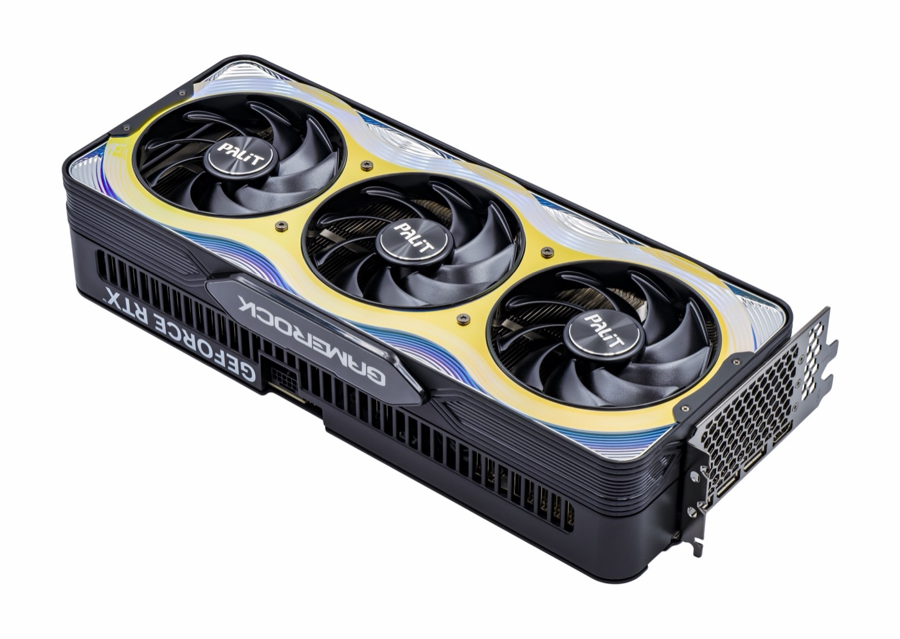
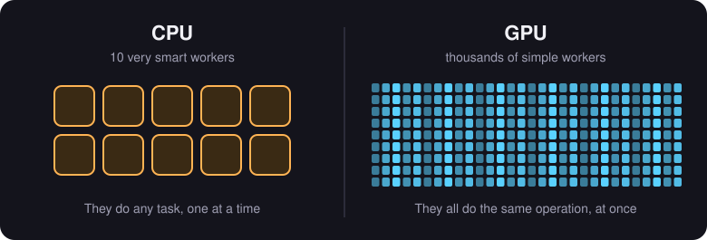
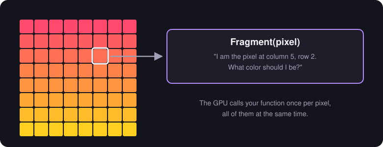
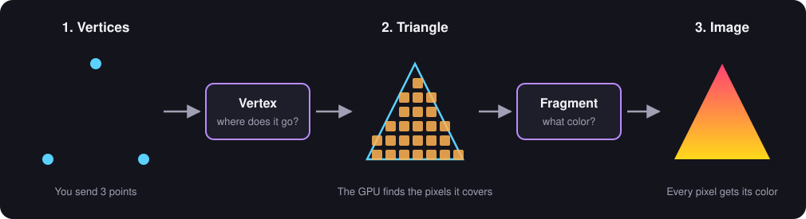

A shader is, to put it simply, a function (or method) that we can call so that it runs on the GPU.

The GPU is your computer's graphics card. It can be a separate part, like the one in the photo, or it can live inside the processor itself, as in laptops and phones.



> [!SAY] In the photo you can see a graphics card seen from above. It is a long, dark block with three round fans in a row, and a metal edge with the connectors. That is what many people picture when they hear the word GPU: a piece you could take in your hand and plug into the computer.

As you know, if you program for Windows you can use a language like JavaScript with Node, but you cannot use Node to write an operating system, because Node depends on functions of the operating system itself that do not exist in a "clean" environment with no operating system. Something very similar used to happen with C# and the GPU (before Yotsuba Shader).

Until now, none of the programming languages we know (C#, JavaScript, Java, Rust, ...) could run directly on the GPU, for a simple reason: they have things that are very hard to translate, and others the GPU simply cannot do.

## Examples of things the GPU cannot do

From the GPU we cannot reach the file system.

That is, a line like this one simply will not work:

```csharp
File.WriteAllText("file.txt", "hello"); // There is no file system on the GPU (at least not like on the CPU)
```

> [!SAY] Here is a line you would write without thinking in a normal program. We call File dot WriteAllText, we give it the name of a file and the word hello, and the computer saves it. On the GPU this line has no place to go, because there is no disk to write to. That is what the comment at the end says.

There are no `string`s either, no lists, no classes with inheritance and no exceptions.

So you can think of the GPU as a machine with no operating system. What you can run there is, above all, math: adding, multiplying, comparing. Not the things you normally do with languages made for the CPU, such as Rust, JS, Java, Python or GDScript.

## Why do we want to run code on the GPU, then?

Even though you cannot do everything on the GPU, there are good reasons to write code that runs there.

### 1. To do many calculations at once

A MacBook Air M5 usually has 10 cores in its CPU. That means it can do, at most, 10 things truly at the same time. Each of those things running at once is called a thread.

A GPU, on the other hand, does not work the same way: inside it has thousands of small workers, and each one can do a calculation at the same time as the others, without waiting for anyone. While the CPU runs 10 threads at once, the GPU runs thousands. That is why a game, an AI or a drawing program is not slow: the GPU can do far more calculations at once than the CPU.



> [!SAY] In this image we can compare two chips. On the left, the CPU: ten big squares, each one a powerful core. On the right, the GPU: hundreds and hundreds of tiny squares packed together. Ten strong workers against a crowd of small ones, and that crowd is what lets the GPU do so many calculations at the same time.

#### Why don't we run everything on the GPU, then?

Because the GPU only wins when the work can be split up in a very particular way.
For example:

```csharp
int[] entities = [1, 2, 3, 4, 5];

for (int index = 0; index < entities.Length; index++)
{
    entities[index] = entities[index] * 2; // example logic
}
```

> [!SAY] Let's read this code. We create an array called entities with five numbers, one to five. Then a for loop goes through it one index at a time, starting at zero, and in each step it replaces the number with its double. One index after another, always in order.

If we ran this on both the CPU and the GPU, as is, one index after another, and measured how long each one takes to go through the `for`, the CPU would win.

I know what you are asking yourself: why, if I told you the GPU is faster?
The answer is that it depends. The GPU is not faster at everything: what it does well is many calculations at once. Each of its threads, on its own, is slower than a CPU core. For the GPU to beat the CPU, instead of going through the `for` one index after another, each GPU thread has to take care of a different index of the array.

In C# you already have something that works on that same idea. It is called `Parallel`, and it lets you run a `for` by spreading the indexes across all the CPU cores:

```csharp
int[] entities = [1, 2, 3, 4, 5];

// Each index can be processed by a different core, and they all run at the same time
Parallel.For(0, entities.Length, index =>
{
    RandomOperation(index);
});

// The RandomOperation function
void RandomOperation(int index)
{
    entities[index] = entities[index] * 2; // example logic
}
```

> [!SAY] This is the same array, but now with Parallel dot For. Notice that we no longer write the loop. We say: from zero up to the length of the array, and for each index call the function RandomOperation. Below, the function RandomOperation receives one index and doubles the number that lives there. The loop is gone and only the work on one index remains.

Notice one thing: here you no longer write the loop. You only write the `RandomOperation` function, which works on **one** index, and `Parallel.For` takes care of calling it for all of them.

The GPU does exactly the same, but with many, many more threads. It runs the `RandomOperation` function for as many indexes of the array as it can at the same time, instead of going through them one by one like a `for` or a `foreach`. It probably runs around 1000 indexes at once, so if the array has 1000 elements, it is quite possible that it finishes everything in one go.

How many calculations the GPU can do at once depends on the model you have. But to give you an idea: the CPU works on a single index of the array each time, while the GPU can do the same on about 1000 different indexes in one go.

And that function that works on a single index, the one called `RandomOperation` in the example, is exactly what we call a shader.

### 2. To decide the color of every pixel on the screen

Your screen is a grid of colored dots. Each dot is a pixel. A Full HD screen is 1920 pixels wide by 1080 tall, that is, a little over 2 million pixels.

For a game to look smooth, the color of all those pixels has to be decided about 60 times per second. That is more than 120 million colors calculated every second. With a `for` on the CPU you will not make it. But look closely at the problem: it is the same one as the array from before, only now the array is the pixels of the screen.

So the GPU lets you write a function that receives a pixel and returns its color. It calls it once for each pixel, all of them at the same time.



> [!SAY] In this image there is a grid of small squares, which are the pixels. One of them is marked, and from it an arrow goes to a box that says Fragment. The idea is that every pixel on the screen is sent, one by one, to the same function, and the function answers with a color.

The interesting part is that inside that function you decide the color with whatever logic you want. If you always return red, the screen looks red. If the color depends on the position of the pixel, you get a gradient. If it depends on an image and on time, you can make a photo move as if it were underwater. Water, fire, shadows, lights, the effect when you get hit in a game: all of those are functions that decide the color of a pixel.

## The stages of a shader

So far we have talked about "a function". There are actually several kinds, and each kind is called a stage. The difference between one stage and another is **what** the function runs over:

| Stage | Runs once for each... | What it decides |
| --- | --- | --- |
| Vertex | point (vertex) of the shape you send to be drawn | Where on the screen that point lands. |
| Fragment | pixel the shape covers | What color that pixel is painted. |
| Compute | index you ask for | Whatever you want: it is the case of the `entities` array. It draws nothing. |

> [!SAY] This table has three rows, one for each stage. Vertex runs once for every point of the shape and decides where that point lands on the screen. Fragment runs once for every pixel the shape covers and decides its color. And Compute runs once for every index you ask for, it draws nothing, and it is the case of our entities array.

To draw something, the first two always work together. You send a shape made of points, the Vertex stage places each point, the GPU figures out which pixels fall inside the shape, and the Fragment stage gives each one a color:



> [!SAY] In this last image we follow a drawing from start to end. On the left there are three points. They go through Vertex, which places them, and they become a triangle. Then the GPU marks which pixels the triangle covers, and finally Fragment gives each one of those pixels its color.

Do not worry if it is not clear yet. The next chapter walks through that drawing step by step, and when you finish it you will know what each stage does and why.

## And where does Yotsuba Shader come in?

Since the GPU does not understand C#, shaders have always been written in languages made just for that: HLSL, GLSL, Metal... Each graphics API has its own, and none of them knows the classes or types of your project.

With Yotsuba Shader you write the shader in C#, in your same project and with your same editor. The compiler checks that you only use things the GPU can do, and translates it to the language you need.

To sum up:

- A shader is a function that runs on the GPU.
- The GPU calls it a huge number of times at once: once per vertex, per pixel or per index.
- Inside it you can only do calculations. No files, no text, no lists.
- With Yotsuba Shader you write that function in C#.

Next: [How a shader is built](how-a-shader-is-built.md).

---

Graphics card photo (a Palit GeForce RTX 5090 GameRock): PantheraLeo1359531, [Wikimedia Commons](https://commons.wikimedia.org/wiki/File:Palit_GeForce_RTX_5090_Gamerock_20250530_HOF4166_RAW-Export.png), [CC BY 4.0](https://creativecommons.org/licenses/by/4.0/) license. It was resized and a white margin was added.
