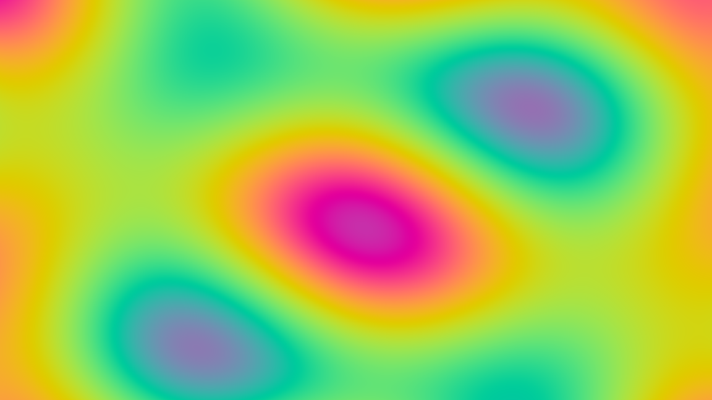
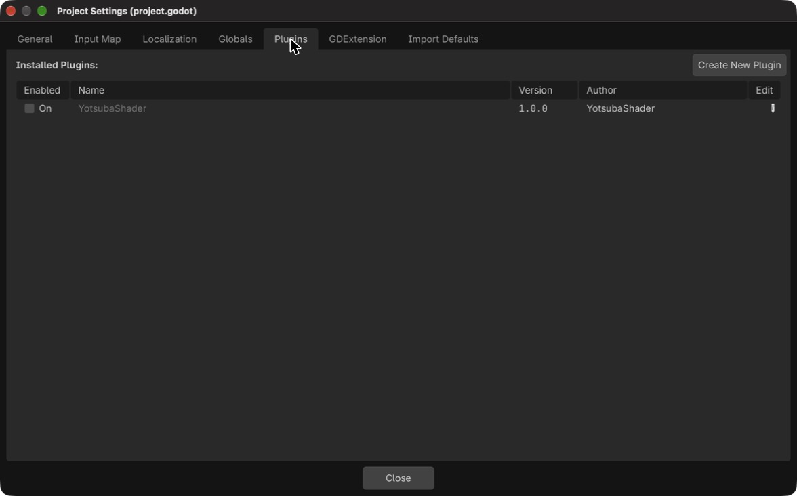
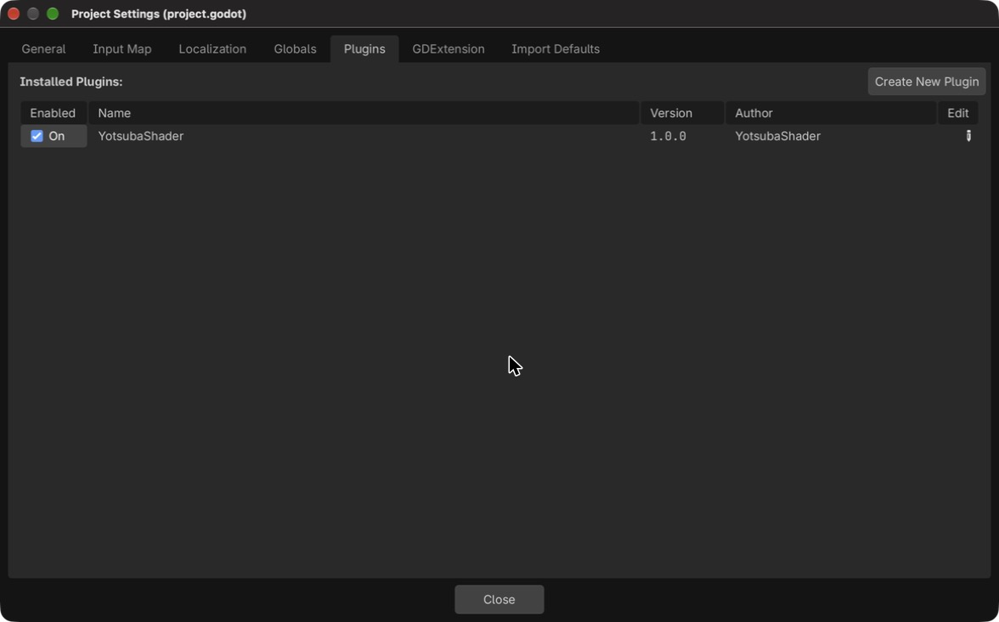
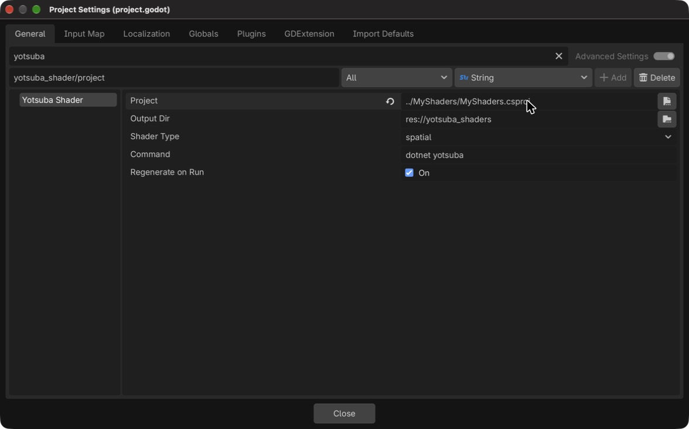
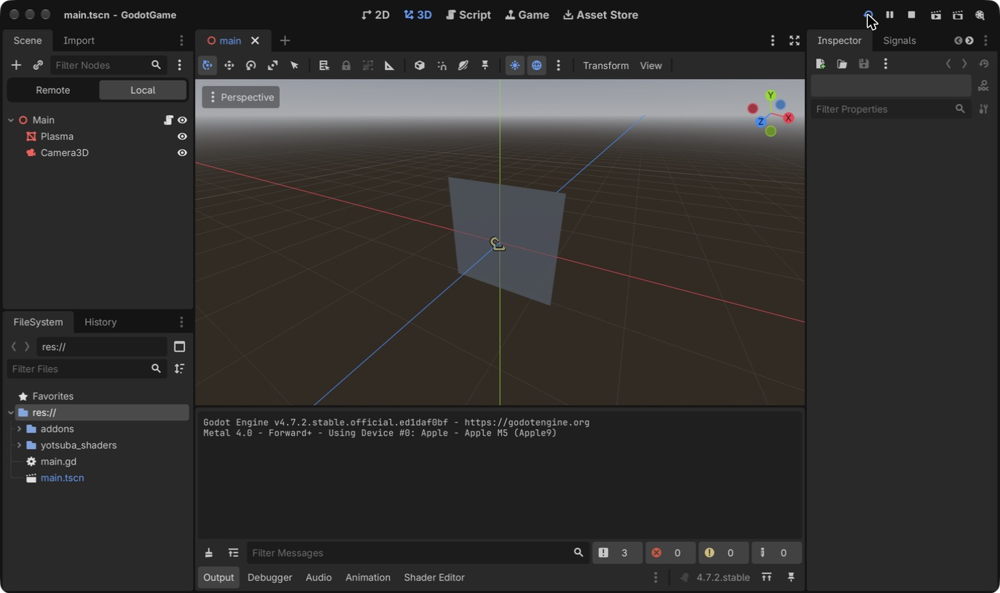

Godot has its own shader language, the Godot Shading Language, saved in `.gdshader` files. You write the shader in C# and Yotsuba Shader translates it to that language for you.



> [!NOTE]
> The step-by-step guide is the **Godot route of the tutorial**: choose Godot in the route selector of [Get Started](../get-started/index.md). It takes you from creating the project to a 3D scene seen through your shaders. This page is the **reference** you consult afterwards: what the addon does, what gets translated and the names of the vertex data.

## 1. The addon: translate every time you press Play

Running the command by hand every time you change the shader gets old. Yotsuba Shader has an addon for the Godot editor that does it for you.

> [!NOTE]
> The addon is not downloaded from any website yet. Today you copy it from the Yotsuba Shader repository: the folder is `Plugins/YotsubaShader.Extensions.Godot/addon/addons/yotsubashader`.

First, copy that folder, `yotsubashader`, into `GodotGame/addons/` (create `addons` if it does not exist). When you open the project in Godot, the folder shows up in the file panel, as in the screenshot above.

Second, in Godot: *Project → Project Settings → Plugins*. YotsubaShader appears in the list, turned off.



Tick the box to turn it on.



Third, in the *General* tab, turn on **Advanced Settings** (the switch at the top right). A section called **Yotsuba Shader** appears: if you do not see it, type `yotsuba` in the filter. The `project` field is empty.


Set `project` to `../MyShaders/MyShaders.csproj` (the path is relative to the Godot project).



These are all the settings:

| Setting | What it is | Default |
| --- | --- | --- |
| `project` | Path to the `.csproj` with your shaders (absolute, or relative to the Godot project) | empty |
| `output_dir` | Where the `.gdshader` files are written | `res://yotsuba_shaders` |
| `shader_type` | `spatial`, `canvas_item` or `both` | `spatial` |
| `command` | The yotsuba command | `dotnet yotsuba` |
| `regenerate_on_run` | Regenerate when you press Play | on |

From now on the addon runs the same `compile --target godot` command that you typed, and writes the files in `output_dir`. It does it:

- every time you press **Play**, before the game starts, and
- from the menu *Project → Tools → Regenerate YotsubaShader shaders*.

Then Godot refreshes its file system. If the command fails, the error shows up in Godot's output panel. A failure in a shader type you did not choose (for example `canvas_item`, when you only use `spatial`) is not counted as an error.

Press **Play** (the triangle at the top right). Before the game starts, the addon translates the shader, and then the game window opens.



Two things that can go wrong:

> [!WARNING]
> **Godot cannot find `dotnet`.** On macOS, if you opened Godot from the Dock or from Finder, it does not see the same `PATH` as your terminal. Put the full path of the tool in the `command` setting.

> [!WARNING]
> **`dotnet yotsuba` says it does not exist.** The Godot project has to be **inside** the folder where you ran `dotnet new tool-manifest`, because .NET looks for the manifest upward. That is why `GodotGame` goes inside `Tutorial`.

> [!NOTE]
> The addon was tested by running its generator from a script, and by opening the project in the editor with the addon enabled: it loads without errors. Pressing Play inside the editor and the menu item were not tested.

## 2. What gets translated

The vertex method of your shader is the part Godot cares about most. Take `Vertex`:

```csharp
    [ShaderStage(Stage.Vertex)]
    public Pixel Vertex(GodotVertex corner)
    {
        Pixel pixel;
        pixel.Position = Make.Vec4(corner.VERTEX.X, corner.VERTEX.Y, 0f, 1f);
        pixel.Uv = corner.UV;
        return pixel;
    }
```

In the `.spatial.gdshader` it becomes this:

```glsl
void vertex() {
    vec2 corner_VERTEX = VERTEX.xy;
    vec2 corner_UV = UV;
    vec4 ys_position = vec4(0.0);
    Pixel pixel;
    pixel.Position = Vec4(corner_VERTEX.x, corner_VERTEX.y, 0.0, 1.0);
    pixel.Uv = corner_UV;
    ys_position = pixel.Position;
    v_Uv = pixel.Uv;
    POSITION = ys_position;
}
```

Look at the correspondences:

- The method `Vertex` became `void vertex()`, and the fragment method `Fragment` became `void fragment()`.
- The `VERTEX` field of your `GodotVertex` reads Godot's `VERTEX`, and the `UV` field reads `UV`. Those are the names that Godot gives to the data of each vertex, and the plugin chose them by the **name of your field**.
- What the vertex hands to the fragment (`pixel.Uv`) became a `varying`, `v_Uv`, that the fragment reads.
- The position you return (`gl_Position`) is written in `POSITION`. This is a position in **clip space**, the `-1` to `1` of before. That means Godot does **not** apply its own matrices (model, view and projection) to a shader made like this. If you want them, you have to send them as a uniform and multiply them yourself in the vertex method. This guide does not cover how.
- The final color (`[return: location(0)]`) goes to `ALBEDO` and `ALPHA`.

The names you can use in the input `struct` are in [section 3](#3-the-names-of-the-vertex-data). In `canvas_item` only the position, the color and `UV` exist.

More things the plugin does:

- A `[uniform]` struct becomes one `uniform` per field, with the name `<Field>_<Member>`, as you saw.
- A texture becomes `uniform sampler2D <name>`. How it is filtered or repeated is decided by Godot, with the options of the texture, and not by the `SamplerState` of your C#.
- The `spatial` files are generated with `render_mode unshaded, cull_disabled;`. `unshaded` because the fragment already calculates the final color, and Godot should not add light on top. `cull_disabled` because a `ShaderMaterial` cannot turn off the *culling* (throwing away the faces that look backwards), and, as the position is in clip space, Godot was throwing away the faces: the rectangle of the whole screen **was not visible** without it.

### Taking another shader from the tutorial

Any shader of the Get Started goes to Godot with the same two changes you made to the plasma: in the vertex method, use `GodotVertex` instead of `Corner`, and read `corner.VERTEX` instead of `corner.Position`.

> [!WARNING]
> That was only checked with the plasma of this guide. The other tutorial shaders were not tested in Godot.

## 3. The names of the vertex data

In the tutorial you declared `GodotVertex` with all the data that Godot delivers per vertex. This section explains each one.

### The rule

Vertex data is declared in a `struct` using these names, as in the tutorial:

```csharp style=glsl
public struct GodotVertex
{
    [location(0)] public vec3 VERTEX;
    [location(1)] public vec2 UV;
    [location(2)] public vec3 NORMAL;
    [location(3)] public vec4 COLOR;
}
```

```csharp style=hlsl
public struct GodotVertex
{
    [POSITION] public vec3 VERTEX;
    [TEXCOORD(0)] public vec2 UV;
    [NORMAL] public vec3 NORMAL;
    [COLOR] public vec4 COLOR;
}
```

```csharp style=msl
public struct GodotVertex
{
    [attribute(0)] public vec3 VERTEX;
    [attribute(1)] public vec2 UV;
    [attribute(2)] public vec3 NORMAL;
    [attribute(3)] public vec4 COLOR;
}
```

```csharp style=wgsl
public struct GodotVertex
{
    [location(0)] public vec3 VERTEX;
    [location(1)] public vec2 UV;
    [location(2)] public vec3 NORMAL;
    [location(3)] public vec4 COLOR;
}
```

```csharp style=spirv
public struct GodotVertex
{
    [Location(0)] public vec3 VERTEX;
    [Location(1)] public vec2 UV;
    [Location(2)] public vec3 NORMAL;
    [Location(3)] public vec4 COLOR;
}
```

- **The name decides the meaning, and it is Godot's.** `UV` is the texture coordinate, `NORMAL` is the normal. The `location` number is still yours: it only has to be unique.
- **They are written exactly as in Godot**: in capitals, with an underscore (`BONE_INDICES`). That is the form the tutorial uses and the one in the tables below.
- **The language changes nothing.** These names are not translated: the Spanish tutorial uses `UV`, not `Textura`.
- **The name rules over the number and the semantic.** If the field is called `UV`, it is `UV`, whatever `[location(1)]`, `[attribute(1)]` or `[TEXCOORD(0)]` it carries.
- **A name that is not on the list is never guessed.** If it also carries no semantic the plugin knows (`[POSITION]`...), the plugin gives an error that lists the names that exist, and never lets wrong data through silently.

### The attributes

This is the complete list of what Godot delivers per vertex in a `spatial` shader. The `canvas_item` ones are a subset, shown in each row.

| Name | Type in `spatial` | Type in `canvas_item` | In HlslSyntax |
| --- | --- | --- | --- |
| `VERTEX` | `vec3` | `vec2` | `POSITION` |
| `NORMAL` | `vec3` | Does not exist | `NORMAL` |
| `TANGENT` | `vec3` | Does not exist | `TANGENT` |
| `BINORMAL` | `vec3` | Does not exist | `BINORMAL` |
| `UV` | `vec2` | `vec2` | `TEXCOORD(0)` |
| `UV2` | `vec2` | Does not exist | `TEXCOORD(1)` |
| `COLOR` | `vec4` | `vec4` | `COLOR` |
| `CUSTOM0` | `vec4` | `vec4` | `TEXCOORD(2)` |
| `CUSTOM1` | `vec4` | `vec4` | `TEXCOORD(3)` |
| `CUSTOM2` | `vec4` | Does not exist | `TEXCOORD(4)` |
| `CUSTOM3` | `vec4` | Does not exist | `TEXCOORD(5)` |
| `BONE_INDICES` | `uvec4` | Does not exist | `TEXCOORD(6)` |
| `BONE_WEIGHTS` | `vec4` | Does not exist | `TEXCOORD(7)` |
| `POINT_SIZE` | `float` | `float` | `TEXCOORD(8)` |

The types are Godot's. If you declare a different one of the same family, the plugin adapts it: a shorter one is padded (with `0`, and with `1` in the `w` of `VERTEX` and `COLOR`), and a longer one is cut. That is why a `vec2` `VERTEX`, like the full-screen rectangle in the tutorial, works.

### One convention for each attribute

#### `VERTEX`: the position

```csharp style=glsl
[location(0)] public vec3 VERTEX;
```

```csharp style=hlsl
[POSITION] public vec3 VERTEX;
```

```csharp style=msl
[attribute(0)] public vec3 VERTEX;
```

```csharp style=wgsl
[location(0)] public vec3 VERTEX;
```

```csharp style=spirv
[Location(0)] public vec3 VERTEX;
```

The vertex position in object space. In `canvas_item` it is a `vec2`.

A warning: if you return this position as-is as the final position, it is a position in **clip space**, and Godot applies none of its matrices to it. That is what the plasma in this guide does.

#### `NORMAL`, `TANGENT` and `BINORMAL`

```csharp style=glsl
[location(2)] public vec3 NORMAL;
[location(5)] public vec3 TANGENT;
[location(6)] public vec3 BINORMAL;
```

```csharp style=hlsl
[NORMAL] public vec3 NORMAL;
[TANGENT] public vec3 TANGENT;
[BINORMAL] public vec3 BINORMAL;
```

```csharp style=msl
[attribute(2)] public vec3 NORMAL;
[attribute(5)] public vec3 TANGENT;
[attribute(6)] public vec3 BINORMAL;
```

```csharp style=wgsl
[location(2)] public vec3 NORMAL;
[location(5)] public vec3 TANGENT;
[location(6)] public vec3 BINORMAL;
```

```csharp style=spirv
[Location(2)] public vec3 NORMAL;
[Location(5)] public vec3 TANGENT;
[Location(6)] public vec3 BINORMAL;
```

All three are `vec3` and exist only in `spatial`: 2D has no normals. A shader that reads them cannot be `canvas_item`, and the compiler must say so with an error rather than produce a broken file.

#### `UV` and `UV2`

```csharp style=glsl
[location(1)] public vec2 UV;
[location(4)] public vec2 UV2;
```

```csharp style=hlsl
[TEXCOORD(0)] public vec2 UV;
[TEXCOORD(1)] public vec2 UV2;
```

```csharp style=msl
[attribute(1)] public vec2 UV;
[attribute(4)] public vec2 UV2;
```

```csharp style=wgsl
[location(1)] public vec2 UV;
[location(4)] public vec2 UV2;
```

```csharp style=spirv
[Location(1)] public vec2 UV;
[Location(4)] public vec2 UV2;
```

`UV` goes from `(0, 0)` to `(1, 1)` over the surface. `UV2` is the second coordinate, which Godot uses for things like lightmaps. In `canvas_item` only `UV` exists.

#### `COLOR`

```csharp style=glsl
[location(3)] public vec4 COLOR;
```

```csharp style=hlsl
[COLOR] public vec4 COLOR;
```

```csharp style=msl
[attribute(3)] public vec4 COLOR;
```

```csharp style=wgsl
[location(3)] public vec4 COLOR;
```

```csharp style=spirv
[Location(3)] public vec4 COLOR;
```

In `spatial` it is the vertex color. In `canvas_item`, Godot multiplies it by the node's `modulate` and `self_modulate`, so the value you read is not the one stored in the mesh.

#### `CUSTOM0` to `CUSTOM3`

```csharp style=glsl
[location(7)] public vec4 CUSTOM0;
```

```csharp style=hlsl
[TEXCOORD(2)] public vec4 CUSTOM0;
```

```csharp style=msl
[attribute(7)] public vec4 CUSTOM0;
```

```csharp style=wgsl
[location(7)] public vec4 CUSTOM0;
```

```csharp style=spirv
[Location(7)] public vec4 CUSTOM0;
```

Four `vec4` for your own data. They are the way out for data that fits none of the other names, and they have a cost: to fill them you must build the mesh by hand in Godot (with `ArrayMesh`), because the built-in meshes (`QuadMesh`, `SphereMesh`...) do not carry them.

In `canvas_item` only `CUSTOM0` and `CUSTOM1` exist. In `HlslSyntax` they travel as `TEXCOORD(2)` to `TEXCOORD(5)`.

#### `BONE_INDICES` and `BONE_WEIGHTS`

```csharp style=glsl
[location(11)] public uvec4 BONE_INDICES;
[location(12)] public vec4 BONE_WEIGHTS;
```

```csharp style=hlsl
[TEXCOORD(6)] public uvec4 BONE_INDICES;
[TEXCOORD(7)] public vec4 BONE_WEIGHTS;
```

```csharp style=msl
[attribute(11)] public uvec4 BONE_INDICES;
[attribute(12)] public vec4 BONE_WEIGHTS;
```

```csharp style=wgsl
[location(11)] public uvec4 BONE_INDICES;
[location(12)] public vec4 BONE_WEIGHTS;
```

```csharp style=spirv
[Location(11)] public uvec4 BONE_INDICES;
[Location(12)] public vec4 BONE_WEIGHTS;
```

A skeleton's data: which bones the vertex belongs to and how much each weighs. They exist only in `spatial` and are read-only. `HlslSyntax` has no semantic for bones or for the point size: that is why the HLSL variant uses an arbitrary `[TEXCOORD(n)]`, and it is the **name** of the field that decides.

#### `POINT_SIZE`

```csharp style=glsl
[location(13)] public float POINT_SIZE;
```

```csharp style=hlsl
[TEXCOORD(8)] public float POINT_SIZE;
```

```csharp style=msl
[attribute(13)] public float POINT_SIZE;
```

```csharp style=wgsl
[location(13)] public float POINT_SIZE;
```

```csharp style=spirv
[Location(13)] public float POINT_SIZE;
```

The size of a point when the mesh is drawn as points. In the tests, reading it inside `vertex()` made Godot draw nothing, so the plugin always delivers `1.0`.

#### `VERTEX_ID`: not a field

The vertex index does not come from the mesh: it is a built-in variable, like `gl_VertexIndex` in GLSL. It is not declared as a field named `VERTEX_ID`, but with the built-in variable of the syntax you use. Godot delivers it as `VERTEX_ID` in `spatial` and `canvas_item`.

### How it is applied

The priority the compiler follows to know what each piece of data is:

1. **The standard name** from this page: always wins.
2. **The semantic the field carries** (`[POSITION]`...), if the name is not on the list.
3. **An error** that lists the names that exist. Never a silent guess.

And the rule has to hold for **every** engine. If it only failed on Godot, a shader would compile in MonoGame and not in Godot, and the promise is that what compiles works anywhere.

In the engines where you build the vertex yourself (MonoGame, KNI and FNA), the `location` number still rules, and the name only adds meaning to it. Your `VertexDeclaration` does not change.

### What is pending

- Publish the Godot plugin with the name recognition (today it only exists as an unpublished change).
- Translate `VERTEX_ID`, which is a built-in variable and not a field.
- Generate the `VertexDeclaration` and the channel map automatically, so the programmer does not write them.
- A strict portability rule: a shader with `[location(n)]` and no standard name should fail to compile for any engine, not only for Godot.

## What is not possible

The plugin does not translate these, and it tells you with a clear error (it does not leave a broken file):

> [!WARNING]
> Compute shaders, storage buffers (`StructuredBuffer`, `RWStructuredBuffer`, or an array used as a buffer), more than one render target (`SV_Target(1)`...), atomic operations, and built-in variables that Godot does not have.

A shader that reads `NORMAL` cannot be a `canvas_item` (2D has no normals). In that case the CLI warns about that file and finishes with exit code 1, but the `.spatial.gdshader` is still written.

> [!NOTE]
> This guide was tested with **Godot 4.7.2**, on macOS, with the standard version (GDScript) and with the .NET version (in the latter, with a Godot project without C#). The plasma with the complete struct was drawn correctly in Godot on a `QuadMesh`, which only carries position, normal and UV. It was not tested with a mesh that carries `CUSTOM`, bones or colors. Windows, Linux and other versions of Godot 4 were not checked. Regular 3D meshes using Godot's own matrices were not checked either. The plasma was checked with the plugin that recognizes the names, which is not published yet.

## Summary

What belongs to Godot, from everything you did:

| | |
| --- | --- |
| The plugin (for the CLI) | `godot` (`--target godot`) |
| What it produces | Text: a `.gdshader`, `spatial` or `canvas_item` |
| The command | `dotnet yotsuba compile MyShaders/MyShaders.csproj --target godot --output ...` |
| Its method in C# | `ToGodotShader(GodotShaderType)`, which returns a `string` |
| The names of the uniforms | `<Field>_<Member>`, like `Time_Seconds` |
| The addon | `addons/yotsubashader`, which regenerates the files when you press Play |

What is the same as in the guides of MonoGame, KNI and FNA:

- The plugin is a tool of the `yotsuba` CLI, and your game does not use it.
- The first `--target godot` downloads the plugin by itself.
- The data of a uniform is sent by name, with the rule `Field_Member`.

What is different: for Godot you write the vertex data with Godot's names (`VERTEX`, `UV`), you get a text file instead of a binary, and Godot loads it with `load(...)` and a `ShaderMaterial`, not with `new Effect(...)`.
