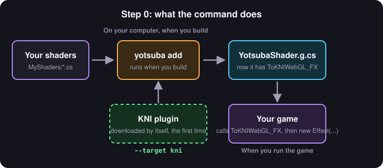
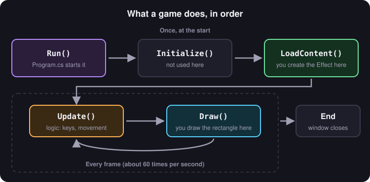
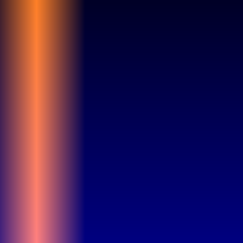
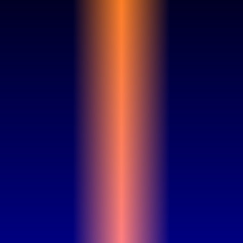
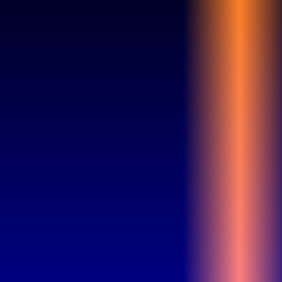

In the [Get Started](../get-started/index.md) you made your shaders in a library that knows nothing about KNI. They compiled, and you saw the result as text in the console. Here you take the step that was missing: seeing them in a KNI window.


That is what will show up in your window in a few minutes, and the `Gradient` you wrote yourself is what will draw it.

> [!IMPORTANT]
> This guide continues right where the Get Started ends. It assumes you have the `Tutorial` folder, with `MyShaders` inside, and that you already installed the `yotsuba` tool. If you have not done that yet, start with [Set up your project](../get-started/setup.md).

## What you are going to do

You are going to add one more project to your folder: the game.

```text
Tutorial/
├── MyShaders/       your shaders
├── TryIt/            the console program from the tutorial
└── MyGame/           new: a KNI window that uses your shaders
```

The path has three parts:

1. **Prepare your shaders for KNI.** One command, in step 0.
2. **Create the game.** A new project with KNI installed (steps 1 to 3).
3. **See them.** You run the game and your shader shows up (steps 4 to 6).

You will see one word a lot: **plugin**. A plugin is an extension of the `yotsuba` tool. Without it, `yotsuba` knows how to prepare shaders for OpenGL, DirectX, Metal and Vulkan, but not for KNI. With the KNI plugin, it learns. You do not write it, and your game does not use it: only `yotsuba` uses it, while it compiles.

## 0. Prepare your shaders for KNI

This step is short, but do not skip it: without it, your game will have no way to ask for the shader.



### The command

From the `Tutorial` folder:

```bash
dotnet yotsuba add MyShaders/MyShaders.csproj --target spirv --target kni
```

It is the same command as always, with one more part:

- `--target spirv` is what you already used.
- `--target kni` means "and prepare them also for KNI".

The first time, `yotsuba` downloads the KNI plugin from the internet by itself. You do not install anything. The next times it uses the copy it saved.

### Check that it worked

Open `MyShaders/YotsubaShader.g.cs`. It is a file that the command wrote. Look for `ToKNIWebGL_FX`: there must be one for each of your shader classes. That method is the one your game will use in step 3.

If you cannot find it, the command did not have `--target kni`. Run it again with it.

### What the plugin makes

The plugin makes a KNI **effect**. It is the same one for desktop and for the browser, which is why the method is called `ToKNIWebGL_FX` (do not let the "WebGL" confuse you). There is only one version, so you do not choose a platform.

### Optional: make it run by itself

Every time you change a shader you would have to repeat the command. To make it happen on its own when you build, open `MyShaders/MyShaders.csproj` and add this just before the closing `</Project>`. The rest of the file stays as it is:

```xml
  <Target Name="CompileShaders" BeforeTargets="CoreCompile" Condition="'$(DesignTimeBuild)' != 'true'">
    <Exec Command="dotnet yotsuba add &quot;$(MSBuildProjectFullPath)&quot; --target spirv --target kni" />
    <ItemGroup>
      <Compile Remove="YotsubaShader.g.cs" />
      <Compile Include="YotsubaShader.g.cs" />
    </ItemGroup>
  </Target>
```

What each part says:

- `BeforeTargets="CoreCompile"`: "do this right before compiling the C#".
- `Exec`: it is the same command you typed by hand.
- `Condition`: your editor builds the project in the background while you type. This keeps the command from running on every keystroke.
- `Compile Remove` and `Compile Include`: they add `YotsubaShader.g.cs` to the build even if it does not exist yet.

From now on, `dotnet build MyShaders` runs the command for you.

### Other plugin commands

If you want to download the plugin before (for example, to work without internet), use `dotnet yotsuba plugin install kni`. And `dotnet yotsuba plugin list` shows which ones you have. There is more in [The CLI](../get-started/cli.md).

## 1. Create the game and install the engine

From the `Tutorial` folder:

```bash
dotnet new console -n MyGame -f net8.0
```

Install KNI:

```bash
dotnet add MyGame package nkast.Kni.Platform.SDL2.GL
```

And tell it that it is going to use your shaders:

```bash
dotnet add MyGame reference MyShaders/MyShaders.csproj
```

`nkast.Kni.Platform.SDL2.GL` is the KNI platform for desktop: it opens the window with SDL2 and draws with OpenGL, on Windows, macOS and Linux. It already pulls in the rest of KNI (`nkast.Xna.Framework`, `.Graphics`, `.Game`, `.Content`...), so you do not need to add those one by one. It also carries the native SDL2 libraries for each system.

KNI has one package per platform, and you only install the one you are going to run on:

| Platform | Package | Is it covered here? |
| --- | --- | --- |
| Desktop (OpenGL) | `nkast.Kni.Platform.SDL2.GL` | Yes: this is the one in this guide. |
| Browser (WebGL) | `nkast.Kni.Platform.Blazor.GL` | Yes, with the same shader (see [KNI in the browser](#kni-in-the-browser)). |
| Windows with DirectX 11 | `nkast.Kni.Platform.WinForms.DX11` | No: the KNI plugin compiles for OpenGL/WebGL only. |

You did not install any Yotsuba Shader package for KNI. Your shader reaches the game as bytes inside your own library, and KNI's Content Pipeline is not involved.

> [!TIP]
> If you already have a KNI game, do not create a new one: add only the reference to `MyShaders` and continue from step 2. Make sure it uses the OpenGL platform (`SDL2.GL` or `Blazor.GL`), because that is what the KNI plugin compiles for.

## 2. The rectangle that covers the screen

In the tutorial you saw that a shader does not draw "the screen": it draws a shape, and to paint the whole screen we use a rectangle that covers it. That rectangle has four corners, and each corner carries the two pieces of data you declared in `Corner`:

```csharp
public struct Corner
{
    [location(0)] public vec2 Position;
    [location(1)] public vec2 Uv;
}
```

Now it is the game's turn to send those corners. For that, KNI asks for a `struct` that says how each one is made. Create `MyGame/ScreenCorner.cs`:

```csharp title="MyGame/ScreenCorner.cs"
using Microsoft.Xna.Framework;
using Microsoft.Xna.Framework.Graphics;

public readonly struct ScreenCorner(Vector2 position, Vector2 uv) : IVertexType
{
    private static readonly VertexDeclaration Declaration = new(
        new VertexElement(0, VertexElementFormat.Vector2, VertexElementUsage.TextureCoordinate, 0),
        new VertexElement(8, VertexElementFormat.Vector2, VertexElementUsage.TextureCoordinate, 1));

    public readonly Vector2 Position = position;
    public readonly Vector2 Uv = uv;

    VertexDeclaration IVertexType.VertexDeclaration => Declaration;
}
```

(KNI keeps the XNA names, so the `using` lines say `Microsoft.Xna.Framework` even though you are not using Microsoft's XNA.)

The two fields are the same ones as in `Corner`: the position and the `Uv`. What is new is the `VertexDeclaration`, which is KNI's way of explaining to the GPU what is in each corner. Each line describes one field:

```csharp
new VertexElement(0, VertexElementFormat.Vector2, VertexElementUsage.TextureCoordinate, 0),
```

- The first `0` is the byte where the field starts. `Position` comes first, so it starts at 0.
- `Vector2` is its type: two `float`.
- `TextureCoordinate` and the last `0` are the slot. **This is the important part.**

And the second line, the one for `Uv`, starts at byte `8` because the two `float` of `Position` come first, and they take 4 bytes each.

`IVertexType` is the interface that lets KNI ask your `struct` for that declaration. And `readonly struct` with a primary constructor is just a short way to write a `struct` whose fields are set once.

### From `[location]` to `TextureCoordinate`

In your shader the slots have only a number: `[location(0)]`, `[location(1)]`. In KNI they have a name and a number. Yotsuba Shader makes the translation like this:

| In your shader | In KNI |
| --- | --- |
| `[location(0)]` | `TextureCoordinate`, number `0` |
| `[location(1)]` | `TextureCoordinate`, number `1` |
| `[location(2)]` | `TextureCoordinate`, number `2` |

That is: the name is always `TextureCoordinate`, and the number is the one from your `location`.

> [!WARNING]
> The natural thing would be to put `VertexElementUsage.Position` on the position field. Do not do it. The shader expects that data in `TextureCoordinate 0`, because that is how you declared it with `[location(0)]`. If you put `Position`, the program starts without any error, but the shader receives the data crossed and the rectangle comes out deformed or does not come out at all.

## 3. The game

Delete what `MyGame/Program.cs` has and leave only this, which creates the game and starts it:

```csharp title="MyGame/Program.cs"
using var game = new MyGame();
game.Run();
```

Now create `MyGame/MyGame.cs`:

```csharp title="MyGame/MyGame.cs"
using Microsoft.Xna.Framework;
using Microsoft.Xna.Framework.Graphics;
using MyShaders;
using YotsubaShader;

public class MyGame : Game
{
    private readonly GraphicsDeviceManager _graphics;
    private Effect _shader = null!;

    private readonly ScreenCorner[] _screen =
    [
        new(new Vector2(-1f,  1f), new Vector2(0f, 0f)),
        new(new Vector2( 1f,  1f), new Vector2(1f, 0f)),
        new(new Vector2(-1f, -1f), new Vector2(0f, 1f)),
        new(new Vector2( 1f, -1f), new Vector2(1f, 1f)),
    ];

    public MyGame()
    {
        _graphics = new GraphicsDeviceManager(this)
        {
            PreferredBackBufferWidth = 800,
            PreferredBackBufferHeight = 800,
        };
    }

    protected override void LoadContent()
    {
        byte[] compiled = new Gradient().ToKNIWebGL_FX();
        _shader = new Effect(GraphicsDevice, compiled);
    }

    protected override void Draw(GameTime gameTime)
    {
        GraphicsDevice.RasterizerState = RasterizerState.CullNone;

        _shader.CurrentTechnique.Passes[0].Apply();
        GraphicsDevice.DrawUserPrimitives(PrimitiveType.TriangleStrip, _screen, 0, 2);

        base.Draw(gameTime);
    }
}
```

The first lines say where each thing comes from: `Microsoft.Xna.Framework` has `Game`, `Vector2` and `GameTime`; `...Graphics` has `Effect`, `GraphicsDevice` and the drawing types; `MyShaders` is your library; and `YotsubaShader` is the namespace of the generated file (where `ToKNIWebGL_FX` lives).

There are three parts that matter for Yotsuba Shader. After them, a section explains what each KNI piece does.

### The four corners

`_screen` is the rectangle. Each line is a corner, with its position and its `Uv`:

```csharp
new(new Vector2(-1f,  1f), new Vector2(0f, 0f)),   // top left
new(new Vector2( 1f,  1f), new Vector2(1f, 0f)),   // top right
new(new Vector2(-1f, -1f), new Vector2(0f, 1f)),   // bottom left
new(new Vector2( 1f, -1f), new Vector2(1f, 1f)),   // bottom right
```

For the GPU the screen goes from `-1` to `1`, with `(0, 0)` in the center and the `1` of Y at the top. That is why the positions are `-1` and `1`: they are the edges of the screen. The `Uv` are the ones you saw in the tutorial: `(0, 0)` at the top left and `(1, 1)` at the bottom right.

### Loading the shader

This is the part that joins the two worlds:

```csharp
byte[] compiled = new Gradient().ToKNIWebGL_FX();
_shader = new Effect(GraphicsDevice, compiled);
```

`new Gradient()` is your shader, the class you wrote. `ToKNIWebGL_FX` is the method that `add` put on your class for KNI. It returns the shader already compiled, in the format KNI reads. That is why `Effect` accepts it directly.

There is no `.fx` file, no `Content` folder and no separate step to compile. The shader already comes inside your library.

### Drawing

```csharp
GraphicsDevice.RasterizerState = RasterizerState.CullNone;

_shader.CurrentTechnique.Passes[0].Apply();
GraphicsDevice.DrawUserPrimitives(PrimitiveType.TriangleStrip, _screen, 0, 2);
```

- `Apply()` tells the GPU: "from now on, draw with this shader".
- `DrawUserPrimitives` sends the four corners. The GPU does not know how to draw rectangles, only triangles, so the rectangle goes as two triangles glued together. That is `TriangleStrip`, and the `2` at the end is how many triangles there are.
- `CullNone` asks the GPU not to discard any triangle. Normally it discards the ones that "face backwards", which in a 3D game are the faces you cannot see. Here there is nothing to hide.

### What each KNI piece does

This part is about KNI, not about Yotsuba Shader, but without it the game above is a block you copy without understanding. Read it once.

**`Game` and its cycle.** Your class inherits from `Game`. When `Program.cs` calls `Run()`, KNI opens the window and repeats a cycle until the window closes. You do not call the steps: you override the ones you need.



```csharp
protected override void Initialize()  { /* once, before the window shows */ base.Initialize(); }
protected override void LoadContent() { /* once, when the graphics are ready */ }
protected override void Update(GameTime gameTime) { /* every frame: logic */ base.Update(gameTime); }
protected override void Draw(GameTime gameTime)   { /* every frame: drawing */ base.Draw(gameTime); }
```

| Method | When it runs | In this guide |
| --- | --- | --- |
| `Initialize` | Once, at the start. | Not used. |
| `LoadContent` | Once, right after the graphics device exists. | We create the `Effect` here, because it needs the `GraphicsDevice`. |
| `Update` | Every frame, before drawing. Usually 60 times per second. | Not used yet. |
| `Draw` | Every frame, after `Update`. | We draw the rectangle. |

`base.Draw(gameTime)` calls the original version of `Draw` that `Game` has. Here it does nothing visible, but it is good to keep it: it is what draws any component you add to the game later.

**`GraphicsDeviceManager`.** It is the object that creates and configures the window and the graphics card connection. You build it in the constructor, passing the game (`this`). The two `PreferredBackBuffer...` lines set the size of the drawing area: 800 by 800 pixels. If you do not set them, KNI uses 800 by 480.

**`GraphicsDevice`.** It is a property that `Game` has once the manager has created it. It represents the graphics card: everything you draw goes through it. That is why `new Effect(GraphicsDevice, ...)` asks for it, and why you cannot create the `Effect` in the constructor (the device does not exist yet): that is the reason for `LoadContent`.

**`Effect`.** It is a compiled shader that KNI can use. It holds the vertex and fragment code, together, and its parameters. The three things you use:

```csharp
_shader.CurrentTechnique          // the set of steps that draws with this effect
_shader.CurrentTechnique.Passes[0] // the first (and, here, only) step
_shader.Parameters["Name"]         // a value you can change from C#
```

An effect can have several techniques with several passes. The ones Yotsuba Shader generates have one technique with one pass, so `Passes[0]` is always the one.

**`GameTime`.** It is what KNI passes to `Update` and `Draw` to tell you about time. `gameTime.TotalGameTime` is how long the game has been open, and `gameTime.ElapsedGameTime` is how long the last frame took. In step 6 you use the first one.

**`DrawUserPrimitives`.** It sends vertices from an array in memory straight to the GPU, and draws them. It is the simplest way to draw, and it is perfect for four corners. For thousands of vertices, KNI has `VertexBuffer` and `IndexBuffer`, which keep the data in the GPU memory so it is not sent every frame. For a rectangle you do not need them.

**Closing the window.** Your game has no way to close except the window's own button. If you want `Esc` to close it, add an `Update`:

```csharp
protected override void Update(GameTime gameTime)
{
    if (Keyboard.GetState().IsKeyDown(Keys.Escape))
    {
        Exit();
    }

    base.Update(gameTime);
}
```

`Keyboard` and `Keys` are in `Microsoft.Xna.Framework.Input`, so you also add that `using`.

**What you will not need.** KNI also has `SpriteBatch` (for drawing 2D images, with its own shader), `Content.Load` (to read files from the Content Pipeline) and `Texture2D`. This guide uses none of them: you draw the rectangle yourself, and the shader is already in memory. When textures work in the compiler, `Texture2D` will come in.

## 4. Run it

```bash
dotnet run --project MyGame
```

A window opens with the sunset. That color was calculated by your `Fragment` method, pixel by pixel, on the GPU.

## 5. Change the shader

Changing shader means changing one word. In `LoadContent`, where it says `Gradient`, put `Mandelbrot`:

```csharp
byte[] compiled = new Mandelbrot().ToKNIWebGL_FX();
```

Run again:

```bash
dotnet run --project MyGame
```


The same rectangle, the same four corners, and a completely different drawing. Everything that changed is inside the shader.

## 6. A shader that moves

Until here the window shows a still image. For something to move, the game has to send the shader a value that changes: the time. In the tutorial you saw it in [Shader 4](../get-started/plasma.md): that data is called a **uniform**.

You are going to make a strip of light that crosses the screen from left to right:

| Second 0.3 | Second 1 | Second 1.7 |
| --- | --- | --- |
|  |  |  |

### The shader

Create `MyShaders/Sweep.cs`:

```csharp title="MyShaders/Sweep.cs"
using YotsubaShader.GlslSyntax;
using YotsubaShader.GlslSyntax.Resources;
using YotsubaShader.GlslSyntax.Types;
using YotsubaShader.Language;

namespace MyShaders;

public struct Stopwatch
{
    public float Seconds;
}

public class Sweep
{
    [uniform, layout(0, 0)]
    public Stopwatch Time;

    [ShaderStage(Stage.Vertex)]
    public Pixel Vertex(Corner corner)
    {
        Pixel pixel;
        pixel.Position = Make.Vec4(corner.Position.X, corner.Position.Y, 0f, 1f);
        pixel.Uv = corner.Uv;
        return pixel;
    }

    [ShaderStage(Stage.Fragment)]
    [return: location(0)]
    public vec4 Fragment(PixelIn pixel)
    {
        float center = Time.Seconds * 0.5f;

        float distance = pixel.Uv.X - center;
        if (distance < 0f)
        {
            distance = -distance;
        }

        float brightness = 1f - distance * 5f;
        if (brightness < 0f)
        {
            brightness = 0f;
        }

        return Make.Vec4(brightness, brightness * 0.5f, 0.15f + 0.35f * pixel.Uv.Y, 1f);
    }
}
```

The `Vertex` method is the usual one. What is new:

- `Stopwatch` is a normal `struct` with the piece of data the game is going to send.
- `[uniform, layout(0, 0)] public Stopwatch Time;` declares that data inside the shader.
- In `Fragment`, `center` is where the strip is right now, from `0` (left edge) to `1` (right edge). `distance` is how far this pixel is from the strip, and the `if` removes the sign. The farther away, the less `brightness`.

Build it with `add`, like in the tutorial, asking for the plugin as in step 0:

```bash
dotnet yotsuba add MyShaders/MyShaders.csproj --target spirv --target kni
```

If you added the `Target` from step 0, you do not need to: it runs when you build the game.

### The game sends it the time

In `MyGame/MyGame.cs` two things change: which shader is loaded, and two new lines in `Draw`. The complete file looks like this:

```csharp title="MyGame/MyGame.cs"
using Microsoft.Xna.Framework;
using Microsoft.Xna.Framework.Graphics;
using MyShaders;
using YotsubaShader;

public class MyGame : Game
{
    private readonly GraphicsDeviceManager _graphics;
    private Effect _shader = null!;

    private readonly ScreenCorner[] _screen =
    [
        new(new Vector2(-1f,  1f), new Vector2(0f, 0f)),
        new(new Vector2( 1f,  1f), new Vector2(1f, 0f)),
        new(new Vector2(-1f, -1f), new Vector2(0f, 1f)),
        new(new Vector2( 1f, -1f), new Vector2(1f, 1f)),
    ];

    public MyGame()
    {
        _graphics = new GraphicsDeviceManager(this)
        {
            PreferredBackBufferWidth = 800,
            PreferredBackBufferHeight = 800,
        };
    }

    protected override void LoadContent()
    {
        byte[] compiled = new Sweep().ToKNIWebGL_FX();
        _shader = new Effect(GraphicsDevice, compiled);
    }

    protected override void Draw(GameTime gameTime)
    {
        GraphicsDevice.RasterizerState = RasterizerState.CullNone;

        float seconds = (float)(gameTime.TotalGameTime.TotalSeconds % 2.0);
        _shader.Parameters["Time_Seconds"].SetValue(seconds);

        _shader.CurrentTechnique.Passes[0].Apply();
        GraphicsDevice.DrawUserPrimitives(PrimitiveType.TriangleStrip, _screen, 0, 2);

        base.Draw(gameTime);
    }
}
```

The two new lines:

```csharp
float seconds = (float)(gameTime.TotalGameTime.TotalSeconds % 2.0);
_shader.Parameters["Time_Seconds"].SetValue(seconds);
```

The first one gets how many seconds the game has been open. The `% 2.0` makes it go back to `0` every two seconds, so the strip starts again from the left.

The second one hands that number to the shader. The name `"Time_Seconds"` is not made up, it comes from your code: it is the name of the field, an underscore and the name of the data.

| In your shader | In KNI |
| --- | --- |
| `public Stopwatch Time;` with a `Seconds` piece of data | `Parameters["Time_Seconds"]` |

It has to be done **before** `Apply()`, because `Apply()` is the moment when the data travels to the GPU.

`SetValue` has a version for each type you can have in a `struct`:

| In your shader | What you pass to `SetValue` |
| --- | --- |
| `float` | A `float` |
| `int` | An `int` |
| `vec2` | A `Vector2` |
| `vec3` | A `Vector3` |
| `vec4` | A `Vector4` |
| `mat4` | A `Matrix` |

If the name does not match any parameter, `Parameters["..."]` gives you `null`, and the line fails with a `NullReferenceException`. When you are not sure the shader uses that value (for example, a shader that does not read the time), write `?.SetValue(...)` and the line is skipped instead.

Run:

```bash
dotnet run --project MyGame
```

The strip crosses the screen again and again.

> [!NOTE]
> The plasma of [Shader 4](../get-started/plasma.md) is fed exactly the same way, with `Parameters["Time_Seconds"]`, because its field is also called `Time` and its data `Seconds`. Today it cannot be seen because it uses the `sin` function, which `add` does not translate yet.

## KNI in the browser

KNI can also run in the browser with WebGL. For that, the game project is a KNI web project (the one that uses `nkast.Kni.Platform.Blazor.GL`) instead of a console program. Create it with KNI's own templates, following [KNI's documentation](https://github.com/kniEngine/kni), because that part is KNI's and not Yotsuba Shader's.

What does not change is everything you did here:

- Step 0 is the same: the same plugin, the same `--target kni`.
- The web project references `MyShaders` like the console game.
- The shader is loaded with the same line, `new Gradient().ToKNIWebGL_FX()`, and `new Effect(GraphicsDevice, bytes)`.

> [!NOTE]
> This guide is tested from start to end on desktop KNI (`nkast.Kni.Platform.SDL2.GL`). The browser project uses the same effect, but we do not run it here.

## If something fails

| What you see | What it means | What to do |
| --- | --- | --- |
| `ToKNIWebGL_FX` does not exist | The generated file does not have it: `add` ran without the plugin. | Run `add` with `--target kni` (step 0), or add it to the `Target` of the `.csproj`. |
| `add` fails with a message about a shader | One of your shaders cannot be compiled for the GPU yet (for example Neon, Plasma or Underwater from the tutorial). | Move that file out of the `MyShaders` folder for now. |
| `add` finishes, but running the game throws `NotSupportedException` | The plugin could not compile that shader. `add` does not fail, it leaves the method ready to report the reason. | Run `add` again and read what it prints: it says which shader and why. |
| The rectangle is deformed or does not show up | The corners use `VertexElementUsage.Position`. | Use `TextureCoordinate` with the number of your `location` (step 2). |
| `NullReferenceException` in `Parameters[...].SetValue` | The name does not exist in the shader. | The name is `Field_Data`: check both against your `struct` (step 6). |
| The window opens and stays black | `Apply()` or `DrawUserPrimitives` are missing, or the shader returns black. | Check step 3 and make sure the `Fragment` returns a color with `1` in the last value. |
| The first `add` with the plugin fails with a network error | The CLI is downloading the plugin and cannot reach NuGet. | Check your connection, or use `dotnet yotsuba plugin install kni` when you are online. |

## What is not possible yet

> [!PLANNED]
> Reading an image from the shader (textures, like in [Shader 5](../get-started/underwater.md)) does not work in the compiler yet, so this guide does not cover it. When it works, it will be added here how to pass a KNI `Texture2D` to the shader.

## Summary

Of everything you did, what belongs to KNI is this:

| | |
| --- | --- |
| The plugin (for the CLI) | `kni` |
| The `add` command | `dotnet yotsuba add MyShaders/MyShaders.csproj --target spirv --target kni` |
| The package (for the game) | `nkast.Kni.Platform.SDL2.GL` |
| The method | `ToKNIWebGL_FX()` |

The rest is the same in MonoGame, KNI and FNA, because the three share the same way of programming:

- The corners are declared with `TextureCoordinate` and the number of your `[location]`.
- The shader is loaded with `new Effect(GraphicsDevice, bytes)`.
- The data of a uniform is sent with `Parameters["Field_Data"].SetValue(...)`, before `Apply()`.

And your `MyShaders` library did not change at all to work here, except for asking for the plugin when you build it.
