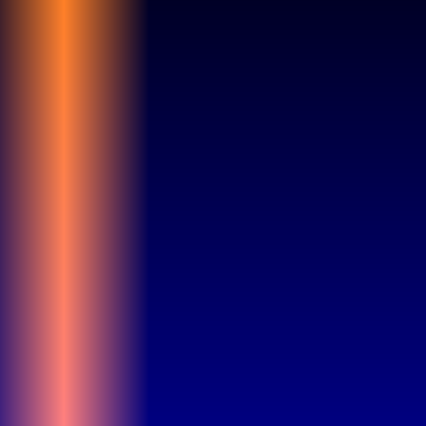
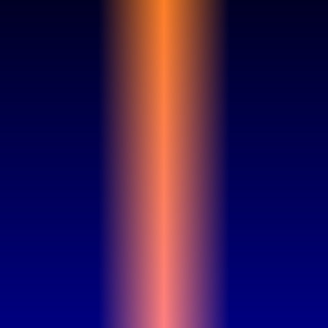
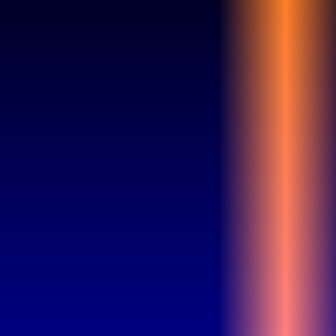

En el [Get Started](../get-started/index.md) hiciste tus shaders en una librería que no sabe nada de KNI. Compilaban, y veías el resultado como texto en la consola. Aquí vas a dar el paso que faltaba: verlos en una ventana de KNI.


Eso es lo que va a salir en tu ventana dentro de unos minutos, y lo va a dibujar el `Degradado` que escribiste tú.

> [!IMPORTANT]
> Esta guía sigue justo donde termina el Get Started. Da por hecho que tienes la carpeta `Tutorial`, con `MisShaders` dentro, y que ya sabes ejecutar `add`. Si todavía no lo has hecho, empieza por [Prepara tu proyecto](../get-started/setup.md).

## Lo que vas a hacer

Vas a añadir un proyecto más a tu carpeta: el juego.

```text
Tutorial/
├── MisShaders/       tus shaders (no cambia nada)
├── Probar/           el programa de consola del tutorial
└── Juego/            nuevo: una ventana de KNI que usa tus shaders
```

`MisShaders` no se toca. Es la misma librería, con los mismos archivos. Lo único que tiene que ver con KNI vive en `Juego`.

## 1. Crea el juego

Desde la carpeta `Tutorial`:

```bash
dotnet new console -n Juego -f net8.0
```

Añádele KNI:

```bash
dotnet add Juego package nkast.Xna.Framework.Game
```

```bash
dotnet add Juego package nkast.Kni.Platform.SDL2.GL
```

Y dile que va a usar tus shaders:

```bash
dotnet add Juego reference MisShaders/MisShaders.csproj
```

El primero es KNI. El segundo es la parte que abre la ventana en Windows, macOS y Linux.

> [!TIP]
> Si ya tienes un juego de KNI, no crees uno nuevo: añádele solo la referencia a `MisShaders` y sigue desde el paso 2. Y fíjate en algo: no vas a tocar el Content Pipeline. El shader no pasa por ahí.

## 2. El rectángulo que cubre la pantalla

En el tutorial viste que un shader no dibuja "la pantalla": dibuja una figura, y para pintar toda la pantalla usamos un rectángulo que la cubre entera. Ese rectángulo tiene cuatro esquinas, y cada esquina lleva los dos datos que declaraste en `Vertice`:

```csharp
public struct Vertice
{
    [location(0)] public vec2 Posicion;
    [location(1)] public vec2 Uv;
}
```

Ahora le toca al juego mandar esas esquinas. Para eso KNI te pide un `struct` que diga cómo está hecha cada una. Crea `Juego/Esquina.cs`:

```csharp title="Juego/Esquina.cs"
using Microsoft.Xna.Framework;
using Microsoft.Xna.Framework.Graphics;

public readonly struct Esquina(Vector2 posicion, Vector2 uv) : IVertexType
{
    private static readonly VertexDeclaration Declaracion = new(
        new VertexElement(0, VertexElementFormat.Vector2, VertexElementUsage.TextureCoordinate, 0),
        new VertexElement(8, VertexElementFormat.Vector2, VertexElementUsage.TextureCoordinate, 1));

    public readonly Vector2 Posicion = posicion;
    public readonly Vector2 Uv = uv;

    VertexDeclaration IVertexType.VertexDeclaration => Declaracion;
}
```

Los dos campos son los mismos de `Vertice`: la posición y el `Uv`. Lo nuevo es la `VertexDeclaration`, que es la manera que tiene KNI de explicarle a la GPU qué hay en cada esquina. Cada línea describe un campo:

```csharp
new VertexElement(0, VertexElementFormat.Vector2, VertexElementUsage.TextureCoordinate, 0),
```

- El primer `0` es en qué byte empieza el campo. `Posicion` es lo primero, así que empieza en el 0.
- `Vector2` es su tipo: dos `float`.
- `TextureCoordinate` y el último `0` son el casillero. **Este es el dato importante.**

Y la segunda línea, la de `Uv`, empieza en el byte `8` porque antes van los dos `float` de `Posicion`, que ocupan 4 bytes cada uno.

### De `[location]` a `TextureCoordinate`

En tu shader los casilleros tienen solo un número: `[location(0)]`, `[location(1)]`. En KNI tienen un nombre y un número. Yotsuba Shader hace la traducción así:

| En tu shader | En KNI |
| --- | --- |
| `[location(0)]` | `TextureCoordinate`, número `0` |
| `[location(1)]` | `TextureCoordinate`, número `1` |
| `[location(2)]` | `TextureCoordinate`, número `2` |

O sea: el nombre es siempre `TextureCoordinate`, y el número es el de tu `location`.

> [!WARNING]
> Lo natural sería poner `VertexElementUsage.Position` en el campo de la posición. No lo hagas. El shader espera ese dato en `TextureCoordinate 0`, porque así lo declaraste con `[location(0)]`. Si pones `Position`, el programa arranca sin ningún error, pero el shader recibe los datos cruzados y el rectángulo sale deformado o no sale.

## 3. El juego

Borra lo que trae `Juego/Program.cs` y deja solo esto, que crea el juego y lo pone a correr:

```csharp title="Juego/Program.cs"
using var juego = new Juego();
juego.Run();
```

Ahora crea `Juego/Juego.cs`:

```csharp title="Juego/Juego.cs"
using Microsoft.Xna.Framework;
using Microsoft.Xna.Framework.Graphics;
using MisShaders;
using YotsubaShader;

public class Juego : Game
{
    private readonly GraphicsDeviceManager _graficos;
    private Effect _shader = null!;

    private readonly Esquina[] _pantalla =
    [
        new(new Vector2(-1f,  1f), new Vector2(0f, 0f)),
        new(new Vector2( 1f,  1f), new Vector2(1f, 0f)),
        new(new Vector2(-1f, -1f), new Vector2(0f, 1f)),
        new(new Vector2( 1f, -1f), new Vector2(1f, 1f)),
    ];

    public Juego()
    {
        _graficos = new GraphicsDeviceManager(this)
        {
            PreferredBackBufferWidth = 800,
            PreferredBackBufferHeight = 800,
        };
    }

    protected override void LoadContent()
    {
        byte[] compilado = new Degradado().ToKNIWebGL_FX();
        _shader = new Effect(GraphicsDevice, compilado);
    }

    protected override void Draw(GameTime gameTime)
    {
        GraphicsDevice.RasterizerState = RasterizerState.CullNone;

        _shader.CurrentTechnique.Passes[0].Apply();
        GraphicsDevice.DrawUserPrimitives(PrimitiveType.TriangleStrip, _pantalla, 0, 2);

        base.Draw(gameTime);
    }
}
```

Son tres partes. Vamos una por una.

### Las cuatro esquinas

`_pantalla` es el rectángulo. Cada línea es una esquina, con su posición y su `Uv`:

```csharp
new(new Vector2(-1f,  1f), new Vector2(0f, 0f)),   // arriba a la izquierda
new(new Vector2( 1f,  1f), new Vector2(1f, 0f)),   // arriba a la derecha
new(new Vector2(-1f, -1f), new Vector2(0f, 1f)),   // abajo a la izquierda
new(new Vector2( 1f, -1f), new Vector2(1f, 1f)),   // abajo a la derecha
```

Para la GPU la pantalla va de `-1` a `1`, con el `(0, 0)` en el centro y el `1` de la Y arriba. Por eso las posiciones son `-1` y `1`: son los bordes de la pantalla. Los `Uv` son los que viste en el tutorial: `(0, 0)` arriba a la izquierda y `(1, 1)` abajo a la derecha.

### Cargar el shader

Esta es la parte que une los dos mundos:

```csharp
byte[] compilado = new Degradado().ToKNIWebGL_FX();
_shader = new Effect(GraphicsDevice, compilado);
```

`new Degradado()` es tu shader, la clase que escribiste. `ToKNIWebGL_FX` es el método que `add` le puso a tu clase para KNI. Te devuelve el shader ya compilado, en el formato que `Effect` sabe leer.

No te dejes confundir por el "WebGL" del nombre. Ese formato es el que usa KNI en el navegador, y el KNI de escritorio con OpenGL (el paquete `SDL2.GL` que instalaste) lee exactamente el mismo.

No hay ningún archivo `.fx`, ni carpeta `Content`, ni un paso aparte para compilar. El shader ya viene dentro de tu librería.

### Dibujar

```csharp
GraphicsDevice.RasterizerState = RasterizerState.CullNone;

_shader.CurrentTechnique.Passes[0].Apply();
GraphicsDevice.DrawUserPrimitives(PrimitiveType.TriangleStrip, _pantalla, 0, 2);
```

- `Apply()` le dice a la GPU: "desde ahora, dibuja con este shader".
- `DrawUserPrimitives` manda las cuatro esquinas. La GPU no sabe dibujar rectángulos, solo triángulos, así que el rectángulo va como dos triángulos pegados. Eso es `TriangleStrip`, y el `2` del final es cuántos triángulos son.
- `CullNone` le pide a la GPU que no descarte ningún triángulo. Normalmente descarta los que "miran hacia atrás", que en un juego 3D son las caras que no se ven. Aquí no hay nada que esconder.

## 4. Ejecútalo

```bash
dotnet run --project Juego
```

Se abre una ventana con el atardecer. Ese color lo calculó tu método `Fragment`, píxel por píxel, en la GPU.

> [!WARNING]
> Si `dotnet` se queja de que `ToMGFX`, `ToKNIWebGL_FX` o `ToFNA_FX` no existe, es que falta ejecutar `add` en `MisShaders`. Y si `add` falla, mira si tienes en el proyecto los shaders 3, 4 y 5 del tutorial (`Neon.cs`, `Plasma.cs`, `BajoElAgua.cs`): todavía no se pueden compilar para la GPU y hacen fallar a `add`. Sácalos de la carpeta `MisShaders` por ahora.

## 5. Cambia de shader

Cambiar de shader es cambiar una palabra. En `LoadContent`, donde dice `Degradado`, pon `Mandelbrot`:

```csharp
byte[] compilado = new Mandelbrot().ToKNIWebGL_FX();
```

Ejecuta otra vez:

```bash
dotnet run --project Juego
```


El mismo rectángulo, las mismas cuatro esquinas, y un dibujo completamente distinto. Todo lo que cambió está dentro del shader.

## 6. Un shader que se mueve

Hasta aquí la ventana muestra una imagen quieta. Para que algo se mueva, el juego tiene que mandarle al shader un dato que cambie: el tiempo. En el tutorial lo viste en [Shader 4](../get-started/plasma.md): a ese dato se le llama **uniform**.

Vas a hacer una franja de luz que cruza la pantalla de izquierda a derecha:

| Segundo 0.3 | Segundo 1 | Segundo 1.7 |
| --- | --- | --- |
|  |  |  |

### El shader

Crea `MisShaders/Barrido.cs`:

```csharp title="MisShaders/Barrido.cs"
using YotsubaShader.GlslSyntax;
using YotsubaShader.GlslSyntax.Resources;
using YotsubaShader.GlslSyntax.Types;
using YotsubaShader.Language;

namespace MisShaders;

public struct Cronometro
{
    public float Segundos;
}

public class Barrido
{
    [uniform, layout(0, 0)]
    public Cronometro Tiempo;

    [ShaderStage(Stage.Vertex)]
    public Pixel Vertex(Vertice vertice)
    {
        Pixel pixel;
        pixel.Posicion = Crear.Vec4(vertice.Posicion.X, vertice.Posicion.Y, 0f, 1f);
        pixel.Uv = vertice.Uv;
        return pixel;
    }

    [ShaderStage(Stage.Fragment)]
    [return: location(0)]
    public vec4 Fragment(PixelIn pixel)
    {
        float centro = Tiempo.Segundos * 0.5f;

        float distancia = pixel.Uv.X - centro;
        if (distancia < 0f)
        {
            distancia = -distancia;
        }

        float brillo = 1f - distancia * 5f;
        if (brillo < 0f)
        {
            brillo = 0f;
        }

        return Crear.Vec4(brillo, brillo * 0.5f, 0.15f + 0.35f * pixel.Uv.Y, 1f);
    }
}
```

El método `Vertex` es el de siempre. Lo nuevo:

- `Cronometro` es un `struct` normal con el dato que va a mandar el juego.
- `[uniform, layout(0, 0)] public Cronometro Tiempo;` declara ese dato dentro del shader.
- En `Fragment`, `centro` es dónde está la franja ahora mismo, de `0` (borde izquierdo) a `1` (borde derecho). `distancia` es qué tan lejos queda este píxel de la franja, y el `if` le quita el signo. Cuanto más lejos, menos `brillo`.

Compílalo con `add`, igual que en el tutorial:

```bash
dotnet yotsuba add MisShaders/MisShaders.csproj --target spirv
```

Si hiciste que `add` [se ejecute solo](../get-started/cli.md), no hace falta: se ejecuta al compilar el juego.

### El juego le manda el tiempo

En `Juego/Juego.cs` cambian dos cosas: qué shader se carga, y dos líneas nuevas en `Draw`. El archivo completo queda así:

```csharp title="Juego/Juego.cs"
using Microsoft.Xna.Framework;
using Microsoft.Xna.Framework.Graphics;
using MisShaders;
using YotsubaShader;

public class Juego : Game
{
    private readonly GraphicsDeviceManager _graficos;
    private Effect _shader = null!;

    private readonly Esquina[] _pantalla =
    [
        new(new Vector2(-1f,  1f), new Vector2(0f, 0f)),
        new(new Vector2( 1f,  1f), new Vector2(1f, 0f)),
        new(new Vector2(-1f, -1f), new Vector2(0f, 1f)),
        new(new Vector2( 1f, -1f), new Vector2(1f, 1f)),
    ];

    public Juego()
    {
        _graficos = new GraphicsDeviceManager(this)
        {
            PreferredBackBufferWidth = 800,
            PreferredBackBufferHeight = 800,
        };
    }

    protected override void LoadContent()
    {
        byte[] compilado = new Barrido().ToKNIWebGL_FX();
        _shader = new Effect(GraphicsDevice, compilado);
    }

    protected override void Draw(GameTime gameTime)
    {
        GraphicsDevice.RasterizerState = RasterizerState.CullNone;

        float segundos = (float)(gameTime.TotalGameTime.TotalSeconds % 2.0);
        _shader.Parameters["Tiempo_Segundos"].SetValue(segundos);

        _shader.CurrentTechnique.Passes[0].Apply();
        GraphicsDevice.DrawUserPrimitives(PrimitiveType.TriangleStrip, _pantalla, 0, 2);

        base.Draw(gameTime);
    }
}
```

Las dos líneas nuevas:

```csharp
float segundos = (float)(gameTime.TotalGameTime.TotalSeconds % 2.0);
_shader.Parameters["Tiempo_Segundos"].SetValue(segundos);
```

La primera saca cuántos segundos lleva abierto el juego. El `% 2.0` hace que vuelva a `0` cada dos segundos, para que la franja empiece de nuevo por la izquierda.

La segunda le entrega ese número al shader. El nombre `"Tiempo_Segundos"` no es inventado, sale de tu código: es el nombre del campo, un guion bajo y el nombre del dato.

| En tu shader | En KNI |
| --- | --- |
| `public Cronometro Tiempo;` con un dato `Segundos` | `Parameters["Tiempo_Segundos"]` |

Hay que hacerlo **antes** de `Apply()`, porque `Apply()` es el momento en que los datos viajan a la GPU.

Ejecuta:

```bash
dotnet run --project Juego
```

La franja cruza la pantalla una y otra vez.

> [!NOTE]
> El plasma del [Shader 4](../get-started/plasma.md) se alimenta exactamente igual, con `Parameters["Tiempo_Segundos"]`, porque su campo también se llama `Tiempo` y su dato `Segundos`. Hoy no se puede ver porque usa la función `sin`, que `add` todavía no traduce.

## KNI en el navegador

KNI se usa mucho para hacer juegos que corren en una página web. Para eso está pensado `ToKNIWebGL_FX`, y la línea que carga el shader es la misma de esta guía:

```csharp
byte[] compilado = new Degradado().ToKNIWebGL_FX();
```

Lo que cambia es el proyecto del juego, que en vez de ser un programa de consola es un proyecto web de KNI.

> [!NOTE]
> Esta guía está probada de principio a fin con KNI 4.3 de escritorio (`nkast.Kni.Platform.SDL2.GL`). El proyecto web usa el mismo shader compilado, pero aquí no lo ejecutamos.

## Lo que todavía no se puede

> [!PLANNED]
> Leer una imagen desde el shader (las texturas, como en el [Shader 5](../get-started/underwater.md)) todavía no funciona en el compilador, así que esta guía no lo cubre. Cuando funcione, se añadirá aquí cómo pasarle una `Texture2D` de KNI al shader.

## Resumen

De todo lo que hiciste, lo único propio de KNI es esto:

| | |
| --- | --- |
| Los paquetes | `nkast.Xna.Framework.Game` y `nkast.Kni.Platform.SDL2.GL` |
| El método | `ToKNIWebGL_FX()` |

Lo demás es igual en MonoGame, KNI y FNA, porque los tres comparten la misma forma de programar:

- Las esquinas se declaran con `TextureCoordinate` y el número de tu `[location]`.
- El shader se carga con `new Effect(GraphicsDevice, bytes)`.
- Los datos de un uniform se mandan con `Parameters["Campo_Dato"].SetValue(...)`, antes de `Apply()`.

Y tu librería `MisShaders` no cambió en nada para funcionar aquí.
