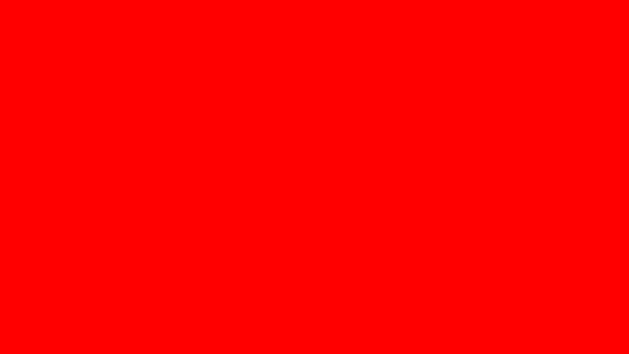
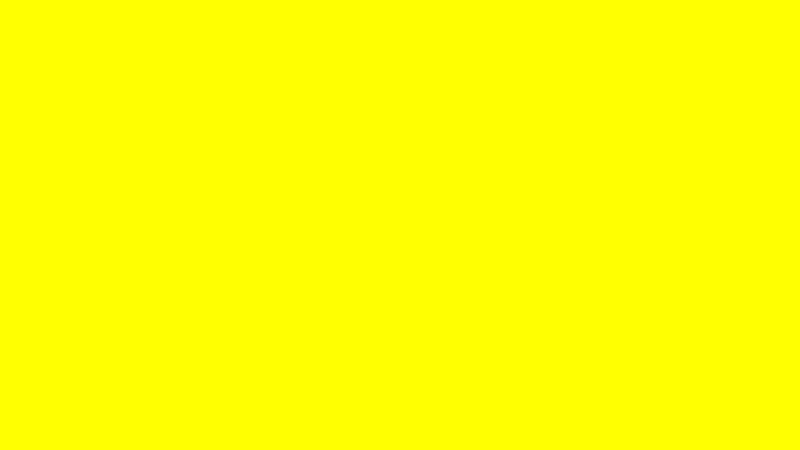

> [!SCENE] intro

Todo lo que un shader de píxeles hace termina en una sola cosa: **devolver un color**. Una sombra, un fuego, el agua, un fractal. Al final, el shader dice "este píxel va de este color", y la GPU lo pinta.

Por eso empezamos por aquí. Si entiendes bien qué es un color para la GPU, el resto del tutorial se vuelve mucho más fácil.

> [!SCENE] first

## Paso 1: tu primer shader de color

Crea el shader de este capítulo a partir de la plantilla:

1. Copia `MisShaders/Plantilla.cs` y llama a la copia `Colores.cs`.
2. Dentro, cambia `public class Plantilla` por `public class Colores`.

Y ejecuta el ciclo de trabajo (el mismo del capítulo anterior, con el nombre nuevo al final):

{{register Colores}}

La ventana sale negra. Es lo que dice la única línea de `Fragment`:

```csharp
return Crear.Vec4(0f, 0f, 0f, 1f);
```

Esos cuatro números son el color. Cada uno tiene un trabajo:

| Posición | Nombre | Qué controla |
|---|---|---|
| 1.º | Rojo | Cuánta luz roja hay |
| 2.º | Verde | Cuánta luz verde hay |
| 3.º | Azul | Cuánta luz azul hay |
| 4.º | Alfa | Qué tan opaco es el color |

> [!SCENE] channels

A los tres primeros se les llama **RGB** (*red, green, blue*: rojo, verde y azul), y a cada uno, un **canal**. Tu pantalla está hecha de píxeles diminutos, y cada uno tiene tres luces: una roja, una verde y una azul. El shader decide cuánto brilla cada una.

> [!SCENE] light

## Paso 2: enciende una luz

Cambia el color por esto:

```csharp
return Crear.Vec4(1f, 0f, 0f, 1f);
```

Ejecuta el ciclo de trabajo.



Rojo al máximo (`1`), verde y azul apagados (`0`). Es rojo puro.

Ahora hazlo tú: prueba `(0f, 1f, 0f, 1f)` y luego `(0f, 0f, 1f, 1f)`. Cada vez que cambies la línea, vuelve a ejecutar el ciclo de trabajo. Deberías ver verde puro y azul puro.

> [!NOTE]
> Quizás te intrigue que `vec4` tenga campos llamados `X`, `Y`, `Z` y `W` en vez de `R`, `G`, `B` y `A`. Es porque un `vec4` es solo "cuatro números juntos": a veces son una posición, a veces un color. Tú decides qué significan. Para un color, el orden es siempre el mismo: `X` es el rojo, `Y` el verde, `Z` el azul y `W` el alfa.

> [!SCENE] mix

## Paso 3: mezcla luces

Ahora enciende dos luces a la vez:

```csharp
return Crear.Vec4(1f, 1f, 0f, 1f);
```



Rojo más verde da **amarillo**. Si alguna vez mezclaste pinturas, esto te sorprende: rojo con verde en pintura da marrón. Pero aquí no mezclas pintura, mezclas **luz**, y la luz se suma. Por eso con las tres encendidas sale blanco, y con las tres apagadas, negro.

Prueba estas recetas, una por una:

| Color | Escríbelo así |
|---|---|
| Negro | `Crear.Vec4(0f, 0f, 0f, 1f)` |
| Blanco | `Crear.Vec4(1f, 1f, 1f, 1f)` |
| Amarillo | `Crear.Vec4(1f, 1f, 0f, 1f)` |
| Cian | `Crear.Vec4(0f, 1f, 1f, 1f)` |
| Magenta | `Crear.Vec4(1f, 0f, 1f, 1f)` |
| Naranja | `Crear.Vec4(1f, 0.5f, 0f, 1f)` |

> [!SCENE] grays

Hay un truco con los grises. Cuando las tres luces valen lo mismo, el color no tira ni a rojo, ni a verde, ni a azul: sale gris. Cuanto mayor el número, más claro. Pruébalo:

```csharp
return Crear.Vec4(0.5f, 0.5f, 0.5f, 1f);
```


Ese es un gris medio. Con `0.2f` en las tres sale casi negro, y con `0.9f`, casi blanco.

> [!SCENE] range

## ¿Por qué de 0 a 1 y no de 0 a 255?

Si has usado colores en otros programas, quizás esperabas números de `0` a `255`, o un código como `#FF8000`. En un shader los números van de `0` a `1`.

La conversión es sencilla: divide entre 255. Si quieres el naranja `#FF8000`, que en decimal es `255, 128, 0`:

```csharp
float rojo = 255f / 255f;  // 1
float verde = 128f / 255f; // 0.5 (más o menos)
float azul = 0f / 255f;    // 0
```

Y por eso el naranja de la tabla es `(1, 0.5, 0)`: el `128` es casi la mitad de `255`.

¿Y por qué de `0` a `1`? Porque así las cuentas salen solas. Multiplicar un color por `0.5` lo deja a la mitad de brillo; multiplicarlo por `0` lo apaga; multiplicarlo por `1` no lo cambia.

> [!SCENE] clip

## Paso 4: ¿qué pasa si me paso?

Ya que sabes que el límite es `1`, hagamos algo prohibido. Escribe un color imposible:

```csharp
return Crear.Vec4(2f, 0.5f, -3f, 1f);
```

Rojo en `2` (el doble del máximo) y azul en `-3` (menos que nada). Ejecuta el ciclo de trabajo.


Sale el mismo naranja de antes, `(1, 0.5, 0)`. No hay error ni nada raro: la GPU **recorta** los valores. Lo que pasa de `1` se queda en `1`, y lo que baja de `0` se queda en `0`.

Esto es importante por dos razones:

- Puedes hacer cuentas que se pasen un poco sin que nada se rompa.
- Pero también puede esconderte errores: si algo sale completamente blanco o completamente negro, quizás tu cuenta se pasó del rango y la GPU lo recortó. Lo recordaremos en el capítulo de [cuando algo sale mal](debugging.md).

> [!SCENE] alpha

## El cuarto número: alfa

Queda un número por explicar. El alfa dice **qué tan opaco** es el color: `1` es completamente opaco y `0` es completamente transparente. Sirve para cosas como el cristal, el humo o un sprite con bordes suaves.

Pero para que el alfa tenga efecto, el programa que dibuja tiene que estar preparado para mezclar ese color con lo que había detrás. Eso no lo decide el shader. Por ahora, déjalo siempre en `1f`, que es el valor seguro.

> [!SCENE] challenge

## Un reto

Antes de seguir, hazlo tú sin mirar la tabla. Cambia el color hasta conseguir:

1. Un **verde oscuro** (como el de un bosque).
2. Un **rosa** (pista: es un rojo fuerte con algo de verde y de azul).
3. El color que más te guste.

No hay una respuesta correcta. Lo importante es que veas cómo el cambio de un número se nota al instante.

> [!SCENE] learned

## Lo que aprendiste

- Un color es un `vec4`: rojo, verde, azul y alfa, en ese orden.
- Los números van de `0` a `1`. Para convertir desde `0`-`255`, divide entre `255`.
- Las luces se **suman**: rojo + verde = amarillo, y las tres juntas dan blanco.
- Si te pasas de `1` o bajas de `0`, la GPU recorta al límite.
- Hasta ahora todos los píxeles tienen el mismo color. Lo emocionante es que cada píxel tenga uno distinto, y para eso hay que saber **dónde está** cada píxel.

Siguiente: [Las coordenadas](coordinates.md).
