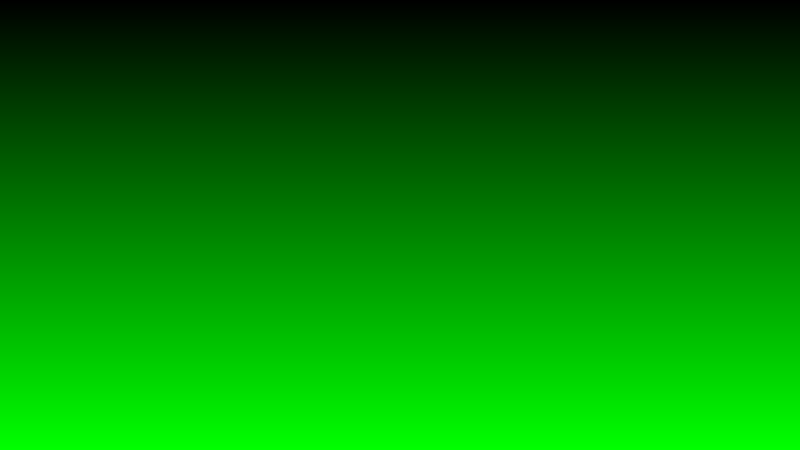
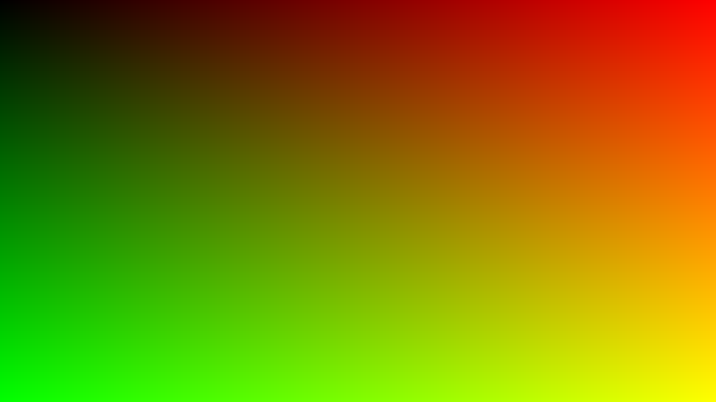
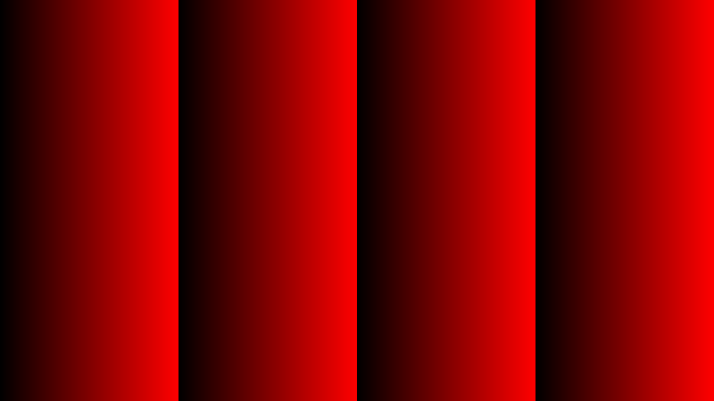
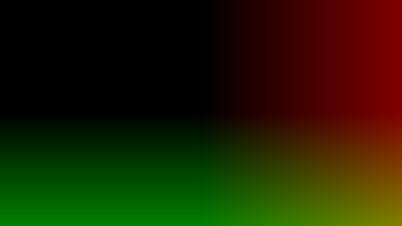
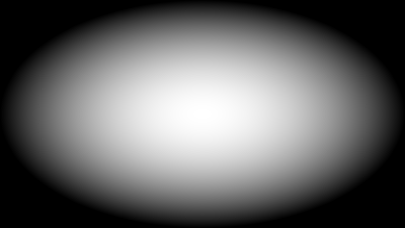
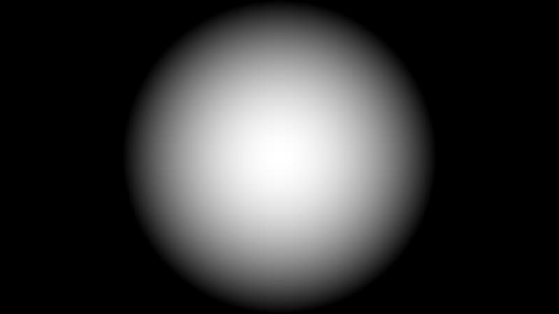
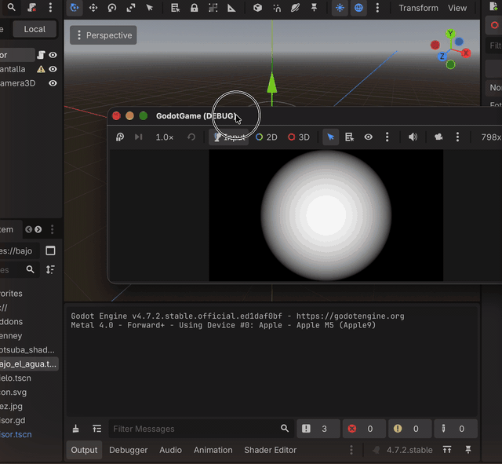

> [!SCENE] intro

En el capítulo anterior todos los píxeles tenían el mismo color. Ahora vas a lograr algo mucho más interesante: que cada píxel tenga el suyo.

Para eso el shader necesita una respuesta a una pregunta: **¿dónde está este píxel?** Esa respuesta es el `Uv`, y lo has estado viendo desde el primer shader sin que nos hayamos detenido a mirarlo de cerca. Hoy sí.

> [!SCENE] uvcolor

## Paso 1: el Uv hecho color

Copia `Plantilla.cs` como `Coordenadas.cs` y cambia el nombre de la clase por `Coordenadas`. Luego reemplaza la línea de `Fragment` por esta:

```csharp
return new vec4(pixel.Uv.X, 0f, 0f, 1f);
```

Aquí estamos usando la posición del píxel como si fuera la cantidad de rojo. Ejecuta el ciclo de trabajo:

{{register Coordenadas}}


Negro a la izquierda y rojo a la derecha. Lo que estás viendo es el valor de `Uv.X` dibujado como brillo: en el borde izquierdo vale `0` (sin rojo) y en el derecho vale `1` (rojo completo).

Esta es la mejor herramienta para entender un shader: **convertir un número en color para poder verlo**. La vas a usar muchas veces.

> [!SCENE] down

## Paso 2: la otra coordenada

Ahora cambia la línea para mostrar `Uv.Y` en el canal verde:

```csharp
return new vec4(0f, pixel.Uv.Y, 0f, 1f);
```



Fíjate bien: el verde crece **hacia abajo**. Arriba `Uv.Y` vale `0` y abajo vale `1`.

Esto sorprende a casi todo el mundo, porque en matemáticas y en los dibujos de funciones el eje Y crece hacia arriba. Pero en las pantallas se numera desde la esquina superior izquierda, como se lee un texto: de izquierda a derecha y de arriba abajo. Así lo dejamos definido en el rectángulo del visor, y en muchos motores es igual.

> [!TIP]
> Si algún día ves un dibujo **al revés** (el cielo abajo, por ejemplo), lo primero que debes revisar es si tu Y crece hacia arriba o hacia abajo.

> [!SCENE] map

Ahora pon las dos coordenadas juntas, una en cada canal:

```csharp
return new vec4(pixel.Uv.X, pixel.Uv.Y, 0f, 1f);
```



Esta imagen es un mapa de coordenadas. Cada esquina te cuenta su posición:

| Esquina | `Uv` | Color que sale |
|---|---|---|
| Arriba a la izquierda | `(0, 0)` | Negro |
| Arriba a la derecha | `(1, 0)` | Rojo |
| Abajo a la izquierda | `(0, 1)` | Verde |
| Abajo a la derecha | `(1, 1)` | Amarillo |

Si alguna vez dudas de qué está pasando con las posiciones en un shader, pinta `Uv.X` y `Uv.Y` como colores y lo sabrás al instante.

> [!SCENE] repeat

## Paso 3: repetir el patrón

Hasta ahora `Uv.X` va de `0` a `1` una sola vez. ¿Y si queremos que el degradado se repita varias veces? Multiplica primero:

```csharp
float x = (pixel.Uv.X * 4f) % 1f;
return new vec4(x, 0f, 0f, 1f);
```

Hay dos cosas nuevas en esa línea:

- `pixel.Uv.X * 4f` hace que el número vaya de `0` a `4` en vez de `0` a `1`.
- `% 1f` es el **resto de la división** entre 1. Es decir, se queda solo con la parte decimal: `0.3` da `0.3`, pero `1.3` da `0.3` y `3.7` da `0.7`.

Juntas, hacen que el número suba de `0` a `1`, vuelva a `0`, suba otra vez, y así cuatro veces.



Cambia el `4f` por `10f` y verás diez franjas. Cambia el `1f` del resto por `0.5f` y verás que las franjas cambian. Jugar con estos números es la mejor forma de que se te queden en la cabeza.

> [!SCENE] center

## Paso 4: poner el origen en el centro

El `Uv` empieza en la esquina de arriba a la izquierda. Pero para dibujar un círculo en el medio, o cualquier cosa centrada, necesitamos que el punto `(0, 0)` esté en **el centro** de la pantalla. Para eso restamos `0.5`:

```csharp
float dx = pixel.Uv.X - 0.5f;
float dy = pixel.Uv.Y - 0.5f;
return new vec4(dx, dy, 0f, 1f);
```

`dx` y `dy` son "cuánto me alejo del centro" en cada dirección. Ya no van de `0` a `1`, sino de `-0.5` a `0.5`.



Mira el resultado con atención. La mitad izquierda no tiene rojo y la mitad de arriba no tiene verde. ¿Por qué? Porque ahí `dx` y `dy` valen **menos que cero**, y como viste en el capítulo de los colores, la GPU recorta lo negativo a `0`. Es decir: lo que ves es el color a medias, cortado por el centro. El centro mismo, donde `dx` y `dy` valen `0`, es el punto más oscuro.

> [!SCENE] dist

## Paso 5: la distancia al centro

Con `dx` y `dy` podemos saber qué tan lejos está cada píxel del centro. La cuenta es `dx * dx + dy * dy`: cada número multiplicado por sí mismo, y los dos resultados sumados. En el centro da `0`, y cuanto más te alejas, más grande sale.

Ojo: ese resultado no es la distancia exacta. Es la distancia multiplicada por sí misma (en matemáticas se dice "la distancia al cuadrado"). Para saber quién está más lejos nos sirve igual, y nos ahorra una cuenta más difícil. Vamos a usarla para pintar una mancha de luz:

```csharp
float dx = pixel.Uv.X - 0.5f;
float dy = pixel.Uv.Y - 0.5f;
float luz = 1f - (dx * dx + dy * dy) * 4f;
return new vec4(luz, luz, luz, 1f);
```

Leamos la tercera línea de adentro hacia afuera:

1. `dx * dx + dy * dy` es el número de antes: `0` en el centro y cada vez más grande hacia afuera.
2. `* 4f` la hace crecer más rápido, para que el efecto llegue a los bordes.
3. `1f - ...` le da la vuelta: ahora vale `1` en el centro (blanco) y baja hacia los bordes (negro).



Funciona, pero algo está mal. Pedimos una mancha **redonda**, y salió un **óvalo**. ¿Qué pasó?

> [!SCENE] oval

## El problema del óvalo

El `Uv` siempre va de `0` a `1`, tanto en horizontal como en vertical, sin importar la forma de la ventana. Nuestra ventana mide 800 por 450 píxeles: es más ancha que alta. Así que `0.1` de ancho son 80 píxeles, pero `0.1` de alto son solo 45. Las distancias que calculamos **no son iguales en las dos direcciones**, y el círculo se estira.

:::godot
La ventana de tu proyecto de Godot mide 1152 por 648 píxeles mientras no la cambies, y tiene la misma forma ancha que los 800 por 450 de las otras rutas: `0.1` de ancho son unos 115 píxeles y `0.1` de alto solo 65, así que el círculo se estira igual.
:::

Este es uno de los problemas que más preguntan los principiantes: *"¿por qué mi círculo sale ovalado?"* La solución es corregir esa diferencia. Si la ventana es 1,78 veces más ancha que alta, hay que multiplicar `dx` por 1,78 para que "mida lo mismo" que `dy`.

Pero para eso el shader tiene que **saber el ancho y el alto de la ventana**, y eso no lo puede adivinar desde dentro. Lo sabe el programa que lo dibuja, y tiene que pasárselo.

> [!SCENE] uniform

## Paso 6: datos que le entrega el programa

Un dato que le pasa el programa al shader se llama **uniform**. Se llama así porque es *uniforme*: vale lo mismo para todos los píxeles de la imagen. El ancho de la ventana es un buen ejemplo, porque no cambia de un píxel a otro.

Declarar uno cuesta tres pasos. Hazlos en orden.

**Primero**, crea un archivo `MisShaders/Entorno.cs` que describe el paquete de datos:

```csharp title="MisShaders/Entorno.cs"
namespace MisShaders;

public struct Entorno
{
    public float Ancho;
    public float Alto;
}
```

Es un `struct` con dos números. Más adelante le sumaremos un tercero.

**Segundo**, en `Coordenadas.cs`, agrega esta línea arriba del todo con los otros `using`:

```csharp style=glsl
using YotsubaShader.GlslSyntax.Resources;
```

```csharp style=hlsl
using YotsubaShader.HlslSyntax.Resources;
```

```csharp style=msl
using YotsubaShader.MslSyntax.Resources;
```

```csharp style=wgsl
using YotsubaShader.WgslSyntax.Resources;
```

```csharp style=spirv
using YotsubaShader.SpirvSyntax.Resources;
```

**Tercero**, dentro de la clase `Coordenadas`, justo antes de `Vertex`, declara el dato:

```csharp style=glsl
    [uniform, layout(0, 0)]
    public Entorno Datos;
```

```csharp style=hlsl
    [cbuffer, register("b0")]
    public Entorno Datos;
```

```csharp style=msl
    [constant, buffer(0)]
    public Entorno Datos;
```

```csharp style=wgsl
    [uniform, @group(0), @binding(0)]
    public Entorno Datos;
```

```csharp style=spirv
    [Uniform, DescriptorSet(0), Binding(0)]
    public Entorno Datos;
```

Esta línea tiene tres partes:

- `[uniform]` le dice al compilador: "esto no es una variable normal, es un dato que me llega de fuera".
- `[layout(0, 0)]` es su **dirección** dentro de la GPU. Por ahora escríbela tal cual; cuando tengas más de un dato, cada uno recibirá una dirección distinta.
- `public Entorno Datos;` es el dato en sí. Se llama `Datos` y su tipo es el struct que acabamos de crear.

Y ahora, dentro de `Fragment`, puedes usarlo como cualquier otro valor: `Datos.Ancho` y `Datos.Alto`.

> [!NOTE]
> ¿Cómo se entera la ventana de que tiene que entregar `Ancho` y `Alto`? Es el visor quien lo hace, por el nombre: busca un dato llamado `Datos_Ancho` (el nombre del uniform, un guion bajo y el nombre del campo). Si tu shader usa otros nombres, el visor no los conoce. Por eso, en este tutorial, mantén los nombres `Datos`, `Ancho`, `Alto` y `Segundos`.

:::raylib silknet
> [!NOTE]
> En {{engine}} funciona un poco distinto: el visor no busca `Datos_Ancho` por el nombre. Escribe el bloque de uniforms como `Ancho`, `Alto` y `Segundos`, en ese orden, así que declara los campos en ese orden y conserva los nombres del tutorial.
:::

> [!SCENE] fix

## Paso 7: arreglar el círculo

Ahora usa el ancho y el alto para corregir `dx`. Reemplaza el contenido de `Fragment` por esto:

```csharp
float aspecto = Datos.Ancho / Datos.Alto;
float dx = (pixel.Uv.X - 0.5f) * aspecto;
float dy = pixel.Uv.Y - 0.5f;
float luz = 1f - (dx * dx + dy * dy) * 4f;
return new vec4(luz, luz, luz, 1f);
```

La línea nueva es la primera: `aspecto` es el ancho dividido entre el alto, o sea cuántas veces más ancha que alta es la ventana. Con 800 y 450 vale 1,78. En la segunda línea se lo aplicamos a `dx`.

Ejecuta el ciclo de trabajo.



:::godot

:::

:::xna raylib silknet
Ahora sí es un círculo. Prueba una cosa más: estira la ventana con el ratón (o cambia el `800` y el `450` en `Visor/Program.cs`). El círculo sigue siendo redondo, porque el shader vuelve a calcular el aspecto con cada medida nueva.
:::

:::godot
Ahora sí es un círculo. Prueba una cosa más: estira la ventana con el ratón (o cambia **Viewport Width** y **Viewport Height** en **Proyecto → Configuración del proyecto → Display → Window**). El círculo sigue siendo redondo, porque el shader vuelve a calcular el aspecto con cada medida nueva.
:::

> [!NOTE]
> Hay otra forma de resolver esto, que es dividir entre el alto en vez del ancho, y dejar el eje X sin límite fijo. La que usamos aquí es la más fácil de explicar. En otros shaders verás las dos.

## Todo junto

Este es el archivo completo, por si quieres comparar con el tuyo:

```csharp style=glsl title="MisShaders/Coordenadas.cs"
using YotsubaShader.GlslSyntax;
using YotsubaShader.GlslSyntax.Resources;
using YotsubaShader.GlslSyntax.Types;
using YotsubaShader.Language;

namespace MisShaders;

public class Coordenadas
{
    [uniform, layout(0, 0)]
    public Entorno Datos;

    [ShaderStage(Stage.Vertex)]
    public Pixel Vertex({{vertexType}} vertice)
    {
        Pixel pixel;
        pixel.Posicion = new vec4(vertice.{{pos}}.X, vertice.{{pos}}.Y, 0f, 1f);
        pixel.Uv = vertice.{{uv}};
        return pixel;
    }

    [ShaderStage(Stage.Fragment)]
    [return: location(0)]
    public vec4 Fragment(PixelIn pixel)
    {
        float aspecto = Datos.Ancho / Datos.Alto;
        float dx = (pixel.Uv.X - 0.5f) * aspecto;
        float dy = pixel.Uv.Y - 0.5f;
        float luz = 1f - (dx * dx + dy * dy) * 4f;
        return new vec4(luz, luz, luz, 1f);
    }
}
```

```csharp style=hlsl title="MisShaders/Coordenadas.cs"
using YotsubaShader.HlslSyntax;
using YotsubaShader.HlslSyntax.Resources;
using YotsubaShader.GlslSyntax.Types;
using YotsubaShader.Language;

namespace MisShaders;

public class Coordenadas
{
    [cbuffer, register("b0")]
    public Entorno Datos;

    [ShaderStage(Stage.Vertex)]
    public Pixel Vertex({{vertexType}} vertice)
    {
        Pixel pixel;
        pixel.Posicion = new vec4(vertice.{{pos}}.X, vertice.{{pos}}.Y, 0f, 1f);
        pixel.Uv = vertice.{{uv}};
        return pixel;
    }

    [ShaderStage(Stage.Fragment)]
    [return: SV_Target]
    public vec4 Fragment(PixelIn pixel)
    {
        float aspecto = Datos.Ancho / Datos.Alto;
        float dx = (pixel.Uv.X - 0.5f) * aspecto;
        float dy = pixel.Uv.Y - 0.5f;
        float luz = 1f - (dx * dx + dy * dy) * 4f;
        return new vec4(luz, luz, luz, 1f);
    }
}
```

```csharp style=msl title="MisShaders/Coordenadas.cs"
using YotsubaShader.MslSyntax;
using YotsubaShader.MslSyntax.Resources;
using YotsubaShader.GlslSyntax.Types;
using YotsubaShader.Language;

namespace MisShaders;

public class Coordenadas
{
    [constant, buffer(0)]
    public Entorno Datos;

    [ShaderStage(Stage.Vertex)]
    public Pixel Vertex({{vertexType}} vertice)
    {
        Pixel pixel;
        pixel.Posicion = new vec4(vertice.{{pos}}.X, vertice.{{pos}}.Y, 0f, 1f);
        pixel.Uv = vertice.{{uv}};
        return pixel;
    }

    [ShaderStage(Stage.Fragment)]
    [return: color(0)]
    public vec4 Fragment(PixelIn pixel)
    {
        float aspecto = Datos.Ancho / Datos.Alto;
        float dx = (pixel.Uv.X - 0.5f) * aspecto;
        float dy = pixel.Uv.Y - 0.5f;
        float luz = 1f - (dx * dx + dy * dy) * 4f;
        return new vec4(luz, luz, luz, 1f);
    }
}
```

```csharp style=wgsl title="MisShaders/Coordenadas.cs"
using YotsubaShader.WgslSyntax;
using YotsubaShader.WgslSyntax.Resources;
using YotsubaShader.GlslSyntax.Types;
using YotsubaShader.Language;

namespace MisShaders;

public class Coordenadas
{
    [uniform, @group(0), @binding(0)]
    public Entorno Datos;

    [ShaderStage(Stage.Vertex)]
    public Pixel Vertex({{vertexType}} vertice)
    {
        Pixel pixel;
        pixel.Posicion = new vec4(vertice.{{pos}}.X, vertice.{{pos}}.Y, 0f, 1f);
        pixel.Uv = vertice.{{uv}};
        return pixel;
    }

    [ShaderStage(Stage.Fragment)]
    [return: location(0)]
    public vec4 Fragment(PixelIn pixel)
    {
        float aspecto = Datos.Ancho / Datos.Alto;
        float dx = (pixel.Uv.X - 0.5f) * aspecto;
        float dy = pixel.Uv.Y - 0.5f;
        float luz = 1f - (dx * dx + dy * dy) * 4f;
        return new vec4(luz, luz, luz, 1f);
    }
}
```

```csharp style=spirv title="MisShaders/Coordenadas.cs"
using YotsubaShader.SpirvSyntax;
using YotsubaShader.SpirvSyntax.Resources;
using YotsubaShader.GlslSyntax.Types;
using YotsubaShader.Language;

namespace MisShaders;

public class Coordenadas
{
    [Uniform, DescriptorSet(0), Binding(0)]
    public Entorno Datos;

    [ShaderStage(Stage.Vertex)]
    public Pixel Vertex({{vertexType}} vertice)
    {
        Pixel pixel;
        pixel.Posicion = new vec4(vertice.{{pos}}.X, vertice.{{pos}}.Y, 0f, 1f);
        pixel.Uv = vertice.{{uv}};
        return pixel;
    }

    [ShaderStage(Stage.Fragment)]
    [return: Location(0)]
    public vec4 Fragment(PixelIn pixel)
    {
        float aspecto = Datos.Ancho / Datos.Alto;
        float dx = (pixel.Uv.X - 0.5f) * aspecto;
        float dy = pixel.Uv.Y - 0.5f;
        float luz = 1f - (dx * dx + dy * dy) * 4f;
        return new vec4(luz, luz, luz, 1f);
    }
}
```

> [!SCENE] learned

## Lo que aprendiste

- `pixel.Uv` es la posición del píxel: `X` de `0` a `1` hacia la derecha, `Y` de `0` a `1` **hacia abajo**.
- Para ver un número, píntalo como color. Es la forma más rápida de entender qué hace un shader.
- `%` repite un patrón. Restar `0.5` mueve el origen al centro.
- Para saber qué tan lejos está un píxel del centro, usa `dx * dx + dy * dy`.
- Un círculo ovalado se arregla teniendo en cuenta que la ventana es más ancha que alta, y para eso el shader necesita un **uniform**: un dato que le entrega el programa.

Siguiente: [Decidir con if](decisions.md).
