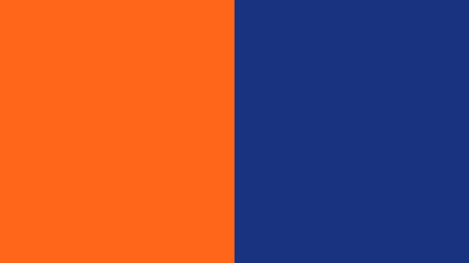
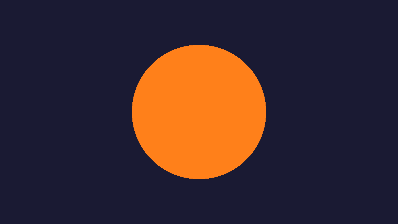
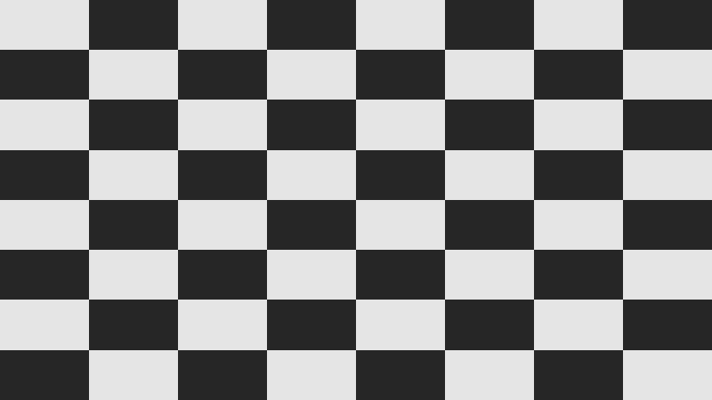

Hasta ahora el shader calculaba un color con una cuenta. Pero a veces no quieres una cuenta: quieres **elegir**. "Si el píxel está a la izquierda, píntalo de naranja; si no, de azul". Eso se hace con `if`.

Con `if` vas a poder dibujar figuras: rectángulos, círculos, tableros. Todo lo que tenga un borde duro.

## Una idea que conviene tener clara

Antes de escribir código, una cosa sobre cómo trabaja la GPU, porque te va a ahorrar confusiones: **cada píxel ejecuta tu `Fragment` por su cuenta**. Es como si tuvieras 360.000 personas con la misma hoja de instrucciones, cada una pintando su cuadradito, sin hablar entre ellas.

Eso significa que dentro del `if`, "yo" es siempre un solo píxel. El píxel de la izquierda puede decidir "naranja" y el de la derecha "azul", y ninguno sabe qué decidió el otro. No puedes preguntarle "¿de qué color es tu vecino?". Tienes que decidir solo con lo que sabes de ti: tu posición, el tiempo, los datos que te dieron.

## Paso 1: partir la pantalla en dos

Copia `Plantilla.cs` como `Decisiones.cs`, cambia el nombre de la clase por `Decisiones` y reemplaza la línea de `Fragment` por esto:

```csharp
if (pixel.Uv.X < 0.5f)
{
    return Crear.Vec4(1f, 0.4f, 0.1f, 1f);
}
return Crear.Vec4(0.1f, 0.2f, 0.5f, 1f);
```

Ejecuta el ciclo de trabajo:

Pero primero, avisa al visor del nuevo shader. En `Visor/Program.cs`, agrega esta línea al `switch`, encima de la línea `_ =>`:

```csharp
            "Decisiones" => new Decisiones().ToMGFX(gl),
```

Ahora sí, ejecútalo:

```bash
dotnet yotsuba add MisShaders/MisShaders.csproj --target spirv && dotnet run --project Visor -- Decisiones
```



Léelo como una frase: *"si la posición X es menor que 0,5, devuelve naranja. Si no, devuelve azul"*.

- Entre paréntesis va la **condición**, algo que puede ser verdadero o falso. Aquí, `pixel.Uv.X < 0.5f` es verdadero para los píxeles de la mitad izquierda.
- Entre llaves va lo que se hace **si es verdadera**. Como hay un `return`, el shader termina ahí para ese píxel.
- Si la condición es falsa, el shader se salta las llaves y sigue con lo que viene después: el segundo `return`.

Mueve el `0.5f` a `0.2f` y vuelve a ejecutar. La línea que divide los dos colores se corre hacia la izquierda.

## Paso 2: más de dos opciones con else if

¿Y si queremos tres franjas? Sustituye el contenido de `Fragment` por esto:

```csharp
float x = pixel.Uv.X;
if (x < 0.333f)
{
    return Crear.Vec4(0.1f, 0.3f, 0.8f, 1f);
}
else if (x < 0.666f)
{
    return Crear.Vec4(1f, 1f, 1f, 1f);
}
else
{
    return Crear.Vec4(0.9f, 0.2f, 0.2f, 1f);
}
```


Hemos agregado dos cosas:

- `else if (...)` significa "si lo anterior no se cumplió, prueba esta otra condición".
- `else` sin condición significa "si nada de lo anterior se cumplió, haz esto".

El orden importa. C# prueba las condiciones **de arriba abajo y se queda con la primera que sea verdadera**. Un píxel con `x = 0.2` cumple la primera y ni mira las demás. Uno con `x = 0.5` no cumple la primera, pero sí la segunda. Y uno con `x = 0.9` no cumple ninguna, así que cae en el `else`.

Fíjate también en que ahora hay un `float x` al principio. Guardar `pixel.Uv.X` en una variable con un nombre corto hace que las condiciones se lean más fácil.

## Los operadores de comparación

Estos son los que puedes usar dentro de la condición:

| Operador | Significa | Ejemplo |
|---|---|---|
| `<` | menor que | `x < 0.5f` |
| `>` | mayor que | `x > 0.5f` |
| `<=` | menor o igual que | `x <= 0.5f` |
| `>=` | mayor o igual que | `x >= 0.5f` |
| `==` | igual a | `contador == 3` |
| `!=` | distinto de | `contador != 3` |

> [!WARNING]
> Un `=` solo **asigna** (`x = 5f` guarda un 5 en `x`). Para **comparar** hay que escribir dos: `x == 5f`. Es un error muy común al empezar. Por suerte, C# te avisa con un error si te equivocas dentro de un `if`.
>
> Y una advertencia más: con números `float` casi nunca uses `==`. Un `float` que "debería" valer `0.5` puede valer `0.5000001` después de varias cuentas, y la comparación falla. Con números enteros (`int`) no hay problema.

## Paso 3: combinar condiciones

Para dibujar un rectángulo, un píxel tiene que cumplir cuatro cosas a la vez: estar a la derecha del borde izquierdo, a la izquierda del derecho, debajo del superior y encima del inferior. Se combinan con `&&`, que significa **"y"**:

```csharp
float x = pixel.Uv.X;
float y = pixel.Uv.Y;
if (x > 0.25f && x < 0.75f && y > 0.25f && y < 0.75f)
{
    return Crear.Vec4(1f, 0.5f, 0.1f, 1f);
}
return Crear.Vec4(0.1f, 0.1f, 0.2f, 1f);
```


Hay tres formas de combinar condiciones:

| Operador | Se lee | Es verdadero cuando |
|---|---|---|
| `&&` | y | las dos condiciones son verdaderas |
| `\|\|` | o | al menos una es verdadera |
| `!` | no | la condición es falsa |

Por ejemplo, `x < 0.1f || x > 0.9f` es verdadero en los bordes izquierdo y derecho, y falso en el medio.

Prueba esto: cambia los cuatro números para que el rectángulo sea más alto que ancho, y luego uno que toque el borde de la ventana.

## Paso 4: un círculo

Un píxel está dentro de un círculo si está **más cerca del centro que el borde**. O sea, si su distancia al centro es menor que el radio. Eso ya lo sabes escribir: la cuenta `dx * dx + dy * dy` del capítulo anterior te dice qué tan lejos estás. Y como esa cuenta da la distancia multiplicada por sí misma, hay que compararla con el radio multiplicado por sí mismo.

Como el círculo necesita el aspecto de la ventana, hay que declarar el uniform otra vez, igual que antes. Agrega arriba el `using`:

```csharp style=glsl
using YotsubaShader.GlslSyntax.Resources;
```

```csharp style=hlsl
using YotsubaShader.HlslSyntax.Resources;
```

```csharp style=msl
using YotsubaShader.MslSyntax.Resources;
```

```csharp style=wgsl
using YotsubaShader.WgslSyntax.Resources;
```

```csharp style=spirv
using YotsubaShader.SpirvSyntax.Resources;
```

Y dentro de la clase, antes de `Vertex`:

```csharp style=glsl
    [uniform, layout(0, 0)]
    public Entorno Datos;
```

```csharp style=hlsl
    [cbuffer, register("b0")]
    public Entorno Datos;
```

```csharp style=msl
    [constant, buffer(0)]
    public Entorno Datos;
```

```csharp style=wgsl
    [uniform, @group(0), @binding(0)]
    public Entorno Datos;
```

```csharp style=spirv
    [Uniform, DescriptorSet(0), Binding(0)]
    public Entorno Datos;
```

Ahora reemplaza `Fragment` por esto:

```csharp
float aspecto = Datos.Ancho / Datos.Alto;
float dx = (pixel.Uv.X - 0.5f) * aspecto;
float dy = pixel.Uv.Y - 0.5f;
if (dx * dx + dy * dy < 0.3f * 0.3f)
{
    return Crear.Vec4(1f, 0.5f, 0.1f, 1f);
}
return Crear.Vec4(0.1f, 0.1f, 0.2f, 1f);
```



La condición `dx * dx + dy * dy < 0.3f * 0.3f` dice: "estoy más cerca del centro que el borde". `0.3f * 0.3f` es el radio `0.3` multiplicado por sí mismo; lo dejamos escrito así para que se vea de dónde sale.

Cambia el `0.3f` (en los dos factores) por `0.1f` y el círculo se hace pequeño. Cambia el `0.5f` de `dx` por `0.3f` y el círculo se mueve a la izquierda.

## Paso 5: un tablero de ajedrez

Un truco muy usado para decidir "esta casilla es clara, esta es oscura" es contar en qué casilla estás y mirar si ese número es par o impar. Reemplaza `Fragment` por esto:

```csharp
int columna = (int)(pixel.Uv.X * 8f);
int fila = (int)(pixel.Uv.Y * 8f);
if ((columna + fila) % 2 == 0)
{
    return Crear.Vec4(0.9f, 0.9f, 0.9f, 1f);
}
return Crear.Vec4(0.15f, 0.15f, 0.15f, 1f);
```



Vamos por partes:

1. `pixel.Uv.X * 8f` va de `0` a `8`, y `(int)(...)` **corta los decimales**: `3.7` pasa a ser `3`. Así `columna` vale `0, 1, 2, ..., 7`: el número de columna donde está el píxel. Lo mismo con `fila`.
2. `(columna + fila) % 2` es el resto de dividir entre 2: da `0` si la suma es par y `1` si es impar.
3. Si pasas a la casilla de al lado, la suma cambia en `1`: si era par, ahora es impar. Por eso las casillas se van alternando.

Cambia los dos `8f` por `4f` y por `20f`. Con números distintos en cada uno saldrán casillas rectangulares.

## Un atajo: el operador ?

Cuando solo quieres elegir **un valor** entre dos, hay una forma más corta que el `if`:

```csharp
float brillo = pixel.Uv.X < 0.5f ? 1f : 0f;
```

Se lee: *"si la condición es verdadera, vale lo primero; si no, lo segundo"*. Es lo mismo que:

```csharp
float brillo;
if (pixel.Uv.X < 0.5f)
{
    brillo = 1f;
}
else
{
    brillo = 0f;
}
```

Usa el `?` cuando la decisión es corta, y el `if` cuando haya varias líneas dentro.

## El defecto de las figuras con if

Mira de cerca el borde del círculo o del rectángulo. Es un corte limpio: un píxel está dentro o está fuera, sin término medio. En pantalla eso se ve como un borde un poco dentado.

Con `if` no hay otra forma, porque un `if` es todo o nada. Para conseguir bordes suaves hacen falta herramientas distintas, que vas a construir dos capítulos más adelante.

## Todo junto

Este es el archivo del círculo completo, por si quieres comparar con el tuyo:

```csharp style=glsl title="MisShaders/Decisiones.cs"
using YotsubaShader.GlslSyntax;
using YotsubaShader.GlslSyntax.Resources;
using YotsubaShader.GlslSyntax.Types;
using YotsubaShader.Language;

namespace MisShaders;

public class Decisiones
{
    [uniform, layout(0, 0)]
    public Entorno Datos;

    [ShaderStage(Stage.Vertex)]
    public Pixel Vertex(Vertice vertice)
    {
        Pixel pixel;
        pixel.Posicion = Crear.Vec4(vertice.Posicion.X, vertice.Posicion.Y, 0f, 1f);
        pixel.Uv = vertice.Uv;
        return pixel;
    }

    [ShaderStage(Stage.Fragment)]
    [return: location(0)]
    public vec4 Fragment(PixelIn pixel)
    {
        float aspecto = Datos.Ancho / Datos.Alto;
        float dx = (pixel.Uv.X - 0.5f) * aspecto;
        float dy = pixel.Uv.Y - 0.5f;
        if (dx * dx + dy * dy < 0.3f * 0.3f)
        {
            return Crear.Vec4(1f, 0.5f, 0.1f, 1f);
        }
        return Crear.Vec4(0.1f, 0.1f, 0.2f, 1f);
    }
}
```

```csharp style=hlsl title="MisShaders/Decisiones.cs"
using YotsubaShader.HlslSyntax;
using YotsubaShader.HlslSyntax.Resources;
using YotsubaShader.GlslSyntax.Types;
using YotsubaShader.Language;

namespace MisShaders;

public class Decisiones
{
    [cbuffer, register("b0")]
    public Entorno Datos;

    [ShaderStage(Stage.Vertex)]
    public Pixel Vertex(Vertice vertice)
    {
        Pixel pixel;
        pixel.Posicion = Crear.Vec4(vertice.Posicion.X, vertice.Posicion.Y, 0f, 1f);
        pixel.Uv = vertice.Uv;
        return pixel;
    }

    [ShaderStage(Stage.Fragment)]
    [return: SV_Target]
    public vec4 Fragment(PixelIn pixel)
    {
        float aspecto = Datos.Ancho / Datos.Alto;
        float dx = (pixel.Uv.X - 0.5f) * aspecto;
        float dy = pixel.Uv.Y - 0.5f;
        if (dx * dx + dy * dy < 0.3f * 0.3f)
        {
            return Crear.Vec4(1f, 0.5f, 0.1f, 1f);
        }
        return Crear.Vec4(0.1f, 0.1f, 0.2f, 1f);
    }
}
```

```csharp style=msl title="MisShaders/Decisiones.cs"
using YotsubaShader.MslSyntax;
using YotsubaShader.MslSyntax.Resources;
using YotsubaShader.GlslSyntax.Types;
using YotsubaShader.Language;

namespace MisShaders;

public class Decisiones
{
    [constant, buffer(0)]
    public Entorno Datos;

    [ShaderStage(Stage.Vertex)]
    public Pixel Vertex(Vertice vertice)
    {
        Pixel pixel;
        pixel.Posicion = Crear.Vec4(vertice.Posicion.X, vertice.Posicion.Y, 0f, 1f);
        pixel.Uv = vertice.Uv;
        return pixel;
    }

    [ShaderStage(Stage.Fragment)]
    [return: color(0)]
    public vec4 Fragment(PixelIn pixel)
    {
        float aspecto = Datos.Ancho / Datos.Alto;
        float dx = (pixel.Uv.X - 0.5f) * aspecto;
        float dy = pixel.Uv.Y - 0.5f;
        if (dx * dx + dy * dy < 0.3f * 0.3f)
        {
            return Crear.Vec4(1f, 0.5f, 0.1f, 1f);
        }
        return Crear.Vec4(0.1f, 0.1f, 0.2f, 1f);
    }
}
```

```csharp style=wgsl title="MisShaders/Decisiones.cs"
using YotsubaShader.WgslSyntax;
using YotsubaShader.WgslSyntax.Resources;
using YotsubaShader.GlslSyntax.Types;
using YotsubaShader.Language;

namespace MisShaders;

public class Decisiones
{
    [uniform, @group(0), @binding(0)]
    public Entorno Datos;

    [ShaderStage(Stage.Vertex)]
    public Pixel Vertex(Vertice vertice)
    {
        Pixel pixel;
        pixel.Posicion = Crear.Vec4(vertice.Posicion.X, vertice.Posicion.Y, 0f, 1f);
        pixel.Uv = vertice.Uv;
        return pixel;
    }

    [ShaderStage(Stage.Fragment)]
    [return: location(0)]
    public vec4 Fragment(PixelIn pixel)
    {
        float aspecto = Datos.Ancho / Datos.Alto;
        float dx = (pixel.Uv.X - 0.5f) * aspecto;
        float dy = pixel.Uv.Y - 0.5f;
        if (dx * dx + dy * dy < 0.3f * 0.3f)
        {
            return Crear.Vec4(1f, 0.5f, 0.1f, 1f);
        }
        return Crear.Vec4(0.1f, 0.1f, 0.2f, 1f);
    }
}
```

```csharp style=spirv title="MisShaders/Decisiones.cs"
using YotsubaShader.SpirvSyntax;
using YotsubaShader.SpirvSyntax.Resources;
using YotsubaShader.GlslSyntax.Types;
using YotsubaShader.Language;

namespace MisShaders;

public class Decisiones
{
    [Uniform, DescriptorSet(0), Binding(0)]
    public Entorno Datos;

    [ShaderStage(Stage.Vertex)]
    public Pixel Vertex(Vertice vertice)
    {
        Pixel pixel;
        pixel.Posicion = Crear.Vec4(vertice.Posicion.X, vertice.Posicion.Y, 0f, 1f);
        pixel.Uv = vertice.Uv;
        return pixel;
    }

    [ShaderStage(Stage.Fragment)]
    [return: Location(0)]
    public vec4 Fragment(PixelIn pixel)
    {
        float aspecto = Datos.Ancho / Datos.Alto;
        float dx = (pixel.Uv.X - 0.5f) * aspecto;
        float dy = pixel.Uv.Y - 0.5f;
        if (dx * dx + dy * dy < 0.3f * 0.3f)
        {
            return Crear.Vec4(1f, 0.5f, 0.1f, 1f);
        }
        return Crear.Vec4(0.1f, 0.1f, 0.2f, 1f);
    }
}
```

## Lo que aprendiste

- Cada píxel ejecuta el shader **por separado** y decide solo con lo que sabe de sí mismo.
- `if`, `else if` y `else` eligen qué color devolver. C# usa la primera condición verdadera.
- `&&` es "y", `||` es "o", `!` es "no". Con ellos se arman figuras: rectángulos y círculos.
- `(int)` corta los decimales y `%` da el resto. Juntos sirven para contar casillas.
- Las figuras hechas con `if` tienen borde duro. Los bordes suaves llegan más adelante.

Siguiente: [Funciones y structs](functions.md).
