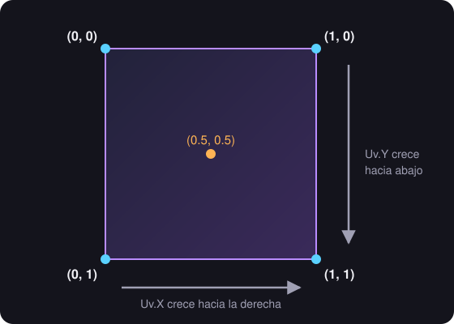
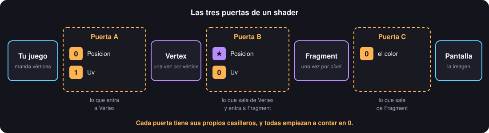
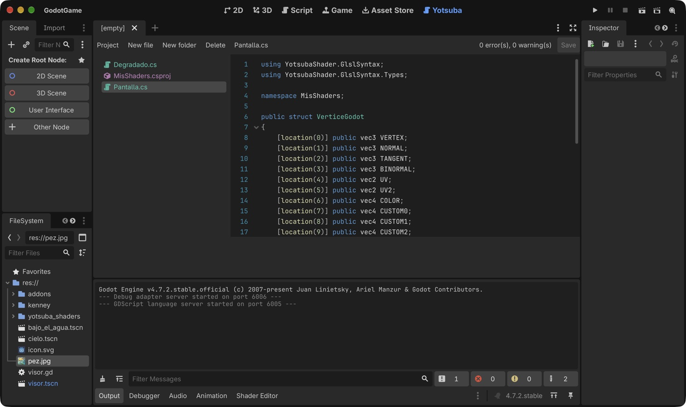
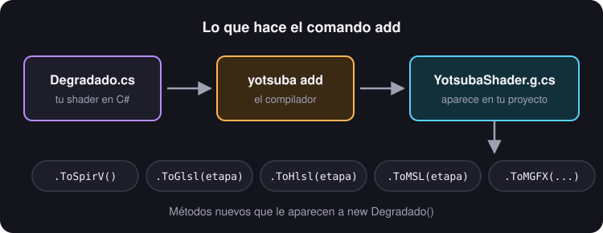

> [!SCENE] goal

Este es el shader que vas a hacer en este capítulo. Pinta toda la pantalla con un degradado, de rosa arriba a amarillo abajo:


Es sencillo a propósito. Lo importante aquí no es el dibujo, sino que escribas en C#, una por una, las cinco cosas que viste en [Cómo se construye un shader](how-a-shader-is-built.md). Los cuatro shaders que vienen después usan exactamente estas mismas partes.

> [!SCENE] plan

## El plan

[Cómo se construye un shader](how-a-shader-is-built.md) terminó con una lista de cinco decisiones. Así se escribe cada una en C#:

| | Lo que decides | Cómo se escribe en C# |
| --- | --- | --- |
| 1 | Qué datos lleva cada vértice (puerta A) | Un `struct`, con `[location]` en cada campo. |
| 2 | Qué le deja pasar Vertex a Fragment (puerta B) | Otro `struct`. |
| 3 | Qué hace la función Vertex | Un método marcado con `[ShaderStage(Stage.Vertex)]`. |
| 4 | Qué hace la función Fragment | Un método marcado con `[ShaderStage(Stage.Fragment)]`. |
| 5 | A dónde va el color (puerta C) | `[return: location(0)]` encima del método Fragment. |

> [!SAY] Vamos a leer esta tabla de izquierda a derecha. En la primera columna está cada una de las cinco decisiones que ya conoces, y en la segunda, cómo se escribe en C#. Los datos que lleva cada vértice, la puerta A, se escriben con un struct, y cada campo lleva su location. Lo que Vertex le deja pasar a Fragment, la puerta B, es otro struct. Las dos funciones, Vertex y Fragment, son simplemente dos métodos, cada uno marcado con su ShaderStage. Y a dónde va el color, la puerta C, se escribe con return location cero justo encima del método Fragment. Fíjate que no hay nada más: son cinco decisiones y cinco piezas de C# normal.

No hay nada más. Un shader en C# son unos `struct` y una clase con dos métodos.

> [!SCENE] rect

## La figura: un rectángulo que cubre toda la pantalla

Allí seguimos un triángulo. Ahora queremos pintar la pantalla entera, así que la figura va a ser un rectángulo que la cubra de borde a borde: dos triángulos, cuatro vértices.

¿Qué datos lleva cada vértice? Dos:

- **La posición**, como siempre. Las cuatro esquinas de la pantalla: `(-1, 1)`, `(1, 1)`, `(-1, -1)` y `(1, -1)`.
- **Un dato que se suele llamar `Uv`**, y que es nuevo.

> [!SCENE] uv

### ¿Qué es `Uv` y para qué lo quiero?

Para hacer un degradado, cada píxel necesita saber si está arriba o abajo. Pero ya viste que un píxel no sabe nada por sí mismo: solo conoce lo que le llega por el reparto.

Así que le vamos a mandar justo eso. A cada vértice le ponemos un par de números que dice en qué esquina del rectángulo está:



> [!SAY] En esta imagen podemos ver el concepto de forma visual. Hay un cuadrado con cuatro esquinas. La de arriba a la izquierda vale cero, cero. La de arriba a la derecha, uno, cero. La de abajo a la izquierda, cero, uno, y la de abajo a la derecha, uno, uno. En el centro hay un punto naranja que vale cero coma cinco, cero coma cinco: justo la mitad en las dos direcciones. Mira también las flechas: la X crece hacia la derecha, como esperarías, pero la Y crece hacia abajo, al revés de lo que se ve en las matemáticas del colegio.

Y el reparto hace el resto. Un píxel a mitad de camino entre la esquina `(0, 0)` y la esquina `(1, 0)` recibe `(0.5, 0)`. Uno justo en el centro recibe `(0.5, 0.5)`. Cada píxel termina sabiendo dónde está dentro del rectángulo, con dos números de `0` a `1`.

El nombre `Uv` es una costumbre: en gráficos se usan las letras "U" y "V" para no confundirlas con la X y la Y de la posición. No significa nada más.

> [!NOTE]
> "¿Y por qué no uso directamente la posición, si ya dice dónde está cada cosa?" Por dos razones. La posición final se la queda la GPU: es el dato especial, el de la estrella. Y además va de `-1` a `1` con la Y hacia arriba, mientras que para hacer cuentas es mucho más cómodo algo que vaya de `0` a `1` empezando por arriba a la izquierda.

> [!SCENE] doors

Con eso, las tres puertas de este shader quedan así:



Es el mismo dibujo de las tres puertas que ya conoces, cambiando "color" por `Uv`. Tenlo a mano, porque cada casillero de ese dibujo va a ser una línea de C#.

> [!SCENE] vectors

## Los vectores: números que van juntos

Antes de escribir las puertas te falta una herramienta. Una posición son dos números. Un color son cuatro. En un shader casi nunca trabajas con un número suelto, y por eso existen tres tipos que agrupan números `float`:

| Tipo | Cuántos `float` tiene | Sus campos | Para qué se usa casi siempre |
| --- | --- | --- | --- |
| `vec2` | 2 | `X`, `Y` | Una posición en 2D, o un `Uv`. |
| `vec3` | 3 | `X`, `Y`, `Z` | Una posición en 3D, o un color sin opacidad. |
| `vec4` | 4 | `X`, `Y`, `Z`, `W` | Un color con opacidad, o la posición final. |

A estos tipos se les llama vectores. No hace falta saber matemáticas para usarlos: piensa en ellos como un `struct` con dos, tres o cuatro `float`.

Cuando un `vec4` guarda un color, sus campos se siguen llamando `X`, `Y`, `Z` y `W`, así que tienes que acordarte del orden:

| Campo | En un color es |
| --- | --- |
| `X` | el rojo |
| `Y` | el verde |
| `Z` | el azul |
| `W` | la opacidad |

> [!SCENE] make

## Crear un vector

Un vector se crea como cualquier otro tipo de C#: con `new` y su constructor. Escribes los valores en el orden de los campos, `X`, `Y`, `Z` y `W`:

```csharp
using YotsubaShader.GlslSyntax.Types;

vec2 uv = new vec2(0.5f, 0.25f);
vec3 naranja = new vec3(1f, 0.5f, 0.1f);
vec4 rojo = new vec4(1f, 0f, 0f, 1f);
```

> [!SAY] Un vector se crea como cualquier otro tipo de C sharp: con new y su constructor. Escribes los valores en el orden de los campos. Un vec2 recibe dos números, un vec3 recibe tres y un vec4 recibe cuatro. Para tener el color rojo, con opacidad total, basta con escribir new vec4 de uno, cero, cero, uno. Arriba, el using de GlslSyntax punto Types es de donde salen los tipos vec2, vec3 y vec4.

- `using YotsubaShader.GlslSyntax.Types;` es de donde salen `vec2`, `vec3` y `vec4`.
- La `f` de `1f` dice que el número es un `float`. Acostúmbrate a ponerla siempre: con un número con decimales, como `0.5`, es obligatoria, porque sin ella C# lo toma por un `double` y no compila.

El constructor tiene algunas formas más, todas útiles:

```csharp
vec4 gris = new vec4(0.5f);              // el mismo número en los cuatro campos
vec4 solido = new vec4(naranja, 1f);     // un vec3 más el cuarto valor
vec2 esquina = new vec2(uv.X, uv.Y);     // campos de otros vectores
```

> [!NOTE]
> También puedes declarar un vector vacío, `vec4 v;`, y llenarle los campos uno por uno con `v.X = 1f;`. Es C# normal: solo te pide que los llenes **todos** antes de usarlo, o falla con `CS0165: Use of unassigned local variable 'v'`. El constructor lo hace en una sola línea, así que es el que usaremos en todo el tutorial.

No hace falta nada más: el compilador sabe qué significa el constructor de un vector y lo escribe en el idioma de cada API gráfica, por ejemplo `vec4(1.0, 0.0, 0.0, 1.0)` en GLSL y `float4(1.0f, 0.0f, 0.0f, 1.0f)` en HLSL.

> [!SCENE] doorA

## Primer archivo: las puertas A y B

Ahora sí, las puertas. Van las dos en un archivo que se llama `Pantalla.cs`. Lo vas a escribir en dos partes.

### La puerta A: lo que lleva cada vértice

Crea `Pantalla.cs` con esto:

:::godot
En Godot: abre la pestaña **Yotsuba**, selecciona `MisShaders` en el panel **Project**, pulsa **New file** y escribe `Pantalla.cs`. Pega el código en el editor vacío y guárdalo con `Cmd/Ctrl+S`.
:::

```csharp style=glsl title="MisShaders/Pantalla.cs"
using YotsubaShader.GlslSyntax;
using YotsubaShader.GlslSyntax.Types;

namespace MisShaders;

public struct {{vertexType}}
{
    {{vertexFields glsl}}
}
```

```csharp style=hlsl title="MisShaders/Pantalla.cs"
using YotsubaShader.HlslSyntax;
using YotsubaShader.GlslSyntax.Types;

namespace MisShaders;

public struct {{vertexType}}
{
    {{vertexFields hlsl}}
}
```

```csharp style=msl title="MisShaders/Pantalla.cs"
using YotsubaShader.MslSyntax;
using YotsubaShader.GlslSyntax.Types;

namespace MisShaders;

public struct {{vertexType}}
{
    {{vertexFields msl}}
}
```

```csharp style=wgsl title="MisShaders/Pantalla.cs"
using YotsubaShader.WgslSyntax;
using YotsubaShader.GlslSyntax.Types;

namespace MisShaders;

public struct {{vertexType}}
{
    {{vertexFields glsl}}
}
```

```csharp style=spirv title="MisShaders/Pantalla.cs"
using YotsubaShader.SpirvSyntax;
using YotsubaShader.GlslSyntax.Types;

namespace MisShaders;

public struct {{vertexType}}
{
    {{vertexFields spirv}}
}
```

:::xna
Esto es la puerta A, escrita en C#. Línea por línea:

- **`public struct Vertice`**: un vértice es un paquete de datos, y en C# un paquete de datos es un `struct`. El nombre `Vertice` lo elegí yo. Puedes ponerle el que quieras.
- **`[location(0)] public vec2 Posicion;`**: "en el casillero 0 de esta puerta viajan dos `float`, y yo los voy a llamar `Posicion`".
- **`[location(1)] public vec2 Uv;`**: "en el casillero 1 viajan otros dos `float`, y los voy a llamar `Uv`".

`[location]` sale de `using YotsubaShader.GlslSyntax;`, por eso está ese `using` arriba.

Compáralo con el dibujo de las puertas: en la puerta A hay un casillero 0 con `Posicion` y un casillero 1 con `Uv`. Es exactamente lo que acabas de escribir.

Tres preguntas que es normal hacerse aquí:

**¿Quién llena esos casilleros?** Tu juego. Cuando llegues a tu Game Engine vas a escribir las cuatro esquinas con su posición y su `Uv`, y vas a decirle que la posición va en el casillero 0 y el `Uv` en el 1. Aquí, en el shader, solo declaras qué esperas recibir.

**¿Importan los nombres `Posicion` y `Uv`?** A la GPU no. Ella solo ve el número del casillero y el tipo. Los nombres son para ti, para que el código se pueda leer.

**¿Qué pasa si me equivoco de número?** Que el shader lee el dato que no es. Si aquí pusieras `Uv` en el casillero 0, recibirías la posición creyendo que es el `Uv`. No sale ningún error: simplemente el dibujo sale mal. Por eso conviene tener claro qué va en cada casillero.
:::

:::raylib silknet
Esto es la puerta A, escrita en C#. Línea por línea:

- **`public struct Vertice`**: un vértice es un paquete de datos, y en C# un paquete de datos es un `struct`. El nombre `Vertice` lo elegí yo. Puedes ponerle el que quieras.
- **`[location(0)] public vec2 Posicion;`**: "en el casillero 0 de esta puerta viajan dos `float`, y yo los voy a llamar `Posicion`".
- **`[location(1)] public vec2 Uv;`**: "en el casillero 1 viajan otros dos `float`, y los voy a llamar `Uv`".

`[location]` sale de `using YotsubaShader.GlslSyntax;`, por eso está ese `using` arriba.

Compáralo con el dibujo de las puertas: en la puerta A hay un casillero 0 con `Posicion` y un casillero 1 con `Uv`. Es exactamente lo que acabas de escribir.

Tres preguntas que es normal hacerse aquí:

**¿Quién llena esos casilleros?** Tu juego. Cuando llegues a tu Game Engine vas a escribir las cuatro esquinas con su posición y su `Uv`, y vas a decirle que la posición va en el casillero 0 y el `Uv` en el 1. Aquí, en el shader, solo declaras qué esperas recibir.

**¿Importan los nombres `Posicion` y `Uv`?** A la GPU no. Ella solo ve el número del casillero y el tipo. Los nombres son para ti, para que el código se pueda leer.

**¿Qué pasa si me equivoco de número?** Que el shader lee el dato que no es. Si aquí pusieras `Uv` en el casillero 0, recibirías la posición creyendo que es el `Uv`. No sale ningún error: simplemente el dibujo sale mal. Por eso conviene tener claro qué va en cada casillero.
:::

:::godot
Esto es la puerta A, escrita en C#. Son los datos de vértice de Godot, todos. Línea por línea:

- **`public struct {{vertexType}}`**: un vértice es un paquete de datos, y en C# un paquete de datos es un `struct`. Este se llama `{{vertexType}}` y **es el mismo durante todo el tutorial**: lo escribes una vez y no lo vuelves a tocar.
- **`public vec3 VERTEX;`**: la posición del vértice. Godot la llama `VERTEX`, así que tu campo se llama `VERTEX`. Igual con `NORMAL`, `TANGENT`, `BINORMAL`, `UV`, `UV2`, `COLOR`, `CUSTOM0` a `CUSTOM3`, `BONE_INDICES`, `BONE_WEIGHTS` y `POINT_SIZE`: los nombres de Godot, con las mayúsculas de Godot.
- **`[location(0)]`, `[location(1)]`...**: la sintaxis pide un número en cada campo, así que el número está. Pero en la puerta A el plugin no lo usa: lee el **nombre**.

Así se ve el archivo en la pestaña Yotsuba de Godot:



En los shaders del tutorial solo vas a usar `VERTEX` (la posición) y `UV`. Los otros doce están para que nunca tengas que cambiar el struct: un shader que no los lee los deja quietos, y Godot rellena los demás con valores por defecto. Están explicados uno por uno en [la referencia de Godot](../engines/godot-reference.md).

`[location]` sale de `using YotsubaShader.GlslSyntax;`, por eso está ese `using` arriba.

Tres preguntas que es normal hacerse aquí:

**¿Quién llena esos campos?** Godot. Cada malla lleva sus datos de vértice, y el motor le entrega cada vértice a tu shader con esos nombres. Lo único que hay que tener presente es que la malla debe llevar lo que pides: el visor del capítulo siguiente le da al rectángulo normales y tangentes porque tu struct las pide.

**¿Importan los nombres?** Aquí sí, y mucho. Son la forma en que Godot y tu shader se entienden. Si escribes `Position` en lugar de `VERTEX`, el compilador no sabe qué dato quieres y te lo dice.

**¿Tengo que declarar los 14?** No, pero el tutorial lo hace, para que el struct sea siempre el mismo y nadie se pierda.
:::

> [!SCENE] doorB

### La puerta B: lo que Vertex le deja pasar a Fragment

Añade el segundo `struct` debajo del primero. El archivo completo queda así:

```csharp style=glsl title="MisShaders/Pantalla.cs"
using YotsubaShader.GlslSyntax;
using YotsubaShader.GlslSyntax.Types;

namespace MisShaders;

public struct {{vertexType}}
{
    {{vertexFields glsl}}
}

public struct Pixel
{
    [gl_Position] public vec4 Posicion;
    [location(0)] public vec2 Uv;
}

public struct PixelIn
{
    [location(0)] public vec2 Uv;
}
```

```csharp style=hlsl title="MisShaders/Pantalla.cs"
using YotsubaShader.HlslSyntax;
using YotsubaShader.GlslSyntax.Types;

namespace MisShaders;

public struct {{vertexType}}
{
    {{vertexFields hlsl}}
}

public struct Pixel
{
    [SV_Position] public vec4 Posicion;
    [TEXCOORD(0)] public vec2 Uv;
}

public struct PixelIn
{
    [TEXCOORD(0)] public vec2 Uv;
}
```

```csharp style=msl title="MisShaders/Pantalla.cs"
using YotsubaShader.MslSyntax;
using YotsubaShader.GlslSyntax.Types;

namespace MisShaders;

public struct {{vertexType}}
{
    {{vertexFields msl}}
}

public struct Pixel
{
    [position] public vec4 Posicion;
    [attribute(0)] public vec2 Uv;
}

public struct PixelIn
{
    [attribute(0)] public vec2 Uv;
}
```

```csharp style=wgsl title="MisShaders/Pantalla.cs"
using YotsubaShader.WgslSyntax;
using YotsubaShader.GlslSyntax.Types;

namespace MisShaders;

public struct {{vertexType}}
{
    {{vertexFields glsl}}
}

public struct Pixel
{
    [builtin_position] public vec4 Posicion;
    [location(0)] public vec2 Uv;
}

public struct PixelIn
{
    [location(0)] public vec2 Uv;
}
```

```csharp style=spirv title="MisShaders/Pantalla.cs"
using YotsubaShader.SpirvSyntax;
using YotsubaShader.GlslSyntax.Types;

namespace MisShaders;

public struct {{vertexType}}
{
    {{vertexFields spirv}}
}

public struct Pixel
{
    [BuiltIn_Position] public vec4 Posicion;
    [Location(0)] public vec2 Uv;
}

public struct PixelIn
{
    [Location(0)] public vec2 Uv;
}
```

`Pixel` es la puerta B vista desde Vertex. Tiene los dos tipos de datos que salen de Vertex, el especial y los tuyos:

- **`[gl_Position] public vec4 Posicion;`** es el dato especial, el de la estrella. `[gl_Position]` le dice a la GPU: "esta es la posición final del vértice, quédatela". Por eso no lleva número. Y es un `vec4` porque la posición final tiene cuatro números.
- **`[location(0)] public vec2 Uv;`** es un dato tuyo: "en el casillero 0 de esta puerta viaja el `Uv`".

> [!NOTE]
> El nombre `gl_Position` puede parecer raro. Viene de GLSL, el lenguaje de shaders de OpenGL, donde ese dato especial se llama exactamente así. Como en este tutorial usamos el estilo GLSL, los nombres son los mismos.

> [!SCENE] zero

### "Un momento: ¿otra vez `location(0)`?"

Sí. Y es el momento de mirarlo bien, porque es justo la confusión de la que te avisé.

:::xna
En `{{vertexType}}`, el casillero 0 es la posición. En `Pixel`, el casillero 0 es el `Uv`. No chocan, porque son dos puertas distintas, y cada puerta cuenta desde 0 por su cuenta:

| | Casillero 0 | Casillero 1 |
| --- | --- | --- |
| `{{vertexType}}` (puerta A) | `{{pos}}` | `{{uv}}` |
| `Pixel` (puerta B) | `Uv` | no hay |

El `Uv` entró por el casillero 1 de la puerta A y sale por el casillero 0 de la puerta B. No pasa nada: el número solo vale dentro de su puerta.
:::

:::raylib silknet
En `{{vertexType}}`, el casillero 0 es la posición. En `Pixel`, el casillero 0 es el `Uv`. No chocan, porque son dos puertas distintas, y cada puerta cuenta desde 0 por su cuenta:

| | Casillero 0 | Casillero 1 |
| --- | --- | --- |
| `{{vertexType}}` (puerta A) | `{{pos}}` | `{{uv}}` |
| `Pixel` (puerta B) | `Uv` | no hay |

El `Uv` entró por el casillero 1 de la puerta A y sale por el casillero 0 de la puerta B. No pasa nada: el número solo vale dentro de su puerta.
:::

:::godot
En la ruta Godot la puerta A no la numeras tú: sus campos se encuentran por **nombre** (`VERTEX`, `UV`...), como acabas de ver. La puerta B (`Pixel`) es la que sí usa números de casillero: su `Uv` viaja por el casillero 0, y ese es el número que `PixelIn` tiene que repetir.
:::

¿Y por qué en `Pixel` el `Uv` no es el casillero 1, para que quede igual? Podrías ponerlo en el 1 y funcionaría. Pero en la puerta B la posición no ocupa casillero, así que el primero que queda libre es el 0. Lo normal es numerar desde 0 sin dejar huecos.

> [!SCENE] pixel

### ¿Por qué se llama `Pixel`?

Porque es lo que le llega a cada píxel. La función Vertex lo llena tres veces, una por vértice, la GPU lo reparte, y la función Fragment lo recibe una vez por píxel, ya mezclado.

Fragment no recibe el `Pixel` completo. La posición final sirve para que la GPU coloque el triángulo, y una función Fragment no la necesita (en GLSL, `gl_Position` ni siquiera existe en esa etapa, y el compilador te avisa si lo intentas). Por eso el archivo tiene un segundo `struct`, `PixelIn`, con solo los datos tuyos: lo que recibe Fragment.

Los dos lados de la puerta B tienen que coincidir: el mismo número de `location` y el mismo tipo. Aquí `Uv` es `location(0)` y `vec2` en los dos. Si un lado dijera `vec3`, o el casillero 1, el shader no compilaría.

> [!SCENE] vertexfn

## Segundo archivo: las dos funciones

Quedan las decisiones 3, 4 y 5: las dos funciones y la puerta C. Van juntas en una clase. Primero te las enseño por separado, y después el archivo completo para que lo copies.

### La función Vertex

```csharp
[ShaderStage(Stage.Vertex)]
public Pixel Vertex({{vertexType}} vertice)
{
    Pixel pixel;
    pixel.Posicion = new vec4(vertice.{{pos}}.X, vertice.{{pos}}.Y, 0f, 1f);
    pixel.Uv = vertice.{{uv}};
    return pixel;
}
```

Empieza por la primera línea y la firma, que ya lo dicen casi todo:

- **`[ShaderStage(Stage.Vertex)]`** es lo que convierte a este método en la etapa Vertex. Sin ese atributo sería un método cualquiera y la GPU no lo llamaría nunca.
- **`({{vertexType}} vertice)`**: lo que recibe. Es la puerta A: un vértice, con su `{{pos}}` y su `{{uv}}`. Recuerda que es **uno solo**. La GPU llama al método cuatro veces, una por esquina.
- **`public Pixel`**: lo que devuelve. Es la puerta B.
- **El nombre `Vertex`** es libre. Podría llamarse `ColocarEsquina`. Lo que manda es el atributo.

Y el cuerpo hace los dos trabajos de la etapa Vertex:

**Trabajo 1, decir dónde va el vértice:**

```csharp
pixel.Posicion = new vec4(vertice.{{pos}}.X, vertice.{{pos}}.Y, 0f, 1f);
```

Aquí no queremos mover nada, así que la posición final es la misma que llegó. Lo único que cambia es que llegó con dos números y hay que entregarla con cuatro. Por eso tomamos la `X` y la `Y` que llegaron y rellenamos con `0f` y `1f`, que son la profundidad y la perspectiva de las que hablamos.

**Trabajo 2, dejar pasar lo que Fragment va a necesitar:**

```csharp
pixel.Uv = vertice.{{uv}};
```

Copiamos el `Uv` tal cual. Si no lo hicieras, a la función Fragment no le llegaría nada con qué saber dónde está cada píxel.

`Pixel pixel;` al principio y `return pixel;` al final funcionan como el `vec4 v;` vacío de la nota sobre vectores: declaras el `struct` vacío, le llenas los dos campos y lo devuelves. Aquí sí lo necesitas, porque no hay un constructor que arme un `struct` tuyo.

> [!SCENE] fragfn

### La función Fragment y la puerta C

```csharp
[ShaderStage(Stage.Fragment)]
[return: location(0)]
public vec4 Fragment(PixelIn pixel)
{
    return new vec4(1f, 0f, 0f, 1f);
}
```

- **`[ShaderStage(Stage.Fragment)]`** convierte a este método en la etapa Fragment.
- **`(PixelIn pixel)`**: lo que recibe. Es el otro lado de la puerta B: solo tus datos, sin la posición. Pero ojo con lo que aprendiste del reparto: este `pixel` no es ninguno de los cuatro que devolvió `Vertex`. Es una mezcla de ellos, distinta para cada píxel.
- **`public vec4`**: lo que devuelve. Un color, o sea, cuatro números.
- **`[return: location(0)]`** es la puerta C: "el color que devuelvo va al casillero 0". Y el casillero 0 de la puerta C es la pantalla.

Si nunca habías visto `[return: ...]`, es C# normal. Los atributos se ponen encima de lo que describen: encima de un campo, de un método, de una clase. Pero lo que un método devuelve no tiene un sitio propio donde poner nada encima, así que C# te deja escribir `return:` delante para decir "este atributo no es para el método, es para lo que devuelve".

Por ahora el cuerpo hace lo más simple posible. Devuelve siempre `new vec4(1f, 0f, 0f, 1f)`, que es rojo: todo el rojo, nada de verde, nada de azul, y opacidad completa. Ni siquiera usa el `pixel` que recibe. Así que toda la pantalla va a quedar roja.

> [!SCENE] zeros

### Los tres ceros

Ya escribiste las tres puertas, y en las tres hay un `location(0)`. Ahora puedes leerlos sin confundirte:

| Dónde lo escribiste | Qué puerta es | Qué viaja en su casillero 0 |
| --- | --- | --- |
| `[location(0)]` en `{{vertexType}}` | A: del juego a Vertex | La posición del vértice. |
| `[location(0)]` en `Pixel` y en `PixelIn` | B: de Vertex a Fragment | El `Uv`. |
| `[return: location(0)]` en `Fragment` | C: de Fragment a la pantalla | El color del píxel. |

Tres ceros, tres puertas, tres cosas distintas.

> [!SCENE] file

### El archivo completo

Crea `Degradado.cs` con las dos funciones dentro de una clase:

:::godot
En la pestaña Yotsuba otra vez: **New file**, `Degradado.cs`, pega y guarda. Si escribiste algo mal, el error sale subrayado y en la lista de debajo del editor.
:::

```csharp style=glsl title="MisShaders/Degradado.cs"
using YotsubaShader.GlslSyntax;
using YotsubaShader.GlslSyntax.Types;
using YotsubaShader.Language;
using YotsubaShader.Compiler.Metadata;

namespace MisShaders;

{{shaderAttrs}}
public class Degradado
{
    [ShaderStage(Stage.Vertex)]
    public Pixel Vertex({{vertexType}} vertice)
    {
        Pixel pixel;
        pixel.Posicion = new vec4(vertice.{{pos}}.X, vertice.{{pos}}.Y, 0f, 1f);
        pixel.Uv = vertice.{{uv}};
        return pixel;
    }

    [ShaderStage(Stage.Fragment)]
    [return: location(0)]
    public vec4 Fragment(PixelIn pixel)
    {
        return new vec4(1f, 0f, 0f, 1f);
    }
}
```

```csharp style=hlsl title="MisShaders/Degradado.cs"
using YotsubaShader.HlslSyntax;
using YotsubaShader.GlslSyntax.Types;
using YotsubaShader.Language;
using YotsubaShader.Compiler.Metadata;

namespace MisShaders;

{{shaderAttrs}}
public class Degradado
{
    [ShaderStage(Stage.Vertex)]
    public Pixel Vertex({{vertexType}} vertice)
    {
        Pixel pixel;
        pixel.Posicion = new vec4(vertice.{{pos}}.X, vertice.{{pos}}.Y, 0f, 1f);
        pixel.Uv = vertice.{{uv}};
        return pixel;
    }

    [ShaderStage(Stage.Fragment)]
    [return: SV_Target]
    public vec4 Fragment(PixelIn pixel)
    {
        return new vec4(1f, 0f, 0f, 1f);
    }
}
```

```csharp style=msl title="MisShaders/Degradado.cs"
using YotsubaShader.MslSyntax;
using YotsubaShader.GlslSyntax.Types;
using YotsubaShader.Language;
using YotsubaShader.Compiler.Metadata;

namespace MisShaders;

{{shaderAttrs}}
public class Degradado
{
    [ShaderStage(Stage.Vertex)]
    public Pixel Vertex({{vertexType}} vertice)
    {
        Pixel pixel;
        pixel.Posicion = new vec4(vertice.{{pos}}.X, vertice.{{pos}}.Y, 0f, 1f);
        pixel.Uv = vertice.{{uv}};
        return pixel;
    }

    [ShaderStage(Stage.Fragment)]
    [return: color(0)]
    public vec4 Fragment(PixelIn pixel)
    {
        return new vec4(1f, 0f, 0f, 1f);
    }
}
```

```csharp style=wgsl title="MisShaders/Degradado.cs"
using YotsubaShader.WgslSyntax;
using YotsubaShader.GlslSyntax.Types;
using YotsubaShader.Language;
using YotsubaShader.Compiler.Metadata;

namespace MisShaders;

{{shaderAttrs}}
public class Degradado
{
    [ShaderStage(Stage.Vertex)]
    public Pixel Vertex({{vertexType}} vertice)
    {
        Pixel pixel;
        pixel.Posicion = new vec4(vertice.{{pos}}.X, vertice.{{pos}}.Y, 0f, 1f);
        pixel.Uv = vertice.{{uv}};
        return pixel;
    }

    [ShaderStage(Stage.Fragment)]
    [return: location(0)]
    public vec4 Fragment(PixelIn pixel)
    {
        return new vec4(1f, 0f, 0f, 1f);
    }
}
```

```csharp style=spirv title="MisShaders/Degradado.cs"
using YotsubaShader.SpirvSyntax;
using YotsubaShader.GlslSyntax.Types;
using YotsubaShader.Language;
using YotsubaShader.Compiler.Metadata;

namespace MisShaders;

{{shaderAttrs}}
public class Degradado
{
    [ShaderStage(Stage.Vertex)]
    public Pixel Vertex({{vertexType}} vertice)
    {
        Pixel pixel;
        pixel.Posicion = new vec4(vertice.{{pos}}.X, vertice.{{pos}}.Y, 0f, 1f);
        pixel.Uv = vertice.{{uv}};
        return pixel;
    }

    [ShaderStage(Stage.Fragment)]
    [return: Location(0)]
    public vec4 Fragment(PixelIn pixel)
    {
        return new vec4(1f, 0f, 0f, 1f);
    }
}
```

Un shader es una clase normal, con un método por cada etapa. La clase se llama `Degradado` porque ese es el nombre del shader: así lo vas a pedir después, con `new Degradado()`.

Hay un `using` nuevo, `YotsubaShader.Language`. De ahí salen `[ShaderStage]` y `Stage`.

> [!SCENE] targets

## Dile al analizador dónde correrá tu shader

Mira la línea encima de `class Degradado`: `[ShaderTargets(...)]`. Viene del nuevo `using YotsubaShader.Compiler.Metadata;`.

Primero, lo que **no** hace: no elige lo que escribe el compilador, y no cambia tu shader. Lo que se genera sale de `--target`, que usas en la siguiente sección. `[ShaderTargets]` solo **comprueba**. Le dice al analizador: "este shader tiene que funcionar en estas APIs gráficas". Si usas algo que alguna no soporta, te sale un error mientras escribes, y `dotnet build` también lo muestra. Lo descubres ahora, no en el ordenador de un jugador.

Entonces la pregunta no es "qué quiero generar", sino "en qué APIs gráficas corre realmente mi shader con {{engine}}". Cada engine lo responde distinto.

:::monogame
**MonoGame** (la versión DesktopGL de este tutorial) dibuja con OpenGL, y el plugin convierte tu shader en un efecto que pasa por Shader Model 3, la generación de Direct3D 9.0c, antes de llegar a OpenGL. Tu shader tiene que sobrevivir a las dos, así que declaras las dos: `Target.OpenGL_20` y `Target.DirectX_90c`. Son viejas a propósito: un efecto de este tipo no tiene nada de lo nuevo. Si más adelante compilas para `WindowsDX11`, el target a declarar pasa a ser `Target.DirectX_11`. Mira [MonoGame](../engines/monogame-reference.md).

Pruébalo. En `Fragment`, escribe esta línea encima del `return`:

```csharp
double green = 0.25 + 0.6 * pixel.Uv.Y;
```

El analizador la subraya, y `dotnet build` imprime (en tu editor es una sola línea larga):

```text
error YS0701: 'double' is not available in all graphics APIs: OpenGL 2.0: does not exist before OpenGL 4.0; Direct3D 9.0c: HLSL only has double since Shader Model 5.0. Affects: OpenGL 2.0, Direct3D 9.0c.
```

Borra la línea antes de seguir.
:::
:::kni
**KNI** tiene un solo efecto para OpenGL de escritorio y para el navegador (WebGL), y el plugin lo construye pasando por Shader Model 3. Así que el shader tiene que funcionar en las tres: `Target.OpenGL_20` (escritorio), `Target.OpenGLES_20` (la base de WebGL) y `Target.DirectX_90c` (el formato del efecto). `DirectX_11` no está en la lista a propósito: el plugin de KNI no compila para DirectX 11, y declararlo comprobaría algo que nunca va a correr. Mira [KNI](../engines/kni-reference.md).

Pruébalo. En `Fragment`, escribe esta línea encima del `return`:

```csharp
double green = 0.25 + 0.6 * pixel.Uv.Y;
```

El analizador la subraya, y `dotnet build` imprime (en tu editor es una sola línea larga):

```text
error YS0701: 'double' is not available in all graphics APIs: OpenGL 2.0: does not exist before OpenGL 4.0; OpenGL ES 2.0: OpenGL ES has no double; Direct3D 9.0c: HLSL only has double since Shader Model 5.0. Affects: OpenGL 2.0, OpenGL ES 2.0, Direct3D 9.0c.
```

Borra la línea antes de seguir.
:::
:::fna
**FNA** tiene un único formato de efecto, el de Direct3D 9 (Shader Model 3), y FNA lo lee en todos sus backends: Vulkan, Direct3D 11, Metal u OpenGL. No declaras cada backend; declaras lo que todos comparten: `Target.DirectX_90c`. Si tu shader funciona en ese formato, funciona donde corra FNA. Mira [FNA](../engines/fna-reference.md).

Pruébalo. En `Fragment`, escribe esta línea encima del `return`:

```csharp
double green = 0.25 + 0.6 * pixel.Uv.Y;
```

El analizador la subraya, y `dotnet build` imprime (en tu editor es una sola línea larga):

```text
error YS0701: 'double' is not available in all graphics APIs: Direct3D 9.0c: HLSL only has double since Shader Model 5.0. Affects: Direct3D 9.0c.
```

Borra la línea antes de seguir.
:::
:::godot
**Godot** tiene su propio lenguaje de shaders, y el addon traduce tu shader a él. Godot lo ejecuta con Vulkan (los renderizadores Forward+ y Mobile) o con OpenGL (el renderizador Compatibility), así que declaras `Target.Vulkan_13` y `Target.OpenGL_33`. `[ShaderEngines(GameEngine.Godot)]` agrega las comprobaciones del propio Godot, para lo que su lenguaje no tiene. Mira [Godot](../engines/godot-reference.md).

Pruébalo. En `Fragment`, escribe esta línea encima del `return`:

```csharp
double green = 0.25 + 0.6 * pixel.Uv.Y;
```

El analizador la subraya, y `dotnet build` imprime (en tu editor es una sola línea larga):

```text
warning YS0701: 'double' is not available in all graphics APIs: Vulkan 1.3: optional (shaderFloat64); OpenGL 3.3: needs ARB_gpu_shader_fp64 (offered by most drivers, not macOS). Affects: Vulkan 1.3, OpenGL 3.3.
```

Borra la línea antes de seguir.

Aquí sale como **warning** y no como error, porque Vulkan y OpenGL 3.3 sí tienen `double` en algunas GPUs (es opcional): el analizador solo marca error cuando una API declarada **no puede** tener lo que usas.
:::
:::raylib
**raylib-cs** dibuja con OpenGL 3.3, y el tutorial compila tu shader a GLSL 330 para que coincida. Así que la API gráfica a declarar es una: `Target.OpenGL_33`. Lo que OpenGL 3.3 no tenga, se te avisa antes de ejecutar. Mira [raylib-cs](../engines/raylib-reference.md).

Pruébalo. En `Fragment`, escribe esta línea encima del `return`:

```csharp
double green = 0.25 + 0.6 * pixel.Uv.Y;
```

El analizador la subraya, y `dotnet build` imprime (en tu editor es una sola línea larga):

```text
warning YS0701: 'double' is not available in all graphics APIs: OpenGL 3.3: needs ARB_gpu_shader_fp64 (offered by most drivers, not macOS). Affects: OpenGL 3.3.
```

Borra la línea antes de seguir.

Aquí sale como **warning** y no como error, porque Vulkan y OpenGL 3.3 sí tienen `double` en algunas GPUs (es opcional): el analizador solo marca error cuando una API declarada **no puede** tener lo que usas.
:::
:::silknet
**Silk.NET** te deja elegir la API gráfica, y este tutorial compila para cuatro: OpenGL, OpenGL ES, Vulkan y WebGPU. El atributo lista esas mismas cuatro: `Target.OpenGL_33`, `Target.OpenGLES_30`, `Target.Vulkan_13` y `Target.WebGpu`. Así un solo shader se comprueba contra todas a la vez. Si usas solo una, declara solo esa. Mira [Silk.NET](../engines/silknet-reference.md).

Pruébalo. En `Fragment`, escribe esta línea encima del `return`:

```csharp
double green = 0.25 + 0.6 * pixel.Uv.Y;
```

El analizador la subraya, y `dotnet build` imprime (en tu editor es una sola línea larga):

```text
error YS0701: 'double' is not available in all graphics APIs: Vulkan 1.3: optional (shaderFloat64); OpenGL 3.3: needs ARB_gpu_shader_fp64 (offered by most drivers, not macOS); OpenGL ES 3.0: OpenGL ES has no double; WebGPU 1.0: does not exist in WGSL. Affects: Vulkan 1.3, OpenGL 3.3, OpenGL ES 3.0, WebGPU 1.0.
```

Borra la línea antes de seguir.

Es un **error** porque alguna de esas APIs no puede tener `double` de ninguna manera.
:::

Lo que declares tiene que coincidir con aquello para lo que compilas. Si cambias de engine o de API, cambia también el atributo. La lista completa de versiones y reglas está en [APIs gráficas y engines](../reference/targets.md).

> [!SCENE] add

## Compílalo con `add`

Ya tienes un shader escrito. Ahora hay que convertirlo en algo que la GPU entienda. Desde la carpeta `Tutorial`, ejecuta el comando que viste en el capítulo anterior:

```bash
yotsuba add MisShaders/MisShaders.csproj --target spirv
```

La primera vez tarda un poco, porque también se compila el propio compilador. Al terminar verás algo así:

```text
Archivo generado: /ruta/a/Tutorial/MisShaders/YotsubaShader.g.cs
```

Abre la carpeta `MisShaders`. Hay un archivo nuevo que tú no escribiste: `YotsubaShader.g.cs`.



Eso es lo que hace `add`: compila todos los shaders de tu proyecto y **añade** a tu proyecto un archivo de C# con el resultado. Ese archivo le pone métodos nuevos a tu clase `Degradado`:

| Método | Lo que devuelve |
| --- | --- |
| `ToGlsl(etapa)` | El shader traducido a GLSL (OpenGL), como texto. |
| `ToGlslEs(etapa)` | Lo mismo, en la variante de GLSL para móviles y web. |
| `ToHlsl(etapa)` | El shader traducido a HLSL (DirectX), como texto. |
| `ToMSL(etapa)` | El shader traducido a Metal (Apple), como texto. |
| `ToSpirV()` | El shader en SPIR-V, el formato binario de Vulkan, como `byte[]`. |
| `ToMGFX(plataforma)`, `ToKNIWebGL_FX()`, `ToFNA_FX()` | El shader listo para cargar en MonoGame, KNI o FNA, como `byte[]`. Estos tres aparecen solo si pides el plugin del motor con `--target {{plugin}}`, `--target kni` o `--target fna`. Lo harás en [Tu ventana para ver shaders](visor.md). |

Es decir, no tienes que cargar archivos ni recordar rutas. Tu shader es una clase, y el resultado compilado se lo pides a esa misma clase.

> [!NOTE]
> `YotsubaShader.g.cs` es un archivo generado. No lo edites a mano: cada vez que ejecutas `add` se vuelve a escribir entero.
>
> Si más adelante borras o renombras una clase de shader y `add` falla con un error `CS0234`, es porque el archivo viejo todavía nombra la clase que ya no existe. Borra `YotsubaShader.g.cs` y ejecuta `add` otra vez.

> [!SCENE] use

## Usa el resultado

Vamos a pedirle a `Degradado` su versión en GLSL y a mostrarla en la consola. Abre `Probar/Program.cs`, borra lo que tenga y escribe esto:

```csharp title="Probar/Program.cs"
using MisShaders;
using YotsubaShader;
using YotsubaShader.Language;

var shader = new Degradado();

Console.WriteLine(shader.ToGlsl(Stage.Fragment));
```

Y ejecútalo:

```bash
dotnet run --project Probar
```

Esto es lo que sale:

```glsl
#version 450

struct Pixel
{
    vec4 Posicion;
    vec2 Uv;
};

layout(location = 0) in vec2 pixel_Uv;
layout(location = 0) out vec4 _return;

void main()
{
    _return = vec4(1.0, 0.0, 0.0, 1.0);
}
```

Míralo con calma, porque ahí está todo lo que escribiste, traducido a otro lenguaje:

- Tu `struct Pixel` está ahí.
- Tu `new vec4(...)` también está, escrito como `vec4(...)`, el constructor de GLSL. No tuviste que escribir un ayudante para eso: el compilador traduce el constructor del vector.
- Tu método `Fragment` es el `main()` del final.

Y tus puertas también están ahí. Mira estas dos líneas:

```glsl
layout(location = 0) in vec2 pixel_Uv;
layout(location = 0) out vec4 _return;
```

La primera dice `in`, que es "entra": es el `Uv` que llega por el casillero 0 de la puerta B. La segunda dice `out`, que es "sale": es el color que se va por el casillero 0 de la puerta C. Dos ceros, uno de entrada y otro de salida, y GLSL los distingue igual que tú: por la puerta.

Ese texto es un shader de GLSL de verdad. Si se lo das a OpenGL, pinta la pantalla de rojo.

### Mira también la etapa Vertex

Cambia `Stage.Fragment` por `Stage.Vertex` en `Probar/Program.cs` y ejecútalo otra vez. Ahora sale tu método `Vertex`:

```glsl
#version 450

struct Pixel
{
    vec4 Posicion;
    vec2 Uv;
};

layout(location = 0) in vec2 vertice_Posicion;
layout(location = 1) in vec2 vertice_Uv;
layout(location = 0) out vec2 _return_Uv;

void main()
{
    Pixel pixel;
    pixel.Posicion = vec4(vertice_Posicion.x, vertice_Posicion.y, 0.0, 1.0);
    pixel.Uv = vertice_Uv;
    gl_Position = pixel.Posicion;
    _return_Uv = pixel.Uv;
}
```

Aquí se ven las puertas A y B enteras:

- Las dos líneas con `in` son la puerta A: la posición en el casillero 0 y el `Uv` en el 1.
- La línea con `out` es la puerta B: el `Uv` saliendo por el casillero 0.
- Y la posición final no tiene `layout` ni número. Aparece al final como `gl_Position = pixel.Posicion;`. Es el dato especial, el que se queda la GPU.

Vuelve a dejar `Stage.Fragment` antes de seguir.

> [!SCENE] gradient

## Ahora sí, el degradado

Una pantalla roja no es muy emocionante. Para hacer un degradado, el color tiene que ser distinto en cada píxel. ¿Y qué tiene de distinto un píxel respecto a otro? Su `Uv`.

Recuerda que el `Uv` solo existe en las cuatro esquinas, pero la función Fragment se ejecuta para todos los píxeles, también los del medio. Es el reparto otra vez: la GPU le da a cada píxel la mezcla que le toca.

Así que dentro de `Fragment`, `pixel.Uv.Y` vale `0` en los píxeles de arriba, `1` en los de abajo, y va subiendo poco a poco entre medias. Eso es justo lo que necesita un degradado.

Cambia el método `Fragment` por este. El archivo completo queda así:

```csharp style=glsl title="MisShaders/Degradado.cs"
using YotsubaShader.GlslSyntax;
using YotsubaShader.GlslSyntax.Types;
using YotsubaShader.Language;
using YotsubaShader.Compiler.Metadata;

namespace MisShaders;

{{shaderAttrs}}
public class Degradado
{
    [ShaderStage(Stage.Vertex)]
    public Pixel Vertex({{vertexType}} vertice)
    {
        Pixel pixel;
        pixel.Posicion = new vec4(vertice.{{pos}}.X, vertice.{{pos}}.Y, 0f, 1f);
        pixel.Uv = vertice.{{uv}};
        return pixel;
    }

    [ShaderStage(Stage.Fragment)]
    [return: location(0)]
    public vec4 Fragment(PixelIn pixel)
    {
        float rojo = 1f;
        float verde = 0.25f + 0.6f * pixel.Uv.Y;
        float azul = 0.45f - 0.35f * pixel.Uv.Y;
        return new vec4(rojo, verde, azul, 1f);
    }
}
```

```csharp style=hlsl title="MisShaders/Degradado.cs"
using YotsubaShader.HlslSyntax;
using YotsubaShader.GlslSyntax.Types;
using YotsubaShader.Language;
using YotsubaShader.Compiler.Metadata;

namespace MisShaders;

{{shaderAttrs}}
public class Degradado
{
    [ShaderStage(Stage.Vertex)]
    public Pixel Vertex({{vertexType}} vertice)
    {
        Pixel pixel;
        pixel.Posicion = new vec4(vertice.{{pos}}.X, vertice.{{pos}}.Y, 0f, 1f);
        pixel.Uv = vertice.{{uv}};
        return pixel;
    }

    [ShaderStage(Stage.Fragment)]
    [return: SV_Target]
    public vec4 Fragment(PixelIn pixel)
    {
        float rojo = 1f;
        float verde = 0.25f + 0.6f * pixel.Uv.Y;
        float azul = 0.45f - 0.35f * pixel.Uv.Y;
        return new vec4(rojo, verde, azul, 1f);
    }
}
```

```csharp style=msl title="MisShaders/Degradado.cs"
using YotsubaShader.MslSyntax;
using YotsubaShader.GlslSyntax.Types;
using YotsubaShader.Language;
using YotsubaShader.Compiler.Metadata;

namespace MisShaders;

{{shaderAttrs}}
public class Degradado
{
    [ShaderStage(Stage.Vertex)]
    public Pixel Vertex({{vertexType}} vertice)
    {
        Pixel pixel;
        pixel.Posicion = new vec4(vertice.{{pos}}.X, vertice.{{pos}}.Y, 0f, 1f);
        pixel.Uv = vertice.{{uv}};
        return pixel;
    }

    [ShaderStage(Stage.Fragment)]
    [return: color(0)]
    public vec4 Fragment(PixelIn pixel)
    {
        float rojo = 1f;
        float verde = 0.25f + 0.6f * pixel.Uv.Y;
        float azul = 0.45f - 0.35f * pixel.Uv.Y;
        return new vec4(rojo, verde, azul, 1f);
    }
}
```

```csharp style=wgsl title="MisShaders/Degradado.cs"
using YotsubaShader.WgslSyntax;
using YotsubaShader.GlslSyntax.Types;
using YotsubaShader.Language;
using YotsubaShader.Compiler.Metadata;

namespace MisShaders;

{{shaderAttrs}}
public class Degradado
{
    [ShaderStage(Stage.Vertex)]
    public Pixel Vertex({{vertexType}} vertice)
    {
        Pixel pixel;
        pixel.Posicion = new vec4(vertice.{{pos}}.X, vertice.{{pos}}.Y, 0f, 1f);
        pixel.Uv = vertice.{{uv}};
        return pixel;
    }

    [ShaderStage(Stage.Fragment)]
    [return: location(0)]
    public vec4 Fragment(PixelIn pixel)
    {
        float rojo = 1f;
        float verde = 0.25f + 0.6f * pixel.Uv.Y;
        float azul = 0.45f - 0.35f * pixel.Uv.Y;
        return new vec4(rojo, verde, azul, 1f);
    }
}
```

```csharp style=spirv title="MisShaders/Degradado.cs"
using YotsubaShader.SpirvSyntax;
using YotsubaShader.GlslSyntax.Types;
using YotsubaShader.Language;
using YotsubaShader.Compiler.Metadata;

namespace MisShaders;

{{shaderAttrs}}
public class Degradado
{
    [ShaderStage(Stage.Vertex)]
    public Pixel Vertex({{vertexType}} vertice)
    {
        Pixel pixel;
        pixel.Posicion = new vec4(vertice.{{pos}}.X, vertice.{{pos}}.Y, 0f, 1f);
        pixel.Uv = vertice.{{uv}};
        return pixel;
    }

    [ShaderStage(Stage.Fragment)]
    [return: Location(0)]
    public vec4 Fragment(PixelIn pixel)
    {
        float rojo = 1f;
        float verde = 0.25f + 0.6f * pixel.Uv.Y;
        float azul = 0.45f - 0.35f * pixel.Uv.Y;
        return new vec4(rojo, verde, azul, 1f);
    }
}
```

Haz la cuenta para dos píxeles y lo verás claro:

| Píxel | `Uv.Y` | Rojo | Verde | Azul | Color |
| --- | --- | --- | --- | --- | --- |
| Uno de arriba | `0` | `1` | `0.25` | `0.45` | Rosa |
| Uno de abajo | `1` | `1` | `0.85` | `0.10` | Amarillo anaranjado |

Los píxeles del medio quedan entre un color y otro. No escribiste ningún bucle: la GPU ejecuta esas cuatro líneas para cada píxel, y cada uno llega con su propio `Uv`.

Vuelve a compilar y a ejecutar:

```bash
yotsuba add MisShaders/MisShaders.csproj --target spirv
```

```bash
dotnet run --project Probar
```

Ahora el `main()` de la salida es este:

```glsl
void main()
{
    float rojo = 1.0;
    float verde = 0.25 + (0.60000002384185791015625 * pixel_Uv.y);
    float azul = 0.449999988079071044921875 - (0.3499999940395355224609375 * pixel_Uv.y);
    _return = vec4(rojo, verde, azul, 1.0);
}
```

Son tus mismas líneas. Los números largos son tus `0.6f`, `0.45f` y `0.35f`, escritos con todos los decimales que un `float` guarda por dentro.

> [!IMPORTANT]
> Cada vez que cambies un shader tienes que ejecutar `add` otra vez, y después compilar tu programa. Si te saltas el `add`, tu programa sigue usando la versión anterior. En el [capítulo de la CLI](cli.md) verás cómo hacer que esto ocurra solo.

> [!SCENE] apis

## El mismo shader, para otras APIs gráficas

Hasta aquí pediste GLSL. Pero el archivo que generó `add` trae todos los formatos. Cambia `Probar/Program.cs` por esto:

```csharp title="Probar/Program.cs"
using MisShaders;
using YotsubaShader;
using YotsubaShader.Language;

var shader = new Degradado();

Console.WriteLine("--- GLSL ---");
Console.WriteLine(shader.ToGlsl(Stage.Fragment));

Console.WriteLine("--- HLSL ---");
Console.WriteLine(shader.ToHlsl(Stage.Fragment));

Console.WriteLine("--- Metal ---");
Console.WriteLine(shader.ToMSL(Stage.Fragment));

byte[] spirv = shader.ToSpirV();
File.WriteAllBytes("Degradado.spv", spirv);
Console.WriteLine($"Degradado.spv: {spirv.Length} bytes");
```

Esta vez no hace falta ejecutar `add`, porque el shader no cambió. Solo ejecuta `dotnet run --project Probar`.

Verás tu shader tres veces, en tres lenguajes distintos, y un archivo `Degradado.spv` nuevo en la carpeta desde donde lo ejecutaste. Por ejemplo, así queda tu método en HLSL:

```hlsl
void Fragment_inner()
{
    float rojo = 1.0f;
    float verde = 0.25f + (0.60000002384185791015625f * pixel_Uv.y);
    float azul = 0.449999988079071044921875f - (0.3499999940395355224609375f * pixel_Uv.y);
    _return = float4(rojo, verde, azul, 1.0f);
}
```

Escribiste el shader una sola vez, en C#, y lo tienes para OpenGL, DirectX, Metal y Vulkan.

> [!TIP]
> Para ver la etapa Vertex en lugar de la Fragment, cambia `Stage.Fragment` por `Stage.Vertex`. `ToSpirV()` no pide etapa porque el archivo SPIR-V lleva las dos dentro.

> [!SCENE] screen

## ¿Y cómo lo veo en pantalla?

Hasta aquí solo has visto el degradado como una imagen del tutorial y como texto en la consola. Para verlo dibujado de verdad hace falta una ventana y algo que le mande el rectángulo a la GPU. Eso lo hace un Game Engine o una API gráfica, y cada uno lo hace a su manera.

Por eso el siguiente capítulo te hace una ventana pequeña, un **visor**, que dibuja el shader que le indiques. Es una herramienta de trabajo: tus shaders siguen siendo los mismos. Con ella, cada capítulo que viene te va a pedir que escribas, ejecutes y **veas** lo que haces. Al terminar, en [¿Y ahora qué?](next-steps.md), eliges tu engine y ves cómo cargar allí lo que te da `add`.

> [!SCENE] learned

## Lo que aprendiste

- Un shader en C# son unos `struct` y una clase con dos métodos.
- La puerta A es un `struct` con `[location(n)]` en cada campo: lo que tu juego manda por cada vértice.
- La puerta B es otro `struct`: la posición final marcada con `[gl_Position]`, y tus datos con `[location(n)]`.
- La puerta C es `[return: location(0)]` encima del método Fragment.
- Cada puerta cuenta sus casilleros desde 0. Por eso hay tres `location(0)` y no chocan.
- Cada etapa es un método marcado con `[ShaderStage]`. Vertex devuelve la posición y deja pasar datos; Fragment devuelve el color, un `vec4` con valores de `0` a `1`.
- Lo que devuelve Vertex le llega a Fragment repartido entre los píxeles. Por eso `Uv` es distinto en cada uno.
- El comando `add` compila tus shaders y añade `YotsubaShader.g.cs` a tu proyecto. Desde ahí, `new Degradado().ToGlsl(...)` y sus hermanos te dan el shader compilado.

Siguiente: [Tu ventana para ver shaders](visor.md).
