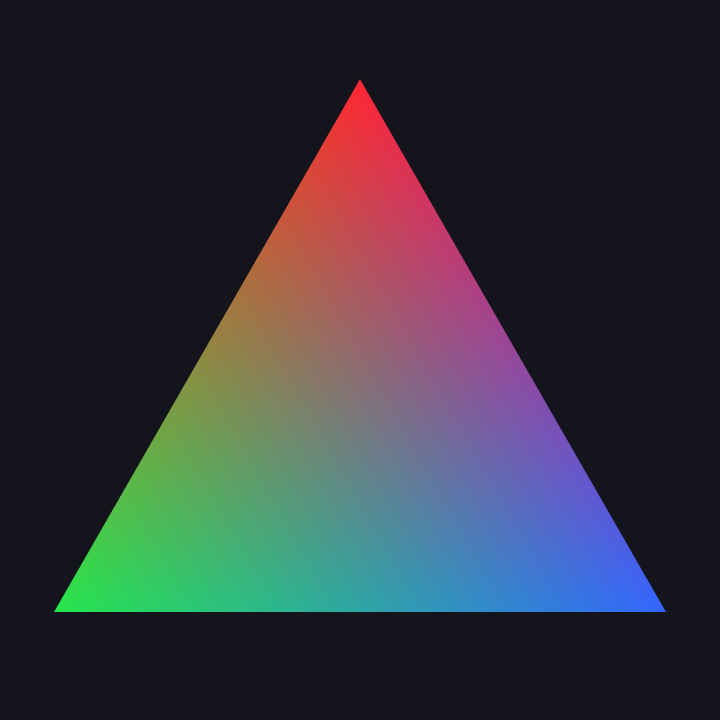
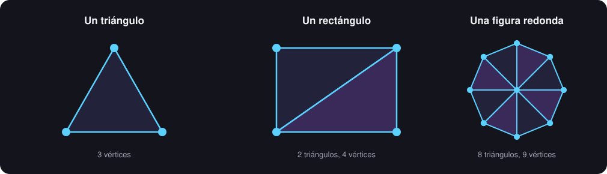
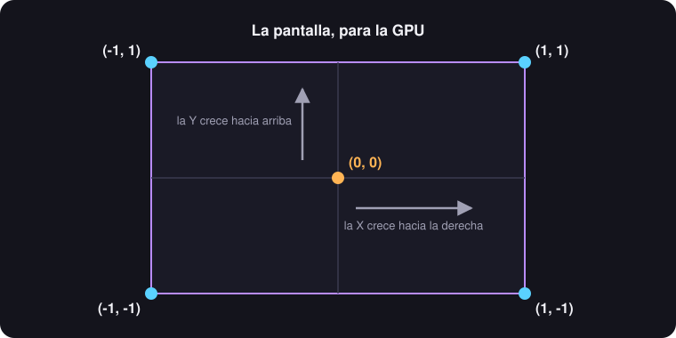
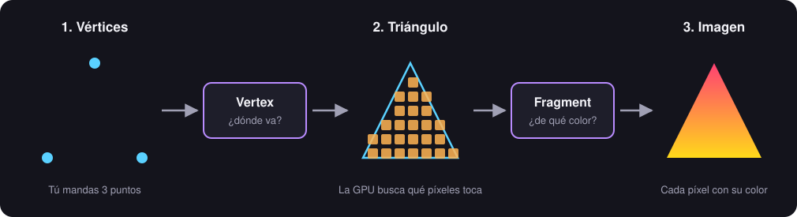
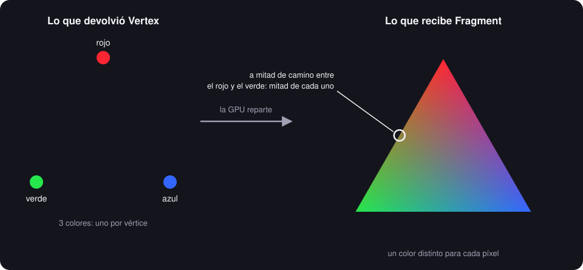
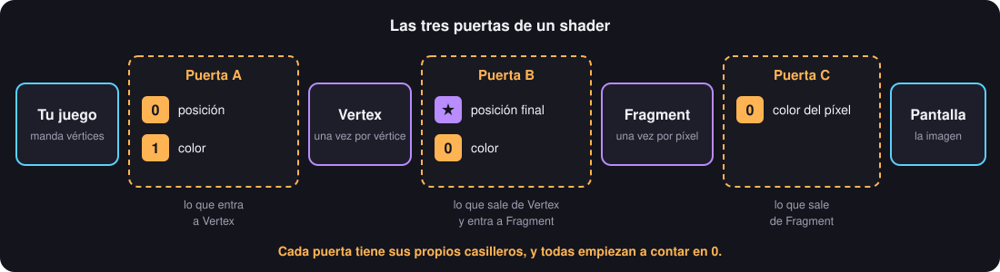

> [!SCENE] intro

Ya sabes qué es un shader: una función que la GPU ejecuta muchísimas veces a la vez. Pero saber qué es no te dice cómo se hace uno. ¿Qué recibe esa función? ¿Qué tiene que devolver? ¿Quién la llama, y con qué datos?

> [!SCENE] journey

En este capítulo no vas a escribir código ni a instalar nada. Vas a seguir el viaje completo de un dibujo, desde tu juego hasta la pantalla, un paso detrás de otro. Tómate tu tiempo con él, porque todo lo que escribas después en C# es uno de estos pasos. Si entiendes el viaje, el código se explica solo.

> [!SCENE] triangle

El dibujo que vamos a seguir es este triángulo:



Tiene una esquina roja, una verde y una azul, y por dentro los colores se van mezclando. Parece poca cosa, pero para dibujarlo hacen falta todas las piezas que tiene un shader. Ni una menos.

## 1. Todo se dibuja con triángulos

> [!SCENE] shapes

La GPU sabe dibujar muy pocas figuras, y la que se usa para casi todo es el triángulo. Todo lo demás se arma juntando triángulos:



Un rectángulo son dos triángulos. Algo redondo son muchos triángulos pequeños. El personaje de un juego en 3D son miles.

A cada esquina de un triángulo se le llama **vértice**. Es una palabra que vas a leer todo el tiempo, y no significa nada más que eso: un punto, una esquina.

Fíjate en el rectángulo: tiene 4 vértices y no 6, porque los dos triángulos comparten dos esquinas.

> [!NOTE]
> ¿Por qué triángulos y no cuadrados o círculos? Porque es la figura más simple que tiene relleno: con tres puntos sale una figura plana, sin dobleces. Por eso la GPU puede rellenarla rápido, y con muchos triángulos se puede armar cualquier otra forma.

## 2. Tu juego manda una lista de vértices

> [!SCENE] list

Para dibujar el triángulo, tu juego le manda a la GPU una lista con sus tres vértices. Y de cada vértice manda los datos que tú decidas. En nuestro caso son dos: dónde está y de qué color es.

| Vértice | Posición | Color |
| --- | --- | --- |
| El de arriba | `(0, 0.8)` | rojo |
| El de abajo a la izquierda | `(-0.8, -0.7)` | verde |
| El de abajo a la derecha | `(0.8, -0.7)` | azul |

Hay dos cosas aquí que conviene tener claras desde ya:

- **Tú decides qué datos lleva cada vértice.** La GPU no te obliga a mandar un color. Podrías mandar solo la posición, o la posición y cinco datos más. Mandas lo que tu shader vaya a necesitar.
- **Para la GPU son solo números.** Ella no sabe que eso es "un color". Ve tres o cuatro números juntos y nada más. El significado se lo das tú dentro del shader.

### ¿Qué puede llevar un vértice?

> [!SCENE] carry

La posición y el color son lo que necesita este triángulo, pero un vértice puede llevar cualquier dato que quieras. Estos son los habituales:

| Dato | Tipo en C# | Para qué sirve |
| --- | --- | --- |
| Posición | `vec2`, `vec3` o `vec4` | dónde está el vértice |
| Color | `vec3` o `vec4` | el color del vértice; `vec4` añade opacidad |
| UV | `vec2` | qué punto de una textura le corresponde a este vértice |
| Normal | `vec3` | hacia dónde apunta la superficie, sirve para la iluminación |
| Tangente | `vec4` | dirección a lo largo de la superficie, sirve para efectos de relieve |
| Índices y pesos de huesos | `vec4` o `uint` | animan a un personaje |
| Datos propios | `float`, `int`, `uint` o un vector | una temperatura, una edad, una marca |

Cada dato es un `float`, un `int` o un `uint`, solo o en grupos de dos, tres o cuatro (`vec2`, `vec3`, `vec4` y sus versiones `int` y `uint`). Una matriz es más grande que cuatro números, así que ocupa varios casilleros.

La GPU no sabe qué significa nada de esto. Un `vec4` son cuatro números, ya pongas un color o una posición. El significado solo existe en cómo lo usas dentro del shader.

### ¿Qué significan los números de la posición?

> [!SCENE] coords

Tu pantalla puede medir 1920 píxeles de ancho, o 800, o 4000. Para que el mismo dibujo sirva en todas, la GPU no mide la pantalla en píxeles. Usa la misma regla, sea cual sea la pantalla:



- El centro de la pantalla es `(0, 0)`.
- El borde izquierdo es `-1` y el derecho es `1`.
- El borde de abajo es `-1` y el de arriba es `1`.

Así que el vértice `(0, 0.8)` está centrado a lo ancho y casi arriba del todo. Y `(-0.8, -0.7)` está a la izquierda y abajo.

> [!WARNING]
> Si ya programaste algo en 2D, estás acostumbrado a que la Y crece hacia abajo. Aquí es al revés: la Y crece hacia **arriba**.

## 3. La etapa Vertex: una vez por cada vértice

> [!SCENE] vertex

Aquí entra la primera función que escribes tú.

La GPU toma la lista y llama a tu función Vertex una vez por cada vértice. Tres vértices, tres llamadas. En cada llamada le entrega los datos de **un solo** vértice: no ve los otros dos.

Esa función tiene dos trabajos:

1. **Decir dónde queda ese vértice en la pantalla.** Esto es obligatorio. Sin una posición, la GPU no tiene nada que dibujar.
2. **Dejar pasar los datos que la siguiente etapa vaya a necesitar.** Esto es opcional, y tú decides cuáles. En nuestro caso, el color.

En el triángulo queda así:

| | Lo que recibe | Lo que devuelve |
| --- | --- | --- |
| Función Vertex | la posición y el color de un vértice | la posición final y el color |

### "Si la posición ya la mandó mi juego, ¿para qué la devuelvo otra vez?"

> [!SCENE] why

Es la pregunta lógica, porque en nuestro triángulo la función Vertex no cambia nada: recibe una posición y devuelve esa misma.

Pero en un juego de verdad los vértices casi nunca se mandan ya colocados. La forma de un personaje se manda una sola vez, y es la etapa Vertex la que lo mueve por el mapa, lo gira, o lo hace pequeño cuando está lejos de la cámara. Para eso existe: es el lugar donde se decide dónde cae cada punto.

Que en nuestro ejemplo la respuesta sea "donde ya estaba" no quita que alguien tenga que darla.

### La posición final tiene cuatro números, no dos

> [!SCENE] four

Tu juego mandó la posición con dos números, X e Y. Pero la GPU pide la posición final con cuatro:

| Número | Qué es | Qué ponemos en 2D |
| --- | --- | --- |
| 1º | X: izquierda o derecha | el tuyo |
| 2º | Y: abajo o arriba | el tuyo |
| 3º | Z: la profundidad, o sea, qué tan lejos está | `0` |
| 4º | W: sirve para la perspectiva en 3D | `1` |

Los dos últimos solo importan en 3D. Mientras dibujes en 2D, quédate con esto: los dos primeros son tu X y tu Y, y los otros dos son `0` y `1`.

## 4. La GPU arma el triángulo

> [!SCENE] raster

Este paso no lo escribes tú. Lo hace la GPU sola.

Con las tres posiciones finales ya sabe dónde está el triángulo en la pantalla. Entonces averigua qué píxeles quedan dentro:



Cuanto más grande sea la figura, más píxeles toca. Un triángulo pequeño puede tocar unos cientos. Un rectángulo que cubre toda una pantalla Full HD toca los dos millones.

## 5. El reparto: de tres valores a miles

> [!SCENE] spread

Aquí pasa algo que casi nunca se explica, y es la clave para entender todo lo demás.

La función Vertex devolvió tres colores, uno por vértice. Pero el triángulo tiene miles de píxeles. ¿Qué color le llega a cada uno?

La GPU **reparte**. A cada píxel le da una mezcla de los tres valores, según lo cerca que esté de cada vértice:



- Un píxel pegado al vértice rojo recibe casi todo rojo.
- Un píxel a mitad de camino entre el rojo y el verde recibe mitad de cada uno.
- Un píxel justo en el centro recibe un tercio de cada uno.

> [!SCENE] heat

Esto no es algo especial de los colores. La GPU no sabe que son colores, ¿recuerdas? Para ella son números, y reparte **cualquier** número que la función Vertex deje pasar. Si dejas pasar una temperatura, cada píxel recibe su temperatura mezclada.

> [!SCENE] important

De aquí sale una idea que tienes que llevarte de este capítulo:

> [!IMPORTANT]
> Lo que devuelve la función Vertex **no es** lo que recibe la función Fragment. Vertex devuelve tres valores exactos, uno por vértice. Fragment recibe miles, uno por píxel, y cada uno es una mezcla distinta. El dato se llama igual en los dos lados, pero por el camino la GPU lo repartió.

El nombre técnico de este reparto es *interpolación*. Lo vas a leer en otros sitios. Aquí lo seguimos llamando reparto.

## 6. La etapa Fragment: una vez por cada píxel

> [!SCENE] fragment

Esta es la segunda función que escribes tú.

La GPU la llama una vez por cada píxel que quedó dentro del triángulo, y en cada llamada le entrega los datos ya repartidos para **ese** píxel.

Tiene un solo trabajo: **devolver el color de ese píxel**.

Un color son cuatro números, y cada uno va de `0` (nada) a `1` (todo). No de 0 a 255:

| Color | Rojo | Verde | Azul | Opacidad |
| --- | --- | --- | --- | --- |
| Rojo | `1` | `0` | `0` | `1` |
| Blanco | `1` | `1` | `1` | `1` |
| Negro | `0` | `0` | `0` | `1` |
| Gris | `0.5` | `0.5` | `0.5` | `1` |
| Amarillo | `1` | `1` | `0` | `1` |

El cuarto número es la opacidad: `1` es un color sólido y `0` es totalmente transparente.

> [!SCENE] freedom

En nuestro triángulo, la función Fragment hace lo más simple que existe: recibe el color ya mezclado y lo devuelve tal cual. Todo el degradado lo hizo el reparto.

Pero podría hacer lo que quisiera con él: oscurecerlo, ignorarlo y devolver rojo, o calcular otro color con una fórmula. En eso consiste escribir shaders, y es lo que harás en los cinco que vienen.

### Lo que una función Fragment no puede hacer

> [!SCENE] isolated

Como la GPU ejecuta la función para miles de píxeles al mismo tiempo, cada llamada vive aislada de las demás:

- **No sabe nada de los otros píxeles.** No puede preguntar de qué color quedó el de al lado.
- **No recuerda nada.** Una variable que crees dentro de la función desaparece al terminar. No sirve para el siguiente píxel ni para el siguiente fotograma.
- **No hay un bucle que recorra los píxeles.** El bucle es la GPU. Tú escribes lo que pasa con uno.

Lo único que sabe un píxel es lo que le llega por el reparto. Si necesita algo más, como el tiempo que ha pasado o una foto, se lo tiene que mandar tu juego. Eso lo verás en los shaders 4 y 5.

## 7. Los casilleros: cómo sabe cada etapa qué dato es cuál

> [!SCENE] slots

Hasta ahora hablamos de "la posición" y "el color", por su nombre. Pero la GPU no entiende de nombres. Para ella los datos viajan en **casilleros numerados**.

Tu juego dice: "pongo la posición en el casillero 0 y el color en el casillero 1". Y la función Vertex dice: "leo la posición del casillero 0 y el color del casillero 1". Se entienden por el número.

A ese número se le llama *location*, que en inglés es "ubicación".

Qué número lleva cada dato lo decides tú. El casillero 0 no es la posición por regla: podrías poner el color en el casillero 0 y la posición en el 1, siempre que tu juego haga lo mismo. La GPU solo ve el número y el tipo: casillero 0, dos float; casillero 1, cuatro float. Cada casillero guarda hasta cuatro números, y toda GPU ofrece al menos 16 para los datos de vértice. Si te equivocas de número no aparece ningún error: el shader lee los datos equivocados y el dibujo sale mal.

En HLSL el casillero se escribe como una semántica, `TEXCOORD0` y `TEXCOORD1` en nuestro triángulo. Es la misma idea con otro nombre.

> [!SCENE] doors

Hasta ahí es fácil. Lo que confunde a casi todo el mundo es esto: **no hay una sola fila de casilleros. Hay tres.**

En el viaje del triángulo los datos cruzan tres puertas, y cada puerta tiene su propia fila:



| Puerta | Qué cruza por ella | Casillero 0 | Casillero 1 |
| --- | --- | --- | --- |
| **A** | Lo que tu juego le manda a Vertex | la posición | el color |
| **B** | Lo que Vertex le deja pasar a Fragment | el color | nada |
| **C** | Lo que Fragment devuelve | el color del píxel | nada |

Cada puerta empieza a contar desde 0 por su cuenta. Por eso el "casillero 0" aparece tres veces, y las tres veces lleva una cosa distinta: en la puerta A es la posición, en la B es el color, y en la C es el color final del píxel.

Piensa en tres edificios en la misma calle. Los tres tienen un apartamento número 1, y ninguno tiene nada que ver con los otros dos. Para encontrar a alguien necesitas el edificio **y** el número.

> [!IMPORTANT]
> Este es el punto donde casi todo el mundo se pierde la primera vez. Vas a ver un `0` junto a la posición en la etapa Vertex, y otro `0` junto al color en la etapa Fragment, y vas a pensar que hay un error o que los dos significan lo mismo. Ni lo uno ni lo otro: son casilleros de puertas distintas.

> [!SCENE] rules

Las reglas son tres:

1. **Dentro de una misma puerta no se repite un número.** No puede haber dos datos en el casillero 0 de la puerta A.
2. **Los dos lados de una puerta tienen que estar de acuerdo.** Si Vertex deja el color en el casillero 0 de la puerta B, Fragment tiene que leer el color del casillero 0 de la puerta B. Tienen que coincidir el número y el tipo de dato. El nombre da igual.
3. **Entre puertas distintas, los números no tienen ninguna relación.**

### ¿Y la posición final? ¿Por qué no tiene número?

> [!SCENE] special

Mira la puerta B en el dibujo. Además del color hay otra cosa, marcada con una estrella en vez de un número: la posición final.

No tiene casillero porque no es un dato para tu función Fragment. Es un dato para **la propia GPU**, que lo necesita en el paso 4 para armar el triángulo. Como siempre hace falta y siempre es para lo mismo, no se le pone un número: se marca con un nombre especial que la GPU reconoce.

Así que hay dos clases de datos saliendo de Vertex:

- **El especial**, la posición final. Se lo queda la GPU.
- **Los tuyos**, los que llevan número de casillero. Esos son los que se reparten y le llegan a Fragment.

### ¿Por qué la puerta C tiene número, si solo sale un color?

Porque un shader puede pintar en varias imágenes a la vez, y el número dice en cuál. Es algo avanzado que no vas a necesitar en este tutorial. Casi siempre se pinta en una sola, y esa es la número `0`.

### Cinco estilos: tú eliges

> [!SCENE] styles

El número entre corchetes, `location`, es como GLSL nombra un casillero. GLSL es el lenguaje de OpenGL y Vulkan. HLSL, el lenguaje de DirectX, nombra lo mismo con una palabra y un índice, como `TEXCOORD0`. Metal, WebGPU y SPIR-V también tienen sus propias palabras. Entonces, ¿cuál escribes? **El que ya conozcas.** Yotsuba Shader tiene cinco estilos: **GLSL, HLSL, MSL (Metal), WGSL (WebGPU) y SPIR-V**. Solo cambian las palabras de la interfaz; la matemática y el C# quedan exactamente igual. Usa el menú **Estilo**, arriba a la derecha de esta página, para ver todos los ejemplos en el estilo que prefieras.

:::godot
> [!IMPORTANT]
> **En la ruta Godot, la puerta A funciona por nombre, no por número.** Godot le entrega a cada vértice sus datos con nombres fijos: `VERTEX` (la posición), `NORMAL`, `UV`, `COLOR`... El plugin lee el **nombre de tu campo** para saber cuál le pides. Por eso en esta ruta `{{cornerType}}` siempre tiene **los 14** atributos de Godot, escritos exactamente como los escribe Godot (con sus mayúsculas), y usarás ese mismo struct desde el primer shader hasta el último. El número entre corchetes se sigue escribiendo porque la sintaxis lo pide, pero en la puerta A Godot lo ignora. Las puertas B y C siguen funcionando con números, como se explica aquí.
>
> No necesitas usar los 14. Un shader que solo lee `VERTEX` y `UV` deja el resto quieto, y Godot rellena los demás con valores por defecto.
:::

Nuestro `{{cornerType}}` en los cinco estilos:

```csharp style=glsl
public struct {{cornerType}}
{
    {{cornerFieldsColor glsl}}
}
```

```csharp style=hlsl
public struct {{cornerType}}
{
    {{cornerFieldsColor hlsl}}
}
```

```csharp style=msl
public struct {{cornerType}}
{
    {{cornerFieldsColor msl}}
}
```

```csharp style=wgsl
public struct {{cornerType}}
{
    {{cornerFieldsColor glsl}}
}
```

```csharp style=spirv
public struct {{cornerType}}
{
    {{cornerFieldsColor spirv}}
}
```

> [!SCENE] dict

Se ven distintos, pero cada lenguaje tiene sus propias palabras para los mismos conceptos, y el compilador conoce el concepto que hay detrás de cada palabra. Estos son los que has visto hasta ahora:

| Concepto | GLSL | HLSL | MSL | WGSL | SPIR-V |
| --- | --- | --- | --- | --- | --- |
| Un canal de datos del vértice | `[location(0)]` | `[TEXCOORD(0)]` | `[attribute(0)]` | `[location(0)]` | `[Location(0)]` |
| La posición final | `[gl_Position]` | `[SV_Position]` | `[position]` | `[builtin_position]` | `[BuiltIn_Position]` |
| A dónde va el color (puerta C) | `[return: location(0)]` | `[return: SV_Target]` | `[return: color(0)]` | `[return: location(0)]` | `[return: Location(0)]` |

> [!SAY] Esta tabla es como un pequeño diccionario entre los cinco estilos. Cada fila es una idea, y cada columna es cómo la dice un estilo. Un canal de datos del vértice es location en GLSL y en WGSL, TEXCOORD en HLSL, attribute en Metal, y Location con L mayúscula en SPIR-V. La posición final es gl_Position en GLSL, SV_Position en HLSL, position en Metal, y así. Y el destino del color es location cero en casi todos, y SV_Target en HLSL. Son palabras distintas, pero para el compilador son la misma idea.

Hay una diferencia que conviene saber. Con un número como `location(0)` **tú eliges el número**. Con una semántica como `TEXCOORD`, **el compilador puede elegir el número** por ti, y conecta las dos etapas por el nombre: el `TEXCOORD(0)` que sale de Vertex es el que recibe Fragment. El resultado final es el mismo tipo de casillero.

En el resto de este capítulo hablamos del número de forma neutral: "el casillero 0". Sea cual sea tu estilo, ese es el casillero que escribes con sus propias palabras.

## 8. El plano completo

> [!SCENE] blueprint

Ya hiciste el viaje entero. Para construir **cualquier** shader, no solo este triángulo, tienes que decidir cinco cosas:

| | Lo que decides | En el triángulo |
| --- | --- | --- |
| 1 | Qué datos lleva cada vértice (puerta A) | La posición en el casillero 0 y el color en el 1. |
| 2 | Qué le deja pasar Vertex a Fragment (puerta B) | La posición final, que es la especial, y el color en el casillero 0. |
| 3 | Qué hace la función Vertex | Copia la posición y el color. |
| 4 | Qué hace la función Fragment | Devuelve el color que recibe. |
| 5 | A dónde va el color (puerta C) | Al casillero 0. |

> [!SAY] Esta tabla resume todo el viaje, una fila por decisión. En la primera fila, cada vértice lleva su posición en el casillero cero y su color en el casillero uno. En la segunda, lo que Vertex le pasa a Fragment es la posición final, que es la especial, y el color en el casillero cero. La tercera dice que la función Vertex solo copia la posición y el color. La cuarta, que Fragment devuelve el color que recibe. Y la quinta, que ese color sale por el casillero cero.

> [!SCENE] who

Y este es el reparto del trabajo entre los tres que participan:

| Quién | Qué hace |
| --- | --- |
| Tu juego | Manda la lista de vértices con sus datos. |
| Tú, en el shader | Escribes la función Vertex y la función Fragment, y declaras las tres puertas. |
| La GPU | Llama a tus funciones, arma los triángulos, busca los píxeles y reparte los datos. |

> [!SAY] Y esta otra tabla reparte el trabajo entre los tres que participan. Tu juego manda la lista de vértices con sus datos. Tú, en el shader, escribes las dos funciones y declaras las tres puertas. Y la GPU hace todo lo demás: llama a tus funciones, arma los triángulos, busca los píxeles y reparte los datos.

Fíjate en lo que **no** tienes que escribir: ni el bucle sobre los vértices, ni el bucle sobre los píxeles, ni el reparto. Todo eso ya lo hace la GPU.

## 9. El shader completo y lo que genera el compilador

> [!SCENE] whole

Este es el shader completo del triángulo, escrito en los cinco estilos. Elige el tuyo en el menú **Estilo**. (`Crear.Vec4` es el pequeño ayudante del capítulo del primer shader.)

```csharp style=glsl
using YotsubaShader.GlslSyntax;
using YotsubaShader.GlslSyntax.Types;
using YotsubaShader.Language;

namespace MyShaders;

public class Triangle
{
    public struct {{cornerType}}
    {
        {{cornerFieldsColor glsl}}
    }

    public struct Pixel
    {
        [gl_Position] public vec4 Position;
        [location(0)] public vec4 Color;
    }

    public struct PixelIn
    {
        [location(0)] public vec4 Color;
    }

    [ShaderStage(Stage.Vertex)]
    public Pixel Vertex({{cornerType}} corner)
    {
        Pixel pixel;
        pixel.Position = Make.Vec4(corner.{{cornerPos}}.X, corner.{{cornerPos}}.Y, 0f, 1f);
        pixel.Color = corner.{{color}};
        return pixel;
    }

    [ShaderStage(Stage.Fragment)]
    [return: location(0)]
    public vec4 Fragment(PixelIn pixel)
    {
        return pixel.Color;
    }
}
```

```csharp style=hlsl
using YotsubaShader.HlslSyntax;
using YotsubaShader.GlslSyntax.Types;
using YotsubaShader.Language;

namespace MyShaders;

public class Triangle
{
    public struct {{cornerType}}
    {
        {{cornerFieldsColor hlsl}}
    }

    public struct Pixel
    {
        [SV_Position] public vec4 Position;
        [TEXCOORD(0)] public vec4 Color;
    }

    public struct PixelIn
    {
        [TEXCOORD(0)] public vec4 Color;
    }

    [ShaderStage(Stage.Vertex)]
    public Pixel Vertex({{cornerType}} corner)
    {
        Pixel pixel;
        pixel.Position = Make.Vec4(corner.{{cornerPos}}.X, corner.{{cornerPos}}.Y, 0f, 1f);
        pixel.Color = corner.{{color}};
        return pixel;
    }

    [ShaderStage(Stage.Fragment)]
    [return: SV_Target]
    public vec4 Fragment(PixelIn pixel)
    {
        return pixel.Color;
    }
}
```

```csharp style=msl
using YotsubaShader.MslSyntax;
using YotsubaShader.GlslSyntax.Types;
using YotsubaShader.Language;

namespace MyShaders;

public class Triangle
{
    public struct {{cornerType}}
    {
        {{cornerFieldsColor msl}}
    }

    public struct Pixel
    {
        [position] public vec4 Position;
        [attribute(0)] public vec4 Color;
    }

    public struct PixelIn
    {
        [attribute(0)] public vec4 Color;
    }

    [ShaderStage(Stage.Vertex)]
    public Pixel Vertex({{cornerType}} corner)
    {
        Pixel pixel;
        pixel.Position = Make.Vec4(corner.{{cornerPos}}.X, corner.{{cornerPos}}.Y, 0f, 1f);
        pixel.Color = corner.{{color}};
        return pixel;
    }

    [ShaderStage(Stage.Fragment)]
    [return: color(0)]
    public vec4 Fragment(PixelIn pixel)
    {
        return pixel.Color;
    }
}
```

```csharp style=wgsl
using YotsubaShader.WgslSyntax;
using YotsubaShader.GlslSyntax.Types;
using YotsubaShader.Language;

namespace MyShaders;

public class Triangle
{
    public struct {{cornerType}}
    {
        {{cornerFieldsColor glsl}}
    }

    public struct Pixel
    {
        [builtin_position] public vec4 Position;
        [location(0)] public vec4 Color;
    }

    public struct PixelIn
    {
        [location(0)] public vec4 Color;
    }

    [ShaderStage(Stage.Vertex)]
    public Pixel Vertex({{cornerType}} corner)
    {
        Pixel pixel;
        pixel.Position = Make.Vec4(corner.{{cornerPos}}.X, corner.{{cornerPos}}.Y, 0f, 1f);
        pixel.Color = corner.{{color}};
        return pixel;
    }

    [ShaderStage(Stage.Fragment)]
    [return: location(0)]
    public vec4 Fragment(PixelIn pixel)
    {
        return pixel.Color;
    }
}
```

```csharp style=spirv
using YotsubaShader.SpirvSyntax;
using YotsubaShader.GlslSyntax.Types;
using YotsubaShader.Language;

namespace MyShaders;

public class Triangle
{
    public struct {{cornerType}}
    {
        {{cornerFieldsColor spirv}}
    }

    public struct Pixel
    {
        [BuiltIn_Position] public vec4 Position;
        [Location(0)] public vec4 Color;
    }

    public struct PixelIn
    {
        [Location(0)] public vec4 Color;
    }

    [ShaderStage(Stage.Vertex)]
    public Pixel Vertex({{cornerType}} corner)
    {
        Pixel pixel;
        pixel.Position = Make.Vec4(corner.{{cornerPos}}.X, corner.{{cornerPos}}.Y, 0f, 1f);
        pixel.Color = corner.{{color}};
        return pixel;
    }

    [ShaderStage(Stage.Fragment)]
    [return: Location(0)]
    public vec4 Fragment(PixelIn pixel)
    {
        return pixel.Color;
    }
}
```

Elijas el estilo que elijas, Yotsuba Shader genera las mismas salidas a partir de él: GLSL y GLSL ES, HLSL, Metal, SPIR-V y C++. Compilamos el shader con el compilador de este proyecto. Estos son los resultados de la etapa Vertex; la etapa Fragment funciona igual.

```csharp tab="C# · cualquier estilo"
using YotsubaShader.GlslSyntax;
using YotsubaShader.GlslSyntax.Types;
using YotsubaShader.Language;

namespace MyShaders;

public class Triangle
{
    public struct {{cornerType}}
    {
        {{cornerFieldsColor glsl}}
    }

    public struct Pixel
    {
        [gl_Position] public vec4 Position;
        [location(0)] public vec4 Color;
    }

    public struct PixelIn
    {
        [location(0)] public vec4 Color;
    }

    [ShaderStage(Stage.Vertex)]
    public Pixel Vertex({{cornerType}} corner)
    {
        Pixel pixel;
        pixel.Position = Make.Vec4(corner.{{cornerPos}}.X, corner.{{cornerPos}}.Y, 0f, 1f);
        pixel.Color = corner.{{color}};
        return pixel;
    }

    [ShaderStage(Stage.Fragment)]
    [return: location(0)]
    public vec4 Fragment(PixelIn pixel)
    {
        return pixel.Color;
    }
}
```

```glsl tab="GLSL / GLSL ES"
#version 450

struct Pixel
{
    vec4 Position;
    vec4 Color;
};

layout(location = 0) in vec2 corner_Position;
layout(location = 1) in vec4 corner_Color;
layout(location = 0) out vec4 _return_Color;

vec4 Vec4(float x, float y, float z, float w)
{
    vec4 v;
    v.x = x;
    v.y = y;
    v.z = z;
    v.w = w;
    return v;
}

void main()
{
    Pixel pixel;
    pixel.Position = Vec4(corner_Position.x, corner_Position.y, 0.0, 1.0);
    pixel.Color = corner_Color;
    gl_Position = pixel.Position;
    _return_Color = pixel.Color;
}
```

```hlsl tab="HLSL"
struct Pixel
{
    float4 Position;
    float4 Color;
};

static float4 gl_Position;
static float2 corner_Position;
static float4 corner_Color;
static float4 _return_Color;

struct SPIRV_Cross_Input
{
    float2 corner_Position : TEXCOORD0;
    float4 corner_Color : TEXCOORD1;
};

struct SPIRV_Cross_Output
{
    float4 _return_Color : TEXCOORD0;
    float4 gl_Position : SV_Position;
};

float4 Vec4(float x, float y, float z, float w)
{
    float4 v;
    v.x = x;
    v.y = y;
    v.z = z;
    v.w = w;
    return v;
}

void Vertex_inner()
{
    Pixel pixel;
    pixel.Position = Vec4(corner_Position.x, corner_Position.y, 0.0f, 1.0f);
    pixel.Color = corner_Color;
    gl_Position = pixel.Position;
    _return_Color = pixel.Color;
}

SPIRV_Cross_Output Vertex(SPIRV_Cross_Input stage_input)
{
    corner_Position = stage_input.corner_Position;
    corner_Color = stage_input.corner_Color;
    Vertex_inner();
    SPIRV_Cross_Output stage_output;
    stage_output.gl_Position = gl_Position;
    stage_output._return_Color = _return_Color;
    return stage_output;
}
```

```cpp tab="Metal (MSL)"
#pragma clang diagnostic ignored "-Wmissing-prototypes"

#include <metal_stdlib>
#include <simd/simd.h>

using namespace metal;

struct Pixel
{
    float4 Position;
    float4 Color;
};

struct Vertex_out
{
    float4 _return_Color [[user(locn0)]];
    float4 gl_Position [[position]];
};

struct Vertex_in
{
    float2 corner_Position [[attribute(0)]];
    float4 corner_Color [[attribute(1)]];
};

static inline __attribute__((always_inline))
float4 Vec4(float x, float y, float z, float w)
{
    float4 v;
    v.x = x;
    v.y = y;
    v.z = z;
    v.w = w;
    return v;
}

vertex Vertex_out Vertex(Vertex_in in [[stage_in]])
{
    Vertex_out out = {};
    Pixel pixel;
    pixel.Position = Vec4(in.corner_Position.x, in.corner_Position.y, 0.0, 1.0);
    pixel.Color = in.corner_Color;
    out.gl_Position = pixel.Position;
    out._return_Color = pixel.Color;
    return out;
}
```

```text tab="SPIR-V"
; SPIR-V
; Version: 1.6
; Generator: Khronos; 0
; Bound: 57
; Schema: 0
               OpCapability Shader
               OpExtension "SPV_GOOGLE_decorate_string"
               OpExtension "SPV_GOOGLE_hlsl_functionality1"
               OpMemoryModel Logical GLSL450
               OpEntryPoint Vertex %Vertex "Vertex" %corner_Position %corner_Color %__return_Position %__return_Color
               OpEntryPoint Fragment %Fragment "Fragment" %pixel_Position %pixel_Color %__return
               OpExecutionMode %Fragment OriginUpperLeft
               OpName %Vertex "Vertex"
               OpName %corner_Position "corner_Position"
               OpName %corner_Color "corner_Color"
               OpName %__return_Position "__return_Position"
               OpName %__return_Color "__return_Color"
               OpName %Fragment "Fragment"
               OpName %pixel_Position "pixel_Position"
               OpName %pixel_Color "pixel_Color"
               OpName %__return "__return"
               OpName %Vec4 "Vec4"
               OpName %Pixel "Pixel"
               OpMemberName %Pixel 0 "Position"
               OpMemberName %Pixel 1 "Color"
               OpName %pixel "pixel"
               OpName %x "x"
               OpName %y "y"
               OpName %z "z"
               OpName %w "w"
               OpName %v "v"
               OpDecorate %corner_Position Location 0
               OpDecorate %corner_Color Location 1
               OpDecorate %__return_Position BuiltIn Position
               OpDecorate %__return_Color Location 0
               OpDecorate %pixel_Position BuiltIn FragCoord
               OpDecorate %pixel_Color Location 0
               OpDecorate %__return Location 0
       %void = OpTypeVoid
      %float = OpTypeFloat 32
    %v2float = OpTypeVector %float 2
%_ptr_Input_v2float = OpTypePointer Input %v2float
    %v4float = OpTypeVector %float 4
%_ptr_Input_v4float = OpTypePointer Input %v4float
%_ptr_Output_v4float = OpTypePointer Output %v4float
    %float_0 = OpConstant %float 0
    %float_1 = OpConstant %float 1
         %27 = OpTypeFunction %void
      %Pixel = OpTypeStruct %v4float %v4float
%_ptr_Function_Pixel = OpTypePointer Function %Pixel
%_ptr_Function_v4float = OpTypePointer Function %v4float
       %uint = OpTypeInt 32 0
     %uint_0 = OpConstant %uint 0
     %uint_1 = OpConstant %uint 1
         %33 = OpTypeFunction %v4float %float %float %float %float
%_ptr_Function_float = OpTypePointer Function %float
     %uint_2 = OpConstant %uint 2
     %uint_3 = OpConstant %uint 3
%corner_Position = OpVariable %_ptr_Input_v2float Input
%corner_Color = OpVariable %_ptr_Input_v4float Input
%__return_Position = OpVariable %_ptr_Output_v4float Output
%__return_Color = OpVariable %_ptr_Output_v4float Output
%pixel_Position = OpVariable %_ptr_Input_v4float Input
%pixel_Color = OpVariable %_ptr_Input_v4float Input
   %__return = OpVariable %_ptr_Output_v4float Output
     %Vertex = OpFunction %void None %27
         %37 = OpLabel
      %pixel = OpVariable %_ptr_Function_Pixel Function
         %38 = OpAccessChain %_ptr_Function_v4float %pixel %uint_0
         %39 = OpLoad %v2float %corner_Position
         %40 = OpCompositeExtract %float %39 0
         %41 = OpLoad %v2float %corner_Position
         %42 = OpCompositeExtract %float %41 1
         %43 = OpFunctionCall %v4float %Vec4 %40 %42 %float_0 %float_1
               OpStore %38 %43
         %44 = OpAccessChain %_ptr_Function_v4float %pixel %uint_1
         %45 = OpLoad %v4float %corner_Color
               OpStore %44 %45
         %46 = OpLoad %Pixel %pixel
         %47 = OpCompositeExtract %v4float %46 0
               OpStore %__return_Position %47
         %48 = OpCompositeExtract %v4float %46 1
               OpStore %__return_Color %48
               OpReturn
               OpFunctionEnd
   %Fragment = OpFunction %void None %27
         %49 = OpLabel
         %50 = OpLoad %v4float %pixel_Color
               OpStore %__return %50
               OpReturn
               OpFunctionEnd
       %Vec4 = OpFunction %v4float None %33
          %x = OpFunctionParameter %float
          %y = OpFunctionParameter %float
          %z = OpFunctionParameter %float
          %w = OpFunctionParameter %float
         %51 = OpLabel
          %v = OpVariable %_ptr_Function_v4float Function
         %52 = OpAccessChain %_ptr_Function_float %v %uint_0
               OpStore %52 %x
         %53 = OpAccessChain %_ptr_Function_float %v %uint_1
               OpStore %53 %y
         %54 = OpAccessChain %_ptr_Function_float %v %uint_2
               OpStore %54 %z
         %55 = OpAccessChain %_ptr_Function_float %v %uint_3
               OpStore %55 %w
         %56 = OpLoad %v4float %v
               OpReturnValue %56
               OpFunctionEnd
```

```cpp tab="C++"
// This C++ shader is autogenerated by spirv-cross.
#include "spirv_cross/internal_interface.hpp"
#include "spirv_cross/external_interface.h"
#include <array>
#include <stdint.h>

using namespace spirv_cross;
using namespace glm;

namespace Impl
{
    struct Shader
    {
        struct Pixel
        {
            vec4 Position;
            vec4 Color;
        };
        
        struct Resources : VertexResources
        {
            internal::StageInput<vec2> corner_Position__;
#define corner_Position __res->corner_Position__.get()
            
            internal::StageInput<vec4> corner_Color__;
#define corner_Color __res->corner_Color__.get()
            
            internal::StageOutput<vec4> _return_Color__;
#define _return_Color __res->_return_Color__.get()
            
            inline void init(spirv_cross_shader& s)
            {
                VertexResources::init(s);
                s.register_stage_input(corner_Position__, 0);
                s.register_stage_input(corner_Color__, 1);
                s.register_stage_output(_return_Color__, 0);
            }
        };
        
        Resources* __res;
        
        inline vec4 Vec4(const float &x, const float &y, const float &z, const float &w)
        {
            vec4 v;
            v.x = x;
            v.y = y;
            v.z = z;
            v.w = w;
            return v;
        }
        
        inline void main()
        {
            struct Pixel pixel;
            pixel.Position = Vec4(corner_Position.x, corner_Position.y, 0.0f, 1.0f);
            pixel.Color = corner_Color;
            gl_Position = pixel.Position;
            _return_Color = pixel.Color;
        }
        
    };
}

spirv_cross_shader_t *spirv_cross_construct(void)
{
    return new VertexShader<Impl::Shader, Impl::Shader::Resources>();
}

void spirv_cross_destruct(spirv_cross_shader_t *shader)
{
    delete static_cast<VertexShader<Impl::Shader, Impl::Shader::Resources>*>(shader);
}

void spirv_cross_invoke(spirv_cross_shader_t *shader)
{
    static_cast<VertexShader<Impl::Shader, Impl::Shader::Resources>*>(shader)->invoke();
}

static const struct spirv_cross_interface vtable =
{
    spirv_cross_construct,
    spirv_cross_destruct,
    spirv_cross_invoke,
};

const struct spirv_cross_interface *spirv_cross_get_interface(void)
{
    return &vtable;
}
```

> [!SAY] Hemos compilado este shader y cada salida tiene su propia pestaña: el C# original y los cinco resultados, que son GLSL, HLSL, Metal, SPIR-V y C++. Puedes cambiar de pestaña para ver con tus propios ojos lo que el compilador generó a partir del mismo C#.

También compilamos el mismo shader escrito en cada uno de los cinco estilos: los archivos de GLSL, GLSL ES, Metal y C++ salen idénticos, carácter por carácter. HLSL y SPIR-V conservan los nombres que escribiste, así que en esos dos las únicas diferencias son los nombres elegidos, por ejemplo el `"TEXCOORD0"` que SPIR-V recuerda en una línea `UserSemantic` cuando escribes en estilo HLSL.

> [!NOTE]
> El compilador convierte tu C# primero a SPIR-V, y desde ahí genera los otros lenguajes. Por eso un nombre como `TEXCOORD` y un número como `location(0)` pueden significar lo mismo para él: los dos terminan como el mismo casillero en SPIR-V.

> [!SCENE] learned

## Lo que aprendiste

- Todo se dibuja con triángulos, y cada esquina es un vértice.
- Tu juego manda los vértices, cada uno con los datos que tú decidas.
- Para la GPU la pantalla va de `-1` a `1`, con el `(0, 0)` en el centro y la Y hacia arriba.
- La función Vertex se ejecuta una vez por vértice. Devuelve la posición final y deja pasar datos.
- La GPU reparte esos datos entre los píxeles. Por eso cada píxel recibe un valor distinto.
- La función Fragment se ejecuta una vez por píxel y devuelve su color: cuatro números de `0` a `1`.
- Los datos viajan en casilleros numerados, y cada una de las tres puertas tiene los suyos, empezando en 0.

En el siguiente capítulo dejas preparado el proyecto, y en el que viene después escribes estas cinco cosas en C#. Vas a ver que cada una son muy pocas líneas.

Siguiente: [Prepara tu proyecto](setup.md).
