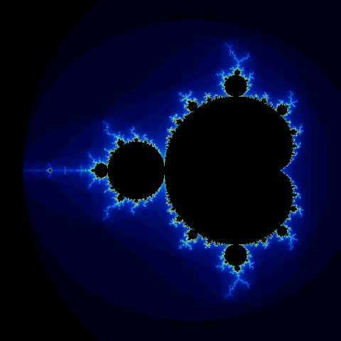
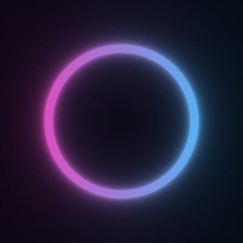
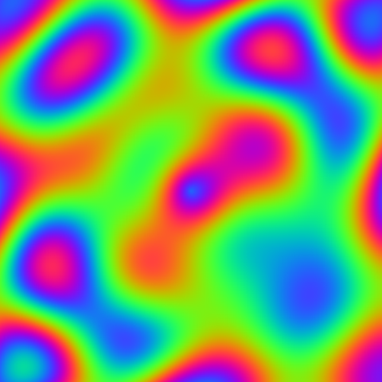

Bienvenido a Yotsuba Shader. Un SDK para escribir shaders en C# para múltiples APIs gráficas y Game Engines.

## Qué aprenderás

En este tutorial aprenderás a escribir shaders en C# con Yotsuba Shader, y a compilarlos para pasárselos a la GPU, ya sea desde un Game Engine existente, desde tu propio Game Engine, o directamente desde alguna API gráfica.

Aprenderás desde los fundamentos de un Shader hasta cómo usar el compilador.
No tienes que saber qué es un Shader, ni cómo funciona. Aquí te enseñamos. Lo único que necesitas es saber programar en C#.

## Cómo está hecho este tutorial

No vas a leer una lista de atributos y funciones. Vas a **escribir código y verlo funcionar**, paso a paso. En cada capítulo hay algo para teclear, un comando para ejecutar y una imagen que debes ver aparecer en tu ventana. Si algo no se ve igual, el capítulo te dice qué revisar.

El camino tiene tres tramos:

### 1. Los fundamentos

Aquí no se da por sentado nada. Está pensado para quien nunca ha visto un shader.

| Capítulo | Qué aprendes |
| --- | --- |
| [¿Qué es un Shader?](what-is-a-shader.md) | Para qué sirve, y por qué se ejecuta en la GPU. |
| [Cómo se construye un shader](how-a-shader-is-built.md) | Vértices, píxeles y las tres puertas por las que viajan los datos. |
| [Prepara tu proyecto](setup.md) | Dejas todo instalado, en una librería que no depende de ningún motor. |
| [Shader 1: un atardecer](first-shader.md) | Tu primer shader completo, y cómo compilarlo con el comando `add`. |

### 2. El taller

Un capítulo por herramienta, cada uno con ejercicios cortos. Aquí construyes la base que usan todos los shaders.

| Capítulo | Qué aprendes |
| --- | --- |
| [Tu ventana para ver shaders](visor.md) | Un visor para ver cada cambio al instante. |
| [Los colores](colors.md) | Qué significa un color para la GPU, y qué pasa cuando te pasas. |
| [Las coordenadas](coordinates.md) | Cómo sabe un píxel dónde está, y cómo evitar que tus círculos salgan ovalados. |
| [Decidir con if](decisions.md) | Rectángulos, círculos y tableros. |
| [Funciones y structs](functions.md) | Cómo ordenar un shader que crece. |
| [Mezclar y suavizar](mixing.md) | `mix`, `clamp` y `smoothstep`, escritas por ti. |
| [Repetir con bucles](loops.md) | `for`, `break`, `continue` y arrays. |
| [El tiempo](time.md) | Cómo se mueve algo que no tiene memoria. |

### 3. Los shaders

Ahora que tienes las herramientas, las usas para hacer cuatro shaders más ambiciosos.

| | Shader | Lo nuevo que aprendes |
| --- | --- | --- |
|  | [2. Un fractal](mandelbrot.md) | Juntar `if`, bucles y funciones en algo complejo. |
|  | [3. Un anillo de neón](neon.md) | Las funciones matemáticas que ya trae la GPU. |
|  | [4. Un plasma que se mueve](plasma.md) | Cómo mandarle datos al shader desde tu programa, por ejemplo el tiempo. |
|  | [5. Una foto bajo el agua](underwater.md) | Cómo leer una imagen desde el shader y modificarla. |

Cuando algo no salga, tienes [Cuando algo sale mal](debugging.md): un método para encontrar errores y las preguntas que casi todo el mundo se hace.

Este tutorial no depende de ningún Game Engine. Al terminar, en [¿Y ahora qué?](next-steps.md), eliges el tuyo y ves cómo se usan allí los shaders que hiciste.

> [!TIP]
> Pulsa **⌘K** (o **Ctrl K**) en cualquier momento para buscar en todo el sitio.

Empieza por [¿Qué es un Shader?](what-is-a-shader.md).
