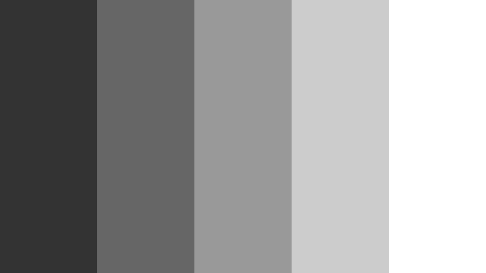
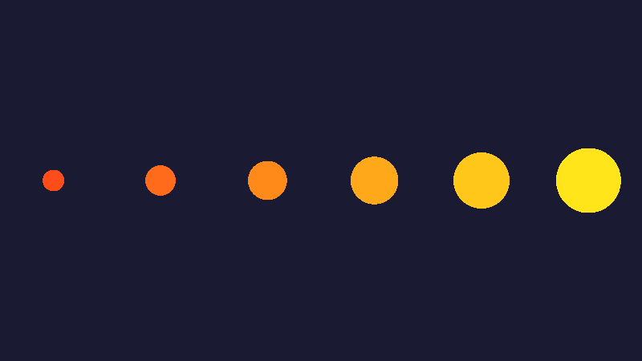
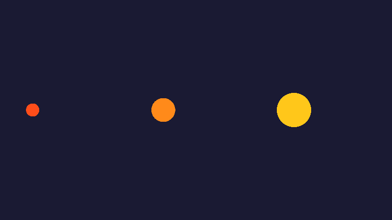
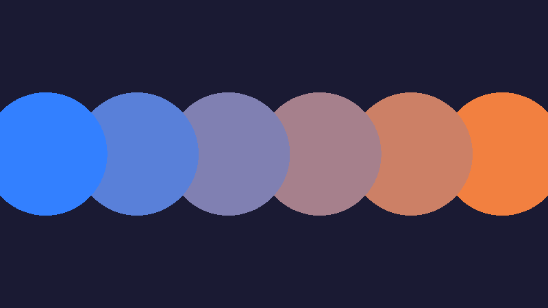
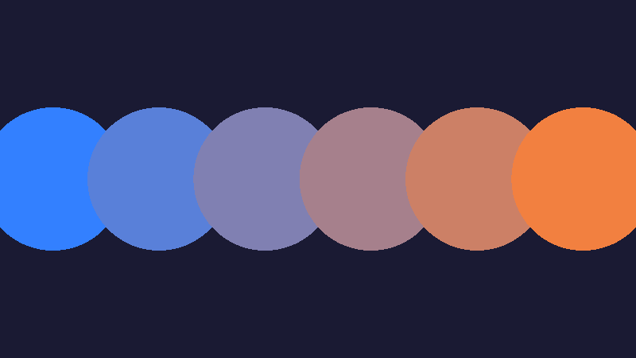

> [!SCENE] intro

Dibujar un círculo ya sabes. ¿Y seis círculos? ¿Y cincuenta? No vas a copiar y pegar el mismo bloque cincuenta veces. Para eso existen los **bucles**: le dices al shader "repite esto tantas veces", y lo hace.

Con los bucles, un shader hace cosas grandes con poco código. El fractal de Mandelbrot, que harás más adelante, no es más que un bucle que da cien vueltas por cada píxel.

> [!SCENE] for

## Paso 1: contar con un for

Copia `Plantilla.cs` como `Bucles.cs` y cambia el nombre de la clase por `Bucles`. Reemplaza la línea de `Fragment` por esto:

```csharp
int escalones = 0;
for (int i = 0; i < 5; i++)
{
    if (pixel.Uv.X > i * 0.2f)
    {
        escalones++;
    }
}
float v = escalones / 5f;
return Crear.Vec4(v, v, v, 1f);
```

Ejecuta el ciclo de trabajo:

{{register Bucles}}



Cinco franjas de gris, cada vez más claras. Vamos a ver cómo se hizo, empezando por la línea del `for`:

```csharp
for (int i = 0; i < 5; i++)
```

Tiene tres partes separadas por `;`:

| Parte | Qué hace |
|---|---|
| `int i = 0` | **Antes de empezar**, crea un contador `i` que vale `0`. |
| `i < 5` | **Antes de cada vuelta**, comprueba si se sigue. Si es falso, el bucle termina. |
| `i++` | **Al final de cada vuelta**, suma `1` a `i`. |

Así que `i` vale `0, 1, 2, 3, 4` en cada vuelta, y al llegar a `5` el bucle para: **cinco vueltas**.

Dentro del bucle, `pixel.Uv.X > i * 0.2f` pregunta "¿estoy más a la derecha que la posición `i * 0.2`?". Esas posiciones son `0, 0.2, 0.4, 0.6, 0.8`. Un píxel con `Uv.X = 0.5` supera tres de ellas (`0`, `0.2` y `0.4`), así que `escalones` termina valiendo `3`. Dividido entre `5`, da `0.6`: un gris medio.

Y recuerda lo que aprendiste en el capítulo de las decisiones: **cada píxel hace su propio recuento**. El píxel de la izquierda cuenta `0` o `1`; el de la derecha cuenta `5`.

Cambia el `5` en la condición del bucle y también el `5f`. Si usas `10` en los dos, salen diez franjas.

> [!NOTE]
> Esta es la primera vez que usamos `escalones++`. Es lo mismo que `escalones = escalones + 1`, pero más corto. Se lee "suma uno".

> [!SCENE] circles

## Paso 2: seis círculos con un solo bloque

Ahora vamos a dibujar varios círculos, pero escribiendo el código **una sola vez**. Declara el uniform, como ya sabes. Arriba:

```csharp style=glsl
using YotsubaShader.GlslSyntax.Resources;
```

```csharp style=hlsl
using YotsubaShader.HlslSyntax.Resources;
```

```csharp style=msl
using YotsubaShader.MslSyntax.Resources;
```

```csharp style=wgsl
using YotsubaShader.WgslSyntax.Resources;
```

```csharp style=spirv
using YotsubaShader.SpirvSyntax.Resources;
```

Y dentro de la clase, antes de `Vertex`:

```csharp style=glsl
    [uniform, layout(0, 0)]
    public Entorno Datos;
```

```csharp style=hlsl
    [cbuffer, register("b0")]
    public Entorno Datos;
```

```csharp style=msl
    [constant, buffer(0)]
    public Entorno Datos;
```

```csharp style=wgsl
    [uniform, @group(0), @binding(0)]
    public Entorno Datos;
```

```csharp style=spirv
    [Uniform, DescriptorSet(0), Binding(0)]
    public Entorno Datos;
```

Reemplaza `Fragment` por esto:

```csharp
float aspecto = Datos.Ancho / Datos.Alto;
float x = pixel.Uv.X * aspecto;
float y = pixel.Uv.Y;

vec4 color = Crear.Vec4(0.1f, 0.1f, 0.2f, 1f);
for (int i = 0; i < 6; i++)
{
    float centroX = (i + 0.5f) * aspecto / 6f;
    float radio = 0.03f + 0.012f * i;
    float dx = x - centroX;
    float dy = y - 0.5f;
    if (dx * dx + dy * dy < radio * radio)
    {
        color = Crear.Vec4(1f, 0.3f + 0.12f * i, 0.1f, 1f);
    }
}
return color;
```



Aquí el contador `i` no solo cuenta: **se usa en las cuentas**. En cada vuelta, `i` vale otra cosa, y por eso cada círculo sale distinto:

| Vuelta (`i`) | Posición `centroX` | Radio |
|---|---|---|
| 0 | `0.5 * aspecto / 6` | 0,030 |
| 1 | `1.5 * aspecto / 6` | 0,042 |
| 2 | `2.5 * aspecto / 6` | 0,054 |
| ... | ... | ... |
| 5 | `5.5 * aspecto / 6` | 0,090 |

La posición reparte los seis círculos a lo ancho: partimos el ancho en seis trozos iguales y ponemos cada círculo en el **medio** de su trozo (por eso el `+ 0.5f`). El radio crece `0.012` con cada vuelta, y el color de verde también.

Para tener siete círculos, cambia los dos `6` por `7`. Para que sean más grandes, cambia el `0.03f`.

> [!WARNING]
> Una trampa clásica: **la división de enteros**. Si escribes `i / 6`, y `i` es un `int`, C# divide enteros y **tira los decimales**: `1 / 6` da `0`, no `0.1666`. Por eso escribimos `(i + 0.5f) * aspecto / 6f`: en cuanto aparece un `float`, todo se calcula con decimales. Si algún día un valor te sale siempre `0` o siempre `1` sin motivo, mira si no estás dividiendo dos enteros.

> [!SCENE] continue

## Paso 3: saltarse vueltas con continue

A veces quieres que en algunas vueltas no pase nada. `continue` significa *"termina esta vuelta aquí y pasa a la siguiente"*. Agrega esto **al principio del cuerpo del bucle**, justo debajo de la llave de apertura:

```csharp
    if (i % 2 == 1)
    {
        continue;
    }
```

`i % 2 == 1` es verdadero cuando `i` es impar. En esas vueltas, `continue` salta el resto del bloque. Ejecuta el ciclo de trabajo.



Solo se dibujan los círculos de las vueltas `0`, `2` y `4`. Los demás quedaron saltados.

> [!SCENE] break

## Paso 4: parar antes con break

`break` es la otra herramienta: *"sal del bucle ahora mismo"*. Para verlo, quita el `continue` que acabas de poner y haz que los círculos se **solapen** (radio fijo grande). Reemplaza el bucle entero por este:

```csharp
for (int i = 0; i < 6; i++)
{
    float centroX = (i + 0.5f) * aspecto / 6f;
    float dx = x - centroX;
    float dy = y - 0.5f;
    if (dx * dx + dy * dy < 0.2f * 0.2f)
    {
        color = Crear.Vec4(0.2f + 0.15f * i, 0.5f, 1f - 0.15f * i, 1f);
        break;
    }
}
```

Compara este resultado con el mismo código **sin** la línea del `break` (pruébalo tú: bórrala y ejecuta de nuevo).





Sin `break`, cada vuelta pinta encima de la anterior, así que **gana el último círculo** (el de la derecha). Con `break`, en cuanto un círculo acierta, el bucle se detiene, y **gana el primero** (el de la izquierda). Es la misma idea de la cara: el orden decide quién queda arriba.

> [!SCENE] array

## Paso 5: una lista de datos, el array

Hasta ahora, lo que cambiaba en cada vuelta salía de una **fórmula** con `i`. Pero a veces los datos no siguen ninguna fórmula: son simplemente una lista. Por ejemplo, las alturas de las barras de un gráfico.

Para eso sirve el **array**: una fila de valores numerados. Se crea así:

```csharp
float[] alturas = new float[5];
alturas[0] = 0.3f;
alturas[1] = 0.8f;
alturas[2] = 0.5f;
alturas[3] = 0.9f;
alturas[4] = 0.6f;
```

- `new float[5]` crea una lista con **cinco** casilleros.
- `alturas[2]` es el casillero número `2`. Se empieza a contar en `0`: los casilleros son `0, 1, 2, 3, 4`.

Ahora, un gráfico de barras. Reemplaza `Fragment` entero por esto:

```csharp
float[] alturas = new float[5];
alturas[0] = 0.3f;
alturas[1] = 0.8f;
alturas[2] = 0.5f;
alturas[3] = 0.9f;
alturas[4] = 0.6f;

vec4 color = Crear.Vec4(0.1f, 0.1f, 0.2f, 1f);
for (int i = 0; i < 5; i++)
{
    float izquierda = i * 0.2f + 0.03f;
    float derecha = izquierda + 0.14f;
    if (pixel.Uv.X > izquierda && pixel.Uv.X < derecha && pixel.Uv.Y > 1f - alturas[i])
    {
        color = Crear.Vec4(0.2f + 0.15f * i, 0.6f, 0.9f - 0.15f * i, 1f);
    }
}
return color;
```

Ejecuta el ciclo de trabajo.


Cada vuelta dibuja una barra: su borde izquierdo y derecho salen de `i`, y su altura sale de la lista `alturas[i]`. Fíjate en la condición de la altura: `Uv.Y > 1f - alturas[i]`. Recuerda que `Y` crece hacia abajo, así que "estar por debajo de la línea" significa tener una `Y` **mayor**.

Cambia los números de la lista y verás las barras subir y bajar. Ese es el poder de combinar un bucle con un array: añadir una barra más es agregar un casillero y cambiar el `5` por un `6`.

> [!NOTE]
> Los arrays de un shader tienen un tamaño fijo, que debes escribir al crearlos: `new float[5]`. No puedes pedir un tamaño que dependa de una variable, porque la GPU necesita saber cuánta memoria reservar antes de empezar.

> [!SCENE] while

## Otro bucle: while

Existe otra forma de repetir, el `while`, que sigue mientras una condición sea verdadera:

```csharp
int pasos = 0;
while (pasos < 100)
{
    pasos++;
}
```

Hace lo mismo que un `for`, con la diferencia de que tú te encargas del contador. Lo usarás cuando no sepas antes de empezar cuántas vueltas dar, aunque siempre con un tope. El Mandelbrot, más adelante, es un ejemplo.

> [!SCENE] cost

## Cuidado: los bucles cuestan

Hay una cuenta que conviene hacer. Si tu ventana tiene 360.000 píxeles y tu bucle da 100 vueltas, la GPU hace 36 millones de vueltas por imagen. Es una barbaridad para una persona, pero una GPU lo aguanta bien. Lo que no aguanta es un bucle **sin fin**.

> [!WARNING]
> Si escribes un bucle con una condición que nunca se vuelve falsa, el shader no termina, y tu pantalla puede congelarse o el programa cerrarse. Dale siempre un tope claro: `i < 100`, o un `break` que seguro se alcance. En un shader no existe el "ya terminará".

Una regla práctica: empieza con pocas vueltas, mira que funcione, y sube el número solo si hace falta.

## Todo junto

Este es el archivo completo del gráfico de barras:

```csharp style=glsl title="MisShaders/Bucles.cs"
using YotsubaShader.GlslSyntax;
using YotsubaShader.GlslSyntax.Types;
using YotsubaShader.Language;

namespace MisShaders;

public class Bucles
{
    [ShaderStage(Stage.Vertex)]
    public Pixel Vertex({{vertexType}} vertice)
    {
        Pixel pixel;
        pixel.Posicion = Crear.Vec4(vertice.{{pos}}.X, vertice.{{pos}}.Y, 0f, 1f);
        pixel.Uv = vertice.{{uv}};
        return pixel;
    }

    [ShaderStage(Stage.Fragment)]
    [return: location(0)]
    public vec4 Fragment(PixelIn pixel)
    {
        float[] alturas = new float[5];
        alturas[0] = 0.3f;
        alturas[1] = 0.8f;
        alturas[2] = 0.5f;
        alturas[3] = 0.9f;
        alturas[4] = 0.6f;

        vec4 color = Crear.Vec4(0.1f, 0.1f, 0.2f, 1f);
        for (int i = 0; i < 5; i++)
        {
            float izquierda = i * 0.2f + 0.03f;
            float derecha = izquierda + 0.14f;
            if (pixel.Uv.X > izquierda && pixel.Uv.X < derecha && pixel.Uv.Y > 1f - alturas[i])
            {
                color = Crear.Vec4(0.2f + 0.15f * i, 0.6f, 0.9f - 0.15f * i, 1f);
            }
        }
        return color;
    }
}
```

```csharp style=hlsl title="MisShaders/Bucles.cs"
using YotsubaShader.HlslSyntax;
using YotsubaShader.GlslSyntax.Types;
using YotsubaShader.Language;

namespace MisShaders;

public class Bucles
{
    [ShaderStage(Stage.Vertex)]
    public Pixel Vertex({{vertexType}} vertice)
    {
        Pixel pixel;
        pixel.Posicion = Crear.Vec4(vertice.{{pos}}.X, vertice.{{pos}}.Y, 0f, 1f);
        pixel.Uv = vertice.{{uv}};
        return pixel;
    }

    [ShaderStage(Stage.Fragment)]
    [return: SV_Target]
    public vec4 Fragment(PixelIn pixel)
    {
        float[] alturas = new float[5];
        alturas[0] = 0.3f;
        alturas[1] = 0.8f;
        alturas[2] = 0.5f;
        alturas[3] = 0.9f;
        alturas[4] = 0.6f;

        vec4 color = Crear.Vec4(0.1f, 0.1f, 0.2f, 1f);
        for (int i = 0; i < 5; i++)
        {
            float izquierda = i * 0.2f + 0.03f;
            float derecha = izquierda + 0.14f;
            if (pixel.Uv.X > izquierda && pixel.Uv.X < derecha && pixel.Uv.Y > 1f - alturas[i])
            {
                color = Crear.Vec4(0.2f + 0.15f * i, 0.6f, 0.9f - 0.15f * i, 1f);
            }
        }
        return color;
    }
}
```

```csharp style=msl title="MisShaders/Bucles.cs"
using YotsubaShader.MslSyntax;
using YotsubaShader.GlslSyntax.Types;
using YotsubaShader.Language;

namespace MisShaders;

public class Bucles
{
    [ShaderStage(Stage.Vertex)]
    public Pixel Vertex({{vertexType}} vertice)
    {
        Pixel pixel;
        pixel.Posicion = Crear.Vec4(vertice.{{pos}}.X, vertice.{{pos}}.Y, 0f, 1f);
        pixel.Uv = vertice.{{uv}};
        return pixel;
    }

    [ShaderStage(Stage.Fragment)]
    [return: color(0)]
    public vec4 Fragment(PixelIn pixel)
    {
        float[] alturas = new float[5];
        alturas[0] = 0.3f;
        alturas[1] = 0.8f;
        alturas[2] = 0.5f;
        alturas[3] = 0.9f;
        alturas[4] = 0.6f;

        vec4 color = Crear.Vec4(0.1f, 0.1f, 0.2f, 1f);
        for (int i = 0; i < 5; i++)
        {
            float izquierda = i * 0.2f + 0.03f;
            float derecha = izquierda + 0.14f;
            if (pixel.Uv.X > izquierda && pixel.Uv.X < derecha && pixel.Uv.Y > 1f - alturas[i])
            {
                color = Crear.Vec4(0.2f + 0.15f * i, 0.6f, 0.9f - 0.15f * i, 1f);
            }
        }
        return color;
    }
}
```

```csharp style=wgsl title="MisShaders/Bucles.cs"
using YotsubaShader.WgslSyntax;
using YotsubaShader.GlslSyntax.Types;
using YotsubaShader.Language;

namespace MisShaders;

public class Bucles
{
    [ShaderStage(Stage.Vertex)]
    public Pixel Vertex({{vertexType}} vertice)
    {
        Pixel pixel;
        pixel.Posicion = Crear.Vec4(vertice.{{pos}}.X, vertice.{{pos}}.Y, 0f, 1f);
        pixel.Uv = vertice.{{uv}};
        return pixel;
    }

    [ShaderStage(Stage.Fragment)]
    [return: location(0)]
    public vec4 Fragment(PixelIn pixel)
    {
        float[] alturas = new float[5];
        alturas[0] = 0.3f;
        alturas[1] = 0.8f;
        alturas[2] = 0.5f;
        alturas[3] = 0.9f;
        alturas[4] = 0.6f;

        vec4 color = Crear.Vec4(0.1f, 0.1f, 0.2f, 1f);
        for (int i = 0; i < 5; i++)
        {
            float izquierda = i * 0.2f + 0.03f;
            float derecha = izquierda + 0.14f;
            if (pixel.Uv.X > izquierda && pixel.Uv.X < derecha && pixel.Uv.Y > 1f - alturas[i])
            {
                color = Crear.Vec4(0.2f + 0.15f * i, 0.6f, 0.9f - 0.15f * i, 1f);
            }
        }
        return color;
    }
}
```

```csharp style=spirv title="MisShaders/Bucles.cs"
using YotsubaShader.SpirvSyntax;
using YotsubaShader.GlslSyntax.Types;
using YotsubaShader.Language;

namespace MisShaders;

public class Bucles
{
    [ShaderStage(Stage.Vertex)]
    public Pixel Vertex({{vertexType}} vertice)
    {
        Pixel pixel;
        pixel.Posicion = Crear.Vec4(vertice.{{pos}}.X, vertice.{{pos}}.Y, 0f, 1f);
        pixel.Uv = vertice.{{uv}};
        return pixel;
    }

    [ShaderStage(Stage.Fragment)]
    [return: Location(0)]
    public vec4 Fragment(PixelIn pixel)
    {
        float[] alturas = new float[5];
        alturas[0] = 0.3f;
        alturas[1] = 0.8f;
        alturas[2] = 0.5f;
        alturas[3] = 0.9f;
        alturas[4] = 0.6f;

        vec4 color = Crear.Vec4(0.1f, 0.1f, 0.2f, 1f);
        for (int i = 0; i < 5; i++)
        {
            float izquierda = i * 0.2f + 0.03f;
            float derecha = izquierda + 0.14f;
            if (pixel.Uv.X > izquierda && pixel.Uv.X < derecha && pixel.Uv.Y > 1f - alturas[i])
            {
                color = Crear.Vec4(0.2f + 0.15f * i, 0.6f, 0.9f - 0.15f * i, 1f);
            }
        }
        return color;
    }
}
```

> [!SCENE] learned

## Lo que aprendiste

- `for (int i = 0; i < n; i++)` repite un bloque `n` veces, con `i` valiendo `0, 1, ..., n - 1`.
- El contador `i` se puede usar en las cuentas, y eso hace que cada vuelta dibuje algo distinto.
- `continue` salta a la siguiente vuelta. `break` sale del bucle.
- Un array es una lista de datos de tamaño fijo, numerada desde `0`.
- Dividir dos enteros descarta los decimales. Si necesitas decimales, pon una `f`.
- Un bucle siempre debe tener tope. Cada píxel lo ejecuta entero.

Siguiente: [El tiempo](time.md).
