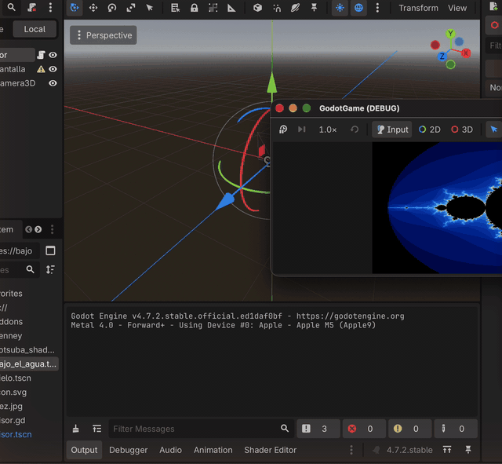
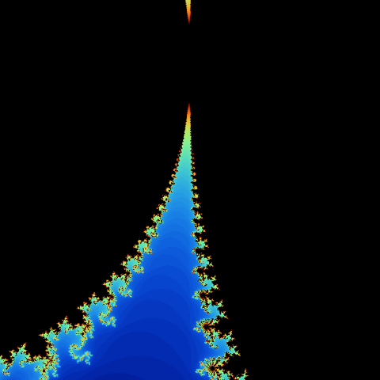
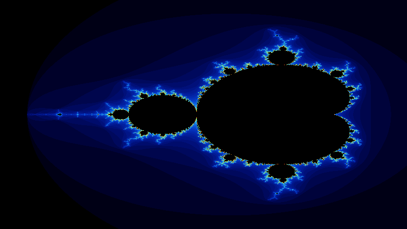
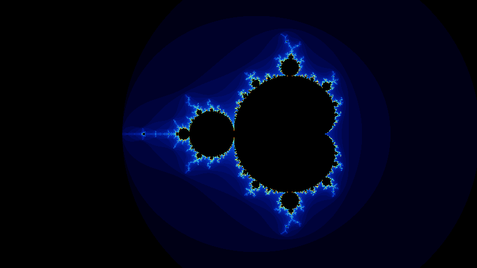
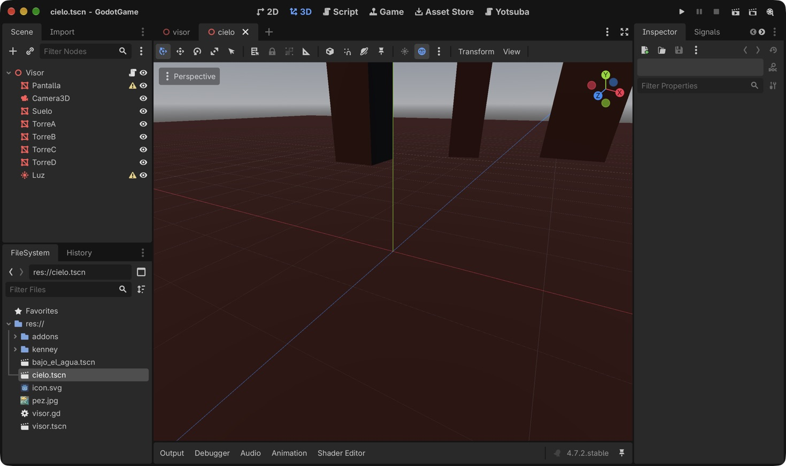
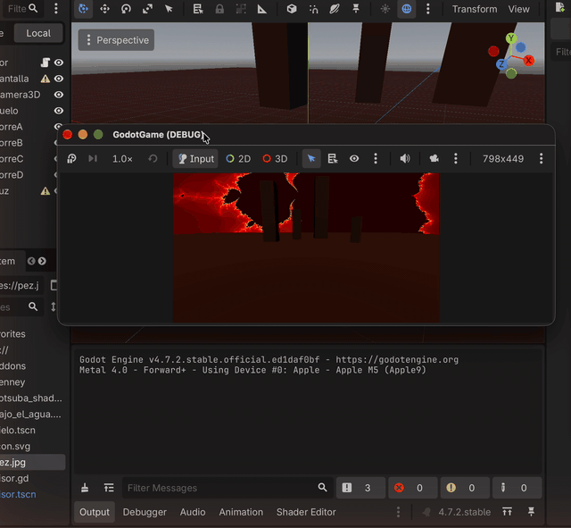

> [!SCENE] intro

Ya sabes decidir con `if`, repetir con bucles, escribir tus propias funciones y mover cosas con el tiempo. Ahora vas a juntar todo en un shader más ambicioso: cada píxel ejecutará un bucle de hasta 100 vueltas, y con eso vas a dibujar esto:


:::godot

:::

Se llama fractal de Mandelbrot. Lo curioso es que no hay ninguna imagen guardada en ningún sitio: todo ese dibujo sale de una fórmula de dos líneas, repetida muchas veces.

No hay nada nuevo de C# en este capítulo. Es la prueba de que lo que aprendiste en los anteriores alcanza para dibujar algo tan complejo como esto.

> [!SCENE] idea

## La idea, sin matemáticas

Para cada píxel hacemos lo siguiente:

1. Tomamos dos números que dependen de dónde está el píxel. Los llamaremos `cx` y `cy`.
2. Empezamos con otros dos números, `x` e `y`, en cero.
3. Aplicamos una fórmula que cambia `x` e `y`, usando `cx` y `cy`. Y la volvemos a aplicar. Y otra vez.
4. Con algunos píxeles, `x` e `y` se quedan siempre pequeños, por más vueltas que demos. Con otros, crecen sin parar y "se escapan".
5. Contamos cuántas vueltas aguantó cada píxel antes de escaparse. Ese número decide su color.

Los píxeles que nunca se escapan son la figura negra. Los que se escapan rápido son el fondo oscuro. Y los que tardan en escaparse forman los bordes brillantes.

Eso es todo. No hace falta que entiendas por qué la fórmula produce ese dibujo. Lo que nos interesa es cómo se escribe.

> [!SCENE] count

## Paso 1: contar las vueltas

Esta es la función que hace las vueltas. Es C# normal:

```csharp
public static int ContarPasos(float cx, float cy)
{
    float x = 0f;
    float y = 0f;
    int pasos = 0;

    while (pasos < 100)
    {
        float nuevoX = x * x - y * y + cx;
        float nuevoY = 2f * x * y + cy;
        x = nuevoX;
        y = nuevoY;

        if (x * x + y * y > 4f)
        {
            break;
        }

        pasos++;
    }

    return pasos;
}
```

Léela de arriba abajo:

- El `while` da como máximo 100 vueltas.
- Las dos primeras líneas dentro del bucle son la fórmula. Calculan los nuevos `x` e `y` a partir de los anteriores.
- El `if` comprueba si el punto ya se escapó. Si es así, `break` corta el bucle.
- Si no, sumamos una vuelta y seguimos.

La función devuelve cuántas vueltas dio. Si devuelve 100, es que el punto nunca se escapó.

Fíjate en lo que hay aquí: un `while`, un `if`, un `break`, un `int` y un `++`. Todo eso funciona dentro de la GPU.

> [!WARNING]
> Un bucle en un shader siempre debe tener un final seguro. Aquí es `pasos < 100`. Un bucle que nunca termina no da un error: congela la GPU, y con ella la pantalla entera.

> [!SCENE] map

## Paso 2: del píxel a `cx` y `cy`

`ContarPasos` necesita dos números para cada píxel. Los sacamos de `Uv`, que ya conoces: va de `0` a `1`.

El dibujo del fractal vive entre `-2.2` y `0.8` de izquierda a derecha, y entre `-1.5` y `1.5` de arriba abajo. Así que hay que convertir un número que va de `0` a `1` en uno que va, por ejemplo, de `-2.2` a `0.8`:

```csharp
float cx = pixel.Uv.X * 3f - 2.2f;
float cy = pixel.Uv.Y * 3f - 1.5f;
```

Compruébalo con los extremos: cuando `Uv.X` es `0`, `cx` vale `-2.2`. Cuando es `1`, vale `3 - 2.2 = 0.8`. Esta cuenta de "multiplico para estirar y resto para mover" la vas a usar en todos los shaders.

> [!SCENE] color

## Paso 3: del número de vueltas a un color

Si el punto dio las 100 vueltas, lo pintamos de negro. Si no, convertimos sus vueltas en un color:

```csharp
int pasos = ContarPasos(cx, cy);

if (pasos == 100)
{
    return new vec4(0f, 0f, 0f, 1f);
}

float t = pasos / 100f;
return Paleta(t);
```

`t` es el número de vueltas llevado a un valor entre `0` y `1`. Mira que dividimos entre `100f`, con la `f`: así la división es entre `float`. Si escribieras `pasos / 100`, C# haría una división entre enteros y el resultado sería siempre `0`.

Y esta es la función que convierte `t` en un color:

```csharp
public static vec4 Paleta(float t)
{
    float resto = 1f - t;
    float rojo = 9f * resto * t * t * t;
    float verde = 15f * resto * resto * t * t;
    float azul = 8.5f * resto * resto * resto * t;
    return new vec4(rojo, verde, azul, 1f);
}
```

No tienes que memorizar esos números. Lo que hacen es que el azul aparezca con valores pequeños de `t`, el verde con valores medios y el rojo con valores altos. Así los puntos que se escapan rápido salen azules oscuros y los que tardan más pasan por el celeste hasta el amarillo.

## El shader completo

Crea `MisShaders/Mandelbrot.cs`:

```csharp style=glsl title="MisShaders/Mandelbrot.cs"
using YotsubaShader.GlslSyntax;
using YotsubaShader.GlslSyntax.Types;
using YotsubaShader.Language;

namespace MisShaders;

public class Mandelbrot
{
    [ShaderStage(Stage.Vertex)]
    public Pixel Vertex({{vertexType}} vertice)
    {
        Pixel pixel;
        pixel.Posicion = new vec4(vertice.{{pos}}.X, vertice.{{pos}}.Y, 0f, 1f);
        pixel.Uv = vertice.{{uv}};
        return pixel;
    }

    [ShaderStage(Stage.Fragment)]
    [return: location(0)]
    public vec4 Fragment(PixelIn pixel)
    {
        float cx = pixel.Uv.X * 3f - 2.2f;
        float cy = pixel.Uv.Y * 3f - 1.5f;

        int pasos = ContarPasos(cx, cy);

        if (pasos == 100)
        {
            return new vec4(0f, 0f, 0f, 1f);
        }

        float t = pasos / 100f;
        return Paleta(t);
    }

    public static int ContarPasos(float cx, float cy)
    {
        float x = 0f;
        float y = 0f;
        int pasos = 0;

        while (pasos < 100)
        {
            float nuevoX = x * x - y * y + cx;
            float nuevoY = 2f * x * y + cy;
            x = nuevoX;
            y = nuevoY;

            if (x * x + y * y > 4f)
            {
                break;
            }

            pasos++;
        }

        return pasos;
    }

    public static vec4 Paleta(float t)
    {
        float resto = 1f - t;
        float rojo = 9f * resto * t * t * t;
        float verde = 15f * resto * resto * t * t;
        float azul = 8.5f * resto * resto * resto * t;
        return new vec4(rojo, verde, azul, 1f);
    }
}
```

```csharp style=hlsl title="MisShaders/Mandelbrot.cs"
using YotsubaShader.HlslSyntax;
using YotsubaShader.GlslSyntax.Types;
using YotsubaShader.Language;

namespace MisShaders;

public class Mandelbrot
{
    [ShaderStage(Stage.Vertex)]
    public Pixel Vertex({{vertexType}} vertice)
    {
        Pixel pixel;
        pixel.Posicion = new vec4(vertice.{{pos}}.X, vertice.{{pos}}.Y, 0f, 1f);
        pixel.Uv = vertice.{{uv}};
        return pixel;
    }

    [ShaderStage(Stage.Fragment)]
    [return: SV_Target]
    public vec4 Fragment(PixelIn pixel)
    {
        float cx = pixel.Uv.X * 3f - 2.2f;
        float cy = pixel.Uv.Y * 3f - 1.5f;

        int pasos = ContarPasos(cx, cy);

        if (pasos == 100)
        {
            return new vec4(0f, 0f, 0f, 1f);
        }

        float t = pasos / 100f;
        return Paleta(t);
    }

    public static int ContarPasos(float cx, float cy)
    {
        float x = 0f;
        float y = 0f;
        int pasos = 0;

        while (pasos < 100)
        {
            float nuevoX = x * x - y * y + cx;
            float nuevoY = 2f * x * y + cy;
            x = nuevoX;
            y = nuevoY;

            if (x * x + y * y > 4f)
            {
                break;
            }

            pasos++;
        }

        return pasos;
    }

    public static vec4 Paleta(float t)
    {
        float resto = 1f - t;
        float rojo = 9f * resto * t * t * t;
        float verde = 15f * resto * resto * t * t;
        float azul = 8.5f * resto * resto * resto * t;
        return new vec4(rojo, verde, azul, 1f);
    }
}
```

```csharp style=msl title="MisShaders/Mandelbrot.cs"
using YotsubaShader.MslSyntax;
using YotsubaShader.GlslSyntax.Types;
using YotsubaShader.Language;

namespace MisShaders;

public class Mandelbrot
{
    [ShaderStage(Stage.Vertex)]
    public Pixel Vertex({{vertexType}} vertice)
    {
        Pixel pixel;
        pixel.Posicion = new vec4(vertice.{{pos}}.X, vertice.{{pos}}.Y, 0f, 1f);
        pixel.Uv = vertice.{{uv}};
        return pixel;
    }

    [ShaderStage(Stage.Fragment)]
    [return: color(0)]
    public vec4 Fragment(PixelIn pixel)
    {
        float cx = pixel.Uv.X * 3f - 2.2f;
        float cy = pixel.Uv.Y * 3f - 1.5f;

        int pasos = ContarPasos(cx, cy);

        if (pasos == 100)
        {
            return new vec4(0f, 0f, 0f, 1f);
        }

        float t = pasos / 100f;
        return Paleta(t);
    }

    public static int ContarPasos(float cx, float cy)
    {
        float x = 0f;
        float y = 0f;
        int pasos = 0;

        while (pasos < 100)
        {
            float nuevoX = x * x - y * y + cx;
            float nuevoY = 2f * x * y + cy;
            x = nuevoX;
            y = nuevoY;

            if (x * x + y * y > 4f)
            {
                break;
            }

            pasos++;
        }

        return pasos;
    }

    public static vec4 Paleta(float t)
    {
        float resto = 1f - t;
        float rojo = 9f * resto * t * t * t;
        float verde = 15f * resto * resto * t * t;
        float azul = 8.5f * resto * resto * resto * t;
        return new vec4(rojo, verde, azul, 1f);
    }
}
```

```csharp style=wgsl title="MisShaders/Mandelbrot.cs"
using YotsubaShader.WgslSyntax;
using YotsubaShader.GlslSyntax.Types;
using YotsubaShader.Language;

namespace MisShaders;

public class Mandelbrot
{
    [ShaderStage(Stage.Vertex)]
    public Pixel Vertex({{vertexType}} vertice)
    {
        Pixel pixel;
        pixel.Posicion = new vec4(vertice.{{pos}}.X, vertice.{{pos}}.Y, 0f, 1f);
        pixel.Uv = vertice.{{uv}};
        return pixel;
    }

    [ShaderStage(Stage.Fragment)]
    [return: location(0)]
    public vec4 Fragment(PixelIn pixel)
    {
        float cx = pixel.Uv.X * 3f - 2.2f;
        float cy = pixel.Uv.Y * 3f - 1.5f;

        int pasos = ContarPasos(cx, cy);

        if (pasos == 100)
        {
            return new vec4(0f, 0f, 0f, 1f);
        }

        float t = pasos / 100f;
        return Paleta(t);
    }

    public static int ContarPasos(float cx, float cy)
    {
        float x = 0f;
        float y = 0f;
        int pasos = 0;

        while (pasos < 100)
        {
            float nuevoX = x * x - y * y + cx;
            float nuevoY = 2f * x * y + cy;
            x = nuevoX;
            y = nuevoY;

            if (x * x + y * y > 4f)
            {
                break;
            }

            pasos++;
        }

        return pasos;
    }

    public static vec4 Paleta(float t)
    {
        float resto = 1f - t;
        float rojo = 9f * resto * t * t * t;
        float verde = 15f * resto * resto * t * t;
        float azul = 8.5f * resto * resto * resto * t;
        return new vec4(rojo, verde, azul, 1f);
    }
}
```

```csharp style=spirv title="MisShaders/Mandelbrot.cs"
using YotsubaShader.SpirvSyntax;
using YotsubaShader.GlslSyntax.Types;
using YotsubaShader.Language;

namespace MisShaders;

public class Mandelbrot
{
    [ShaderStage(Stage.Vertex)]
    public Pixel Vertex({{vertexType}} vertice)
    {
        Pixel pixel;
        pixel.Posicion = new vec4(vertice.{{pos}}.X, vertice.{{pos}}.Y, 0f, 1f);
        pixel.Uv = vertice.{{uv}};
        return pixel;
    }

    [ShaderStage(Stage.Fragment)]
    [return: Location(0)]
    public vec4 Fragment(PixelIn pixel)
    {
        float cx = pixel.Uv.X * 3f - 2.2f;
        float cy = pixel.Uv.Y * 3f - 1.5f;

        int pasos = ContarPasos(cx, cy);

        if (pasos == 100)
        {
            return new vec4(0f, 0f, 0f, 1f);
        }

        float t = pasos / 100f;
        return Paleta(t);
    }

    public static int ContarPasos(float cx, float cy)
    {
        float x = 0f;
        float y = 0f;
        int pasos = 0;

        while (pasos < 100)
        {
            float nuevoX = x * x - y * y + cx;
            float nuevoY = 2f * x * y + cy;
            x = nuevoX;
            y = nuevoY;

            if (x * x + y * y > 4f)
            {
                break;
            }

            pasos++;
        }

        return pasos;
    }

    public static vec4 Paleta(float t)
    {
        float resto = 1f - t;
        float rojo = 9f * resto * t * t * t;
        float verde = 15f * resto * resto * t * t;
        float azul = 8.5f * resto * resto * resto * t;
        return new vec4(rojo, verde, azul, 1f);
    }
}
```

> [!SCENE] notice

Tres cosas que conviene notar:

- **El método `Vertex` es el mismo del shader anterior.** Cuando lo que dibujas es un rectángulo que cubre la pantalla, la etapa Vertex no cambia. Lo interesante pasa en `Fragment`.
- **`Vertice`, `Pixel` y `PixelIn` no los volviste a escribir.** Están en `Pantalla.cs` y los comparten todos tus shaders, como cualquier `struct` de tu proyecto.
- **Las funciones `ContarPasos` y `Paleta` no llevan `[ShaderStage]`.** Solo las etapas lo llevan. Las demás son funciones de ayuda, y el compilador las encuentra solo porque `Fragment` las llama.

> [!SCENE] compile

## Compila y mira el resultado

El mismo comando de siempre. Como `add` compila todos los shaders del proyecto, ahora procesa los dos:

{{register Mandelbrot}}

:::xna raylib silknet
Se abre el visor con tu fractal. Probablemente lo veas **estirado a lo ancho**. No es un fallo del shader: es el mismo problema del óvalo del capítulo de las [coordenadas](coordinates.md). Este shader convierte el `Uv` en números sin tener en cuenta que la ventana es más ancha que alta. Para verlo bien, hazla cuadrada: en `Visor/Program.cs`, cambia `800` y `450` por `600` y `600`. Al final del capítulo tienes un reto para arreglarlo en el propio shader.
:::

:::godot
Se abre el visor con tu fractal. Probablemente lo veas **estirado a lo ancho**. No es un fallo del shader: es el mismo problema del óvalo del capítulo de las [coordenadas](coordinates.md). Este shader convierte el `Uv` en números sin tener en cuenta que la ventana es más ancha que alta. Para verlo bien, hazla cuadrada: en **Proyecto → Configuración del proyecto → Display → Window**, pon **Viewport Width** y **Viewport Height** en `600` y `600`. Al final del capítulo tienes un reto para arreglarlo en el propio shader.
:::

Si además quieres ver la versión compilada, en `Probar/Program.cs` cambia `new Degradado()` por `new Mandelbrot()`:

```csharp title="Probar/Program.cs"
using MisShaders;
using YotsubaShader;
using YotsubaShader.Language;

var shader = new Mandelbrot();

Console.WriteLine(shader.ToGlsl(Stage.Fragment));
```

```bash
dotnet run --project Probar
```

En la salida busca tu función `ContarPasos`. Está ahí, con su bucle:

```glsl
int ContarPasos(float cx, float cy)
{
    float x = 0.0;
    float y = 0.0;
    int pasos = 0;
    while (pasos < 100)
    {
        float nuevoX = ((x * x) - (y * y)) + cx;
        float nuevoY = ((2.0 * x) * y) + cy;
        x = nuevoX;
        y = nuevoY;
        if (((x * x) + (y * y)) > 4.0)
        {
            break;
        }
        pasos++;
    }
    return pasos;
}
```

Piensa un momento en lo que hace la GPU con esto. Si dibujas en una ventana de 600 por 600, son 360.000 píxeles. Cada uno da hasta 100 vueltas. Son hasta 36 millones de vueltas por imagen, y la GPU lo hace decenas de veces por segundo sin esfuerzo, porque todos los píxeles trabajan a la vez. Esta es la razón 1 del capítulo [¿Qué es un Shader?](what-is-a-shader.md), ahora con un ejemplo de verdad.

> [!SCENE] play

## Juega con él

Lo mejor de un fractal es que puedes acercarte todo lo que quieras y siempre hay más detalle. Para acercarte solo hay que cambiar las dos líneas que calculan `cx` y `cy`: un número más pequeño al multiplicar es más zoom, y el número que restas mueve la vista.

Prueba con estas:

```csharp
float cx = pixel.Uv.X * 0.3f - 0.9f;
float cy = pixel.Uv.Y * 0.3f - 0.05f;
```



Otras cosas que puedes probar (recuerda ejecutar `add` después de cada cambio):

- Cambia los dos `100` por `20`. El borde pierde detalle, porque los puntos tienen menos vueltas para demostrar si se escapan.
- En `Paleta`, intercambia `rojo` y `azul` en la última línea. El fractal pasa de azul a naranja.

> [!SCENE] challenge

### Reto: que no se estire

En una ventana ancha el fractal sale estirado:



Ya sabes arreglarlo: lo hiciste con el círculo. Inténtalo tú antes de mirar la solución. Necesitas tres cosas: declarar el uniform `Datos` (con su `using`), calcular el `aspecto`, y usarlo en `cx`. Y para que el fractal siga centrado, conviene medir desde el centro de la ventana (`Uv.X - 0.5f`), como en el capítulo de las coordenadas.

Una solución posible: declara el uniform en la clase `Mandelbrot`, como siempre,

```csharp style=glsl
    [uniform, layout(0, 0)]
    public Entorno Datos;
```

```csharp style=hlsl
    [cbuffer, register("b0")]
    public Entorno Datos;
```

```csharp style=msl
    [constant, buffer(0)]
    public Entorno Datos;
```

```csharp style=wgsl
    [uniform, @group(0), @binding(0)]
    public Entorno Datos;
```

```csharp style=spirv
    [Uniform, DescriptorSet(0), Binding(0)]
    public Entorno Datos;
```

y reemplaza las dos líneas de `cx` y `cy` por estas tres:

```csharp
float aspecto = Datos.Ancho / Datos.Alto;
float cx = (pixel.Uv.X - 0.5f) * 3f * aspecto - 0.7f;
float cy = (pixel.Uv.Y - 0.5f) * 3f;
```



Los números `3f` y `-0.7f` son los que antes salían del `3f` y el `-2.2f`: el `3` es cuánto de plano se ve de alto, y el `-0.7` es el centro de la vista en horizontal.

:::godot
## Un extra para Godot: un cielo apocalíptico

En Godot el fractal no tiene por qué quedarse dentro de un rectángulo. Vas a usarlo como el **cielo de una escena 3D**, con una ondulación que hace que el aire parezca arder.

> [!NOTE]
> Este shader es **temporal**, solo para lucirte. No lo necesitarás después: al terminar vuelves a `Mandelbrot` y el resto del tutorial sigue igual que en las demás rutas.

Crea `MisShaders/MandelbrotCielo.cs`:

```csharp style=glsl title="MisShaders/MandelbrotCielo.cs"
using YotsubaShader.GlslSyntax;
using YotsubaShader.GlslSyntax.Resources;
using YotsubaShader.GlslSyntax.Types;
using YotsubaShader.Language;
using static YotsubaShader.GlslSyntax.Methods.Math;

namespace MisShaders;

public struct RelojCielo
{
    public float Segundos;
}

public class MandelbrotCielo
{
    [uniform, layout(0, 0)]
    public RelojCielo Cielo;

    [ShaderStage(Stage.Vertex)]
    public Pixel Vertex(VerticeGodot vertice)
    {
        Pixel pixel;
        // z casi 0: el rectángulo queda en el fondo de todo, detrás de cualquier objeto de la escena.
        pixel.Posicion = new vec4(vertice.VERTEX.X, vertice.VERTEX.Y, 0.00001f, 1f);
        pixel.Uv = vertice.UV;
        return pixel;
    }

    [ShaderStage(Stage.Fragment)]
    [return: location(0)]
    public vec4 Fragment(PixelIn pixel)
    {
        float t = Cielo.Segundos;

        // La ondulación: cada fila del cielo se empuja hacia un lado con una onda que sube.
        float u = pixel.Uv.X + 0.012f * sin(pixel.Uv.Y * 38f - t * 2.5f);
        float v = pixel.Uv.Y + 0.008f * sin(pixel.Uv.X * 29f + t * 1.7f);

        // Un zoom lento que "respira" sobre el borde superior del fractal.
        float zoom = 1.1f + 0.2f * sin(t * 0.15f);
        float cx = -0.65f + (u - 0.5f) * 3f / zoom;
        float cy = 0.45f + (v - 0.5f) * 1.7f / zoom;

        int pasos = ContarPasos(cx, cy);
        float k = pasos / 100f;
        float red = clamp(k * 4f, 0f, 1f);
        float green = clamp(k * 4f - 1.2f, 0f, 1f) * 0.55f;
        float blue = clamp(k * 4f - 3f, 0f, 1f) * 0.25f;

        // El interior del conjunto (los 100 pasos) es el núcleo oscuro del cielo.
        float dentro = step(100f, pasos);
        red = mix(red, 0.02f, dentro);
        green = mix(green, 0f, dentro);
        blue = mix(blue, 0f, dentro);
        return new vec4(red, green, blue, 1f);
    }

    public static int ContarPasos(float cx, float cy)
    {
        float x = 0f;
        float y = 0f;
        int pasos = 0;

        while (pasos < 100)
        {
            float nuevoX = x * x - y * y + cx;
            float nuevoY = 2f * x * y + cy;
            x = nuevoX;
            y = nuevoY;

            if (x * x + y * y > 4f)
            {
                break;
            }

            pasos++;
        }

        return pasos;
    }
}
```

Hay tres ideas nuevas:

- **`0.00001f` en la posición.** Hasta ahora el tercer número de `Posicion` era `0f`. En Godot, ese número es la profundidad: qué tan lejos de la cámara está el punto. Con casi cero, el rectángulo se va al fondo de todo, detrás de todo lo demás. Los objetos que están delante lo tapan, igual que un cielo de verdad.
- **La ondulación.** Antes de convertir el píxel en `cx` y `cy`, empujas un poco `Uv.X` con un `sin` de la altura, y `Uv.Y` con un `sin` del ancho. Los dos incluyen el tiempo, así que las ondas viajan. Cambia `0.012f` por `0.05f` y el cielo se derretirá.
- **`step` y `mix` en lugar de un `if`.** El interior del conjunto se pinta con estas dos, que eligen un color sin ramificar. `step(100f, pasos)` vale `1` cuando el píxel nunca escapó y `0` en caso contrario; `mix` usa ese número para elegir entre el color del fuego y el núcleo oscuro.

Ahora la escena. Abre `visor.tscn` y guárdala con otro nombre (**Scene → Save Scene As…**): `cielo.tscn`. Luego añade, como hijos de `Visor`:

- **`Suelo`**: un `MeshInstance3D`. En el Inspector, **Mesh → New PlaneMesh** y pon su **Size** en `80 × 80`.
- **`TorreA` … `TorreD`**: más `MeshInstance3D`, con **Mesh → New BoxMesh**, altas y delgadas (por ejemplo `1.6 × 7 × 1.6`). Colócalas entre `-4` y `-11` en Z, con alturas distintas.
- **`Luz`**: un `DirectionalLight3D` de color naranja.

Selecciona la `Camera3D` y súbela y échala hacia atrás (`Position` Y `1.6`, Z `8`). Selecciona la raíz y escribe `MandelbrotCielo` en **Shader Name**.



Pulsa **Play Scene** (`Cmd/Ctrl+R`):



El fractal es tu propio código, corriendo como fondo de una escena 3D. Para volver, abre `visor.tscn`: sigue diciendo `Mandelbrot`.
:::

> [!SCENE] allowed

## Qué puedes usar dentro de un shader y qué no

Ya viste que mucho de C# funciona. Este es el resumen:

| Sí puedes | No puedes |
| --- | --- |
| `float`, `int`, `uint`, `bool` | `string`, `double`, `object` |
| `vec2`, `vec3`, `vec4` y tus propios `struct` | Clases, listas, diccionarios |
| `if`, `else`, `for`, `while`, `break`, `continue` | `try`, `catch`, `foreach` sobre listas |
| Llamar a funciones `static` tuyas | Que una función se llame a sí misma (recursión) |
| `+`, `-`, `*`, `/`, `%`, comparaciones, `&&`, `||` | `new` de objetos, `async`, lambdas |

La regla general es la del primer capítulo: la GPU solo sabe hacer cuentas. Si algo necesita memoria que crece, texto o el sistema operativo, no existe allí.

> [!SCENE] learned

## Lo que aprendiste

- Dentro de un shader puedes usar `if`, `while`, `for` y `break`.
- Puedes partir tu shader en funciones `static`. No llevan ningún atributo.
- Cada píxel ejecuta su propio bucle, y todos a la vez.
- Para pasar de `Uv` a otro rango: multiplicas para estirar y sumas o restas para mover.
- Cuidado con dividir enteros: usa `100f`, no `100`.

Siguiente: [Shader 3: un anillo de neón](neon.md).
