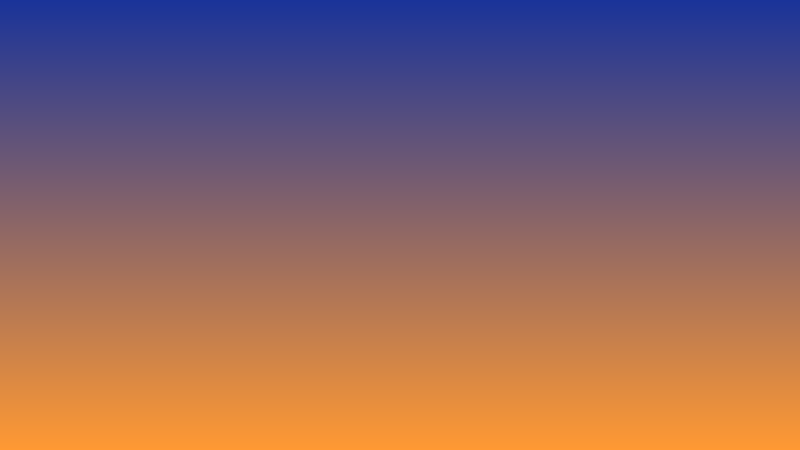
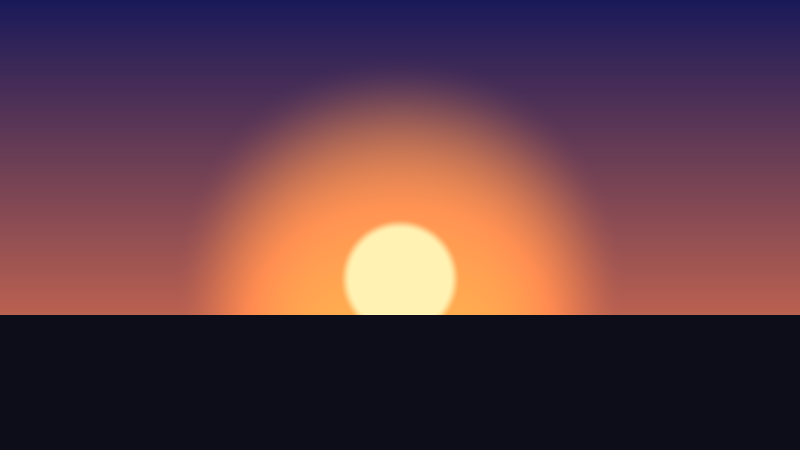

Si le preguntas a alguien que hace shaders cuál es la función que más usa, probablemente te diga **`mix`**. Sirve para pasar de un valor a otro poco a poco. Con ella haces degradados, cambios de un color a otro, bordes suaves, luces que se apagan.

La GPU ya trae esa función hecha, igual que otras dos hermanas suyas: `clamp` y `smoothstep`. Pero en Yotsuba Shader todavía no se pueden llamar desde C# (lo verás avisado en el capítulo del anillo de neón). Y eso, para aprender, es una suerte: **vas a escribirlas tú**. Cuando las hayas hecho con tus manos, no habrá ningún misterio en ellas.

## Paso 1: mezclar dos números

Copia `Plantilla.cs` como `Mezclas.cs` y cambia el nombre de la clase por `Mezclas`.

La idea de mezclar es esta: tienes un valor de partida `a`, un valor final `b`, y un número `t` entre `0` y `1` que dice **cuánto del camino** has recorrido.

- Con `t = 0`, estás en `a`.
- Con `t = 1`, estás en `b`.
- Con `t = 0.5`, estás justo en el medio.

La fórmula es `a + (b - a) * t`. Pruébala con papel: si `a = 10`, `b = 20` y `t = 0.3`, entonces `b - a` es `10`, por `0.3` da `3`, más `10` da `13`. Un 30 % del camino entre 10 y 20.

Escribe la función dentro de la clase `Mezclas`, después de `Fragment`:

```csharp
    public static float Mezclar(float a, float b, float t)
    {
        return a + (b - a) * t;
    }
```

Y úsala en `Fragment` para hacer un degradado de cielo. Reemplaza la línea de `return` por esto:

```csharp
float t = pixel.Uv.Y;
float r = Mezclar(0.1f, 1f, t);
float g = Mezclar(0.2f, 0.6f, t);
float b = Mezclar(0.6f, 0.2f, t);
return Crear.Vec4(r, g, b, 1f);
```

Aquí `t` es la altura del píxel: `0` arriba y `1` abajo. Cada canal de color se mezcla por separado, desde su valor de arriba hasta su valor de abajo. Fíjate en el azul: baja de `0.6` a `0.2`, mientras el rojo sube de `0.1` a `1`.

Ejecuta el ciclo de trabajo:

Pero primero, avisa al visor del nuevo shader. En `Visor/Program.cs`, agrega esta línea al `switch`, encima de la línea `_ =>`:

```csharp
            "Mezclas" => new Mezclas().ToMGFX(gl),
```

Ahora sí, ejecútalo:

```bash
dotnet yotsuba add MisShaders/MisShaders.csproj --target spirv && dotnet run --project Visor -- Mezclas
```



Un cielo de atardecer con una sola función. Cambia los números a tu gusto, y verás cómo cada canal se mueve por separado.

## Paso 2: ¿y si t se sale de 0 a 1?

`Mezclar` funciona perfecto mientras `t` esté entre `0` y `1`. Pero si `t` vale `2`, la fórmula no se detiene en `b`: se pasa. Con `a = 10` y `b = 20`, `t = 2` da `30`.

A veces eso es lo que quieres. Pero muchas veces querrás que el resultado **se quede quieto** en `a` o en `b` cuando te pasas. Esa herramienta se llama `clamp` (*limitar*), y es muy corta. Agrégala debajo de `Mezclar`:

```csharp
    public static float Limitar(float valor, float minimo, float maximo)
    {
        if (valor < minimo)
        {
            return minimo;
        }
        if (valor > maximo)
        {
            return maximo;
        }
        return valor;
    }
```

Si el valor es menor que el mínimo, devuelve el mínimo. Si es mayor que el máximo, devuelve el máximo. Si no, lo deja como está. `Limitar(5f, 0f, 1f)` da `1`; `Limitar(-3f, 0f, 1f)` da `0`; y `Limitar(0.4f, 0f, 1f)` da `0.4`.

No lo vamos a usar todavía, pero lo necesitará la siguiente función.

## Paso 3: bordes suaves

En el capítulo de las decisiones viste que un `if` hace bordes duros. Para un borde suave necesitamos algo que **no sea todo o nada**: un número que vaya pasando poco a poco de `0` a `1`.

Esa es la tarea de `smoothstep` (*paso suave*). Le das tres cosas: dónde empieza el cambio (`desde`), dónde termina (`hasta`) y el valor que estás mirando. Te devuelve:

- `0` si el valor está antes del comienzo.
- `1` si el valor está después del final.
- Un número entre `0` y `1` si está en el medio, subiendo con suavidad.

Agrégala debajo de `Limitar`:

```csharp
    public static float Suavizar(float desde, float hasta, float valor)
    {
        float t = Limitar((valor - desde) / (hasta - desde), 0f, 1f);
        return t * t * (3f - 2f * t);
    }
```

Tiene dos líneas, y cada una hace algo distinto:

1. `(valor - desde) / (hasta - desde)` convierte el valor en un `t`: `0` cuando valor es `desde`, `1` cuando valor es `hasta`. Y `Limitar` lo corta para que nunca se salga de `0` a `1`. Hasta aquí es una rampa recta.
2. `t * t * (3f - 2f * t)` suaviza la rampa. Al principio sube despacio, en el medio más rápido, y al final vuelve a ir despacio, como una letra S.

Mira cómo cambia el recorrido:

| `t` (rampa recta) | Resultado suavizado |
|---|---|
| 0 | 0 |
| 0.25 | 0.156 |
| 0.5 | 0.5 |
| 0.75 | 0.844 |
| 1 | 1 |

Con la rampa recta, a un cuarto del camino vas a un cuarto de la altura. Con la suavizada, a un cuarto del camino apenas llevas un 16 %. Ese arranque lento y ese final lento son lo que hace que se vea "suave".

## Paso 4: un círculo con borde suave

Vamos a aplicarlo. Declara el uniform, como en los capítulos anteriores. Arriba:

```csharp style=glsl
using YotsubaShader.GlslSyntax.Resources;
```

```csharp style=hlsl
using YotsubaShader.HlslSyntax.Resources;
```

```csharp style=msl
using YotsubaShader.MslSyntax.Resources;
```

```csharp style=wgsl
using YotsubaShader.WgslSyntax.Resources;
```

```csharp style=spirv
using YotsubaShader.SpirvSyntax.Resources;
```

Y dentro de la clase, antes de `Vertex`:

```csharp style=glsl
    [uniform, layout(0, 0)]
    public Entorno Datos;
```

```csharp style=hlsl
    [cbuffer, register("b0")]
    public Entorno Datos;
```

```csharp style=msl
    [constant, buffer(0)]
    public Entorno Datos;
```

```csharp style=wgsl
    [uniform, @group(0), @binding(0)]
    public Entorno Datos;
```

```csharp style=spirv
    [Uniform, DescriptorSet(0), Binding(0)]
    public Entorno Datos;
```

Ahora reemplaza todo el contenido de `Fragment` por esto:

```csharp
float aspecto = Datos.Ancho / Datos.Alto;
float dx = (pixel.Uv.X - 0.5f) * aspecto;
float dy = pixel.Uv.Y - 0.5f;
float d2 = dx * dx + dy * dy;

float brillo = 1f - Suavizar(0.04f, 0.09f, d2);
return Crear.Vec4(brillo, brillo * 0.6f, brillo * 0.1f, 1f);
```

Lo importante está en las dos líneas del medio. `d2` es la cuenta de siempre para saber qué tan lejos está el píxel del centro. Después:

- `Suavizar(0.04f, 0.09f, d2)` vale `0` cuando `d2` es menor que `0.04` (cerca del centro), `1` cuando es mayor que `0.09` (lejos), y sube suavemente entre medias.
- `1f - ...` lo da vuelta: ahora vale `1` en el centro y `0` fuera. Es el brillo.

Los tres números de la última línea (`brillo`, `brillo * 0.6f`, `brillo * 0.1f`) tiñen la luz de naranja: más rojo, algo de verde, casi nada de azul.


Compara con el círculo del capítulo anterior. Ya no hay un borde afilado: la luz se va apagando. Cambia el `0.04f` por `0.085f` y el borde queda casi afilado. Cambia el `0.09f` por `0.2f` y la luz se difumina mucho más. **Cuanto más cerca estén `desde` y `hasta`, más duro es el borde.**

## Paso 5: un atardecer completo

Vamos a juntar todo en una escena. Lo haremos de a poco, para que veas cómo cada capa suma. Reemplaza el contenido de `Fragment` por esta primera versión, que es el cielo:

```csharp
float aspecto = Datos.Ancho / Datos.Alto;
float dx = (pixel.Uv.X - 0.5f) * aspecto;
float dy = pixel.Uv.Y - 0.62f;
float d2 = dx * dx + dy * dy;

// cielo: de azul oscuro arriba a naranja en el horizonte
float t = pixel.Uv.Y;
float r = Mezclar(0.1f, 1f, t);
float g = Mezclar(0.1f, 0.5f, t);
float b = Mezclar(0.35f, 0.3f, t);

return Crear.Vec4(r, g, b, 1f);
```

Nada nuevo salvo que `dy` ahora se mide desde `0.62` (la altura del sol, un poco por debajo del centro). Ejecuta el ciclo de trabajo para ver el cielo.

**Capa 1: el halo.** Agrega esto **antes** del `return`:

```csharp
// halo del sol
float halo = 1f - Suavizar(0.0f, 0.25f, d2);
r = r + halo * 0.5f;
g = g + halo * 0.3f;
```

Un halo es un círculo muy grande y muy suave: va desde `0` hasta `0.25`. Y en vez de **reemplazar** el color del cielo, lo **suma**: el cielo sigue ahí, pero con más luz cerca del sol. Ejecuta el ciclo de trabajo.

**Capa 2: el disco.** Agrega esto después del halo:

```csharp
// disco del sol
float disco = 1f - Suavizar(0.012f, 0.018f, d2);
r = Mezclar(r, 1f, disco);
g = Mezclar(g, 0.95f, disco);
b = Mezclar(b, 0.7f, disco);
```

El disco es un círculo pequeño con un borde casi duro (`0.012` a `0.018`, muy juntos). Aquí usamos `Mezclar` de otra forma: `disco` es `1` dentro del sol y `0` fuera, así que `Mezclar(r, 1f, disco)` deja el cielo donde `disco` es `0` y pone el color del sol donde es `1`. En los píxeles del borde, mezcla las dos cosas. **Mezclar con un `t` que vale 0 o 1 es un `if` con bordes suaves.** Ejecuta el ciclo de trabajo.

**Capa 3: el suelo.** Y para cerrar, una franja oscura abajo. Agrega esto, y **reemplaza el `return`** por la versión nueva:

```csharp
// suelo
if (pixel.Uv.Y > 0.7f)
{
    r = 0.05f;
    g = 0.05f;
    b = 0.1f;
}
return Crear.Vec4(Limitar(r, 0f, 1f), Limitar(g, 0f, 1f), Limitar(b, 0f, 1f), 1f);
```

Aquí volvemos a ver `Limitar`: al sumar el halo, el rojo o el verde pueden pasar de `1`. La GPU los recortaría sola, pero escribirlo a mano te deja claro lo que pasa.

Ejecuta el ciclo de trabajo.



Tres funciones escritas por ti, y tienes un atardecer. Juega con él: sube el sol cambiando el `0.62`, agranda el halo cambiando el `0.25`, o cambia los colores del cielo.

## Todo junto

Este es el archivo completo:

```csharp style=glsl title="MisShaders/Mezclas.cs"
using YotsubaShader.GlslSyntax;
using YotsubaShader.GlslSyntax.Resources;
using YotsubaShader.GlslSyntax.Types;
using YotsubaShader.Language;

namespace MisShaders;

public class Mezclas
{
    [uniform, layout(0, 0)]
    public Entorno Datos;

    [ShaderStage(Stage.Vertex)]
    public Pixel Vertex(Vertice vertice)
    {
        Pixel pixel;
        pixel.Posicion = Crear.Vec4(vertice.Posicion.X, vertice.Posicion.Y, 0f, 1f);
        pixel.Uv = vertice.Uv;
        return pixel;
    }

    [ShaderStage(Stage.Fragment)]
    [return: location(0)]
    public vec4 Fragment(PixelIn pixel)
    {
        float aspecto = Datos.Ancho / Datos.Alto;
        float dx = (pixel.Uv.X - 0.5f) * aspecto;
        float dy = pixel.Uv.Y - 0.62f;
        float d2 = dx * dx + dy * dy;

        // cielo: de azul oscuro arriba a naranja en el horizonte
        float t = pixel.Uv.Y;
        float r = Mezclar(0.1f, 1f, t);
        float g = Mezclar(0.1f, 0.5f, t);
        float b = Mezclar(0.35f, 0.3f, t);

        // halo del sol y disco del sol
        float halo = 1f - Suavizar(0.0f, 0.25f, d2);
        float disco = 1f - Suavizar(0.012f, 0.018f, d2);
        r = r + halo * 0.5f;
        g = g + halo * 0.3f;
        r = Mezclar(r, 1f, disco);
        g = Mezclar(g, 0.95f, disco);
        b = Mezclar(b, 0.7f, disco);

        // suelo
        if (pixel.Uv.Y > 0.7f)
        {
            r = 0.05f;
            g = 0.05f;
            b = 0.1f;
        }
        return Crear.Vec4(Limitar(r, 0f, 1f), Limitar(g, 0f, 1f), Limitar(b, 0f, 1f), 1f);
    }

    public static float Limitar(float valor, float minimo, float maximo)
    {
        if (valor < minimo)
        {
            return minimo;
        }
        if (valor > maximo)
        {
            return maximo;
        }
        return valor;
    }

    public static float Mezclar(float a, float b, float t)
    {
        return a + (b - a) * t;
    }

    public static float Suavizar(float desde, float hasta, float valor)
    {
        float t = Limitar((valor - desde) / (hasta - desde), 0f, 1f);
        return t * t * (3f - 2f * t);
    }
}
```

```csharp style=hlsl title="MisShaders/Mezclas.cs"
using YotsubaShader.HlslSyntax;
using YotsubaShader.HlslSyntax.Resources;
using YotsubaShader.GlslSyntax.Types;
using YotsubaShader.Language;

namespace MisShaders;

public class Mezclas
{
    [cbuffer, register("b0")]
    public Entorno Datos;

    [ShaderStage(Stage.Vertex)]
    public Pixel Vertex(Vertice vertice)
    {
        Pixel pixel;
        pixel.Posicion = Crear.Vec4(vertice.Posicion.X, vertice.Posicion.Y, 0f, 1f);
        pixel.Uv = vertice.Uv;
        return pixel;
    }

    [ShaderStage(Stage.Fragment)]
    [return: SV_Target]
    public vec4 Fragment(PixelIn pixel)
    {
        float aspecto = Datos.Ancho / Datos.Alto;
        float dx = (pixel.Uv.X - 0.5f) * aspecto;
        float dy = pixel.Uv.Y - 0.62f;
        float d2 = dx * dx + dy * dy;

        // cielo: de azul oscuro arriba a naranja en el horizonte
        float t = pixel.Uv.Y;
        float r = Mezclar(0.1f, 1f, t);
        float g = Mezclar(0.1f, 0.5f, t);
        float b = Mezclar(0.35f, 0.3f, t);

        // halo del sol y disco del sol
        float halo = 1f - Suavizar(0.0f, 0.25f, d2);
        float disco = 1f - Suavizar(0.012f, 0.018f, d2);
        r = r + halo * 0.5f;
        g = g + halo * 0.3f;
        r = Mezclar(r, 1f, disco);
        g = Mezclar(g, 0.95f, disco);
        b = Mezclar(b, 0.7f, disco);

        // suelo
        if (pixel.Uv.Y > 0.7f)
        {
            r = 0.05f;
            g = 0.05f;
            b = 0.1f;
        }
        return Crear.Vec4(Limitar(r, 0f, 1f), Limitar(g, 0f, 1f), Limitar(b, 0f, 1f), 1f);
    }

    public static float Limitar(float valor, float minimo, float maximo)
    {
        if (valor < minimo)
        {
            return minimo;
        }
        if (valor > maximo)
        {
            return maximo;
        }
        return valor;
    }

    public static float Mezclar(float a, float b, float t)
    {
        return a + (b - a) * t;
    }

    public static float Suavizar(float desde, float hasta, float valor)
    {
        float t = Limitar((valor - desde) / (hasta - desde), 0f, 1f);
        return t * t * (3f - 2f * t);
    }
}
```

```csharp style=msl title="MisShaders/Mezclas.cs"
using YotsubaShader.MslSyntax;
using YotsubaShader.MslSyntax.Resources;
using YotsubaShader.GlslSyntax.Types;
using YotsubaShader.Language;

namespace MisShaders;

public class Mezclas
{
    [constant, buffer(0)]
    public Entorno Datos;

    [ShaderStage(Stage.Vertex)]
    public Pixel Vertex(Vertice vertice)
    {
        Pixel pixel;
        pixel.Posicion = Crear.Vec4(vertice.Posicion.X, vertice.Posicion.Y, 0f, 1f);
        pixel.Uv = vertice.Uv;
        return pixel;
    }

    [ShaderStage(Stage.Fragment)]
    [return: color(0)]
    public vec4 Fragment(PixelIn pixel)
    {
        float aspecto = Datos.Ancho / Datos.Alto;
        float dx = (pixel.Uv.X - 0.5f) * aspecto;
        float dy = pixel.Uv.Y - 0.62f;
        float d2 = dx * dx + dy * dy;

        // cielo: de azul oscuro arriba a naranja en el horizonte
        float t = pixel.Uv.Y;
        float r = Mezclar(0.1f, 1f, t);
        float g = Mezclar(0.1f, 0.5f, t);
        float b = Mezclar(0.35f, 0.3f, t);

        // halo del sol y disco del sol
        float halo = 1f - Suavizar(0.0f, 0.25f, d2);
        float disco = 1f - Suavizar(0.012f, 0.018f, d2);
        r = r + halo * 0.5f;
        g = g + halo * 0.3f;
        r = Mezclar(r, 1f, disco);
        g = Mezclar(g, 0.95f, disco);
        b = Mezclar(b, 0.7f, disco);

        // suelo
        if (pixel.Uv.Y > 0.7f)
        {
            r = 0.05f;
            g = 0.05f;
            b = 0.1f;
        }
        return Crear.Vec4(Limitar(r, 0f, 1f), Limitar(g, 0f, 1f), Limitar(b, 0f, 1f), 1f);
    }

    public static float Limitar(float valor, float minimo, float maximo)
    {
        if (valor < minimo)
        {
            return minimo;
        }
        if (valor > maximo)
        {
            return maximo;
        }
        return valor;
    }

    public static float Mezclar(float a, float b, float t)
    {
        return a + (b - a) * t;
    }

    public static float Suavizar(float desde, float hasta, float valor)
    {
        float t = Limitar((valor - desde) / (hasta - desde), 0f, 1f);
        return t * t * (3f - 2f * t);
    }
}
```

```csharp style=wgsl title="MisShaders/Mezclas.cs"
using YotsubaShader.WgslSyntax;
using YotsubaShader.WgslSyntax.Resources;
using YotsubaShader.GlslSyntax.Types;
using YotsubaShader.Language;

namespace MisShaders;

public class Mezclas
{
    [uniform, @group(0), @binding(0)]
    public Entorno Datos;

    [ShaderStage(Stage.Vertex)]
    public Pixel Vertex(Vertice vertice)
    {
        Pixel pixel;
        pixel.Posicion = Crear.Vec4(vertice.Posicion.X, vertice.Posicion.Y, 0f, 1f);
        pixel.Uv = vertice.Uv;
        return pixel;
    }

    [ShaderStage(Stage.Fragment)]
    [return: location(0)]
    public vec4 Fragment(PixelIn pixel)
    {
        float aspecto = Datos.Ancho / Datos.Alto;
        float dx = (pixel.Uv.X - 0.5f) * aspecto;
        float dy = pixel.Uv.Y - 0.62f;
        float d2 = dx * dx + dy * dy;

        // cielo: de azul oscuro arriba a naranja en el horizonte
        float t = pixel.Uv.Y;
        float r = Mezclar(0.1f, 1f, t);
        float g = Mezclar(0.1f, 0.5f, t);
        float b = Mezclar(0.35f, 0.3f, t);

        // halo del sol y disco del sol
        float halo = 1f - Suavizar(0.0f, 0.25f, d2);
        float disco = 1f - Suavizar(0.012f, 0.018f, d2);
        r = r + halo * 0.5f;
        g = g + halo * 0.3f;
        r = Mezclar(r, 1f, disco);
        g = Mezclar(g, 0.95f, disco);
        b = Mezclar(b, 0.7f, disco);

        // suelo
        if (pixel.Uv.Y > 0.7f)
        {
            r = 0.05f;
            g = 0.05f;
            b = 0.1f;
        }
        return Crear.Vec4(Limitar(r, 0f, 1f), Limitar(g, 0f, 1f), Limitar(b, 0f, 1f), 1f);
    }

    public static float Limitar(float valor, float minimo, float maximo)
    {
        if (valor < minimo)
        {
            return minimo;
        }
        if (valor > maximo)
        {
            return maximo;
        }
        return valor;
    }

    public static float Mezclar(float a, float b, float t)
    {
        return a + (b - a) * t;
    }

    public static float Suavizar(float desde, float hasta, float valor)
    {
        float t = Limitar((valor - desde) / (hasta - desde), 0f, 1f);
        return t * t * (3f - 2f * t);
    }
}
```

```csharp style=spirv title="MisShaders/Mezclas.cs"
using YotsubaShader.SpirvSyntax;
using YotsubaShader.SpirvSyntax.Resources;
using YotsubaShader.GlslSyntax.Types;
using YotsubaShader.Language;

namespace MisShaders;

public class Mezclas
{
    [Uniform, DescriptorSet(0), Binding(0)]
    public Entorno Datos;

    [ShaderStage(Stage.Vertex)]
    public Pixel Vertex(Vertice vertice)
    {
        Pixel pixel;
        pixel.Posicion = Crear.Vec4(vertice.Posicion.X, vertice.Posicion.Y, 0f, 1f);
        pixel.Uv = vertice.Uv;
        return pixel;
    }

    [ShaderStage(Stage.Fragment)]
    [return: Location(0)]
    public vec4 Fragment(PixelIn pixel)
    {
        float aspecto = Datos.Ancho / Datos.Alto;
        float dx = (pixel.Uv.X - 0.5f) * aspecto;
        float dy = pixel.Uv.Y - 0.62f;
        float d2 = dx * dx + dy * dy;

        // cielo: de azul oscuro arriba a naranja en el horizonte
        float t = pixel.Uv.Y;
        float r = Mezclar(0.1f, 1f, t);
        float g = Mezclar(0.1f, 0.5f, t);
        float b = Mezclar(0.35f, 0.3f, t);

        // halo del sol y disco del sol
        float halo = 1f - Suavizar(0.0f, 0.25f, d2);
        float disco = 1f - Suavizar(0.012f, 0.018f, d2);
        r = r + halo * 0.5f;
        g = g + halo * 0.3f;
        r = Mezclar(r, 1f, disco);
        g = Mezclar(g, 0.95f, disco);
        b = Mezclar(b, 0.7f, disco);

        // suelo
        if (pixel.Uv.Y > 0.7f)
        {
            r = 0.05f;
            g = 0.05f;
            b = 0.1f;
        }
        return Crear.Vec4(Limitar(r, 0f, 1f), Limitar(g, 0f, 1f), Limitar(b, 0f, 1f), 1f);
    }

    public static float Limitar(float valor, float minimo, float maximo)
    {
        if (valor < minimo)
        {
            return minimo;
        }
        if (valor > maximo)
        {
            return maximo;
        }
        return valor;
    }

    public static float Mezclar(float a, float b, float t)
    {
        return a + (b - a) * t;
    }

    public static float Suavizar(float desde, float hasta, float valor)
    {
        float t = Limitar((valor - desde) / (hasta - desde), 0f, 1f);
        return t * t * (3f - 2f * t);
    }
}
```

## Lo que aprendiste

- `Mezclar(a, b, t)` va de `a` a `b` según `t`. Con `t` entre `0` y `1`, el resultado siempre queda entre `a` y `b`.
- `Limitar` corta un valor entre un mínimo y un máximo.
- `Suavizar` pasa de `0` a `1` despacio al principio y despacio al final. Cuanto más juntos `desde` y `hasta`, más duro el borde.
- Mezclar con un `t` de `0` o `1` es un `if` con bordes suaves.
- Una escena se arma por **capas**: cada capa mezcla o suma algo sobre lo que había.
- En GLSL estas tres funciones se llaman `mix`, `clamp` y `smoothstep`. Cuando las veas en otros tutoriales, ya sabes qué hacen por dentro.

Siguiente: [Repetir con bucles](loops.md).
