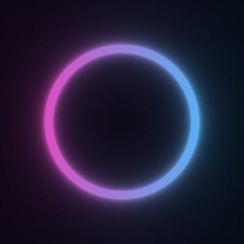
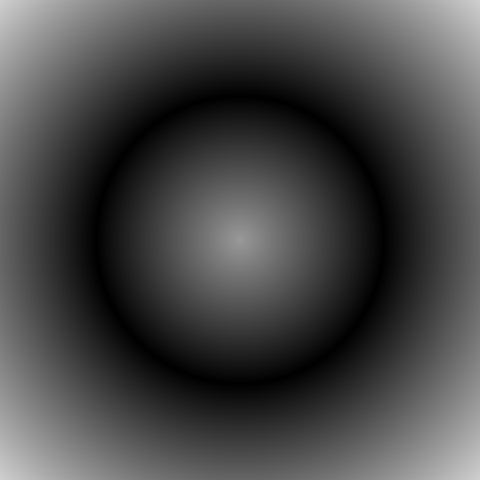
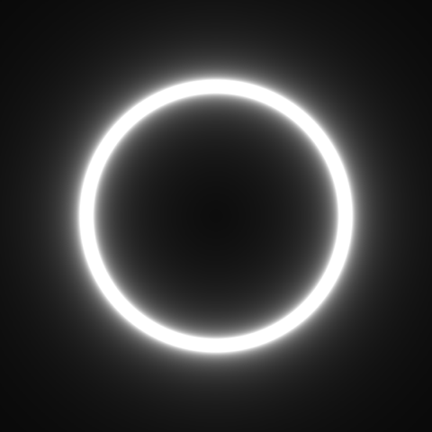

Hasta ahora todas las cuentas las hiciste con sumas, restas y multiplicaciones. Pero la GPU ya trae hechas muchas funciones matemáticas: raíz cuadrada, seno, valor absoluto, mezclar dos colores... En este capítulo las vas a usar para dibujar un tubo de neón:



## Cómo se usan las funciones de la GPU

Están todas en una clase llamada `Math`, dentro de `YotsubaShader.GlslSyntax.Methods`. Como las vas a usar todo el rato, lo cómodo es poner esta línea arriba del archivo:

```csharp
using static YotsubaShader.GlslSyntax.Methods.Math;
```

Un `using static` te deja llamar a los métodos de una clase sin escribir su nombre delante. Así, en vez de `Math.sqrt(x)` escribes solo `sqrt(x)`.

> [!NOTE]
> Los nombres van en minúscula (`sqrt`, `abs`, `mix`) porque así se llaman en GLSL, y este estilo respeta esos nombres. No son los de `System.Math` de C#: aquellos no funcionan en un shader, porque no hay forma de llevarlos a la GPU.

Estas son las cuatro que vas a usar en este shader:

| Función | Qué hace | Ejemplo |
| --- | --- | --- |
| `sqrt(x)` | La raíz cuadrada. | `sqrt(9f)` da `3` |
| `abs(x)` | Le quita el signo a un número. | `abs(-0.2f)` da `0.2` |
| `clamp(x, minimo, maximo)` | Si `x` se sale de los límites, lo deja en el límite. | `clamp(7f, 0f, 1f)` da `1` |
| `mix(a, b, t)` | Mezcla `a` y `b`. Con `t` en `0` da `a`, con `1` da `b`, con `0.5` da la mitad de cada uno. | `mix(0f, 10f, 0.5f)` da `5` |

## Paso 1: qué tan lejos está cada píxel del centro

Un anillo es un círculo, y para dibujar un círculo necesitas saber a qué distancia del centro está cada píxel.

Primero movemos el centro. Con `Uv`, el punto `(0, 0)` es la esquina de arriba a la izquierda. Nos conviene que `(0, 0)` sea el centro de la pantalla. Es la cuenta de estirar y mover que ya conoces:

```csharp
float x = pixel.Uv.X * 2f - 1f;
float y = pixel.Uv.Y * 2f - 1f;
```

Ahora `x` e `y` van de `-1` a `1`, y el centro de la pantalla es `(0, 0)`.

La distancia de un punto al centro se calcula con el teorema de Pitágoras, el del triángulo del colegio: la raíz cuadrada de `x` por `x` más `y` por `y`.

```csharp
float distanciaAlCentro = sqrt(x * x + y * y);
```

Si pintaras cada píxel con ese número como color (más lejos, más blanco), verías esto:


Negro en el centro, porque la distancia es `0`. Cada vez más claro al alejarse.

## Paso 2: qué tan lejos está cada píxel del anillo

Queremos un anillo de radio `0.6`. Los píxeles que forman el anillo son los que están a una distancia de `0.6` del centro. Así que restamos:

```csharp
float distanciaAlAnillo = abs(distanciaAlCentro - 0.6f);
```

Si un píxel está a `0.6` del centro, el resultado es `0`: está justo sobre el anillo. Si está a `0.8`, da `0.2`. Y si está a `0.4`, la resta da `-0.2`, pero `abs` le quita el signo y queda `0.2`. Es decir, nos da igual si el píxel está por dentro o por fuera del anillo: solo nos importa cuánto le falta para llegar.



Ya se ve el anillo: es la línea negra, donde la distancia vale `0`.

## Paso 3: convertir la distancia en brillo

Queremos lo contrario de la imagen anterior: mucha luz sobre el anillo y poca lejos de él. Hay un truco muy usado para eso, que es dividir un número pequeño entre la distancia:

```csharp
float brillo = clamp(0.03f / distanciaAlAnillo, 0f, 1f);
```

Piensa en lo que pasa con la división:

| Distancia al anillo | `0.03 / distancia` | Brillo después de `clamp` |
| --- | --- | --- |
| `0.01` (casi encima) | `3` | `1` |
| `0.03` | `1` | `1` |
| `0.1` | `0.3` | `0.3` |
| `0.5` (lejos) | `0.06` | `0.06` |

Cerca del anillo el resultado es enorme, y `clamp` lo deja en `1`, que es el máximo. Al alejarse baja rápido, pero nunca llega del todo a cero. Esa luz que se va apagando poco a poco es lo que hace que parezca un neón y no una simple línea.



> [!TIP]
> El `0.03` es el grosor del brillo. Con `0.01` tienes un hilo fino. Con `0.1`, un resplandor enorme.

## Paso 4: ponerle color

Tenemos un brillo de `0` a `1`. Falta decidir de qué color es la luz y de qué color es el fondo. Aquí entra `mix`, que también funciona con colores:

```csharp
vec3 rosa = Crear.Vec3(1f, 0.2f, 0.7f);
vec3 celeste = Crear.Vec3(0.2f, 0.8f, 1f);
vec3 tubo = mix(rosa, celeste, pixel.Uv.X);
```

`mix(rosa, celeste, pixel.Uv.X)` da rosa a la izquierda de la pantalla (donde `Uv.X` es `0`), celeste a la derecha (donde es `1`) y una mezcla en el medio. Es el degradado del primer shader, hecho con una sola función.

Y ahora mezclamos otra vez, entre el fondo y el tubo, usando el brillo:

```csharp
vec3 fondo = Crear.Vec3(0.02f, 0.02f, 0.06f);
vec3 color = mix(fondo, tubo, brillo);
```

Donde el brillo es `0`, sale el fondo. Donde es `1`, sale el color del tubo. En el resplandor, una mezcla.

Usamos `vec3` porque a un color, mientras lo calculas, no le hace falta la opacidad. Se la ponemos al final, al devolverlo.

## El shader completo

```csharp style=glsl title="MisShaders/Neon.cs"
using YotsubaShader.GlslSyntax;
using YotsubaShader.GlslSyntax.Types;
using YotsubaShader.Language;
using static YotsubaShader.GlslSyntax.Methods.Math;

namespace MisShaders;

public class Neon
{
    [ShaderStage(Stage.Vertex)]
    public Pixel Vertex({{vertexType}} vertice)
    {
        Pixel pixel;
        pixel.Posicion = Crear.Vec4(vertice.{{pos}}.X, vertice.{{pos}}.Y, 0f, 1f);
        pixel.Uv = vertice.{{uv}};
        return pixel;
    }

    [ShaderStage(Stage.Fragment)]
    [return: location(0)]
    public vec4 Fragment(PixelIn pixel)
    {
        float x = pixel.Uv.X * 2f - 1f;
        float y = pixel.Uv.Y * 2f - 1f;

        float distanciaAlCentro = sqrt(x * x + y * y);
        float distanciaAlAnillo = abs(distanciaAlCentro - 0.6f);

        float brillo = clamp(0.03f / distanciaAlAnillo, 0f, 1f);

        vec3 rosa = Crear.Vec3(1f, 0.2f, 0.7f);
        vec3 celeste = Crear.Vec3(0.2f, 0.8f, 1f);
        vec3 tubo = mix(rosa, celeste, pixel.Uv.X);

        vec3 fondo = Crear.Vec3(0.02f, 0.02f, 0.06f);
        vec3 color = mix(fondo, tubo, brillo);

        return Crear.Vec4(color.X, color.Y, color.Z, 1f);
    }
}
```

```csharp style=hlsl title="MisShaders/Neon.cs"
using YotsubaShader.HlslSyntax;
using YotsubaShader.GlslSyntax.Types;
using YotsubaShader.Language;
using static YotsubaShader.GlslSyntax.Methods.Math;

namespace MisShaders;

public class Neon
{
    [ShaderStage(Stage.Vertex)]
    public Pixel Vertex({{vertexType}} vertice)
    {
        Pixel pixel;
        pixel.Posicion = Crear.Vec4(vertice.{{pos}}.X, vertice.{{pos}}.Y, 0f, 1f);
        pixel.Uv = vertice.{{uv}};
        return pixel;
    }

    [ShaderStage(Stage.Fragment)]
    [return: SV_Target]
    public vec4 Fragment(PixelIn pixel)
    {
        float x = pixel.Uv.X * 2f - 1f;
        float y = pixel.Uv.Y * 2f - 1f;

        float distanciaAlCentro = sqrt(x * x + y * y);
        float distanciaAlAnillo = abs(distanciaAlCentro - 0.6f);

        float brillo = clamp(0.03f / distanciaAlAnillo, 0f, 1f);

        vec3 rosa = Crear.Vec3(1f, 0.2f, 0.7f);
        vec3 celeste = Crear.Vec3(0.2f, 0.8f, 1f);
        vec3 tubo = mix(rosa, celeste, pixel.Uv.X);

        vec3 fondo = Crear.Vec3(0.02f, 0.02f, 0.06f);
        vec3 color = mix(fondo, tubo, brillo);

        return Crear.Vec4(color.X, color.Y, color.Z, 1f);
    }
}
```

```csharp style=msl title="MisShaders/Neon.cs"
using YotsubaShader.MslSyntax;
using YotsubaShader.GlslSyntax.Types;
using YotsubaShader.Language;
using static YotsubaShader.GlslSyntax.Methods.Math;

namespace MisShaders;

public class Neon
{
    [ShaderStage(Stage.Vertex)]
    public Pixel Vertex({{vertexType}} vertice)
    {
        Pixel pixel;
        pixel.Posicion = Crear.Vec4(vertice.{{pos}}.X, vertice.{{pos}}.Y, 0f, 1f);
        pixel.Uv = vertice.{{uv}};
        return pixel;
    }

    [ShaderStage(Stage.Fragment)]
    [return: color(0)]
    public vec4 Fragment(PixelIn pixel)
    {
        float x = pixel.Uv.X * 2f - 1f;
        float y = pixel.Uv.Y * 2f - 1f;

        float distanciaAlCentro = sqrt(x * x + y * y);
        float distanciaAlAnillo = abs(distanciaAlCentro - 0.6f);

        float brillo = clamp(0.03f / distanciaAlAnillo, 0f, 1f);

        vec3 rosa = Crear.Vec3(1f, 0.2f, 0.7f);
        vec3 celeste = Crear.Vec3(0.2f, 0.8f, 1f);
        vec3 tubo = mix(rosa, celeste, pixel.Uv.X);

        vec3 fondo = Crear.Vec3(0.02f, 0.02f, 0.06f);
        vec3 color = mix(fondo, tubo, brillo);

        return Crear.Vec4(color.X, color.Y, color.Z, 1f);
    }
}
```

```csharp style=wgsl title="MisShaders/Neon.cs"
using YotsubaShader.WgslSyntax;
using YotsubaShader.GlslSyntax.Types;
using YotsubaShader.Language;
using static YotsubaShader.GlslSyntax.Methods.Math;

namespace MisShaders;

public class Neon
{
    [ShaderStage(Stage.Vertex)]
    public Pixel Vertex({{vertexType}} vertice)
    {
        Pixel pixel;
        pixel.Posicion = Crear.Vec4(vertice.{{pos}}.X, vertice.{{pos}}.Y, 0f, 1f);
        pixel.Uv = vertice.{{uv}};
        return pixel;
    }

    [ShaderStage(Stage.Fragment)]
    [return: location(0)]
    public vec4 Fragment(PixelIn pixel)
    {
        float x = pixel.Uv.X * 2f - 1f;
        float y = pixel.Uv.Y * 2f - 1f;

        float distanciaAlCentro = sqrt(x * x + y * y);
        float distanciaAlAnillo = abs(distanciaAlCentro - 0.6f);

        float brillo = clamp(0.03f / distanciaAlAnillo, 0f, 1f);

        vec3 rosa = Crear.Vec3(1f, 0.2f, 0.7f);
        vec3 celeste = Crear.Vec3(0.2f, 0.8f, 1f);
        vec3 tubo = mix(rosa, celeste, pixel.Uv.X);

        vec3 fondo = Crear.Vec3(0.02f, 0.02f, 0.06f);
        vec3 color = mix(fondo, tubo, brillo);

        return Crear.Vec4(color.X, color.Y, color.Z, 1f);
    }
}
```

```csharp style=spirv title="MisShaders/Neon.cs"
using YotsubaShader.SpirvSyntax;
using YotsubaShader.GlslSyntax.Types;
using YotsubaShader.Language;
using static YotsubaShader.GlslSyntax.Methods.Math;

namespace MisShaders;

public class Neon
{
    [ShaderStage(Stage.Vertex)]
    public Pixel Vertex({{vertexType}} vertice)
    {
        Pixel pixel;
        pixel.Posicion = Crear.Vec4(vertice.{{pos}}.X, vertice.{{pos}}.Y, 0f, 1f);
        pixel.Uv = vertice.{{uv}};
        return pixel;
    }

    [ShaderStage(Stage.Fragment)]
    [return: Location(0)]
    public vec4 Fragment(PixelIn pixel)
    {
        float x = pixel.Uv.X * 2f - 1f;
        float y = pixel.Uv.Y * 2f - 1f;

        float distanciaAlCentro = sqrt(x * x + y * y);
        float distanciaAlAnillo = abs(distanciaAlCentro - 0.6f);

        float brillo = clamp(0.03f / distanciaAlAnillo, 0f, 1f);

        vec3 rosa = Crear.Vec3(1f, 0.2f, 0.7f);
        vec3 celeste = Crear.Vec3(0.2f, 0.8f, 1f);
        vec3 tubo = mix(rosa, celeste, pixel.Uv.X);

        vec3 fondo = Crear.Vec3(0.02f, 0.02f, 0.06f);
        vec3 color = mix(fondo, tubo, brillo);

        return Crear.Vec4(color.X, color.Y, color.Z, 1f);
    }
}
```

Para comprobar que está bien escrito, compila el proyecto de C#:

```bash
dotnet build MisShaders
```

Si sale `Build succeeded`, el shader es C# válido. Cuando `add` admita estas funciones, se compila y se usa igual que los dos anteriores: `new Neon().ToGlsl(Stage.Fragment)`.

## Juega con él

- Cambia `0.6f` por `0.3f` para un anillo más pequeño.
- Cambia `pixel.Uv.X` por `pixel.Uv.Y` en el primer `mix`. El cambio de color pasa a ir de arriba abajo.
- Dibuja dos anillos: calcula un segundo brillo con otro radio y súmalos antes de mezclar.

```csharp
float brilloGrande = clamp(0.03f / abs(distanciaAlCentro - 0.6f), 0f, 1f);
float brilloPequeno = clamp(0.03f / abs(distanciaAlCentro - 0.3f), 0f, 1f);
float brillo = clamp(brilloGrande + brilloPequeno, 0f, 1f);
```

## Lo que aprendiste

- La GPU trae funciones matemáticas ya hechas. Están en `YotsubaShader.GlslSyntax.Methods.Math` y se usan con `using static`.
- Casi cualquier figura sale de una distancia: calculas qué tan lejos está cada píxel de la figura y conviertes eso en color.
- `mix` mezcla dos números o dos colores. `clamp` mantiene un valor entre dos límites.
- Dividir un número pequeño entre una distancia da el efecto de luz que se apaga.

Siguiente: [Shader 4: un plasma que se mueve](plasma.md).
