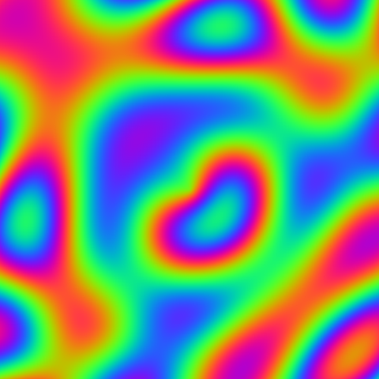
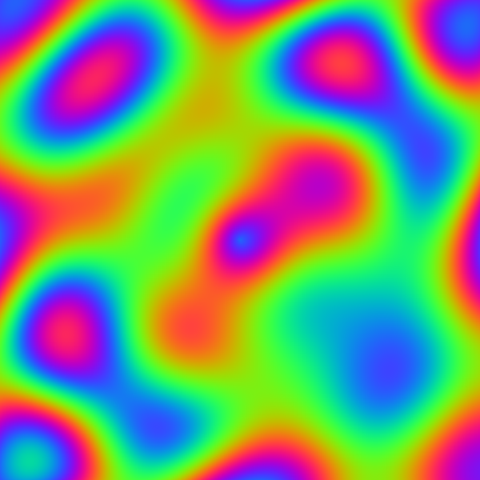
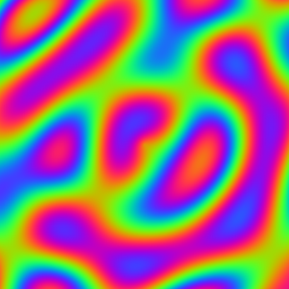
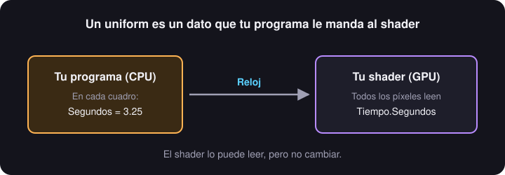
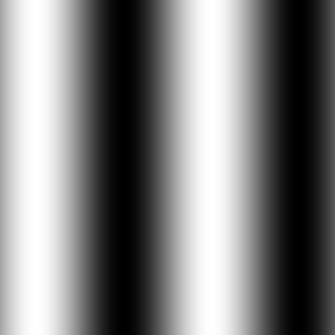

> [!SCENE] intro

Los tres shaders anteriores tienen algo en común: dibujan siempre la misma imagen. Es lógico. Lo único que sabe cada píxel es su `Uv`, y eso no cambia nunca.

Para que algo se mueva, el shader necesita un dato que cambie con el tiempo. Y ese dato no lo tiene la GPU: lo tiene tu programa. En este capítulo aprendes a mandárselo, y con eso haces este efecto, que es un clásico de los años 90:

| Segundo 0 | Segundo 1.5 | Segundo 3 |
| --- | --- | --- |
|  |  |  |

Son tres momentos del mismo shader. En movimiento, las manchas se deforman y se funden unas con otras sin parar.

> [!SCENE] uniform

## Un dato que viene de fuera: el uniform

A un dato que tu programa le manda al shader se le llama **uniform**. El nombre viene de que es "uniforme": vale lo mismo para todos los píxeles. En un mismo momento, todos los píxeles leen el mismo tiempo.



Se declara en dos pasos.

**Primero, un `struct` con los datos.** Uno normal, sin atributos:

```csharp
public struct Reloj
{
    public float Segundos;
}
```

**Después, un campo en la clase del shader**, marcado con dos atributos:

```csharp style=glsl
[uniform, layout(0, 0)]
public Reloj Tiempo;
```

```csharp style=hlsl
[cbuffer, register("b0")]
public Reloj Tiempo;
```

```csharp style=msl
[constant, buffer(0)]
public Reloj Tiempo;
```

```csharp style=wgsl
[uniform, @group(0), @binding(0)]
public Reloj Tiempo;
```

```csharp style=spirv
[Uniform, DescriptorSet(0), Binding(0)]
public Reloj Tiempo;
```

- `uniform` dice que ese campo es un dato que viene de tu programa.
- `layout(0, 0)` es su dirección. Es la misma idea de los casilleros de `[location]`, pero para este tipo de datos la dirección tiene dos números: el grupo y el casillero dentro del grupo. Aquí es el grupo 0, casillero 0. Tu programa tendrá que dejar el reloj justo en esa dirección.

Estos dos atributos están en `YotsubaShader.GlslSyntax.Resources`, así que hay que añadir ese `using`.

Y para leerlo dentro del shader, lo usas como cualquier campo:

```csharp
float t = Tiempo.Segundos;
```

Una cosa a tener en cuenta: el shader puede **leer** un uniform, pero no cambiarlo. Los datos viajan en un solo sentido, de tu programa a la GPU.

> [!SCENE] sin

## Una onda: la función `sin`

`sin` es el seno. No hace falta recordar trigonometría. Para lo que nos interesa, `sin` es una función que, le des el número que le des, devuelve algo entre `-1` y `1`, subiendo y bajando sin parar como una ola.

Mira lo que pasa si pintamos cada píxel según `sin(x * 6f)`, con negro para `-1` y blanco para `1`:



Salen franjas, porque al avanzar hacia la derecha `x` crece y el seno sube y baja. El `6` dice cuántas franjas caben: con `12` habría el doble.

Ahora viene lo importante. Si le sumas el tiempo:

```csharp
sin(x * 6f + t)
```

a medida que `t` crece, todas las franjas se deslizan hacia un lado. Con esa suma ya tienes movimiento.

> [!SCENE] four

## Cuatro ondas juntas

Unas franjas que se deslizan son aburridas. El plasma sale de sumar varias ondas, cada una en una dirección y a una velocidad distinta:

```csharp
float olas = sin(x * 6f + t)
           + sin(y * 6f + t * 1.3f)
           + sin((x + y) * 6f + t * 0.7f)
           + sin(sqrt(x * x + y * y) * 9f - t * 2f);
```

Una por una:

| Línea | Qué forma tiene | Hacia dónde se mueve |
| --- | --- | --- |
| `sin(x * 6f + t)` | Franjas verticales. | De lado. |
| `sin(y * 6f + t * 1.3f)` | Franjas horizontales. | De arriba abajo, un poco más rápido. |
| `sin((x + y) * 6f + t * 0.7f)` | Franjas en diagonal. | En diagonal, más lento. |
| `sin(sqrt(x * x + y * y) * 9f - t * 2f)` | Círculos, como las ondas de una piedra en el agua. Reconocerás la distancia al centro del capítulo anterior. | Hacia fuera. |

Al sumarlas, donde coinciden varias crestas el valor es alto, y donde coinciden varios valles es bajo. Como cada una va a su ritmo, el dibujo nunca se repite igual:


> [!SCENE] rainbow

## De un número a un arcoíris

`olas` es un solo número. Para convertirlo en color usamos el mismo `sin`, tres veces, una por cada componente del color:

```csharp
public static vec4 Arcoiris(float valor)
{
    float rojo = 0.5f + 0.5f * sin(valor * 1.5f);
    float verde = 0.5f + 0.5f * sin(valor * 1.5f + 2.1f);
    float azul = 0.5f + 0.5f * sin(valor * 1.5f + 4.2f);
    return Crear.Vec4(rojo, verde, azul, 1f);
}
```

Dos detalles:

- `0.5f + 0.5f * sin(...)` convierte el resultado del seno, que va de `-1` a `1`, en algo que va de `0` a `1`, que es lo que necesita un color.
- Los `+ 2.1f` y `+ 4.2f` hacen que el verde y el azul vayan desfasados respecto al rojo. Cuando el rojo está arriba, los otros dos van por otro punto de su ola. Por eso salen todos los colores del arcoíris en lugar de grises.

## El shader completo

```csharp style=glsl title="MisShaders/Plasma.cs"
using YotsubaShader.GlslSyntax;
using YotsubaShader.GlslSyntax.Resources;
using YotsubaShader.GlslSyntax.Types;
using YotsubaShader.Language;
using static YotsubaShader.GlslSyntax.Methods.Math;

namespace MisShaders;

public struct Reloj
{
    public float Segundos;
}

public class Plasma
{
    [uniform, layout(0, 0)]
    public Reloj Tiempo;

    [ShaderStage(Stage.Vertex)]
    public Pixel Vertex({{vertexType}} vertice)
    {
        Pixel pixel;
        pixel.Posicion = Crear.Vec4(vertice.{{pos}}.X, vertice.{{pos}}.Y, 0f, 1f);
        pixel.Uv = vertice.{{uv}};
        return pixel;
    }

    [ShaderStage(Stage.Fragment)]
    [return: location(0)]
    public vec4 Fragment(PixelIn pixel)
    {
        float x = pixel.Uv.X * 2f - 1f;
        float y = pixel.Uv.Y * 2f - 1f;
        float t = Tiempo.Segundos;

        float olas = sin(x * 6f + t)
                   + sin(y * 6f + t * 1.3f)
                   + sin((x + y) * 6f + t * 0.7f)
                   + sin(sqrt(x * x + y * y) * 9f - t * 2f);

        return Arcoiris(olas);
    }

    public static vec4 Arcoiris(float valor)
    {
        float rojo = 0.5f + 0.5f * sin(valor * 1.5f);
        float verde = 0.5f + 0.5f * sin(valor * 1.5f + 2.1f);
        float azul = 0.5f + 0.5f * sin(valor * 1.5f + 4.2f);
        return Crear.Vec4(rojo, verde, azul, 1f);
    }
}
```

```csharp style=hlsl title="MisShaders/Plasma.cs"
using YotsubaShader.HlslSyntax;
using YotsubaShader.HlslSyntax.Resources;
using YotsubaShader.GlslSyntax.Types;
using YotsubaShader.Language;
using static YotsubaShader.GlslSyntax.Methods.Math;

namespace MisShaders;

public struct Reloj
{
    public float Segundos;
}

public class Plasma
{
    [cbuffer, register("b0")]
    public Reloj Tiempo;

    [ShaderStage(Stage.Vertex)]
    public Pixel Vertex({{vertexType}} vertice)
    {
        Pixel pixel;
        pixel.Posicion = Crear.Vec4(vertice.{{pos}}.X, vertice.{{pos}}.Y, 0f, 1f);
        pixel.Uv = vertice.{{uv}};
        return pixel;
    }

    [ShaderStage(Stage.Fragment)]
    [return: SV_Target]
    public vec4 Fragment(PixelIn pixel)
    {
        float x = pixel.Uv.X * 2f - 1f;
        float y = pixel.Uv.Y * 2f - 1f;
        float t = Tiempo.Segundos;

        float olas = sin(x * 6f + t)
                   + sin(y * 6f + t * 1.3f)
                   + sin((x + y) * 6f + t * 0.7f)
                   + sin(sqrt(x * x + y * y) * 9f - t * 2f);

        return Arcoiris(olas);
    }

    public static vec4 Arcoiris(float valor)
    {
        float rojo = 0.5f + 0.5f * sin(valor * 1.5f);
        float verde = 0.5f + 0.5f * sin(valor * 1.5f + 2.1f);
        float azul = 0.5f + 0.5f * sin(valor * 1.5f + 4.2f);
        return Crear.Vec4(rojo, verde, azul, 1f);
    }
}
```

```csharp style=msl title="MisShaders/Plasma.cs"
using YotsubaShader.MslSyntax;
using YotsubaShader.MslSyntax.Resources;
using YotsubaShader.GlslSyntax.Types;
using YotsubaShader.Language;
using static YotsubaShader.GlslSyntax.Methods.Math;

namespace MisShaders;

public struct Reloj
{
    public float Segundos;
}

public class Plasma
{
    [constant, buffer(0)]
    public Reloj Tiempo;

    [ShaderStage(Stage.Vertex)]
    public Pixel Vertex({{vertexType}} vertice)
    {
        Pixel pixel;
        pixel.Posicion = Crear.Vec4(vertice.{{pos}}.X, vertice.{{pos}}.Y, 0f, 1f);
        pixel.Uv = vertice.{{uv}};
        return pixel;
    }

    [ShaderStage(Stage.Fragment)]
    [return: color(0)]
    public vec4 Fragment(PixelIn pixel)
    {
        float x = pixel.Uv.X * 2f - 1f;
        float y = pixel.Uv.Y * 2f - 1f;
        float t = Tiempo.Segundos;

        float olas = sin(x * 6f + t)
                   + sin(y * 6f + t * 1.3f)
                   + sin((x + y) * 6f + t * 0.7f)
                   + sin(sqrt(x * x + y * y) * 9f - t * 2f);

        return Arcoiris(olas);
    }

    public static vec4 Arcoiris(float valor)
    {
        float rojo = 0.5f + 0.5f * sin(valor * 1.5f);
        float verde = 0.5f + 0.5f * sin(valor * 1.5f + 2.1f);
        float azul = 0.5f + 0.5f * sin(valor * 1.5f + 4.2f);
        return Crear.Vec4(rojo, verde, azul, 1f);
    }
}
```

```csharp style=wgsl title="MisShaders/Plasma.cs"
using YotsubaShader.WgslSyntax;
using YotsubaShader.WgslSyntax.Resources;
using YotsubaShader.GlslSyntax.Types;
using YotsubaShader.Language;
using static YotsubaShader.GlslSyntax.Methods.Math;

namespace MisShaders;

public struct Reloj
{
    public float Segundos;
}

public class Plasma
{
    [uniform, @group(0), @binding(0)]
    public Reloj Tiempo;

    [ShaderStage(Stage.Vertex)]
    public Pixel Vertex({{vertexType}} vertice)
    {
        Pixel pixel;
        pixel.Posicion = Crear.Vec4(vertice.{{pos}}.X, vertice.{{pos}}.Y, 0f, 1f);
        pixel.Uv = vertice.{{uv}};
        return pixel;
    }

    [ShaderStage(Stage.Fragment)]
    [return: location(0)]
    public vec4 Fragment(PixelIn pixel)
    {
        float x = pixel.Uv.X * 2f - 1f;
        float y = pixel.Uv.Y * 2f - 1f;
        float t = Tiempo.Segundos;

        float olas = sin(x * 6f + t)
                   + sin(y * 6f + t * 1.3f)
                   + sin((x + y) * 6f + t * 0.7f)
                   + sin(sqrt(x * x + y * y) * 9f - t * 2f);

        return Arcoiris(olas);
    }

    public static vec4 Arcoiris(float valor)
    {
        float rojo = 0.5f + 0.5f * sin(valor * 1.5f);
        float verde = 0.5f + 0.5f * sin(valor * 1.5f + 2.1f);
        float azul = 0.5f + 0.5f * sin(valor * 1.5f + 4.2f);
        return Crear.Vec4(rojo, verde, azul, 1f);
    }
}
```

```csharp style=spirv title="MisShaders/Plasma.cs"
using YotsubaShader.SpirvSyntax;
using YotsubaShader.SpirvSyntax.Resources;
using YotsubaShader.GlslSyntax.Types;
using YotsubaShader.Language;
using static YotsubaShader.GlslSyntax.Methods.Math;

namespace MisShaders;

public struct Reloj
{
    public float Segundos;
}

public class Plasma
{
    [Uniform, DescriptorSet(0), Binding(0)]
    public Reloj Tiempo;

    [ShaderStage(Stage.Vertex)]
    public Pixel Vertex({{vertexType}} vertice)
    {
        Pixel pixel;
        pixel.Posicion = Crear.Vec4(vertice.{{pos}}.X, vertice.{{pos}}.Y, 0f, 1f);
        pixel.Uv = vertice.{{uv}};
        return pixel;
    }

    [ShaderStage(Stage.Fragment)]
    [return: Location(0)]
    public vec4 Fragment(PixelIn pixel)
    {
        float x = pixel.Uv.X * 2f - 1f;
        float y = pixel.Uv.Y * 2f - 1f;
        float t = Tiempo.Segundos;

        float olas = sin(x * 6f + t)
                   + sin(y * 6f + t * 1.3f)
                   + sin((x + y) * 6f + t * 0.7f)
                   + sin(sqrt(x * x + y * y) * 9f - t * 2f);

        return Arcoiris(olas);
    }

    public static vec4 Arcoiris(float valor)
    {
        float rojo = 0.5f + 0.5f * sin(valor * 1.5f);
        float verde = 0.5f + 0.5f * sin(valor * 1.5f + 2.1f);
        float azul = 0.5f + 0.5f * sin(valor * 1.5f + 4.2f);
        return Crear.Vec4(rojo, verde, azul, 1f);
    }
}
```

> [!SCENE] compile

## Qué pasa con el uniform al compilar

Cuando `add` procesa un shader con un uniform, tu `struct` y su dirección aparecen en la salida. En GLSL quedan así:

```glsl
layout(set = 0, binding = 0, std140) uniform Reloj
{
    float Segundos;
} Tiempo;
```

Ahí están tu `Reloj`, tu `Segundos`, tu campo `Tiempo` y los dos números de `layout(0, 0)`: `set = 0` es el grupo y `binding = 0` es el casillero.

> [!SCENE] program

## Cómo le manda tu programa el tiempo

Esta parte ocurre fuera del shader, en tu programa, y es lo que hace que la imagen se mueva. En cada cuadro que dibujas:

1. Miras cuántos segundos han pasado desde que arrancó el programa.
2. Guardas ese número en un `Reloj`.
3. Le entregas ese `Reloj` a la GPU, en el grupo 0, casillero 0.
4. Dibujas.

El paso 3 es distinto en cada engine y en cada API gráfica. Pero los pasos 1 y 2 son C# normal, y tienen una ventaja que solo tienes por escribir el shader en C#: **el `struct Reloj` que usa el shader es el mismo que usa tu programa.** No hay dos definiciones que mantener iguales a mano.

Puedes probarlo ya en `Probar`. Este programa crea un `Reloj` y lo convierte en los bytes que hay que entregarle a la GPU:

```csharp title="Probar/Program.cs"
using System.Runtime.InteropServices;
using MisShaders;

var reloj = new Reloj { Segundos = 3.25f };

byte[] bytes = MemoryMarshal.AsBytes(MemoryMarshal.CreateReadOnlySpan(ref reloj, 1)).ToArray();

Console.WriteLine($"El uniform ocupa {bytes.Length} bytes.");
```

La salida es `El uniform ocupa 4 bytes.`, que es lo que ocupa un `float`.

> [!NOTE]
> En un uniform puedes poner `float`, `int`, `uint`, vectores y otros `struct`. No pongas `bool`: usa un `int` con `0` y `1`.

:::godot
## En Godot, el reloj ya está conectado

El shader de Godot generado declara tu uniform como un valor simple con el nombre del campo y del miembro:

```glsl
uniform float Tiempo_Segundos;
```

El script del visor del [capítulo del visor](visor.md) ya se encarga: en cada cuadro busca los uniforms que terminan en `_Segundos` y escribe los segundos desde que empezó el juego. Por eso `Plasma` se mueve con solo escribir `Plasma` en **Nombre Shader** y pulsar **Play**; no escribes código extra.

Si cambias el nombre del campo (por ejemplo, un campo `Pared`), el uniform pasa a ser `Pared_Segundos` y el visor lo sigue encontrando, porque solo mira el final del nombre.
:::

> [!SCENE] play

## Juega con él

- Cambia el `1.5f` de `Arcoiris` por `0.5f`. Los colores cambian más despacio de una mancha a otra, y salen manchas más grandes de un solo color.
- Multiplica el tiempo: `float t = Tiempo.Segundos * 3f;`. Todo va tres veces más rápido.
- Añade un segundo dato al `Reloj`, por ejemplo `public float Velocidad;`, y úsalo en esa multiplicación. Ahora tu programa controla la velocidad sin tocar el shader.

> [!SCENE] learned

## Lo que aprendiste

- Un uniform es un dato que tu programa le manda al shader. Vale lo mismo para todos los píxeles.
- Se declara con un `struct` y un campo marcado con `[uniform, layout(grupo, casillero)]`.
- El shader lo lee, pero no lo puede cambiar.
- El mismo `struct` sirve en el shader y en tu programa.
- `sin` hace ondas. Si le sumas el tiempo, las ondas se mueven.

Siguiente: [Shader 5: una foto bajo el agua](underwater.md).
