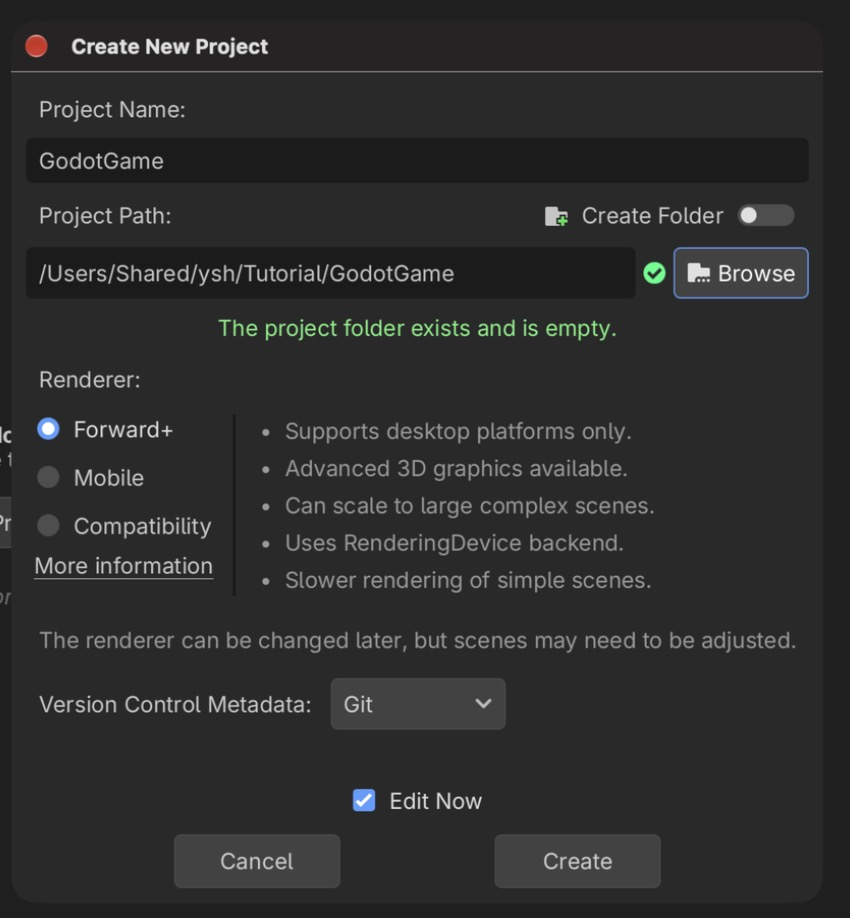
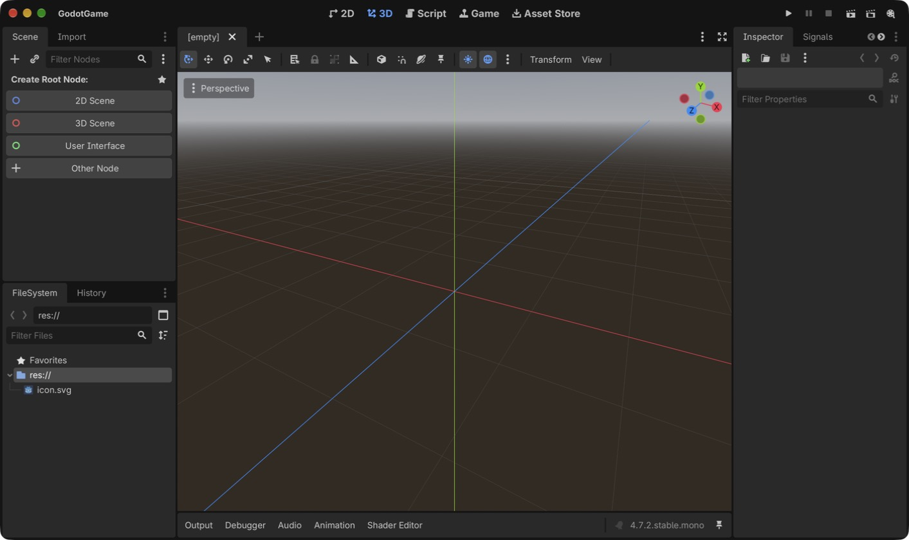
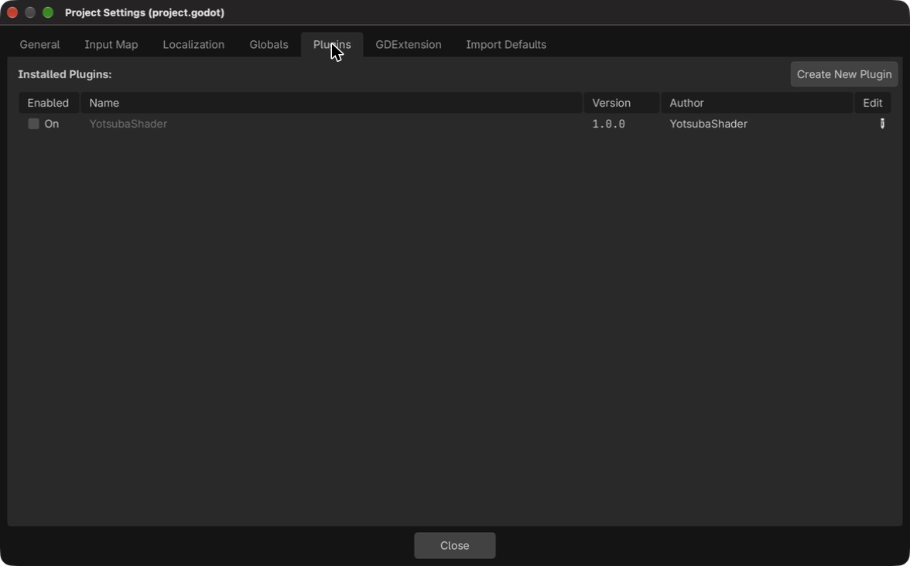
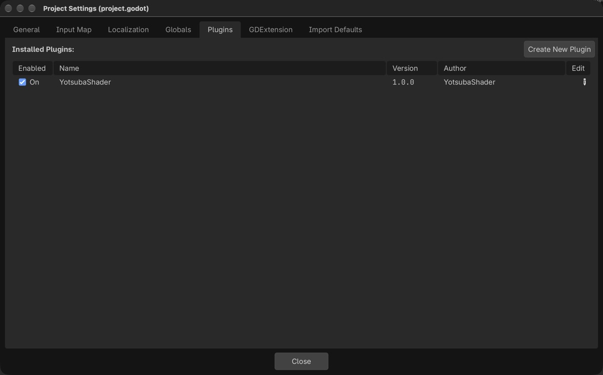
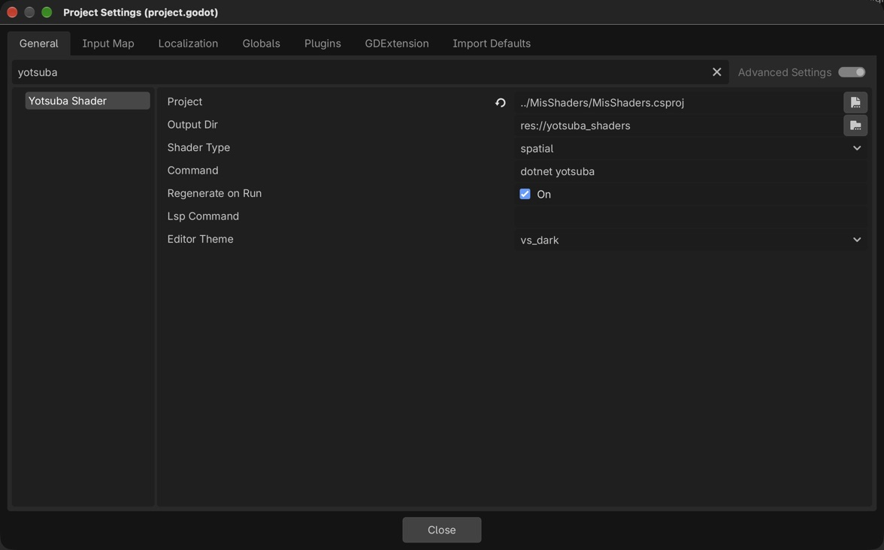
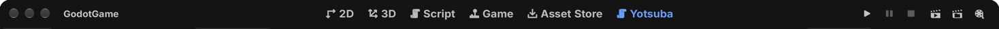
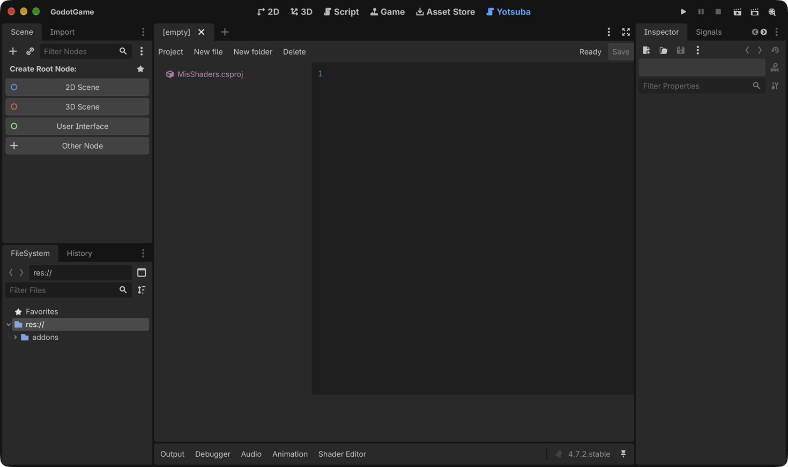
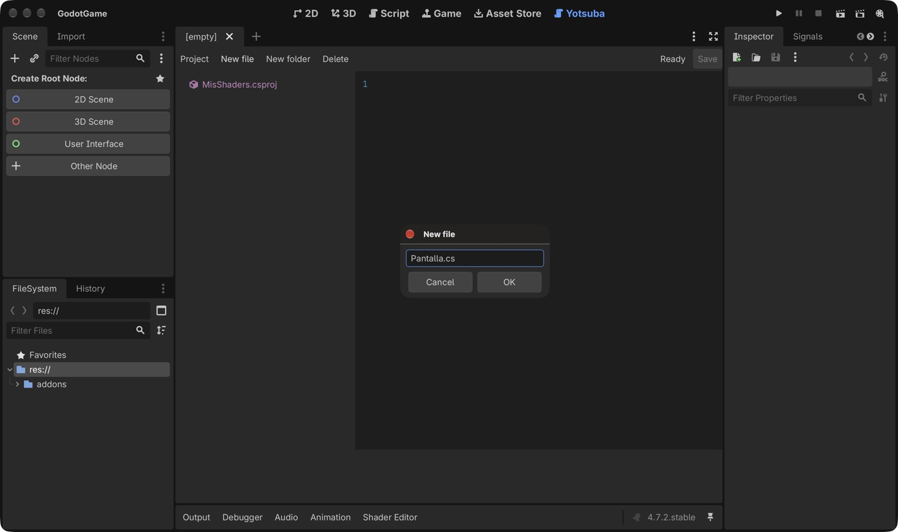
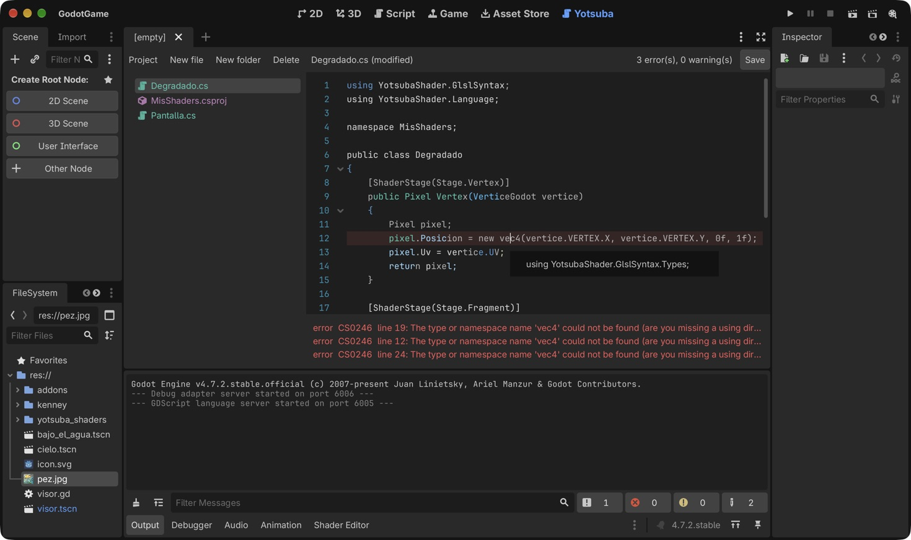

> [!SCENE] intro

En este capítulo no vas a escribir ningún shader todavía. Vas a dejar lista la carpeta de trabajo, para que en los capítulos siguientes solo tengas que preocuparte por el código.

Todos los shaders del tutorial los vas a escribir en una librería de C#. Los vas a ver funcionar con {{engine}}.

Cuando termines el tutorial, vas a usar esa misma librería en tu juego de {{engine}}. El último capítulo, [¿Y ahora qué?](next-steps.md), tiene los pasos para conectarla.

> [!SCENE] need

## Lo que necesitas

- **El SDK de .NET 10 o más nuevo.** Para saber cuál tienes, abre una terminal y escribe `dotnet --version`. Si te sale un número menor que 10, descarga el nuevo desde [dotnet.microsoft.com](https://dotnet.microsoft.com/download).

  Ojo con un detalle: el SDK es el programa que compila, y no tiene por qué ser de la misma versión que tu proyecto. Por eso más abajo creamos los proyectos con `-f net8.0`: el SDK 10 sabe compilarlos igual. Si tu juego usa otra versión, no pasa nada.
- **Un editor de C#.** El que ya uses: Rider, Visual Studio o Visual Studio Code. (En la ruta de Godot puedes usar el propio Godot, mira el paso 7.)
:::godot
- **Godot 4.4 o más nuevo.** Descárgalo en [godotengine.org](https://godotengine.org/download). Sirven las dos versiones: la estándar (GDScript) y la **.NET** (C#). Lo usarás desde el paso 5 de este capítulo, y también es donde escribirás tus shaders: el addon de Yotsuba Shader le agrega un editor de C#.
:::

> [!SCENE] tree

## Cómo va a quedar la carpeta

Al terminar este capítulo tendrás esto:

```text
Tutorial/
├── MisShaders/       una librería de C# normal: aquí escribes los shaders
└── Probar/           un programa de consola para usar los shaders ya compilados
```

Mira que `MisShaders` es una librería de C# como cualquier otra. Eso es lo bueno de escribir shaders en C#: un proyecto de shaders es simplemente un proyecto de .NET. Esta es la librería que después vas a llevar a tu Game Engine.

`Probar` solo existe para ver el resultado mientras aprendes. Cuando uses los shaders en tu juego, su lugar lo ocupa el proyecto de tu juego.

> [!SCENE] install

## 1. Crea la carpeta e instala el compilador

```bash
mkdir Tutorial
```

```bash
cd Tutorial
```

```bash
dotnet tool install --global YotsubaShader.Compiler.CLI
```

El comando descarga el compilador de Yotsuba Shader desde NuGet y lo instala como herramienta de todo tu equipo, no solo de esta carpeta. Desde ahora, desde cualquier carpeta, al compilador se le llama con `yotsuba`.

> [!NOTE]
> Si la terminal dice que no encuentra `yotsuba` justo después de instalar, ciérrala y abre una nueva. La terminal lee la lista de herramientas cuando arranca.

> [!SCENE] project

## 2. Crea el proyecto de shaders

Desde la carpeta `Tutorial`:

```bash
dotnet new classlib -n MisShaders -f net8.0
```

La plantilla crea un archivo `Class1.cs` que no vas a usar. Bórralo.

Ahora dile al proyecto que va a usar Yotsuba Shader. Es una sola referencia:

```bash
dotnet add MisShaders package YotsubaShader.GlslSyntax
```

Con esa línea te llegan dos cosas:

| Paquete | Qué te da |
| --- | --- |
| `YotsubaShader.GlslSyntax` | Los nombres con los que vas a escribir: `vec4`, `[location]`, `sin`, `texture`... |
| `YotsubaShader.Language` | Lo básico: `[ShaderStage]`, con lo que marcas qué método es un shader. |

`YotsubaShader.Language` no la añades tú. `GlslSyntax` ya la usa por dentro, y cuando un paquete usa otro, NuGet te trae los dos.

> [!SCENE] styles

> [!NOTE]
> `GlslSyntax` es uno de los cinco "estilos" que trae Yotsuba Shader. Usa los mismos nombres que GLSL, el lenguaje de shaders que más vas a encontrar en tutoriales de internet. Si vienes de HLSL, Metal, Vulkan o WGSL, hay un estilo para cada uno, y el resultado es el mismo. Lo verás en [Otros estilos de escritura](how-it-works.md). En este tutorial usamos GLSL de principio a fin.

> [!SCENE] tryit

## 3. Crea el programa para probar

```bash
dotnet new console -n Probar -f net8.0
```

```bash
dotnet add Probar reference MisShaders/MisShaders.csproj
```

`Probar` es un programa de consola cualquiera. Hace el papel de "tu juego" o "tu aplicación": el programa que va a pedir los shaders ya compilados. Lo usaremos para ver con nuestros propios ojos lo que produce el compilador.

> [!SCENE] build

## 4. Comprueba que todo compila

```bash
dotnet build Probar
```

Si al final ves `Build succeeded`, ya está todo listo. Aún no hay ningún shader, pero las referencias están bien puestas.

:::godot
> [!SCENE] g_project

## 5. Crea el proyecto de Godot

> [!NOTE]
> Usa Godot **en inglés** (es el idioma por defecto) y así los nombres de los menús coinciden con las capturas y con la documentación oficial. En las capturas los nodos se llaman `Viewer` y `Screen`; en el texto los llamamos `Visor` y `Pantalla`, y tú puedes ponerles los nombres que prefieras mientras el script los use igual.

Crea una carpeta vacía llamada `GodotGame` **dentro** de tu carpeta `Tutorial`. Abre Godot, pulsa **Create** y rellena la ventana así:



- **Project Name:** `GodotGame`.
- **Project Path:** la ruta completa de esa carpeta vacía. Godot lo confirma con "The project folder exists and is empty". Deja **Create Folder** apagado, porque la carpeta ya existe.
- **Renderer:** Forward+ está bien.

Pulsa **Create**. El editor se abre con un proyecto vacío:



```text
Tutorial/
├── MisShaders/       tus shaders
├── Probar/           la consola que creaste en el paso 3
└── GodotGame/        nuevo: el proyecto de Godot
```

Va **dentro** de `Tutorial` a propósito, para que todo quede junto y funcionen las rutas relativas que usarás más adelante (`../GodotGame/...`).

> [!NOTE]
> Las dos versiones de Godot sirven: la estándar (GDScript) y la **.NET** (C#). Todos los scripts de esta ruta aparecen en los dos lenguajes, en pestañas. El C# que escribes en `MisShaders` es solo el shader, y Godot nunca lo ejecuta.

> [!SCENE] g_addon

## 6. Instala el addon

Yotsuba Shader tiene un addon para el editor de Godot. Cada vez que pulsas **Play**, le pide a `yotsuba` que traduzca tus shaders a archivos de Godot, así que nunca tienes que ejecutar el comando a mano. El addon viene dentro del paquete NuGet del plugin de Godot. Desde la carpeta `Tutorial`:

```bash tab="macOS / Linux"
curl -L -o godot-addon.zip https://www.nuget.org/api/v2/package/YotsubaShader.Extensions.Godot/0.9.5
unzip -q godot-addon.zip "content/addon/addons/*" -d godot-addon
cp -R godot-addon/content/addon/addons GodotGame/
```

```powershell tab="Windows (PowerShell)"
curl.exe -L -o godot-addon.zip https://www.nuget.org/api/v2/package/YotsubaShader.Extensions.Godot/0.9.5
Expand-Archive godot-addon.zip -DestinationPath godot-addon -Force
Copy-Item -Recurse -Force godot-addon/content/addon/addons GodotGame/
```

`0.9.5` es la versión con la que se escribió este tutorial; instala la misma que tu herramienta `yotsuba` (`dotnet tool list --global` te la muestra). La pestaña Yotsuba, que vas a usar enseguida, viene en el addon desde la versión 0.9.1. En PowerShell hay que escribir `curl.exe`, porque `curl` a secas es otro comando allí.

Godot solo mira sus archivos al arrancar, así que recarga el proyecto (**Project → Reload Current Project**). La carpeta nueva `addons` aparece en el panel FileSystem.

Ahora enciende el addon. Abre **Project → Project Settings → Plugins**. **YotsubaShader** está en la lista, apagado:



Marca la casilla **Enabled**:



Luego abre la pestaña **General**, activa **Advanced Settings** (arriba a la derecha), escribe `yotsuba` en el filtro y elige la sección **Yotsuba Shader**. El campo **Project** está vacío:


Rellena `project` con:

```text
../MisShaders/MisShaders.csproj
```



La ruta se cuenta desde el proyecto de Godot. Deja el resto como está: `Lsp Command` y `Editor Theme` son para la pestaña Yotsuba que verás a continuación, `Output Dir` es donde van los shaders traducidos, `Shader Type` es `spatial` (para objetos 3D), `Command` es la herramienta y `Regenerate on Run` hace que el addon traduzca cada vez que pulsas Play. Si Godot dice que no encuentra `dotnet` (en macOS, cuando lo abres desde el Dock), escribe la ruta completa de la herramienta en `Command`.

## 7. Escribe tus shaders en la pestaña Yotsuba

Con el addon encendido, Godot tiene una pestaña más junto a **2D**, **3D** y **Script**: **Yotsuba**. Es un editor para el C# de `MisShaders`, dentro del propio Godot, así que no necesitas otro programa para escribir shaders.



Ábrela. Arriba están los botones **Project**, **New file**, **New folder** y **Delete**, el nombre del archivo abierto y el botón **Save**. Debajo, a la izquierda, los archivos de `MisShaders` (el proyecto que pusiste en `project`); a la derecha, el editor con sus números de línea y, debajo, la lista de problemas. Empieza vacío:



Para crear un archivo, pulsa **New file**. La pestaña te pide un nombre y pone el archivo en la carpeta del proyecto.



En el próximo capítulo vas a crear `Pantalla.cs` y `Degradado.cs` así.

Tres cosas que conviene saber:

- **Save** (el botón, o `Cmd/Ctrl+S`) escribe el archivo en disco. Hasta que guardes, el cambio solo existe en la pestaña.
- **Los errores salen mientras escribes.** La línea con el problema se marca en rojo y cada error aparece en la lista de abajo con su código: `CS...` si es de C# y `YS...` si es una regla de Yotsuba Shader. El contador junto a **Save** los suma.
- **Autocompletado y arreglos rápidos.** Después de un punto, la pestaña sugiere lo que puedes escribir. Si a un tipo le falta su `using`, pon el cursor sobre él y pulsa `Alt+Enter`; la pestaña ofrece el `using` que hay que añadir.



> [!NOTE]
> La pestaña Yotsuba necesita Godot 4.4 o más nuevo y una herramienta `yotsuba` que tenga el comando `lsp` (la que instalaste en el paso 1 lo tiene). Si el estado dice que no pudo iniciar el servidor de lenguaje, escribe la ruta completa de `yotsuba` en **Lsp Command**, en la misma sección de Project Settings. Es un editor joven: si prefieres, cualquier otro editor de C# (Rider, Visual Studio, VS Code) puede abrir `MisShaders/MisShaders.csproj` y todo lo demás del tutorial funciona igual.
:::

> [!SCENE] cli

## Un atajo para llamar al compilador

El compilador de Yotsuba Shader es un programa de terminal (una CLI). Lo vas a ejecutar así, desde la carpeta `Tutorial`:

```bash
yotsuba add MisShaders/MisShaders.csproj --target spirv
```

No lo ejecutes todavía. Solo fíjate en sus partes:

| Parte | Qué significa |
| --- | --- |
| `yotsuba` | "Ejecuta el compilador". Es el nombre de la herramienta que acabas de instalar. Todo lo que va después son las órdenes para él. |
| `add` | El comando. `add` significa: "compila mis shaders y **añade** el resultado a mi proyecto". |
| `MisShaders/MisShaders.csproj` | El proyecto donde están los shaders. |
| `--target spirv` | Un formato de salida. La CLI pide al menos uno. `spirv` viene dentro de la CLI; los motores (MonoGame, KNI, FNA, Godot) son plugins que añades más adelante como un `--target` más. |

:::raylib silknet
En esta ruta no añadirás ningún plugin: raylib-cs y Silk.NET leen archivos, y los formatos que pides con `--target` (`glsl:330`, `gles:300`, `spirv` y `wgsl`) vienen dentro de la CLI. Los capítulos siguientes muestran el comando de cada uno.
:::

En el siguiente capítulo lo vas a usar de verdad.

Siguiente: [Shader 1: un atardecer](first-shader.md).
