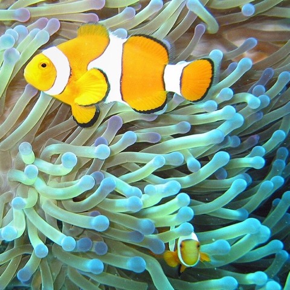
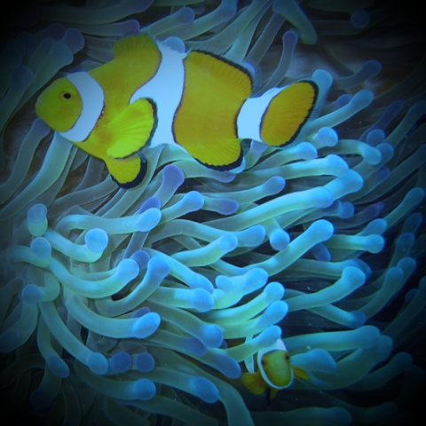
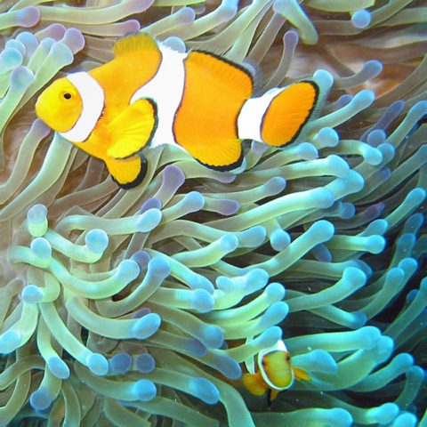
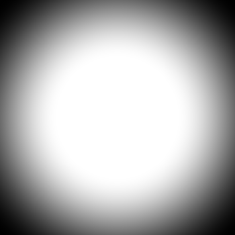
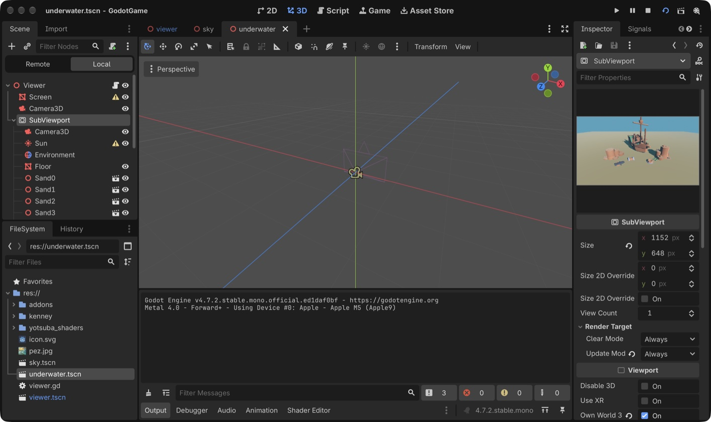
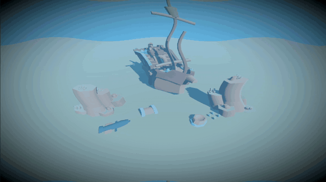

Los cuatro shaders anteriores inventaban el color de cada píxel con cuentas. En este último, el color sale de una imagen: una foto. Y como el color pasa por tu función antes de llegar a la pantalla, puedes hacerle lo que quieras.

Vas a tomar esta foto:



y vas a hacer que se vea así, ondulando como si la miraras a través del agua:



En este shader se junta todo lo que ya sabes: `Uv`, funciones propias, `sin`, `mix` y el uniform del tiempo. Lo único nuevo es leer la imagen.

## Una imagen dentro de un shader: la textura

A una imagen que usa un shader se le llama **textura**. Se declara igual que el uniform del capítulo anterior, como un campo de la clase con su dirección:

```csharp
[layout(0, 1)]
public sampler2D Foto;
```

- `sampler2D` es el tipo. Significa "una imagen en 2D que puedo leer". Está en `YotsubaShader.GlslSyntax.Resources.Types`.
- `layout(0, 1)` es su dirección: grupo 0, casillero 1. El casillero 0 ya lo ocupa el reloj, y dos cosas no pueden estar en la misma dirección.

Tu programa es quien carga la foto y la deja en esa dirección, igual que hacía con el reloj.

## Leer un color de la foto

Para leer la textura se usa la función `texture`. Le das la textura y un punto, y te devuelve el color que hay en ese punto:

```csharp
vec4 foto = texture(Foto, Crear.Vec2(u, v));
```

El punto se da con dos números de `0` a `1`. `(0, 0)` es la esquina de arriba a la izquierda de la foto y `(1, 1)` la de abajo a la derecha. ¿Te suena? Es exactamente lo mismo que `Uv`.

Por eso, si a cada píxel le das el color de la foto en su propio `Uv`, la foto aparece en pantalla tal cual, sin cambios:

```csharp
vec4 foto = texture(Foto, Crear.Vec2(pixel.Uv.X, pixel.Uv.Y));
```

`texture` no está en la clase `Math`, sino en otra llamada `Intrinsic`, donde están las funciones que hablan con el hardware. Se usa con otro `using static`:

```csharp
using static YotsubaShader.GlslSyntax.Methods.Intrinsic;
```

## El truco: leer de un sitio un poco distinto

Aquí está la idea de todo el efecto. Nadie te obliga a leer la foto justo en el `Uv` del píxel. Puedes leerla **un poquito al lado**.

Si todos los píxeles leyeran un poco a la derecha, la foto entera se vería desplazada. Pero si cada píxel se desvía una cantidad distinta, la foto se deforma. Y si esa cantidad sigue una ola, la foto se ondula:

```csharp
float u = pixel.Uv.X + sin(pixel.Uv.Y * 25f + t * 2f) * 0.012f;
float v = pixel.Uv.Y + sin(pixel.Uv.X * 20f + t * 1.5f) * 0.012f;

vec4 foto = texture(Foto, Crear.Vec2(u, v));
```

Mira la primera línea por partes:

- `pixel.Uv.X` es el punto donde le tocaría leer al píxel.
- `sin(pixel.Uv.Y * 25f + t * 2f)` es una ola que depende de la altura del píxel. Cada fila de píxeles recibe un valor distinto, entre `-1` y `1`.
- `* 0.012f` hace la ola muy pequeña. El desvío máximo es un 1,2 % del ancho de la foto. Con más, la imagen se rompe; con menos, no se nota.
- `+ t * 2f` es el truco del capítulo anterior: al sumar el tiempo, la ola avanza.

La segunda línea hace lo mismo para la altura, con otros números para que las dos olas no vayan a la par.



La foto no se movió. Lo que cambió es de qué punto lee cada píxel.

## Teñir de azul

Debajo del agua todo se ve azulado, porque el agua apaga el rojo. Vamos a hacer lo mismo: bajar mucho el rojo, un poco el verde, y dejar el azul.

```csharp
vec3 original = Crear.Vec3(foto.X, foto.Y, foto.Z);
vec3 azulMar = Crear.Vec3(foto.X * 0.2f, foto.Y * 0.7f, foto.Z * 1f + 0.1f);
vec3 color = mix(original, azulMar, 0.6f);
```

`foto.X`, `foto.Y` y `foto.Z` son el rojo, el verde y el azul del color que leíste. `azulMar` es ese mismo color con el rojo al 20 % y el verde al 70 %.

El `mix` final se queda con un 60 % de la versión azul y un 40 % de la original. Así el pez sigue siendo naranja, pero apagado. Si quieres el agua más profunda, sube el `0.6f`.

## Oscurecer los bordes

El último toque es oscurecer las esquinas, como en una foto antigua. A eso se le llama viñeta, y es otra vez la distancia al centro:

```csharp
public static float Vineta(float u, float v)
{
    float x = u * 2f - 1f;
    float y = v * 2f - 1f;
    float distancia = sqrt(x * x + y * y);
    return 1f - smoothstep(0.5f, 1.4f, distancia);
}
```

Aquí aparece una función nueva, `smoothstep(inicio, fin, valor)`. Devuelve `0` si el valor está por debajo de `inicio`, `1` si está por encima de `fin`, y entre medias sube de `0` a `1` con suavidad. Sirve para hacer transiciones sin cortes bruscos.

En este caso: hasta una distancia de `0.5` del centro devuelve `0`, y de ahí hasta `1.4` va subiendo. Como queremos lo contrario (luz en el centro, sombra en los bordes), le damos la vuelta con `1f - ...`.



Esa imagen es la viñeta sola: blanco es `1` y negro es `0`. Al multiplicar el color de la foto por ese número, el centro se queda igual y los bordes se oscurecen:

```csharp
float sombra = Vineta(pixel.Uv.X, pixel.Uv.Y);

return Crear.Vec4(color.X * sombra, color.Y * sombra, color.Z * sombra, 1f);
```

Multiplicar un color por un número entre `0` y `1` es la forma de oscurecerlo.

## El shader completo

```csharp title="MisShaders/BajoElAgua.cs"
using YotsubaShader.GlslSyntax;
using YotsubaShader.GlslSyntax.Resources;
using YotsubaShader.GlslSyntax.Resources.Types;
using YotsubaShader.GlslSyntax.Types;
using YotsubaShader.Language;
using static YotsubaShader.GlslSyntax.Methods.Intrinsic;
using static YotsubaShader.GlslSyntax.Methods.Math;

namespace MisShaders;

public class BajoElAgua
{
    [uniform, layout(0, 0)]
    public Reloj Tiempo;

    [layout(0, 1)]
    public sampler2D Foto;

    [ShaderStage(Stage.Vertex)]
    public Pixel Vertex({{vertexType}} vertice)
    {
        Pixel pixel;
        pixel.Posicion = Crear.Vec4(vertice.{{pos}}.X, vertice.{{pos}}.Y, 0f, 1f);
        pixel.Uv = vertice.{{uv}};
        return pixel;
    }

    [ShaderStage(Stage.Fragment)]
    [return: location(0)]
    public vec4 Fragment(PixelIn pixel)
    {
        float t = Tiempo.Segundos;

        float u = pixel.Uv.X + sin(pixel.Uv.Y * 25f + t * 2f) * 0.012f;
        float v = pixel.Uv.Y + sin(pixel.Uv.X * 20f + t * 1.5f) * 0.012f;

        vec4 foto = texture(Foto, Crear.Vec2(u, v));

        vec3 original = Crear.Vec3(foto.X, foto.Y, foto.Z);
        vec3 azulMar = Crear.Vec3(foto.X * 0.2f, foto.Y * 0.7f, foto.Z * 1f + 0.1f);
        vec3 color = mix(original, azulMar, 0.6f);

        float sombra = Vineta(pixel.Uv.X, pixel.Uv.Y);

        return Crear.Vec4(color.X * sombra, color.Y * sombra, color.Z * sombra, 1f);
    }

    public static float Vineta(float u, float v)
    {
        float x = u * 2f - 1f;
        float y = v * 2f - 1f;
        float distancia = sqrt(x * x + y * y);
        return 1f - smoothstep(0.5f, 1.4f, distancia);
    }
}
```

El `struct Reloj` no se vuelve a declarar: es el de `Plasma.cs`. Dos shaders pueden compartir el mismo `struct` de datos, y tu programa puede mandarles el mismo reloj a los dos.

:::godot
## Darle la foto a Godot

Un shader no puede abrir archivos por sí solo: tu escena le entrega la imagen. El script del visor ya tiene un espacio para eso, la propiedad `foto` (en C#, `Foto`). Envía la imagen a la textura `Foto` del shader justo después de cargarlo.

1. Copia `pez.jpg` en `GodotGame/` y deja que Godot lo importe.
2. Abre `visor.tscn`, selecciona la raíz `Visor` y escribe `BajoElAgua` en **Nombre Shader**.
3. Arrastra `pez.jpg` desde el panel FileSystem a la propiedad **Foto** del Inspector.

Pulsa **Play Scene** (`Cmd/Ctrl+R`): aparece el pez payaso ondulando, con tono azul y bordes oscuros, igual que en las demás rutas.

## Un extra para Godot: toda la escena 3D bajo el agua

Al shader le da igual de dónde viene la imagen. En Godot una imagen también puede ser **lo que ve una cámara**. Vas a dibujar un fondo marino en 3D y a usar ese dibujo como `Foto`, de modo que el efecto de agua cubra una escena completa.

> [!NOTE]
> Esta escena es **temporal**, solo para lucirte. Cuando termines le vuelves a dar el pez payaso a `BajoElAgua` y el tutorial sigue como en las demás rutas.

Los modelos son del [Pirate Kit de Kenney](https://kenney.nl/assets/pirate-kit), licencia CC0 (dominio público). Descárgalo y copia estos archivos de `Models/GLB format/` a `GodotGame/kenney/`: `ship-wreck.glb`, `patch-sand.glb`, `rocks-sand-a.glb`, `rocks-sand-b.glb`, `chest.glb`, `barrel.glb`, `crate-bottles.glb`, `cannon.glb`. Copia también `Textures/colormap.png`, junto a ellos, porque los modelos lo usan para sus colores. Después usa **Project → Reload Current Project** para que Godot los importe.

Abre `visor.tscn`, guárdala como `bajo_el_agua.tscn` (**Scene → Save Scene As…**) y añade estos nodos como hijos de `Visor`:

- **`SubViewport`**: una pantalla pequeña e invisible donde se dibuja la escena 3D. En el Inspector pon **Size** en `1152 × 648`, **Render Target → Update Mode** en `Always` y activa **Own World 3D**. Esto último es importante: le da su propio mundo al SubViewport, así la cámara de `Visor` no ve sus objetos.

Todo lo siguiente va dentro de `SubViewport`:

| Nodo | Tipo | Qué configuras |
| --- | --- | --- |
| `Camera3D` | `Camera3D` | Position `(0, 7.5, 15)`, Rotation X `-25°`, **FOV** `65` |
| `Sun` | `DirectionalLight3D` | Rotation X `-60°`, **Energy** `0.7`, Shadow **Enabled** |
| `Environment` | `WorldEnvironment` | New Environment: cielo verde azulado oscuro, **Fog** activada con color verde azulado y **Density** `0.006` |
| `Floor` | `MeshInstance3D` | **Mesh → New PlaneMesh**, tamaño `120 × 120`, Position Y `0.85`, material color arena |
| `Sand0` … `Sand8` | `patch-sand.glb` | Arrastra el archivo desde FileSystem a la escena. Nueve copias en cuadrícula: X `-8, 0, 8` y Z `-4, 2, 8`, Y `-0.1` |
| `Wreck` | `ship-wreck.glb` | Position `(0.5, 0.3, -1)`, Rotation Y `25°` |
| `RocksA`, `RocksB` | `rocks-sand-a.glb`, `rocks-sand-b.glb` | Posiciones `(-5.5, 0, 3.5)` y `(6, 0, 4)` |
| `Chest`, `Barrel`, `Crate`, `Cannon` | `chest.glb`, `barrel.glb`, `crate-bottles.glb`, `cannon.glb` | Repártelos delante del naufragio, entre Z `5` y `6.5` |



Ahora une las dos partes. Selecciona la raíz `Visor` y, en **Foto**, elige **New ViewportTexture**. Godot pregunta qué viewport: elige `SubViewport`. La raíz conserva `BajoElAgua` en **Nombre Shader**.

Pulsa **Play Scene**:



El naufragio, las rocas y la arena son modelos normales de Godot. Todo lo que ves teñido, ondulando y oscurecido en los bordes es tu shader `BajoElAgua`, que recibió la imagen de la cámara como si fuera una foto.

Para volver al capítulo estándar, abre `visor.tscn`: sigue con `BajoElAgua` y el pez payaso en **Foto**.
:::

## Mira lo lejos que llegaste

Lee el método `Fragment` otra vez. Hace diez líneas de cuentas, y cada una es algo que aprendiste en un capítulo:

| Línea | De dónde viene |
| --- | --- |
| `pixel.Uv.X`, `Crear.Vec4(...)` | Shader 1 |
| La función `Vineta` | Shader 2 |
| `sqrt`, `mix` | Shader 3 |
| `Tiempo.Segundos`, `sin(... + t)` | Shader 4 |
| `texture(Foto, ...)` | Este capítulo |

Casi todos los efectos que ves en un juego están hechos con estas mismas piezas: leer una imagen, desviar un poco de dónde se lee, mezclar colores y usar distancias.

## Juega con él

- Cambia `0.012f` por `0.05f` en las dos líneas. La foto se deforma mucho más.
- Quita el tinte azul devolviendo `original` en lugar de `color`. Te quedas solo con las ondas.
- Convierte la foto a blanco y negro: calcula `float gris = (foto.X + foto.Y + foto.Z) / 3f;` y devuelve `Crear.Vec4(gris, gris, gris, 1f)`.

## Lo que aprendiste

- Una textura es una imagen que el shader puede leer. Se declara como un campo `sampler2D` con su `[layout(grupo, casillero)]`.
- `texture(imagen, punto)` devuelve el color de la imagen en ese punto. El punto va de `0` a `1`, igual que `Uv`.
- Leer la imagen en un punto distinto al que toca es la base de casi todos los efectos de deformación.
- Multiplicar un color por un número lo oscurece. `smoothstep` hace que el paso de un valor a otro sea suave.

Ya terminaste los cinco shaders. Antes de cerrar, el capítulo [Cuando algo sale mal](debugging.md) reúne el método para encontrar errores y las preguntas que casi todo el mundo se hace.

---

Foto del pez payaso: Janderk, [Wikimedia Commons](https://commons.wikimedia.org/wiki/File:Common_clownfish.jpg), dominio público.
