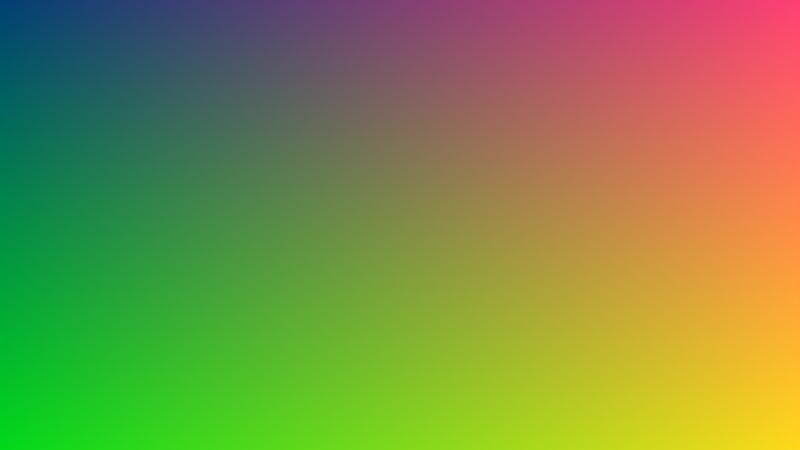
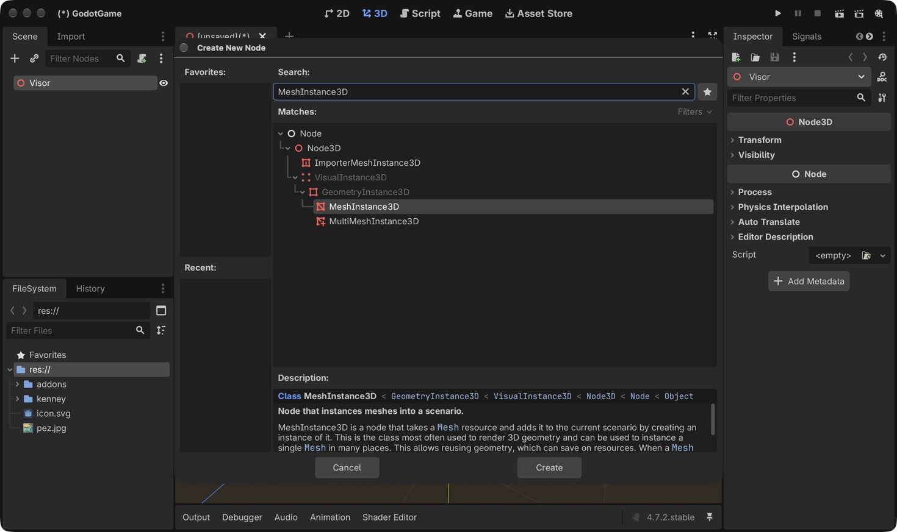
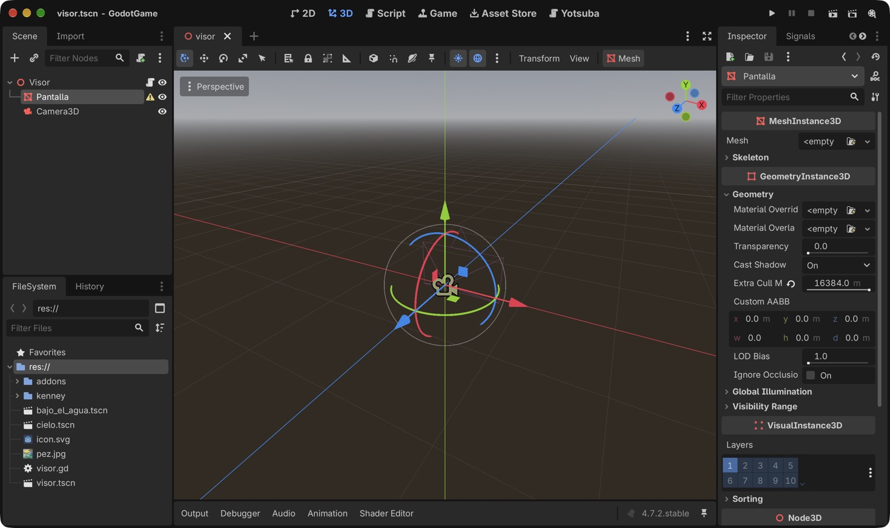
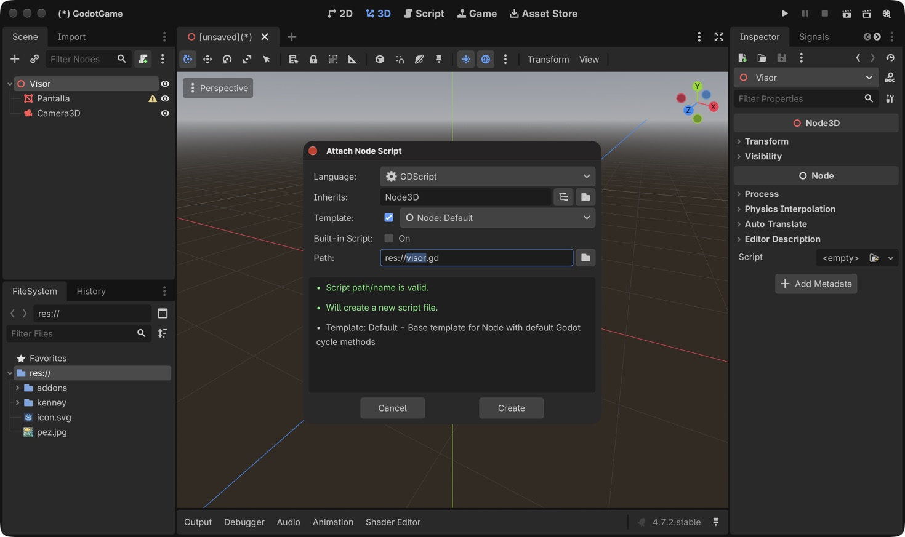
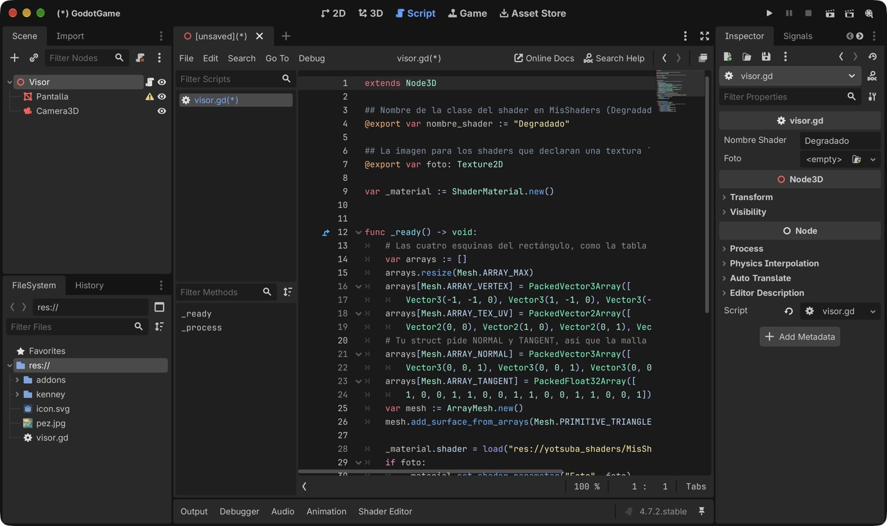
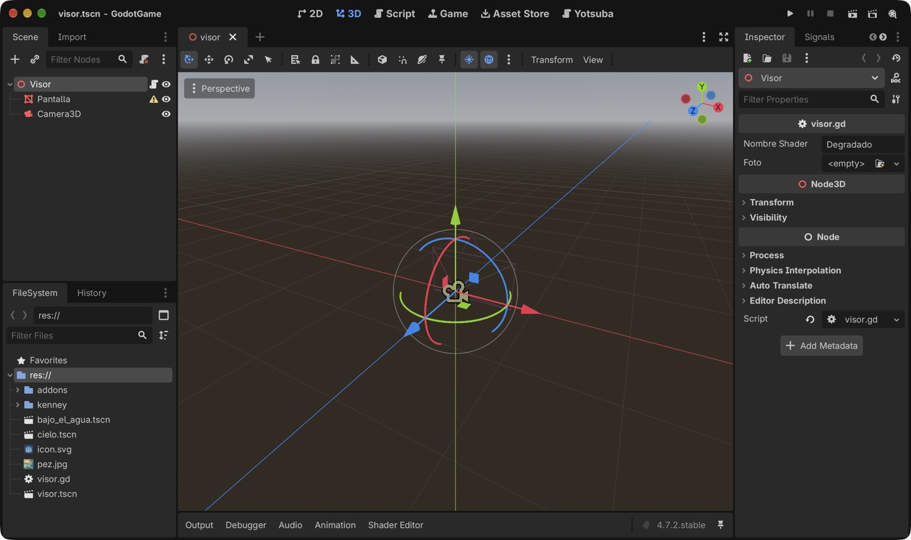
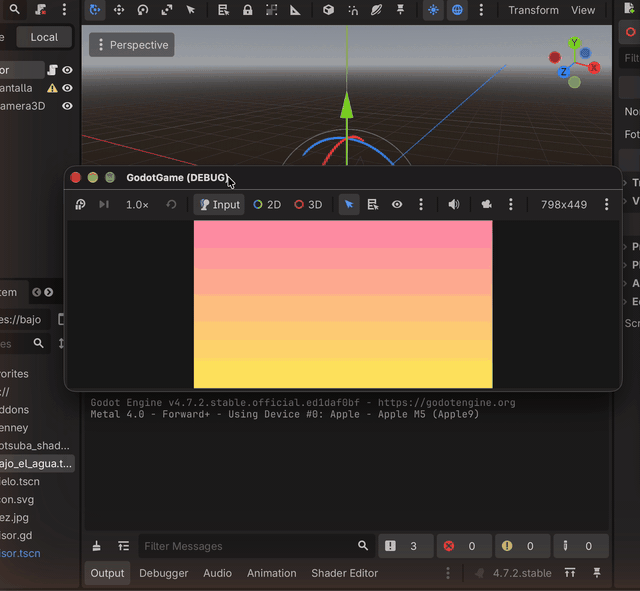
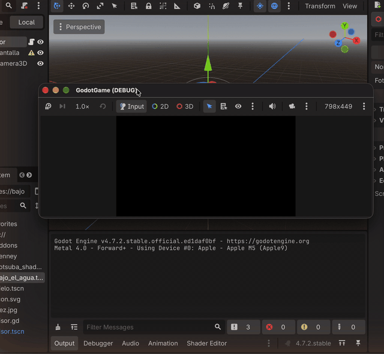

> [!SCENE] intro

Hasta ahora compilaste un shader y leíste su código en la consola. Pero un shader se hace para **verse**. Un shader del que no ves el resultado es como una receta que nunca cocinas: no aprendes nada.

Por eso, desde este capítulo cambia la forma de trabajar. Todo lo que sigue funciona así:

1. Escribes un poco de código.
2. Lo compilas.
3. Lo miras en una ventana.
4. Cambias un número y vuelves a mirar.

Para el paso 3 necesitas esa ventana. La vas a construir ahora, una sola vez.

:::xna
> [!SCENE] x_viewer

## Qué es el visor

El visor es un programa de unas 70 líneas que hace tres cosas:

- Abre una ventana.
- Dibuja un rectángulo que la cubre entera (el mismo rectángulo de [Shader 1](first-shader.md)).
- Le pone encima el shader que le indiques por nombre.

Fíjate en una cosa: el visor **no forma parte de tu shader**. Tus shaders siguen en `MisShaders`, sin saber nada de ventanas. El visor es solo una herramienta de trabajo, como un banco para probar piezas. Para abrir la ventana usamos {{engine}} porque es corto y funciona igual en Windows, Mac y Linux. Cuando quieras llevar tus shaders a tu juego, usarás la misma librería con el motor que prefieras.

> [!NOTE]
> No hace falta que entiendas cada línea del visor para seguir. Si te da curiosidad, la guía de [{{engine}}](../engines/{{plugin}}-reference.md) explica una por una las partes que aquí solo mencionamos.

> [!SCENE] x_project

## Paso 1: crea el proyecto

Desde la carpeta `Tutorial`:

```bash
dotnet new console -n Visor -f net8.0
dotnet add Visor package {{enginePackage}}
dotnet add Visor reference MisShaders/MisShaders.csproj
```

- La primera línea crea un programa de consola vacío llamado `Visor`.
- La segunda le agrega {{engine}}, que es quien abre la ventana.
- La tercera le dice que puede usar tus shaders. Así, cada cambio que hagas en `MisShaders` lo verá el visor sin copiar nada.

Tu carpeta queda así:

```text
Tutorial/
├── MisShaders/       tus shaders
├── Probar/           la consola del capítulo anterior
└── Visor/            nuevo: la ventana
```

> [!SCENE] x_vertex

## Paso 2: describe el vértice, del lado de la ventana

En [Cómo se construye un shader](how-a-shader-is-built.md) viste que el juego le entrega al shader una lista de vértices, y que cada uno trae una posición y un `Uv`. En el shader ya escribiste cómo es un vértice (el struct `Vertice`). Ahora hay que escribir **lo mismo del lado de C# normal**, para que ventana y shader se entiendan.

Crea `Visor/Esquina.cs`:

```csharp title="Visor/Esquina.cs"
using Microsoft.Xna.Framework;
using Microsoft.Xna.Framework.Graphics;

public readonly struct Esquina(Vector2 posicion, Vector2 uv) : IVertexType
{
    private static readonly VertexDeclaration Declaracion = new(
        new VertexElement(0, VertexElementFormat.Vector2, VertexElementUsage.TextureCoordinate, 0),
        new VertexElement(8, VertexElementFormat.Vector2, VertexElementUsage.TextureCoordinate, 1));

    public readonly Vector2 Posicion = posicion;
    public readonly Vector2 Uv = uv;

    VertexDeclaration IVertexType.VertexDeclaration => Declaracion;
}
```

Aquí lo único importante es que coincida con tu `Vertice`: primero dos números para la posición (ranura 0), luego dos para el `Uv` (ranura 1). Si algún día cambias `Vertice`, tendrás que cambiar `Esquina` igual.

> [!SCENE] x_window

## Paso 3: una ventana vacía

Reemplaza todo el contenido de `Visor/Program.cs` por esto:

```csharp title="Visor/Program.cs"
using Microsoft.Xna.Framework;
using Microsoft.Xna.Framework.Graphics;
using Microsoft.Xna.Framework.Input;

string nombre = args.Length > 0 ? args[0] : "Degradado";

using var visor = new Visor(nombre);
visor.Run();

public class Visor : Game
{
    private readonly string _nombre;

    public Visor(string nombre)
    {
        _nombre = nombre;
        var graficos = new GraphicsDeviceManager(this)
        {
            PreferredBackBufferWidth = 800,
            PreferredBackBufferHeight = 450,
        };
        Window.AllowUserResizing = true;
        Window.Title = nombre;
    }

    protected override void Update(GameTime gameTime)
    {
        if (Keyboard.GetState().IsKeyDown(Keys.Escape))
        {
            Exit();
        }
        base.Update(gameTime);
    }

    protected override void Draw(GameTime gameTime)
    {
        GraphicsDevice.Clear(Color.CornflowerBlue);
        base.Draw(gameTime);
    }
}
```

Mira las tres partes:

- La primera línea toma el nombre del shader que escribas al ejecutar. Si no escribes ninguno, usa `Degradado`.
- El constructor `Visor(...)` pide una ventana de 800 por 450 píxeles. Es ancha a propósito: más adelante te ayudará a descubrir un problema típico de los shaders. Además, puedes estirarla con el ratón.
- `Update` cierra la ventana cuando pulsas **Esc**. `Draw` la pinta de azul, por ahora.

Ejecútalo:

```bash
dotnet run --project Visor
```

Debe aparecer una ventana azul. Ciérrala con **Esc**. Si la ves, {{engine}} funciona en tu equipo y no te falta nada.

> [!SCENE] x_shader

## Paso 4: agrega el shader

Ahora vamos a hacer que la ventana dibuje un shader en vez de pintarse de azul. Son cuatro cambios en el mismo archivo. Hazlos uno por uno.

**Cambio 1.** Agrega estas líneas arriba del todo, junto a los otros `using`:

```csharp
using MisShaders;
using YotsubaShader;
```

**Cambio 2.** Dentro de la clase `Visor`, debajo de `private readonly string _nombre;`, agrega el shader y el rectángulo:

```csharp
    private Effect _shader = null!;

    private readonly Esquina[] _pantalla =
    [
        new(new Vector2(-1f,  1f), new Vector2(0f, 0f)),
        new(new Vector2( 1f,  1f), new Vector2(1f, 0f)),
        new(new Vector2(-1f, -1f), new Vector2(0f, 1f)),
        new(new Vector2( 1f, -1f), new Vector2(1f, 1f)),
    ];
```

Son las cuatro esquinas del rectángulo. Cada una dice dónde está en la pantalla (de `-1` a `1`) y cuál es su `Uv` (de `0` a `1`). Es la misma tabla que viste en el capítulo de cómo se construye un shader.

**Cambio 3.** Entre el constructor y `Update`, agrega un método nuevo que carga tu shader:

```csharp
    protected override void LoadContent()
    {
{{loadPrefix}}
        // Una línea por cada shader del tutorial: el nombre que escribes tras `--` y su clase.
        byte[] compilado = _nombre switch
        {
            "Degradado" => {{toFx Degradado}},
            _ => throw new Exception($"El visor no conoce ningún shader llamado \"{_nombre}\". Agrégalo al switch."),
        };

        _shader = new Effect(GraphicsDevice, compilado);
    }
```

`{{toMethod}}` es el método que Yotsuba Shader crea para cada una de tus clases de shader: devuelve el shader compilado para {{engine}}. El `switch` elige qué clase usar según el nombre que escribes tras `--` en la terminal. Por ahora solo conoce `Degradado`. **Cada vez que crees un shader nuevo agregarás una línea aquí**, y el capítulo te lo recordará. La última línea, `_ =>`, significa "cualquier otro nombre" y te da un error claro si lo escribes mal.

**Cambio 4.** Reemplaza el método `Draw` entero por este:

```csharp
    protected override void Draw(GameTime gameTime)
    {
        GraphicsDevice.Clear(Color.Black);
        GraphicsDevice.RasterizerState = RasterizerState.CullNone;

        // Si tu shader declara estos datos, el visor se los entrega.
        _shader.Parameters["Datos_Ancho"]?.SetValue((float)GraphicsDevice.Viewport.Width);
        _shader.Parameters["Datos_Alto"]?.SetValue((float)GraphicsDevice.Viewport.Height);
        _shader.Parameters["Datos_Segundos"]?.SetValue((float)gameTime.TotalGameTime.TotalSeconds);

        _shader.CurrentTechnique.Passes[0].Apply();
        GraphicsDevice.DrawUserPrimitives(PrimitiveType.TriangleStrip, _pantalla, 0, 2);

        base.Draw(gameTime);
    }
```

Las tres líneas que empiezan con `_shader.Parameters` son un adelanto: si tu shader pide el tamaño de la ventana o el tiempo, el visor se los da. Todavía no los usamos; en unos capítulos sabrás para qué sirven. Si tu shader no los pide, esas líneas no hacen nada.

Por si algo no te cuadra, así queda el archivo completo:

```csharp title="Visor/Program.cs"
using Microsoft.Xna.Framework;
using Microsoft.Xna.Framework.Graphics;
using Microsoft.Xna.Framework.Input;
using MisShaders;
using YotsubaShader;

string nombre = args.Length > 0 ? args[0] : "Degradado";

using var visor = new Visor(nombre);
visor.Run();

public class Visor : Game
{
    private readonly string _nombre;
    private Effect _shader = null!;

    private readonly Esquina[] _pantalla =
    [
        new(new Vector2(-1f,  1f), new Vector2(0f, 0f)),
        new(new Vector2( 1f,  1f), new Vector2(1f, 0f)),
        new(new Vector2(-1f, -1f), new Vector2(0f, 1f)),
        new(new Vector2( 1f, -1f), new Vector2(1f, 1f)),
    ];

    public Visor(string nombre)
    {
        _nombre = nombre;
        var graficos = new GraphicsDeviceManager(this)
        {
            PreferredBackBufferWidth = 800,
            PreferredBackBufferHeight = 450,
        };
        Window.AllowUserResizing = true;
        Window.Title = nombre;
    }

    protected override void LoadContent()
    {
{{loadPrefix}}
        // Una línea por cada shader del tutorial: el nombre que escribes tras `--` y su clase.
        byte[] compilado = _nombre switch
        {
            "Degradado" => {{toFx Degradado}},
            _ => throw new Exception($"El visor no conoce ningún shader llamado \"{_nombre}\". Agrégalo al switch."),
        };

        _shader = new Effect(GraphicsDevice, compilado);
    }

    protected override void Update(GameTime gameTime)
    {
        if (Keyboard.GetState().IsKeyDown(Keys.Escape))
        {
            Exit();
        }
        base.Update(gameTime);
    }

    protected override void Draw(GameTime gameTime)
    {
        GraphicsDevice.Clear(Color.Black);
        GraphicsDevice.RasterizerState = RasterizerState.CullNone;

        // Si tu shader declara estos datos, el visor se los entrega.
        _shader.Parameters["Datos_Ancho"]?.SetValue((float)GraphicsDevice.Viewport.Width);
        _shader.Parameters["Datos_Alto"]?.SetValue((float)GraphicsDevice.Viewport.Height);
        _shader.Parameters["Datos_Segundos"]?.SetValue((float)gameTime.TotalGameTime.TotalSeconds);

        _shader.CurrentTechnique.Passes[0].Apply();
        GraphicsDevice.DrawUserPrimitives(PrimitiveType.TriangleStrip, _pantalla, 0, 2);

        base.Draw(gameTime);
    }
}
```

> [!SCENE] x_see

## Paso 5: ve tu primer shader

Ahora sí. Tu `Degradado` del capítulo anterior ya está compilado, así que basta con ejecutar el visor:

```bash
dotnet run --project Visor -- Degradado
```

Lo que va después de `--` es el nombre del shader que le pasas al visor.


Ese es tu shader, dibujado por la GPU de tu equipo. Ciérralo con **Esc**.

> [!SCENE] x_cycle

## El ciclo de trabajo

Ahora vas a aprender el ciclo que usarás el resto del tutorial. Es siempre el mismo:

1. **Editas** un archivo de `MisShaders`.
2. **Compilas** con `add`, para que tus cambios se conviertan en shader.
3. **Miras** con el visor.

Los dos últimos pasos caben en una línea, unidos por `&&` (que significa "y si salió bien, sigue con esto"):

```bash
yotsuba add MisShaders/MisShaders.csproj --target spirv --target {{plugin}} && dotnet run --project Visor -- Degradado
```

Hay algo nuevo en el comando: `--target {{plugin}}`. El visor carga tu shader con `{{toMethod}}`, y ese método no lo genera la CLI sola: viene del **plugin de {{engine}}**. Con ese `--target` lo pides. La primera vez la CLI descarga el plugin (necesita internet solo esa vez) y desde entonces usa la copia que guardó. La [guía de {{engine}}](../engines/{{plugin}}-reference.md) explica qué es el plugin y qué produce.

Pruébalo ahora con tu primer experimento. Abre `MisShaders/Degradado.cs` y busca esta línea en `Fragment`:

```csharp
float rojo = 1f;
```

Cámbiala por esta:

```csharp
float rojo = pixel.Uv.X;
```

Guarda y ejecuta el comando de arriba:



El rojo ya no vale lo mismo en toda la pantalla: ahora crece de izquierda a derecha, porque `pixel.Uv.X` va de `0` en el borde izquierdo a `1` en el derecho. En el borde izquierdo no hay nada de rojo y quedan solo el verde y el azul (azul oscuro arriba, verde abajo). En el derecho vuelve el atardecer de antes.

Acabas de hacer lo que vas a hacer cientos de veces: cambiar un número y ver qué pasa. Antes de seguir, devuelve la línea a `float rojo = 1f;`.

> [!NOTE]
> El ciclo tiene un paso más la primera vez que usas un shader: su línea en el `switch` del visor. Lo haces una vez por shader, nunca más.

> [!TIP]
> Guarda el comando del ciclo en un archivo de texto o en el historial de tu terminal. Vas a ejecutarlo muchas veces, y lo único que cambia es el nombre del final.

:::

:::godot
> [!SCENE] g_viewer

## Qué es el visor

El visor es una pequeña **escena de Godot** que hace tres cosas:

- Dibuja un rectángulo que cubre toda la ventana (el mismo rectángulo del [Shader 1](first-shader.md)).
- Le pone encima el shader que le nombres.
- Le entrega el tamaño de la ventana y el tiempo, por si el shader los pide.

Fíjate en una cosa: el visor **no forma parte de tu shader**. Tus shaders siguen en `MisShaders`, sin saber nada de Godot. El visor es solo una herramienta de trabajo, como un banco para probar piezas. Cuando quieras llevar tus shaders a tu juego, usarás la misma librería en tus propias escenas.

> [!NOTE]
> No necesitas entender cada línea del visor para seguir. Son unas 30 líneas de Godot.

> [!NOTE]
> Esta ruta necesita el proyecto de Godot y el addon de [Prepara tu proyecto](setup.md): la carpeta `GodotGame` dentro de `Tutorial`, con `addons/yotsubashader` activado y `project` apuntando a `MisShaders`. Si te lo saltaste, hazlo ahora.

> [!SCENE] g_scene

## Paso 1: el rectángulo y la ventana

Aquí está la idea clave de esta ruta: Godot no dibuja un rectángulo suelto. Dibuja **mallas** (*meshes*), dentro de **escenas**. Así que el visor es una escena con tres nodos:

- `Visor`: la raíz. Lleva el script.
- `Pantalla`: un `MeshInstance3D`, el objeto que mostrará tu shader.
- `Camera3D`: sin ella Godot no tiene por dónde mirar.

Constrúyela paso a paso.

**La raíz.** En el panel **Scene**, pulsa **3D Scene**. Godot crea un `Node3D`. Haz doble clic en su nombre y llámalo `Visor`.

**El nodo `Pantalla`.** Clic derecho en `Visor` y elige **Add Child Node…** (o selecciónalo y pulsa `Cmd/Ctrl+A`). Escribe `MeshInstance3D`, selecciónalo y pulsa **Create**:



Haz doble clic en el nodo nuevo y cámbiale el nombre a `Pantalla`.

**La cámara.** Selecciona `Visor` otra vez y añade otro nodo hijo, esta vez un `Camera3D`. Déjalo como está.

**El margen.** Selecciona `Pantalla`. En el Inspector abre **Geometry** y pon **Extra Cull Margin** en `16384`:



Por qué: antes de dibujar un objeto, Godot comprueba, con su posición **en el mundo 3D**, si está dentro de lo que ve la cámara. Tu shader mueve los vértices a otro sitio, pero eso pasa después. El margen grande le dice a Godot: "no tires este objeto".

**El script.** Clic derecho en `Visor` y elige **Attach Script…**. Deja el lenguaje en GDScript (o elige C# si usas .NET), pon la ruta `res://visor.gd` y pulsa **Create**:



Se abre el editor de scripts con una plantilla. Reemplaza **todo** su contenido por esto:

```gdscript tab="GDScript" title="GodotGame/visor.gd"
extends Node3D

## Nombre de la clase del shader en MisShaders (Degradado, Colores, Plasma...).
@export var nombre_shader := "Degradado"

## La imagen para los shaders que declaran una textura `Foto`. Arrástrala aquí desde el Inspector.
@export var foto: Texture2D

var _material := ShaderMaterial.new()


func _ready() -> void:
	# Las cuatro esquinas del rectángulo, como la tabla del capítulo: posición y Uv.
	var arrays := []
	arrays.resize(Mesh.ARRAY_MAX)
	arrays[Mesh.ARRAY_VERTEX] = PackedVector3Array([
		Vector3(-1, -1, 0), Vector3(1, -1, 0), Vector3(-1, 1, 0), Vector3(1, 1, 0)])
	arrays[Mesh.ARRAY_TEX_UV] = PackedVector2Array([
		Vector2(0, 0), Vector2(1, 0), Vector2(0, 1), Vector2(1, 1)])
	# Tu struct pide NORMAL y TANGENT, así que la malla también tiene que llevarlos.
	arrays[Mesh.ARRAY_NORMAL] = PackedVector3Array([
		Vector3(0, 0, 1), Vector3(0, 0, 1), Vector3(0, 0, 1), Vector3(0, 0, 1)])
	arrays[Mesh.ARRAY_TANGENT] = PackedFloat32Array([
		1, 0, 0, 1, 1, 0, 0, 1, 1, 0, 0, 1, 1, 0, 0, 1])
	var mesh := ArrayMesh.new()
	mesh.add_surface_from_arrays(Mesh.PRIMITIVE_TRIANGLE_STRIP, arrays)

	_material.shader = load("res://yotsuba_shaders/MisShaders/%s.spatial.gdshader" % nombre_shader)
	if foto:
		_material.set_shader_parameter("Foto", foto)
	$Pantalla.mesh = mesh
	$Pantalla.material_override = _material


func _process(_delta: float) -> void:
	var size := get_viewport().get_visible_rect().size
	var seconds := Time.get_ticks_msec() / 1000.0
	# Cualquier uniform llamado <Field>_Ancho, <Field>_Alto or <Field>_Segundos recibe su valor.
	for uniform in _material.shader.get_shader_uniform_list():
		var uniform_name: String = uniform.name
		if uniform_name.ends_with("_Ancho"):
			_material.set_shader_parameter(uniform_name, size.x)
		elif uniform_name.ends_with("_Alto"):
			_material.set_shader_parameter(uniform_name, size.y)
		elif uniform_name.ends_with("_Segundos"):
			_material.set_shader_parameter(uniform_name, seconds)
```
```csharp tab="C#" title="GodotGame/Visor.cs"
using Godot;

public partial class Visor : Node3D
{
    // Nombre de la clase del shader en MisShaders (Degradado, Colores, Plasma...).
    [Export] public string NombreShader { get; set; } = "Degradado";

    // La imagen para los shaders que declaran una textura `Foto`. Arrástrala aquí desde el Inspector.
    [Export] public Texture2D Foto { get; set; }

    private readonly ShaderMaterial _material = new();

    public override void _Ready()
    {
        // Las cuatro esquinas del rectángulo, como la tabla del capítulo: posición y Uv.
        var arrays = new Godot.Collections.Array();
        arrays.Resize((int)Mesh.ArrayType.Max);
        arrays[(int)Mesh.ArrayType.Vertex] = new[]
        {
            new Vector3(-1, -1, 0), new Vector3(1, -1, 0), new Vector3(-1, 1, 0), new Vector3(1, 1, 0),
        };
        arrays[(int)Mesh.ArrayType.TexUV] = new[]
        {
            new Vector2(0, 0), new Vector2(1, 0), new Vector2(0, 1), new Vector2(1, 1),
        };
        // Tu struct pide NORMAL y TANGENT, así que la malla también tiene que llevarlos.
        arrays[(int)Mesh.ArrayType.Normal] = new[]
        {
            new Vector3(0, 0, 1), new Vector3(0, 0, 1), new Vector3(0, 0, 1), new Vector3(0, 0, 1),
        };
        arrays[(int)Mesh.ArrayType.Tangent] = new float[] { 1, 0, 0, 1, 1, 0, 0, 1, 1, 0, 0, 1, 1, 0, 0, 1 };
        var mesh = new ArrayMesh();
        mesh.AddSurfaceFromArrays(Mesh.PrimitiveType.TriangleStrip, arrays);

        _material.Shader = GD.Load<Shader>($"res://yotsuba_shaders/MisShaders/{NombreShader}.spatial.gdshader");
        if (Foto != null) _material.SetShaderParameter("Foto", Foto);
        var pantalla = GetNode<MeshInstance3D>("Pantalla");
        pantalla.Mesh = mesh;
        pantalla.MaterialOverride = _material;
    }

    public override void _Process(double delta)
    {
        Vector2 size = GetViewport().GetVisibleRect().Size;
        double seconds = Time.GetTicksMsec() / 1000.0;
        // Cualquier uniform llamado <Campo>_Ancho, <Campo>_Alto o <Campo>_Segundos recibe su valor.
        foreach (var uniform in _material.Shader.GetShaderUniformList())
        {
            string name = uniform["name"].AsString();
            if (name.EndsWith("_Ancho")) _material.SetShaderParameter(name, size.X);
            else if (name.EndsWith("_Alto")) _material.SetShaderParameter(name, size.Y);
            else if (name.EndsWith("_Segundos")) _material.SetShaderParameter(name, seconds);
        }
    }
}
```

Las esquinas son la misma tabla de los capítulos anteriores: cada una dice dónde está y cuál es su `Uv`. Una cosa cambia en Godot: el eje vertical de la pantalla va al revés (`Y = -1` es **arriba**), así que la esquina que tiene `Uv = (0, 0)` se escribe con `Y = -1`. Así la `Uv` sigue empezando arriba a la izquierda, y los shaders se ven igual que en todas las demás rutas.

Otras líneas que vale la pena leer:

- `ShaderMaterial` es un material cuyo pintado lo hace un shader que tú le das. `material_override` hace que `Pantalla` lo use.
- `_ready()` se ejecuta una vez, cuando arranca la escena. `_process()` se ejecuta en cada fotograma.
- El bucle de `_process` mira los `uniform` de tu shader y manda un valor a los cuyo nombre termina en `_Ancho`, `_Alto` o `_Segundos` (por ejemplo `Datos_Segundos` o `Tiempo_Segundos`). Si tu shader no declara ninguno, no pasa nada. En unos capítulos sabrás para qué sirven.
- `@export` (o `[Export]` en C#) pone `nombre_shader` en el **Inspector**, así eliges el shader sin tocar el código.

Así se ve el editor con tu script:



Si usas C#, el archivo del script se tiene que llamar igual que la clase, `Visor.cs`, y Godot necesita un `.csproj` para el proyecto de Godot (el editor lo crea con **Proyecto → Herramientas → C# → Crear solución de C#**). Ese `.csproj` **no** es `MisShaders`: es el del juego.

> [!SCENE] g_see

## Paso 2: ve tu primer shader

Guarda la escena (`Cmd/Ctrl+S`) como `visor.tscn`. Selecciona el nodo `Visor`: en el Inspector, **Shader Name** dice `Degradado`.



Pulsa **Play** (el triángulo de arriba a la derecha). La primera vez Godot pide una escena principal: elige **Select Current**. Antes de que empiece el juego, el addon traduce `MisShaders`, y luego se abre la ventana.



Ese es tu shader, dibujado por la GPU. Cierra la ventana para volver al editor.

> [!NOTE]
> Si prefieres la terminal, el addon hace esto por ti: `yotsuba compile MisShaders/MisShaders.csproj --target godot --output ../GodotGame/yotsuba_shaders`.

> [!SCENE] g_cycle

## El ciclo de trabajo

Durante el resto del tutorial usarás este ciclo:

1. **Editas** un archivo de `MisShaders`.
2. Pulsas **Play** en Godot. El addon **compila** por ti.
3. **Miras** la ventana.

Pruébalo con tu primer experimento. Abre `MisShaders/Degradado.cs` y busca esta línea en `Fragment`:

```csharp
float rojo = 1f;
```

Cámbiala por esta:

```csharp
float rojo = pixel.Uv.X;
```

Guarda y pulsa **Play**:


El rojo ya no vale lo mismo en toda la pantalla: ahora crece de izquierda a derecha, porque `pixel.Uv.X` va de `0` en el borde izquierdo a `1` en el derecho.

Acabas de hacer lo que harás cientos de veces: cambiar un número y ver qué pasa. Antes de seguir, vuelve la línea a `float rojo = 1f;`.

> [!NOTE]
> Con cada shader nuevo solo escribirás su nombre en el campo **Nombre Shader**. Lo haces una vez por shader.
:::

:::raylib
## Qué es el visor

El visor es un programa de unas 50 líneas que hace tres cosas:

- Abre una ventana.
- Dibuja un rectángulo que cubre toda la ventana (el mismo rectángulo de [Shader 1](first-shader.md)).
- Le pone encima el shader que le indiques.

Fíjate en algo: el visor **no forma parte de tu shader**. Tus shaders se quedan en `MisShaders`, sin saber nada de ventanas. El visor es solo una herramienta de trabajo, como un banco para probar piezas. Usamos {{engine}} para abrir la ventana porque es corto y funciona igual en Windows, Mac y Linux. Cuando quieras llevar tus shaders a tu juego, usarás la misma librería con el motor que prefieras.

> [!NOTE]
> No necesitas entender cada línea del visor para seguir. Si tienes curiosidad, la guía de [{{engine}}](../engines/raylib-reference.md) explica una por una las partes que aquí solo mencionamos.

## Paso 1: compila los shaders a archivos

En los capítulos anteriores usaste `add`, que escribe métodos de C# dentro de tu proyecto. raylib no los necesita: recibe el shader como **texto**. Por eso en esta ruta usas el otro comando, `compile`, que escribe cada shader en un archivo. Desde la carpeta `Tutorial`:

```bash
yotsuba compile MisShaders/MisShaders.csproj --target glsl:330 --output out
```

- `--target glsl:330` pide GLSL en su versión 3.30, el lenguaje del OpenGL 3.3 que usa raylib.
- `--output out` es la carpeta donde se guardan los archivos.

Por cada clase de shader salen ahora dos archivos, uno por etapa:

```text
MisShaders/out/MisShaders/
├── Degradado.Vertex.glsl
└── Degradado.Fragment.glsl
```

## Paso 2: crea el proyecto

Desde la carpeta `Tutorial`:

```bash
dotnet new console -n Visor -f net8.0
dotnet add Visor package Raylib-cs --version 8.1.0
```

- La primera línea crea un programa de consola vacío llamado `Visor`.
- La segunda le agrega raylib-cs, que es lo que abre la ventana.

El visor **no** referencia a `MisShaders`: solo lee los archivos del paso 1. Lo único que falta es permitir código `unsafe`, porque el siguiente archivo llama funciones por puntero. Abre `Visor/Visor.csproj` y agrega esta línea dentro de `<PropertyGroup>`:

```xml
<AllowUnsafeBlocks>true</AllowUnsafeBlocks>
```

Tu carpeta queda así:

```text
Tutorial/
├── MisShaders/        tus shaders (con la carpeta out)
├── Probar/            la consola del capítulo anterior
└── Visor/           nuevo: la ventana
```

## Paso 3: una ventana vacía

Reemplaza todo el contenido de `Visor/Program.cs` por esto:

```csharp title="Visor/Program.cs"
using Raylib_cs;

string name = args.Length > 0 ? args[0] : "Degradado";

Raylib.SetConfigFlags(ConfigFlags.ResizableWindow);
Raylib.InitWindow(800, 450, name);

while (!Raylib.WindowShouldClose())
{
    Raylib.BeginDrawing();
    Raylib.ClearBackground(Color.SkyBlue);
    Raylib.EndDrawing();
}

Raylib.CloseWindow();
```

Mira las tres partes:

- La primera línea toma el nombre del shader que escribes al ejecutarlo. Si no escribes ninguno, usa `Degradado`.
- `InitWindow` pide una ventana de 800 por 450 píxeles. Es ancha a propósito: más adelante te ayudará a descubrir un problema típico de los shaders. `ResizableWindow` te deja también estirarla con el ratón.
- El bucle se repite en cada cuadro hasta que cierres la ventana (o pulses **Esc**), y lo único que hace por ahora es pintarla de azul cielo.

Ejecútalo:

```bash
dotnet run --project Visor
```

Debe aparecer una ventana azul. Ciérrala con **Esc**. Si la ves, raylib funciona en tu equipo y no falta nada.

## Paso 4: las funciones de OpenGL que raylib no envuelve

raylib dibuja con OpenGL y envuelve casi todo lo que necesita, pero no los **bloques de uniforms**: la forma en que tu shader recibe el tamaño de la ventana y el tiempo. raylib ya creó el contexto de OpenGL, así que solo hay que preguntarle dónde viven esas funciones, con `Rlgl.GetProcAddress`. Crea `Visor/Gl.cs`:

```csharp title="Visor/Gl.cs"
using System.Runtime.InteropServices;
using Raylib_cs;

// Las pocas funciones de OpenGL que raylib no envuelve. raylib ya creó el contexto;
// solo le preguntamos dónde están.
public static unsafe class Gl
{
    public const uint UniformBuffer = 0x8A11;
    public const uint DynamicDraw = 0x88E8;
    public const uint ActiveUniformBlocks = 0x8A36;

    private delegate void GenBuffersFn(int n, out uint buffers);
    private delegate void BindBufferFn(uint target, uint buffer);
    private delegate void BufferDataFn(uint target, nint size, float[] data, uint usage);
    private delegate void BindBufferBaseFn(uint target, uint index, uint buffer);
    private delegate void GetProgramFn(uint program, uint name, out int value);
    private delegate void UniformBlockBindingFn(uint program, uint blockIndex, uint binding);

    private static T Load<T>(string name) where T : Delegate
    {
        nint text = Marshal.StringToHGlobalAnsi(name);
        void* address = Rlgl.GetProcAddress((sbyte*)text);
        Marshal.FreeHGlobal(text);
        return Marshal.GetDelegateForFunctionPointer<T>((nint)address);
    }

    private static readonly GenBuffersFn GenBuffersFunction = Load<GenBuffersFn>("glGenBuffers");
    private static readonly BindBufferFn BindBufferFunction = Load<BindBufferFn>("glBindBuffer");
    private static readonly BufferDataFn BufferDataFunction = Load<BufferDataFn>("glBufferData");
    private static readonly BindBufferBaseFn BindBufferBaseFunction = Load<BindBufferBaseFn>("glBindBufferBase");
    private static readonly GetProgramFn GetProgramFunction = Load<GetProgramFn>("glGetProgramiv");
    private static readonly UniformBlockBindingFn UniformBlockBindingFunction = Load<UniformBlockBindingFn>("glUniformBlockBinding");

    public static uint GenBuffer() { GenBuffersFunction(1, out uint id); return id; }
    public static void BindBuffer(uint target, uint buffer) => BindBufferFunction(target, buffer);
    public static void BufferData(uint target, float[] data, uint usage) => BufferDataFunction(target, data.Length * sizeof(float), data, usage);
    public static void BindBufferBase(uint target, uint index, uint buffer) => BindBufferBaseFunction(target, index, buffer);
    public static int GetProgram(uint program, uint name) { GetProgramFunction(program, name, out int value); return value; }
    public static void UniformBlockBinding(uint program, uint block, uint binding) => UniformBlockBindingFunction(program, block, binding);
}
```

`Load<T>` le pide a raylib una función por su nombre y la convierte en un delegado de C#. Los seis métodos de abajo se llaman como las funciones de OpenGL que envuelven (`glGenBuffers`, `glBindBufferBase`...), así que, si algún día buscas qué hacen, la documentación de OpenGL te sirve tal cual.

## Paso 5: agrega el shader

Ahora haremos que la ventana dibuje un shader en lugar de pintarse de azul. Reemplaza todo `Visor/Program.cs` por este archivo:

```csharp title="Visor/Program.cs"
using Raylib_cs;

string name = args.Length > 0 ? args[0] : "Degradado";
// Los shaders que declaran solo el reloj (un Reloj con Segundos) leen primero los segundos; los demás leen ancho, alto y segundos.
bool clockOnly = name is "Plasma" or "BajoElAgua";

Raylib.SetConfigFlags(ConfigFlags.ResizableWindow);
Raylib.InitWindow(800, 450, name);

// Las dos etapas del shader, tal como las escribió el compilador.
string folder = "MisShaders/out/MisShaders";
Shader shader = Raylib.LoadShaderFromMemory(
    File.ReadAllText($"{folder}/{name}.Vertex.glsl"),
    File.ReadAllText($"{folder}/{name}.Fragment.glsl"));

// El bloque de uniforms (ancho, alto, segundos) va en la dirección 0.
uint data = Gl.GenBuffer();
int blocks = Gl.GetProgram(shader.Id, Gl.ActiveUniformBlocks);
for (uint block = 0; block < blocks; block++)
{
    Gl.UniformBlockBinding(shader.Id, block, 0);
}
Gl.BindBufferBase(Gl.UniformBuffer, 0, data);

// La foto para los shaders que declaran una textura. Si el archivo no existe, la textura es blanca.
Texture2D photo = File.Exists("pez.png") ? Raylib.LoadTexture("pez.png") : default;

while (!Raylib.WindowShouldClose())
{
    // Si tu shader declara estos datos, el visor se los entrega.
    float seconds = (float)Raylib.GetTime();
    float[] values = clockOnly ? [seconds, 0f, 0f, 0f] : [Raylib.GetScreenWidth(), Raylib.GetScreenHeight(), seconds, 0f];
    Gl.BindBuffer(Gl.UniformBuffer, data);
    Gl.BufferData(Gl.UniformBuffer, values, Gl.DynamicDraw);

    Raylib.BeginDrawing();
    Raylib.ClearBackground(Color.Black);
    Raylib.BeginShaderMode(shader);

    // El rectángulo: cuatro esquinas con su Uv. Las posiciones van de -1 a 1.
    Rlgl.SetTexture(photo.Id);
    Rlgl.Begin(DrawMode.Quads);
    Rlgl.TexCoord2f(0f, 0f); Rlgl.Vertex2f(-1f, 1f);
    Rlgl.TexCoord2f(0f, 1f); Rlgl.Vertex2f(-1f, -1f);
    Rlgl.TexCoord2f(1f, 1f); Rlgl.Vertex2f(1f, -1f);
    Rlgl.TexCoord2f(1f, 0f); Rlgl.Vertex2f(1f, 1f);
    Rlgl.End();
    Rlgl.SetTexture(0);

    Raylib.EndShaderMode();
    Raylib.EndDrawing();
}

Raylib.UnloadShader(shader);
Raylib.CloseWindow();
```

Tiene cuatro partes:

- **Carga.** `LoadShaderFromMemory` recibe el texto de las dos etapas, tal como las escribió el compilador. raylib las compila y las enlaza. Como el nombre sale de la línea de comandos, el visor no necesita saber de antemano qué shaders existen: **no hay que registrar cada shader nuevo**, basta con compilarlo.
- **La dirección de los datos.** Tu shader declara sus datos como un *bloque de uniforms* (`[uniform, layout(0, 0)]`), y cada bloque necesita una dirección. GLSL 3.30 no puede escribirla en el texto, así que el visor asigna la dirección `0` a todos los bloques del programa con `UniformBlockBinding`, y deja ahí el buffer `data` con `BindBufferBase`.
- **El rectángulo.** Entre `Rlgl.Begin` y `Rlgl.End` van las cuatro esquinas, cada una con su `Uv`. Las posiciones van de `-1` a `1`. raylib entrega la posición en la ranura 0 y el `Uv` en la ranura 1, exactamente el orden de tu struct `Corner`.
- **Los datos de cada cuadro.** Si tu shader declara el tamaño de la ventana o el tiempo, el visor se los entrega: ancho, alto y segundos. Los shaders que declaran solo el reloj (`Plasma` y `BajoElAgua`) reciben primero los segundos. Todavía no usamos estos datos; en unos capítulos sabrás para qué sirven. Las líneas de la foto tampoco: son para el último shader, y si el archivo no existe se ignoran.

## Paso 6: mira tu primer shader

Ahora sí. Tu `Degradado` ya está compilado desde el paso 1, así que basta con ejecutar el visor:

```bash
dotnet run --project Visor -- Degradado
```

Lo que va después de `--` es el nombre del shader que le pasas al visor.


Ese es tu shader, dibujado por la GPU de tu equipo. Ciérralo con **Esc**.

## El ciclo de trabajo

Ahora vas a aprender el ciclo que usarás el resto del tutorial. Siempre es el mismo:

1. **Editas** un archivo de `MisShaders`.
2. **Compilas** con `compile`, para que tus cambios se conviertan en archivos.
3. **Miras** con el visor.

Los dos últimos pasos caben en una línea, unidos con `&&` (que significa "y si eso salió bien, continúa con esto"):

```bash
yotsuba compile MisShaders/MisShaders.csproj --target glsl:330 --output out && dotnet run --project Visor -- Degradado
```

Pruébalo con tu primer experimento. Abre `MisShaders/Degradado.cs` y busca esta línea en `Fragment`:

```csharp
float rojo = 1f;
```

Cámbiala por esta:

```csharp
float rojo = pixel.Uv.X;
```

Guarda y ejecuta el comando de arriba:


El rojo ya no vale lo mismo en toda la pantalla: ahora crece de izquierda a derecha, porque `pixel.Uv.X` va de `0` en el borde izquierdo a `1` en el derecho. En el borde izquierdo no hay nada de rojo y solo quedan el verde y el azul (azul oscuro arriba, verde abajo). A la derecha vuelve el atardecer de antes.

Acabas de hacer lo que harás cientos de veces: cambiar un número y ver qué pasa. Antes de seguir, deja la línea otra vez en `float rojo = 1f;`.

> [!TIP]
> Guarda el comando del ciclo en un archivo de texto o en el historial de tu terminal. Lo vas a ejecutar muchas veces y lo único que cambia es el nombre del final.
:::

:::silknet
## Qué es el visor

El visor es un programa que hace tres cosas:

- Abre una ventana.
- Dibuja un rectángulo que cubre toda la ventana (el mismo rectángulo de [Shader 1](first-shader.md)).
- Le pone encima el shader que le indiques.

Fíjate en algo: el visor **no forma parte de tu shader**. Tus shaders se quedan en `MisShaders`, sin saber nada de ventanas. El visor es solo una herramienta de trabajo, como un banco para probar piezas. Usamos {{engine}} para abrir la ventana, y a diferencia de otras rutas aquí **eliges la API gráfica**: OpenGL, OpenGL ES, Vulkan o WebGPU. Cada pestaña de este capítulo es un visor completo para una de ellas, y los shaders que escribas después son los mismos para las cuatro.

> [!NOTE]
> Elige una API y **mantén la misma pestaña en todos los pasos del capítulo**. Los capítulos siguientes también tienen sus comandos en pestañas: usa siempre la tuya. Si tienes curiosidad por las demás, la guía de [{{engine}}](../engines/silknet-reference.md) explica una por una las partes que aquí solo mencionamos.

## Paso 1: compila los shaders a archivos

En los capítulos anteriores usaste `add`, que escribe métodos de C# dentro de tu proyecto. Aquí el visor recibe cada shader como un **archivo**, así que usas el otro comando, `compile`. Cada API pide un formato distinto con `--target`. Desde la carpeta `Tutorial`:

```bash tab="OpenGL"
yotsuba compile MisShaders/MisShaders.csproj --target glsl:330 --output out
```
```bash tab="OpenGL ES"
yotsuba compile MisShaders/MisShaders.csproj --target gles:300 --output out
```
```bash tab="Vulkan"
yotsuba compile MisShaders/MisShaders.csproj --target spirv --output out
```
```bash tab="WebGPU"
yotsuba compile MisShaders/MisShaders.csproj --target wgsl --output out
```

- `--target` elige el formato: GLSL 3.30 para OpenGL, GLSL ES 3.00 para OpenGL ES, SPIR-V para Vulkan y WGSL para WebGPU.
- `--output out` es la carpeta donde se guardan los archivos.

Esto es lo que sale por cada clase de shader:

```text tab="OpenGL"
MisShaders/out/MisShaders/
├── Degradado.Vertex.glsl
└── Degradado.Fragment.glsl
```
```text tab="OpenGL ES"
MisShaders/out/MisShaders/
├── Degradado.Vertex.gles
└── Degradado.Fragment.gles
```
```text tab="Vulkan"
MisShaders/out/MisShaders/
└── Degradado.spv
```
```text tab="WebGPU"
MisShaders/out/MisShaders/
└── Degradado.wgsl
```

OpenGL y OpenGL ES reciben un archivo por etapa. SPIR-V y WGSL guardan las dos etapas en un solo archivo.

## Paso 2: crea el proyecto

Desde la carpeta `Tutorial`, crea el proyecto y agrégale los paquetes de tu API:

```bash
dotnet new console -n Visor -f net8.0
```

```bash tab="OpenGL"
dotnet add Visor package Silk.NET.OpenGL --version 2.23.0
dotnet add Visor package Silk.NET.Windowing --version 2.23.0
dotnet add Visor package Silk.NET.Input --version 2.23.0
dotnet add Visor package StbImageSharp --version 2.23.0
```
```bash tab="OpenGL ES"
dotnet add Visor package Silk.NET.OpenGLES --version 2.23.0
dotnet add Visor package Silk.NET.Windowing --version 2.23.0
dotnet add Visor package Silk.NET.Input --version 2.23.0
dotnet add Visor package StbImageSharp --version 2.23.0
```
```bash tab="Vulkan"
dotnet add Visor package Silk.NET.Vulkan --version 2.23.0
dotnet add Visor package Silk.NET.Vulkan.Extensions.KHR --version 2.23.0
dotnet add Visor package Silk.NET.Windowing --version 2.23.0
dotnet add Visor package Silk.NET.Windowing.Sdl --version 2.23.0
dotnet add Visor package Silk.NET.Input --version 2.23.0
dotnet add Visor package Silk.NET.Input.Sdl --version 2.23.0
dotnet add Visor package StbImageSharp --version 2.23.0
```
```bash tab="WebGPU"
dotnet add Visor package Silk.NET.WebGPU --version 2.23.0
dotnet add Visor package Silk.NET.WebGPU.Native.WGPU --version 2.23.0
dotnet add Visor package Silk.NET.Windowing --version 2.23.0
dotnet add Visor package Silk.NET.Input --version 2.23.0
dotnet add Visor package StbImageSharp --version 2.23.0
```

El visor **no** referencia a `MisShaders`: solo lee los archivos del paso 1. Lo único que falta es permitir código `unsafe`, porque las APIs gráficas se llaman a través de punteros. Abre `Visor/Visor.csproj` y agrega esta línea dentro de `<PropertyGroup>`:

```xml
<AllowUnsafeBlocks>true</AllowUnsafeBlocks>
```

Además de los paquetes, cada API necesita algo en tu equipo:

- **OpenGL.** Nada más: el visor pide un contexto 4.1 de perfil core, el máximo que ofrece macOS.
- **OpenGL ES.** Un driver con OpenGL ES 3.0. En Linux y en la mayoría de los drivers de Windows ya viene; donde no hay ninguno (macOS, por ejemplo), pon `libEGL` y `libGLESv2` de ANGLE junto al programa.
- **Vulkan.** El cargador de Vulkan y un driver. En Windows y Linux lo trae el driver de tu tarjeta; en macOS instala el [Vulkan SDK](https://vulkan.lunarg.com/sdk/home), que incluye MoltenVK.
- **WebGPU.** Nada más: `Silk.NET.WebGPU.Native.WGPU` trae wgpu-native, que usa Direct3D 12, Metal o Vulkan según tu sistema.

Tu carpeta queda así:

```text
Tutorial/
├── MisShaders/        tus shaders (con la carpeta out)
├── Probar/            la consola del capítulo anterior
└── Visor/           nuevo: la ventana
```

## Paso 3: una ventana vacía

Reemplaza todo el contenido de `Visor/Program.cs` por el de tu API:

```csharp tab="OpenGL" title="Visor/Program.cs"
using Silk.NET.Input;
using Silk.NET.Maths;
using Silk.NET.OpenGL;
using Silk.NET.Windowing;

string name = args.Length > 0 ? args[0] : "Degradado";

var options = WindowOptions.Default with
{
    Size = new Vector2D<int>(800, 450),
    Title = name,
    API = new GraphicsAPI(ContextAPI.OpenGL, ContextProfile.Core, ContextFlags.ForwardCompatible, new APIVersion(4, 1)),
};

using IWindow window = Window.Create(options);
GL gl = null!;

window.Load += () =>
{
    gl = window.CreateOpenGL();
    gl.ClearColor(0.39f, 0.58f, 0.93f, 1f);

    // Esc cierra la ventana.
    IInputContext input = window.CreateInput();
    foreach (IKeyboard keyboard in input.Keyboards)
    {
        keyboard.KeyDown += (_, key, _) =>
        {
            if (key == Key.Escape) window.Close();
        };
    }
};

window.Resize += size => gl.Viewport(size);
window.Render += _ => gl.Clear(ClearBufferMask.ColorBufferBit);

window.Run();
```
```csharp tab="OpenGL ES" title="Visor/Program.cs"
using Silk.NET.Input;
using Silk.NET.Maths;
using Silk.NET.OpenGLES;
using Silk.NET.Windowing;

string name = args.Length > 0 ? args[0] : "Degradado";

var options = WindowOptions.Default with
{
    Size = new Vector2D<int>(800, 450),
    Title = name,
    API = new GraphicsAPI(ContextAPI.OpenGLES, new APIVersion(3, 0)),
};

using IWindow window = Window.Create(options);
GL gl = null!;

window.Load += () =>
{
    gl = window.CreateOpenGLES();
    gl.ClearColor(0.39f, 0.58f, 0.93f, 1f);

    // Esc cierra la ventana.
    IInputContext input = window.CreateInput();
    foreach (IKeyboard keyboard in input.Keyboards)
    {
        keyboard.KeyDown += (_, key, _) =>
        {
            if (key == Key.Escape) window.Close();
        };
    }
};

window.Resize += size => gl.Viewport(size);
window.Render += _ => gl.Clear(ClearBufferMask.ColorBufferBit);

window.Run();
```
```csharp tab="Vulkan" title="Visor/Program.cs"
using Silk.NET.Input;
using Silk.NET.Maths;
using Silk.NET.Windowing;

string name = args.Length > 0 ? args[0] : "Degradado";

var options = WindowOptions.DefaultVulkan with
{
    Size = new Vector2D<int>(800, 450),
    Title = name,
};

// SDL abre ventanas Vulkan en todos los sistemas.
Window.PrioritizeSdl();
using IWindow window = Window.Create(options);

window.Load += () =>
{
    // Esc cierra la ventana.
    IInputContext input = window.CreateInput();
    foreach (IKeyboard keyboard in input.Keyboards)
    {
        keyboard.KeyDown += (_, key, _) =>
        {
            if (key == Key.Escape) window.Close();
        };
    }
};

window.Run();
```
```csharp tab="WebGPU" title="Visor/Program.cs"
using Silk.NET.Input;
using Silk.NET.Maths;
using Silk.NET.Windowing;

string name = args.Length > 0 ? args[0] : "Degradado";

var options = WindowOptions.Default with
{
    Size = new Vector2D<int>(800, 450),
    Title = name,
    API = GraphicsAPI.None,
};

using IWindow window = Window.Create(options);

window.Load += () =>
{
    // Esc cierra la ventana.
    IInputContext input = window.CreateInput();
    foreach (IKeyboard keyboard in input.Keyboards)
    {
        keyboard.KeyDown += (_, key, _) =>
        {
            if (key == Key.Escape) window.Close();
        };
    }
};

window.Run();
```

Mira las partes que se repiten en las cuatro:

- La primera línea toma el nombre del shader que escribes al ejecutarlo. Si no escribes ninguno, usa `Degradado`.
- `Size` pide una ventana de 800 por 450 píxeles. Es ancha a propósito: más adelante te ayudará a descubrir un problema típico de los shaders.
- Lo que cambia es la opción de la API (`API =` o `DefaultVulkan`): le dice a Silk.NET qué tipo de ventana crear.
- `Escape` cierra la ventana.

Ejecútalo:

```bash
dotnet run --project Visor
```

Debe aparecer una ventana vacía. Ciérrala con **Esc**. Si la ves, Silk.NET funciona en tu equipo.

## Paso 4: agrega el shader

Ahora haremos que la ventana dibuje un shader. Reemplaza todo `Visor/Program.cs` por el archivo de tu API:

```csharp tab="OpenGL" title="Visor/Program.cs"
using Silk.NET.Input;
using Silk.NET.Maths;
using Silk.NET.OpenGL;
using Silk.NET.Windowing;
using StbImageSharp;

string name = args.Length > 0 ? args[0] : "Degradado";
// Los shaders que declaran solo el reloj (un Reloj con Segundos) leen primero los segundos; los demás leen ancho, alto y segundos.
bool clockOnly = name is "Plasma" or "BajoElAgua";

var options = WindowOptions.Default with
{
    Size = new Vector2D<int>(800, 450),
    Title = name,
    API = new GraphicsAPI(ContextAPI.OpenGL, ContextProfile.Core, ContextFlags.ForwardCompatible, new APIVersion(4, 1)),
};

using IWindow window = Window.Create(options);
GL gl = null!;
uint program = 0, vao = 0, data = 0, photo = 0;

window.Load += () =>
{
    gl = window.CreateOpenGL();

    IInputContext input = window.CreateInput();
    foreach (IKeyboard keyboard in input.Keyboards)
    {
        keyboard.KeyDown += (_, key, _) =>
        {
            if (key == Key.Escape) window.Close();
        };
    }

    // Las dos etapas del shader, tal como las escribió el compilador.
    string folder = "MisShaders/out/MisShaders";
    uint vertex = Compile(gl, ShaderType.VertexShader, File.ReadAllText($"{folder}/{name}.Vertex.glsl"));
    uint fragment = Compile(gl, ShaderType.FragmentShader, File.ReadAllText($"{folder}/{name}.Fragment.glsl"));
    program = gl.CreateProgram();
    gl.AttachShader(program, vertex);
    gl.AttachShader(program, fragment);
    gl.LinkProgram(program);
    gl.GetProgram(program, ProgramPropertyARB.LinkStatus, out int linked);
    if (linked == 0) throw new Exception(gl.GetProgramInfoLog(program));
    gl.DeleteShader(vertex);
    gl.DeleteShader(fragment);

    // El rectángulo: cuatro esquinas, cada una con su posición (ranura 0) y su Uv (ranura 1).
    float[] screen =
    {
        -1f,  1f, 0f, 0f,
         1f,  1f, 1f, 0f,
        -1f, -1f, 0f, 1f,
         1f, -1f, 1f, 1f,
    };
    vao = gl.GenVertexArray();
    gl.BindVertexArray(vao);
    uint vbo = gl.GenBuffer();
    gl.BindBuffer(BufferTargetARB.ArrayBuffer, vbo);
    gl.BufferData<float>(BufferTargetARB.ArrayBuffer, screen, BufferUsageARB.StaticDraw);
    unsafe
    {
        gl.EnableVertexAttribArray(0);
        gl.VertexAttribPointer(0, 2, VertexAttribPointerType.Float, false, 16, (void*)0);
        gl.EnableVertexAttribArray(1);
        gl.VertexAttribPointer(1, 2, VertexAttribPointerType.Float, false, 16, (void*)8);
    }

    // El bloque de uniforms (ancho, alto, segundos) va en la dirección 0.
    data = gl.GenBuffer();
    gl.BindBuffer(BufferTargetARB.UniformBuffer, data);
    unsafe { gl.BufferData(BufferTargetARB.UniformBuffer, 16, null, BufferUsageARB.DynamicDraw); }
    gl.BindBufferBase(BufferTargetARB.UniformBuffer, 0, data);
    gl.GetProgram(program, ProgramPropertyARB.ActiveUniformBlocks, out int blocks);
    for (uint block = 0; block < blocks; block++)
    {
        gl.UniformBlockBinding(program, block, 0);
    }

    // La foto para los shaders que declaran una textura.
    if (File.Exists("pez.jpg"))
    {
        ImageResult image = ImageResult.FromStream(File.OpenRead("pez.jpg"), ColorComponents.RedGreenBlueAlpha);
        photo = gl.GenTexture();
        gl.BindTexture(TextureTarget.Texture2D, photo);
        gl.TexImage2D<byte>(TextureTarget.Texture2D, 0, InternalFormat.Rgba8, (uint)image.Width, (uint)image.Height, 0, PixelFormat.Rgba, PixelType.UnsignedByte, image.Data);
        gl.TexParameter(TextureTarget.Texture2D, TextureParameterName.TextureMinFilter, (int)GLEnum.Linear);
        gl.TexParameter(TextureTarget.Texture2D, TextureParameterName.TextureMagFilter, (int)GLEnum.Linear);
        gl.TexParameter(TextureTarget.Texture2D, TextureParameterName.TextureWrapS, (int)GLEnum.ClampToEdge);
        gl.TexParameter(TextureTarget.Texture2D, TextureParameterName.TextureWrapT, (int)GLEnum.ClampToEdge);
    }
};

window.Resize += size => gl.Viewport(size);

window.Render += _ =>
{
    gl.Clear(ClearBufferMask.ColorBufferBit);
    gl.UseProgram(program);

    // Si tu shader declara estos datos, el visor se los entrega.
    float seconds = (float)window.Time;
    float[] values = clockOnly ? [seconds, 0f, 0f, 0f] : [window.FramebufferSize.X, window.FramebufferSize.Y, seconds, 0f];
    gl.BindBuffer(BufferTargetARB.UniformBuffer, data);
    gl.BufferSubData<float>(BufferTargetARB.UniformBuffer, 0, values);

    if (photo != 0)
    {
        gl.ActiveTexture(TextureUnit.Texture0);
        gl.BindTexture(TextureTarget.Texture2D, photo);
    }

    gl.BindVertexArray(vao);
    gl.DrawArrays(PrimitiveType.TriangleStrip, 0, 4);
};

window.Run();

static uint Compile(GL gl, ShaderType type, string source)
{
    uint shader = gl.CreateShader(type);
    gl.ShaderSource(shader, source);
    gl.CompileShader(shader);
    gl.GetShader(shader, ShaderParameterName.CompileStatus, out int ok);
    if (ok == 0) throw new Exception(gl.GetShaderInfoLog(shader));
    return shader;
}
```
```csharp tab="OpenGL ES" title="Visor/Program.cs"
using Silk.NET.Input;
using Silk.NET.Maths;
using Silk.NET.OpenGLES;
using Silk.NET.Windowing;
using StbImageSharp;

string name = args.Length > 0 ? args[0] : "Degradado";
// Los shaders que declaran solo el reloj (un Reloj con Segundos) leen primero los segundos; los demás leen ancho, alto y segundos.
bool clockOnly = name is "Plasma" or "BajoElAgua";

var options = WindowOptions.Default with
{
    Size = new Vector2D<int>(800, 450),
    Title = name,
    API = new GraphicsAPI(ContextAPI.OpenGLES, new APIVersion(3, 0)),
};

using IWindow window = Window.Create(options);
GL gl = null!;
uint program = 0, vao = 0, data = 0, photo = 0;

window.Load += () =>
{
    gl = window.CreateOpenGLES();

    IInputContext input = window.CreateInput();
    foreach (IKeyboard keyboard in input.Keyboards)
    {
        keyboard.KeyDown += (_, key, _) =>
        {
            if (key == Key.Escape) window.Close();
        };
    }

    // Las dos etapas del shader, tal como las escribió el compilador.
    string folder = "MisShaders/out/MisShaders";
    uint vertex = Compile(gl, ShaderType.VertexShader, File.ReadAllText($"{folder}/{name}.Vertex.gles"));
    uint fragment = Compile(gl, ShaderType.FragmentShader, File.ReadAllText($"{folder}/{name}.Fragment.gles"));
    program = gl.CreateProgram();
    gl.AttachShader(program, vertex);
    gl.AttachShader(program, fragment);
    gl.LinkProgram(program);
    gl.GetProgram(program, ProgramPropertyARB.LinkStatus, out int linked);
    if (linked == 0) throw new Exception(gl.GetProgramInfoLog(program));
    gl.DeleteShader(vertex);
    gl.DeleteShader(fragment);

    // El rectángulo: cuatro esquinas, cada una con su posición (ranura 0) y su Uv (ranura 1).
    float[] screen =
    {
        -1f,  1f, 0f, 0f,
         1f,  1f, 1f, 0f,
        -1f, -1f, 0f, 1f,
         1f, -1f, 1f, 1f,
    };
    vao = gl.GenVertexArray();
    gl.BindVertexArray(vao);
    uint vbo = gl.GenBuffer();
    gl.BindBuffer(BufferTargetARB.ArrayBuffer, vbo);
    gl.BufferData<float>(BufferTargetARB.ArrayBuffer, screen, BufferUsageARB.StaticDraw);
    unsafe
    {
        gl.EnableVertexAttribArray(0);
        gl.VertexAttribPointer(0, 2, VertexAttribPointerType.Float, false, 16, (void*)0);
        gl.EnableVertexAttribArray(1);
        gl.VertexAttribPointer(1, 2, VertexAttribPointerType.Float, false, 16, (void*)8);
    }

    // El bloque de uniforms (ancho, alto, segundos) va en la dirección 0.
    data = gl.GenBuffer();
    gl.BindBuffer(BufferTargetARB.UniformBuffer, data);
    unsafe { gl.BufferData(BufferTargetARB.UniformBuffer, 16, null, BufferUsageARB.DynamicDraw); }
    gl.BindBufferBase(BufferTargetARB.UniformBuffer, 0, data);
    gl.GetProgram(program, ProgramPropertyARB.ActiveUniformBlocks, out int blocks);
    for (uint block = 0; block < blocks; block++)
    {
        gl.UniformBlockBinding(program, block, 0);
    }

    // La foto para los shaders que declaran una textura.
    if (File.Exists("pez.jpg"))
    {
        ImageResult image = ImageResult.FromStream(File.OpenRead("pez.jpg"), ColorComponents.RedGreenBlueAlpha);
        photo = gl.GenTexture();
        gl.BindTexture(TextureTarget.Texture2D, photo);
        gl.TexImage2D<byte>(TextureTarget.Texture2D, 0, InternalFormat.Rgba8, (uint)image.Width, (uint)image.Height, 0, PixelFormat.Rgba, PixelType.UnsignedByte, image.Data);
        gl.TexParameter(TextureTarget.Texture2D, TextureParameterName.TextureMinFilter, (int)GLEnum.Linear);
        gl.TexParameter(TextureTarget.Texture2D, TextureParameterName.TextureMagFilter, (int)GLEnum.Linear);
        gl.TexParameter(TextureTarget.Texture2D, TextureParameterName.TextureWrapS, (int)GLEnum.ClampToEdge);
        gl.TexParameter(TextureTarget.Texture2D, TextureParameterName.TextureWrapT, (int)GLEnum.ClampToEdge);
    }
};

window.Resize += size => gl.Viewport(size);

window.Render += _ =>
{
    gl.Clear(ClearBufferMask.ColorBufferBit);
    gl.UseProgram(program);

    // Si tu shader declara estos datos, el visor se los entrega.
    float seconds = (float)window.Time;
    float[] values = clockOnly ? [seconds, 0f, 0f, 0f] : [window.FramebufferSize.X, window.FramebufferSize.Y, seconds, 0f];
    gl.BindBuffer(BufferTargetARB.UniformBuffer, data);
    gl.BufferSubData<float>(BufferTargetARB.UniformBuffer, 0, values);

    if (photo != 0)
    {
        gl.ActiveTexture(TextureUnit.Texture0);
        gl.BindTexture(TextureTarget.Texture2D, photo);
    }

    gl.BindVertexArray(vao);
    gl.DrawArrays(PrimitiveType.TriangleStrip, 0, 4);
};

window.Run();

static uint Compile(GL gl, ShaderType type, string source)
{
    uint shader = gl.CreateShader(type);
    gl.ShaderSource(shader, source);
    gl.CompileShader(shader);
    gl.GetShader(shader, ShaderParameterName.CompileStatus, out int ok);
    if (ok == 0) throw new Exception(gl.GetShaderInfoLog(shader));
    return shader;
}
```
```csharp tab="Vulkan" title="Visor/Program.cs"
using Silk.NET.Input;
using Silk.NET.Maths;
using Silk.NET.Windowing;

string name = args.Length > 0 ? args[0] : "Degradado";

var options = WindowOptions.DefaultVulkan with
{
    Size = new Vector2D<int>(800, 450),
    Title = name,
};

// SDL abre ventanas Vulkan en todos los sistemas.
Window.PrioritizeSdl();
using IWindow window = Window.Create(options);
Renderer? renderer = null;

window.Load += () =>
{
    IInputContext input = window.CreateInput();
    foreach (IKeyboard keyboard in input.Keyboards)
    {
        keyboard.KeyDown += (_, key, _) =>
        {
            if (key == Key.Escape) window.Close();
        };
    }

    renderer = new Renderer(window, name);
};

window.FramebufferResize += _ =>
{
    if (renderer != null) renderer.Resized = true;
};
window.Render += _ => renderer!.Draw();
window.Closing += () => renderer?.Dispose();

window.Run();
```
```csharp tab="WebGPU" title="Visor/Program.cs"
using Silk.NET.Core.Native;
using Silk.NET.Input;
using Silk.NET.Maths;
using Silk.NET.WebGPU;
using Silk.NET.Windowing;
using StbImageSharp;
using Buffer = Silk.NET.WebGPU.Buffer;

string name = args.Length > 0 ? args[0] : "Degradado";
// Los shaders que declaran solo el reloj (un Reloj con Segundos) leen primero los segundos; los demás leen ancho, alto y segundos.
bool clockOnly = name is "Plasma" or "BajoElAgua";

var options = WindowOptions.Default with
{
    Size = new Vector2D<int>(800, 450),
    Title = name,
    API = GraphicsAPI.None,
};

using IWindow window = Window.Create(options);
unsafe
{
    WebGPU wgpu = WebGPU.GetApi();
    Instance* instance = null;
    Surface* surface = null;
    Adapter* adapter = null;
    Device* device = null;
    Queue* queue = null;
    RenderPipeline* pipeline = null;
    BindGroup* bindGroup = null;
    Buffer* vertexBuffer = null;
    Buffer* dataBuffer = null;
    TextureFormat format = TextureFormat.Bgra8Unorm;

    window.Load += () =>
    {
        IInputContext input = window.CreateInput();
        foreach (IKeyboard keyboard in input.Keyboards)
        {
            keyboard.KeyDown += (_, key, _) =>
            {
                if (key == Key.Escape) window.Close();
            };
        }

        // Instancia, superficie, adaptador (la tarjeta gráfica) y dispositivo (tu conexión con ella).
        var instanceDescriptor = new InstanceDescriptor();
        instance = wgpu.CreateInstance(in instanceDescriptor);
        surface = WindowSurface.Create(wgpu, instance, window);

        var adapterOptions = new RequestAdapterOptions { CompatibleSurface = surface };
        wgpu.InstanceRequestAdapter(instance, in adapterOptions, new PfnRequestAdapterCallback((status, result, message, _) =>
        {
            if (status != RequestAdapterStatus.Success) throw new Exception($"No adapter: {SilkMarshal.PtrToString((nint)message)}");
            adapter = result;
        }), null);

        var deviceDescriptor = new DeviceDescriptor();
        wgpu.AdapterRequestDevice(adapter, in deviceDescriptor, new PfnRequestDeviceCallback((status, result, message, _) =>
        {
            if (status != RequestDeviceStatus.Success) throw new Exception($"No device: {SilkMarshal.PtrToString((nint)message)}");
            device = result;
        }), null);
        queue = wgpu.DeviceGetQueue(device);

        Configure();

        // El shader: un archivo WGSL con las dos etapas.
        // El backend Metal de wgpu ya usa el nombre VertexOutput, así que a la struct de salida le damos otro.
        string wgsl = File.ReadAllText($"MisShaders/out/MisShaders/{name}.wgsl")
            .Replace("VertexOutput", "VertexOut");
        var wgslDescriptor = new ShaderModuleWGSLDescriptor
        {
            Chain = new ChainedStruct { SType = SType.ShaderModuleWgsldescriptor },
            Code = (byte*)SilkMarshal.StringToPtr(wgsl),
        };
        var moduleDescriptor = new ShaderModuleDescriptor { NextInChain = (ChainedStruct*)&wgslDescriptor };
        ShaderModule* module = wgpu.DeviceCreateShaderModule(device, in moduleDescriptor);

        // El rectángulo: cuatro esquinas, cada una con su posición (ranura 0) y su Uv (ranura 1).
        // La Y de las posiciones está invertida porque el WGSL compilado mantiene la convención de Vulkan.
        float[] screen =
        [
            -1f, -1f, 0f, 0f,
             1f, -1f, 1f, 0f,
            -1f,  1f, 0f, 1f,
             1f,  1f, 1f, 1f,
        ];
        vertexBuffer = CreateBuffer(BufferUsage.Vertex | BufferUsage.CopyDst, (ulong)(screen.Length * sizeof(float)));
        fixed (float* p = screen) wgpu.QueueWriteBuffer(queue, vertexBuffer, 0, p, (nuint)(screen.Length * sizeof(float)));

        // El bloque de uniforms (ancho, alto, segundos): 16 bytes, que se escriben en cada cuadro.
        dataBuffer = CreateBuffer(BufferUsage.Uniform | BufferUsage.CopyDst, 16);

        // La foto: WebGPU mantiene separadas la textura y su sampler.
        Texture* photo = CreatePhoto();
        var viewDescriptor = new TextureViewDescriptor
        {
            Format = TextureFormat.Rgba8Unorm,
            Dimension = TextureViewDimension.Dimension2D,
            MipLevelCount = 1,
            ArrayLayerCount = 1,
            Aspect = TextureAspect.All,
        };
        TextureView* photoView = wgpu.TextureCreateView(photo, in viewDescriptor);
        var samplerDescriptor = new SamplerDescriptor
        {
            MagFilter = FilterMode.Linear,
            MinFilter = FilterMode.Linear,
            AddressModeU = AddressMode.ClampToEdge,
            AddressModeV = AddressMode.ClampToEdge,
            AddressModeW = AddressMode.ClampToEdge,
            MaxAnisotropy = 1,
            LodMaxClamp = 32,
        };
        Sampler* sampler = wgpu.DeviceCreateSampler(device, in samplerDescriptor);

        // Grupo 0: el binding 0 es el bloque de uniforms, el 1 la textura y el 2 el sampler.
        var layoutEntries = stackalloc BindGroupLayoutEntry[3];
        layoutEntries[0] = new BindGroupLayoutEntry { Binding = 0, Visibility = ShaderStage.Vertex | ShaderStage.Fragment, Buffer = new BufferBindingLayout { Type = BufferBindingType.Uniform } };
        layoutEntries[1] = new BindGroupLayoutEntry { Binding = 1, Visibility = ShaderStage.Fragment, Texture = new TextureBindingLayout { SampleType = TextureSampleType.Float, ViewDimension = TextureViewDimension.Dimension2D } };
        layoutEntries[2] = new BindGroupLayoutEntry { Binding = 2, Visibility = ShaderStage.Fragment, Sampler = new SamplerBindingLayout { Type = SamplerBindingType.Filtering } };
        var layoutDescriptor = new BindGroupLayoutDescriptor { EntryCount = 3, Entries = layoutEntries };
        BindGroupLayout* bindLayout = wgpu.DeviceCreateBindGroupLayout(device, in layoutDescriptor);

        var entries = stackalloc BindGroupEntry[3];
        entries[0] = new BindGroupEntry { Binding = 0, Buffer = dataBuffer, Offset = 0, Size = 16 };
        entries[1] = new BindGroupEntry { Binding = 1, TextureView = photoView };
        entries[2] = new BindGroupEntry { Binding = 2, Sampler = sampler };
        var groupDescriptor = new BindGroupDescriptor { Layout = bindLayout, EntryCount = 3, Entries = entries };
        bindGroup = wgpu.DeviceCreateBindGroup(device, in groupDescriptor);

        var pipelineLayoutDescriptor = new PipelineLayoutDescriptor { BindGroupLayoutCount = 1, BindGroupLayouts = &bindLayout };
        PipelineLayout* pipelineLayout = wgpu.DeviceCreatePipelineLayout(device, in pipelineLayoutDescriptor);

        // Los atributos de vértice repiten los números de location del struct de C#.
        var attributes = stackalloc VertexAttribute[2];
        attributes[0] = new VertexAttribute { Format = VertexFormat.Float32x2, Offset = 0, ShaderLocation = 0 };
        attributes[1] = new VertexAttribute { Format = VertexFormat.Float32x2, Offset = 8, ShaderLocation = 1 };
        var vertexLayout = new VertexBufferLayout { ArrayStride = 16, StepMode = VertexStepMode.Vertex, AttributeCount = 2, Attributes = attributes };

        var blend = new BlendState
        {
            Color = new BlendComponent { Operation = BlendOperation.Add, SrcFactor = BlendFactor.One, DstFactor = BlendFactor.Zero },
            Alpha = new BlendComponent { Operation = BlendOperation.Add, SrcFactor = BlendFactor.One, DstFactor = BlendFactor.Zero },
        };
        var target = new ColorTargetState { Format = format, Blend = &blend, WriteMask = ColorWriteMask.All };
        var fragment = new FragmentState { Module = module, EntryPoint = (byte*)SilkMarshal.StringToPtr("Fragment"), TargetCount = 1, Targets = &target };

        var pipelineDescriptor = new RenderPipelineDescriptor
        {
            Layout = pipelineLayout,
            Vertex = new VertexState { Module = module, EntryPoint = (byte*)SilkMarshal.StringToPtr("Vertex"), BufferCount = 1, Buffers = &vertexLayout },
            Primitive = new PrimitiveState { Topology = PrimitiveTopology.TriangleStrip, FrontFace = FrontFace.Ccw, CullMode = CullMode.None },
            Multisample = new MultisampleState { Count = 1, Mask = ~0u },
            Fragment = &fragment,
        };
        pipeline = wgpu.DeviceCreateRenderPipeline(device, in pipelineDescriptor);
    };

    window.FramebufferResize += _ =>
    {
        if (device != null) Configure();
    };

    window.Render += _ =>
    {
        // Si tu shader declara estos datos, el visor se los entrega.
        float seconds = (float)window.Time;
    float[] values = clockOnly ? [seconds, 0f, 0f, 0f] : [window.FramebufferSize.X, window.FramebufferSize.Y, seconds, 0f];
        fixed (float* p = values) wgpu.QueueWriteBuffer(queue, dataBuffer, 0, p, 16);

        SurfaceTexture current;
        wgpu.SurfaceGetCurrentTexture(surface, &current);
        TextureView* view = wgpu.TextureCreateView(current.Texture, null);
        CommandEncoder* encoder = wgpu.DeviceCreateCommandEncoder(device, null);

        var color = new RenderPassColorAttachment
        {
            View = view,
            LoadOp = LoadOp.Clear,
            StoreOp = StoreOp.Store,
            ClearValue = new Color(0, 0, 0, 1),
        };
        var passDescriptor = new RenderPassDescriptor { ColorAttachmentCount = 1, ColorAttachments = &color };
        RenderPassEncoder* pass = wgpu.CommandEncoderBeginRenderPass(encoder, in passDescriptor);
        wgpu.RenderPassEncoderSetPipeline(pass, pipeline);
        wgpu.RenderPassEncoderSetBindGroup(pass, 0, bindGroup, 0, null);
        wgpu.RenderPassEncoderSetVertexBuffer(pass, 0, vertexBuffer, 0, 64);
        wgpu.RenderPassEncoderDraw(pass, 4, 1, 0, 0);
        wgpu.RenderPassEncoderEnd(pass);

        CommandBuffer* commands = wgpu.CommandEncoderFinish(encoder, null);
        wgpu.QueueSubmit(queue, 1, &commands);
        wgpu.SurfacePresent(surface);

        wgpu.CommandBufferRelease(commands);
        wgpu.RenderPassEncoderRelease(pass);
        wgpu.CommandEncoderRelease(encoder);
        wgpu.TextureViewRelease(view);
        wgpu.TextureRelease(current.Texture);
    };

    window.Run();

    void Configure()
    {
        var configuration = new SurfaceConfiguration
        {
            Device = device,
            Format = format,
            Usage = TextureUsage.RenderAttachment,
            Width = (uint)window.FramebufferSize.X,
            Height = (uint)window.FramebufferSize.Y,
            PresentMode = PresentMode.Fifo,
            AlphaMode = CompositeAlphaMode.Auto,
        };
        wgpu.SurfaceConfigure(surface, in configuration);
    }

    Buffer* CreateBuffer(BufferUsage usage, ulong size)
    {
        var descriptor = new BufferDescriptor { Usage = usage, Size = size };
        return wgpu.DeviceCreateBuffer(device, in descriptor);
    }

    Texture* CreatePhoto()
    {
        // Si la foto no existe, la textura es un solo píxel blanco.
        byte[] pixels = [255, 255, 255, 255];
        int width = 1, height = 1;
        if (File.Exists("pez.jpg"))
        {
            ImageResult image = ImageResult.FromStream(File.OpenRead("pez.jpg"), ColorComponents.RedGreenBlueAlpha);
            pixels = image.Data;
            width = image.Width;
            height = image.Height;
        }

        var descriptor = new TextureDescriptor
        {
            Usage = TextureUsage.TextureBinding | TextureUsage.CopyDst,
            Dimension = TextureDimension.Dimension2D,
            Size = new Extent3D((uint)width, (uint)height, 1),
            Format = TextureFormat.Rgba8Unorm,
            MipLevelCount = 1,
            SampleCount = 1,
        };
        Texture* texture = wgpu.DeviceCreateTexture(device, in descriptor);
        var destination = new ImageCopyTexture { Texture = texture, MipLevel = 0, Aspect = TextureAspect.All };
        var layout = new TextureDataLayout { Offset = 0, BytesPerRow = (uint)(width * 4), RowsPerImage = (uint)height };
        var size = new Extent3D((uint)width, (uint)height, 1);
        fixed (byte* p = pixels) wgpu.QueueWriteTexture(queue, in destination, p, (nuint)pixels.Length, in layout, in size);
        return texture;
    }
}
```

Las cuatro versiones hacen lo mismo, con las palabras de cada API:

- **Carga.** Lee el archivo del shader que compiló el paso 1. Como el nombre sale de la línea de comandos, **no hay que registrar cada shader nuevo**: basta con compilarlo.
- **El rectángulo.** Cuatro esquinas, cada una con su posición (ranura 0) y su `Uv` (ranura 1), exactamente el orden de tu struct `Corner`. Las posiciones van de `-1` a `1`.
- **Los datos.** El shader declara sus datos como un bloque de uniforms en la dirección `layout(0, 0)`: el visor crea un buffer de 16 bytes y lo vuelve a escribir en cada cuadro con el ancho, el alto y los segundos. Los shaders que declaran solo el reloj (`Plasma` y `BajoElAgua`) reciben primero los segundos. Todavía no usamos estos datos; en unos capítulos sabrás para qué sirven.
- **La foto.** Si existe `pez.jpg`, se sube como textura en la dirección 1. Es para el último shader; si el archivo no existe se usa una textura blanca.

**Vulkan y WebGPU necesitan archivos de apoyo.** En Vulkan, `Program.cs` solo crea la ventana y llama a `Renderer`: el renderizador son siete archivos `Renderer*.cs` (instancia, dispositivo, swapchain, recursos, pipeline, sincronización y dibujo). En WebGPU hace falta `WindowSurface.cs`, que crea la superficie de la ventana en cada sistema. Están completos, con su explicación, en la [guía de {{engine}}](../engines/silknet-reference.md): cópialos en `Visor/`, junto a `Program.cs`.

## Paso 5: mira tu primer shader

Ahora sí. Compila tu `Degradado` y ejecuta el visor:

```bash tab="OpenGL"
yotsuba compile MisShaders/MisShaders.csproj --target glsl:330 --output out && dotnet run --project Visor -- Degradado
```
```bash tab="OpenGL ES"
yotsuba compile MisShaders/MisShaders.csproj --target gles:300 --output out && dotnet run --project Visor -- Degradado
```
```bash tab="Vulkan"
yotsuba compile MisShaders/MisShaders.csproj --target spirv --output out && dotnet run --project Visor -- Degradado
```
```bash tab="WebGPU"
yotsuba compile MisShaders/MisShaders.csproj --target wgsl --output out && dotnet run --project Visor -- Degradado
```

Lo que va después de `--` es el nombre del shader que le pasas al visor.


Ese es tu shader, dibujado por la GPU de tu equipo con la API que elegiste. Ciérralo con **Esc**.

## El ciclo de trabajo

Ahora vas a aprender el ciclo que usarás el resto del tutorial. Siempre es el mismo:

1. **Editas** un archivo de `MisShaders`.
2. **Compilas** con `compile`, para que tus cambios se conviertan en archivos.
3. **Miras** con el visor.

Los dos últimos pasos son el comando que acabas de ejecutar: están unidos con `&&` (que significa "y si eso salió bien, continúa con esto"). Pruébalo con tu primer experimento. Abre `MisShaders/Degradado.cs` y busca esta línea en `Fragment`:

```csharp
float rojo = 1f;
```

Cámbiala por esta:

```csharp
float rojo = pixel.Uv.X;
```

Guarda y ejecuta el comando de tu pestaña:


El rojo ya no vale lo mismo en toda la pantalla: ahora crece de izquierda a derecha, porque `pixel.Uv.X` va de `0` en el borde izquierdo a `1` en el derecho. En el borde izquierdo no hay nada de rojo y solo quedan el verde y el azul (azul oscuro arriba, verde abajo). A la derecha vuelve el atardecer de antes.

Acabas de hacer lo que harás cientos de veces: cambiar un número y ver qué pasa. Antes de seguir, deja la línea otra vez en `float rojo = 1f;`.

> [!TIP]
> Guarda el comando del ciclo en un archivo de texto o en el historial de tu terminal. Lo vas a ejecutar muchas veces y lo único que cambia es el nombre del final.
:::

> [!SCENE] template

## Un archivo de partida

Para cada capítulo siguiente vas a crear un shader nuevo. Todos arrancan igual, con el mismo `Vertex` de siempre, así que conviene tenerlo como molde. Crea `MisShaders/Plantilla.cs`:

```csharp style=glsl title="MisShaders/Plantilla.cs"
using YotsubaShader.GlslSyntax;
using YotsubaShader.GlslSyntax.Types;
using YotsubaShader.Language;

namespace MisShaders;

public class Plantilla
{
    [ShaderStage(Stage.Vertex)]
    public Pixel Vertex({{vertexType}} vertice)
    {
        Pixel pixel;
        pixel.Posicion = new vec4(vertice.{{pos}}.X, vertice.{{pos}}.Y, 0f, 1f);
        pixel.Uv = vertice.{{uv}};
        return pixel;
    }

    [ShaderStage(Stage.Fragment)]
    [return: location(0)]
    public vec4 Fragment(PixelIn pixel)
    {
        return new vec4(0f, 0f, 0f, 1f);
    }
}
```

```csharp style=hlsl title="MisShaders/Plantilla.cs"
using YotsubaShader.HlslSyntax;
using YotsubaShader.GlslSyntax.Types;
using YotsubaShader.Language;

namespace MisShaders;

public class Plantilla
{
    [ShaderStage(Stage.Vertex)]
    public Pixel Vertex({{vertexType}} vertice)
    {
        Pixel pixel;
        pixel.Posicion = new vec4(vertice.{{pos}}.X, vertice.{{pos}}.Y, 0f, 1f);
        pixel.Uv = vertice.{{uv}};
        return pixel;
    }

    [ShaderStage(Stage.Fragment)]
    [return: SV_Target]
    public vec4 Fragment(PixelIn pixel)
    {
        return new vec4(0f, 0f, 0f, 1f);
    }
}
```

```csharp style=msl title="MisShaders/Plantilla.cs"
using YotsubaShader.MslSyntax;
using YotsubaShader.GlslSyntax.Types;
using YotsubaShader.Language;

namespace MisShaders;

public class Plantilla
{
    [ShaderStage(Stage.Vertex)]
    public Pixel Vertex({{vertexType}} vertice)
    {
        Pixel pixel;
        pixel.Posicion = new vec4(vertice.{{pos}}.X, vertice.{{pos}}.Y, 0f, 1f);
        pixel.Uv = vertice.{{uv}};
        return pixel;
    }

    [ShaderStage(Stage.Fragment)]
    [return: color(0)]
    public vec4 Fragment(PixelIn pixel)
    {
        return new vec4(0f, 0f, 0f, 1f);
    }
}
```

```csharp style=wgsl title="MisShaders/Plantilla.cs"
using YotsubaShader.WgslSyntax;
using YotsubaShader.GlslSyntax.Types;
using YotsubaShader.Language;

namespace MisShaders;

public class Plantilla
{
    [ShaderStage(Stage.Vertex)]
    public Pixel Vertex({{vertexType}} vertice)
    {
        Pixel pixel;
        pixel.Posicion = new vec4(vertice.{{pos}}.X, vertice.{{pos}}.Y, 0f, 1f);
        pixel.Uv = vertice.{{uv}};
        return pixel;
    }

    [ShaderStage(Stage.Fragment)]
    [return: location(0)]
    public vec4 Fragment(PixelIn pixel)
    {
        return new vec4(0f, 0f, 0f, 1f);
    }
}
```

```csharp style=spirv title="MisShaders/Plantilla.cs"
using YotsubaShader.SpirvSyntax;
using YotsubaShader.GlslSyntax.Types;
using YotsubaShader.Language;

namespace MisShaders;

public class Plantilla
{
    [ShaderStage(Stage.Vertex)]
    public Pixel Vertex({{vertexType}} vertice)
    {
        Pixel pixel;
        pixel.Posicion = new vec4(vertice.{{pos}}.X, vertice.{{pos}}.Y, 0f, 1f);
        pixel.Uv = vertice.{{uv}};
        return pixel;
    }

    [ShaderStage(Stage.Fragment)]
    [return: Location(0)]
    public vec4 Fragment(PixelIn pixel)
    {
        return new vec4(0f, 0f, 0f, 1f);
    }
}
```

El `Fragment` de esta plantilla devuelve negro (`0, 0, 0`). Es un shader que todavía no hace nada, listo para que tú le pongas lo suyo.

Cuando un capítulo te diga "copia `Plantilla.cs` como `Colores.cs`", haz esto:

1. Copia el archivo y llámalo `Colores.cs`.
2. Dentro, cambia `public class Plantilla` por `public class Colores`.

El nombre de la clase tiene que coincidir con lo que escribes después de `--` en el visor.

:::xna
Comprueba que todo funciona ejecutando la plantilla. Primero agrega su línea al `switch` de `Visor/Program.cs`, encima de la línea `_ =>`:

```csharp
            "Plantilla" => {{toFx Plantilla}},
```

Luego ejecuta:

```bash
yotsuba add MisShaders/MisShaders.csproj --target spirv --target {{plugin}} && dotnet run --project Visor -- Plantilla
```

Debe abrirse una ventana completamente negra. Si la ves, estás listo.



## Si algo falla

| Lo que ves | Qué significa | Qué hacer |
|---|---|---|
| `El visor no conoce ningún shader llamado "Colores"` | El nombre no tiene su línea en el `switch` del visor, o lo escribiste mal. | Agrega `"Colores" => {{toFx Colores}},` al `switch` y revisa las mayúsculas. |
| La ventana muestra el shader viejo | Cambiaste el archivo pero no ejecutaste `add`. | Usa el comando del ciclo, que hace las dos cosas. |
| `error CS0234` al ejecutar `add` | Borraste o renombraste una clase y `YotsubaShader.g.cs` todavía la nombra. | Borra `MisShaders/YotsubaShader.g.cs` y vuelve a ejecutar. |
| Error `CS` con un número y una línea | Es un error de C# normal en tu código. | Léelo, ve a esa línea y corrige. `add` no sigue hasta que compile. |
| La ventana no se abre y no hay error | A veces queda detrás de otras ventanas. | Búscala en la barra de tareas o en el Dock. |

:::

:::godot
Comprueba que todo funciona ejecutando la plantilla. Selecciona el nodo `Visor`, escribe `Plantilla` en **Nombre Shader** y pulsa **Play**. Debe abrirse una ventana completamente negra. Si la ves, estás listo.

## Si algo falla

| Qué ves | Qué significa | Qué hacer |
|---|---|---|
| `Cannot open file 'res://yotsuba_shaders/MisShaders/Colores.spatial.gdshader'` | El nombre en **Nombre Shader** está mal escrito, o el addon no se ejecutó. | Revisa las mayúsculas, y que el plugin **YotsubaShader** esté activado. |
| La ventana muestra el shader viejo | El addon está apagado o `regenerate_on_run` está apagado. | Enciéndelo en la configuración del proyecto, o usa **Proyecto → Herramientas → Regenerate YotsubaShader shaders**. |
| El panel de Salida dice que no encontró `dotnet` | Godot, abierto desde el Dock o el Finder, no ve el mismo `PATH` que tu terminal. | Pon la ruta completa de `dotnet` en el ajuste `command` del addon. |
| El addon no encuentra `yotsuba` | Godot se abrió desde el Dock o Finder y no ve la carpeta donde .NET instala las herramientas, o la herramienta no está instalada. | Ejecuta `dotnet tool install --global YotsubaShader.Compiler.CLI`, o escribe la ruta completa del ejecutable `yotsuba` en el campo `Command`. |
| Un error `CS` con número y línea | Es un error normal de C# en tu shader. | Léelo, ve a esa línea y corrígela. |
| La ventana sale negra o vacía | Godot descartó el rectángulo o el shader falló. | Revisa el `extra_cull_margin` de `Pantalla` y el panel de Salida. |
:::

:::raylib silknet
Comprueba que todo funciona ejecutando la plantilla. Compílala y ábrela:

{{register Plantilla}}

Debe abrirse una ventana completamente negra. Si la ves, estás listo.

## Si algo falla

| Qué ves | Qué significa | Qué hacer |
|---|---|---|
| `Could not find file '.../Colores.Fragment.glsl'` (o `.spv`, `.wgsl`) | El shader no se compiló, el nombre está mal escrito o ejecutaste el visor desde otra carpeta. | Usa el comando del ciclo, que compila y abre, desde la carpeta `Tutorial`, y revisa las mayúsculas. |
| La ventana muestra el shader viejo | Cambiaste el archivo pero no ejecutaste `compile`. | Usa el comando del ciclo, que hace las dos cosas. |
| Un error `CS` con un número y una línea | Es un error normal de C# en tu código. | Léelo, ve a esa línea y corrígela. `compile` no continúa hasta que compila. |
| La consola muestra un error de compilación del shader | El driver rechazó el shader generado. | Lee la línea que indica el error: casi siempre es una versión de GLSL distinta a la que pediste con `--target`. |
| La ventana no se abre y no hay error | A veces queda detrás de otras ventanas. | Búscala en la barra de tareas o en el Dock. |
| La ventana sale negra con un shader que usa una foto | El visor no encontró la imagen. | Pon la foto dentro de la carpeta `Tutorial`, como explica el capítulo del último shader. |
:::

> [!SCENE] learned

## Lo que aprendiste

- Para ver un shader hace falta una ventana. El visor es esa ventana, y es una herramienta aparte: tus shaders no dependen de ella.
- El ciclo de trabajo es editar, compilar con `add` y mirar con el visor.
- `Plantilla.cs` es el molde de todos los shaders que vienen: un `Vertex` ya escrito y un `Fragment` que devuelve negro.

Siguiente: [Los colores](colors.md).
