Hasta ahora compilaste un shader y leíste su código en la consola. Pero un shader se hace para **verse**. Un shader del que no ves el resultado es como una receta que nunca cocinas: no aprendes nada.

Por eso, desde este capítulo cambia la forma de trabajar. Todo lo que sigue funciona así:

1. Escribes un poco de código.
2. Lo compilas.
3. Lo miras en una ventana.
4. Cambias un número y vuelves a mirar.

Para el paso 3 necesitas esa ventana. La vas a construir ahora, una sola vez.

:::xna
## Qué es el visor

El visor es un programa de unas 70 líneas que hace tres cosas:

- Abre una ventana.
- Dibuja un rectángulo que la cubre entera (el mismo rectángulo de [Shader 1](first-shader.md)).
- Le pone encima el shader que le indiques por nombre.

Fíjate en una cosa: el visor **no forma parte de tu shader**. Tus shaders siguen en `MisShaders`, sin saber nada de ventanas. El visor es solo una herramienta de trabajo, como un banco para probar piezas. Para abrir la ventana usamos {{engine}} porque es corto y funciona igual en Windows, Mac y Linux. Cuando quieras llevar tus shaders a tu juego, usarás la misma librería con el motor que prefieras.

> [!NOTE]
> No hace falta que entiendas cada línea del visor para seguir. Si te da curiosidad, la guía de [{{engine}}](../reference/{{plugin}}.md) explica una por una las partes que aquí solo mencionamos.

## Paso 1: crea el proyecto

Desde la carpeta `Tutorial`:

```bash
dotnet new console -n Visor -f net8.0
dotnet add Visor package {{enginePackage}}
dotnet add Visor reference MisShaders/MisShaders.csproj
```

- La primera línea crea un programa de consola vacío llamado `Visor`.
- La segunda le agrega {{engine}}, que es quien abre la ventana.
- La tercera le dice que puede usar tus shaders. Así, cada cambio que hagas en `MisShaders` lo verá el visor sin copiar nada.

Tu carpeta queda así:

```text
Tutorial/
├── MisShaders/       tus shaders
├── Probar/           la consola del capítulo anterior
└── Visor/            nuevo: la ventana
```

## Paso 2: describe el vértice, del lado de la ventana

En [Cómo se construye un shader](how-a-shader-is-built.md) viste que el juego le entrega al shader una lista de vértices, y que cada uno trae una posición y un `Uv`. En el shader ya escribiste cómo es un vértice (el struct `Vertice`). Ahora hay que escribir **lo mismo del lado de C# normal**, para que ventana y shader se entiendan.

Crea `Visor/Esquina.cs`:

```csharp title="Visor/Esquina.cs"
using Microsoft.Xna.Framework;
using Microsoft.Xna.Framework.Graphics;

public readonly struct Esquina(Vector2 posicion, Vector2 uv) : IVertexType
{
    private static readonly VertexDeclaration Declaracion = new(
        new VertexElement(0, VertexElementFormat.Vector2, VertexElementUsage.TextureCoordinate, 0),
        new VertexElement(8, VertexElementFormat.Vector2, VertexElementUsage.TextureCoordinate, 1));

    public readonly Vector2 Posicion = posicion;
    public readonly Vector2 Uv = uv;

    VertexDeclaration IVertexType.VertexDeclaration => Declaracion;
}
```

Aquí lo único importante es que coincida con tu `Vertice`: primero dos números para la posición (ranura 0), luego dos para el `Uv` (ranura 1). Si algún día cambias `Vertice`, tendrás que cambiar `Esquina` igual.

## Paso 3: una ventana vacía

Reemplaza todo el contenido de `Visor/Program.cs` por esto:

```csharp title="Visor/Program.cs"
using Microsoft.Xna.Framework;
using Microsoft.Xna.Framework.Graphics;
using Microsoft.Xna.Framework.Input;

string nombre = args.Length > 0 ? args[0] : "Degradado";

using var visor = new Visor(nombre);
visor.Run();

public class Visor : Game
{
    private readonly string _nombre;

    public Visor(string nombre)
    {
        _nombre = nombre;
        var graficos = new GraphicsDeviceManager(this)
        {
            PreferredBackBufferWidth = 800,
            PreferredBackBufferHeight = 450,
        };
        Window.AllowUserResizing = true;
        Window.Title = nombre;
    }

    protected override void Update(GameTime gameTime)
    {
        if (Keyboard.GetState().IsKeyDown(Keys.Escape))
        {
            Exit();
        }
        base.Update(gameTime);
    }

    protected override void Draw(GameTime gameTime)
    {
        GraphicsDevice.Clear(Color.CornflowerBlue);
        base.Draw(gameTime);
    }
}
```

Mira las tres partes:

- La primera línea toma el nombre del shader que escribas al ejecutar. Si no escribes ninguno, usa `Degradado`.
- El constructor `Visor(...)` pide una ventana de 800 por 450 píxeles. Es ancha a propósito: más adelante te ayudará a descubrir un problema típico de los shaders. Además, puedes estirarla con el ratón.
- `Update` cierra la ventana cuando pulsas **Esc**. `Draw` la pinta de azul, por ahora.

Ejecútalo:

```bash
dotnet run --project Visor
```

Debe aparecer una ventana azul. Ciérrala con **Esc**. Si la ves, {{engine}} funciona en tu equipo y no te falta nada.

## Paso 4: agrega el shader

Ahora vamos a hacer que la ventana dibuje un shader en vez de pintarse de azul. Son cuatro cambios en el mismo archivo. Hazlos uno por uno.

**Cambio 1.** Agrega estas líneas arriba del todo, junto a los otros `using`:

```csharp
using MisShaders;
using YotsubaShader;
```

**Cambio 2.** Dentro de la clase `Visor`, debajo de `private readonly string _nombre;`, agrega el shader y el rectángulo:

```csharp
    private Effect _shader = null!;

    private readonly Esquina[] _pantalla =
    [
        new(new Vector2(-1f,  1f), new Vector2(0f, 0f)),
        new(new Vector2( 1f,  1f), new Vector2(1f, 0f)),
        new(new Vector2(-1f, -1f), new Vector2(0f, 1f)),
        new(new Vector2( 1f, -1f), new Vector2(1f, 1f)),
    ];
```

Son las cuatro esquinas del rectángulo. Cada una dice dónde está en la pantalla (de `-1` a `1`) y cuál es su `Uv` (de `0` a `1`). Es la misma tabla que viste en el capítulo de cómo se construye un shader.

**Cambio 3.** Entre el constructor y `Update`, agrega un método nuevo que carga tu shader:

```csharp
    protected override void LoadContent()
    {
{{loadPrefix}}
        // Una línea por cada shader del tutorial: el nombre que escribes tras `--` y su clase.
        byte[] compilado = _nombre switch
        {
            "Degradado" => {{toFx Degradado}},
            _ => throw new Exception($"El visor no conoce ningún shader llamado \"{_nombre}\". Agrégalo al switch."),
        };

        _shader = new Effect(GraphicsDevice, compilado);
    }
```

`{{toMethod}}` es el método que Yotsuba Shader crea para cada una de tus clases de shader: devuelve el shader compilado para {{engine}}. El `switch` elige qué clase usar según el nombre que escribes tras `--` en la terminal. Por ahora solo conoce `Degradado`. **Cada vez que crees un shader nuevo agregarás una línea aquí**, y el capítulo te lo recordará. La última línea, `_ =>`, significa "cualquier otro nombre" y te da un error claro si lo escribes mal.

**Cambio 4.** Reemplaza el método `Draw` entero por este:

```csharp
    protected override void Draw(GameTime gameTime)
    {
        GraphicsDevice.Clear(Color.Black);
        GraphicsDevice.RasterizerState = RasterizerState.CullNone;

        // Si tu shader declara estos datos, el visor se los entrega.
        _shader.Parameters["Datos_Ancho"]?.SetValue((float)GraphicsDevice.Viewport.Width);
        _shader.Parameters["Datos_Alto"]?.SetValue((float)GraphicsDevice.Viewport.Height);
        _shader.Parameters["Datos_Segundos"]?.SetValue((float)gameTime.TotalGameTime.TotalSeconds);

        _shader.CurrentTechnique.Passes[0].Apply();
        GraphicsDevice.DrawUserPrimitives(PrimitiveType.TriangleStrip, _pantalla, 0, 2);

        base.Draw(gameTime);
    }
```

Las tres líneas que empiezan con `_shader.Parameters` son un adelanto: si tu shader pide el tamaño de la ventana o el tiempo, el visor se los da. Todavía no los usamos; en unos capítulos sabrás para qué sirven. Si tu shader no los pide, esas líneas no hacen nada.

Por si algo no te cuadra, así queda el archivo completo:

```csharp title="Visor/Program.cs"
using Microsoft.Xna.Framework;
using Microsoft.Xna.Framework.Graphics;
using Microsoft.Xna.Framework.Input;
using MisShaders;
using YotsubaShader;

string nombre = args.Length > 0 ? args[0] : "Degradado";

using var visor = new Visor(nombre);
visor.Run();

public class Visor : Game
{
    private readonly string _nombre;
    private Effect _shader = null!;

    private readonly Esquina[] _pantalla =
    [
        new(new Vector2(-1f,  1f), new Vector2(0f, 0f)),
        new(new Vector2( 1f,  1f), new Vector2(1f, 0f)),
        new(new Vector2(-1f, -1f), new Vector2(0f, 1f)),
        new(new Vector2( 1f, -1f), new Vector2(1f, 1f)),
    ];

    public Visor(string nombre)
    {
        _nombre = nombre;
        var graficos = new GraphicsDeviceManager(this)
        {
            PreferredBackBufferWidth = 800,
            PreferredBackBufferHeight = 450,
        };
        Window.AllowUserResizing = true;
        Window.Title = nombre;
    }

    protected override void LoadContent()
    {
{{loadPrefix}}
        // Una línea por cada shader del tutorial: el nombre que escribes tras `--` y su clase.
        byte[] compilado = _nombre switch
        {
            "Degradado" => {{toFx Degradado}},
            _ => throw new Exception($"El visor no conoce ningún shader llamado \"{_nombre}\". Agrégalo al switch."),
        };

        _shader = new Effect(GraphicsDevice, compilado);
    }

    protected override void Update(GameTime gameTime)
    {
        if (Keyboard.GetState().IsKeyDown(Keys.Escape))
        {
            Exit();
        }
        base.Update(gameTime);
    }

    protected override void Draw(GameTime gameTime)
    {
        GraphicsDevice.Clear(Color.Black);
        GraphicsDevice.RasterizerState = RasterizerState.CullNone;

        // Si tu shader declara estos datos, el visor se los entrega.
        _shader.Parameters["Datos_Ancho"]?.SetValue((float)GraphicsDevice.Viewport.Width);
        _shader.Parameters["Datos_Alto"]?.SetValue((float)GraphicsDevice.Viewport.Height);
        _shader.Parameters["Datos_Segundos"]?.SetValue((float)gameTime.TotalGameTime.TotalSeconds);

        _shader.CurrentTechnique.Passes[0].Apply();
        GraphicsDevice.DrawUserPrimitives(PrimitiveType.TriangleStrip, _pantalla, 0, 2);

        base.Draw(gameTime);
    }
}
```

## Paso 5: ve tu primer shader

Ahora sí. Tu `Degradado` del capítulo anterior ya está compilado, así que basta con ejecutar el visor:

```bash
dotnet run --project Visor -- Degradado
```

Lo que va después de `--` es el nombre del shader que le pasas al visor.


Ese es tu shader, dibujado por la GPU de tu equipo. Ciérralo con **Esc**.

## El ciclo de trabajo

Ahora vas a aprender el ciclo que usarás el resto del tutorial. Es siempre el mismo:

1. **Editas** un archivo de `MisShaders`.
2. **Compilas** con `add`, para que tus cambios se conviertan en shader.
3. **Miras** con el visor.

Los dos últimos pasos caben en una línea, unidos por `&&` (que significa "y si salió bien, sigue con esto"):

```bash
dotnet yotsuba add MisShaders/MisShaders.csproj --target spirv --target {{plugin}} && dotnet run --project Visor -- Degradado
```

Hay algo nuevo en el comando: `--target {{plugin}}`. El visor carga tu shader con `{{toMethod}}`, y ese método no lo genera la CLI sola: viene del **plugin de {{engine}}**. Con ese `--target` lo pides. La primera vez la CLI descarga el plugin (necesita internet solo esa vez) y desde entonces usa la copia que guardó. La [guía de {{engine}}](../reference/{{plugin}}.md) explica qué es el plugin y qué produce.

Pruébalo ahora con tu primer experimento. Abre `MisShaders/Degradado.cs` y busca esta línea en `Fragment`:

```csharp
float rojo = 1f;
```

Cámbiala por esta:

```csharp
float rojo = pixel.Uv.X;
```

Guarda y ejecuta el comando de arriba:


El rojo ya no vale lo mismo en toda la pantalla: ahora crece de izquierda a derecha, porque `pixel.Uv.X` va de `0` en el borde izquierdo a `1` en el derecho. En el borde izquierdo no hay nada de rojo y quedan solo el verde y el azul (azul oscuro arriba, verde abajo). En el derecho vuelve el atardecer de antes.

Acabas de hacer lo que vas a hacer cientos de veces: cambiar un número y ver qué pasa. Antes de seguir, devuelve la línea a `float rojo = 1f;`.

> [!NOTE]
> El ciclo tiene un paso más la primera vez que usas un shader: su línea en el `switch` del visor. Lo haces una vez por shader, nunca más.

> [!TIP]
> Guarda el comando del ciclo en un archivo de texto o en el historial de tu terminal. Vas a ejecutarlo muchas veces, y lo único que cambia es el nombre del final.

:::

:::godot
## Qué es el visor

El visor es una pequeña **escena de Godot** que hace tres cosas:

- Dibuja un rectángulo que cubre toda la ventana (el mismo rectángulo del [Shader 1](first-shader.md)).
- Le pone encima el shader que le nombres.
- Le entrega el tamaño de la ventana y el tiempo, por si el shader los pide.

Fíjate en una cosa: el visor **no forma parte de tu shader**. Tus shaders siguen en `MisShaders`, sin saber nada de Godot. El visor es solo una herramienta de trabajo, como un banco para probar piezas. Cuando quieras llevar tus shaders a tu juego, usarás la misma librería en tus propias escenas.

> [!NOTE]
> No necesitas entender cada línea del visor para seguir. Son unas 30 líneas de Godot.

## Paso 1: crea el proyecto de Godot

> [!NOTE]
> Usa Godot **en inglés** (es el idioma por defecto) y así los nombres de los menús coinciden con las capturas y con la documentación oficial. En las capturas los nodos se llaman `Viewer` y `Screen`; en el texto los llamamos `Visor` y `Pantalla`, y tú puedes ponerles los nombres que prefieras mientras el script los use igual.

Crea una carpeta vacía llamada `GodotGame` **dentro** de tu carpeta `Tutorial`. Abre Godot, pulsa **Create** y rellena la ventana así:

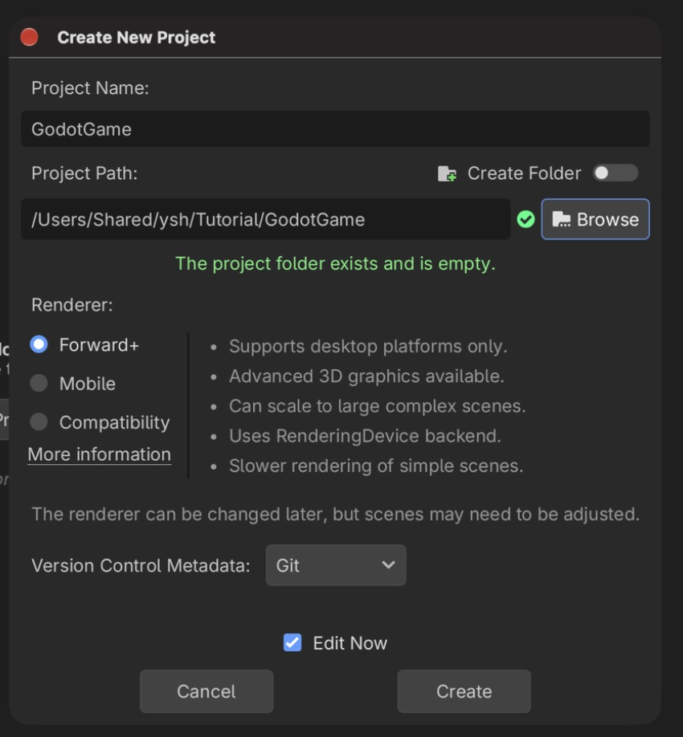

- **Project Name:** `GodotGame`.
- **Project Path:** la ruta completa de esa carpeta vacía. Godot lo confirma con "The project folder exists and is empty". Deja **Create Folder** apagado, porque la carpeta ya existe.
- **Renderer:** Forward+ está bien.

Pulsa **Create**. El editor se abre con un proyecto vacío:

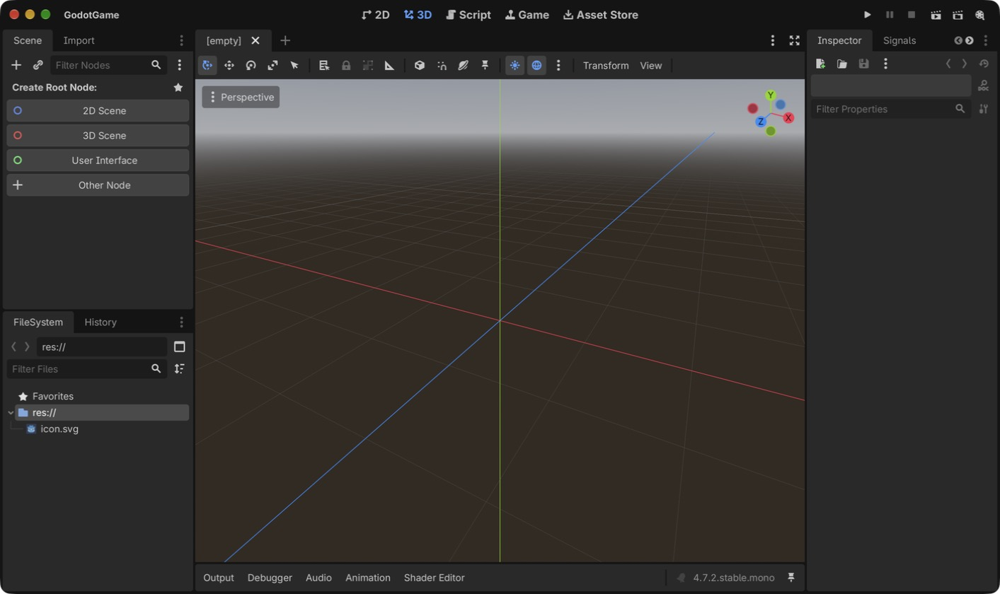

```text
Tutorial/
├── MisShaders/       tus shaders
├── Probar/           la consola del capítulo anterior
└── GodotGame/        nuevo: el proyecto de Godot
```

Va **dentro** de `Tutorial` a propósito. La herramienta `yotsuba` se instaló con un manifiesto (`.config/dotnet-tools.json`), y .NET busca ese manifiesto en la carpeta actual y en las de arriba. Si el proyecto de Godot está dentro de `Tutorial`, `dotnet yotsuba` también funciona desde ahí.

> [!NOTE]
> Las dos versiones de Godot sirven: la estándar (GDScript) y la **.NET** (C#). Todos los scripts de esta ruta aparecen en los dos lenguajes, en pestañas. El C# que escribes en `MisShaders` es solo el shader, y Godot nunca lo ejecuta.

## Paso 2: instala el addon

Yotsuba Shader tiene un addon para el editor de Godot. Cada vez que pulsas **Play**, le pide a `yotsuba` que traduzca tus shaders a archivos de Godot, así que nunca tienes que ejecutar el comando a mano. El addon viene dentro del paquete NuGet del plugin de Godot. Desde la carpeta `Tutorial`:

```bash
curl -L -o godot-addon.zip https://www.nuget.org/api/v2/package/YotsubaShader.Extensions.Godot/0.9.0
unzip -q godot-addon.zip "content/addon/addons/*" -d godot-addon
cp -R godot-addon/content/addon/addons GodotGame/
```

Un `.nupkg` es un archivo zip, así que en Windows también puedes renombrarlo a `.zip` y copiar a mano la carpeta `addons/yotsubashader`.

Godot solo mira sus archivos al arrancar, así que recarga el proyecto (**Project → Reload Current Project**). La carpeta nueva `addons` aparece en el panel FileSystem.

Ahora enciende el addon. Abre **Project → Project Settings → Plugins**. **YotsubaShader** está en la lista, apagado:

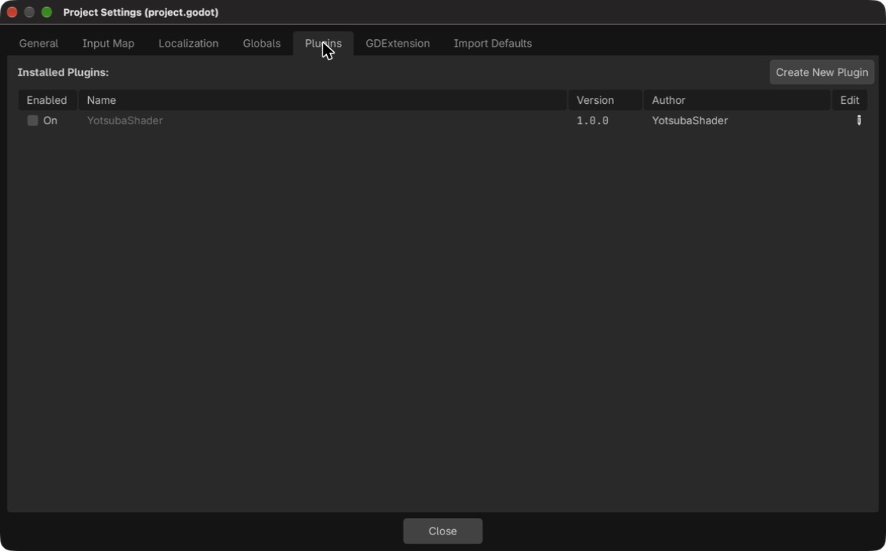

Marca la casilla **Enabled**. Luego abre la pestaña **General**, activa **Advanced Settings** (arriba a la derecha), escribe `yotsuba` en el filtro y elige la sección **Yotsuba Shader**. El campo **Project** está vacío:

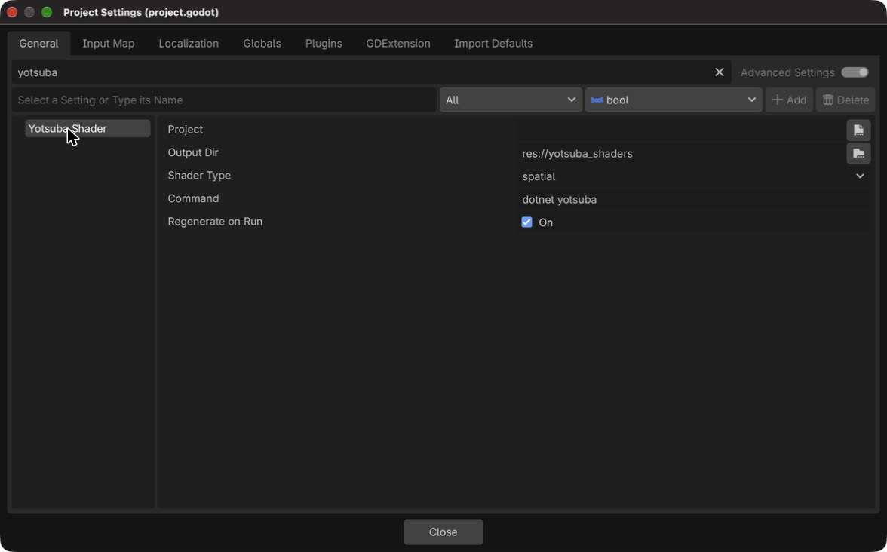

Rellena `project` con:

```text
../MisShaders/MisShaders.csproj
```

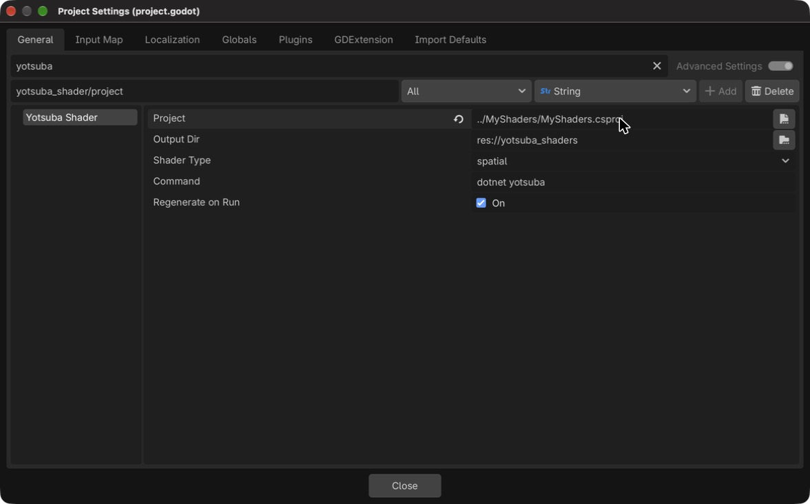

La ruta se cuenta desde el proyecto de Godot. Deja el resto como está: `Output Dir` es donde van los shaders traducidos, `Shader Type` es `spatial` (para objetos 3D), `Command` es la herramienta y `Regenerate on Run` hace que el addon traduzca cada vez que pulsas Play.

## Paso 3: el rectángulo y la ventana

Aquí está la idea clave de esta ruta: Godot no dibuja un rectángulo suelto. Dibuja **mallas** (*meshes*), dentro de **escenas**. Así que el visor es una escena con tres nodos:

- `Visor`: la raíz. Lleva el script.
- `Pantalla`: un `MeshInstance3D`, el objeto que mostrará tu shader.
- `Camera3D`: sin ella Godot no tiene por dónde mirar.

Constrúyela paso a paso.

**La raíz.** En el panel **Scene**, pulsa **3D Scene**. Godot crea un `Node3D`. Haz doble clic en su nombre y llámalo `Visor`.

**El nodo `Pantalla`.** Clic derecho en `Visor` y elige **Add Child Node…** (o selecciónalo y pulsa `Cmd/Ctrl+A`). Escribe `MeshInstance3D`, selecciónalo y pulsa **Create**:

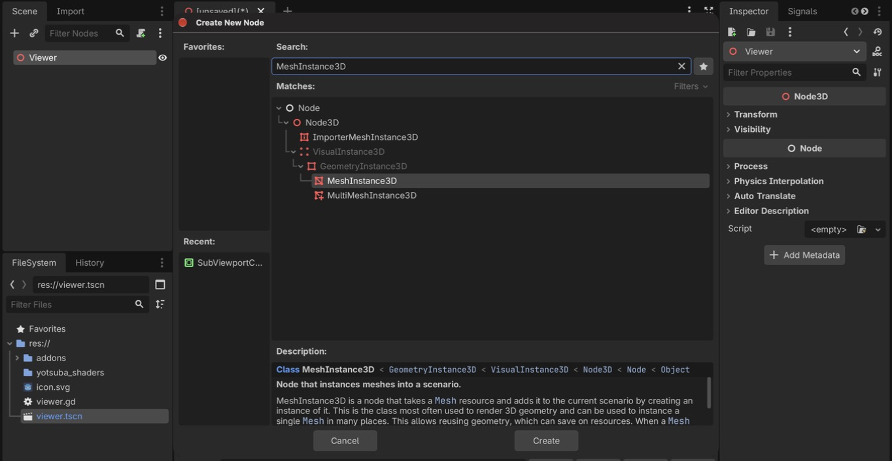

Haz doble clic en el nodo nuevo y cámbiale el nombre a `Pantalla`.

**La cámara.** Selecciona `Visor` otra vez y añade otro nodo hijo, esta vez un `Camera3D`. Déjalo como está.

**El margen.** Selecciona `Pantalla`. En el Inspector abre **Geometry** y pon **Extra Cull Margin** en `16384`:

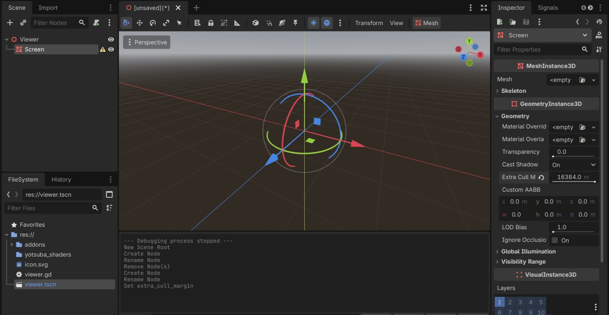

Por qué: antes de dibujar un objeto, Godot comprueba, con su posición **en el mundo 3D**, si está dentro de lo que ve la cámara. Tu shader mueve los vértices a otro sitio, pero eso pasa después. El margen grande le dice a Godot: "no tires este objeto".

**El script.** Clic derecho en `Visor` y elige **Attach Script…**. Deja el lenguaje en GDScript (o elige C# si usas .NET), pon la ruta `res://visor.gd` y pulsa **Create**:

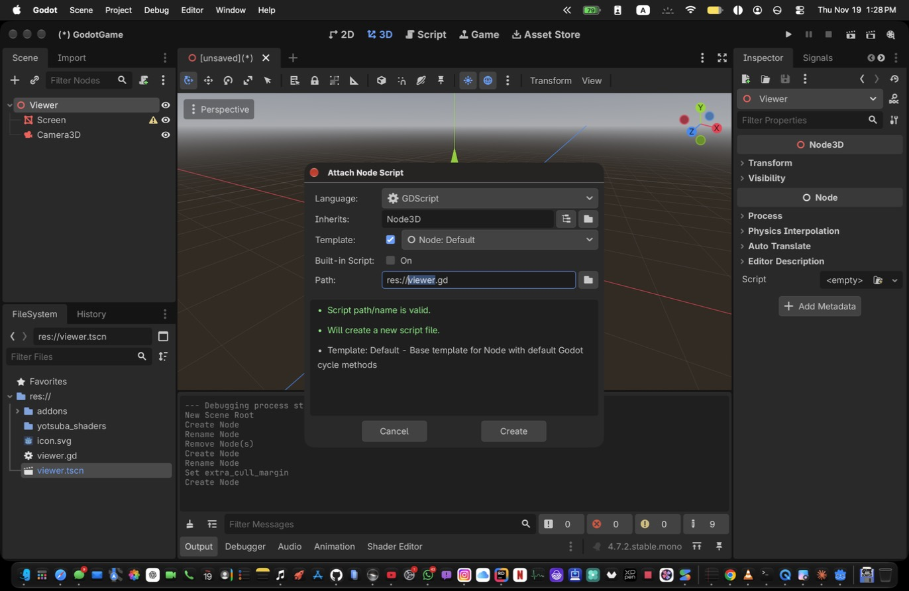

Se abre el editor de scripts con una plantilla. Reemplaza **todo** su contenido por esto:

```gdscript tab="GDScript" title="GodotGame/visor.gd"
extends Node3D

## Nombre de la clase del shader en MisShaders (Degradado, Colores, Plasma...).
@export var nombre_shader := "Degradado"

## La imagen para los shaders que declaran una textura `Foto`. Arrástrala aquí desde el Inspector.
@export var foto: Texture2D

var _material := ShaderMaterial.new()


func _ready() -> void:
	# Las cuatro esquinas del rectángulo, como la tabla del capítulo: posición y Uv.
	var arrays := []
	arrays.resize(Mesh.ARRAY_MAX)
	arrays[Mesh.ARRAY_VERTEX] = PackedVector3Array([
		Vector3(-1, -1, 0), Vector3(1, -1, 0), Vector3(-1, 1, 0), Vector3(1, 1, 0)])
	arrays[Mesh.ARRAY_TEX_UV] = PackedVector2Array([
		Vector2(0, 0), Vector2(1, 0), Vector2(0, 1), Vector2(1, 1)])
	# Tu struct pide NORMAL y TANGENT, así que la malla también tiene que llevarlos.
	arrays[Mesh.ARRAY_NORMAL] = PackedVector3Array([
		Vector3(0, 0, 1), Vector3(0, 0, 1), Vector3(0, 0, 1), Vector3(0, 0, 1)])
	arrays[Mesh.ARRAY_TANGENT] = PackedFloat32Array([
		1, 0, 0, 1, 1, 0, 0, 1, 1, 0, 0, 1, 1, 0, 0, 1])
	var mesh := ArrayMesh.new()
	mesh.add_surface_from_arrays(Mesh.PRIMITIVE_TRIANGLE_STRIP, arrays)

	_material.shader = load("res://yotsuba_shaders/MisShaders/%s.spatial.gdshader" % nombre_shader)
	if foto:
		_material.set_shader_parameter("Foto", foto)
	$Pantalla.mesh = mesh
	$Pantalla.material_override = _material


func _process(_delta: float) -> void:
	var size := get_viewport().get_visible_rect().size
	var seconds := Time.get_ticks_msec() / 1000.0
	# Cualquier uniform llamado <Field>_Ancho, <Field>_Alto or <Field>_Segundos recibe su valor.
	for uniform in _material.shader.get_shader_uniform_list():
		var uniform_name: String = uniform.name
		if uniform_name.ends_with("_Ancho"):
			_material.set_shader_parameter(uniform_name, size.x)
		elif uniform_name.ends_with("_Alto"):
			_material.set_shader_parameter(uniform_name, size.y)
		elif uniform_name.ends_with("_Segundos"):
			_material.set_shader_parameter(uniform_name, seconds)
```
```csharp tab="C#" title="GodotGame/Visor.cs"
using Godot;

public partial class Visor : Node3D
{
    // Nombre de la clase del shader en MisShaders (Degradado, Colores, Plasma...).
    [Export] public string NombreShader { get; set; } = "Degradado";

    // La imagen para los shaders que declaran una textura `Foto`. Arrástrala aquí desde el Inspector.
    [Export] public Texture2D Foto { get; set; }

    private readonly ShaderMaterial _material = new();

    public override void _Ready()
    {
        // Las cuatro esquinas del rectángulo, como la tabla del capítulo: posición y Uv.
        var arrays = new Godot.Collections.Array();
        arrays.Resize((int)Mesh.ArrayType.Max);
        arrays[(int)Mesh.ArrayType.Vertex] = new[]
        {
            new Vector3(-1, -1, 0), new Vector3(1, -1, 0), new Vector3(-1, 1, 0), new Vector3(1, 1, 0),
        };
        arrays[(int)Mesh.ArrayType.TexUV] = new[]
        {
            new Vector2(0, 0), new Vector2(1, 0), new Vector2(0, 1), new Vector2(1, 1),
        };
        // Tu struct pide NORMAL y TANGENT, así que la malla también tiene que llevarlos.
        arrays[(int)Mesh.ArrayType.Normal] = new[]
        {
            new Vector3(0, 0, 1), new Vector3(0, 0, 1), new Vector3(0, 0, 1), new Vector3(0, 0, 1),
        };
        arrays[(int)Mesh.ArrayType.Tangent] = new float[] { 1, 0, 0, 1, 1, 0, 0, 1, 1, 0, 0, 1, 1, 0, 0, 1 };
        var mesh = new ArrayMesh();
        mesh.AddSurfaceFromArrays(Mesh.PrimitiveType.TriangleStrip, arrays);

        _material.Shader = GD.Load<Shader>($"res://yotsuba_shaders/MisShaders/{NombreShader}.spatial.gdshader");
        if (Foto != null) _material.SetShaderParameter("Foto", Foto);
        var pantalla = GetNode<MeshInstance3D>("Pantalla");
        pantalla.Mesh = mesh;
        pantalla.MaterialOverride = _material;
    }

    public override void _Process(double delta)
    {
        Vector2 size = GetViewport().GetVisibleRect().Size;
        double seconds = Time.GetTicksMsec() / 1000.0;
        // Cualquier uniform llamado <Campo>_Ancho, <Campo>_Alto o <Campo>_Segundos recibe su valor.
        foreach (var uniform in _material.Shader.GetShaderUniformList())
        {
            string name = uniform["name"].AsString();
            if (name.EndsWith("_Ancho")) _material.SetShaderParameter(name, size.X);
            else if (name.EndsWith("_Alto")) _material.SetShaderParameter(name, size.Y);
            else if (name.EndsWith("_Segundos")) _material.SetShaderParameter(name, seconds);
        }
    }
}
```

Las esquinas son la misma tabla de los capítulos anteriores: cada una dice dónde está y cuál es su `Uv`. Una cosa cambia en Godot: el eje vertical de la pantalla va al revés (`Y = -1` es **arriba**), así que la esquina que tiene `Uv = (0, 0)` se escribe con `Y = -1`. Así la `Uv` sigue empezando arriba a la izquierda, y los shaders se ven igual que en todas las demás rutas.

Otras líneas que vale la pena leer:

- `ShaderMaterial` es un material cuyo pintado lo hace un shader que tú le das. `material_override` hace que `Pantalla` lo use.
- `_ready()` se ejecuta una vez, cuando arranca la escena. `_process()` se ejecuta en cada fotograma.
- El bucle de `_process` mira los `uniform` de tu shader y manda un valor a los cuyo nombre termina en `_Ancho`, `_Alto` o `_Segundos` (por ejemplo `Datos_Segundos` o `Tiempo_Segundos`). Si tu shader no declara ninguno, no pasa nada. En unos capítulos sabrás para qué sirven.
- `@export` (o `[Export]` en C#) pone `nombre_shader` en el **Inspector**, así eliges el shader sin tocar el código.

Así se ve el editor con tu script:

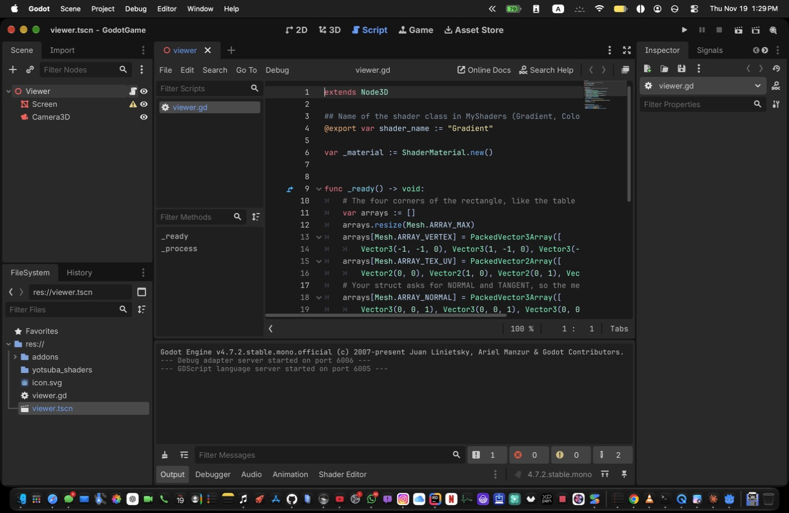

Si usas C#, el archivo del script se tiene que llamar igual que la clase, `Visor.cs`, y Godot necesita un `.csproj` para el proyecto de Godot (el editor lo crea con **Proyecto → Herramientas → C# → Crear solución de C#**). Ese `.csproj` **no** es `MisShaders`: es el del juego.

## Paso 4: ve tu primer shader

Guarda la escena (`Cmd/Ctrl+S`) como `visor.tscn`. Selecciona el nodo `Visor`: en el Inspector, **Shader Name** dice `Degradado`.

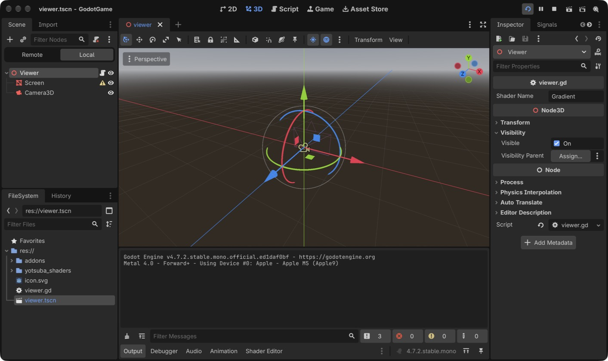

Pulsa **Play** (el triángulo de arriba a la derecha). La primera vez Godot pide una escena principal: elige **Select Current**. Antes de que empiece el juego, el addon traduce `MisShaders`, y luego se abre la ventana.

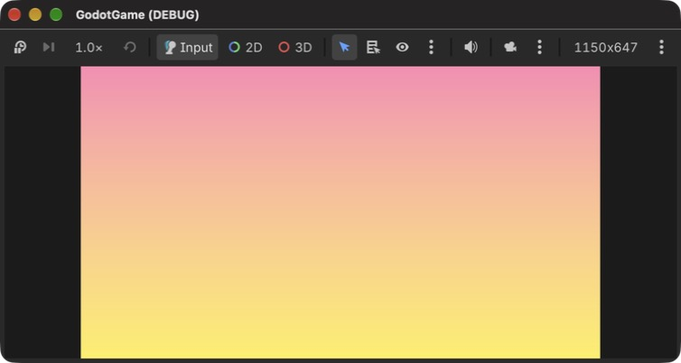

Ese es tu shader, dibujado por la GPU. Cierra la ventana para volver al editor.

> [!NOTE]
> Si prefieres la terminal, el addon hace esto por ti: `dotnet yotsuba compile MisShaders/MisShaders.csproj --target godot --output ../GodotGame/yotsuba_shaders`.

## El ciclo de trabajo

Durante el resto del tutorial usarás este ciclo:

1. **Editas** un archivo de `MisShaders`.
2. Pulsas **Play** en Godot. El addon **compila** por ti.
3. **Miras** la ventana.

Pruébalo con tu primer experimento. Abre `MisShaders/Degradado.cs` y busca esta línea en `Fragment`:

```csharp
float rojo = 1f;
```

Cámbiala por esta:

```csharp
float rojo = pixel.Uv.X;
```

Guarda y pulsa **Play**:


El rojo ya no vale lo mismo en toda la pantalla: ahora crece de izquierda a derecha, porque `pixel.Uv.X` va de `0` en el borde izquierdo a `1` en el derecho.

Acabas de hacer lo que harás cientos de veces: cambiar un número y ver qué pasa. Antes de seguir, vuelve la línea a `float rojo = 1f;`.

> [!NOTE]
> Con cada shader nuevo solo escribirás su nombre en el campo **Nombre Shader**. Lo haces una vez por shader.
:::

## Un archivo de partida

Para cada capítulo siguiente vas a crear un shader nuevo. Todos arrancan igual, con el mismo `Vertex` de siempre, así que conviene tenerlo como molde. Crea `MisShaders/Plantilla.cs`:

```csharp style=glsl title="MisShaders/Plantilla.cs"
using YotsubaShader.GlslSyntax;
using YotsubaShader.GlslSyntax.Types;
using YotsubaShader.Language;

namespace MisShaders;

public class Plantilla
{
    [ShaderStage(Stage.Vertex)]
    public Pixel Vertex({{vertexType}} vertice)
    {
        Pixel pixel;
        pixel.Posicion = Crear.Vec4(vertice.{{pos}}.X, vertice.{{pos}}.Y, 0f, 1f);
        pixel.Uv = vertice.{{uv}};
        return pixel;
    }

    [ShaderStage(Stage.Fragment)]
    [return: location(0)]
    public vec4 Fragment(PixelIn pixel)
    {
        return Crear.Vec4(0f, 0f, 0f, 1f);
    }
}
```

```csharp style=hlsl title="MisShaders/Plantilla.cs"
using YotsubaShader.HlslSyntax;
using YotsubaShader.GlslSyntax.Types;
using YotsubaShader.Language;

namespace MisShaders;

public class Plantilla
{
    [ShaderStage(Stage.Vertex)]
    public Pixel Vertex({{vertexType}} vertice)
    {
        Pixel pixel;
        pixel.Posicion = Crear.Vec4(vertice.{{pos}}.X, vertice.{{pos}}.Y, 0f, 1f);
        pixel.Uv = vertice.{{uv}};
        return pixel;
    }

    [ShaderStage(Stage.Fragment)]
    [return: SV_Target]
    public vec4 Fragment(PixelIn pixel)
    {
        return Crear.Vec4(0f, 0f, 0f, 1f);
    }
}
```

```csharp style=msl title="MisShaders/Plantilla.cs"
using YotsubaShader.MslSyntax;
using YotsubaShader.GlslSyntax.Types;
using YotsubaShader.Language;

namespace MisShaders;

public class Plantilla
{
    [ShaderStage(Stage.Vertex)]
    public Pixel Vertex({{vertexType}} vertice)
    {
        Pixel pixel;
        pixel.Posicion = Crear.Vec4(vertice.{{pos}}.X, vertice.{{pos}}.Y, 0f, 1f);
        pixel.Uv = vertice.{{uv}};
        return pixel;
    }

    [ShaderStage(Stage.Fragment)]
    [return: color(0)]
    public vec4 Fragment(PixelIn pixel)
    {
        return Crear.Vec4(0f, 0f, 0f, 1f);
    }
}
```

```csharp style=wgsl title="MisShaders/Plantilla.cs"
using YotsubaShader.WgslSyntax;
using YotsubaShader.GlslSyntax.Types;
using YotsubaShader.Language;

namespace MisShaders;

public class Plantilla
{
    [ShaderStage(Stage.Vertex)]
    public Pixel Vertex({{vertexType}} vertice)
    {
        Pixel pixel;
        pixel.Posicion = Crear.Vec4(vertice.{{pos}}.X, vertice.{{pos}}.Y, 0f, 1f);
        pixel.Uv = vertice.{{uv}};
        return pixel;
    }

    [ShaderStage(Stage.Fragment)]
    [return: location(0)]
    public vec4 Fragment(PixelIn pixel)
    {
        return Crear.Vec4(0f, 0f, 0f, 1f);
    }
}
```

```csharp style=spirv title="MisShaders/Plantilla.cs"
using YotsubaShader.SpirvSyntax;
using YotsubaShader.GlslSyntax.Types;
using YotsubaShader.Language;

namespace MisShaders;

public class Plantilla
{
    [ShaderStage(Stage.Vertex)]
    public Pixel Vertex({{vertexType}} vertice)
    {
        Pixel pixel;
        pixel.Posicion = Crear.Vec4(vertice.{{pos}}.X, vertice.{{pos}}.Y, 0f, 1f);
        pixel.Uv = vertice.{{uv}};
        return pixel;
    }

    [ShaderStage(Stage.Fragment)]
    [return: Location(0)]
    public vec4 Fragment(PixelIn pixel)
    {
        return Crear.Vec4(0f, 0f, 0f, 1f);
    }
}
```

El `Fragment` de esta plantilla devuelve negro (`0, 0, 0`). Es un shader que todavía no hace nada, listo para que tú le pongas lo suyo.

Cuando un capítulo te diga "copia `Plantilla.cs` como `Colores.cs`", haz esto:

1. Copia el archivo y llámalo `Colores.cs`.
2. Dentro, cambia `public class Plantilla` por `public class Colores`.

El nombre de la clase tiene que coincidir con lo que escribes después de `--` en el visor.

:::xna
Comprueba que todo funciona ejecutando la plantilla. Primero agrega su línea al `switch` de `Visor/Program.cs`, encima de la línea `_ =>`:

```csharp
            "Plantilla" => {{toFx Plantilla}},
```

Luego ejecuta:

```bash
dotnet yotsuba add MisShaders/MisShaders.csproj --target spirv --target {{plugin}} && dotnet run --project Visor -- Plantilla
```

Debe abrirse una ventana completamente negra. Si la ves, estás listo.

## Si algo falla

| Lo que ves | Qué significa | Qué hacer |
|---|---|---|
| `El visor no conoce ningún shader llamado "Colores"` | El nombre no tiene su línea en el `switch` del visor, o lo escribiste mal. | Agrega `"Colores" => {{toFx Colores}},` al `switch` y revisa las mayúsculas. |
| La ventana muestra el shader viejo | Cambiaste el archivo pero no ejecutaste `add`. | Usa el comando del ciclo, que hace las dos cosas. |
| `error CS0234` al ejecutar `add` | Borraste o renombraste una clase y `YotsubaShader.g.cs` todavía la nombra. | Borra `MisShaders/YotsubaShader.g.cs` y vuelve a ejecutar. |
| Error `CS` con un número y una línea | Es un error de C# normal en tu código. | Léelo, ve a esa línea y corrige. `add` no sigue hasta que compile. |
| La ventana no se abre y no hay error | A veces queda detrás de otras ventanas. | Búscala en la barra de tareas o en el Dock. |

:::

:::godot
Comprueba que todo funciona ejecutando la plantilla. Selecciona el nodo `Visor`, escribe `Plantilla` en **Nombre Shader** y pulsa **Play**. Debe abrirse una ventana completamente negra. Si la ves, estás listo.

## Si algo falla

| Qué ves | Qué significa | Qué hacer |
|---|---|---|
| `Cannot open file 'res://yotsuba_shaders/MisShaders/Colores.spatial.gdshader'` | El nombre en **Nombre Shader** está mal escrito, o el addon no se ejecutó. | Revisa las mayúsculas, y que el plugin **YotsubaShader** esté activado. |
| La ventana muestra el shader viejo | El addon está apagado o `regenerate_on_run` está apagado. | Enciéndelo en la configuración del proyecto, o usa **Proyecto → Herramientas → Regenerate YotsubaShader shaders**. |
| El panel de Salida dice que no encontró `dotnet` | Godot, abierto desde el Dock o el Finder, no ve el mismo `PATH` que tu terminal. | Pon la ruta completa de `dotnet` en el ajuste `command` del addon. |
| `dotnet yotsuba` dice que no existe | El proyecto de Godot está fuera de la carpeta donde ejecutaste `dotnet new tool-manifest`. | Mueve `GodotGame` dentro de `Tutorial`. |
| Un error `CS` con número y línea | Es un error normal de C# en tu shader. | Léelo, ve a esa línea y corrígela. |
| La ventana sale negra o vacía | Godot descartó el rectángulo o el shader falló. | Revisa el `extra_cull_margin` de `Pantalla` y el panel de Salida. |
:::

## Lo que aprendiste

- Para ver un shader hace falta una ventana. El visor es esa ventana, y es una herramienta aparte: tus shaders no dependen de ella.
- El ciclo de trabajo es editar, compilar con `add` y mirar con el visor.
- `Plantilla.cs` es el molde de todos los shaders que vienen: un `Vertex` ya escrito y un `Fragment` que devuelve negro.

Siguiente: [Los colores](colors.md).
