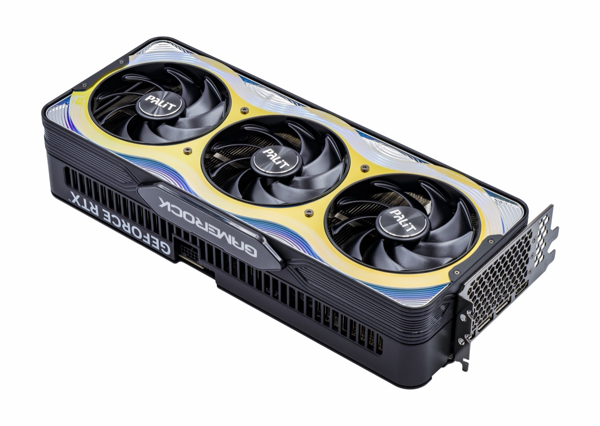
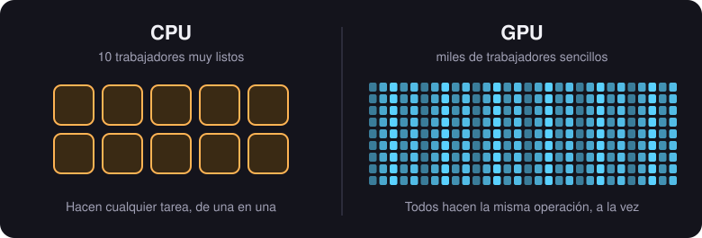
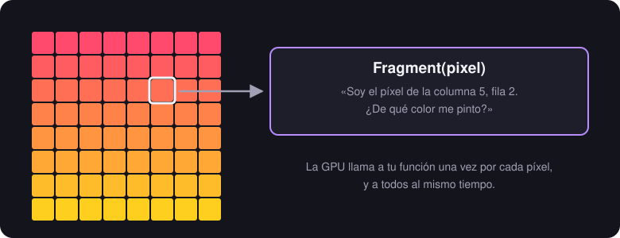
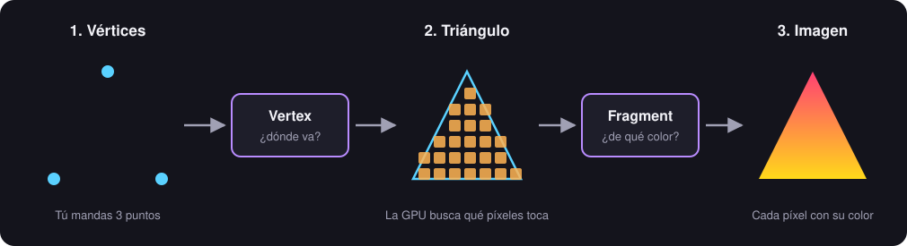

Un Shader es, para que lo entiendas, una función (o método) que podemos llamar para que se ejecute en la GPU.

La GPU es la tarjeta gráfica de tu computadora. Puede ser una pieza aparte, como la de la foto, o venir dentro del mismo procesador, como en los portátiles y los teléfonos.



> [!SAY] En la foto se ve una tarjeta gráfica vista desde arriba. Es un bloque largo y oscuro, con tres ventiladores redondos en fila y un borde de metal con los conectores. Eso es lo que mucha gente imagina cuando oye la palabra GPU: una pieza que podrías tomar con la mano y conectar al computador.

Como sabes, si programas para Windows puedes usar un lenguaje como JavaScript con Node, pero no puedes usar Node para programar un sistema operativo, porque Node depende de funciones del propio sistema operativo que no existen en un entorno "limpio", sin sistema operativo. Algo muy parecido pasaba con C# y la GPU (antes de Yotsuba Shader).

Hasta ahora, ninguno de los lenguajes de programación que conocemos (C#, JavaScript, Java, Rust, ...) podía ejecutarse directamente en la GPU, por una razón sencilla: tienen cosas muy difíciles de traducir, y otras que la GPU simplemente no puede hacer.

## Ejemplos de cosas que la GPU no puede hacer

Desde la GPU no podemos acceder al sistema de archivos (Filesystem).

Es decir, algo como esta línea simplemente no funcionará:

```csharp
File.WriteAllText("file.txt", "hola"); // No existe un sistema de archivos en la GPU (al menos no como en la CPU)
```

> [!SAY] Aquí hay una línea que escribirías sin pensarlo en un programa normal. Llamamos a File punto WriteAllText, le damos el nombre de un archivo y la palabra hola, y el computador lo guarda. En la GPU esta línea no tiene a dónde ir, porque no hay un disco donde escribir. Eso es lo que dice el comentario del final.

Tampoco existen los `string`, las listas, las clases con herencia ni las excepciones.

Así que puedes pensar en la GPU como una máquina sin sistema operativo. Lo que puedes ejecutar allí son, sobre todo, cuentas: sumar, multiplicar, comparar. No las cosas que normalmente haces con lenguajes pensados para la CPU, como Rust, JS, Java, Python o GDScript.

## ¿Por qué queremos ejecutar código en la GPU entonces?

Aunque en la GPU no se puede hacer de todo, hay buenas razones para escribir código que se ejecute allí.

### 1. Para hacer muchas cuentas a la vez

Una MacBook Air M5 suele tener 10 núcleos en su CPU. Eso quiere decir que puede hacer, como máximo, 10 cosas a la vez de verdad. A cada una de esas cosas que corren a la vez se le llama hilo.

Una GPU, en cambio, no funciona igual: por dentro tiene miles de trabajadores pequeños, y cada uno puede hacer una cuenta al mismo tiempo que los demás, sin esperar a nadie. Mientras la CPU lleva 10 hilos a la vez, la GPU lleva miles. Por eso un juego, una IA o un programa de dibujo no van lentos: la GPU puede hacer muchísimas más cuentas a la vez que la CPU.



> [!SAY] En esta imagen podemos comparar dos chips. A la izquierda, la CPU: diez cuadros grandes, cada uno un núcleo potente. A la derecha, la GPU: cientos y cientos de cuadros pequeños, apretados unos junto a otros. Diez trabajadores fuertes contra una multitud de pequeños, y esa multitud es lo que le permite a la GPU hacer tantos cálculos al mismo tiempo.

#### ¿Por qué no ejecutamos todo en la GPU entonces?

Porque la GPU solo gana cuando el trabajo se puede repartir de una forma muy concreta.
Por ejemplo:

```csharp
int[] entidades = [1, 2, 3, 4, 5];

for (int indice = 0; indice < entidades.Length; indice++)
{
    entidades[indice] = entidades[indice] * 2; // lógica de ejemplo
}
```

> [!SAY] Vamos a leer este código. Creamos un arreglo llamado entidades con cinco números, del uno al cinco. Luego un for lo recorre un índice a la vez, empezando en cero, y en cada paso reemplaza el número por su doble. Un índice después de otro, siempre en orden.

Si ejecutáramos esto tanto en la CPU como en la GPU, tal cual, un índice detrás de otro, y midiéramos cuánto tarda cada una en recorrer el `for`, la CPU ganaría.

Ya sé que te estás preguntando: ¿por qué, si te dije que la GPU es más rápida?
La respuesta es que depende. La GPU no es más rápida en todo: lo que hace bien es muchas cuentas a la vez. Cada uno de sus hilos, por separado, es más lento que un núcleo de la CPU. Para que la GPU le gane a la CPU, en lugar de recorrer el `for` un índice detrás de otro, cada hilo de la GPU tiene que encargarse de un índice distinto del arreglo.

En C# ya tienes algo que funciona con esa misma idea. Se llama `Parallel`, y te permite ejecutar un `for` repartiendo los índices entre todos los núcleos de la CPU:

```csharp
int[] entidades = [1, 2, 3, 4, 5];

// Cada índice lo puede procesar un núcleo distinto, y todos corren al mismo tiempo
Parallel.For(0, entidades.Length, indice =>
{
    RandomOperation(indice);
});

// Función RandomOperation
void RandomOperation(int indice)
{
    entidades[indice] = entidades[indice] * 2; // lógica de ejemplo
}
```

> [!SAY] Este es el mismo arreglo, pero ahora con Parallel punto For. Fíjate en que ya no escribimos el bucle. Decimos: desde cero hasta el largo del arreglo, y para cada índice llama a la función RandomOperation. Más abajo, la función RandomOperation recibe un índice y duplica el número que vive ahí. El bucle desapareció y solo queda el trabajo sobre un índice.

Fíjate en una cosa: aquí ya no escribes el bucle. Solo escribes la función `RandomOperation`, que trabaja sobre **un** índice, y `Parallel.For` se encarga de llamarla para todos.

La GPU hace exactamente lo mismo, pero con muchísimos más hilos. Ejecuta la función `RandomOperation` para todos los índices del arreglo que pueda al mismo tiempo, en lugar de recorrerlos uno por uno como un `for` o un `foreach`. Probablemente ejecute alrededor de 1000 índices a la vez, así que si el arreglo tiene 1000 elementos, es muy posible que termine todo de una sola vez.

Cuántas cuentas puede hacer la GPU a la vez depende del modelo que tengas. Pero para que te hagas una idea: la CPU trabaja sobre un solo índice del arreglo cada vez, mientras que la GPU puede hacer lo mismo sobre unos 1000 índices distintos de una sola vez.

Y esa función que trabaja sobre un solo índice, la que en el ejemplo se llama `RandomOperation`, es justo lo que llamamos Shader.

### 2. Para decidir el color de cada píxel de la pantalla

Tu pantalla es una cuadrícula de puntos de colores. Cada punto es un píxel. Una pantalla Full HD tiene 1920 píxeles de ancho por 1080 de alto, es decir, algo más de 2 millones de píxeles.

Para que un juego se vea fluido hay que decidir el color de todos esos píxeles unas 60 veces por segundo. Son más de 120 millones de colores calculados cada segundo. Con un `for` en la CPU no llegas. Pero mira bien el problema: es el mismo del arreglo de antes, solo que ahora el arreglo son los píxeles de la pantalla.

Así que la GPU te deja escribir una función que recibe un píxel y devuelve su color. Ella la llama una vez por cada píxel, y a todos al mismo tiempo.



> [!SAY] En esta imagen hay una cuadrícula de cuadritos, que son los píxeles. Uno de ellos está marcado, y de él sale una flecha hacia una caja que dice Fragment. La idea es que cada píxel de la pantalla se manda, uno por uno, a la misma función, y la función responde con un color.

Lo interesante es que dentro de esa función tú decides el color con la lógica que quieras. Si devuelves siempre rojo, la pantalla se ve roja. Si el color depende de la posición del píxel, tienes un degradado. Si depende de una imagen y del tiempo, puedes hacer que una foto se mueva como si estuviera bajo el agua. Agua, fuego, sombras, luces, el efecto de cuando te golpean en un juego: todo eso son funciones que deciden el color de un píxel.

## Las etapas de un Shader

Hasta ahora hablamos de "una función". En realidad hay varios tipos, y a cada tipo se le llama etapa (en inglés, *Stage*). La diferencia entre una etapa y otra es **sobre qué** se ejecuta la función:

| Etapa | Se ejecuta una vez por cada... | Lo que decide |
| --- | --- | --- |
| Vertex | punto (vértice) de la figura que mandas a dibujar | En qué lugar de la pantalla cae ese punto. |
| Fragment | píxel que ocupa la figura | De qué color se pinta ese píxel. |
| Compute | índice que tú le pidas | Lo que tú quieras: es el caso del arreglo `entidades`. No dibuja nada. |

> [!SAY] Esta tabla tiene tres filas, una por cada etapa. Vertex se ejecuta una vez por cada punto de la figura y decide en qué lugar de la pantalla cae ese punto. Fragment se ejecuta una vez por cada píxel que ocupa la figura y decide su color. Y Compute se ejecuta una vez por cada índice que le pidas, no dibuja nada, y es el caso de nuestro arreglo de entidades.

Para dibujar algo siempre trabajan juntas las dos primeras. Tú mandas una figura hecha de puntos, la etapa Vertex coloca cada punto, la GPU averigua qué píxeles quedan dentro de la figura, y la etapa Fragment le pone color a cada uno:



> [!SAY] En esta última imagen seguimos un dibujo de principio a fin. A la izquierda hay tres puntos. Pasan por Vertex, que los coloca, y se convierten en un triángulo. Luego la GPU marca qué píxeles toca el triángulo, y por último Fragment le da su color a cada uno de esos píxeles.

No te preocupes si todavía no lo ves claro. El siguiente capítulo recorre ese dibujo paso a paso, y cuando lo termines vas a saber qué hace cada etapa y por qué.

## ¿Y dónde entra Yotsuba Shader?

Como la GPU no entiende C#, los shaders se han escrito siempre en lenguajes hechos solo para eso: HLSL, GLSL, Metal... Cada API gráfica tiene el suyo, y ninguno conoce las clases ni los tipos de tu proyecto.

Con Yotsuba Shader escribes el shader en C#, en tu mismo proyecto y con tu mismo editor. El compilador revisa que solo uses cosas que la GPU puede hacer, y lo traduce al lenguaje que necesites.

En resumen:

- Un Shader es una función que se ejecuta en la GPU.
- La GPU la llama muchísimas veces a la vez: una por cada vértice, por cada píxel o por cada índice.
- Dentro solo puedes hacer cálculos. Nada de archivos, textos ni listas.
- Con Yotsuba Shader esa función la escribes en C#.

Siguiente: [Cómo se construye un shader](how-a-shader-is-built.md).

---

Foto de la tarjeta gráfica (una Palit GeForce RTX 5090 GameRock): PantheraLeo1359531, [Wikimedia Commons](https://commons.wikimedia.org/wiki/File:Palit_GeForce_RTX_5090_Gamerock_20250530_HOF4166_RAW-Export.png), licencia [CC BY 4.0](https://creativecommons.org/licenses/by/4.0/). Se redujo de tamaño y se le añadió margen blanco.
