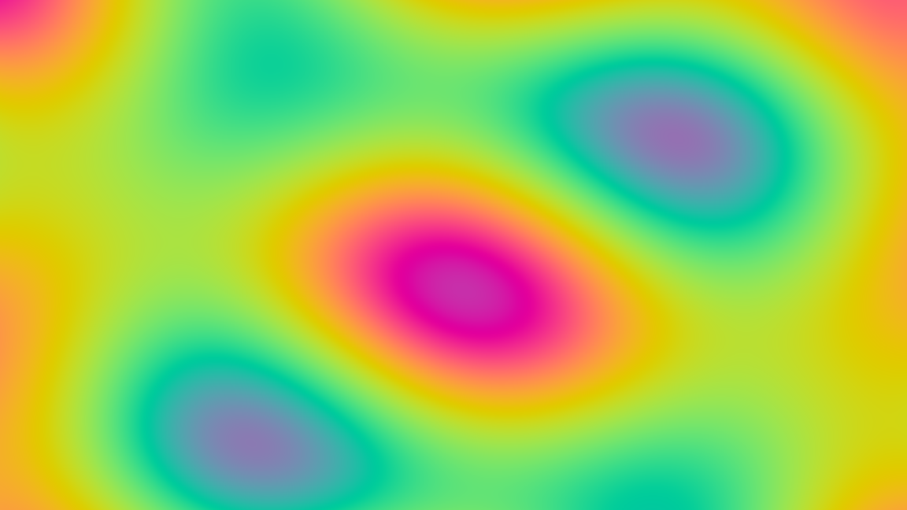
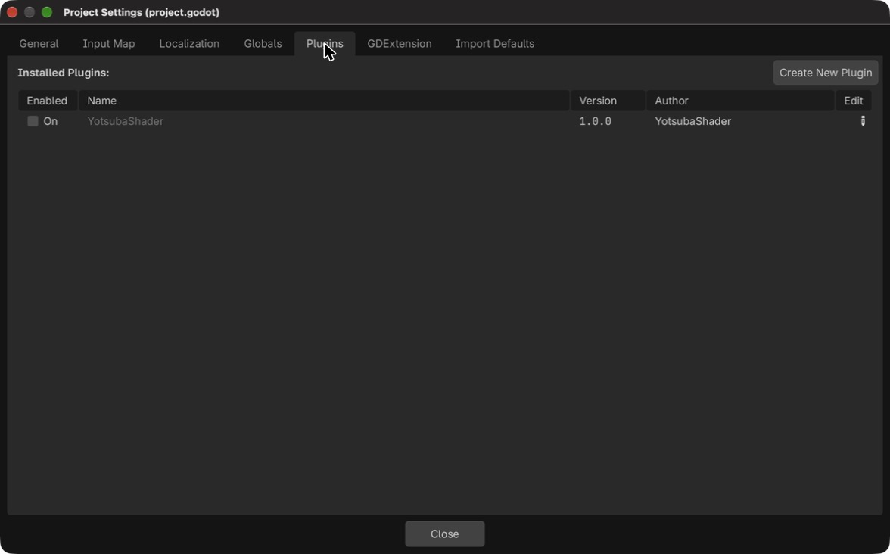
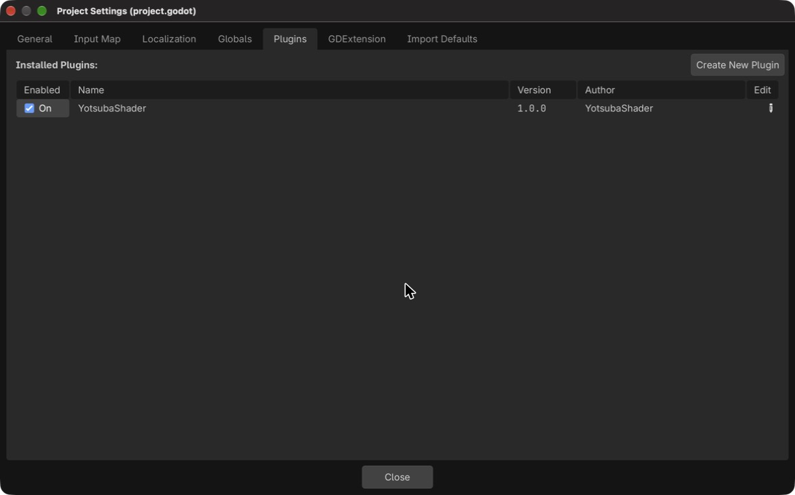
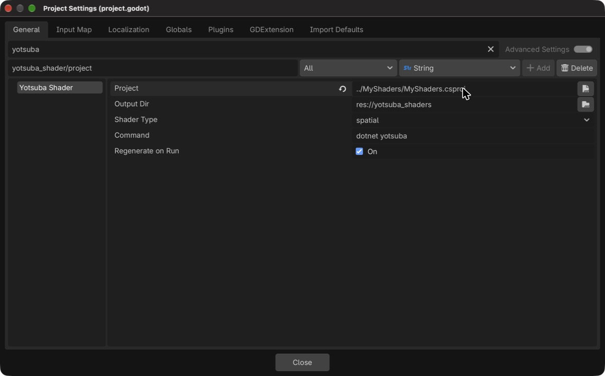
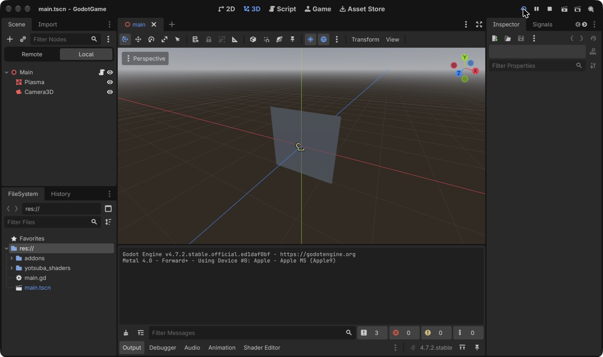

Godot tiene su propio lenguaje de shaders, el Godot Shading Language, guardado en archivos `.gdshader`. Tú escribes el shader en C# y Yotsuba Shader lo traduce a ese lenguaje.



> [!NOTE]
> La guía paso a paso es la **ruta de Godot del tutorial**: elige Godot en el selector de ruta de [Get Started](../get-started/index.md). Te lleva desde crear el proyecto hasta una escena 3D vista a través de tus shaders. Esta página es la **referencia** que consultas después: qué hace el addon, qué se traduce y los nombres de los datos del vértice.

## 1. El addon: traducir cada vez que pulsas Play

Ejecutar el comando a mano cada vez que cambias el shader cansa. Yotsuba Shader tiene un addon para el editor de Godot que lo hace por ti.

> [!NOTE]
> El addon todavía no se descarga desde ninguna web. Hoy lo copias del repositorio de Yotsuba Shader: la carpeta es `Plugins/YotsubaShader.Extensions.Godot/addon/addons/yotsubashader`.

Primero, copia esa carpeta, `yotsubashader`, dentro de `GodotGame/addons/` (crea `addons` si no existe). Al abrir el proyecto en Godot, la carpeta aparece en el panel de archivos, como se ve en la captura de arriba.

Segundo, en Godot: *Proyecto → Ajustes del proyecto → Plugins*. YotsubaShader aparece en la lista, apagado.



Marca la casilla para activarlo.



Tercero, en la pestaña *General*, activa **Ajustes avanzados** (el interruptor de arriba a la derecha). Aparece una sección llamada **Yotsuba Shader**: si no la ves, escribe `yotsuba` en el filtro. El campo `project` está vacío.


Pon `project` en `../MisShaders/MisShaders.csproj` (la ruta es relativa al proyecto de Godot).



Estos son todos los ajustes:

| Ajuste | Qué es | Por defecto |
| --- | --- | --- |
| `project` | Ruta al `.csproj` con tus shaders (absoluta, o relativa al proyecto de Godot) | vacío |
| `output_dir` | Dónde se escriben los `.gdshader` | `res://yotsuba_shaders` |
| `shader_type` | `spatial`, `canvas_item` o `both` | `spatial` |
| `command` | El comando de yotsuba | `dotnet yotsuba` |
| `regenerate_on_run` | Regenerar al pulsar Play | activado |

Desde ahora el addon ejecuta el mismo comando `compile --target godot` que escribiste, y deja los archivos en `output_dir`. Lo hace:

- cada vez que pulsas **Play**, antes de que arranque el juego, y
- desde el menú *Proyecto → Herramientas → Regenerar shaders de YotsubaShader*.

Después Godot refresca su sistema de archivos. Si el comando falla, el error sale en el panel de salida de Godot. Un fallo en un tipo de shader que no elegiste (por ejemplo `canvas_item`, cuando solo usas `spatial`) no se cuenta como error.

Pulsa **Play** (el triángulo de arriba a la derecha). Antes de que arranque el juego, el addon traduce el shader, y después se abre la ventana del juego.



Dos cosas que pueden salir mal:

> [!WARNING]
> **Godot no encuentra `dotnet`.** En macOS, si abriste Godot desde el Dock o desde Finder, no ve el mismo `PATH` que tu terminal. Pon la ruta completa de la herramienta en el ajuste `command`.

> [!WARNING]
> **`dotnet yotsuba` dice que no existe.** El proyecto de Godot tiene que estar **dentro** de la carpeta donde ejecutaste `dotnet new tool-manifest`, porque .NET busca el manifiesto hacia arriba. Por eso `GodotGame` va dentro de `Tutorial`.

> [!NOTE]
> El addon se probó ejecutando su generador desde un script, y abriendo el proyecto en el editor con el addon activado: carga sin errores. No se probó pulsar Play dentro del editor ni el elemento del menú.

## 2. Qué se traduce

El método del vértice de tu shader es lo que más le importa a Godot. Toma `Vertex`:

```csharp
    [ShaderStage(Stage.Vertex)]
    public Pixel Vertex(VerticeGodot vertice)
    {
        Pixel pixel;
        pixel.Posicion = Crear.Vec4(vertice.VERTEX.X, vertice.VERTEX.Y, 0f, 1f);
        pixel.Uv = vertice.UV;
        return pixel;
    }
```

En el `.spatial.gdshader` queda así:

```glsl
void vertex() {
    vec2 vertice_VERTEX = VERTEX.xy;
    vec2 vertice_UV = UV;
    vec4 ys_position = vec4(0.0);
    Pixel pixel;
    pixel.Posicion = Vec4(vertice_VERTEX.x, vertice_VERTEX.y, 0.0, 1.0);
    pixel.Uv = vertice_UV;
    ys_position = pixel.Posicion;
    v_Uv = pixel.Uv;
    POSITION = ys_position;
}
```

Fíjate en las correspondencias:

- El método `Vertex` pasó a ser `void vertex()`, y el del fragmento, `Fragment`, pasó a ser `void fragment()`.
- El campo `VERTEX` de tu `VerticeGodot` lee el `VERTEX` de Godot, y el campo `UV` lee `UV`. Esos son los nombres que Godot le da a los datos de cada vértice, y el plugin los eligió por el **nombre de tu campo**.
- Lo que el vértice le entrega al fragmento (`pixel.Uv`) pasó a ser un `varying`, `v_Uv`, que el fragmento lee.
- La posición que devuelves (`gl_Position`) se escribe en `POSITION`. Es una posición en **espacio de recorte**, el `-1` a `1` de antes. Eso quiere decir que Godot **no** aplica sus propias matrices (modelo, vista y proyección) a un shader hecho así. Si las quieres, tienes que mandarlas como uniform y multiplicarlas tú en el método del vértice. Esta guía no cubre cómo.
- El color final (`[return: location(0)]`) va a `ALBEDO` y `ALPHA`.

Los nombres que puedes usar en el `struct` de entrada están en la [sección 3](#3-los-nombres-de-los-datos-del-vertice). En `canvas_item` solo existen la posición, el color y `UV`.

Más cosas que hace el plugin:

- Un `struct` con `[uniform]` se convierte en un `uniform` por cada campo, con el nombre `<Campo>_<Miembro>`, como viste.
- Una textura se convierte en `uniform sampler2D <nombre>`. Cómo se filtra o se repite lo decide Godot, con las opciones de la textura, y no el `SamplerState` de tu C#.
- Los archivos `spatial` se generan con `render_mode unshaded, cull_disabled;`. `unshaded` porque el fragmento ya calcula el color final, y Godot no debe sumarle luz encima. `cull_disabled` porque un `ShaderMaterial` no puede apagar el *culling* (descartar las caras que miran hacia atrás), y, como la posición está en espacio de recorte, Godot descartaba las caras: el rectángulo de pantalla completa **no se veía** sin esto.

### Tomar otro shader del tutorial

Cualquier shader del Get Started se lleva a Godot con los mismos dos cambios que le hiciste al plasma: en el método del vértice, usa `VerticeGodot` en lugar de `Vertice`, y lee `vertice.VERTEX` en lugar de `vertice.Posicion`.

> [!WARNING]
> Eso solo se comprobó con el plasma de esta guía. Los demás shaders del tutorial no se probaron en Godot.

## 3. Los nombres de los datos del vértice

En el tutorial declaraste `VerticeGodot` con todos los datos que Godot entrega por vértice. Esta sección explica cada uno.

### La regla

Los datos del vértice se declaran en un `struct` con estos nombres, tal como en el tutorial:

```csharp style=glsl
public struct VerticeGodot
{
    [location(0)] public vec3 VERTEX;
    [location(1)] public vec2 UV;
    [location(2)] public vec3 NORMAL;
    [location(3)] public vec4 COLOR;
}
```

```csharp style=hlsl
public struct VerticeGodot
{
    [POSITION] public vec3 VERTEX;
    [TEXCOORD(0)] public vec2 UV;
    [NORMAL] public vec3 NORMAL;
    [COLOR] public vec4 COLOR;
}
```

```csharp style=msl
public struct VerticeGodot
{
    [attribute(0)] public vec3 VERTEX;
    [attribute(1)] public vec2 UV;
    [attribute(2)] public vec3 NORMAL;
    [attribute(3)] public vec4 COLOR;
}
```

```csharp style=wgsl
public struct VerticeGodot
{
    [location(0)] public vec3 VERTEX;
    [location(1)] public vec2 UV;
    [location(2)] public vec3 NORMAL;
    [location(3)] public vec4 COLOR;
}
```

```csharp style=spirv
public struct VerticeGodot
{
    [Location(0)] public vec3 VERTEX;
    [Location(1)] public vec2 UV;
    [Location(2)] public vec3 NORMAL;
    [Location(3)] public vec4 COLOR;
}
```

- **El nombre decide el significado, y es el de Godot.** `UV` es la coordenada de textura, `NORMAL` es la normal. El número de `location` sigue siendo tuyo: solo tiene que ser único.
- **Se escriben tal cual en Godot**: en mayúsculas, con guion bajo (`BONE_INDICES`). Esa es la forma que usa el tutorial y la de las tablas de abajo.
- **El idioma no cambia nada.** Estos nombres no se traducen: el tutorial en español usa `UV`, no `Textura`.
- **El nombre manda sobre el número y la semántica.** Si el campo se llama `UV`, es `UV`, lleve el `[location(1)]`, el `[attribute(1)]` o el `[TEXCOORD(0)]` que lleve.
- **Un nombre que no está en la lista no se adivina.** Si tampoco lleva una semántica que el plugin conozca (`[POSITION]`...), el plugin da un error que dice qué nombres existen, y no deja pasar datos equivocados en silencio.

### Los atributos

Esta es la lista completa de lo que Godot entrega por vértice en un shader `spatial`. Los de `canvas_item` son un subconjunto, y se indica en cada fila.

| Nombre | Tipo en `spatial` | Tipo en `canvas_item` | En HlslSyntax |
| --- | --- | --- | --- |
| `VERTEX` | `vec3` | `vec2` | `POSITION` |
| `NORMAL` | `vec3` | No existe | `NORMAL` |
| `TANGENT` | `vec3` | No existe | `TANGENT` |
| `BINORMAL` | `vec3` | No existe | `BINORMAL` |
| `UV` | `vec2` | `vec2` | `TEXCOORD(0)` |
| `UV2` | `vec2` | No existe | `TEXCOORD(1)` |
| `COLOR` | `vec4` | `vec4` | `COLOR` |
| `CUSTOM0` | `vec4` | `vec4` | `TEXCOORD(2)` |
| `CUSTOM1` | `vec4` | `vec4` | `TEXCOORD(3)` |
| `CUSTOM2` | `vec4` | No existe | `TEXCOORD(4)` |
| `CUSTOM3` | `vec4` | No existe | `TEXCOORD(5)` |
| `BONE_INDICES` | `uvec4` | No existe | `TEXCOORD(6)` |
| `BONE_WEIGHTS` | `vec4` | No existe | `TEXCOORD(7)` |
| `POINT_SIZE` | `float` | `float` | `TEXCOORD(8)` |

Los tipos son los de Godot. Si declaras uno distinto de la misma familia, el plugin lo adapta: uno más corto se completa (con `0`, y con `1` en la `w` de `VERTEX` y de `COLOR`), y uno más largo se recorta. Por eso un `VERTEX` de `vec2`, como el del rectángulo de pantalla completa del tutorial, sirve.

### Una convención para cada atributo

#### `VERTEX`: la posición

```csharp style=glsl
[location(0)] public vec3 VERTEX;
```

```csharp style=hlsl
[POSITION] public vec3 VERTEX;
```

```csharp style=msl
[attribute(0)] public vec3 VERTEX;
```

```csharp style=wgsl
[location(0)] public vec3 VERTEX;
```

```csharp style=spirv
[Location(0)] public vec3 VERTEX;
```

Es la posición del vértice en el espacio del objeto. En `canvas_item` es un `vec2`.

Una advertencia: si devuelves esta posición tal cual como posición final, es una posición en **espacio de recorte**, y Godot no le aplica sus matrices. Es lo que hace el plasma de esta guía.

#### `NORMAL`, `TANGENT` y `BINORMAL`

```csharp style=glsl
[location(2)] public vec3 NORMAL;
[location(5)] public vec3 TANGENT;
[location(6)] public vec3 BINORMAL;
```

```csharp style=hlsl
[NORMAL] public vec3 NORMAL;
[TANGENT] public vec3 TANGENT;
[BINORMAL] public vec3 BINORMAL;
```

```csharp style=msl
[attribute(2)] public vec3 NORMAL;
[attribute(5)] public vec3 TANGENT;
[attribute(6)] public vec3 BINORMAL;
```

```csharp style=wgsl
[location(2)] public vec3 NORMAL;
[location(5)] public vec3 TANGENT;
[location(6)] public vec3 BINORMAL;
```

```csharp style=spirv
[Location(2)] public vec3 NORMAL;
[Location(5)] public vec3 TANGENT;
[Location(6)] public vec3 BINORMAL;
```

Los tres son `vec3` y solo existen en `spatial`: el 2D no tiene normales. Un shader que los lee no puede ser `canvas_item`, y el compilador debe decirlo con un error, no generar un archivo roto.

#### `UV` y `UV2`

```csharp style=glsl
[location(1)] public vec2 UV;
[location(4)] public vec2 UV2;
```

```csharp style=hlsl
[TEXCOORD(0)] public vec2 UV;
[TEXCOORD(1)] public vec2 UV2;
```

```csharp style=msl
[attribute(1)] public vec2 UV;
[attribute(4)] public vec2 UV2;
```

```csharp style=wgsl
[location(1)] public vec2 UV;
[location(4)] public vec2 UV2;
```

```csharp style=spirv
[Location(1)] public vec2 UV;
[Location(4)] public vec2 UV2;
```

`UV` va de `(0, 0)` a `(1, 1)` sobre la superficie. `UV2` es la segunda coordenada, que Godot usa para cosas como mapas de luz. En `canvas_item` solo existe `UV`.

#### `COLOR`

```csharp style=glsl
[location(3)] public vec4 COLOR;
```

```csharp style=hlsl
[COLOR] public vec4 COLOR;
```

```csharp style=msl
[attribute(3)] public vec4 COLOR;
```

```csharp style=wgsl
[location(3)] public vec4 COLOR;
```

```csharp style=spirv
[Location(3)] public vec4 COLOR;
```

En `spatial` es el color del vértice. En `canvas_item`, Godot lo multiplica por `modulate` y `self_modulate` del nodo, así que el valor que lees no es el que guardaste en la malla.

#### `CUSTOM0` a `CUSTOM3`

```csharp style=glsl
[location(7)] public vec4 CUSTOM0;
```

```csharp style=hlsl
[TEXCOORD(2)] public vec4 CUSTOM0;
```

```csharp style=msl
[attribute(7)] public vec4 CUSTOM0;
```

```csharp style=wgsl
[location(7)] public vec4 CUSTOM0;
```

```csharp style=spirv
[Location(7)] public vec4 CUSTOM0;
```

Cuatro `vec4` para datos propios. Son la salida para un dato que no encaja en ninguno de los otros nombres, y tienen un coste: para llenarlos hay que construir la malla a mano en Godot (con `ArrayMesh`), porque las mallas integradas (`QuadMesh`, `SphereMesh`...) no los traen.

En `canvas_item` solo existen `CUSTOM0` y `CUSTOM1`. En `HlslSyntax` viajan como `TEXCOORD(2)` a `TEXCOORD(5)`.

#### `BONE_INDICES` y `BONE_WEIGHTS`

```csharp style=glsl
[location(11)] public uvec4 BONE_INDICES;
[location(12)] public vec4 BONE_WEIGHTS;
```

```csharp style=hlsl
[TEXCOORD(6)] public uvec4 BONE_INDICES;
[TEXCOORD(7)] public vec4 BONE_WEIGHTS;
```

```csharp style=msl
[attribute(11)] public uvec4 BONE_INDICES;
[attribute(12)] public vec4 BONE_WEIGHTS;
```

```csharp style=wgsl
[location(11)] public uvec4 BONE_INDICES;
[location(12)] public vec4 BONE_WEIGHTS;
```

```csharp style=spirv
[Location(11)] public uvec4 BONE_INDICES;
[Location(12)] public vec4 BONE_WEIGHTS;
```

Los datos de un esqueleto: a qué huesos pertenece el vértice y cuánto pesa cada uno. Solo existen en `spatial` y son de solo lectura. `HlslSyntax` no tiene una semántica para huesos ni para el tamaño del punto: por eso la variante HLSL usa un `[TEXCOORD(n)]` cualquiera, y es el **nombre** del campo el que decide.

#### `POINT_SIZE`

```csharp style=glsl
[location(13)] public float POINT_SIZE;
```

```csharp style=hlsl
[TEXCOORD(8)] public float POINT_SIZE;
```

```csharp style=msl
[attribute(13)] public float POINT_SIZE;
```

```csharp style=wgsl
[location(13)] public float POINT_SIZE;
```

```csharp style=spirv
[Location(13)] public float POINT_SIZE;
```

El tamaño de un punto cuando la malla se dibuja como puntos. En las pruebas, leerlo dentro de `vertex()` hacía que Godot no dibujara nada, así que el plugin siempre entrega `1.0`.

#### `VERTEX_ID`: no es un campo

El índice del vértice no viene de la malla: es una variable integrada, igual que `gl_VertexIndex` en GLSL. No se declara con un campo de nombre `VERTEX_ID`, sino con la variable integrada de la sintaxis que uses. Godot la entrega como `VERTEX_ID` en `spatial` y en `canvas_item`.

### Cómo se aplica

La prioridad que sigue el compilador para saber qué es cada dato:

1. **El nombre estándar** de esta página: siempre gana.
2. **La semántica que lleve el campo** (`[POSITION]`...), si el nombre no está en la lista.
3. **Un error** que dice qué nombres existen. Nunca una suposición silenciosa.

Y la regla tiene que valer para **todos** los motores. Si solo fallara con Godot, un shader compilaría en MonoGame y no en Godot, y la promesa es que lo que compila funciona en cualquiera.

En los motores donde armas tú el vértice (MonoGame, KNI y FNA), el número de `location` sigue mandando, y el nombre solo le añade significado. Tu `VertexDeclaration` no cambia.

### Lo que está pendiente

- Publicar el plugin de Godot con el reconocimiento de nombres (hoy solo existe como cambio sin publicar).
- Traducir `VERTEX_ID`, que es una variable integrada y no un campo.
- Generar la `VertexDeclaration` y el mapa de canales automáticamente, para que el programador no los escriba.
- Una regla de portabilidad estricta: que un shader con `[location(n)]` sin nombre estándar falle al compilar para cualquier motor, no solo para Godot.

## Lo que no se puede

El plugin no traduce esto, y te lo dice con un error claro (no deja un archivo roto):

> [!WARNING]
> Compute shaders, storage buffers (`StructuredBuffer`, `RWStructuredBuffer`, o un arreglo usado como buffer), más de un render target (`SV_Target(1)`...), operaciones atómicas, y variables integradas que Godot no tiene.

Un shader que lee `NORMAL` no puede ser un `canvas_item` (el 2D no tiene normales). En ese caso la CLI avisa de ese archivo y termina con código de salida 1, pero el `.spatial.gdshader` sí se escribe.

> [!NOTE]
> Esta guía está probada con **Godot 4.7.2**, en macOS, con la versión estándar (GDScript) y con la versión .NET (en esta, con un proyecto de Godot sin C#). El plasma con el struct completo se dibujó bien en Godot sobre un `QuadMesh`, que solo trae posición, normal y UV. No se probó con una malla que traiga `CUSTOM`, huesos o colores. No se comprobó Windows, Linux ni otras versiones de Godot 4. Tampoco se comprobaron mallas 3D normales usando las matrices propias de Godot. El plasma se comprobó con el plugin que reconoce los nombres, que todavía no está publicado.

## Resumen

De todo lo que hiciste, lo propio de Godot es esto:

| | |
| --- | --- |
| El plugin (para la CLI) | `godot` (`--target godot`) |
| Lo que produce | Texto: un `.gdshader`, `spatial` o `canvas_item` |
| El comando | `dotnet yotsuba compile MisShaders/MisShaders.csproj --target godot --output ...` |
| Su método en C# | `ToGodotShader(GodotShaderType)`, que devuelve un `string` |
| Los nombres de los uniforms | `<Campo>_<Miembro>`, como `Tiempo_Segundos` |
| El addon | `addons/yotsubashader`, que regenera los archivos al pulsar Play |

Lo que es igual que en las guías de MonoGame, KNI y FNA:

- El plugin es una herramienta de la CLI `yotsuba`, y tu juego no lo usa.
- El primer `--target godot` descarga el plugin solo.
- Los datos de un uniform se mandan por nombre, con la regla `Campo_Miembro`.

Lo que es distinto: en Godot escribes los datos del vértice con nombres (`VERTEX`, `UV`), obtienes un archivo de texto en lugar de un binario, y Godot lo carga con `load(...)` y un `ShaderMaterial`, no con `new Effect(...)`.
