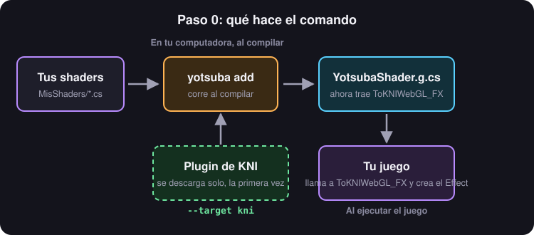
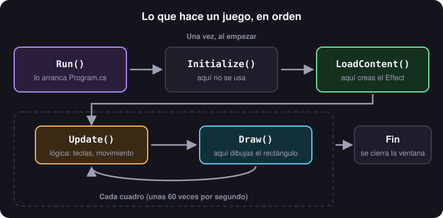
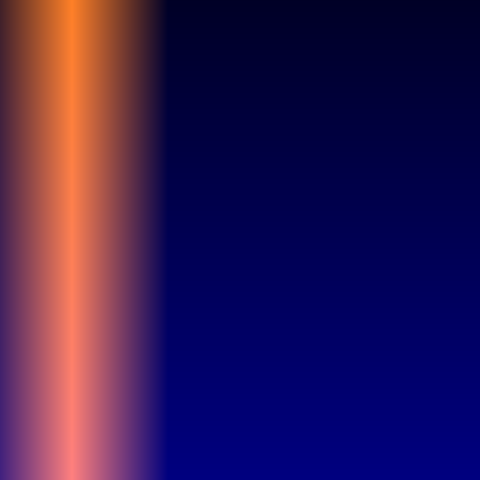
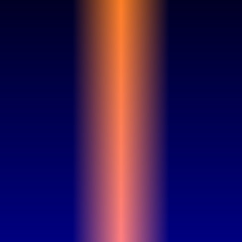
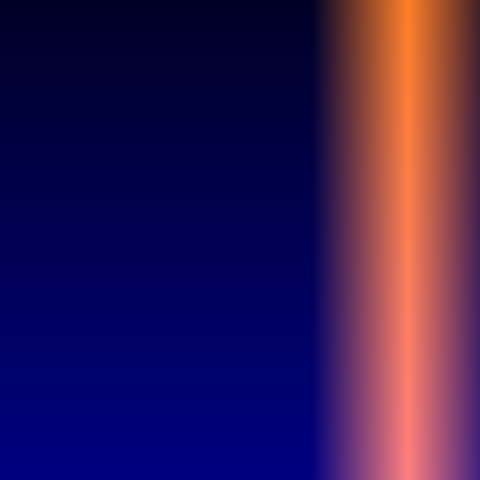

En el [Get Started](../get-started/index.md) hiciste tus shaders en una librería que no sabe nada de KNI. Compilaban, y veías el resultado como texto en la consola. Aquí vas a dar el paso que faltaba: verlos en una ventana de KNI.


Eso es lo que va a salir en tu ventana dentro de unos minutos, y lo va a dibujar el `Degradado` que escribiste tú.

> [!IMPORTANT]
> Esta guía sigue justo donde termina el Get Started. Da por hecho que tienes la carpeta `Tutorial`, con `MisShaders` dentro, y que ya instalaste la herramienta `yotsuba`. Si todavía no lo has hecho, empieza por [Prepara tu proyecto](../get-started/setup.md).

## Lo que vas a hacer

Vas a añadir un proyecto más a tu carpeta: el juego.

```text
Tutorial/
├── MisShaders/       tus shaders
├── Probar/           el programa de consola del tutorial
└── Juego/            nuevo: una ventana de KNI que usa tus shaders
```

El camino tiene tres partes:

1. **Preparar tus shaders para KNI.** Un comando, en el paso 0.
2. **Crear el juego.** Un proyecto nuevo con KNI instalado (pasos 1 a 3).
3. **Verlos.** Ejecutas el juego y aparece tu shader (pasos 4 a 6).

Vas a ver mucho una palabra: **plugin**. Un plugin es una extensión de la herramienta `yotsuba`. Sin ella, `yotsuba` sabe preparar shaders para OpenGL, DirectX, Metal y Vulkan, pero no para KNI. Con el plugin de KNI, aprende. Tú no lo escribes, y tu juego no lo usa: solo lo usa `yotsuba`, mientras compila.

## 0. Prepara tus shaders para KNI

Este paso es corto, pero no te lo saltes: sin él, tu juego no tendrá cómo pedir el shader.



### El comando

Desde la carpeta `Tutorial`:

```bash
dotnet yotsuba add MisShaders/MisShaders.csproj --target spirv --target kni
```

Es el mismo comando de siempre, con una parte más:

- `--target spirv` es lo que ya usabas.
- `--target kni` significa "y prepáralos también para KNI".

La primera vez, `yotsuba` descarga solo el plugin de KNI desde internet. Tú no instalas nada. Las siguientes veces usa la copia que guardó.

### Comprueba que funcionó

Abre `MisShaders/YotsubaShader.g.cs`. Es un archivo que escribió el comando. Busca `ToKNIWebGL_FX`: tiene que haber uno por cada una de tus clases de shader. Ese método es el que usará tu juego en el paso 3.

Si no lo encuentras, el comando no llevaba `--target kni`. Ejecútalo otra vez con él.

### Qué hace el plugin

El plugin hace un **efecto** de KNI. Es el mismo para escritorio y para el navegador, y por eso el método se llama `ToKNIWebGL_FX` (no te dejes engañar por el "WebGL"). Hay una sola versión, así que no eliges plataforma.

### Opcional: que se ejecute solo

Cada vez que cambies un shader tendrías que repetir el comando. Para que ocurra solo al compilar, abre `MisShaders/MisShaders.csproj` y añade esto justo antes del `</Project>` final. El resto del archivo se queda como está:

```xml
  <Target Name="CompileShaders" BeforeTargets="CoreCompile" Condition="'$(DesignTimeBuild)' != 'true'">
    <Exec Command="dotnet yotsuba add &quot;$(MSBuildProjectFullPath)&quot; --target spirv --target kni" />
    <ItemGroup>
      <Compile Remove="YotsubaShader.g.cs" />
      <Compile Include="YotsubaShader.g.cs" />
    </ItemGroup>
  </Target>
```

Qué dice cada parte:

- `BeforeTargets="CoreCompile"`: "haz esto justo antes de compilar el C#".
- `Exec`: es el mismo comando que escribías a mano.
- `Condition`: tu editor compila el proyecto en segundo plano mientras escribes. Esto evita que el comando se ejecute en cada tecla.
- `Compile Remove` y `Compile Include`: añaden `YotsubaShader.g.cs` a la compilación aunque todavía no exista.

Desde ahora, `dotnet build MisShaders` ejecuta el comando por ti.

### Otros comandos de plugins

Si quieres descargar el plugin antes (por ejemplo, para trabajar sin internet), usa `dotnet yotsuba plugin install kni`. Y `dotnet yotsuba plugin list` te muestra cuáles tienes. Hay más en [La CLI](../get-started/cli.md).

## 1. Crea el juego e instala el motor

Desde la carpeta `Tutorial`:

```bash
dotnet new console -n Juego -f net8.0
```

Instala KNI:

```bash
dotnet add Juego package nkast.Kni.Platform.SDL2.GL
```

Y dile que va a usar tus shaders:

```bash
dotnet add Juego reference MisShaders/MisShaders.csproj
```

`nkast.Kni.Platform.SDL2.GL` es la plataforma de KNI para escritorio: abre la ventana con SDL2 y dibuja con OpenGL, en Windows, macOS y Linux. Ya trae el resto de KNI (`nkast.Xna.Framework`, `.Graphics`, `.Game`, `.Content`...), así que no hace falta añadirlos uno por uno. También lleva las librerías nativas de SDL2 de cada sistema.

KNI tiene un paquete por plataforma, y solo instalas el de donde vas a ejecutarlo:

| Plataforma | Paquete | ¿Se cubre aquí? |
| --- | --- | --- |
| Escritorio (OpenGL) | `nkast.Kni.Platform.SDL2.GL` | Sí: es el de esta guía. |
| Navegador (WebGL) | `nkast.Kni.Platform.Blazor.GL` | Sí, con el mismo shader (mira [KNI en el navegador](#kni-en-el-navegador)). |
| Windows con DirectX 11 | `nkast.Kni.Platform.WinForms.DX11` | No: el plugin de KNI compila solo para OpenGL/WebGL. |

No instalaste ningún paquete de Yotsuba Shader para KNI. Tu shader llega al juego como bytes dentro de tu propia librería, y el Content Pipeline de KNI no interviene.

> [!TIP]
> Si ya tienes un juego de KNI, no crees uno nuevo: añádele solo la referencia a `MisShaders` y sigue desde el paso 2. Comprueba que use la plataforma de OpenGL (`SDL2.GL` o `Blazor.GL`), porque es la que compila el plugin de KNI.

## 2. El rectángulo que cubre la pantalla

En el tutorial viste que un shader no dibuja "la pantalla": dibuja una figura, y para pintar toda la pantalla usamos un rectángulo que la cubre entera. Ese rectángulo tiene cuatro esquinas, y cada esquina lleva los dos datos que declaraste en `Vertice`:

```csharp
public struct Vertice
{
    [location(0)] public vec2 Posicion;
    [location(1)] public vec2 Uv;
}
```

Ahora le toca al juego mandar esas esquinas. Para eso KNI te pide un `struct` que diga cómo está hecha cada una. Crea `Juego/Esquina.cs`:

```csharp title="Juego/Esquina.cs"
using Microsoft.Xna.Framework;
using Microsoft.Xna.Framework.Graphics;

public readonly struct Esquina(Vector2 posicion, Vector2 uv) : IVertexType
{
    private static readonly VertexDeclaration Declaracion = new(
        new VertexElement(0, VertexElementFormat.Vector2, VertexElementUsage.TextureCoordinate, 0),
        new VertexElement(8, VertexElementFormat.Vector2, VertexElementUsage.TextureCoordinate, 1));

    public readonly Vector2 Posicion = posicion;
    public readonly Vector2 Uv = uv;

    VertexDeclaration IVertexType.VertexDeclaration => Declaracion;
}
```

(KNI conserva los nombres de XNA, por eso los `using` dicen `Microsoft.Xna.Framework` aunque no uses el XNA de Microsoft.)

Los dos campos son los mismos de `Vertice`: la posición y el `Uv`. Lo nuevo es la `VertexDeclaration`, que es la manera que tiene KNI de explicarle a la GPU qué hay en cada esquina. Cada línea describe un campo:

```csharp
new VertexElement(0, VertexElementFormat.Vector2, VertexElementUsage.TextureCoordinate, 0),
```

- El primer `0` es en qué byte empieza el campo. `Posicion` es lo primero, así que empieza en el 0.
- `Vector2` es su tipo: dos `float`.
- `TextureCoordinate` y el último `0` son el casillero. **Este es el dato importante.**

Y la segunda línea, la de `Uv`, empieza en el byte `8` porque antes van los dos `float` de `Posicion`, que ocupan 4 bytes cada uno.

`IVertexType` es la interfaz que le permite a KNI pedirle esa declaración a tu `struct`. Y `readonly struct` con un constructor primario es solo una forma corta de escribir un `struct` cuyos campos se asignan una vez.

### De `[location]` a `TextureCoordinate`

En tu shader los casilleros tienen solo un número: `[location(0)]`, `[location(1)]`. En KNI tienen un nombre y un número. Yotsuba Shader hace la traducción así:

| En tu shader | En KNI |
| --- | --- |
| `[location(0)]` | `TextureCoordinate`, número `0` |
| `[location(1)]` | `TextureCoordinate`, número `1` |
| `[location(2)]` | `TextureCoordinate`, número `2` |

O sea: el nombre es siempre `TextureCoordinate`, y el número es el de tu `location`.

> [!WARNING]
> Lo natural sería poner `VertexElementUsage.Position` en el campo de la posición. No lo hagas. El shader espera ese dato en `TextureCoordinate 0`, porque así lo declaraste con `[location(0)]`. Si pones `Position`, el programa arranca sin ningún error, pero el shader recibe los datos cruzados y el rectángulo sale deformado o no sale.

## 3. El juego

Borra lo que trae `Juego/Program.cs` y deja solo esto, que crea el juego y lo pone a correr:

```csharp title="Juego/Program.cs"
using var juego = new Juego();
juego.Run();
```

Ahora crea `Juego/Juego.cs`:

```csharp title="Juego/Juego.cs"
using Microsoft.Xna.Framework;
using Microsoft.Xna.Framework.Graphics;
using MisShaders;
using YotsubaShader;

public class Juego : Game
{
    private readonly GraphicsDeviceManager _graficos;
    private Effect _shader = null!;

    private readonly Esquina[] _pantalla =
    [
        new(new Vector2(-1f,  1f), new Vector2(0f, 0f)),
        new(new Vector2( 1f,  1f), new Vector2(1f, 0f)),
        new(new Vector2(-1f, -1f), new Vector2(0f, 1f)),
        new(new Vector2( 1f, -1f), new Vector2(1f, 1f)),
    ];

    public Juego()
    {
        _graficos = new GraphicsDeviceManager(this)
        {
            PreferredBackBufferWidth = 800,
            PreferredBackBufferHeight = 800,
        };
    }

    protected override void LoadContent()
    {
        byte[] compilado = new Degradado().ToKNIWebGL_FX();
        _shader = new Effect(GraphicsDevice, compilado);
    }

    protected override void Draw(GameTime gameTime)
    {
        GraphicsDevice.RasterizerState = RasterizerState.CullNone;

        _shader.CurrentTechnique.Passes[0].Apply();
        GraphicsDevice.DrawUserPrimitives(PrimitiveType.TriangleStrip, _pantalla, 0, 2);

        base.Draw(gameTime);
    }
}
```

Las primeras líneas dicen de dónde sale cada cosa: `Microsoft.Xna.Framework` tiene `Game`, `Vector2` y `GameTime`; `...Graphics` tiene `Effect`, `GraphicsDevice` y los tipos de dibujo; `MisShaders` es tu librería; y `YotsubaShader` es el espacio de nombres del archivo generado (donde vive `ToKNIWebGL_FX`).

Hay tres partes que importan para Yotsuba Shader. Después de ellas, una sección explica qué hace cada pieza de KNI.

### Las cuatro esquinas

`_pantalla` es el rectángulo. Cada línea es una esquina, con su posición y su `Uv`:

```csharp
new(new Vector2(-1f,  1f), new Vector2(0f, 0f)),   // arriba a la izquierda
new(new Vector2( 1f,  1f), new Vector2(1f, 0f)),   // arriba a la derecha
new(new Vector2(-1f, -1f), new Vector2(0f, 1f)),   // abajo a la izquierda
new(new Vector2( 1f, -1f), new Vector2(1f, 1f)),   // abajo a la derecha
```

Para la GPU la pantalla va de `-1` a `1`, con el `(0, 0)` en el centro y el `1` de la Y arriba. Por eso las posiciones son `-1` y `1`: son los bordes de la pantalla. Los `Uv` son los que viste en el tutorial: `(0, 0)` arriba a la izquierda y `(1, 1)` abajo a la derecha.

### Cargar el shader

Esta es la parte que une los dos mundos:

```csharp
byte[] compilado = new Degradado().ToKNIWebGL_FX();
_shader = new Effect(GraphicsDevice, compilado);
```

`new Degradado()` es tu shader, la clase que escribiste. `ToKNIWebGL_FX` es el método que `add` le puso a tu clase para KNI. Devuelve el shader ya compilado, en el formato que lee KNI. Por eso `Effect` lo acepta directamente.

No hay ningún archivo `.fx`, ni carpeta `Content`, ni un paso aparte para compilar. El shader ya viene dentro de tu librería.

### Dibujar

```csharp
GraphicsDevice.RasterizerState = RasterizerState.CullNone;

_shader.CurrentTechnique.Passes[0].Apply();
GraphicsDevice.DrawUserPrimitives(PrimitiveType.TriangleStrip, _pantalla, 0, 2);
```

- `Apply()` le dice a la GPU: "desde ahora, dibuja con este shader".
- `DrawUserPrimitives` manda las cuatro esquinas. La GPU no sabe dibujar rectángulos, solo triángulos, así que el rectángulo va como dos triángulos pegados. Eso es `TriangleStrip`, y el `2` del final es cuántos triángulos son.
- `CullNone` le pide a la GPU que no descarte ningún triángulo. Normalmente descarta los que "miran hacia atrás", que en un juego 3D son las caras que no se ven. Aquí no hay nada que esconder.

### Qué hace cada pieza de KNI

Esta parte es de KNI, no de Yotsuba Shader, pero sin ella el juego de arriba es un bloque que copias sin entender. Léela una vez.

**`Game` y su ciclo.** Tu clase hereda de `Game`. Cuando `Program.cs` llama a `Run()`, KNI abre la ventana y repite un ciclo hasta que se cierra. Tú no llamas a los pasos: sobrescribes los que necesites.



```csharp
protected override void Initialize()  { /* una vez, antes de mostrar la ventana */ base.Initialize(); }
protected override void LoadContent() { /* una vez, cuando los gráficos están listos */ }
protected override void Update(GameTime gameTime) { /* cada cuadro: la lógica */ base.Update(gameTime); }
protected override void Draw(GameTime gameTime)   { /* cada cuadro: el dibujo */ base.Draw(gameTime); }
```

| Método | Cuándo corre | En esta guía |
| --- | --- | --- |
| `Initialize` | Una vez, al empezar. | No se usa. |
| `LoadContent` | Una vez, justo después de que existe el dispositivo gráfico. | Aquí creamos el `Effect`, porque necesita el `GraphicsDevice`. |
| `Update` | Cada cuadro, antes de dibujar. Normalmente 60 veces por segundo. | Todavía no se usa. |
| `Draw` | Cada cuadro, después de `Update`. | Dibujamos el rectángulo. |

`base.Draw(gameTime)` llama a la versión original de `Draw` que tiene `Game`. Aquí no hace nada visible, pero conviene dejarlo: es lo que dibuja cualquier componente que añadas al juego más adelante.

**`GraphicsDeviceManager`.** Es el objeto que crea y configura la ventana y la conexión con la tarjeta gráfica. Lo construyes en el constructor, pasándole el juego (`this`). Las dos líneas `PreferredBackBuffer...` fijan el tamaño del área de dibujo: 800 por 800 píxeles. Si no las pones, KNI usa 800 por 480.

**`GraphicsDevice`.** Es una propiedad que tiene `Game` una vez que el manager lo creó. Representa la tarjeta gráfica: todo lo que dibujas pasa por él. Por eso `new Effect(GraphicsDevice, ...)` lo pide, y por eso no puedes crear el `Effect` en el constructor (el dispositivo todavía no existe): para eso es `LoadContent`.

**`Effect`.** Es un shader compilado que KNI puede usar. Guarda el código del vértice y del fragmento, juntos, y sus parámetros. Las tres cosas que usas:

```csharp
_shader.CurrentTechnique           // el conjunto de pasos que dibuja con este efecto
_shader.CurrentTechnique.Passes[0] // el primer paso (y, aquí, el único)
_shader.Parameters["Nombre"]       // un valor que puedes cambiar desde C#
```

Un efecto puede tener varias técnicas con varios pasos. Los que genera Yotsuba Shader tienen una técnica con un paso, así que `Passes[0]` siempre es el que toca.

**`GameTime`.** Es lo que KNI pasa a `Update` y `Draw` para hablarte del tiempo. `gameTime.TotalGameTime` es cuánto lleva el juego abierto, y `gameTime.ElapsedGameTime` es cuánto tardó el último cuadro. En el paso 6 usas el primero.

**`DrawUserPrimitives`.** Manda vértices desde un arreglo en memoria directo a la GPU, y los dibuja. Es la forma más simple de dibujar, y va perfecta para cuatro esquinas. Para miles de vértices, KNI tiene `VertexBuffer` e `IndexBuffer`, que guardan los datos en la memoria de la GPU para no enviarlos en cada cuadro. Para un rectángulo no los necesitas.

**Cerrar la ventana.** Tu juego no tiene otra forma de cerrarse que el botón de la ventana. Si quieres que `Esc` lo cierre, añade un `Update`:

```csharp
protected override void Update(GameTime gameTime)
{
    if (Keyboard.GetState().IsKeyDown(Keys.Escape))
    {
        Exit();
    }

    base.Update(gameTime);
}
```

`Keyboard` y `Keys` están en `Microsoft.Xna.Framework.Input`, así que añade también ese `using`.

**Lo que no vas a necesitar.** KNI también tiene `SpriteBatch` (para dibujar imágenes 2D, con su propio shader), `Content.Load` (para leer archivos del Content Pipeline) y `Texture2D`. Esta guía no usa ninguno: tú dibujas el rectángulo y el shader ya está en memoria. Cuando las texturas funcionen en el compilador, entrará `Texture2D`.

## 4. Ejecútalo

```bash
dotnet run --project Juego
```

Se abre una ventana con el atardecer. Ese color lo calculó tu método `Fragment`, píxel por píxel, en la GPU.

## 5. Cambia de shader

Cambiar de shader es cambiar una palabra. En `LoadContent`, donde dice `Degradado`, pon `Mandelbrot`:

```csharp
byte[] compilado = new Mandelbrot().ToKNIWebGL_FX();
```

Ejecuta otra vez:

```bash
dotnet run --project Juego
```


El mismo rectángulo, las mismas cuatro esquinas, y un dibujo completamente distinto. Todo lo que cambió está dentro del shader.

## 6. Un shader que se mueve

Hasta aquí la ventana muestra una imagen quieta. Para que algo se mueva, el juego tiene que mandarle al shader un dato que cambie: el tiempo. En el tutorial lo viste en [Shader 4](../get-started/plasma.md): a ese dato se le llama **uniform**.

Vas a hacer una franja de luz que cruza la pantalla de izquierda a derecha:

| Segundo 0.3 | Segundo 1 | Segundo 1.7 |
| --- | --- | --- |
|  |  |  |

### El shader

Crea `MisShaders/Barrido.cs`:

```csharp title="MisShaders/Barrido.cs"
using YotsubaShader.GlslSyntax;
using YotsubaShader.GlslSyntax.Resources;
using YotsubaShader.GlslSyntax.Types;
using YotsubaShader.Language;

namespace MisShaders;

public struct Cronometro
{
    public float Segundos;
}

public class Barrido
{
    [uniform, layout(0, 0)]
    public Cronometro Tiempo;

    [ShaderStage(Stage.Vertex)]
    public Pixel Vertex(Vertice vertice)
    {
        Pixel pixel;
        pixel.Posicion = Crear.Vec4(vertice.Posicion.X, vertice.Posicion.Y, 0f, 1f);
        pixel.Uv = vertice.Uv;
        return pixel;
    }

    [ShaderStage(Stage.Fragment)]
    [return: location(0)]
    public vec4 Fragment(PixelIn pixel)
    {
        float centro = Tiempo.Segundos * 0.5f;

        float distancia = pixel.Uv.X - centro;
        if (distancia < 0f)
        {
            distancia = -distancia;
        }

        float brillo = 1f - distancia * 5f;
        if (brillo < 0f)
        {
            brillo = 0f;
        }

        return Crear.Vec4(brillo, brillo * 0.5f, 0.15f + 0.35f * pixel.Uv.Y, 1f);
    }
}
```

El método `Vertex` es el de siempre. Lo nuevo:

- `Cronometro` es un `struct` normal con el dato que va a mandar el juego.
- `[uniform, layout(0, 0)] public Cronometro Tiempo;` declara ese dato dentro del shader.
- En `Fragment`, `centro` es dónde está la franja ahora mismo, de `0` (borde izquierdo) a `1` (borde derecho). `distancia` es qué tan lejos queda este píxel de la franja, y el `if` le quita el signo. Cuanto más lejos, menos `brillo`.

Compílalo con `add`, igual que en el tutorial, pidiendo el plugin como en el paso 0:

```bash
dotnet yotsuba add MisShaders/MisShaders.csproj --target spirv --target kni
```

Si añadiste el `Target` del paso 0, no hace falta: se ejecuta al compilar el juego.

### El juego le manda el tiempo

En `Juego/Juego.cs` cambian dos cosas: qué shader se carga, y dos líneas nuevas en `Draw`. El archivo completo queda así:

```csharp title="Juego/Juego.cs"
using Microsoft.Xna.Framework;
using Microsoft.Xna.Framework.Graphics;
using MisShaders;
using YotsubaShader;

public class Juego : Game
{
    private readonly GraphicsDeviceManager _graficos;
    private Effect _shader = null!;

    private readonly Esquina[] _pantalla =
    [
        new(new Vector2(-1f,  1f), new Vector2(0f, 0f)),
        new(new Vector2( 1f,  1f), new Vector2(1f, 0f)),
        new(new Vector2(-1f, -1f), new Vector2(0f, 1f)),
        new(new Vector2( 1f, -1f), new Vector2(1f, 1f)),
    ];

    public Juego()
    {
        _graficos = new GraphicsDeviceManager(this)
        {
            PreferredBackBufferWidth = 800,
            PreferredBackBufferHeight = 800,
        };
    }

    protected override void LoadContent()
    {
        byte[] compilado = new Barrido().ToKNIWebGL_FX();
        _shader = new Effect(GraphicsDevice, compilado);
    }

    protected override void Draw(GameTime gameTime)
    {
        GraphicsDevice.RasterizerState = RasterizerState.CullNone;

        float segundos = (float)(gameTime.TotalGameTime.TotalSeconds % 2.0);
        _shader.Parameters["Tiempo_Segundos"].SetValue(segundos);

        _shader.CurrentTechnique.Passes[0].Apply();
        GraphicsDevice.DrawUserPrimitives(PrimitiveType.TriangleStrip, _pantalla, 0, 2);

        base.Draw(gameTime);
    }
}
```

Las dos líneas nuevas:

```csharp
float segundos = (float)(gameTime.TotalGameTime.TotalSeconds % 2.0);
_shader.Parameters["Tiempo_Segundos"].SetValue(segundos);
```

La primera saca cuántos segundos lleva abierto el juego. El `% 2.0` hace que vuelva a `0` cada dos segundos, para que la franja empiece de nuevo por la izquierda.

La segunda le entrega ese número al shader. El nombre `"Tiempo_Segundos"` no es inventado, sale de tu código: es el nombre del campo, un guion bajo y el nombre del dato.

| En tu shader | En KNI |
| --- | --- |
| `public Cronometro Tiempo;` con un dato `Segundos` | `Parameters["Tiempo_Segundos"]` |

Hay que hacerlo **antes** de `Apply()`, porque `Apply()` es el momento en que los datos viajan a la GPU.

`SetValue` tiene una versión para cada tipo que puedes tener en un `struct`:

| En tu shader | Qué le pasas a `SetValue` |
| --- | --- |
| `float` | Un `float` |
| `int` | Un `int` |
| `vec2` | Un `Vector2` |
| `vec3` | Un `Vector3` |
| `vec4` | Un `Vector4` |
| `mat4` | Una `Matrix` |

Si el nombre no coincide con ningún parámetro, `Parameters["..."]` te da `null`, y la línea falla con una `NullReferenceException`. Cuando no estés seguro de que el shader use ese valor (por ejemplo, un shader que no lee el tiempo), escribe `?.SetValue(...)` y la línea se salta en vez de fallar.

Ejecuta:

```bash
dotnet run --project Juego
```

La franja cruza la pantalla una y otra vez.

> [!NOTE]
> El plasma del [Shader 4](../get-started/plasma.md) se alimenta exactamente igual, con `Parameters["Tiempo_Segundos"]`, porque su campo también se llama `Tiempo` y su dato `Segundos`. Hoy no se puede ver porque usa la función `sin`, que `add` todavía no traduce.

## KNI en el navegador

KNI también corre en el navegador con WebGL. Para eso el proyecto del juego es un proyecto web de KNI (el que usa `nkast.Kni.Platform.Blazor.GL`) en lugar de un programa de consola. Créalo con las plantillas propias de KNI, siguiendo [la documentación de KNI](https://github.com/kniEngine/kni), porque esa parte es de KNI y no de Yotsuba Shader.

Lo que no cambia es todo lo que hiciste aquí:

- El paso 0 es el mismo: el mismo plugin, el mismo `--target kni`.
- El proyecto web referencia `MisShaders` igual que el juego de consola.
- El shader se carga con la misma línea, `new Degradado().ToKNIWebGL_FX()`, y `new Effect(GraphicsDevice, bytes)`.

> [!NOTE]
> Esta guía está probada de principio a fin con KNI de escritorio (`nkast.Kni.Platform.SDL2.GL`). El proyecto del navegador usa el mismo efecto, pero aquí no lo ejecutamos.

## Si algo falla

| Lo que ves | Qué significa | Qué hacer |
| --- | --- | --- |
| `ToKNIWebGL_FX` no existe | El archivo generado no lo tiene: `add` corrió sin el plugin. | Ejecuta `add` con `--target kni` (paso 0), o añádelo al `Target` del `.csproj`. |
| `add` falla con un mensaje sobre un shader | Uno de tus shaders todavía no se puede compilar para la GPU (por ejemplo Neon, Plasma o BajoElAgua del tutorial). | Saca ese archivo de la carpeta `MisShaders` por ahora. |
| `add` termina, pero al ejecutar el juego salta `NotSupportedException` | El plugin no pudo compilar ese shader. `add` no falla: deja el método listo para avisar el motivo. | Ejecuta `add` otra vez y lee lo que imprime: dice qué shader y por qué. |
| El rectángulo sale deformado o no sale | Las esquinas usan `VertexElementUsage.Position`. | Usa `TextureCoordinate` con el número de tu `location` (paso 2). |
| `NullReferenceException` en `Parameters[...].SetValue` | El nombre no existe en el shader. | El nombre es `Campo_Dato`: revisa los dos contra tu `struct` (paso 6). |
| La ventana abre y queda negra | Falta `Apply()` o `DrawUserPrimitives`, o el shader devuelve negro. | Revisa el paso 3 y comprueba que `Fragment` devuelva un color con `1` en el último valor. |
| El primer `add` con el plugin falla con un error de red | El CLI está descargando el plugin y no llega a NuGet. | Revisa tu conexión, o usa `dotnet yotsuba plugin install kni` cuando tengas internet. |

## Lo que todavía no se puede

> [!PLANNED]
> Leer una imagen desde el shader (las texturas, como en el [Shader 5](../get-started/underwater.md)) todavía no funciona en el compilador, así que esta guía no lo cubre. Cuando funcione, se añadirá aquí cómo pasarle una `Texture2D` de KNI al shader.

## Resumen

De todo lo que hiciste, lo único propio de KNI es esto:

| | |
| --- | --- |
| El plugin (para el CLI) | `kni` |
| El comando `add` | `dotnet yotsuba add MisShaders/MisShaders.csproj --target spirv --target kni` |
| El paquete (para el juego) | `nkast.Kni.Platform.SDL2.GL` |
| El método | `ToKNIWebGL_FX()` |

Lo demás es igual en MonoGame, KNI y FNA, porque los tres comparten la misma forma de programar:

- Las esquinas se declaran con `TextureCoordinate` y el número de tu `[location]`.
- El shader se carga con `new Effect(GraphicsDevice, bytes)`.
- Los datos de un uniform se mandan con `Parameters["Campo_Dato"].SetValue(...)`, antes de `Apply()`.

Y tu librería `MisShaders` no cambió en nada para funcionar aquí, salvo por pedir el plugin al compilarla.
